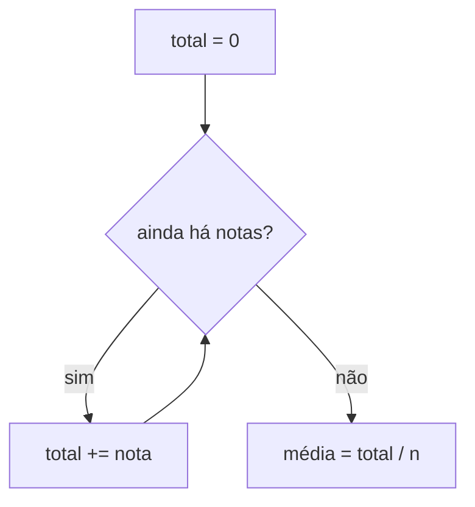

# Conteúdo dos cursos — guia para autores

Os cursos do LevelUSP são escritos em arquivos de texto versionados nesta pasta:
YAML para trilhas, cursos, módulos e provas, e um formato Markdown (`.lvl.md`) para
as lições. O comando `pnpm content:build` compila tudo no pacote
`packages/db/seed/trilha-python-ia.json` (formato 2, `docs/v2/curso-e-passos.md` §6.2),
que o seed (`pnpm db:seed`) e `POST /admin/content/import` gravam no banco.

Este guia vale para pessoas e para agentes que geram conteúdo. Tudo em pt-BR.

## 1. Árvore de diretórios

```
content/
  trilhas/<trilha>.yaml                       trilha: sequência de cursos
  cursos/<curso>/curso.yaml                   curso (= nível certificável)
  cursos/<curso>/prova.yaml                   prova do curso (opcional)
  cursos/<curso>/<modulo>/modulo.yaml         módulo
  cursos/<curso>/<modulo>/NN-<slug>.lvl.md    lições (NN = ordem no módulo: 01, 02…)
  cursos/<curso>/<modulo>/assets/             imagens citadas nas lições do módulo (§3.5)
  exemplo/                                    curso mínimo usado pelos testes (não entra no pacote)
```

- Pastas que começam com `_` ou `.` são ignoradas (rascunhos). Qualquer outra
  subpasta de `cursos/` precisa de `curso.yaml`, e qualquer subpasta de um curso precisa de
  `modulo.yaml`.
- Ordem: lições pelo prefixo numérico `NN-` do nome do arquivo (prefixo repetido é erro);
  módulos pela chave `ordem` do `modulo.yaml` (repetida é erro); cursos de uma trilha pela
  lista `cursos` da trilha; cursos no pacote por `ordem` do `curso.yaml`.
- Um curso que não está em nenhuma trilha também entra no pacote.
- `content/exemplo/` tem a mesma árvore (`trilhas/`, `cursos/`) e serve de modelo:
  `pnpm content:check --content content/exemplo`. A lição
  `03-recursos-de-apresentacao.lvl.md` usa todos os recursos das §3.5 a §3.7.

## 2. Arquivos YAML

Todas as chaves são em pt-BR; chave desconhecida é erro (pega erro de digitação).
Os padrões são os do schema do pacote (`packages/contracts/src/content-bundle.ts`).

### `trilhas/<trilha>.yaml`

```yaml
slug: python-ia                 # único na plataforma (minúsculas, dígitos e hífens)
titulo: "Python: do zero à IA"
descricao: Sete níveis, do primeiro print ao primeiro modelo.
icone: Sparkles                 # nome de ícone (lucide); padrão BookOpen
cor: bg-level-purple            # token de cor; padrão bg-level-purple
ordem: 1
publicada: true                 # padrão false
titulo_certificado: "Python: do zero à IA"
cursos:                         # slugs dos cursos, na ordem da trilha
  - n1-fundamentos
  - n2-estruturas
```

### `cursos/<curso>/curso.yaml`

```yaml
slug: n1-fundamentos
titulo: Nível 1 — Fundamentos
descricao: Como o computador funciona e o Python básico.      # até 500 caracteres
descricao_longa: |                                             # markdown, até 20 000
  O que você vai aprender…
nivel: iniciante                # iniciante | intermediario | avancado
tags: [python, fundamentos]
horas: 50                       # horas estimadas
ordem: 1                        # posição informativa; a ordem real é a lista da trilha
publicado: true                 # padrão false
prerequisito: null              # slug do curso cujo certificado libera este; null = liberado
sequencial: true                # lições liberadas em ordem; padrão false
```

### `cursos/<curso>/<modulo>/modulo.yaml`

```yaml
slug: n1-m1-primeiros-passos    # único na plataforma
titulo: Primeiros passos
descricao: Seu primeiro programa.
icone: BookOpen
cor: bg-level-blue
ordem: 1                        # única dentro do curso
```

### `cursos/<curso>/prova.yaml` (opcional)

```yaml
titulo: Prova do Nível 1
descricao: 20 questões sobre o nível.
nota_minima: 70                 # 1–100, padrão 70
tempo_min: 45                   # minutos, padrão 45
intervalo_min: 60               # espera entre tentativas, padrão 60
questoes_por_tentativa: 20      # sorteadas por tentativa; null = todas
questoes:
  - enunciado: O que `print` faz?
    opcoes:                     # 2 a 8 alternativas
      - Lê do teclado
      - Escreve na saída padrão
    correta: 1                  # índice da alternativa correta, a partir de 0
    explicacao: Escreve na saída padrão.
    topico: Saída
```

## 3. Lição (`.lvl.md`)

Um arquivo por lição: cabeçalho YAML entre linhas `---` e, depois, os passos.

### 3.1 Cabeçalho

```markdown
---
slug: n1-m1-01-ola-python          # único na plataforma
titulo: Olá, Python                 # ≥ 3 caracteres
descricao: Seu primeiro programa e como o Python o executa.
dificuldade: iniciante              # iniciante | intermediario | avancado
tipo: guiada                        # guiada | pratica | leitura | quiz
runtime: python                     # python | python-dados (ver §6)
bibliotecas: []                     # só para python-dados: [numpy, pandas, scikit-learn…]
xp: 100                             # XP ao concluir a lição (padrão 50)
tempo_min: 25                       # tempo estimado de estudo (padrão 10)
publicada: true                     # padrão true
projeto: false                      # lição-projeto do nível (conta para o certificado)
solucao_apos_tentativas: 3          # verificações reprovadas até liberar a solução; 0 = nunca
objetivos:                          # obrigatório em lição publicada
  - Executar um programa Python e ler a saída
  - Explicar o que `print` faz
nota_minima_quiz: 70                # nota mínima dos quizzes da lição (padrão 70)
---
```

Só `slug`, `titulo` e `tipo` são obrigatórios; o resto usa o padrão do pacote.

| `tipo`    | Passos no arquivo                                | No pacote (`lesson_type`) |
|-----------|--------------------------------------------------|---------------------------|
| `guiada`  | um ou mais passos (Leitura, Exercício, Quiz, Previsão) | `guided`            |
| `pratica` | exatamente UM passo `Exercício`                  | `coding`                  |
| `leitura` | exatamente UM passo `Leitura`                    | `theory`                  |
| `quiz`    | exatamente UM passo `Quiz`                       | `quiz`                    |

As lições clássicas (`pratica`, `leitura`, `quiz`) usam o mesmo formato; o seed preenche os
campos planos da lição (`starter_files`, `test_cases`, `content_markdown`, quiz) a partir do
único passo.

### 3.2 Passos

Cada passo começa com um título de nível 2:

```markdown
## Passo 1 · Leitura · O que é um programa
## Passo 2 · Exercício · Seu primeiro print
## Passo 3 · Quiz · Fixando
## Passo 4 · Previsão · O que este laço imprime
```

- `N` é sequencial a partir de 1. O separador pode ser `·`, `-` ou `—`; `Exercicio` sem
  acento também vale. Cada passo vale 10 XP (padrão do pacote).
- **Narrativa** = tudo entre o título do passo e a primeira seção `###`, em markdown. Pode ter
  blocos ```python ilustrativos (não são executados), fórmulas, diagramas, imagens, blocos
  `visualizar` e vídeos (§3.5). Títulos `##` são reservados para passos e
  `###` para seções: para subtítulos dentro da narrativa use `####`.
- Passo `Leitura`: só narrativa (≥ 200 caracteres), nenhuma seção.
- Passo `Exercício`: seções da §3.3; `modo: lacunas` e `modo: ordenar` na §3.6.
- Passo `Quiz`: uma ou mais seções `### Pergunta` (§3.4).
- Passo `Previsão`: o aluno lê um código e digita a saída (§3.7). Só em lição `guiada`.

### 3.3 Seções do passo `Exercício`

````markdown
## Passo 2 · Exercício · Seu primeiro print
Narrativa curta explicando o conceito do exercício.

### Instruções
1. Use `print()` para exibir exatamente `Olá, mundo!`.
   Dica: o texto vai entre aspas.
2. Na linha seguinte, exiba o texto `Aprendendo Python`.

### Código inicial
```python
# Escreva seu código abaixo
```

### Solução
```python
print("Olá, mundo!")
print("Aprendendo Python")
```

### Dicas
1. `print` recebe o texto entre aspas.
2. Cada `print` escreve em uma linha nova.

### Verificação
```json
[
  { "id": "saida", "checkpoint": 1, "kind": "io", "expected_stdout": "Olá, mundo!", "match": "contains",
    "name": "Exibe Olá, mundo!", "hint": "A saída precisa ter exatamente o texto Olá, mundo!" },
  { "id": "duas-linhas", "checkpoint": 2, "kind": "io", "expected_stdout": "Olá, mundo!\nAprendendo Python",
    "name": "Duas linhas, na ordem certa" }
]
```

### Soluções erradas
```python name="sem aspas"
print(Olá, mundo!)
```
```python name="texto diferente"
print("Ola mundo")
print("Aprendendo Python")
```
````

| Seção                  | Obrigatória | Conteúdo                                                                 |
|------------------------|-------------|--------------------------------------------------------------------------|
| `### Instruções`       | sim         | lista numerada `1.`, `2.`… = checkpoints (ids 1..n). Uma sublinha `Dica: …` vira a dica do checkpoint. Linhas seguintes sem número continuam o item. |
| `### Código inicial`   | sim*        | blocos de código = `starter_files`                                       |
| `### Solução`          | sim         | blocos de código = `solution_files` (só sai para o aluno pela regra `solucao_apos_tentativas`) |
| `### Dicas`            | não         | lista numerada, até 3 itens, reveladas uma a uma                         |
| `### Verificação`      | sim         | um único bloco ```json com a lista de casos (§4)                        |
| `### Soluções erradas` | sim         | um ou mais blocos ```python name="…"; cada um precisa ser REPROVADO     |

\* Numa lição `guiada`, um passo `Exercício` que continua um exercício anterior pode omitir
`### Código inicial`: o aluno continua do código do passo anterior (`starter_files` fica vazio
no pacote). Na verificação, a solução do exercício anterior é usada como "código inicial" e
precisa ser reprovada pelos casos do passo novo. O primeiro exercício da lição e as lições
`pratica` sempre precisam da seção.

Blocos de código:

| Abertura                         | Vira                                                   |
|----------------------------------|--------------------------------------------------------|
| ```` ```python ````              | `main.py` (o arquivo executado)                        |
| ```` ```python path=utils.py ```` | outro arquivo `.py` do projeto                         |
| ```` ```text path=dados.csv ````  | arquivo de dados (`.txt`, `.csv`, `.json`, `.md`)      |
| ```` ```python name="caso" ````   | em `Soluções erradas`: nome da solução errada          |

Caminhos são relativos, sem `..`, terminados em `.py`, `.txt`, `.csv`, `.json` ou `.md`.
Uma solução errada com vários arquivos usa blocos seguidos com o mesmo `name=`
(e `path=` nos arquivos extras). Dentro de uma seção, cada caminho aparece uma vez.
Na verificação, a solução errada **herda os arquivos de `### Solução`** e só troca os que
declara: escreva apenas o arquivo que tem o defeito (num projeto com `modelos.py`,
`servico.py` e `dados.json`, a errada que erra em `servico.py` traz só esse bloco).

### 3.4 Passo `Quiz`

````markdown
## Passo 3 · Quiz · Fixando

### Pergunta
Qual função exibe texto na tela?
- [ ] `show()`
- [x] `print()`
- [ ] `echo()`
> `print()` escreve na saída padrão.

### Pergunta
O que este código imprime?
```python
print(2 * 3)
```
- [x] 6
- [ ] 23
````

- O enunciado é tudo antes da primeira alternativa (pode ter bloco de código).
- Alternativas: `- [ ]` ou `- [x]`; 2 a 8 por pergunta; **exatamente uma** marcada.
- `> …` depois das alternativas é a explicação (opcional), mostrada após responder.
- A nota mínima do quiz é `nota_minima_quiz` do cabeçalho.

### 3.5 Recursos de apresentação (narrativas)

Valem na narrativa de qualquer passo. As fórmulas valem também nas instruções, dicas,
perguntas, alternativas e explicações de quiz. Nada disto é lido dentro de código (blocos
``` e trechos entre crases).

````markdown
## Passo 1 · Leitura · O que é a média

A média de $n$ notas é a soma delas dividida por $n$:

$$
\bar{x} = \frac{1}{n} \sum_{i=1}^{n} x_i
$$

A apostila custa R\$ 25,00. Em código o cifrão não muda: `preco = "R$ 25,00"`.




```python visualizar
notas = [6, 8, 10]
total = 0
for nota in notas:
    total += nota
print(total / len(notas))
```

::video[Média aritmética em dois minutos](https://www.youtube.com/watch?v=AAAAAAAAAAA)
> Resumo: o vídeo soma três notas uma a uma em uma variável acumuladora, divide o total pela
> quantidade de notas e mostra que o resultado fica sempre entre a menor e a maior nota.
````

**Fórmulas (KaTeX).** `$…$` no meio do texto e `$$…$$` em bloco (pode ocupar várias linhas).
O `content:check` passa cada fórmula pelo parser do KaTeX e aponta `arquivo:linha`.

- **Todo `$` fora de código é delimitador de fórmula.** Para o cifrão de dinheiro escreva
  `\$`: `R\$ 25,00`. Um `$` sem par, ou uma fórmula em linha que começa ou termina com espaço
  (é o que sobra de `R$ 10 e R$ 20`), é erro, com a lembrança do `\$` na mensagem.
- Dentro de bloco de código e de trecho entre crases o `$` é só um caractere: não escape.
- Texto com acento dentro da fórmula vai em `\text{…}`: `$\text{média} = 8$`.

**Diagramas (Mermaid).** Bloco ```` ```mermaid ````. A primeira linha é o tipo do diagrama
(`flowchart`, `graph`, `sequenceDiagram`, `classDiagram`, `stateDiagram-v2`, `erDiagram`,
`gantt`, `pie`, `mindmap`, `timeline`…). Em fluxograma, texto com parênteses ou colchetes vai
entre aspas: `D["média = total / n"]`.

> Limitação: o `content:check` faz uma validação **estrutural** (tipo conhecido, corpo não
> vazio e, em `flowchart`/`graph`, direção, `subgraph`/`end` e colchetes/aspas casados). O parser
> oficial do Mermaid depende do DOM do navegador e não roda no Node; um erro de sintaxe mais
> fino só aparece ao abrir a lição no player. Confira o diagrama em https://mermaid.live.

**Imagens.** Arquivos em `cursos/<curso>/<modulo>/assets/`, citados como
``.

- Texto alternativo obrigatório (descreva o que a imagem mostra); o arquivo precisa existir.
- Tipos: `svg`, `png`, `jpg`/`jpeg`, `webp`, `gif`; até 512 KB por arquivo; nome com letras,
  dígitos, `-`, `_` e `.`, sem subpastas. Endereço externo (`https://…`) não é aceito.
- O conteúdo precisa ser do tipo da extensão. **SVG com `<script>`, atributo de evento
  (`onload=`, `onclick=`…), URL `javascript:`, `foreignObject`/`iframe`/`embed`/`object` ou
  `<!ENTITY` é recusado.** A conferência é conservadora: um rótulo de texto como
  `fica onde = aqui` também bate na regra do atributo de evento; reescreva o rótulo.
- Só as imagens citadas entram no pacote (campo `assets`). O compilador troca a referência
  pela URL pública `/api/content/assets/<curso>/<modulo>/<arquivo>?v=<hash>`.

**Visualizador de execução.** Bloco ```` ```python visualizar ````: o player mostra o código
com o botão "Visualizar" e o executa passo a passo no navegador (não há correção). O
`content:check` exige um bloco não vazio, com até 60 linhas, sem `input()` e estruturalmente
plausível (parênteses, aspas, indentação depois de `:`); o `content:verify` roda cada bloco
no executor real e exige que termine sem erro.

**Vídeo (opcional).** Sozinho na linha: `::video[título](url)`, seguido de um resumo em texto.

- Só YouTube e Vimeo, com `https`: `youtube.com/watch?v=…`, `youtu.be/…`,
  `youtube-nocookie.com/embed/…`, `vimeo.com/<id>`, `player.vimeo.com/video/<id>`. Qualquer
  outro endereço é erro. No pacote a URL vira sempre
  `https://www.youtube-nocookie.com/embed/<id>` ou `https://player.vimeo.com/video/<id>`.
- **Resumo obrigatório** (acessibilidade e quem não pode ver o vídeo): logo abaixo, uma
  citação que começa com `> Resumo:` (≥ 60 caracteres; linhas `>` seguintes continuam o
  resumo). O vídeo é complemento: a narrativa precisa fazer sentido sem ele.

### 3.6 Exercício com `modo: lacunas` e `modo: ordenar`

O modo vai na **primeira linha da narrativa** do passo `Exercício` (`modo: codigo` é o padrão
e pode ser omitido). Os dois modos só valem em lição `guiada` e são corrigidos pelos mesmos
casos de `### Verificação`.

**`modo: lacunas`** — o código inicial vem com `___` (três sublinhados) em cada trecho que o
aluno completa:

````markdown
## Passo 2 · Exercício · Complete a média
modo: lacunas

Complete as três lacunas (`___`) para que `media` devolva a média da lista.

### Instruções
1. Comece o acumulador `total` em zero.
2. Some cada nota ao acumulador.
3. Divida o total pela quantidade de notas.

### Código inicial
```python
def media(notas):
    total = ___
    for nota in notas:
        total += ___
    return total / ___
```

### Solução
```python
def media(notas):
    total = 0
    for nota in notas:
        total += nota
    return total / len(notas)
```

### Verificação
```json
[
  { "id": "media-3", "checkpoint": 2, "kind": "call", "function": "media", "args": [[6, 8, 10]], "expected": 8.0, "tolerance": 1e-9,
    "name": "media([6, 8, 10]) é 8.0" },
  { "id": "media-1", "checkpoint": 3, "kind": "call", "function": "media", "args": [[5]], "expected": 5.0, "tolerance": 1e-9,
    "name": "media([5]) é 5.0" }
]
```

### Soluções erradas
```python name="divide por um número fixo"
def media(notas):
    total = 0
    for nota in notas:
        total += nota
    return total / 3
```
````

- O código inicial precisa de pelo menos uma lacuna; a **solução é o código inicial com as
  lacunas preenchidas** — fora das lacunas os dois são idênticos, e cada lacuna vira um
  trecho não vazio na mesma linha. O `content:check` confere.
- Lacuna é qualquer sequência de três ou mais `_`; não use `___` como nome no resto do código.
- O código inicial com as lacunas precisa ser REPROVADO (ele é, porque `___` não existe).

**`modo: ordenar`** (problema de Parsons) — o aluno recebe as linhas da solução embaralhadas,
ordena e indenta. Não há `### Código inicial`:

````markdown
## Passo 3 · Exercício · Monte a função situacao
modo: ordenar

Arraste as linhas para montar `situacao(notas)` e ajuste a indentação de cada uma.
Duas linhas estão sobrando.

### Instruções
1. Calcule a média das notas dentro da função.
2. Devolva `"aprovado"` quando a média for 6 ou mais; senão, `"reprovado"`.

### Solução
```python
def situacao(notas):
    media = sum(notas) / len(notas)
    if media >= 6:
        return "aprovado"
    return "reprovado"
```

### Distratores
```python
if media > 6:
return aprovado
```

### Verificação
```json
[
  { "id": "limite", "checkpoint": 2, "kind": "call", "function": "situacao", "args": [[6, 6]], "expected": "aprovado",
    "name": "média exatamente 6 é aprovado" },
  { "id": "reprovado", "checkpoint": 2, "kind": "call", "function": "situacao", "args": [[2, 4]], "expected": "reprovado",
    "name": "situacao([2, 4]) é reprovado" }
]
```

### Soluções erradas
```python name="comparação estrita"
def situacao(notas):
    media = sum(notas) / len(notas)
    if media > 6:
        return "aprovado"
    return "reprovado"
```
````

- `### Solução`: um único bloco ```python (o `main.py`), com pelo menos 3 linhas de código,
  indentado com **múltiplos de 4 espaços** (o aluno indenta por níveis). Linhas em branco
  não viram linhas para ordenar.
- `### Distratores` (opcional): um bloco ```python; cada linha não vazia é uma linha a mais,
  que não faz parte da resposta. Um distrator não pode ser igual a uma linha da solução.
- O compilador tira a indentação e **embaralha** as linhas (solução + distratores) com uma
  semente fixa (slug da lição + número do passo): o pacote é o mesmo a cada compilação e as
  linhas nunca saem na ordem da solução. A ordem e a indentação certas são gabarito.
- O aluno envia a ordem e os níveis de indentação; a API monta o `main.py` só com as linhas
  do passo e corrige pelos casos. `### Soluções erradas` continua obrigatória (código comum).
- No `content:verify`, a solução **montada com as linhas** precisa APROVAR e a **ordem
  embaralhada** (como o aluno recebe, sem indentação) precisa REPROVAR.

### 3.7 Passo `Previsão`

O aluno lê um programa, **sem executar**, e digita a saída. Dá XP, tem dicas e segue a regra
`solucao_apos_tentativas` como os demais passos.

````markdown
## Passo 4 · Previsão · O que este laço imprime

Leia o programa com calma e digite exatamente o que ele imprime.

### Código
```python
notas = [7, 9, 5]
total = 0
for nota in notas:
    total += nota
    print(total)
print("média:", total / len(notas))
```

### Dicas
1. O `print(total)` está dentro do laço: ele roda uma vez por nota.

### Saída esperada
```text
7
16
21
média: 7.0
```
````

| Seção                | Obrigatória | Conteúdo                                                                 |
|----------------------|-------------|--------------------------------------------------------------------------|
| narrativa            | sim         | o enunciado (o que prever)                                                |
| `### Código`         | sim         | bloco ```python (o `main.py` que o aluno lê); arquivos extras com `path=` |
| `### Dicas`          | não         | lista numerada, até 3                                                    |
| `### Saída esperada` | não         | um bloco ```text com a saída que você espera — serve só de conferência   |

- **A saída esperada do pacote é gerada pelo `content:build`**, que executa o código no
  executor real (`RUNNER_URL`, `RUNNER_TOKEN`). Sem executor, o build de um conteúdo com
  passo `Previsão` falha: a saída nunca é inventada nem copiada do arquivo. Se você escreveu
  `### Saída esperada`, o build confere com a execução e acusa a diferença.
- O código roda sem entrada: não use `input()`. Precisa terminar sem erro, imprimir alguma
  coisa (até 20 linhas e 4 000 caracteres) e ser determinístico (sem `random`, hora, `id()`):
  o `content:verify` executa de novo e exige a mesma saída.
- A comparação é feita na API e **ignora espaços no fim das linhas e linhas em branco no
  fim**; todo o resto conta (maiúsculas, espaços no meio, linhas em branco no meio).
- A saída esperada nunca vai para o navegador. Depois de `solucao_apos_tentativas` respostas
  erradas, "Ver solução" mostra a saída esperada; o aluno ainda precisa enviá-la, e o passo
  vale metade do XP. A resposta de uma tentativa errada não diz onde está a diferença.

## 4. Casos de verificação (`### Verificação`)

O bloco JSON é uma lista de casos (`TestCase[]`, `packages/contracts/src/grading.ts`),
validada ao compilar. Os valores esperados ficam só na API: o executor recebe apenas as
entradas, então o aluno nunca vê o gabarito.

Campos comuns a todo caso:

| Campo        | Uso                                                                                      |
|--------------|------------------------------------------------------------------------------------------|
| `id`         | obrigatório, único no passo (`saida`, `dobro-4`)                                         |
| `kind`       | `io` · `call` · `variable` · `source` · `expr` · `unittest`                               |
| `name`       | nome mostrado ao aluno quando o caso falha (escreva sempre)                              |
| `hint`       | dica mostrada na falha; não entregue o valor esperado                                    |
| `checkpoint` | id da instrução que o caso cobre (a UI marca ✓ por instrução)                            |
| `reveal`     | `true` mostra entrada e valor esperado na mensagem de falha. Padrão `false` — mantenha   |

**`__name__` em cada caso.** Só o caso `io` roda o `main.py` como programa
(`__name__ == "__main__"`), igual ao botão Executar. Nos casos `call`, `variable`, `expr` e
`unittest` o arquivo é carregado como biblioteca (o módulo `main`, como num `import main`):
o bloco `if __name__ == "__main__":` **não roda**. Consequências para quem escreve a lição:

- a demonstração, o treino ou a leitura de entrada que ficam no bloco `__main__` não custam
  tempo nem atrapalham os casos `call`/`variable`/`expr` (não é preciso encurtá-los por isso);
- o que só é criado dentro do bloco (variáveis, arquivos, o que é impresso) **não existe**
  nesses casos: verifique-o com um caso `io`, ou crie-o no `setup` de um caso `expr`;
- uma classe do aluno é observada como `main.Classe` (`type`/`raises` continuam recebendo só
  o nome, `"Tarefa"`); texto que traz o módulo (`repr(type(x))`, `<main.Conta object at …>`)
  só é `__main__` no caso `io` e no Executar.

### `io` — roda `main.py` com uma entrada e compara a saída

```json
{ "id": "soma", "kind": "io", "stdin": "3\n4\n", "expected_stdout": "7", "match": "trimmed",
  "name": "Soma 3 + 4", "hint": "Leia dois números com input() e imprima a soma." }
```

`match`: `trimmed` (padrão: ignora espaços no fim das linhas e nas pontas), `exact`,
`contains` (a saída contém o texto) ou `regex` (padrão curto, sem quantificadores aninhados
como `(a+)+`). `expected_stdout` não pode ser vazio.

### `call` — chama uma função do aluno e compara o retorno

```json
{ "id": "dobro-4", "kind": "call", "function": "dobro", "args": [4], "expected": 8, "name": "dobro(4) é 8" },
{ "id": "desconto", "kind": "call", "function": "aplicar_desconto", "args": [200], "kwargs": { "percentual": 50 },
  "expected": 100.0, "tolerance": 1e-6, "name": "aplicar_desconto(200, percentual=50)" },
{ "id": "par", "kind": "call", "function": "eh_par", "args": [4], "expected": true, "type": "bool",
  "name": "eh_par(4)", "hint": "Devolva um booleano, não um texto." }
```

`function` aceita `Classe.metodo`. `type` exige o tipo Python do retorno
(`int`, `float`, `str`, `bool`, `list`, `tuple`, `dict`, `set`, `NoneType`), porque o JSON não
distingue `3` de `3.0` nem lista de tupla. `tolerance` é absoluta, para números de ponto flutuante.

### `variable` — lê uma variável global depois de executar `main.py`

```json
{ "id": "versao", "kind": "variable", "variable": "versao", "expected": 3.12, "type": "float",
  "name": "Variável versao", "hint": "versao deve ser um número decimal." }
```

Aceita `type` e `tolerance` como `call`.

### `source` — verifica a estrutura do código (análise de AST, sem executar)

```json
{ "id": "usa-for", "kind": "source", "rule": { "type": "uses", "construct": "for" }, "name": "Usa um laço for" },
{ "id": "compreensao", "kind": "source", "rule": { "type": "uses", "construct": "list_comprehension", "function": "achatar" },
  "name": "achatar usa list comprehension" },
{ "id": "sem-while", "kind": "source", "rule": { "type": "not_uses", "construct": "while" } },
{ "id": "chama-print", "kind": "source", "rule": { "type": "calls", "name": "print" } },
{ "id": "sem-sum", "kind": "source", "rule": { "type": "not_calls", "name": "sum" }, "name": "Some com um laço, sem sum()" },
{ "id": "define-f", "kind": "source", "rule": { "type": "defines_function", "name": "dobro" } },
{ "id": "define-classe", "kind": "source", "rule": { "type": "defines_class", "name": "Conta" } },
{ "id": "importa", "kind": "source", "rule": { "type": "imports", "module": "math" } },
{ "id": "property", "kind": "source", "rule": { "type": "decorator", "name": "property" } },
{ "id": "captura", "kind": "source", "rule": { "type": "catches", "exception": "ValueError" } }
```

| Regra              | Campos                                                                                                   |
|--------------------|----------------------------------------------------------------------------------------------------------|
| `uses`             | `construct` ∈ `lambda`, `for`, `while`, `if`, `def`, `class`, `list_comprehension`, `dict_comprehension`, `f_string`, `try`, `with`, `return`, `import`, `recursion`, `yield`; `function` (opcional) restringe ao corpo da função |
| `not_uses`         | `construct` ∈ `for`, `while`, `import`, `list_comprehension`, `recursion`; `function` opcional. Falha também se o código usa `eval`/`exec`/`getattr` e afins |
| `calls`            | `name`: função chamada em qualquer lugar                                                                 |
| `not_calls`        | `name`: nem chamada nem citada por outro nome (`s = sum` conta)                                           |
| `defines_function` | `name` (vale para métodos e dunders: `__enter__`)                                                        |
| `defines_class`    | `name`                                                                                                   |
| `imports`          | `module`                                                                                                 |
| `decorator`        | `name` (`property`, `staticmethod`, `wraps`…)                                                            |
| `catches`          | `exception`: nome num `except`                                                                           |

### `expr` — avalia uma expressão sua no namespace do aluno

Cobre classes, métodos, properties, exceções, generators, arquivos: roda `main.py`, depois
o `setup` (opcional) e a expressão; compara o valor, o tipo, a exceção ou a saída impressa.

```json
{ "id": "saldo", "kind": "expr", "setup": "c = ContaBancaria(\"Ana\", 100)", "expr": "c.saldo", "expected": 100,
  "name": "Saldo inicial" },
{ "id": "area", "kind": "expr", "expr": "Retangulo(3, 4).area()", "expected": 12, "type": "int" },
{ "id": "progresso", "kind": "expr", "setup": "g = Gerenciador()\ng.adicionar(Tarefa(\"A\"))\ng.concluir(\"A\")",
  "expr": "g.progresso", "expected": 33.33, "tolerance": 0.05 },
{ "id": "saque", "kind": "expr", "setup": "c = ContaBancaria(\"Ana\", 100)", "expr": "c.sacar(999)",
  "raises": "ValueError", "message_contains": "insuficiente", "name": "Saque acima do saldo é recusado",
  "hint": "Levante ValueError('saldo insuficiente')." },
{ "id": "generator", "kind": "expr", "expr": "pares_ate(4)", "type": "generator", "hint": "Use yield." },
{ "id": "arquivo", "kind": "expr", "setup": "salvar_lista(\"t.txt\", [\"um\", \"dois\"])",
  "expr": "open(\"t.txt\", encoding=\"utf-8\").read().splitlines()", "expected": ["um", "dois"] },
{ "id": "mostrar", "kind": "expr", "expr": "mostrar()", "expected_stdout": "Olá", "match": "contains" },
{ "id": "com-entrada", "kind": "expr", "stdin": "7\n", "expr": "ler_numero()", "expected": 7 }
```

| Campo              | Uso                                                                               |
|--------------------|-----------------------------------------------------------------------------------|
| `setup`            | código Python rodado antes da expressão (cria objetos, arquivos…)                 |
| `expr`             | uma expressão Python                                                              |
| `stdin`            | entrada padrão de `main.py`, do `setup` e da expressão                            |
| `expected`         | valor esperado em JSON (omitido = o valor não é comparado)                        |
| `type`             | tipo exigido: embutido (`int`, `generator`) ou classe do aluno (`Tarefa`)         |
| `tolerance`        | tolerância absoluta (exige `expected`)                                            |
| `raises`           | exceção que o `setup` ou a expressão deve levantar (subclasses valem). Não combina com `expected`/`type` |
| `message_contains` | trecho da mensagem da exceção (exige `raises`)                                    |
| `expected_stdout`  | saída impressa durante `setup` + expressão, com `match` como em `io`              |

Pelo menos um de `expected`, `type`, `raises` ou `expected_stdout` é obrigatório.

### `unittest` — corrige a suíte de testes escrita pelo aluno

O aluno escreve a classe `unittest.TestCase`; a plataforma roda a suíte dele contra a sua
implementação de referência (deve passar) e contra implementações defeituosas, os mutantes
(a suíte deve reprová-las). Sem `implementation`, roda contra o código do próprio aluno.

```json
{ "id": "suite-ref", "kind": "unittest", "test_class": "TestValidarSenha", "target": "validar_senha",
  "implementation": "def validar_senha(senha):\n    return len(senha) >= 8 and any(c.isdigit() for c in senha)\n",
  "expect": "pass", "min_tests": 3, "name": "Seus testes passam com a implementação correta" },
{ "id": "suite-propria", "kind": "unittest", "test_class": "TestValidarSenha", "expect": "pass",
  "name": "Seus testes passam com a sua validar_senha" },
{ "id": "mutante-aceita-tudo", "kind": "unittest", "test_class": "TestValidarSenha", "target": "validar_senha",
  "implementation": "def validar_senha(senha):\n    return True\n", "expect": "fail",
  "name": "Detecta implementação que aceita tudo", "hint": "Teste uma senha curta e uma sem dígitos." }
```

| Campo            | Uso                                                                                  |
|------------------|--------------------------------------------------------------------------------------|
| `test_class`     | classe a rodar (omitida = todas as `TestCase` do `main.py`)                          |
| `target` + `implementation` | nome substituído no `main.py` e o código que o define (andam juntos)      |
| `expect`         | `pass`: a suíte deve passar; `fail`: deve acusar o defeito                           |
| `min_tests`      | mínimo de testes (sem `skipTest`) na suíte                                           |

## 5. Boas práticas

- **Uma solução errada por erro comum**: a verificação (`content:verify`) prova que os casos
  pegam cada um deles. Pense no que o aluno costuma errar (sinal, caso vazio, tipo de retorno,
  usar `sum` quando o objetivo é o laço) e escreva uma solução errada para cada.
- **Casos cobrem as instruções**: cada checkpoint deveria ter pelo menos um caso com
  `"checkpoint": n`; o aluno vê ✓ por instrução.
- **Dicas não entregam a resposta**: a dica do checkpoint e as `### Dicas` apontam o caminho
  (`"use um acumulador"`), não o código. O `hint` de um caso idem.
- **`reveal` fica falso**: a mensagem de falha não mostra o valor esperado; o aluno precisa
  entender o problema, não copiar a saída. Ligue só em exercícios de leitura de enunciado.
- **`name` em todo caso**: é o que o aluno lê quando falha (`"dobro(-3) é -6"`).
- **Código inicial reprova**: o esqueleto (`pass`, comentários) não pode passar em nenhum caso
  — senão o passo se conclui sozinho.
- **Narrativa de leitura com substância** (≥ 200 caracteres) e sem marcadores de rascunho
  (`TODO`, `Em breve`, `lorem`): o lint recusa.
- **Recursos a serviço do conceito**: diagrama para processo ou estrutura, visualizador quando
  o estado muda a cada linha (laços, listas, chamadas), `Previsão` antes de explicar um
  comportamento, `ordenar`/`lacunas` nas primeiras práticas de um assunto, fórmula onde há conta.
  Vídeo é sempre opcional e sempre com resumo.
- **Slugs** únicos na plataforma inteira (trilhas, cursos, módulos e lições juntos), com o
  prefixo do nível e do módulo: `n1-m2-03-listas`.

## 6. Lição `python-dados` (numpy, pandas, scikit-learn)

`runtime: python-dados` corrige no motor Pyodide, com as bibliotecas de `bibliotecas`
(`numpy` e `pandas` usam o perfil `dados`; `scipy`, `scikit-learn` e `matplotlib` o perfil
`ml`, mais pesado). `runtime: python` exige `bibliotecas: []`.

````markdown
---
slug: n5-m1-02-media-com-numpy
titulo: Média e desvio com numpy
descricao: Estatísticas básicas de um vetor com numpy.
dificuldade: intermediario
tipo: pratica
runtime: python-dados
bibliotecas: [numpy]
xp: 80
tempo_min: 20
objetivos:
  - Criar um array numpy a partir de uma lista
  - Calcular média e desvio padrão com numpy
---

## Passo 1 · Exercício · Estatísticas de um vetor

`numpy` guarda números em arrays e calcula estatísticas em uma chamada.

### Instruções
1. Importe `numpy` como `np`.
2. Defina `media(valores)`, que devolve a média dos valores como `float`.
3. Defina `desvio(valores)`, que devolve o desvio padrão populacional (`np.std`).

### Código inicial
```python
def media(valores):
    pass


def desvio(valores):
    pass
```

### Solução
```python
import numpy as np


def media(valores):
    return float(np.mean(np.array(valores)))


def desvio(valores):
    return float(np.std(np.array(valores)))
```

### Dicas
1. `np.array(valores)` transforma a lista em array.
2. `np.mean` e `np.std` recebem o array; converta o resultado com `float(...)`.

### Verificação
```json
[
  { "id": "importa-numpy", "checkpoint": 1, "kind": "source", "rule": { "type": "imports", "module": "numpy" }, "name": "Importa numpy" },
  { "id": "media", "checkpoint": 2, "kind": "call", "function": "media", "args": [[1, 2, 3, 4]], "expected": 2.5, "type": "float",
    "tolerance": 1e-9, "name": "media([1, 2, 3, 4]) é 2.5" },
  { "id": "desvio", "checkpoint": 3, "kind": "call", "function": "desvio", "args": [[2, 4, 4, 4, 5, 5, 7, 9]], "expected": 2.0,
    "tolerance": 1e-9, "name": "desvio([2, 4, 4, 4, 5, 5, 7, 9]) é 2.0", "hint": "np.std sem ddof é o desvio populacional." },
  { "id": "usa-np-mean", "checkpoint": 2, "kind": "expr", "setup": "import numpy as np", "expr": "media(np.arange(10))",
    "expected": 4.5, "tolerance": 1e-9, "name": "media aceita um array numpy" }
]
```

### Soluções erradas
```python name="desvio amostral (ddof=1)"
import numpy as np


def media(valores):
    return float(np.mean(np.array(valores)))


def desvio(valores):
    return float(np.std(np.array(valores), ddof=1))
```
```python name="sem numpy"
def media(valores):
    return sum(valores) / len(valores)


def desvio(valores):
    m = sum(valores) / len(valores)
    return (sum((v - m) ** 2 for v in valores) / len(valores)) ** 0.5
```
````

Retornos precisam ser tipos embutidos (`float(...)`, `.tolist()`): o executor serializa só
`int`, `float`, `str`, `bool`, `list`, `dict`, `None`.

## 7. Comandos

```bash
pnpm content:check                       # lint sem executar código; saída ≠ 0 em falha
pnpm content:check --content content/exemplo
pnpm content:build                       # compila content/ → packages/db/seed/trilha-python-ia.json
RUNNER_URL=... RUNNER_TOKEN=... pnpm content:build --content content/exemplo --out /tmp/exemplo.json   # o exemplo tem Previsão
RUNNER_URL=http://127.0.0.1:8081 RUNNER_TOKEN=... pnpm content:verify [--curso slug] [--licao slug] [--content pasta]
```

- `content:check` valida também os recursos de apresentação (§3.5: fórmulas no KaTeX, Mermaid
  estrutural, imagens de `assets/`, blocos `visualizar`, vídeos) e os formatos novos (§3.6 e
  §3.7: lacunas coerentes com a solução, linhas do `ordenar`, código da `Previsão`).
- `content:check` compila os arquivos e aplica as regras: slugs únicos; passos numerados;
  exercício com instruções, código inicial, solução, verificação e ≥ 1 solução errada;
  dicas ≤ 3; quiz com exatamente uma correta e ≥ 2 opções; `checkpoint` existente;
  `runtime`/`bibliotecas` coerentes; sem `TODO`/`Em breve`/`lorem` nos textos; objetivos nas
  lições publicadas; `io` com `expected_stdout`; títulos ≥ 3 caracteres; narrativa de leitura
  ≥ 200 caracteres; trilha e `prerequisito` citando cursos existentes; `ordem` de módulo
  única no curso; nenhum caso `legacy`. Relatório por arquivo (`arquivo:linha: causa`).
- `content:build` roda as mesmas verificações, gera a saída esperada dos passos `Previsão` no
  executor (só precisa de `RUNNER_URL`/`RUNNER_TOKEN` quando o conteúdo tem `Previsão`), valida
  o pacote com `contentBundleSchema` e só então grava o JSON (2 espaços, `generated_at`, imagens
  em `assets`). Nada é gravado se houver problema.
- `content:verify` usa o executor real e o motor de correção da API: em cada passo de
  exercício a solução APROVA, o código inicial REPROVA e cada solução errada REPROVA (no
  `modo: ordenar`: a solução montada APROVA e a ordem embaralhada REPROVA); cada `Previsão`
  é executada de novo e precisa reproduzir a saída gerada; cada bloco `visualizar` precisa
  rodar sem erro. Até 4
  lotes simultâneos; lições `python-dados` enviam `runtime` e `libraries` ao executor.
  Para subir um executor local: `pnpm --filter @levelusp/runner build` e
  `RUNNER_TOKEN=<24+ caracteres> PORT=8091 node apps/runner/dist/main.js`
  (`RUNNER_PYODIDE_ENABLED=false` desliga o motor `python-dados` quando não há Pyodide).

Depois de compilar, `pnpm db:seed` grava o pacote no banco (upsert por slug).
