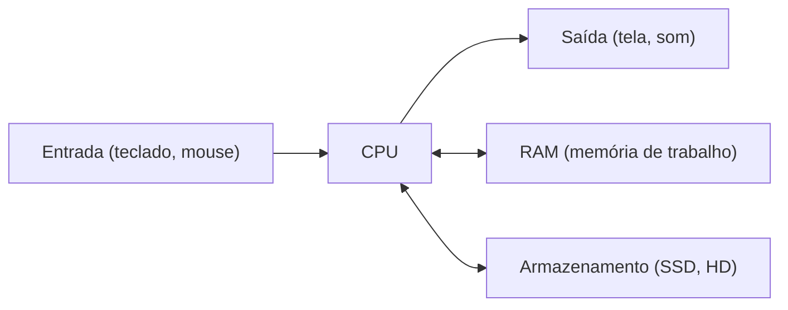
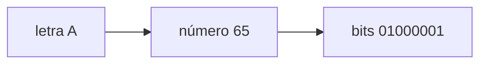

## Passo 1 · Leitura · As partes do computador

Notebook, celular, videogame e caixa eletrônico parecem máquinas diferentes, mas por dentro todos têm as mesmas quatro partes. Para entender cada uma, pense em uma cozinha de restaurante.

**CPU (processador).** É o cozinheiro: a única parte que de fato trabalha. A CPU executa **instruções**, ordens muito simples como "some estes dois números" ou "compare este valor com aquele". Ela faz bilhões delas por segundo, uma depois da outra.

**Memória RAM.** É a bancada: o espaço onde fica o que está em uso agora. Os programas abertos e os dados com que eles trabalham ficam na RAM, porque a CPU alcança o que está ali muito depressa. A bancada tem dois limites. É pequena, e por isso o computador fica lento com muitos programas abertos. E é esvaziada no fim do expediente: quando o computador desliga, tudo o que estava na RAM some.

**Armazenamento (SSD ou HD).** É a despensa: guarda o que precisa continuar existindo depois de desligar, como fotos, documentos e os próprios programas. Cabe muito mais do que na bancada, mas buscar algo lá demora mais.

**Entrada e saída.** São a porta por onde os pedidos chegam e o balcão por onde os pratos saem. Teclado, mouse, microfone e tela de toque são dispositivos de **entrada**. Tela, caixa de som e impressora são dispositivos de **saída**.



Siga o diagrama com um exemplo. Você abre um trabalho da faculdade: o arquivo é copiado do armazenamento para a RAM. Você digita uma frase: as teclas chegam pela entrada, a CPU atualiza o texto que está na RAM e manda o resultado para a tela. Você clica em Salvar: o texto da RAM é copiado de volta para o armazenamento. Se a energia cair antes do Salvar, o que você digitou se perde, porque só existia na RAM.

Isso explica uma confusão comum em anúncios de loja. "Notebook com 8 GB de memória e SSD de 512 GB" traz dois números diferentes: 8 GB é a RAM (a bancada) e 512 GB é o armazenamento (a despensa). Dizer que o computador "tem 512 GB de memória" mistura as duas coisas.

## Passo 2 · Leitura · Bits, bytes e como tudo vira número

Dentro do computador, cada pedacinho da memória só consegue ficar em dois estados: desligado ou ligado. Chamamos esses estados de 0 e 1. Essa unidade mínima de informação é o **bit**.

Um bit sozinho diz pouco, então os bits andam em grupos de oito. Cada grupo é um **byte**:

$$
1\ \text{byte} = 8\ \text{bits}
$$

Com 8 bits dá para formar $2^8 = 256$ combinações diferentes, de `00000000` a `11111111`. Por isso um byte guarda um número de 0 a 255.

Arquivos têm milhares ou bilhões de bytes, e daí vêm as unidades maiores:

| Unidade | Vale | Exemplo |
|---|---|---|
| KB (quilobyte) | 1024 bytes | um texto curto |
| MB (megabyte) | 1024 KB | uma foto de celular tem alguns MB |
| GB (gigabyte) | 1024 MB | um filme em alta definição tem alguns GB |

O fator é 1024 porque o computador conta em potências de 2: $1\ \text{KB} = 2^{10} = 1024\ \text{bytes}$. No dia a dia, e nas embalagens de SSD e pen drive, é comum arredondar para 1000. As duas contas aparecem por aí; a diferença é pequena e, neste curso, vale 1024.

#### Texto vira número

Se a memória só guarda números, como ela guarda a letra A? Com uma tabela combinada entre todos os computadores, em que cada caractere tem um número. A primeira tabela muito usada foi a **ASCII**, com 128 caracteres. A atual é o **Unicode**, que mantém os números da ASCII e acrescenta letras acentuadas, outros alfabetos e emojis. Nas duas, o A maiúsculo é o 65, o B é o 66 e o a minúsculo é o 97.



#### Imagem vira número

Uma imagem é uma grade de pontos coloridos, os **pixels**. Cada pixel é guardado como três números de 0 a 255: quanto de vermelho (R), de verde (G) e de azul (B) aquele ponto tem.

| Cor | R | G | B |
|---|---|---|---|
| vermelho | 255 | 0 | 0 |
| amarelo | 255 | 255 | 0 |
| preto | 0 | 0 | 0 |

São 3 bytes por pixel. Uma foto de 1000 por 1000 pixels tem 1 milhão de pixels, ou 3 milhões de bytes: perto de 3 MB antes de ser compactada.

Som e vídeo seguem a mesma ideia. Tudo o que o computador guarda é número, e todo número é guardado em bits.

## Passo 3 · Quiz · Fixando o hardware

### Pergunta
Você está escrevendo um relatório e ainda não salvou. Em qual componente está o texto que você acabou de digitar?
- [ ] No armazenamento (SSD ou HD)
- [x] Na memória RAM
- [ ] Na CPU
- [ ] No teclado
> A RAM guarda o que está em uso agora e perde tudo ao desligar. O texto só vai para o armazenamento quando você salva.

### Pergunta
Quantos bits tem um byte?
- [ ] 2
- [x] 8
- [ ] 10
- [ ] 1024
> Um byte é um grupo de 8 bits e guarda 256 valores diferentes. 1024 é quantos bytes tem 1 KB.

### Pergunta
Pela convenção usada nesta lição, 1 MB equivale a quantos KB?
- [ ] 8
- [ ] 256
- [x] 1024
- [ ] 1 048 576
> Cada unidade vale 1024 vezes a anterior: 1 KB = 1024 bytes e 1 MB = 1024 KB. Já 1 048 576 é o número de bytes em 1 MB.

## Passo 4 · Exercício · Primeiro contato com o Verificar
modo: lacunas

Este é o seu primeiro exercício na plataforma. Você ainda não precisa saber Python: o programa já vem quase pronto, e a ideia é conhecer os botões **Executar** e **Verificar**.

O que você precisa para ler o código:

- `print(...)` mostra na tela o valor que está entre os parênteses.
- `ord("A")` pergunta ao Python qual é o número da letra A na tabela Unicode. `chr(66)` faz o caminho contrário: dá o caractere de número 66.
- `codigo_a = ...` guarda um valor com o nome `codigo_a`. Um nome que guarda um valor se chama **variável**.

As duas últimas linhas têm lacunas (`___`). Enquanto elas não forem preenchidas, o Python mostra as duas respostas e depois avisa um erro na linha 3. É o esperado.

### Instruções
1. Clique em Executar e observe os dois valores que aparecem na saída.
2. Troque a primeira lacuna pelo número que apareceu para a letra `"A"`, de modo que `codigo_a` guarde esse número.
   Dica: número se escreve sem aspas.
3. Troque a segunda lacuna pela letra que apareceu para o código 66, entre aspas, e clique em Verificar.
   Dica: texto sempre vai entre aspas, como em `"A"`.

### Código inicial
```python
print(ord("A"))
print(chr(66))
codigo_a = ___
letra_66 = ___
```

### Solução
```python
print(ord("A"))
print(chr(66))
codigo_a = 65
letra_66 = "B"
```

### Dicas
1. `ord` dá o número de uma letra: a primeira linha da saída é a resposta da primeira lacuna.
2. O valor de `codigo_a` é um número, escrito sem aspas. Com aspas ele vira texto, e a verificação exige número.
3. `chr(66)` mostra a letra de código 66: é a segunda linha da saída. Escreva essa letra entre aspas na segunda lacuna.

### Verificação
```json
[
  { "id": "saida", "checkpoint": 1, "kind": "io", "stdin": "", "expected_stdout": "65\nB",
    "name": "O programa executa até o fim e mostra os dois valores", "hint": "Mantenha as duas linhas de print como vieram e preencha as duas lacunas: enquanto houver ___ o programa para com erro." },
  { "id": "codigo-a", "checkpoint": 2, "kind": "variable", "variable": "codigo_a", "expected": 65, "type": "int",
    "name": "codigo_a guarda o número da letra A", "hint": "Use o número da primeira linha da saída, sem aspas." },
  { "id": "letra-66", "checkpoint": 3, "kind": "variable", "variable": "letra_66", "expected": "B", "type": "str",
    "name": "letra_66 guarda a letra de código 66", "hint": "Use a letra da segunda linha da saída, maiúscula e entre aspas." }
]
```

### Soluções erradas
```python name="número entre aspas vira texto"
print(ord("A"))
print(chr(66))
codigo_a = "65"
letra_66 = "B"
```
```python name="trocou 65 por 66"
print(ord("A"))
print(chr(66))
codigo_a = 66
letra_66 = "B"
```
```python name="letra sem aspas (NameError)"
print(ord("A"))
print(chr(66))
codigo_a = 65
letra_66 = B
```
```python name="letra minúscula"
print(ord("A"))
print(chr(66))
codigo_a = 65
letra_66 = "b"
```
