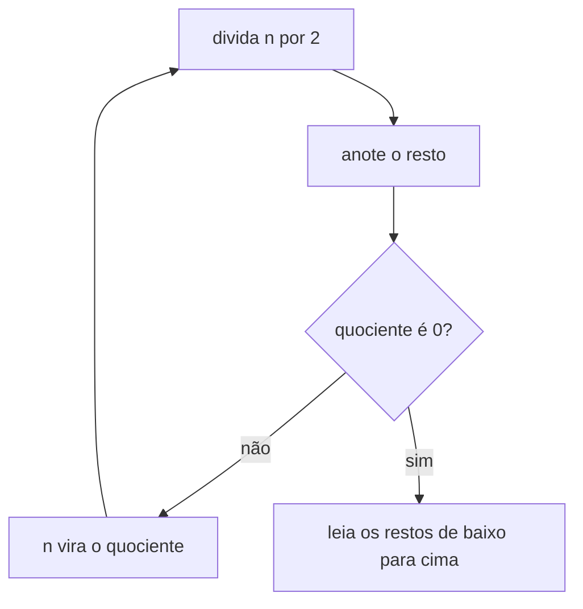

## Passo 1 · Leitura · Base 10 e base 2

No dia a dia você conta na **base 10**: dez símbolos, de 0 a 9, e cada posição vale dez vezes a posição à direita. No número 37, o 3 vale trinta e o 7 vale sete:

$37 = 3 \cdot 10^1 + 7 \cdot 10^0$

O computador só tem dois símbolos, 0 e 1. Ele conta na **base 2**, o **binário**. A regra é a mesma, mas cada posição vale o **dobro** da posição à direita:

| Posição (da direita para a esquerda) | 8ª | 7ª | 6ª | 5ª | 4ª | 3ª | 2ª | 1ª |
|---|---|---|---|---|---|---|---|---|
| Valor | 128 | 64 | 32 | 16 | 8 | 4 | 2 | 1 |

#### De binário para decimal

Some os valores das posições em que há 1. Para `100101`:

$$
100101_2 = 1 \cdot 2^5 + 0 \cdot 2^4 + 0 \cdot 2^3 + 1 \cdot 2^2 + 0 \cdot 2^1 + 1 \cdot 2^0 = 37
$$

Ou, direto: $32 + 4 + 1 = 37$. O 2 pequeno em $100101_2$ avisa que o número está na base 2.

#### De decimal para binário

Divida o número por 2 e anote o resto, que é sempre 0 ou 1. Repita com o quociente até ele chegar a 0. Veja com o 37:

| Divisão | Quociente | Resto |
|---|---|---|
| 37 ÷ 2 | 18 | 1 |
| 18 ÷ 2 | 9 | 0 |
| 9 ÷ 2 | 4 | 1 |
| 4 ÷ 2 | 2 | 0 |
| 2 ÷ 2 | 1 | 0 |
| 1 ÷ 2 | 0 | 1 |

Agora leia a coluna dos restos **de baixo para cima**: `100101`. Ler de cima para baixo daria `101001`, que é 41. Esse é o erro mais comum nesta conta.



Para conferir, faça o caminho de volta: some as potências de 2 das posições com 1 e veja se chega ao número de partida.

## Passo 2 · Exercício · Conversões à mão
modo: lacunas

Pegue papel e lápis. Você vai converter quatro números à mão e registrar as respostas em variáveis. As três primeiras respostas são sequências de dígitos e ficam entre aspas, que já estão no código. A última é um número comum, sem aspas.

Escreva só os dígitos do binário, sem espaços e sem zeros à esquerda.

### Instruções
1. Converta 10, 37 e 255 para binário e preencha as três primeiras lacunas, nessa ordem.
   Dica: o 37 foi convertido na leitura; use o mesmo método nos outros dois.
2. Converta o binário `110101` para decimal e preencha a lacuna de `valor`.
   Dica: as posições valem 32, 16, 8, 4, 2 e 1.

### Código inicial
```python
dez = "___"
trinta_e_sete = "___"
duzentos_cinquenta_e_cinco = "___"
valor = ___
```

### Solução
```python
dez = "1010"
trinta_e_sete = "100101"
duzentos_cinquenta_e_cinco = "11111111"
valor = 53
```

### Dicas
1. Divida o número por 2, anote o resto e repita com o quociente até ele chegar a 0.
2. Leia os restos de baixo para cima: o último resto que você anotou é o primeiro dígito do binário.
3. Para voltar ao decimal, some os valores das posições com 1. Em `110101` há 1 nas posições que valem 32, 16, 4 e 1.

### Verificação
```json
[
  { "id": "dez", "checkpoint": 1, "kind": "variable", "variable": "dez", "expected": "1010", "type": "str",
    "name": "10 em binário", "hint": "São quatro divisões por 2. Leia os restos de baixo para cima." },
  { "id": "trinta-e-sete", "checkpoint": 1, "kind": "variable", "variable": "trinta_e_sete", "expected": "100101", "type": "str",
    "name": "37 em binário", "hint": "A tabela de divisões do 37 está na leitura anterior." },
  { "id": "duzentos-cinquenta-e-cinco", "checkpoint": 1, "kind": "variable", "variable": "duzentos_cinquenta_e_cinco",
    "expected": "11111111", "type": "str",
    "name": "255 em binário", "hint": "255 é o maior número que cabe em um byte. Conte quantos dígitos você escreveu." },
  { "id": "valor", "checkpoint": 2, "kind": "variable", "variable": "valor", "expected": 53, "type": "int",
    "name": "110101 em decimal", "hint": "Some as potências de 2 das posições com 1 e escreva o resultado como número, sem aspas." }
]
```

### Soluções erradas
```python name="restos lidos de cima para baixo"
dez = "0101"
trinta_e_sete = "101001"
duzentos_cinquenta_e_cinco = "11111111"
valor = 53
```
```python name="valor entre aspas vira texto"
dez = "1010"
trinta_e_sete = "100101"
duzentos_cinquenta_e_cinco = "11111111"
valor = "53"
```
```python name="255 com sete dígitos"
dez = "1010"
trinta_e_sete = "100101"
duzentos_cinquenta_e_cinco = "1111111"
valor = 53
```
```python name="binário lido ao contrário na volta"
dez = "1010"
trinta_e_sete = "100101"
duzentos_cinquenta_e_cinco = "11111111"
valor = 43
```

## Passo 3 · Leitura · Hexadecimal: binário abreviado

Binário é ótimo para a máquina e ruim para pessoas: `111111111000100000000000` é difícil de ler e fácil de copiar errado. Por isso programadores usam a **base 16**, o **hexadecimal** (ou só "hexa").

A base 16 precisa de 16 símbolos. Os dez primeiros são os dígitos de 0 a 9. Para os seis que faltam, usam-se letras: `a` vale 10, `b` vale 11, `c` vale 12, `d` vale 13, `e` vale 14 e `f` vale 15. Cada posição vale 16 vezes a posição à direita:

$\text{ff}_{16} = 15 \cdot 16^1 + 15 \cdot 16^0 = 255$

A vantagem vem de $16 = 2^4$: cada dígito hexadecimal corresponde a exatamente 4 bits.

| Hexa | Bits | Hexa | Bits | Hexa | Bits | Hexa | Bits |
|---|---|---|---|---|---|---|---|
| 0 | 0000 | 4 | 0100 | 8 | 1000 | c | 1100 |
| 1 | 0001 | 5 | 0101 | 9 | 1001 | d | 1101 |
| 2 | 0010 | 6 | 0110 | a | 1010 | e | 1110 |
| 3 | 0011 | 7 | 0111 | b | 1011 | f | 1111 |

Para converter, separe o binário em grupos de 4 bits e troque cada grupo por um dígito: `1111 1111` vira `ff`. Um byte inteiro cabe em dois dígitos hexadecimais.

É por isso que as cores de páginas da web aparecem como `#ff0000`. São os três bytes do pixel: `ff` de vermelho (255), `00` de verde e `00` de azul. Aquele número binário enorme do começo é a cor `#ff8800`, um laranja.

#### No Python

Como o Python sabe se `10` é dez ou dois? Pelo **prefixo**. Sem prefixo, o número é decimal. `0b` avisa que os dígitos estão em binário, e `0x`, em hexadecimal. O prefixo não faz parte do valor: é só o aviso da base.

```python
print(0b1010)          # 10
print(0x1f)            # 31
print(bin(10))         # 0b1010
print(hex(31))         # 0x1f
print(int("1010", 2))  # 10
print(int("1f", 16))   # 31
```

- `bin(n)` e `hex(n)` devolvem um **texto** com a representação do número, já com o prefixo.
- `int(texto, base)` faz o caminho contrário: lê os dígitos de um texto na base indicada e devolve o número. Sem a base, `int` supõe base 10: `int("1010")` é mil e dez, e `int("1f")` dá erro, porque `f` não é dígito decimal.

## Passo 4 · Exercício · Conferindo com o Python

Agora o Python faz as contas e você confere com o que calculou à mão. Escreva quatro linhas, cada uma com um `print`. A saída do programa deve ser exatamente esta:

```
0b100101
0xff
255
26
```

Para mostrar o resultado de uma função, coloque a chamada dentro do `print`, como em `print(bin(10))`.

### Instruções
1. Imprima `bin(37)`.
2. Imprima `hex(255)`.
3. Imprima `int("ff", 16)`.
   Dica: o texto `"ff"` vai entre aspas e a base vem depois da vírgula.
4. Imprima a soma `0b1010 + 0x10`.
   Dica: o Python converte os dois valores e mostra a soma em decimal.

### Código inicial
```python
# 1. Imprima bin(37)

# 2. Imprima hex(255)

# 3. Imprima int("ff", 16)

# 4. Imprima 0b1010 + 0x10
```

### Solução
```python
print(bin(37))
print(hex(255))
print(int("ff", 16))
print(0b1010 + 0x10)
```

### Dicas
1. `bin` e `hex` devolvem um texto com prefixo (`0b`, `0x`). Imprima o que elas devolvem, sem cortar nada.
2. `int` precisa saber em que base o texto está: a base é o segundo valor entre os parênteses.
3. Cada linha tem a forma `print(...)`, com a expressão da instrução entre os parênteses. São quatro linhas, na ordem das instruções.

### Verificação
```json
[
  { "id": "usa-bin", "checkpoint": 1, "kind": "source", "rule": { "type": "calls", "name": "bin" },
    "name": "Usa bin()", "hint": "Deixe o Python converter: chame bin(37) dentro do print." },
  { "id": "saida-bin", "checkpoint": 1, "kind": "io", "stdin": "", "expected_stdout": "0b100101", "match": "contains",
    "name": "Mostra 37 em binário, com prefixo", "hint": "Imprima exatamente o que bin(37) devolve." },
  { "id": "usa-hex", "checkpoint": 2, "kind": "source", "rule": { "type": "calls", "name": "hex" },
    "name": "Usa hex()", "hint": "Chame hex(255) dentro do print." },
  { "id": "saida-hex", "checkpoint": 2, "kind": "io", "stdin": "", "expected_stdout": "0xff", "match": "contains",
    "name": "Mostra 255 em hexadecimal, com prefixo", "hint": "Imprima exatamente o que hex(255) devolve." },
  { "id": "usa-int", "checkpoint": 3, "kind": "source", "rule": { "type": "calls", "name": "int" },
    "name": "Usa int() com a base", "hint": "Chame int com o texto e a base 16." },
  { "id": "saida-int", "checkpoint": 3, "kind": "io", "stdin": "", "expected_stdout": "0xff\n255\n", "match": "contains",
    "name": "Mostra o valor decimal de ff na terceira linha", "hint": "Sem a base, int não sabe ler a letra f." },
  { "id": "saida-completa", "checkpoint": 4, "kind": "io", "stdin": "", "expected_stdout": "0b100101\n0xff\n255\n26",
    "name": "As quatro linhas, na ordem do enunciado", "hint": "Compare sua saída com a do enunciado, linha por linha. A última linha é a soma dos dois números." }
]
```

### Soluções erradas
```python name="int sem a base (ValueError)"
print(bin(37))
print(hex(255))
print(int("ff"))
print(0b1010 + 0x10)
```
```python name="corta o prefixo do binário"
print(bin(37)[2:])
print(hex(255))
print(int("ff", 16))
print(0b1010 + 0x10)
```
```python name="copia a saída sem usar as funções"
print("0b100101")
print("0xff")
print(255)
print(26)
```
```python name="junta os dois números como texto"
print(bin(37))
print(hex(255))
print(int("ff", 16))
print("0b1010" + "0x10")
```
```python name="esquece a última linha"
print(bin(37))
print(hex(255))
print(int("ff", 16))
```

## Passo 5 · Quiz · Bases

### Pergunta
Quantos valores diferentes cabem em 8 bits?
- [ ] 8
- [ ] 16
- [ ] 255
- [x] 256
> Cada bit dobra a quantidade de combinações, e com 8 bits são 256. O maior valor é 255 porque a contagem começa no 0.

### Pergunta
Qual é o maior número que se escreve com 4 bits?
- [ ] 4
- [ ] 8
- [x] 15
- [ ] 16
> `1111` vale 8 + 4 + 2 + 1 = 15. O 16 já precisa de cinco bits: `10000`.

### Pergunta
Por que programadores preferem escrever bytes em hexadecimal, e não em binário?
- [ ] Porque o computador guarda os dados em base 16
- [x] Porque cada dígito hexadecimal equivale a 4 bits, então o número fica curto e a conversão é direta
- [ ] Porque o hexadecimal ocupa menos espaço na memória
- [ ] Porque o Python não aceita números em binário
> O computador guarda tudo em bits. O hexadecimal é só uma forma abreviada de escrever esses bits: dois dígitos por byte.
