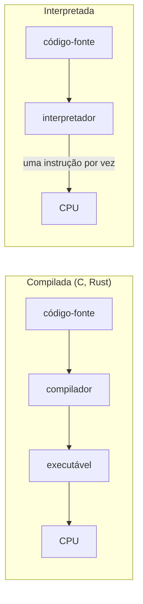
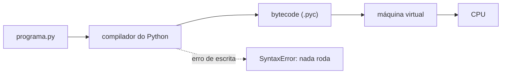

## Passo 1 · Leitura · Compilar e interpretar

A CPU só entende **código de máquina**: instruções muito simples, escritas em números binários. Cada família de processador tem o seu, e escrever um programa inteiro assim, à mão, seria lento e cheio de erros.

Por isso existem as **linguagens de programação**. Nelas você escreve o **código-fonte**: um texto com palavras e símbolos que uma pessoa consegue ler, como `print("Olá")`. A linguagem é a ponte entre você e a CPU. Só que alguém precisa atravessar a ponte, ou seja, traduzir o código-fonte para algo que a máquina execute. Há duas maneiras clássicas.

**Compilar.** O **compilador** é um programa que lê o código-fonte inteiro e o traduz de uma vez, antes de qualquer coisa rodar. O resultado é um arquivo **executável**, já em código de máquina. É como o tradutor de um livro: trabalha no texto todo e entrega o livro pronto; depois disso, o leitor não precisa mais dele. Linguagens como C e Rust funcionam assim.

**Interpretar.** O **interpretador** é um programa que lê o código-fonte e vai executando, uma instrução por vez, sem gerar um executável. É como o intérprete de uma palestra: traduz enquanto a pessoa fala e precisa estar presente toda vez. Os primeiros interpretadores de BASIC e os terminais de comandos funcionam assim.



Cada caminho tem um custo e um ganho:

| | Compilada | Interpretada |
|---|---|---|
| Antes de rodar | precisa compilar tudo | nada: roda direto |
| Velocidade do programa | maior | menor |
| Para rodar em outro tipo de máquina | compila de novo | basta haver um interpretador lá |
| Erros de escrita | aparecem todos na compilação | aparecem quando a linha é alcançada |

Na prática, quase nenhuma linguagem atual é puramente uma coisa ou outra. O Python, como você vai ver no próximo passo, usa as duas ideias.

## Passo 2 · Leitura · O caminho do Python

É comum ouvir que "Python é interpretado, não compila". Não é bem assim. Quando você manda executar um arquivo `programa.py`, acontecem duas etapas.

**1. Compilação para bytecode.** O Python lê o arquivo inteiro e o traduz para **bytecode**: uma lista de instruções simples, mais próximas da máquina do que o seu texto, mas que ainda não são código de máquina. Nenhuma CPU executa bytecode diretamente.

**2. Execução pela máquina virtual.** Quem executa o bytecode é a **máquina virtual do Python**, um programa que lê cada instrução e manda a CPU fazer o trabalho correspondente. É essa parte que funciona como um interpretador.



Tudo isso acontece em uma fração de segundo, sem você pedir. O programa que faz as duas etapas se chama **CPython** e é o Python que você baixa do site oficial.

#### O que é a pasta `__pycache__`

Em projetos com mais de um arquivo, o Python guarda o bytecode dos arquivos reaproveitados em uma pasta chamada `__pycache__`, em arquivos de extensão `.pyc`. Assim ele não precisa traduzir de novo o que não mudou. Você pode ignorar essa pasta e até apagá-la: o Python a recria quando precisar.

#### Por que um erro de escrita impede tudo

Como a tradução para bytecode acontece **antes** da execução e vale para o arquivo inteiro, um erro de escrita em qualquer linha faz a etapa 1 falhar. O Python mostra um `SyntaxError` (erro de sintaxe, isto é, uma regra de escrita da linguagem que foi quebrada) e **nenhuma** linha roda, nem as que estavam certas.

#### E o botão Executar desta plataforma?

O navegador não entende Python sozinho. O que a plataforma faz é carregar na página o próprio CPython, traduzido para **WebAssembly**, um formato de código que os navegadores sabem executar. Quando você clica em Executar, é o Python de verdade que compila e roda o seu programa, dentro da aba, sem instalar nada.

#### "Python é lento"?

Um programa em Python costuma ser mais lento do que o mesmo programa em C, por causa da máquina virtual no meio do caminho. Para quem está aprendendo, isso quase nunca importa: os programas deste curso terminam em milésimos de segundo. O que você ganha em troca é uma linguagem fácil de ler e de testar.

## Passo 3 · Quiz · Compilador ou interpretador?

### Pergunta
O que um compilador faz?
- [x] Traduz o código-fonte inteiro antes da execução
- [ ] Executa o código-fonte uma instrução por vez, sem traduzir antes
- [ ] Corrige sozinho os erros do código-fonte
- [ ] Deixa o computador mais rápido enquanto o programa roda
> O compilador faz a tradução completa antes de o programa rodar. Executar aos poucos é o papel do interpretador.

### Pergunta
O que é o bytecode do Python?
- [ ] O texto que você digita no arquivo `.py`
- [ ] O código de máquina que a CPU executa diretamente
- [x] Um conjunto de instruções intermediárias, executadas pela máquina virtual do Python
- [ ] Uma cópia de segurança do seu programa
> O bytecode fica no meio do caminho: é gerado a partir do código-fonte e executado pela máquina virtual, não pela CPU diretamente.

### Pergunta
Um programa tem 10 linhas e só a linha 9 tem um erro de sintaxe. O que acontece ao executar?
- [ ] As linhas 1 a 8 rodam e o erro aparece na linha 9
- [ ] O Python pula a linha 9 e roda as outras
- [x] Nenhuma linha roda: a tradução para bytecode falha antes de a execução começar
- [ ] O programa roda inteiro e o erro aparece no final
> O arquivo inteiro é traduzido antes de ser executado. Se a tradução falha, não há bytecode para a máquina virtual executar.

## Passo 4 · Exercício · O erro que aparece antes de rodar

Agora veja isso acontecer. O programa abaixo deveria mostrar três linhas:

```
Linha 1
Linha 2
Linha 3
```

As duas primeiras linhas do código estão corretas. A terceira tem um erro de escrita. Antes de consertar, execute o programa do jeito que está e repare: nem `Linha 1` aparece. O Python mostra uma mensagem parecida com esta:

```
  File "main.py", line 3
    print("Linha 3"
         ^
SyntaxError: '(' was never closed
```

A mensagem diz em que linha está o problema (`line 3`) e qual é ele: um parêntese foi aberto e nunca foi fechado.

### Instruções
1. Clique em Executar sem mudar nada e observe que nenhuma linha é mostrada, só o `SyntaxError`.
2. Conserte a linha 3, sem mudar o texto entre aspas.
   Dica: todo parêntese que abre precisa de um que fecha.
3. Execute de novo, confira as três linhas na saída e clique em Verificar.

### Código inicial
```python
print("Linha 1")
print("Linha 2")
print("Linha 3"
```

### Solução
```python
print("Linha 1")
print("Linha 2")
print("Linha 3")
```

### Dicas
1. Leia a mensagem `SyntaxError` e o número da linha: o problema está na linha 3, não nas duas primeiras.
2. Conte os parênteses da linha 3: quantos abrem e quantos fecham? Compare com a linha 2.

### Verificação
```json
[
  { "id": "volta-a-rodar", "checkpoint": 1, "kind": "io", "stdin": "", "expected_stdout": "Linha 1\nLinha 2", "match": "contains",
    "name": "As duas primeiras linhas voltam a aparecer", "hint": "Enquanto houver erro de sintaxe em qualquer linha, nenhuma linha roda. Mantenha as linhas 1 e 2 como vieram." },
  { "id": "linha-3", "checkpoint": 2, "kind": "io", "stdin": "", "expected_stdout": "Linha 3", "match": "contains",
    "name": "A linha 3 é exibida com o texto original", "hint": "Conserte só o parêntese: o texto entre aspas não muda e a linha não deve ser apagada." },
  { "id": "saida", "checkpoint": 3, "kind": "io", "stdin": "", "expected_stdout": "Linha 1\nLinha 2\nLinha 3",
    "name": "As três linhas, na ordem", "hint": "A saída deve ter exatamente três linhas: Linha 1, Linha 2 e Linha 3." }
]
```

### Soluções erradas
```python name="apaga a linha com erro"
print("Linha 1")
print("Linha 2")
```
```python name="conserta mas muda o texto"
print("Linha 1")
print("Linha 2")
print("Linha três")
```
```python name="fecha com colchete (ainda é SyntaxError)"
print("Linha 1")
print("Linha 2")
print("Linha 3"]
```
```python name="transforma a linha 3 em comentário"
print("Linha 1")
print("Linha 2")
# print("Linha 3"
```
