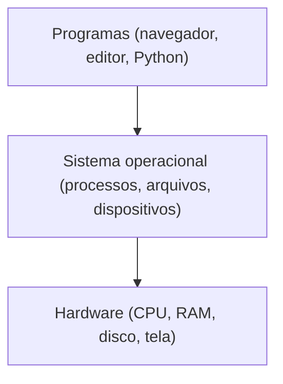
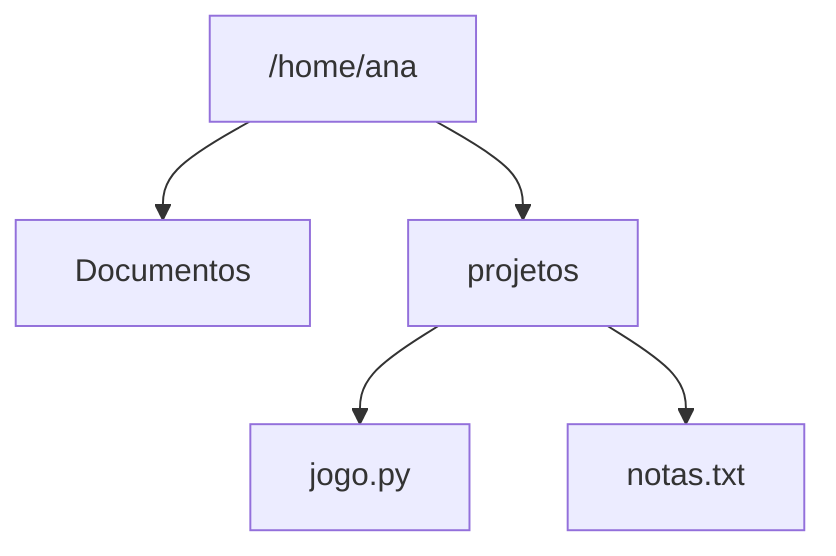

## Passo 1 · Leitura · O que o sistema operacional faz

Windows, Linux, macOS, Android e iOS são **sistemas operacionais**. O sistema operacional (SO) é o programa que liga junto com a máquina e fica entre os outros programas e o hardware. Pense nele como o gerente de um prédio comercial: as empresas (os programas) usam o elevador, a água e a luz (o hardware), mas quem organiza o uso é a gerência.

O SO tem três papéis principais.

**Processos.** Um programa em execução se chama **processo**. Neste momento seu computador tem dezenas deles: o navegador, o tocador de música, o antivírus. A CPU é uma só para todos. O SO entrega a CPU a cada processo por alguns milésimos de segundo e troca tão rápido que tudo parece rodar ao mesmo tempo. Ele também divide a RAM e impede que um processo mexa na memória do outro.

**Arquivos.** No SSD existem apenas bytes em sequência. É o SO que organiza esses bytes em **arquivos** com nome e em **pastas** (também chamadas de diretórios). Quando um programa pede "abra `notas.txt`", o SO sabe onde estão os bytes daquele arquivo.

**Dispositivos.** Teclado, tela, impressora, placa de rede: cada modelo funciona de um jeito. O SO conversa com cada um e oferece aos programas uma forma única de usá-los. Por isso o mesmo programa imprime em qualquer impressora instalada.



O diagrama resume a regra: **nenhum programa fala direto com o hardware**. Todo pedido passa pelo SO.

Isso vale para o Python. Quando o seu programa executa `print("Olá")`, o Python pede ao SO que escreva o texto na tela. Quando ele lê um arquivo, é o SO que busca os bytes no armazenamento. Você escreve o mesmo código em Windows, Linux ou macOS, e o Python de cada sistema cuida da conversa com o SO.

## Passo 2 · Leitura · Pastas, caminhos e terminal

As pastas formam uma árvore: uma pasta contém arquivos e outras pastas. Veja as pastas da Ana, em um computador com Linux:



O **caminho** de um arquivo é o endereço dele nessa árvore. Há dois tipos.

- **Caminho absoluto**: começa na raiz do sistema e funciona de qualquer lugar. O do jogo é `/home/ana/projetos/jogo.py`. No Windows, a raiz é a letra da unidade e a barra é invertida: `C:\Users\ana\projetos\jogo.py`.
- **Caminho relativo**: começa na pasta em que você está agora. Se você está em `/home/ana`, o mesmo arquivo é `projetos/jogo.py`. Se já está em `/home/ana/projetos`, é só `jogo.py`.

O final do nome, depois do ponto, é a **extensão**. Ela indica o tipo do arquivo: `.py` é código Python, `.txt` é texto puro.

#### O terminal

O **terminal** é uma janela em que você conversa com o SO por texto: digita um comando, aperta Enter e lê a resposta. No Windows ele se chama PowerShell ou Prompt de Comando; no Linux e no macOS, Terminal. O terminal está sempre "dentro" de uma pasta, a **pasta atual**, e os caminhos relativos partem dela.

| Para | Linux e macOS | Windows |
|---|---|---|
| ver a pasta atual | `pwd` | `cd` |
| listar o que há na pasta | `ls` | `dir` |
| entrar em uma pasta | `cd projetos` | `cd projetos` |
| voltar para a pasta de cima | `cd ..` | `cd ..` |
| executar um arquivo Python | `python jogo.py` | `python jogo.py` |

Os dois pontos em `cd ..` significam "a pasta que contém esta". Repare no espaço entre `cd` e `..`.

Uma sessão da Ana, com a resposta do terminal logo abaixo de cada comando:

```
pwd
/home/ana
cd projetos
ls
jogo.py  notas.txt
python jogo.py
```

O último comando só funciona porque ela entrou na pasta antes. `python jogo.py` usa um caminho relativo: o Python procura `jogo.py` na pasta atual. Se o terminal estiver em outra pasta, a resposta é um erro dizendo que o arquivo não existe (`No such file or directory`). Nesse caso, confira a pasta atual e use `cd` até chegar à pasta do arquivo.

## Passo 3 · Quiz · Terminal

### Pergunta
O terminal está na pasta `/home/ana/projetos`. Depois do comando `cd ..`, qual é a pasta atual?
- [ ] `/home/ana/projetos`
- [x] `/home/ana`
- [ ] `/` (a raiz)
- [ ] `/home/ana/projetos/..`, uma pasta nova chamada `..`
> `..` é a pasta que contém a pasta atual. O comando sobe um nível na árvore, não vai até a raiz.

### Pergunta
Qual comando executa o arquivo `jogo.py` que está na pasta atual?
- [ ] `jogo.py python`
- [ ] `cd jogo.py`
- [ ] `ls jogo.py`
- [x] `python jogo.py`
> Primeiro vem o programa que vai executar (`python`) e depois o arquivo. `cd` entra em pastas e `ls` só lista.

### Pergunta
Qual é a diferença entre caminho absoluto e caminho relativo?
- [ ] O absoluto é usado no Windows e o relativo, no Linux
- [ ] O absoluto serve para pastas e o relativo, para arquivos
- [x] O absoluto começa na raiz e vale de qualquer lugar; o relativo começa na pasta atual
- [ ] O absoluto traz a extensão do arquivo e o relativo não
> `/home/ana/projetos/jogo.py` funciona de qualquer pasta. `projetos/jogo.py` só funciona se a pasta atual for `/home/ana`.

## Passo 4 · Leitura · Instalando o Python no seu computador

Nesta plataforma você não precisa instalar nada: o Python roda no navegador. Mesmo assim, vale ter o Python no seu computador, para criar seus próprios programas fora daqui.

#### Windows

1. Acesse python.org, entre em Downloads e baixe o instalador para Windows.
2. Abra o instalador e, **antes** de clicar em instalar, marque a caixa "Add python.exe to PATH". Sem ela, o terminal não encontra o comando `python`.
3. Conclua a instalação e abra um terminal novo (PowerShell).

#### macOS

1. Acesse python.org, entre em Downloads e baixe o instalador para macOS.
2. Abra o arquivo baixado e siga as telas até o fim.
3. Abra o Terminal. No macOS o comando se chama `python3`.

#### Linux

1. O Python quase sempre já vem instalado. Abra o terminal e confira com `python3 --version`.
2. Se não vier, em sistemas como Ubuntu e Debian instale com `sudo apt install python3`.

#### Conferindo

No terminal, digite:

```
python --version
```

A resposta deve ser algo como `Python 3.14.0`. Qualquer versão 3.10 ou mais nova serve para este curso.

`python` ou `python3`? Depende do sistema. No Windows o comando é `python`. No Linux e no macOS costuma ser `python3`. Se um responder "comando não encontrado", tente o outro. Nesta lição escrevemos sempre `python`.

#### O modo interativo

Se você digitar só `python`, sem nome de arquivo, o terminal muda e passa a mostrar `>>>`. Esse é o **modo interativo**: o Python espera você digitar uma linha, executa e mostra o resultado na hora.

```
>>> 2 + 3
5
```

É ótimo para testes rápidos, mas os comandos do terminal (`ls`, `cd`) não funcionam ali dentro. Muita gente acha que travou o terminal. Para sair, digite `exit()` e aperte Enter.

#### Um editor

Programas são arquivos de texto puro com extensão `.py`. Editores como o Word não servem, porque gravam formatação junto com o texto. Use um editor de código. O **VS Code** é gratuito e funciona nos três sistemas: instale-o, abra a aba de extensões e instale a extensão "Python". Depois crie um arquivo `ola.py`, escreva `print("Olá")`, salve e execute no terminal com `python ola.py`.

## Passo 5 · Exercício · Comandos em variáveis

Para fixar os comandos, você vai guardar cada um em uma variável, como texto. Texto, em Python, vai entre aspas. O código inicial traz as quatro variáveis com um texto vazio (`""`): escreva o comando entre as aspas.

Escreva cada comando exatamente como você o digitaria no terminal: letras minúsculas e espaços nos lugares certos.

### Instruções
1. Em `listar_linux`, guarde o comando que lista o conteúdo da pasta atual no Linux e no macOS.
2. Em `listar_windows`, guarde o comando que faz o mesmo no Windows.
3. Em `rodar`, guarde o comando que executa o arquivo `jogo.py` da pasta atual.
   Dica: o comando tem duas palavras, e o nome do arquivo vai completo.
4. Em `voltar`, guarde o comando que volta para a pasta de cima.

### Código inicial
```python
listar_linux = ""
listar_windows = ""
rodar = ""
voltar = ""
```

### Solução
```python
listar_linux = "ls"
listar_windows = "dir"
rodar = "python jogo.py"
voltar = "cd .."
```

### Dicas
1. Os quatro comandos estão na tabela do passo 2 desta lição.
2. O comando que executa um arquivo inclui a extensão: o arquivo se chama `jogo.py`, não `jogo`.
3. Há um espaço entre `cd` e os dois pontos: `cd`, espaço, `..`.

### Verificação
```json
[
  { "id": "listar-linux", "checkpoint": 1, "kind": "variable", "variable": "listar_linux", "expected": "ls", "type": "str",
    "name": "Comando que lista arquivos no Linux e no macOS", "hint": "São duas letras minúsculas, entre aspas." },
  { "id": "listar-windows", "checkpoint": 2, "kind": "variable", "variable": "listar_windows", "expected": "dir", "type": "str",
    "name": "Comando que lista arquivos no Windows", "hint": "Veja a coluna Windows da tabela de comandos, em minúsculas." },
  { "id": "rodar", "checkpoint": 3, "kind": "variable", "variable": "rodar", "expected": "python jogo.py", "type": "str",
    "name": "Comando que executa jogo.py", "hint": "Primeiro o programa que executa, depois um espaço e o nome completo do arquivo, com a extensão." },
  { "id": "voltar", "checkpoint": 4, "kind": "variable", "variable": "voltar", "expected": "cd ..", "type": "str",
    "name": "Comando que volta para a pasta de cima", "hint": "Confira o espaço entre cd e os dois pontos." }
]
```

### Soluções erradas
```python name="arquivo sem a extensão"
listar_linux = "ls"
listar_windows = "dir"
rodar = "python jogo"
voltar = "cd .."
```
```python name="cd.. sem espaço"
listar_linux = "ls"
listar_windows = "dir"
rodar = "python jogo.py"
voltar = "cd.."
```
```python name="comandos de listar trocados"
listar_linux = "dir"
listar_windows = "ls"
rodar = "python jogo.py"
voltar = "cd .."
```
```python name="só o nome do arquivo, sem python"
listar_linux = "ls"
listar_windows = "dir"
rodar = "jogo.py"
voltar = "cd .."
```
```python name="comandos sem aspas (NameError)"
listar_linux = ls
listar_windows = dir
rodar = "python jogo.py"
voltar = "cd .."
```
