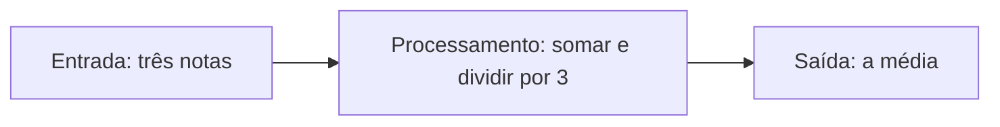
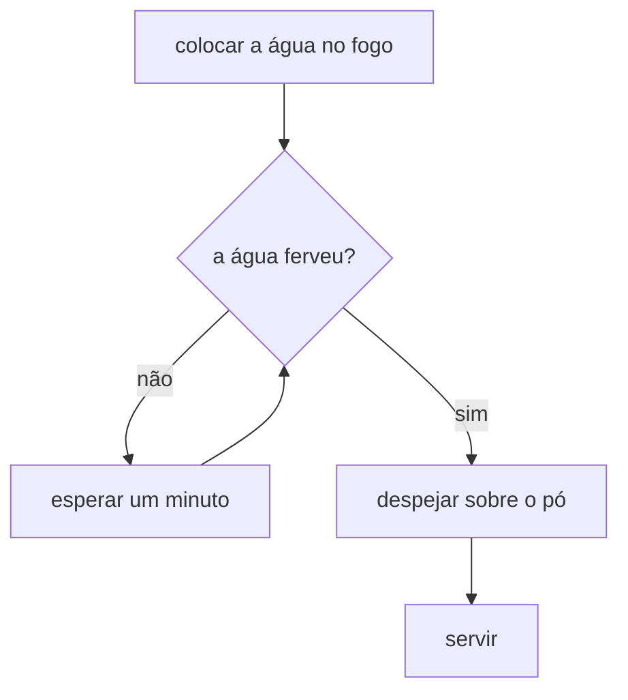

## Passo 1 · Leitura · Algoritmo: entrada, processamento e saída

Um **algoritmo** é uma sequência finita de passos, sem ambiguidade, que resolve um problema. Você segue algoritmos todos os dias: a receita de um bolo, o caminho até a faculdade, as instruções para pagar um boleto. Programar é escrever algoritmos em uma linguagem que o computador executa.

Todo algoritmo tem três partes:

- **Entrada**: os dados de que ele precisa para começar.
- **Processamento**: o que ele faz com esses dados.
- **Saída**: o resultado que ele entrega.



Na receita de bolo, a entrada são os ingredientes, o processamento é o modo de preparo e a saída é o bolo. Em um aplicativo de transporte, a entrada é onde você está e para onde vai; a saída é a rota e o preço.

A definição traz duas exigências, e é nelas que os iniciantes mais erram.

#### Sem ambiguidade

Cada passo precisa ter uma única interpretação. Uma pessoa entende "misture bem" ou "asse até ficar bom" porque usa a experiência para completar o que falta. O computador não tem experiência: ele faz exatamente o que está escrito, nem mais, nem menos.

| Passo ambíguo | Passo preciso |
|---|---|
| misture bem | misture por 2 minutos |
| adicione um pouco de açúcar | adicione 2 colheres de sopa de açúcar |
| asse até ficar bom | asse por 40 minutos a 180 graus |

#### Finito

O algoritmo precisa terminar. Quando há repetição, é preciso dizer com precisão quando parar. "Repita até ficar bom" não serve: falta um critério que qualquer um consiga conferir. "Repita até a massa ficar sem grumos" ou "repita 10 vezes" servem. Esse critério se chama **condição de parada**.

A ordem dos passos também faz parte do algoritmo. Assar o bolo antes de misturar os ingredientes usa os mesmos passos e dá outro resultado. O computador executa as instruções na ordem em que foram escritas, uma por vez, de cima para baixo.

## Passo 2 · Exercício · Ordene os passos do café
modo: ordenar

Um algoritmo para fazer café coado tem cinco passos. Eles chegaram embaralhados, cada um escrito como um `print`, que mostra o passo na tela. Arraste as linhas até a ordem certa. Nenhuma linha precisa de indentação.

Regras deste café:

- A água ferve primeiro; só depois o pó vai para o filtro.
- A água só é despejada quando o pó já está no filtro.
- O café só é servido depois de coar.

Uma das linhas não faz parte do algoritmo. A saída do programa deve ser exatamente esta:

```
Ferver a água
Colocar o pó no filtro
Despejar a água sobre o pó
Esperar o café coar
Servir o café
```

### Instruções
1. Coloque os passos na ordem em que o café coado é feito, seguindo as regras do enunciado.
2. Deixe de fora a linha que não faz parte do algoritmo.

### Solução
```python
print("Ferver a água")
print("Colocar o pó no filtro")
print("Despejar a água sobre o pó")
print("Esperar o café coar")
print("Servir o café")
```

### Distratores
```python
print("Servir a água fria")
```

### Dicas
1. Comece pelo passo que não depende de nenhum outro: o que dá para fazer com a cozinha ainda vazia?
2. O último passo é servir o café. A linha que fala em água fria fica de fora.

### Verificação
```json
[
  { "id": "comeca-fervendo", "checkpoint": 1, "kind": "io", "stdin": "", "expected_stdout": "^Ferver a água\\n", "match": "regex",
    "name": "O primeiro passo é ferver a água", "hint": "Nenhum outro passo pode ser feito antes de a água ferver." },
  { "id": "coa-e-serve", "checkpoint": 1, "kind": "io", "stdin": "", "expected_stdout": "Esperar o café coar\nServir o café", "match": "contains",
    "name": "O café é servido logo depois de coar", "hint": "Servir é o último passo, e vem imediatamente depois de esperar o café coar." },
  { "id": "saida", "checkpoint": 2, "kind": "io", "stdin": "",
    "expected_stdout": "Ferver a água\nColocar o pó no filtro\nDespejar a água sobre o pó\nEsperar o café coar\nServir o café",
    "name": "Cinco passos, na ordem, sem a linha que sobra", "hint": "Compare com a saída do enunciado: são cinco linhas, e nenhuma fala em água fria." }
]
```

### Soluções erradas
```python name="despeja a água antes de ferver"
print("Colocar o pó no filtro")
print("Despejar a água sobre o pó")
print("Ferver a água")
print("Esperar o café coar")
print("Servir o café")
```
```python name="serve antes de coar"
print("Ferver a água")
print("Colocar o pó no filtro")
print("Despejar a água sobre o pó")
print("Servir o café")
print("Esperar o café coar")
```
```python name="inclui a linha que sobra"
print("Ferver a água")
print("Colocar o pó no filtro")
print("Despejar a água sobre o pó")
print("Esperar o café coar")
print("Servir o café")
print("Servir a água fria")
```
```python name="põe o pó antes de ferver a água"
print("Colocar o pó no filtro")
print("Ferver a água")
print("Despejar a água sobre o pó")
print("Esperar o café coar")
print("Servir o café")
```

## Passo 3 · Leitura · Pseudocódigo, fluxograma e teste de mesa

Antes de escrever um programa, vale planejar o algoritmo. Há duas formas comuns de fazer isso e uma técnica para conferir o resultado.

#### Pseudocódigo

**Pseudocódigo** é o algoritmo escrito em português, com uma instrução por linha e frases curtas. Não tem regras rígidas: serve para organizar a ideia antes de se preocupar com a linguagem.

```
colocar a água no fogo
enquanto a água não ferveu:
    esperar um minuto
despejar a água sobre o pó
servir
```

O recuo na terceira linha mostra o que se repete: só "esperar um minuto". A condição de parada está escrita: a repetição acaba quando a água ferve.

#### Fluxograma

O **fluxograma** é o mesmo algoritmo em desenho. O **retângulo** é uma ação. O **losango** é uma decisão: uma pergunta de sim ou não, com uma seta de saída para cada resposta. As setas mostram a ordem.



A seta que volta de "esperar um minuto" para o losango é a repetição do pseudocódigo.

#### Teste de mesa

O **teste de mesa** é executar o algoritmo à mão, no papel, fazendo o papel do computador. Você monta uma tabela com uma coluna por variável e preenche uma linha a cada instrução executada, anotando os valores naquele momento.

Lembre que uma variável é um nome que guarda um valor. Em Python, `x = 5` significa "guarde 5 em `x`". O sinal `=` não é uma igualdade da matemática: primeiro o Python calcula o lado direito, com os valores atuais, e só depois guarda o resultado no nome da esquerda.

```python
x = 5
y = x + 1
x = x * 2
```

| Instrução | x | y |
|---|---|---|
| `x = 5` | 5 | (ainda não existe) |
| `y = x + 1` | 5 | 6 |
| `x = x * 2` | 10 | 6 |

Repare em duas coisas. Na última linha, `x * 2` é calculado com o valor antigo de `x` (5), e só então `x` passa a valer 10. E `y` continua 6: ele foi calculado quando `x` valia 5 e não muda sozinho quando `x` muda.

O teste de mesa é a principal ferramenta para entender por que um programa não faz o que você esperava. Você vai usá-lo no curso inteiro.

## Passo 4 · Previsão · Teste de mesa

Faça o teste de mesa do programa abaixo, no papel: uma coluna para cada variável (`a`, `b` e `c`) e uma linha para cada instrução. Depois digite exatamente o que o programa mostra na tela. Cada `print` mostra um valor em uma linha.

### Código
```python
a = 3
b = a * 2
a = a + b
b = b - 1
c = a - b
print(a)
print(b)
print(c)
```

### Dicas
1. Monte a tabela com uma coluna por variável e uma linha por instrução. Em cada linha, só uma variável muda.
2. `c` usa os valores de `a` e de `b` depois das atualizações das linhas 3 e 4, não os valores iniciais.

### Saída esperada
```text
9
5
4
```

## Passo 5 · Quiz · Algoritmos

### Pergunta
Uma receita diz: "mexa o brigadeiro e repita até ficar bom". O que falta para esse passo servir em um algoritmo?
- [ ] Um passo de entrada
- [x] Um critério objetivo de parada
- [ ] Um fluxograma
- [ ] Mais passos de repetição
> "Até ficar bom" depende da opinião de quem lê. Um algoritmo precisa de uma condição que qualquer um consiga conferir, como "até desgrudar do fundo da panela".

### Pergunta
Em um fluxograma, qual símbolo representa uma decisão?
- [ ] O retângulo
- [ ] A seta
- [x] O losango
- [ ] A tabela
> O losango traz uma pergunta de sim ou não e tem uma saída para cada resposta. O retângulo representa uma ação.

### Pergunta
O que é um teste de mesa?
- [ ] Executar o programa no computador várias vezes até dar certo
- [x] Executar o algoritmo à mão, anotando o valor de cada variável depois de cada instrução
- [ ] Desenhar o fluxograma do algoritmo
- [ ] Pedir para outra pessoa revisar o programa
> No teste de mesa você faz o papel do computador: segue as instruções uma a uma e registra os valores em uma tabela.
