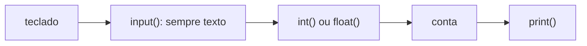

## Passo 1 · Leitura · Conversando com o programa

Seus programas até agora fazem sempre a mesma coisa, porque os dados estão escritos no código. Com `input()`, o programa **pergunta** e trabalha com o que a pessoa responder.

```python
nome = input("Qual é o seu nome? ")
print(f"Olá, {nome}!")
```

Quando o Python chega ao `input`, ele mostra o texto dos parênteses (o **prompt**, a pergunta), para e espera. A pessoa digita, aperta Enter, e o que foi digitado vira o valor de `nome`. O prompt é opcional: `input()` sozinho espera do mesmo jeito, sem mostrar nada.

#### input devolve sempre texto

Mesmo que a pessoa digite só dígitos, o resultado de `input()` é uma `str`. Se ela digitar `20`, a variável guarda `"20"`, com aspas. E com texto não se faz conta: `"20" + 1` dá `TypeError`, e `"3" + "4"` dá `"34"`.

Para calcular, converta antes:

- `int(texto)` transforma em número inteiro: `int("20")` é `20`.
- `float(texto)` transforma em número com casas decimais: `float("7.5")` é `7.5`.
- `str(numero)` faz o caminho de volta: `str(20)` é `"20"`.

O caminho de um dado digitado é sempre este:



Na prática, a leitura e a conversão costumam ficar na mesma linha:

```python
idade = int(input("Quantos anos você tem? "))
print(f"Ano que vem você terá {idade + 1}")
```

O Python resolve de dentro para fora: primeiro o `input` devolve o texto, depois o `int` o converte, e só então o número é guardado em `idade`.

#### Quando a conversão falha

A conversão só funciona se o texto tiver cara de número. Se não tiver, o programa para com `ValueError` ("erro de valor"):

- `int("dez")`: `ValueError: invalid literal for int() with base 10: 'dez'`
- `int("3.5")`: também `ValueError`, porque `int()` não aceita texto com ponto. Para esse caso existe o `float`.
- `float("2,5")`: `ValueError: could not convert string to float: '2,5'`. O Python só entende o **ponto** como separador decimal.

Na dúvida entre os dois, pense no dado: quantidade, idade e ano são `int`; preço, nota e altura são `float`. O `float` também aceita texto sem ponto: `float("5")` é `5.0`.

## Passo 2 · Previsão · Texto ou número?

Neste programa, as "respostas digitadas" já estão guardadas em duas variáveis de texto, do jeito que o `input()` as entregaria. Leia sem executar e digite exatamente o que ele mostra.

### Código
```python
a = "3"
b = "4"
print(a + b)
print(int(a) + int(b))
print(float(a) * 2)
```

### Dicas
1. O `+` entre dois textos junta, não soma.
2. Um `float` sempre aparece com a parte decimal, mesmo quando ela é zero.

### Saída esperada
```text
34
7
6.0
```

## Passo 3 · Exercício · Olá, você
modo: ordenar

Este programa lê o nome de uma pessoa e a cidade onde ela mora, **nessa ordem**, uma resposta por linha, e mostra uma saudação. Arraste as linhas para a ordem certa. Duas linhas estão sobrando.

Aqui os `input()` ficam sem prompt, com os parênteses vazios: a correção compara tudo o que o programa mostra na tela, e uma pergunta a mais mudaria a saída. Será assim nos exercícios com `input()` deste módulo.

Exemplo de execução. Se a pessoa digitar:

```
Ana
Ribeirão Preto
```

o programa mostra:

```
Olá, Ana de Ribeirão Preto!
```

Nenhuma linha precisa de indentação.

### Instruções
1. Leia primeiro o nome e depois a cidade, cada um com um `input()`.
2. Depois das duas leituras, mostre a saudação montada com o nome e a cidade.

### Solução
```python
nome = input()
cidade = input()
print(f"Olá, {nome} de {cidade}!")
```

### Distratores
```python
print("Olá, nome de cidade!")
nome = input
```

### Dicas
1. Cada `input()` lê uma linha digitada. A primeira linha é o nome, então a primeira leitura vai para `nome`.
2. A saudação usa as duas variáveis: ela só pode vir depois das duas leituras.
3. Sobram a linha em que `input` está sem parênteses e a que não tem o `f` nem as chaves.

### Verificação
```json
[
  { "id": "ana", "checkpoint": 1, "kind": "io", "stdin": "Ana\nRibeirão Preto\n", "expected_stdout": "Olá, Ana de Ribeirão Preto!",
    "name": "Entradas Ana e Ribeirão Preto", "hint": "A primeira linha digitada é o nome; a segunda é a cidade." },
  { "id": "caio", "checkpoint": 2, "kind": "io", "stdin": "Caio\nSão Paulo\n", "expected_stdout": "Olá, Caio de São Paulo!",
    "name": "Funciona com outro nome e outra cidade", "hint": "A saudação precisa usar o que foi lido, com a f-string e as chaves." },
  { "id": "eva", "checkpoint": 2, "kind": "io", "stdin": "Eva\nSantos\n", "expected_stdout": "Olá, Eva de Santos!\n", "match": "exact",
    "name": "Mostra só a saudação, sem mais nada", "hint": "Deixe os input() sem prompt: qualquer texto a mais aparece na saída." }
]
```

### Soluções erradas
```python name="lê a cidade antes do nome"
cidade = input()
nome = input()
print(f"Olá, {nome} de {cidade}!")
```
```python name="input com prompt"
nome = input("Nome: ")
cidade = input("Cidade: ")
print(f"Olá, {nome} de {cidade}!")
```
```python name="saudação sem f nem chaves"
nome = input()
cidade = input()
print("Olá, nome de cidade!")
```
```python name="resposta fixa"
print("Olá, Ana de Ribeirão Preto!")
```

## Passo 4 · Exercício · Soma e média

Agora um programa completo, do começo ao fim: ele lê dois números, um por linha, calcula a soma e a média e mostra os dois resultados com duas casas decimais.

Os números podem ter casas decimais (digitadas com ponto). A média de dois valores é a soma deles dividida por 2:

$$
\text{média} = \dfrac{a + b}{2}
$$

Exemplo de execução. Se a pessoa digitar:

```
2.5
5
```

o programa mostra exatamente:

```
Soma: 7.50
Média: 3.75
```

Use `input()` sem prompt. O programa é testado com outros números, então os resultados têm de sair das contas.

### Instruções
1. Leia os dois números, convertendo cada um para `float`, e mostre a soma no formato `Soma: 7.50`.
   Dica: sem converter, o `+` junta os dois textos.
2. Na linha seguinte, mostre a média no formato `Média: 3.75`, também com duas casas.

### Código inicial
```python
# Leia dois números, um por linha, e mostre a soma e a média

```

### Solução
```python
a = float(input())
b = float(input())
soma = a + b
media = (a + b) / 2
print(f"Soma: {soma:.2f}")
print(f"Média: {media:.2f}")
```

### Dicas
1. `input()` devolve texto. Para aceitar números com casas decimais, converta com `float(input())`.
2. Some antes de dividir: a divisão tem precedência sobre a soma, então use parênteses, `(a + b) / 2`.
3. Use `:.2f` nas duas linhas: `print(f"Soma: {soma:.2f}")`.

### Verificação
```json
[
  { "id": "soma-decimal", "checkpoint": 1, "kind": "io", "stdin": "2.5\n5\n", "expected_stdout": "^Soma: 7\\.50\\n", "match": "regex",
    "name": "Soma das entradas 2.5 e 5", "hint": "Converta as duas leituras com float e mostre a soma com duas casas." },
  { "id": "soma-inteiros", "checkpoint": 1, "kind": "io", "stdin": "10\n4\n", "expected_stdout": "^Soma: 14\\.00\\n", "match": "regex",
    "name": "Soma de dois números sem casas decimais", "hint": "Mesmo com entradas inteiras, a soma aparece com duas casas." },
  { "id": "exemplo", "checkpoint": 2, "kind": "io", "stdin": "2.5\n5\n", "expected_stdout": "Soma: 7.50\nMédia: 3.75",
    "name": "Soma e média das entradas 2.5 e 5", "hint": "A média é a soma dividida por 2. Confira os parênteses e o acento em Média." },
  { "id": "inteiros", "checkpoint": 2, "kind": "io", "stdin": "10\n4\n", "expected_stdout": "Soma: 14.00\nMédia: 7.00",
    "name": "Soma e média das entradas 10 e 4", "hint": "O programa precisa calcular com o que foi lido, não com valores fixos." },
  { "id": "outro", "checkpoint": 2, "kind": "io", "stdin": "1.5\n2\n", "expected_stdout": "Soma: 3.50\nMédia: 1.75",
    "name": "Soma e média de outro par de números", "hint": "Use float nas duas leituras e parênteses na média." }
]
```

### Soluções erradas
```python name="converte com int"
a = int(input())
b = int(input())
soma = a + b
media = (a + b) / 2
print(f"Soma: {soma:.2f}")
print(f"Média: {media:.2f}")
```
```python name="sem conversão"
a = input()
b = input()
soma = a + b
print(f"Soma: {soma}")
print(f"Média: {soma}")
```
```python name="média sem parênteses"
a = float(input())
b = float(input())
soma = a + b
media = a + b / 2
print(f"Soma: {soma:.2f}")
print(f"Média: {media:.2f}")
```
```python name="sem as duas casas decimais"
a = float(input())
b = float(input())
soma = a + b
media = (a + b) / 2
print(f"Soma: {soma}")
print(f"Média: {media}")
```
```python name="resposta fixa do exemplo"
print("Soma: 7.50")
print("Média: 3.75")
```

## Passo 5 · Quiz · input

### Pergunta
A pessoa digita `15` e aperta Enter. Qual é o tipo do valor guardado em `x`?
```python
x = input()
```
- [ ] `int`, porque ela digitou um número inteiro
- [ ] `float`
- [x] `str`
- [ ] Depende do que for digitado
> `input()` devolve sempre uma `str`, seja qual for a digitação. Aqui `x` guarda o texto `"15"`. Para fazer contas, converta com `int(x)` ou `float(x)`.

### Pergunta
O que acontece ao executar `int("3.5")`?
- [ ] O resultado é `3`
- [ ] O resultado é `4`
- [ ] O resultado é `3.5`
- [x] Dá `ValueError`
> `int()` só converte textos que representam números inteiros, como `"3"` ou `"-12"`. O texto `"3.5"` tem um ponto, e a conversão falha com `ValueError: invalid literal for int() with base 10: '3.5'`. Para esse texto, use `float("3.5")`.

## Passo 6 · Exercício · Idade em dias

Para fechar, um programa completo: ele lê o ano em que a pessoa nasceu e o ano atual, **nessa ordem**, um por linha, e mostra quantos dias ela já viveu, aproximadamente. A conta é simples: a idade em anos vezes 365.

Exemplo de execução. Se a pessoa digitar:

```
2006
2026
```

o programa mostra exatamente:

```
Você tem aproximadamente 7300 dias
```

Os anos são números inteiros, e o resultado aparece sem casas decimais. Use `input()` sem prompt.

### Instruções
1. Leia o ano de nascimento e depois o ano atual, convertendo os dois para inteiro.
2. Calcule a idade em anos e multiplique por 365. Mostre a frase do exemplo com o resultado no lugar de `7300`.
   Dica: a idade é o ano atual menos o ano de nascimento.

### Código inicial
```python
# Leia o ano de nascimento e o ano atual; mostre a idade em dias

```

### Solução
```python
nascimento = int(input())
atual = int(input())
dias = (atual - nascimento) * 365
print(f"Você tem aproximadamente {dias} dias")
```

### Dicas
1. Anos são números inteiros: converta cada leitura com `int`. Com `float`, o resultado ganha um `.0` no fim.
2. A idade é o ano atual menos o ano de nascimento, nessa ordem. Faça a subtração entre parênteses antes de multiplicar por 365.
3. Monte a frase com uma f-string: `f"Você tem aproximadamente {dias} dias"`.

### Verificação
```json
[
  { "id": "exemplo", "checkpoint": 1, "kind": "io", "stdin": "2006\n2026\n", "expected_stdout": "(^|\\s)7300 dias", "match": "regex",
    "name": "Nascimento em 2006, ano atual 2026: calcula os dias", "hint": "Converta as duas leituras com int. A primeira linha é o ano de nascimento." },
  { "id": "frase-exemplo", "checkpoint": 2, "kind": "io", "stdin": "2006\n2026\n", "expected_stdout": "Você tem aproximadamente 7300 dias\n", "match": "exact",
    "name": "Frase completa para 2006 e 2026", "hint": "Compare com o enunciado: acento em Você, um espaço entre as palavras, número sem casas decimais." },
  { "id": "frase-2000", "checkpoint": 2, "kind": "io", "stdin": "2000\n2026\n", "expected_stdout": "Você tem aproximadamente 9490 dias\n", "match": "exact",
    "name": "Frase completa para outro ano de nascimento", "hint": "O resultado precisa sair da conta com os anos lidos, não de um valor fixo." },
  { "id": "um-ano", "checkpoint": 2, "kind": "io", "stdin": "2025\n2026\n", "expected_stdout": "Você tem aproximadamente 365 dias\n", "match": "exact",
    "name": "Um ano de idade são 365 dias", "hint": "Subtraia os anos antes de multiplicar por 365." }
]
```

### Soluções erradas
```python name="converte com float"
nascimento = float(input())
atual = float(input())
dias = (atual - nascimento) * 365
print(f"Você tem aproximadamente {dias} dias")
```
```python name="subtrai na ordem errada"
nascimento = int(input())
atual = int(input())
dias = (nascimento - atual) * 365
print(f"Você tem aproximadamente {dias} dias")
```
```python name="sem parênteses na subtração"
nascimento = int(input())
atual = int(input())
dias = atual - nascimento * 365
print(f"Você tem aproximadamente {dias} dias")
```
```python name="resposta fixa do exemplo"
print("Você tem aproximadamente 7300 dias")
```
