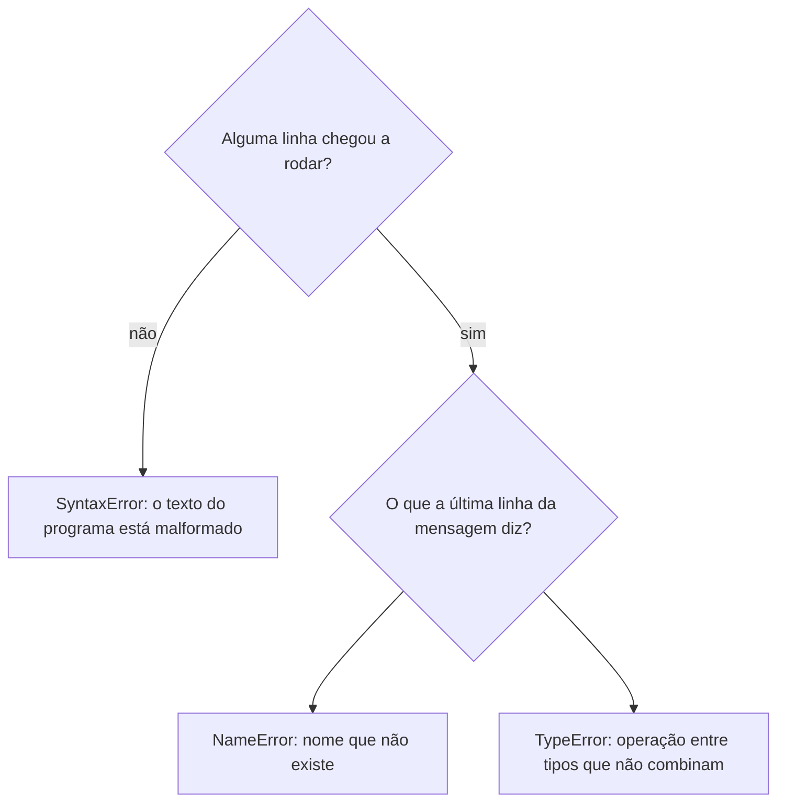

## Passo 1 · Leitura · Três erros que todo mundo comete

Errar faz parte de programar. Quando algo dá errado, o Python para e mostra uma mensagem que diz **onde** parou e **por quê**. Achar e consertar o defeito de um programa (o *bug*) se chama **depuração**, e ela começa pela leitura dessa mensagem. Três erros respondem por quase todos os tropeços de quem está começando.

#### SyntaxError: o texto do programa está malformado

```python
total = 10
print("Total:, total)
```

```
  File "main.py", line 2
    print("Total:, total)
          ^
SyntaxError: unterminated string literal (detected at line 2)
```

O Python lê o arquivo inteiro antes de executar. Se o texto não segue as regras da linguagem (aspa sem fechar, parêntese faltando), **nenhuma linha roda**. A mensagem traz o arquivo e o número da linha (`line 2`), a linha copiada e uma seta (`^`) no ponto em que o Python se perdeu. Aqui a seta está na aspa que abriu e nunca fechou.

#### NameError: nome que não existe

```python
total = 10
print(totl)
```

```
Traceback (most recent call last):
  File "main.py", line 2, in <module>
    print(totl)
          ^^^^
NameError: name 'totl' is not defined. Did you mean: 'total'?
```

O *traceback* é o relatório de erro que o Python imprime quando o programa para no meio da execução. As setas marcam o nome desconhecido. Quase sempre é erro de digitação, ou um texto que ficou sem aspas. Às vezes o Python até sugere o nome certo ("Did you mean", "você quis dizer").

#### TypeError: tipos que não combinam

```python
idade = 20
print("Idade: " + idade)
```

```
Traceback (most recent call last):
  File "main.py", line 2, in <module>
    print("Idade: " + idade)
          ~~~~~~~~~~^~~~~~~
TypeError: can only concatenate str (not "int") to str
```

Os nomes existem, mas a operação não faz sentido entre aqueles tipos: aqui, juntar texto com número.

#### Como ler a mensagem

**Leia a última linha primeiro.** Ela traz o nome do erro e a explicação. Depois suba: o número da linha diz onde olhar, e a seta, em que ponto. Este roteiro ajuda a reconhecer cada um:



Se a mensagem não bastar, inspecione: um `print(type(idade))` antes da linha do erro mostra o que a variável guarda de fato. E conserte a **causa**. Apagar a linha que reclama faz a mensagem sumir, mas o programa deixa de fazer o que devia.

## Passo 2 · Exercício · Bug de sintaxe

O programa abaixo deveria mostrar o cardápio do restaurante universitário. Ao executar, nada aparece além desta mensagem:

```
  File "main.py", line 2
    print("Arroz e feijão)
          ^
SyntaxError: unterminated string literal (detected at line 2)
```

Leia a mensagem antes de mexer no código: a última linha diz que há uma string sem fim, e `line 2` diz onde. Conserte o programa para que a saída seja exatamente esta:

```
Cardápio do RU
Arroz e feijão
Frango grelhado
Suco de laranja
```

### Instruções
1. Corrija a linha apontada pela mensagem para que o programa volte a rodar.
   Dica: a seta mostra onde a string começou.
2. Mantenha as quatro linhas do cardápio na saída, sem apagar nem alterar nenhum texto.

### Código inicial
```python
print("Cardápio do RU")
print("Arroz e feijão)
print("Frango grelhado")
print("Suco de laranja")
```

### Solução
```python
print("Cardápio do RU")
print("Arroz e feijão")
print("Frango grelhado")
print("Suco de laranja")
```

### Dicas
1. A seta aponta onde o Python se perdeu: na aspa que abre a string da linha 2.
2. Conte as aspas da linha 2 e compare com as outras linhas. Cada string abre e fecha com o mesmo tipo de aspas.
3. Falta uma aspa dupla logo depois de `feijão`, antes do parêntese.

### Verificação
```json
[
  { "id": "roda", "checkpoint": 1, "kind": "io", "stdin": "", "expected_stdout": "^Cardápio do RU\\n", "match": "regex",
    "name": "O programa roda e começa com Cardápio do RU", "hint": "Enquanto houver erro de sintaxe, nenhuma linha é executada. Feche a string da linha 2." },
  { "id": "cardapio", "checkpoint": 2, "kind": "io", "stdin": "", "expected_stdout": "Cardápio do RU\nArroz e feijão\nFrango grelhado\nSuco de laranja\n", "match": "exact",
    "name": "As quatro linhas do cardápio", "hint": "A linha consertada continua no programa: o cardápio tem quatro linhas." }
]
```

### Soluções erradas
```python name="apaga a linha com erro"
print("Cardápio do RU")
print("Frango grelhado")
print("Suco de laranja")
```
```python name="fecha com aspas simples"
print("Cardápio do RU")
print("Arroz e feijão')
print("Frango grelhado")
print("Suco de laranja")
```
```python name="transforma a linha em comentário"
print("Cardápio do RU")
# print("Arroz e feijão)
print("Frango grelhado")
print("Suco de laranja")
```

## Passo 3 · Exercício · Bug de nome

Este programa monta o nome completo de um aluno e deveria mostrar `Aluno: Davi Lima`. Ao executar, ele para na última linha:

```
Traceback (most recent call last):
  File "main.py", line 4, in <module>
    print("Aluno:", nome_compelto)
                    ^^^^^^^^^^^^^
NameError: name 'nome_compelto' is not defined. Did you mean: 'nome_completo'?
```

As três primeiras linhas rodaram sem problema. Na quarta, o Python procurou um nome que não existe. A variável `nome_completo` foi criada corretamente na linha 3 e deve continuar com esse nome. Conserte o programa para que a saída seja exatamente esta:

```
Aluno: Davi Lima
```

### Instruções
1. Corrija o nome usado na linha 4 para que o programa mostre `Aluno: Davi Lima`.
   Dica: compare, letra por letra, o nome criado na linha 3 com o nome usado na linha 4.
2. Mantenha a variável `nome_completo`, com esse nome, guardando o texto `Davi Lima`.

### Código inicial
```python
nome = "Davi"
sobrenome = "Lima"
nome_completo = nome + " " + sobrenome
print("Aluno:", nome_compelto)
```

### Solução
```python
nome = "Davi"
sobrenome = "Lima"
nome_completo = nome + " " + sobrenome
print("Aluno:", nome_completo)
```

### Dicas
1. `NameError` quer dizer que o Python não conhece aquele nome. Compare os dois nomes letra por letra.
2. Corrija o **uso**, na linha 4, e não a definição, na linha 3: o nome certo é o que foi criado.
3. Na linha 4, duas letras estão trocadas: `compelto` deveria ser `completo`.

### Verificação
```json
[
  { "id": "saida", "checkpoint": 1, "kind": "io", "stdin": "", "expected_stdout": "Aluno: Davi Lima\n", "match": "exact",
    "name": "Mostra Aluno: Davi Lima", "hint": "O print precisa usar a variável que foi criada na linha 3." },
  { "id": "variavel", "checkpoint": 2, "kind": "variable", "variable": "nome_completo", "expected": "Davi Lima", "type": "str",
    "name": "A variável nome_completo continua existindo", "hint": "Não renomeie a variável da linha 3: corrija o nome na linha que a usa." }
]
```

### Soluções erradas
```python name="renomeia a definição para o nome errado"
nome = "Davi"
sobrenome = "Lima"
nome_compelto = nome + " " + sobrenome
print("Aluno:", nome_compelto)
```
```python name="cria uma segunda variável vazia"
nome = "Davi"
sobrenome = "Lima"
nome_completo = nome + " " + sobrenome
nome_compelto = ""
print("Aluno:", nome_compelto)
```
```python name="põe o nome errado entre aspas"
nome = "Davi"
sobrenome = "Lima"
nome_completo = nome + " " + sobrenome
print("Aluno:", "nome_compelto")
```
```python name="apaga a linha com erro"
nome = "Davi"
sobrenome = "Lima"
nome_completo = nome + " " + sobrenome
```

## Passo 4 · Exercício · Bug de tipo

Este programa lê a idade de uma pessoa (um número inteiro, com `input()` sem prompt) e deveria mostrar a idade que ela terá no ano que vem. Se a pessoa digitar `20`, a saída esperada é:

```
Ano que vem: 21
```

Mas, ao executar e digitar `20`, o programa para assim:

```
Traceback (most recent call last):
  File "main.py", line 2, in <module>
    print("Ano que vem:", idade + 1)
                          ~~~~~~^~~
TypeError: can only concatenate str (not "int") to str
```

A mensagem diz que o Python tentou juntar uma `str` com um `int`. O `1` é um número. Então qual é o tipo de `idade`, e por quê? Conserte a causa. O programa é testado com mais de uma idade.

### Instruções
1. Faça `idade` guardar um número inteiro, e não um texto.
   Dica: lembre o que o `input()` devolve.
2. Deixe a saída no formato `Ano que vem: 21`, com a idade lida mais 1.

### Código inicial
```python
idade = input()
print("Ano que vem:", idade + 1)
```

### Solução
```python
idade = int(input())
print("Ano que vem:", idade + 1)
```

### Dicas
1. `input()` devolve sempre texto, mesmo quando a pessoa digita só dígitos.
2. Converta antes de somar. A soma `idade + 1` está certa; o problema nasce na linha 1.
3. A primeira linha fica `idade = int(input())`.

### Verificação
```json
[
  { "id": "vinte", "checkpoint": 1, "kind": "io", "stdin": "20\n", "expected_stdout": "Ano que vem: 21",
    "name": "Entrada 20", "hint": "Converta o texto lido em número inteiro antes de somar 1." },
  { "id": "dezessete", "checkpoint": 2, "kind": "io", "stdin": "17\n", "expected_stdout": "Ano que vem: 18",
    "name": "Entrada 17", "hint": "O resultado precisa ser calculado a partir da idade lida." },
  { "id": "nove", "checkpoint": 2, "kind": "io", "stdin": "9\n", "expected_stdout": "Ano que vem: 10",
    "name": "Entrada 9: a soma é uma conta, não uma emenda de textos", "hint": "9 mais 1 é 10. Se saiu 91, o programa juntou dois textos em vez de somar." }
]
```

### Soluções erradas
```python name="soma o texto 1"
idade = input()
print("Ano que vem:", idade + "1")
```
```python name="converte depois de somar"
idade = input()
print("Ano que vem:", int(idade + 1))
```
```python name="converte o 1 em texto"
idade = input()
print("Ano que vem:", idade + str(1))
```
```python name="resposta fixa"
idade = input()
print("Ano que vem: 21")
```

## Passo 5 · Quiz · Qual é o erro?

### Pergunta
Qual erro este programa gera?
```python
print("Bom dia"
print("Boa tarde")
```
- [x] `SyntaxError`
- [ ] `NameError`
- [ ] `TypeError`
- [ ] Nenhum: mostra `Bom dia` e depois dá erro
> Falta fechar o parêntese da primeira linha. É um problema no texto do programa, e o Python o encontra antes de executar qualquer coisa: por isso nem o `Bom dia` aparece.

### Pergunta
Qual erro este programa gera?
```python
preco = 10
print(Preco)
```
- [ ] `SyntaxError`
- [x] `NameError`
- [ ] `TypeError`
- [ ] Nenhum: mostra `10`
> Maiúsculas e minúsculas fazem diferença: `preco` existe, `Preco` não. O texto do programa está bem formado, a linha 1 roda, e na linha 2 o Python procura um nome que nunca foi criado.

### Pergunta
Qual erro este programa gera?
```python
quantidade = "3"
print(quantidade - 1)
```
- [ ] `SyntaxError`
- [ ] `NameError`
- [x] `TypeError`
- [ ] Nenhum: mostra `2`
> `quantidade` guarda o texto `"3"`, por causa das aspas, e não existe subtração entre texto e número. A mensagem é `TypeError: unsupported operand type(s) for -: 'str' and 'int'`. O conserto é guardar o número: `quantidade = 3`.
