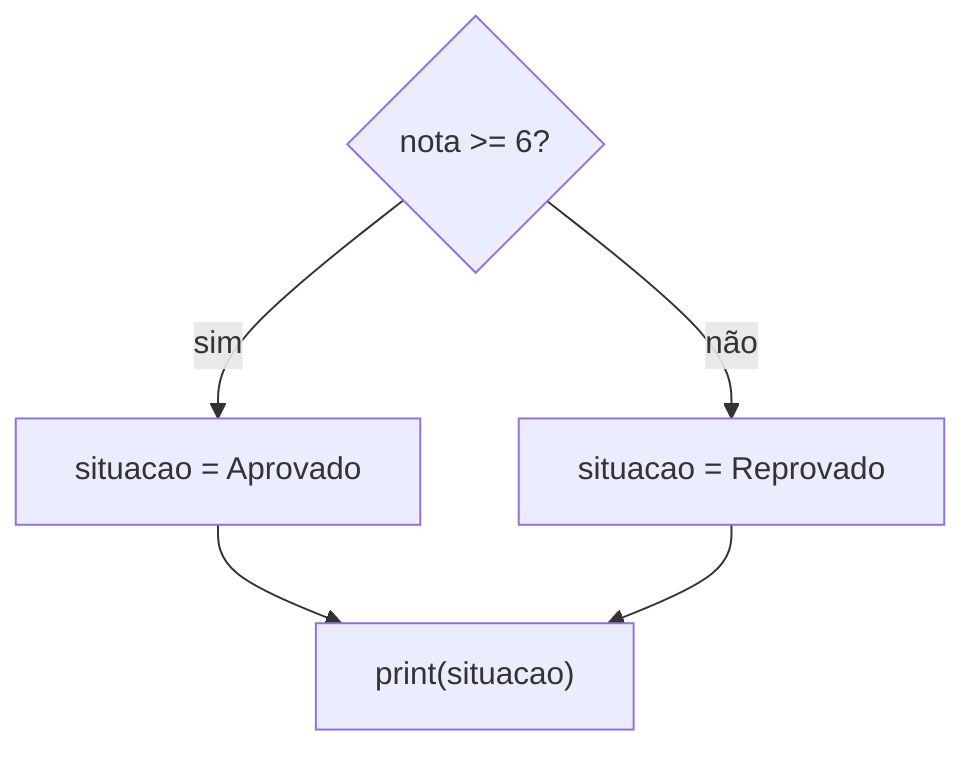

## Passo 1 · Leitura · Dois caminhos

Uma comparação responde `True` ou `False`. O `if` ("se", em inglês) usa essa resposta para escolher o que o programa faz:

```python
nota = 7.5
if nota >= 6:
    situacao = "Aprovado"
else:
    situacao = "Reprovado"
print(situacao)
```

Leia assim: **se** a nota for maior ou igual a 6, a situação é `Aprovado`; **senão**, é `Reprovado`. Só um dos dois caminhos é executado, nunca os dois.



Três detalhes de escrita são obrigatórios.

**Dois-pontos.** A linha do `if` e a linha do `else` terminam com `:`. Sem eles, o Python responde `SyntaxError: expected ':'`.

**Indentação.** As linhas que pertencem a um caminho ficam recuadas 4 espaços. Esse recuo se chama *indentação*, e as linhas recuadas formam um **bloco**. No Python a indentação não é enfeite: é ela que diz onde o bloco começa e onde termina. Um `if` sem bloco recuado dá `IndentationError`.

**O `else` não tem condição.** Ele significa "em qualquer outro caso" e fica alinhado com o `if`. O `else` é opcional: sem ele, quando a condição é falsa, o programa só pula o bloco.

A linha `print(situacao)` voltou para a margem esquerda. Ela está fora dos dois blocos e por isso roda sempre, qualquer que seja a nota.

Execute passo a passo e veja qual bloco é pulado. Depois troque a nota para `8` e execute de novo:

```python visualizar
nota = 5.5
if nota >= 6:
    situacao = "Aprovado"
else:
    situacao = "Reprovado"
print(situacao)
```

#### Uma receita com nome

Alguns exercícios deste módulo pedem uma **função**: uma receita com nome que recebe valores e devolve um resultado. Por enquanto, basta reconhecer o formato:

```python
def dobro(n):
    return n * 2
```

`def` cria a receita `dobro`, que recebe um valor chamado `n`. O corpo também é um bloco indentado. `return` devolve o resultado a quem usar a receita: `dobro(4)` vale `8`. Repare que `return` devolve, não imprime. As funções ganham um módulo inteiro mais adiante.

## Passo 2 · Exercício · Par ou ímpar
modo: ordenar

Um número é par quando o resto da divisão dele por 2 é zero. O operador `%`, que você já usou, calcula esse resto: `8 % 2` dá `0` e `7 % 2` dá `1`.

Monte um programa que lê um número inteiro e imprime `par` ou `ímpar`. Arraste as linhas para a ordem certa e ajuste a indentação de cada uma. Uma das linhas está sobrando: ela tem um erro e não faz parte da resposta.

Exemplo de execução, com a entrada `7`:

```
ímpar
```

### Instruções
1. Leia o número inteiro e guarde em `n`. Essa é a primeira linha do programa.
2. Teste se o resto da divisão de `n` por 2 é igual a zero.
   Dica: comparar usa dois sinais de igual.
3. Imprima `par` no bloco do `if` e `ímpar` no bloco do `else`, cada `print` um nível à direita.

### Solução
```python
n = int(input())
if n % 2 == 0:
    print("par")
else:
    print("ímpar")
```

### Distratores
```python
if n % 2 = 0:
```

### Dicas
1. `n % 2` dá `0` para os números pares e `1` para os ímpares.
2. `if` e `else` ficam na margem esquerda, alinhados entre si. O que está dentro de cada um fica um nível à direita.
3. A linha que sobra é a que usa `=` para comparar: um sinal só guarda um valor, não pergunta nada.

### Verificação
```json
[
  { "id": "le-numero", "checkpoint": 1, "kind": "source", "rule": { "type": "calls", "name": "input" },
    "name": "Lê o número com input()", "hint": "A leitura vem antes do teste: o if precisa de n já definido." },
  { "id": "usa-if", "checkpoint": 2, "kind": "source", "rule": { "type": "uses", "construct": "if" },
    "name": "Usa if para decidir" },
  { "id": "par-4", "checkpoint": 3, "kind": "io", "stdin": "4\n", "expected_stdout": "par",
    "name": "Entrada 4: par", "hint": "Com resto zero, o programa deve imprimir só a palavra par." },
  { "id": "impar-7", "checkpoint": 3, "kind": "io", "stdin": "7\n", "expected_stdout": "ímpar",
    "name": "Entrada 7: ímpar", "hint": "O caminho do else precisa imprimir ímpar, com acento." },
  { "id": "par-0", "checkpoint": 3, "kind": "io", "stdin": "0\n", "expected_stdout": "par",
    "name": "Entrada 0: par", "hint": "O resto de 0 dividido por 2 também é zero." }
]
```

### Soluções erradas
```python name="teste invertido: resto 1 imprime par"
n = int(input())
if n % 2 == 1:
    print("par")
else:
    print("ímpar")
```
```python name="sem else: nada é impresso para os ímpares"
n = int(input())
if n % 2 == 0:
    print("par")
```
```python name="print do ímpar fora do bloco: roda sempre"
n = int(input())
if n % 2 == 0:
    print("par")
print("ímpar")
```

## Passo 3 · Previsão · Qual bloco executa

Leia o programa sem executar e digite exatamente o que ele imprime. Preste atenção em quais linhas estão indentadas.

### Código
```python
idade = 16
if idade >= 18:
    print("Pode dirigir")
else:
    print("Não pode dirigir")
print("Fim")
```

### Dicas
1. Só um dos dois blocos roda: o do `if` quando a condição é verdadeira, o do `else` quando é falsa.
2. A última linha não está indentada. Ela não pertence a nenhum dos dois blocos.

### Saída esperada
```text
Não pode dirigir
Fim
```

## Passo 4 · Exercício · Maior de dois

Agora o `if` vai dentro de uma função. A função `maior(a, b)` recebe dois números e **devolve** o maior deles. A primeira linha já está pronta. O `pass` é só um marcador de "nada aqui ainda": apague-o e escreva o corpo.

O corpo da função é um bloco, e o `if` dentro dele tem os próprios blocos. São dois níveis de indentação:

```python
def sinal(n):
    if n >= 0:
        return "positivo ou zero"
    else:
        return "negativo"
```

Exemplos do que a sua função deve devolver: `maior(3, 5)` vale `5`, `maior(9, 2)` vale `9` e `maior(4, 4)` vale `4`.

### Instruções
1. Dentro de `maior`, quando `a` for maior que `b`, devolva `a` com `return`.
   Dica: quem devolve o valor é o return; print só mostra na tela.
2. Em qualquer outro caso, devolva `b`.

### Código inicial
```python
def maior(a, b):
    pass
```

### Solução
```python
def maior(a, b):
    if a > b:
        return a
    else:
        return b
```

### Dicas
1. `return` entrega o valor a quem chamou a função. `print` apenas escreve na tela, e a função fica sem devolver nada.
2. Compare `a` com `b` no `if`. Um caminho devolve `a`, o outro devolve `b`.
3. Quando os dois números são iguais, tanto faz qual você devolve: o `else` já cuida disso.

### Verificação
```json
[
  { "id": "maior-9-2", "checkpoint": 1, "kind": "call", "function": "maior", "args": [9, 2], "expected": 9,
    "name": "maior(9, 2) é 9", "hint": "Quando o primeiro número é o maior, é ele que deve ser devolvido com return." },
  { "id": "maior-3-5", "checkpoint": 2, "kind": "call", "function": "maior", "args": [3, 5], "expected": 5,
    "name": "maior(3, 5) é 5", "hint": "Quando o segundo número é o maior, a função deve devolver o segundo." },
  { "id": "maior-iguais", "checkpoint": 2, "kind": "call", "function": "maior", "args": [4, 4], "expected": 4,
    "name": "maior(4, 4) é 4", "hint": "Com dois números iguais, a função ainda precisa devolver um deles." },
  { "id": "maior-negativos", "checkpoint": 2, "kind": "call", "function": "maior", "args": [-1, -5], "expected": -1,
    "name": "maior(-1, -5) é -1", "hint": "Entre dois negativos, o maior é o que está mais perto do zero." }
]
```

### Soluções erradas
```python name="print em vez de return: a função devolve None"
def maior(a, b):
    if a > b:
        print(a)
    else:
        print(b)
```
```python name="devolve sempre o primeiro"
def maior(a, b):
    return a
```
```python name="comparação invertida: devolve o menor"
def maior(a, b):
    if a < b:
        return a
    else:
        return b
```
```python name="sem else: não devolve nada quando b é o maior"
def maior(a, b):
    if a > b:
        return a
```

## Passo 5 · Quiz · if e else

### Pergunta
O Python recusa este programa com `SyntaxError`. O que falta?
```python
x = 8
if x > 5
    print("grande")
```
- [ ] Parênteses em volta de `x > 5`
- [x] Dois-pontos no fim da linha do `if`
- [ ] Um `else` depois do `print`
- [ ] A palavra `then` depois da condição
> A linha do `if` termina com dois-pontos: `if x > 5:`. Parênteses são opcionais, o `else` também, e `then` não existe no Python.

### Pergunta
Quando a linha `print("Obrigado!")` é executada?
```python
valor = 30
if valor >= 50:
    print("Frete grátis")
else:
    print("Frete: 10 reais")
print("Obrigado!")
```
- [ ] Só quando `valor >= 50` é verdadeiro
- [ ] Só quando `valor >= 50` é falso
- [x] Sempre, porque ela está fora dos blocos do `if` e do `else`
- [ ] Nunca, porque vem depois do `else`
> A linha voltou para a margem esquerda, então não pertence a nenhum bloco. O programa escolhe um dos dois caminhos e depois segue para ela.

## Passo 6 · Exercício · Aprovação

Em muitas disciplinas, quem tira nota 6,0 ou mais está aprovado. Escreva um programa que lê uma nota e imprime a situação do aluno: `Aprovado` ou `Reprovado`.

A nota pode ter casas decimais, digitadas com ponto: `5.9`, `7.25`. Use `input()` sem texto dentro dos parênteses, para que a saída tenha só a situação.

Exemplos de execução:

| Entrada | Saída |
|---|---|
| `6.0` | `Aprovado` |
| `5.9` | `Reprovado` |
| `9.5` | `Aprovado` |

### Instruções
1. Leia a nota e converta para número decimal.
   Dica: int() não aceita um texto como 5.9.
2. Se a nota for maior ou igual a 6.0, imprima `Aprovado`; senão, imprima `Reprovado`.

### Código inicial
```python
# Leia a nota

# Decida e imprima Aprovado ou Reprovado
```

### Solução
```python
nota = float(input())
if nota >= 6.0:
    print("Aprovado")
else:
    print("Reprovado")
```

### Dicas
1. A nota exatamente igual a 6.0 é de aprovação: o operador precisa aceitar o igual.
2. A nota pode ter casas decimais. Converta a entrada com `float()`, não com `int()`.
3. São dois caminhos: `if nota >= 6.0:` com um `print`, e `else:` com o outro.

### Verificação
```json
[
  { "id": "nota-decimal", "checkpoint": 1, "kind": "io", "stdin": "5.9\n", "expected_stdout": "Reprovado",
    "name": "Nota 5.9: Reprovado", "hint": "A entrada tem casas decimais. A conversão que você usou aceita o texto 5.9?" },
  { "id": "usa-if", "checkpoint": 2, "kind": "source", "rule": { "type": "uses", "construct": "if" },
    "name": "Usa if para decidir" },
  { "id": "borda-6", "checkpoint": 2, "kind": "io", "stdin": "6.0\n", "expected_stdout": "Aprovado",
    "name": "Nota 6.0: Aprovado", "hint": "A nota mínima de aprovação também aprova. Confira o operador da comparação." },
  { "id": "nota-alta", "checkpoint": 2, "kind": "io", "stdin": "9.5\n", "expected_stdout": "Aprovado",
    "name": "Nota 9.5: Aprovado" },
  { "id": "nota-baixa", "checkpoint": 2, "kind": "io", "stdin": "2\n", "expected_stdout": "Reprovado",
    "name": "Nota 2: Reprovado", "hint": "Abaixo de 6.0, a saída deve ser só a palavra Reprovado." }
]
```

### Soluções erradas
```python name="maior que 6: reprova quem tirou 6.0"
nota = float(input())
if nota > 6.0:
    print("Aprovado")
else:
    print("Reprovado")
```
```python name="int(input()): falha com 5.9"
nota = int(input())
if nota >= 6:
    print("Aprovado")
else:
    print("Reprovado")
```
```python name="sem conversão: compara texto com número"
nota = input()
if nota >= 6.0:
    print("Aprovado")
else:
    print("Reprovado")
```
```python name="sem else: Reprovado é impresso sempre"
nota = float(input())
if nota >= 6.0:
    print("Aprovado")
print("Reprovado")
```
