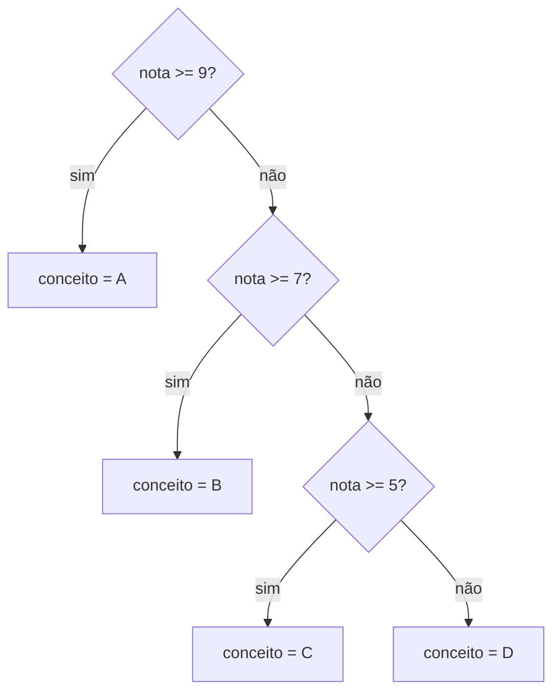

## Passo 1 · Leitura · Mais de dois caminhos

`if` e `else` dão dois caminhos. Muitas decisões têm mais: uma nota vira conceito A, B, C ou D; uma distância cai em uma de três faixas de frete. Para isso existe o `elif`, abreviação de *else if*: "senão, se".

Veja a tabela de conceitos de uma disciplina e o código que a representa:

| Nota | Conceito |
|---|---|
| 9 ou mais | A |
| de 7 a menos de 9 | B |
| de 5 a menos de 7 | C |
| menos de 5 | D |

```python
nota = 7.5
if nota >= 9:
    conceito = "A"
elif nota >= 7:
    conceito = "B"
elif nota >= 5:
    conceito = "C"
else:
    conceito = "D"
print(conceito)   # B
```

O Python testa as condições **de cima para baixo** e executa o bloco da **primeira** que for verdadeira. Depois disso, pula todo o resto da cadeia, sem nem olhar as outras condições. Com a nota 7.5: `nota >= 9` é falso, então ele segue; `nota >= 7` é verdadeiro, então `conceito` recebe `"B"` e a cadeia acaba. O teste `nota >= 5` nem chega a ser feito.



As regras de escrita:

- a cadeia começa com um `if`, e só um;
- depois vêm quantos `elif` você precisar, cada um com a própria condição e dois-pontos;
- o `else` é opcional, vem por último e não tem condição: ele recolhe tudo o que sobrou.

Repare que a tabela diz "de 7 a menos de 9", mas o código só pergunta `nota >= 7`. Não é preciso repetir o "menos de 9": o Python só chega ao segundo teste quando o primeiro falhou, isto é, quando a nota já é menor que 9.

No exemplo abaixo, o frete depende da distância em quilômetros. Execute passo a passo e veja em qual teste a cadeia para. Depois troque a distância para `3` e para `40`:

```python visualizar
distancia = 12
if distancia <= 5:
    frete = 5.0
elif distancia <= 20:
    frete = 12.0
else:
    frete = 25.0
print(frete)
```

## Passo 2 · Previsão · A ordem importa

Alguém reescreveu a cadeia dos conceitos mudando a ordem dos testes. Leia o programa sem executar e digite o que ele imprime para a nota 9.5.

### Código
```python
nota = 9.5
if nota >= 5:
    conceito = "C"
elif nota >= 7:
    conceito = "B"
elif nota >= 9:
    conceito = "A"
else:
    conceito = "D"
print(conceito)
```

### Dicas
1. O Python para no primeiro teste verdadeiro e pula todos os outros.
2. 9.5 é maior que 9, mas também é maior que 5. Qual desses testes vem primeiro?

### Saída esperada
```text
C
```

## Passo 3 · Exercício · Conceito
modo: lacunas

No passo anterior, uma nota 9.5 recebeu conceito C. O motivo: toda nota que passa em `nota >= 9` também passa em `nota >= 5`. Como o teste do 5 vinha primeiro, ele ficava com todas as notas boas, e os testes de baixo nunca eram alcançados.

A regra prática: quando as condições usam `>=`, comece pela faixa **mais alta** e desça. Cada teste recolhe o que os anteriores deixaram passar. (Com `<` ou `<=` é o contrário: comece pela faixa mais baixa.)

Complete as lacunas (`___`) da função `conceito(nota)`, que devolve o conceito conforme a tabela:

| Nota | Conceito |
|---|---|
| 9 ou mais | `"A"` |
| de 7 a menos de 9 | `"B"` |
| de 5 a menos de 7 | `"C"` |
| menos de 5 | `"D"` |

### Instruções
1. Complete a primeira condição: a faixa do conceito `"A"`.
2. Complete a palavra que encadeia a segunda condição à primeira.
   Dica: é a palavra que significa "senão, se".
3. Complete a faixa e o valor devolvido para o conceito `"C"`.

### Código inicial
```python
def conceito(nota):
    if nota >= ___:
        return "A"
    ___ nota >= 7:
        return "B"
    elif nota >= ___:
        return ___
    else:
        return "D"
```

### Solução
```python
def conceito(nota):
    if nota >= 9:
        return "A"
    elif nota >= 7:
        return "B"
    elif nota >= 5:
        return "C"
    else:
        return "D"
```

### Dicas
1. Com `>=`, a cadeia começa pela faixa mais alta: a primeira lacuna é a menor nota que ainda recebe A.
2. Um `elif` só é testado quando todos os testes acima dele falharam.
3. O conceito é um texto: a última lacuna precisa das aspas.

### Verificação
```json
[
  { "id": "nota-10", "checkpoint": 1, "kind": "call", "function": "conceito", "args": [10], "expected": "A",
    "name": "conceito(10) é \"A\"" },
  { "id": "borda-9", "checkpoint": 1, "kind": "call", "function": "conceito", "args": [9], "expected": "A",
    "name": "conceito(9) é \"A\"", "hint": "A nota 9 exata já recebe o conceito mais alto." },
  { "id": "abaixo-de-9", "checkpoint": 1, "kind": "call", "function": "conceito", "args": [8.99], "expected": "B",
    "name": "conceito(8.99) é \"B\"", "hint": "Quase 9 ainda não é 9: confira o limite da primeira faixa." },
  { "id": "borda-7", "checkpoint": 2, "kind": "call", "function": "conceito", "args": [7], "expected": "B",
    "name": "conceito(7) é \"B\"" },
  { "id": "nota-6-5", "checkpoint": 3, "kind": "call", "function": "conceito", "args": [6.5], "expected": "C",
    "name": "conceito(6.5) é \"C\"" },
  { "id": "borda-5", "checkpoint": 3, "kind": "call", "function": "conceito", "args": [5], "expected": "C",
    "name": "conceito(5) é \"C\"", "hint": "A nota 5 exata ainda recebe C. Confira o limite da terceira faixa." },
  { "id": "abaixo-de-5", "checkpoint": 3, "kind": "call", "function": "conceito", "args": [4.9], "expected": "D",
    "name": "conceito(4.9) é \"D\"", "hint": "Abaixo de 5, nenhuma condição é verdadeira e a nota cai no else." },
  { "id": "nota-0", "checkpoint": 3, "kind": "call", "function": "conceito", "args": [0], "expected": "D",
    "name": "conceito(0) é \"D\"" }
]
```

### Soluções erradas
```python name="ifs independentes: o último verdadeiro vence"
def conceito(nota):
    resultado = "D"
    if nota >= 9:
        resultado = "A"
    if nota >= 7:
        resultado = "B"
    if nota >= 5:
        resultado = "C"
    return resultado
```
```python name="faixas em ordem crescente: tudo a partir de 5 vira C"
def conceito(nota):
    if nota >= 5:
        return "C"
    elif nota >= 7:
        return "B"
    elif nota >= 9:
        return "A"
    else:
        return "D"
```
```python name="limites trocados nas lacunas"
def conceito(nota):
    if nota >= 10:
        return "A"
    elif nota >= 7:
        return "B"
    elif nota >= 6:
        return "C"
    else:
        return "D"
```

## Passo 4 · Exercício · Temperatura

Um aplicativo de clima resume a temperatura do dia em uma palavra:

| Temperatura (°C) | Palavra |
|---|---|
| menos de 15 | `frio` |
| de 15 a menos de 28 | `agradável` |
| 28 ou mais | `quente` |

Escreva um programa que lê a temperatura (pode ter casas decimais, com ponto) e imprime **uma** dessas três palavras, em minúsculas. Use `input()` sem texto dentro dos parênteses.

Exemplos de execução:

| Entrada | Saída |
|---|---|
| `10` | `frio` |
| `15` | `agradável` |
| `27.9` | `agradável` |
| `28` | `quente` |

### Instruções
1. Leia a temperatura como número decimal.
2. Com uma cadeia `if`/`elif`/`else`, imprima `frio` para menos de 15, `agradável` para menos de 28 e `quente` nos outros casos.
   Dica: os limites 15 e 28 pertencem à faixa de cima.

### Código inicial
```python
# Leia a temperatura

# Imprima frio, agradável ou quente
```

### Solução
```python
temperatura = float(input())
if temperatura < 15:
    print("frio")
elif temperatura < 28:
    print("agradável")
else:
    print("quente")
```

### Dicas
1. São três caminhos e só um pode rodar: `if` para o primeiro, `elif` para o segundo, `else` para o resto.
2. 15 graus já é agradável, e 28 já é quente. O operador que deixa o limite de fora é `<`.
3. Como os testes usam `<`, comece pela faixa mais baixa: `if temperatura < 15:` e depois `elif temperatura < 28:`.

### Verificação
```json
[
  { "id": "le-decimal", "checkpoint": 1, "kind": "io", "stdin": "27.9\n", "expected_stdout": "agradável",
    "name": "Entrada 27.9: agradável", "hint": "A temperatura pode ter casas decimais: converta a entrada com float()." },
  { "id": "usa-if", "checkpoint": 2, "kind": "source", "rule": { "type": "uses", "construct": "if" },
    "name": "Usa if para decidir" },
  { "id": "frio-10", "checkpoint": 2, "kind": "io", "stdin": "10\n", "expected_stdout": "frio",
    "name": "Entrada 10: só a palavra frio", "hint": "A saída deve ter uma única linha. Se apareceram duas palavras, os testes não estão encadeados com elif." },
  { "id": "frio-14-9", "checkpoint": 2, "kind": "io", "stdin": "14.9\n", "expected_stdout": "frio",
    "name": "Entrada 14.9: frio" },
  { "id": "borda-15", "checkpoint": 2, "kind": "io", "stdin": "15\n", "expected_stdout": "agradável",
    "name": "Entrada 15: agradável", "hint": "O limite 15 pertence à faixa de cima. Confira o operador do primeiro teste." },
  { "id": "borda-28", "checkpoint": 2, "kind": "io", "stdin": "28\n", "expected_stdout": "quente",
    "name": "Entrada 28: quente", "hint": "O limite 28 pertence à faixa de cima. Confira o operador do segundo teste." },
  { "id": "quente-35", "checkpoint": 2, "kind": "io", "stdin": "35.5\n", "expected_stdout": "quente",
    "name": "Entrada 35.5: quente" }
]
```

### Soluções erradas
```python name="menor ou igual a 15: 15 graus vira frio"
temperatura = float(input())
if temperatura <= 15:
    print("frio")
elif temperatura < 28:
    print("agradável")
else:
    print("quente")
```
```python name="três ifs independentes: 10 graus imprime duas linhas"
temperatura = float(input())
if temperatura < 15:
    print("frio")
if temperatura < 28:
    print("agradável")
if temperatura >= 28:
    print("quente")
```
```python name="menor ou igual a 28: 28 graus vira agradável"
temperatura = float(input())
if temperatura < 15:
    print("frio")
elif temperatura <= 28:
    print("agradável")
else:
    print("quente")
```
```python name="ordem errada: o teste do 28 vem primeiro"
temperatura = float(input())
if temperatura < 28:
    print("agradável")
elif temperatura < 15:
    print("frio")
else:
    print("quente")
```

## Passo 5 · Quiz · Cadeias

### Pergunta
O que este programa imprime?
```python
idade = 70
if idade >= 18:
    print("adulto")
elif idade >= 60:
    print("idoso")
else:
    print("menor")
```
- [ ] `idoso`
- [x] `adulto`
- [ ] `adulto` e, na linha seguinte, `idoso`
- [ ] `menor`
> 70 passa no primeiro teste (`idade >= 18`), e a cadeia para ali. O teste `idade >= 60` nunca é alcançado por ninguém: com `>=`, a faixa mais alta deveria vir primeiro.

### Pergunta
O que acontece ao executar este programa?
```python
nota = 8
elif nota >= 7:
    print("B")
```
- [ ] Imprime `B`
- [ ] Não imprime nada
- [x] Dá `SyntaxError`, porque um `elif` só pode vir depois de um `if`
- [ ] Dá `NameError`, porque `elif` não foi definido
> `elif` significa "senão, se": ele precisa de um `if` antes para continuar. Sozinho, o Python nem começa a executar o programa.

### Pergunta
Em uma cadeia com um `if`, três `elif` e um `else`, quantos blocos são executados?
- [ ] Todos os que tiverem a condição verdadeira
- [ ] Nenhum ou um, dependendo das condições
- [x] Exatamente um
- [ ] Sempre dois: o primeiro verdadeiro e o `else`
> Roda só o bloco da primeira condição verdadeira. Se nenhuma for verdadeira, roda o `else`. Como aqui existe `else`, sempre roda exatamente um bloco.

## Passo 6 · Exercício · Ingresso

Um cinema cobra R\$ 40,00 pela entrada inteira e R\$ 20,00 pela meia. Pagam meia as crianças de até 12 anos e as pessoas com 60 anos ou mais:

| Idade | Preço |
|---|---|
| negativa (inválida) | `None` |
| de 0 a 12 | `20.0` |
| de 13 a 59 | `40.0` |
| 60 ou mais | `20.0` |

Escreva a função `preco_ingresso(idade)`, que recebe a idade em anos (um número inteiro) e devolve o preço.

Uma idade negativa não existe. Nesse caso a função devolve `None`, o valor que o Python usa para dizer "nenhum valor". Ele se escreve assim, sem aspas e com N maiúsculo: `return None`.

Exemplos: `preco_ingresso(12)` vale `20.0`, `preco_ingresso(13)` vale `40.0`, `preco_ingresso(60)` vale `20.0` e `preco_ingresso(-1)` vale `None`.

### Instruções
1. Se a idade for negativa, devolva `None`.
   Dica: trate o valor inválido antes de todas as faixas.
2. Para idades de 0 a 12, devolva `20.0`.
3. Para idades de 13 a 59, devolva `40.0`; para 60 ou mais, devolva `20.0`.

### Código inicial
```python
def preco_ingresso(idade):
    pass
```

### Solução
```python
def preco_ingresso(idade):
    if idade < 0:
        return None
    elif idade <= 12:
        return 20.0
    elif idade < 60:
        return 40.0
    else:
        return 20.0
```

### Dicas
1. Trate primeiro o valor inválido. Depois dele, as faixas seguem em ordem crescente de idade.
2. Confira as quatro bordas: 12 paga meia, 13 paga inteira, 59 paga inteira, 60 paga meia.
3. Depois de `if idade < 0:`, os testes `elif idade <= 12:` e `elif idade < 60:` separam as faixas; o `else` fica com quem tem 60 ou mais.

### Verificação
```json
[
  { "id": "negativa", "checkpoint": 1, "kind": "call", "function": "preco_ingresso", "args": [-1], "expected": null, "type": "NoneType",
    "name": "preco_ingresso(-1) é None", "hint": "Uma idade negativa é inválida: o teste dela vem antes das faixas de preço." },
  { "id": "idade-0", "checkpoint": 2, "kind": "call", "function": "preco_ingresso", "args": [0], "expected": 20.0, "tolerance": 0.001,
    "name": "preco_ingresso(0) é 20.0", "hint": "Zero é uma idade válida (um bebê) e paga meia." },
  { "id": "borda-12", "checkpoint": 2, "kind": "call", "function": "preco_ingresso", "args": [12], "expected": 20.0, "tolerance": 0.001,
    "name": "preco_ingresso(12) é 20.0", "hint": "\"Até 12 anos\" inclui quem tem exatamente 12." },
  { "id": "borda-13", "checkpoint": 3, "kind": "call", "function": "preco_ingresso", "args": [13], "expected": 40.0, "tolerance": 0.001,
    "name": "preco_ingresso(13) é 40.0" },
  { "id": "idade-30", "checkpoint": 3, "kind": "call", "function": "preco_ingresso", "args": [30], "expected": 40.0, "tolerance": 0.001,
    "name": "preco_ingresso(30) é 40.0" },
  { "id": "borda-59", "checkpoint": 3, "kind": "call", "function": "preco_ingresso", "args": [59], "expected": 40.0, "tolerance": 0.001,
    "name": "preco_ingresso(59) é 40.0" },
  { "id": "borda-60", "checkpoint": 3, "kind": "call", "function": "preco_ingresso", "args": [60], "expected": 20.0, "tolerance": 0.001,
    "name": "preco_ingresso(60) é 20.0", "hint": "\"60 anos ou mais\" inclui quem tem exatamente 60." },
  { "id": "idade-85", "checkpoint": 3, "kind": "call", "function": "preco_ingresso", "args": [85], "expected": 20.0, "tolerance": 0.001,
    "name": "preco_ingresso(85) é 20.0" }
]
```

### Soluções erradas
```python name="esquece a idade negativa: devolve 20.0"
def preco_ingresso(idade):
    if idade <= 12:
        return 20.0
    elif idade < 60:
        return 40.0
    else:
        return 20.0
```
```python name="menor que 12: quem tem 12 anos paga inteira"
def preco_ingresso(idade):
    if idade < 0:
        return None
    elif idade < 12:
        return 20.0
    elif idade < 60:
        return 40.0
    else:
        return 20.0
```
```python name="maior que 60: quem tem 60 anos paga inteira"
def preco_ingresso(idade):
    if idade < 0:
        return None
    elif idade <= 12:
        return 20.0
    elif idade <= 60:
        return 40.0
    else:
        return 20.0
```
```python name="None escrito como texto"
def preco_ingresso(idade):
    if idade < 0:
        return "None"
    elif idade <= 12:
        return 20.0
    elif idade < 60:
        return 40.0
    else:
        return 20.0
```
