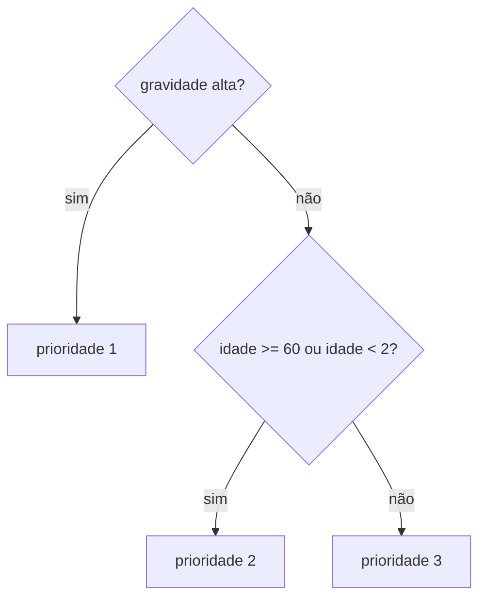

## Passo 1 · Leitura · Juntando condições

Muitas regras dependem de mais de uma pergunta: para dirigir é preciso ter 18 anos **e** ter habilitação; paga meia quem é criança **ou** idoso. O Python tem três operadores lógicos para montar essas regras. Eles recebem `True` e `False` e devolvem `True` ou `False`.

`and` (e) só é verdadeiro quando os **dois** lados são verdadeiros. `or` (ou) é verdadeiro quando **pelo menos um** lado é verdadeiro:

| `a` | `b` | `a and b` | `a or b` |
|---|---|---|---|
| `True` | `True` | `True` | `True` |
| `True` | `False` | `False` | `True` |
| `False` | `True` | `False` | `True` |
| `False` | `False` | `False` | `False` |

`not` (não) inverte um valor:

| `a` | `not a` |
|---|---|
| `True` | `False` |
| `False` | `True` |

Uma tabela assim, com todas as combinações possíveis, se chama **tabela-verdade**.

```python
idade = 20
tem_cnh = False
print(idade >= 18 and tem_cnh)    # False: só um dos lados é verdadeiro
print(idade < 12 or idade >= 60)  # False: nenhum dos lados é verdadeiro
print(not tem_cnh)                # True
```

#### Quem vem primeiro

As comparações são resolvidas antes dos operadores lógicos. Entre os lógicos, a ordem é: primeiro `not`, depois `and`, por último `or`. Assim, `a or b and c` é lido como `a or (b and c)`. Na dúvida, use parênteses: eles deixam a intenção clara para quem lê.

#### O operador in

`in` (em) pergunta se um valor está dentro de outro. Com textos, testa se um trecho aparece: `"a" in "casa"` é `True`, e `"z" in "casa"` é `False`. Também funciona com uma lista de valores entre colchetes: `dia in ["sábado", "domingo"]` é `True` quando `dia` é um dos dois.

#### Intervalos

Na matemática, "x está entre 0 e 10" se escreve $0 \le x \le 10$. O Python aceita quase a mesma escrita: `0 <= x <= 10`. Ela vale o mesmo que `x >= 0 and x <= 10`: são duas comparações ligadas por `and`.

#### Um erro clássico

Para testar se `x` vale 1 ou 2, não escreva `x == 1 or 2`. O Python lê `(x == 1) or 2`, e um número diferente de zero, usado como condição, conta como verdadeiro. O resultado é uma condição que passa sempre. Cada lado do `or` precisa da comparação completa: `x == 1 or x == 2`.

## Passo 2 · Previsão · Expressões lógicas

Leia o programa sem executar. Cada linha imprime `True` ou `False`. Digite as seis linhas da saída, na ordem.

### Código
```python
print(True and False)
print(not True or True)
print(5 > 3 and 2 > 1)
print("a" in "casa")
print(not (1 == 1))
print(0 < 5 < 3)
```

### Dicas
1. Resolva primeiro o `not`, depois o `and` e por último o `or`. O que está entre parênteses vem antes de tudo.
2. `0 < 5 < 3` são duas comparações ligadas por `and`: `0 < 5` e `5 < 3`.

### Saída esperada
```text
False
True
True
True
False
False
```

## Passo 3 · Exercício · Regras

Duas regras do mundo real, cada uma em uma função que devolve `True` ou `False`. Em nenhuma delas você precisa de `if`: a expressão lógica já é o valor a devolver, como em `return idade >= 18`.

**Dirigir.** No Brasil, pode dirigir quem tem 18 anos ou mais **e** tem habilitação (CNH). A função `pode_dirigir(idade, tem_cnh)` recebe a idade e um booleano que diz se a pessoa tem CNH.

**Ano bissexto.** Um ano é bissexto, isto é, tem 29 de fevereiro, quando:

- é divisível por 4 **e não** é divisível por 100;
- **ou** é divisível por 400.

Por isso 2024 é bissexto, 2023 não é, 1900 não é (divisível por 100, mas não por 400) e 2000 é (divisível por 400). "Divisível por 4" quer dizer que o resto da divisão por 4 é zero: `ano % 4 == 0`.

### Instruções
1. Complete `pode_dirigir(idade, tem_cnh)`: devolve `True` só quando a idade é 18 ou mais e `tem_cnh` é verdadeiro.
   Dica: tem_cnh já é um booleano; não precisa comparar com True.
2. Complete `ano_bissexto(ano)`: devolve `True` quando o ano é divisível por 4 e não por 100, ou quando é divisível por 400.
   Dica: "não é divisível por 100" é ano % 100 != 0.

### Código inicial
```python
def pode_dirigir(idade, tem_cnh):
    pass


def ano_bissexto(ano):
    pass
```

### Solução
```python
def pode_dirigir(idade, tem_cnh):
    return idade >= 18 and tem_cnh


def ano_bissexto(ano):
    return (ano % 4 == 0 and ano % 100 != 0) or ano % 400 == 0
```

### Dicas
1. Escreva a regra em português primeiro e troque cada "e" por `and`, cada "ou" por `or`.
2. No bissexto, use parênteses para separar as duas partes da regra: `(parte 1) or (parte 2)`.
3. A parte 1 é `ano % 4 == 0 and ano % 100 != 0`; a parte 2 é `ano % 400 == 0`.

### Verificação
```json
[
  { "id": "dirigir-18-com-cnh", "checkpoint": 1, "kind": "call", "function": "pode_dirigir", "args": [18, true], "expected": true, "type": "bool",
    "name": "pode_dirigir(18, True) é True", "hint": "Quem tem exatamente 18 anos e CNH pode dirigir. A função precisa devolver um booleano com return." },
  { "id": "dirigir-18-sem-cnh", "checkpoint": 1, "kind": "call", "function": "pode_dirigir", "args": [18, false], "expected": false, "type": "bool",
    "name": "pode_dirigir(18, False) é False", "hint": "Sem CNH não pode dirigir, qualquer que seja a idade: as duas condições precisam valer juntas." },
  { "id": "dirigir-17-com-cnh", "checkpoint": 1, "kind": "call", "function": "pode_dirigir", "args": [17, true], "expected": false, "type": "bool",
    "name": "pode_dirigir(17, True) é False", "hint": "Com menos de 18 anos não pode dirigir, mesmo com o segundo valor verdadeiro." },
  { "id": "dirigir-40-com-cnh", "checkpoint": 1, "kind": "call", "function": "pode_dirigir", "args": [40, true], "expected": true, "type": "bool",
    "name": "pode_dirigir(40, True) é True" },
  { "id": "dirigir-15-sem-cnh", "checkpoint": 1, "kind": "call", "function": "pode_dirigir", "args": [15, false], "expected": false, "type": "bool",
    "name": "pode_dirigir(15, False) é False" },
  { "id": "bissexto-2024", "checkpoint": 2, "kind": "call", "function": "ano_bissexto", "args": [2024], "expected": true, "type": "bool",
    "name": "ano_bissexto(2024) é True" },
  { "id": "bissexto-2023", "checkpoint": 2, "kind": "call", "function": "ano_bissexto", "args": [2023], "expected": false, "type": "bool",
    "name": "ano_bissexto(2023) é False" },
  { "id": "bissexto-1900", "checkpoint": 2, "kind": "call", "function": "ano_bissexto", "args": [1900], "expected": false, "type": "bool",
    "name": "ano_bissexto(1900) é False", "hint": "1900 é divisível por 4, mas também por 100, e não é divisível por 400." },
  { "id": "bissexto-2000", "checkpoint": 2, "kind": "call", "function": "ano_bissexto", "args": [2000], "expected": true, "type": "bool",
    "name": "ano_bissexto(2000) é True", "hint": "2000 é divisível por 100, mas a segunda parte da regra o salva: ele é divisível por 400." }
]
```

### Soluções erradas
```python name="bissexto só com % 4: 1900 passa"
def pode_dirigir(idade, tem_cnh):
    return idade >= 18 and tem_cnh


def ano_bissexto(ano):
    return ano % 4 == 0
```
```python name="or no lugar de and em pode_dirigir"
def pode_dirigir(idade, tem_cnh):
    return idade >= 18 or tem_cnh


def ano_bissexto(ano):
    return (ano % 4 == 0 and ano % 100 != 0) or ano % 400 == 0
```
```python name="maior que 18: quem tem 18 anos fica de fora"
def pode_dirigir(idade, tem_cnh):
    return idade > 18 and tem_cnh


def ano_bissexto(ano):
    return (ano % 4 == 0 and ano % 100 != 0) or ano % 400 == 0
```
```python name="bissexto sem a regra do 400: 2000 fica de fora"
def pode_dirigir(idade, tem_cnh):
    return idade >= 18 and tem_cnh


def ano_bissexto(ano):
    return ano % 4 == 0 and ano % 100 != 0
```
```python name="devolve textos em vez de booleanos"
def pode_dirigir(idade, tem_cnh):
    if idade >= 18 and tem_cnh:
        return "True"
    else:
        return "False"


def ano_bissexto(ano):
    if (ano % 4 == 0 and ano % 100 != 0) or ano % 400 == 0:
        return "True"
    else:
        return "False"
```

## Passo 4 · Leitura · Aninhar ou combinar?

O bloco de um `if` pode conter qualquer código, inclusive outro `if`. Isso se chama **aninhar**: uma decisão dentro da outra. A segunda pergunta só é feita quando a primeira já foi respondida.

Um pronto-socorro faz isso na triagem. Primeiro pergunta se o caso é grave. Só quando não é, olha a idade do paciente:



No código, cada nível de decisão ganha mais 4 espaços de indentação. É o recuo que mostra a qual `if` cada `else` pertence: um `else` sempre faz par com o `if` que está alinhado com ele.

Execute o exemplo abaixo passo a passo. Repare que o `if` de dentro só é testado porque `chovendo` é `True`. Depois troque `chovendo` para `False` e veja a decisão interna ser pulada inteira:

```python visualizar
chovendo = True
tem_guarda_chuva = False
if chovendo:
    if tem_guarda_chuva:
        plano = "vou a pé"
    else:
        plano = "vou de ônibus"
else:
    plano = "vou de bicicleta"
print(plano)
```

#### Quando combinar

Se o `if` de dentro é a única coisa no bloco do `if` de fora, e nenhum dos dois tem `else`, um `and` diz o mesmo com menos recuo:

```python
# aninhado
if idade >= 18:
    if tem_cnh:
        print("Pode dirigir")

# combinado: mesmo resultado, mais fácil de ler
if idade >= 18 and tem_cnh:
    print("Pode dirigir")
```

#### Quando aninhar

Aninhe quando a segunda pergunta só faz sentido depois da primeira, ou quando cada resposta leva a um caminho diferente, como na chuva e na triagem. Ali existem três resultados, e um `and` sozinho não dá conta.

Um limite prático: fique em dois níveis de `if`. Com três ou quatro, quem lê precisa guardar na cabeça todas as condições de fora para entender a linha de dentro. Quando o código chegar a esse ponto, tente combinar condições com `and` ou usar `elif`.

## Passo 5 · Exercício · Triagem

Escreva a função `prioridade(idade, gravidade)` da triagem do pronto-socorro. Ela recebe a idade em anos (inteiro) e a gravidade, que é um dos textos `"alta"`, `"media"` ou `"baixa"`, e devolve a prioridade de atendimento: `1`, `2` ou `3`.

| Situação | Prioridade |
|---|---|
| gravidade `"alta"`, qualquer idade | `1` |
| gravidade não é alta, e a idade é 60 ou mais, ou menor que 2 | `2` |
| todos os outros casos | `3` |

Exemplos: `prioridade(30, "alta")` vale `1`, `prioridade(70, "baixa")` vale `2`, `prioridade(1, "baixa")` vale `2` e `prioridade(30, "baixa")` vale `3`.

### Instruções
1. Se a gravidade for `"alta"`, devolva `1`, sem olhar a idade.
2. Senão, se a idade for 60 ou mais, ou menor que 2, devolva `2`.
   Dica: quem tem exatamente 60 anos entra; quem tem exatamente 2 anos não entra.
3. Em todos os outros casos, devolva `3`.

### Código inicial
```python
def prioridade(idade, gravidade):
    pass
```

### Solução
```python
def prioridade(idade, gravidade):
    if gravidade == "alta":
        return 1
    else:
        if idade >= 60 or idade < 2:
            return 2
        else:
            return 3
```

### Dicas
1. Trate o caso mais urgente primeiro: a gravidade alta decide tudo sozinha.
2. Toda combinação de idade e gravidade precisa chegar a um `return`. Se a função devolver `None`, algum caminho ficou sem `else`.
3. A segunda decisão junta duas comparações de idade com `or`: `idade >= 60 or idade < 2`.

### Verificação
```json
[
  { "id": "alta-30", "checkpoint": 1, "kind": "call", "function": "prioridade", "args": [30, "alta"], "expected": 1,
    "name": "prioridade(30, \"alta\") é 1", "hint": "Compare a gravidade com o texto \"alta\", entre aspas e em minúsculas." },
  { "id": "alta-70", "checkpoint": 1, "kind": "call", "function": "prioridade", "args": [70, "alta"], "expected": 1,
    "name": "prioridade(70, \"alta\") é 1", "hint": "A gravidade alta vem antes de qualquer regra de idade." },
  { "id": "baixa-70", "checkpoint": 2, "kind": "call", "function": "prioridade", "args": [70, "baixa"], "expected": 2,
    "name": "prioridade(70, \"baixa\") é 2" },
  { "id": "baixa-1", "checkpoint": 2, "kind": "call", "function": "prioridade", "args": [1, "baixa"], "expected": 2,
    "name": "prioridade(1, \"baixa\") é 2", "hint": "Basta uma das duas condições de idade ser verdadeira. Qual operador diz isso?" },
  { "id": "media-60", "checkpoint": 2, "kind": "call", "function": "prioridade", "args": [60, "media"], "expected": 2,
    "name": "prioridade(60, \"media\") é 2", "hint": "\"60 ou mais\" inclui quem tem exatamente 60 anos." },
  { "id": "baixa-2", "checkpoint": 2, "kind": "call", "function": "prioridade", "args": [2, "baixa"], "expected": 3,
    "name": "prioridade(2, \"baixa\") é 3", "hint": "\"Menor que 2\" não inclui quem tem exatamente 2 anos." },
  { "id": "baixa-30", "checkpoint": 3, "kind": "call", "function": "prioridade", "args": [30, "baixa"], "expected": 3,
    "name": "prioridade(30, \"baixa\") é 3", "hint": "Se o resultado foi None, falta um else: este caso não chegou a nenhum return." },
  { "id": "media-59", "checkpoint": 3, "kind": "call", "function": "prioridade", "args": [59, "media"], "expected": 3,
    "name": "prioridade(59, \"media\") é 3" }
]
```

### Soluções erradas
```python name="idade > 60: quem tem 60 anos cai na prioridade 3"
def prioridade(idade, gravidade):
    if gravidade == "alta":
        return 1
    else:
        if idade > 60 or idade < 2:
            return 2
        else:
            return 3
```
```python name="aninhado sem o else interno: devolve None"
def prioridade(idade, gravidade):
    if gravidade == "alta":
        return 1
    else:
        if idade >= 60 or idade < 2:
            return 2
```
```python name="and no lugar de or: ninguém tem 60 ou mais e menos de 2"
def prioridade(idade, gravidade):
    if gravidade == "alta":
        return 1
    else:
        if idade >= 60 and idade < 2:
            return 2
        else:
            return 3
```
```python name="idade <= 2: quem tem 2 anos entra na prioridade 2"
def prioridade(idade, gravidade):
    if gravidade == "alta":
        return 1
    else:
        if idade >= 60 or idade <= 2:
            return 2
        else:
            return 3
```
```python name="olha a idade antes da gravidade"
def prioridade(idade, gravidade):
    if idade >= 60 or idade < 2:
        return 2
    else:
        if gravidade == "alta":
            return 1
        else:
            return 3
```

## Passo 6 · Quiz · Lógica

### Pergunta
Por que este programa imprime `ok` para qualquer valor de `x`?
```python
x = 7
if x == 1 or 2:
    print("ok")
```
- [ ] Porque `or` compara `x` com 1 e com 2, e 7 é maior que os dois
- [x] Porque o Python lê `(x == 1) or 2`, e o número 2, usado como condição, conta como verdadeiro
- [ ] Porque `==` guarda o valor 1 em `x`
- [ ] Porque um `if` sem `else` executa sempre o bloco
> O `or` não distribui a comparação. O lado direito é só o número `2`, que vale como verdadeiro. O certo é `x == 1 or x == 2`.

### Pergunta
Qual é o valor de `True and False`?
- [ ] `True`, porque pelo menos um dos lados é verdadeiro
- [x] `False`, porque o `and` exige que os dois lados sejam verdadeiros
- [ ] Depende da ordem dos dois valores
- [ ] Um erro, porque faltam parênteses
> `and` só dá `True` na linha da tabela-verdade em que os dois lados são `True`. Quem aceita um lado só é o `or`.

### Pergunta
Qual dos dois trechos é a melhor escolha, e por quê?
```python
# Trecho 1
if nota >= 6:
    if frequencia >= 75:
        print("Aprovado")

# Trecho 2
if nota >= 6 and frequencia >= 75:
    print("Aprovado")
```
- [ ] O trecho 1, porque o `and` não funciona com duas comparações
- [ ] O trecho 1, porque os dois trechos dão resultados diferentes
- [x] O trecho 2: o resultado é o mesmo, com um nível de indentação a menos
- [ ] Nenhum, porque as duas condições precisariam de um `elif`
> Quando o `if` interno é a única coisa dentro do externo e não há `else`, o `and` diz a mesma regra em uma linha. Aninhe quando cada resposta levar a um caminho diferente.
