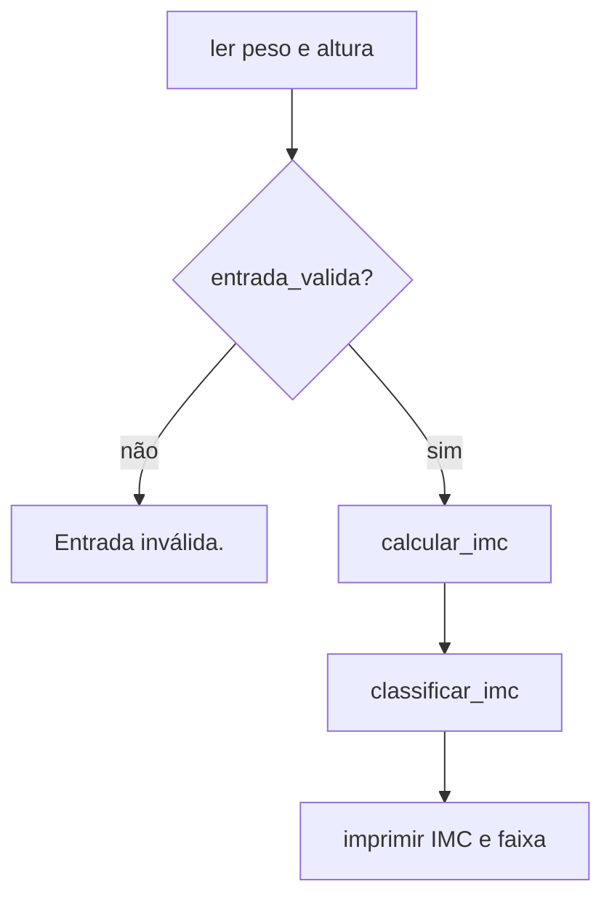

## Passo 1 · Leitura · O que você vai construir

Neste mini-projeto você junta tudo o que viu no módulo em um programa completo: uma calculadora de IMC. O IMC (índice de massa corporal) é uma medida usada em triagens de saúde. Ele relaciona o peso de uma pessoa com a altura dela:

$$
\text{IMC} = \frac{\text{peso}}{\text{altura}^2}
$$

O peso vai em quilogramas e a altura em **metros**. Para alguém com 70 kg e 1,75 m: $\dfrac{70}{1{,}75^2} \approx 22{,}9$.

O resultado, arredondado para uma casa decimal, cai em uma de quatro faixas:

| IMC | Faixa |
|---|---|
| menos de 18,5 | `abaixo do peso` |
| de 18,5 a menos de 25 | `peso normal` |
| de 25 a menos de 30 | `sobrepeso` |
| 30 ou mais | `obesidade` |

#### O que o programa faz

Ele lê dois números decimais, um por linha: primeiro o peso, depois a altura. Em seguida imprime **uma** linha:

- `Entrada inválida.` quando o peso não está no intervalo $0 < \text{peso} \le 400$ ou a altura não está no intervalo $0{,}5 \le \text{altura} \le 2{,}6$;
- senão, `IMC: ` seguido do IMC com uma casa decimal, de ` - ` e da faixa.

| Entrada (peso, altura) | Saída |
|---|---|
| `70` e `1.75` | `IMC: 22.9 - peso normal` |
| `90` e `1.8` | `IMC: 27.8 - sobrepeso` |
| `70` e `175` | `Entrada inválida.` |
| `-5` e `1.7` | `Entrada inválida.` |

No terceiro exemplo a pessoa digitou a altura em centímetros. Sem a validação, o programa responderia um IMC de 0.0, que não faz sentido. Um programa bem-feito recusa a entrada em vez de devolver uma resposta absurda.

#### Dividir para conquistar

Você não vai escrever tudo de uma vez. O programa é dividido em três funções pequenas, cada uma com uma única tarefa, e um trecho final que as usa:



Cada passo a seguir constrói uma parte, no mesmo arquivo. A vantagem de dividir: cada função pode ser testada sozinha, e um erro fica fácil de localizar.

## Passo 2 · Exercício · calcular_imc(peso, altura)

Comece pela conta. A função `calcular_imc(peso, altura)` recebe o peso em quilogramas e a altura em metros e devolve o IMC **arredondado para uma casa decimal**.

Duas lembranças do módulo 2: `**` eleva a uma potência (`3 ** 2` vale `9`) e `round(x, 1)` arredonda `x` para uma casa (`round(22.857, 1)` vale `22.9`).

Exemplos: `calcular_imc(70, 1.75)` vale `22.9`, `calcular_imc(90, 1.8)` vale `27.8` e `calcular_imc(58, 1.62)` vale `22.1`.

### Instruções
1. Dentro de `calcular_imc`, divida o peso pela altura elevada ao quadrado.
   Dica: elevar ao quadrado não é multiplicar por 2.
2. Arredonde o resultado para uma casa decimal e devolva-o com `return`.

### Código inicial
```python
def calcular_imc(peso, altura):
    pass
```

### Solução
```python
def calcular_imc(peso, altura):
    return round(peso / altura ** 2, 1)
```

### Dicas
1. A altura é elevada ao quadrado com `** 2`. A potência é calculada antes da divisão, então não precisa de parênteses.
2. `round(valor, 1)` devolve o valor com uma casa decimal.
3. Tudo cabe em uma linha: `return round(... / ... ** 2, 1)`, com o peso e a altura nos lugares certos.

### Verificação
```json
[
  { "id": "formula-80-2", "checkpoint": 1, "kind": "call", "function": "calcular_imc", "args": [80, 2], "expected": 20.0, "tolerance": 0.001,
    "name": "calcular_imc(80, 2) é 20.0", "hint": "80 dividido por 2 ao quadrado. Confira se a altura foi elevada ao quadrado e se a função usa return." },
  { "id": "formula-100-1-6", "checkpoint": 1, "kind": "call", "function": "calcular_imc", "args": [100, 1.6], "expected": 39.1, "tolerance": 0.06,
    "name": "calcular_imc(100, 1.6) fica perto de 39.1", "hint": "O peso é dividido pela altura ao quadrado, nessa ordem." },
  { "id": "arredonda-70-1-75", "checkpoint": 2, "kind": "call", "function": "calcular_imc", "args": [70, 1.75], "expected": 22.9, "tolerance": 0.001,
    "name": "calcular_imc(70, 1.75) é 22.9", "hint": "O resultado precisa ter exatamente uma casa decimal." },
  { "id": "arredonda-90-1-8", "checkpoint": 2, "kind": "call", "function": "calcular_imc", "args": [90, 1.8], "expected": 27.8, "tolerance": 0.001,
    "name": "calcular_imc(90, 1.8) é 27.8", "hint": "O resultado precisa ter exatamente uma casa decimal." },
  { "id": "arredonda-58-1-62", "checkpoint": 2, "kind": "call", "function": "calcular_imc", "args": [58, 1.62], "expected": 22.1, "tolerance": 0.001,
    "name": "calcular_imc(58, 1.62) é 22.1" }
]
```

### Soluções erradas
```python name="altura vezes 2 em vez de altura ao quadrado"
def calcular_imc(peso, altura):
    return round(peso / altura * 2, 1)
```
```python name="sem arredondar"
def calcular_imc(peso, altura):
    return peso / altura ** 2
```
```python name="print em vez de return: a função devolve None"
def calcular_imc(peso, altura):
    print(round(peso / altura ** 2, 1))
```
```python name="arredonda para duas casas"
def calcular_imc(peso, altura):
    return round(peso / altura ** 2, 2)
```

## Passo 3 · Exercício · classificar_imc(imc)

Agora a classificação. **Continue no mesmo arquivo**: mantenha `calcular_imc` como está e escreva a nova função abaixo dela, deixando duas linhas em branco entre as duas.

A função `classificar_imc(imc)` recebe um IMC já calculado e devolve o texto da faixa, exatamente como na tabela, em minúsculas:

| IMC | Texto devolvido |
|---|---|
| menos de 18.5 | `"abaixo do peso"` |
| de 18.5 a menos de 25 | `"peso normal"` |
| de 25 a menos de 30 | `"sobrepeso"` |
| 30 ou mais | `"obesidade"` |

Atenção aos limites: 18.5 já é `"peso normal"`, 25 já é `"sobrepeso"` e 30 já é `"obesidade"`. Cada limite pertence à faixa de cima.

Exemplos: `classificar_imc(18.4)` vale `"abaixo do peso"`, `classificar_imc(18.5)` vale `"peso normal"` e `classificar_imc(30.0)` vale `"obesidade"`.

### Instruções
1. Defina `classificar_imc(imc)` e devolva `"abaixo do peso"` quando o IMC for menor que 18.5.
2. Devolva `"peso normal"` para IMC menor que 25 e `"sobrepeso"` para IMC menor que 30.
   Dica: use elif, para que cada teste só receba o que o anterior deixou passar.
3. Em todos os outros casos, devolva `"obesidade"`.

### Solução
```python
def calcular_imc(peso, altura):
    return round(peso / altura ** 2, 1)

def classificar_imc(imc):
    if imc < 18.5:
        return "abaixo do peso"
    elif imc < 25:
        return "peso normal"
    elif imc < 30:
        return "sobrepeso"
    else:
        return "obesidade"
```

### Dicas
1. Os limites pertencem à faixa de cima: o operador que deixa o limite de fora é `<`, não `<=`.
2. Como os testes usam `<`, comece pela faixa mais baixa e encadeie as seguintes com `elif`.
3. A cadeia é `if imc < 18.5:`, `elif imc < 25:`, `elif imc < 30:` e `else:`, cada uma com o seu `return`.

### Verificação
```json
[
  { "id": "abaixo-18-4", "checkpoint": 1, "kind": "call", "function": "classificar_imc", "args": [18.4], "expected": "abaixo do peso",
    "name": "classificar_imc(18.4) é \"abaixo do peso\"", "hint": "Confira o nome da função e o texto devolvido: minúsculas, sem ponto final." },
  { "id": "borda-18-5", "checkpoint": 1, "kind": "call", "function": "classificar_imc", "args": [18.5], "expected": "peso normal",
    "name": "classificar_imc(18.5) é \"peso normal\"", "hint": "O limite 18.5 pertence à faixa de cima. Confira o operador do primeiro teste." },
  { "id": "normal-24-9", "checkpoint": 2, "kind": "call", "function": "classificar_imc", "args": [24.9], "expected": "peso normal",
    "name": "classificar_imc(24.9) é \"peso normal\"", "hint": "Se o resultado foi outra faixa, os testes não estão encadeados com elif." },
  { "id": "borda-25", "checkpoint": 2, "kind": "call", "function": "classificar_imc", "args": [25.0], "expected": "sobrepeso",
    "name": "classificar_imc(25.0) é \"sobrepeso\"", "hint": "O limite 25 pertence à faixa de cima. Confira o operador do segundo teste." },
  { "id": "sobrepeso-29-9", "checkpoint": 2, "kind": "call", "function": "classificar_imc", "args": [29.9], "expected": "sobrepeso",
    "name": "classificar_imc(29.9) é \"sobrepeso\"" },
  { "id": "borda-30", "checkpoint": 3, "kind": "call", "function": "classificar_imc", "args": [30.0], "expected": "obesidade",
    "name": "classificar_imc(30.0) é \"obesidade\"", "hint": "O limite 30 pertence à faixa de cima. Confira o operador do terceiro teste." },
  { "id": "obesidade-41", "checkpoint": 3, "kind": "call", "function": "classificar_imc", "args": [41.3], "expected": "obesidade",
    "name": "classificar_imc(41.3) é \"obesidade\"" },
  { "id": "abaixo-12", "checkpoint": 1, "kind": "call", "function": "classificar_imc", "args": [12.0], "expected": "abaixo do peso",
    "name": "classificar_imc(12.0) é \"abaixo do peso\"", "hint": "Se o resultado foi outra faixa, os testes não estão encadeados com elif ou estão na ordem errada." }
]
```

### Soluções erradas
```python name="menor ou igual nas faixas: 18.5 vira abaixo do peso"
def calcular_imc(peso, altura):
    return round(peso / altura ** 2, 1)

def classificar_imc(imc):
    if imc <= 18.5:
        return "abaixo do peso"
    elif imc <= 25:
        return "peso normal"
    elif imc <= 30:
        return "sobrepeso"
    else:
        return "obesidade"
```
```python name="ifs independentes: o último verdadeiro vence"
def calcular_imc(peso, altura):
    return round(peso / altura ** 2, 1)

def classificar_imc(imc):
    faixa = "obesidade"
    if imc < 18.5:
        faixa = "abaixo do peso"
    if imc < 25:
        faixa = "peso normal"
    if imc < 30:
        faixa = "sobrepeso"
    return faixa
```
```python name="ordem errada: o teste do 30 vem primeiro"
def calcular_imc(peso, altura):
    return round(peso / altura ** 2, 1)

def classificar_imc(imc):
    if imc < 30:
        return "sobrepeso"
    elif imc < 25:
        return "peso normal"
    elif imc < 18.5:
        return "abaixo do peso"
    else:
        return "obesidade"
```
```python name="só o limite 25 com menor ou igual"
def calcular_imc(peso, altura):
    return round(peso / altura ** 2, 1)

def classificar_imc(imc):
    if imc < 18.5:
        return "abaixo do peso"
    elif imc <= 25:
        return "peso normal"
    elif imc < 30:
        return "sobrepeso"
    else:
        return "obesidade"
```

## Passo 4 · Exercício · entrada_valida(peso, altura)

Antes de calcular, o programa precisa saber se os números fazem sentido. Continue no mesmo arquivo e escreva, abaixo das outras duas, a função `entrada_valida(peso, altura)`. Ela devolve `True` quando as **duas** condições valem, e `False` em qualquer outro caso:

- o peso é maior que zero e no máximo 400: $0 < \text{peso} \le 400$;
- a altura é de no mínimo 0.5 e no máximo 2.6: $0{,}5 \le \text{altura} \le 2{,}6$.

Os limites são folgados de propósito: servem para barrar enganos de digitação, como a altura em centímetros (`175` no lugar de `1.75`) ou um peso negativo.

Exemplos: `entrada_valida(70, 1.75)` vale `True`, `entrada_valida(70, 175)` vale `False`, `entrada_valida(0, 1.7)` vale `False` e `entrada_valida(400, 1.7)` vale `True`.

### Instruções
1. Defina `entrada_valida(peso, altura)` e teste se o peso é maior que 0 e menor ou igual a 400.
   Dica: peso zero é inválido; peso 400 é válido.
2. Teste se a altura está entre 0.5 e 2.6, incluindo os dois limites.
3. Devolva `True` só quando as duas condições forem verdadeiras ao mesmo tempo; senão, `False`.
   Dica: a expressão lógica já é o valor a devolver.

### Solução
```python
def calcular_imc(peso, altura):
    return round(peso / altura ** 2, 1)

def classificar_imc(imc):
    if imc < 18.5:
        return "abaixo do peso"
    elif imc < 25:
        return "peso normal"
    elif imc < 30:
        return "sobrepeso"
    else:
        return "obesidade"

def entrada_valida(peso, altura):
    return 0 < peso <= 400 and 0.5 <= altura <= 2.6
```

### Dicas
1. Altura em metros é um número pequeno: ninguém mede 3 metros. É esse teste que barra a altura em centímetros.
2. As duas condições precisam valer ao mesmo tempo. O operador que exige os dois lados verdadeiros é o `and`.
3. Os intervalos podem ser escritos como na matemática: `0 < peso <= 400` e `0.5 <= altura <= 2.6`.

### Verificação
```json
[
  { "id": "valida-comum", "checkpoint": 3, "kind": "call", "function": "entrada_valida", "args": [70, 1.75], "expected": true, "type": "bool",
    "name": "entrada_valida(70, 1.75) é True", "hint": "Confira o nome da função e se ela devolve um booleano com return." },
  { "id": "peso-zero", "checkpoint": 1, "kind": "call", "function": "entrada_valida", "args": [0, 1.7], "expected": false, "type": "bool",
    "name": "entrada_valida(0, 1.7) é False", "hint": "O peso precisa ser maior que zero: o zero fica de fora." },
  { "id": "peso-negativo", "checkpoint": 1, "kind": "call", "function": "entrada_valida", "args": [-5, 1.7], "expected": false, "type": "bool",
    "name": "entrada_valida(-5, 1.7) é False" },
  { "id": "peso-400", "checkpoint": 1, "kind": "call", "function": "entrada_valida", "args": [400, 1.7], "expected": true, "type": "bool",
    "name": "entrada_valida(400, 1.7) é True", "hint": "O limite 400 ainda é válido." },
  { "id": "peso-acima", "checkpoint": 1, "kind": "call", "function": "entrada_valida", "args": [400.5, 1.7], "expected": false, "type": "bool",
    "name": "entrada_valida(400.5, 1.7) é False", "hint": "O peso também tem um limite máximo." },
  { "id": "altura-em-cm", "checkpoint": 2, "kind": "call", "function": "entrada_valida", "args": [70, 175], "expected": false, "type": "bool",
    "name": "entrada_valida(70, 175) é False", "hint": "175 é uma altura em centímetros. A altura também precisa ser testada, e as duas condições precisam valer juntas." },
  { "id": "altura-minima", "checkpoint": 2, "kind": "call", "function": "entrada_valida", "args": [70, 0.5], "expected": true, "type": "bool",
    "name": "entrada_valida(70, 0.5) é True", "hint": "O limite 0.5 ainda é válido." },
  { "id": "altura-maxima", "checkpoint": 2, "kind": "call", "function": "entrada_valida", "args": [70, 2.6], "expected": true, "type": "bool",
    "name": "entrada_valida(70, 2.6) é True", "hint": "O limite 2.6 ainda é válido." },
  { "id": "altura-baixa", "checkpoint": 2, "kind": "call", "function": "entrada_valida", "args": [70, 0.4], "expected": false, "type": "bool",
    "name": "entrada_valida(70, 0.4) é False", "hint": "A altura também tem um limite mínimo." },
  { "id": "duas-invalidas", "checkpoint": 3, "kind": "call", "function": "entrada_valida", "args": [-5, 175], "expected": false, "type": "bool",
    "name": "entrada_valida(-5, 175) é False" }
]
```

### Soluções erradas
```python name="valida só o peso: altura em centímetros passa"
def calcular_imc(peso, altura):
    return round(peso / altura ** 2, 1)

def classificar_imc(imc):
    if imc < 18.5:
        return "abaixo do peso"
    elif imc < 25:
        return "peso normal"
    elif imc < 30:
        return "sobrepeso"
    else:
        return "obesidade"

def entrada_valida(peso, altura):
    return 0 < peso <= 400
```
```python name="or no lugar de and"
def calcular_imc(peso, altura):
    return round(peso / altura ** 2, 1)

def classificar_imc(imc):
    if imc < 18.5:
        return "abaixo do peso"
    elif imc < 25:
        return "peso normal"
    elif imc < 30:
        return "sobrepeso"
    else:
        return "obesidade"

def entrada_valida(peso, altura):
    return 0 < peso <= 400 or 0.5 <= altura <= 2.6
```
```python name="maior ou igual a zero: peso zero passa"
def calcular_imc(peso, altura):
    return round(peso / altura ** 2, 1)

def classificar_imc(imc):
    if imc < 18.5:
        return "abaixo do peso"
    elif imc < 25:
        return "peso normal"
    elif imc < 30:
        return "sobrepeso"
    else:
        return "obesidade"

def entrada_valida(peso, altura):
    return 0 <= peso <= 400 and 0.5 <= altura <= 2.6
```
```python name="limites máximos com menor estrito"
def calcular_imc(peso, altura):
    return round(peso / altura ** 2, 1)

def classificar_imc(imc):
    if imc < 18.5:
        return "abaixo do peso"
    elif imc < 25:
        return "peso normal"
    elif imc < 30:
        return "sobrepeso"
    else:
        return "obesidade"

def entrada_valida(peso, altura):
    return 0 < peso < 400 and 0.5 < altura < 2.6
```
```python name="só testa se são positivos"
def calcular_imc(peso, altura):
    return round(peso / altura ** 2, 1)

def classificar_imc(imc):
    if imc < 18.5:
        return "abaixo do peso"
    elif imc < 25:
        return "peso normal"
    elif imc < 30:
        return "sobrepeso"
    else:
        return "obesidade"

def entrada_valida(peso, altura):
    return peso > 0 and altura > 0
```

## Passo 5 · Exercício · Programa principal

As três funções estão prontas. Falta o trecho que conversa com o usuário. Continue no mesmo arquivo e escreva o programa principal **abaixo** das funções, na margem esquerda (fora de qualquer `def`).

O programa lê o peso e depois a altura, um por linha, como números decimais. Use `input()` sem texto dentro dos parênteses. Em seguida imprime uma única linha:

- `Entrada inválida.` (com o ponto final) quando `entrada_valida` devolve `False`;
- senão, a linha no formato `IMC: 22.9 - peso normal`: o texto `IMC: `, o valor devolvido por `calcular_imc`, um hífen entre espaços e a faixa devolvida por `classificar_imc`.

A faixa é a do IMC **já arredondado**: passe para `classificar_imc` o mesmo valor que você imprime.

Exemplos de execução:

| Entrada (duas linhas) | Saída |
|---|---|
| `70` e `1.75` | `IMC: 22.9 - peso normal` |
| `90` e `1.8` | `IMC: 27.8 - sobrepeso` |
| `70` e `175` | `Entrada inválida.` |
| `-5` e `1.7` | `Entrada inválida.` |

### Instruções
1. Leia o peso e a altura, nessa ordem, e converta os dois para número decimal.
2. Se `entrada_valida(peso, altura)` for falso, imprima `Entrada inválida.` e nada mais.
   Dica: valide antes de fazer qualquer conta.
3. Senão, guarde o resultado de `calcular_imc`, passe-o para `classificar_imc` e imprima a linha no formato `IMC: 22.9 - peso normal`.
   Dica: uma f-string monta a linha com as duas variáveis.

### Solução
```python
def calcular_imc(peso, altura):
    return round(peso / altura ** 2, 1)

def classificar_imc(imc):
    if imc < 18.5:
        return "abaixo do peso"
    elif imc < 25:
        return "peso normal"
    elif imc < 30:
        return "sobrepeso"
    else:
        return "obesidade"

def entrada_valida(peso, altura):
    return 0 < peso <= 400 and 0.5 <= altura <= 2.6

peso = float(input())
altura = float(input())
if entrada_valida(peso, altura):
    imc = calcular_imc(peso, altura)
    faixa = classificar_imc(imc)
    print(f"IMC: {imc} - {faixa}")
else:
    print("Entrada inválida.")
```

### Dicas
1. Valide antes de calcular: com altura `0`, a conta do IMC é uma divisão por zero e o programa quebra.
2. Chame as três funções que você já escreveu, em vez de refazer as contas. Guarde o IMC em uma variável e use essa mesma variável para classificar e para imprimir.
3. A linha de saída pode ser `print(f"IMC: {imc} - {faixa}")`, dentro do caminho da entrada válida.

### Verificação
```json
[
  { "id": "le-decimais", "checkpoint": 1, "kind": "io", "stdin": "58\n1.62\n", "expected_stdout": "IMC: 22.1 - peso normal",
    "name": "Entrada 58 e 1.62: IMC: 22.1 - peso normal", "hint": "O peso vem na primeira linha e a altura na segunda, os dois convertidos com float()." },
  { "id": "usa-validacao", "checkpoint": 2, "kind": "source", "rule": { "type": "calls", "name": "entrada_valida" },
    "name": "O programa chama entrada_valida", "hint": "Use a função de validação que você escreveu no passo anterior." },
  { "id": "altura-em-cm", "checkpoint": 2, "kind": "io", "stdin": "70\n175\n", "expected_stdout": "Entrada inválida.",
    "name": "Entrada 70 e 175: Entrada inválida.", "hint": "A saída deve ter só a mensagem, com acento e ponto final, sem nenhuma linha de IMC." },
  { "id": "peso-negativo", "checkpoint": 2, "kind": "io", "stdin": "-5\n1.7\n", "expected_stdout": "Entrada inválida.",
    "name": "Entrada -5 e 1.7: Entrada inválida." },
  { "id": "altura-zero", "checkpoint": 2, "kind": "io", "stdin": "70\n0\n", "expected_stdout": "Entrada inválida.",
    "name": "Entrada 70 e 0: Entrada inválida.", "hint": "Com altura zero, calcular o IMC é dividir por zero. A validação precisa vir antes da conta." },
  { "id": "usa-calcular", "checkpoint": 3, "kind": "source", "rule": { "type": "calls", "name": "calcular_imc" },
    "name": "O programa chama calcular_imc", "hint": "Não refaça a conta no programa principal: chame a função." },
  { "id": "usa-classificar", "checkpoint": 3, "kind": "source", "rule": { "type": "calls", "name": "classificar_imc" },
    "name": "O programa chama classificar_imc" },
  { "id": "normal", "checkpoint": 3, "kind": "io", "stdin": "70\n1.75\n", "expected_stdout": "IMC: 22.9 - peso normal",
    "name": "Entrada 70 e 1.75: IMC: 22.9 - peso normal", "hint": "Confira o formato caractere por caractere: dois-pontos, espaços, hífen e uma casa decimal." },
  { "id": "sobrepeso", "checkpoint": 3, "kind": "io", "stdin": "90\n1.8\n", "expected_stdout": "IMC: 27.8 - sobrepeso",
    "name": "Entrada 90 e 1.8: IMC: 27.8 - sobrepeso", "hint": "O IMC aparece com exatamente uma casa decimal." },
  { "id": "abaixo", "checkpoint": 3, "kind": "io", "stdin": "50\n1.7\n", "expected_stdout": "IMC: 17.3 - abaixo do peso",
    "name": "Entrada 50 e 1.7: IMC: 17.3 - abaixo do peso" },
  { "id": "obesidade", "checkpoint": 3, "kind": "io", "stdin": "95\n1.75\n", "expected_stdout": "IMC: 31.0 - obesidade",
    "name": "Entrada 95 e 1.75: IMC: 31.0 - obesidade" },
  { "id": "borda-arredondada", "checkpoint": 3, "kind": "io", "stdin": "72.2\n1.7\n", "expected_stdout": "IMC: 25.0 - sobrepeso",
    "name": "Entrada 72.2 e 1.7: IMC: 25.0 - sobrepeso", "hint": "A faixa é a do IMC arredondado: classifique o mesmo valor que você imprime." }
]
```

### Soluções erradas
```python name="calcula antes de validar: quebra com altura zero"
def calcular_imc(peso, altura):
    return round(peso / altura ** 2, 1)

def classificar_imc(imc):
    if imc < 18.5:
        return "abaixo do peso"
    elif imc < 25:
        return "peso normal"
    elif imc < 30:
        return "sobrepeso"
    else:
        return "obesidade"

def entrada_valida(peso, altura):
    return 0 < peso <= 400 and 0.5 <= altura <= 2.6

peso = float(input())
altura = float(input())
imc = calcular_imc(peso, altura)
faixa = classificar_imc(imc)
if entrada_valida(peso, altura):
    print(f"IMC: {imc} - {faixa}")
else:
    print("Entrada inválida.")
```
```python name="IMC com duas casas decimais"
def calcular_imc(peso, altura):
    return round(peso / altura ** 2, 1)

def classificar_imc(imc):
    if imc < 18.5:
        return "abaixo do peso"
    elif imc < 25:
        return "peso normal"
    elif imc < 30:
        return "sobrepeso"
    else:
        return "obesidade"

def entrada_valida(peso, altura):
    return 0 < peso <= 400 and 0.5 <= altura <= 2.6

peso = float(input())
altura = float(input())
if entrada_valida(peso, altura):
    imc = round(peso / altura ** 2, 2)
    faixa = classificar_imc(imc)
    print(f"IMC: {imc} - {faixa}")
else:
    print("Entrada inválida.")
```
```python name="classifica o IMC sem arredondar"
def calcular_imc(peso, altura):
    return round(peso / altura ** 2, 1)

def classificar_imc(imc):
    if imc < 18.5:
        return "abaixo do peso"
    elif imc < 25:
        return "peso normal"
    elif imc < 30:
        return "sobrepeso"
    else:
        return "obesidade"

def entrada_valida(peso, altura):
    return 0 < peso <= 400 and 0.5 <= altura <= 2.6

peso = float(input())
altura = float(input())
if entrada_valida(peso, altura):
    imc = calcular_imc(peso, altura)
    faixa = classificar_imc(peso / altura ** 2)
    print(f"IMC: {imc} - {faixa}")
else:
    print("Entrada inválida.")
```
```python name="sem validação: sempre calcula"
def calcular_imc(peso, altura):
    return round(peso / altura ** 2, 1)

def classificar_imc(imc):
    if imc < 18.5:
        return "abaixo do peso"
    elif imc < 25:
        return "peso normal"
    elif imc < 30:
        return "sobrepeso"
    else:
        return "obesidade"

def entrada_valida(peso, altura):
    return 0 < peso <= 400 and 0.5 <= altura <= 2.6

peso = float(input())
altura = float(input())
imc = calcular_imc(peso, altura)
faixa = classificar_imc(imc)
print(f"IMC: {imc} - {faixa}")
```
```python name="lê a altura antes do peso"
def calcular_imc(peso, altura):
    return round(peso / altura ** 2, 1)

def classificar_imc(imc):
    if imc < 18.5:
        return "abaixo do peso"
    elif imc < 25:
        return "peso normal"
    elif imc < 30:
        return "sobrepeso"
    else:
        return "obesidade"

def entrada_valida(peso, altura):
    return 0 < peso <= 400 and 0.5 <= altura <= 2.6

altura = float(input())
peso = float(input())
if entrada_valida(peso, altura):
    imc = calcular_imc(peso, altura)
    faixa = classificar_imc(imc)
    print(f"IMC: {imc} - {faixa}")
else:
    print("Entrada inválida.")
```
```python name="mensagem de erro sem o ponto final e junto com o IMC"
def calcular_imc(peso, altura):
    return round(peso / altura ** 2, 1)

def classificar_imc(imc):
    if imc < 18.5:
        return "abaixo do peso"
    elif imc < 25:
        return "peso normal"
    elif imc < 30:
        return "sobrepeso"
    else:
        return "obesidade"

def entrada_valida(peso, altura):
    return 0 < peso <= 400 and 0.5 <= altura <= 2.6

peso = float(input())
altura = float(input())
if not entrada_valida(peso, altura):
    print("Entrada inválida")
imc = calcular_imc(peso, altura)
faixa = classificar_imc(imc)
print(f"IMC: {imc} - {faixa}")
```

## Passo 6 · Quiz · Revisão do módulo

### Pergunta
Alguém escreveu `classificar_imc` com os testes nesta ordem. O que `classificar_imc(17.0)` devolve?
```python
def classificar_imc(imc):
    if imc < 30:
        return "sobrepeso"
    elif imc < 25:
        return "peso normal"
    elif imc < 18.5:
        return "abaixo do peso"
    else:
        return "obesidade"
```
- [ ] `"abaixo do peso"`, porque 17.0 é menor que 18.5
- [x] `"sobrepeso"`, porque 17.0 passa no primeiro teste e a cadeia para ali
- [ ] `"peso normal"`, porque o teste do meio tem preferência
- [ ] `"obesidade"`, porque nenhum teste é verdadeiro
> O Python executa o bloco da primeira condição verdadeira e pula o resto. Com `<`, a cadeia precisa começar pela faixa mais baixa: `imc < 18.5` primeiro.

### Pergunta
A validação foi escrita com `or`. O que `entrada_valida(70, 175)` devolve, e por quê?
```python
def entrada_valida(peso, altura):
    return 0 < peso <= 400 or 0.5 <= altura <= 2.6
```
- [ ] `False`, porque a altura está fora do intervalo
- [ ] `False`, porque o `or` exige que os dois lados sejam verdadeiros
- [x] `True`, porque o peso é válido e o `or` se contenta com um lado verdadeiro
- [ ] Um erro, porque não se pode escrever `0 < peso <= 400`
> Uma entrada só é válida quando **todas** as condições valem: isso é `and`. Com `or`, basta o peso estar certo para a altura em centímetros passar.

### Pergunta
Quantas linhas este programa imprime?
```python
imc = 17.0
if imc < 18.5:
    print("abaixo do peso")
if imc < 25:
    print("peso normal")
if imc < 30:
    print("sobrepeso")
```
- [ ] Uma: `abaixo do peso`
- [ ] Uma: `sobrepeso`
- [ ] Duas
- [x] Três, porque cada `if` é uma decisão independente e as três condições são verdadeiras
> Três `if` separados são três perguntas, todas feitas. Para que só um bloco rode, as condições precisam estar encadeadas com `elif`.
