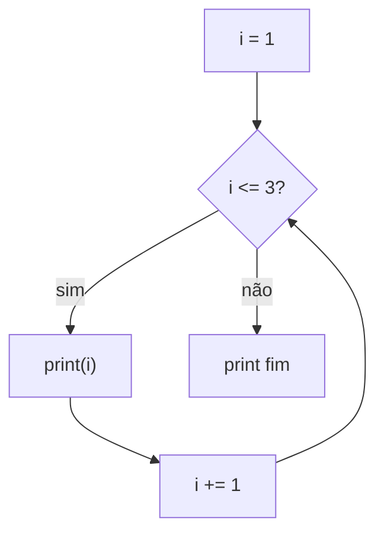

## Passo 1 · Leitura · Um if que volta

Até aqui, cada linha do seu programa rodava no máximo uma vez. Para imprimir os números de 1 a 100 você precisaria de cem linhas de `print`. O **laço** resolve isso: é um trecho de código que se repete.

O laço mais simples do Python é o `while` ("enquanto"). Ele se parece com um `if`, com uma diferença: depois de executar o bloco, o Python **volta** e testa a condição de novo. Enquanto ela for verdadeira, o bloco roda outra vez.

```python
i = 1              # inicialização
while i <= 3:      # condição
    print(i)
    i += 1         # atualização (o mesmo que i = i + 1)
print("fim")
```

Todo `while` que conta tem três partes:

- **Inicialização:** a variável de controle recebe o primeiro valor, antes do laço.
- **Condição:** é testada antes de cada volta. Se for `False`, o laço acaba e o programa segue na primeira linha sem indentação.
- **Atualização:** dentro do bloco, muda a variável para que a condição um dia fique falsa.



Para saber o que um laço faz sem executar, faça o **teste de mesa**: uma tabela com uma linha por volta, anotando os valores.

| Volta | `i` no teste | `i <= 3`? | Imprime | `i` depois |
|---|---|---|---|---|
| 1 | 1 | sim | 1 | 2 |
| 2 | 2 | sim | 2 | 3 |
| 3 | 3 | sim | 3 | 4 |
| — | 4 | não | (sai do laço) | 4 |

O laço dá três voltas e, na saída, `i` vale 4: o valor que tornou a condição falsa. Clique em "Visualizar" e acompanhe `i` mudar a cada volta:

```python visualizar
i = 1
while i <= 3:
    print(i)
    i += 1
print("fim")
```

#### Laço infinito

Se você esquecer a atualização, `i` vale 1 para sempre, a condição nunca fica falsa e o programa imprime `1` sem parar. Isso é um **laço infinito**. Aqui na plataforma, o botão Executar interrompe o programa depois de alguns segundos e avisa que o tempo acabou. Quando isso acontecer, procure a linha que deveria mudar a variável da condição: ela está faltando, ou ficou fora do bloco indentado.

## Passo 2 · Previsão · Quantas voltas?

Leia o programa abaixo sem executar. Faça o teste de mesa em um papel e digite exatamente o que ele imprime.

### Código
```python
i = 0
while i < 5:
    print(i)
    i += 2
print("i vale", i)
```

### Dicas
1. Anote o valor de `i` a cada volta: ele começa em 0 e aumenta de 2 em 2.
2. O laço para quando a condição fica falsa, e `i` guarda o valor que a tornou falsa.

### Saída esperada
```text
0
2
4
i vale 6
```

## Passo 3 · Exercício · De 1 a 10
modo: lacunas

O programa abaixo deve imprimir os números de 1 a 10, um por linha. As três partes do laço estão incompletas. Complete as lacunas (`___`).

### Instruções
1. Comece o contador `i` no primeiro número que deve ser impresso.
2. Complete a condição para que o 10 também seja impresso.
   Dica: `<` para antes do 10; qual operador inclui o 10?
3. Complete a atualização para que `i` aumente 1 a cada volta.

### Código inicial
```python
i = ___
while i ___ 10:
    print(i)
    i ___ 1
```

### Solução
```python
i = 1
while i <= 10:
    print(i)
    i += 1
```

### Dicas
1. O primeiro número impresso é 1, então o contador começa em 1.
2. `<=` significa "menor ou igual": com ele, a volta em que `i` vale 10 ainda acontece.
3. Sem atualização o laço não termina. Para somar 1 à variável, use `+=`.

### Verificação
```json
[
  { "id": "comeca-em-1", "checkpoint": 1, "kind": "io", "stdin": "", "expected_stdout": "^1\\n2\\n", "match": "regex",
    "name": "A primeira linha impressa é 1", "hint": "Confira o valor inicial de i: ele é o primeiro número que aparece na tela." },
  { "id": "termina-em-10", "checkpoint": 2, "kind": "io", "stdin": "", "expected_stdout": "(^|\\n)10\\s*$", "match": "regex",
    "name": "A última linha impressa é 10", "hint": "Com i < 10 o laço para no 9. Qual comparação inclui o 10?" },
  { "id": "saida", "checkpoint": 3, "kind": "io", "stdin": "", "expected_stdout": "1\n2\n3\n4\n5\n6\n7\n8\n9\n10",
    "name": "Imprime de 1 a 10, um número por linha", "hint": "A cada volta, i precisa aumentar exatamente 1." },
  { "id": "usa-while", "checkpoint": 3, "kind": "source", "rule": { "type": "uses", "construct": "while" },
    "name": "Usa um laço while" },
  { "id": "sem-for", "checkpoint": 3, "kind": "source", "rule": { "type": "not_uses", "construct": "for" },
    "name": "Não usa for", "hint": "Este exercício treina o while." }
]
```

### Soluções erradas
```python name="começa em 0 (imprime de 0 a 10)"
i = 0
while i <= 10:
    print(i)
    i += 1
```
```python name="condição i < 10 (para no 9)"
i = 1
while i < 10:
    print(i)
    i += 1
```
```python name="dez prints, sem laço"
print(1)
print(2)
print(3)
print(4)
print(5)
print(6)
print(7)
print(8)
print(9)
print(10)
```

## Passo 4 · Exercício · Contagem regressiva
modo: ordenar

Um laço também pode contar para trás: basta a atualização diminuir a variável. O programa que você vai montar lê um número inteiro `n` (com `input()` sem texto), imprime de `n` até 1, um por linha, e termina com `Fogo!`.

Exemplo de execução, com a entrada `3`:

```
3
2
1
Fogo!
```

Arraste as linhas para a ordem certa e ajuste a indentação de cada uma. Duas linhas estão sobrando.

### Instruções
1. Leia `n` e converta para inteiro.
2. Repita enquanto `n` for pelo menos 1: imprima `n` e depois diminua 1.
3. Imprima `Fogo!` uma única vez, depois do laço.

### Solução
```python
n = int(input())
while n >= 1:
    print(n)
    n -= 1
print("Fogo!")
```

### Distratores
```python
n += 1
while n > 1:
```

### Dicas
1. O que se repete fica indentado sob o `while`; o que acontece uma vez só fica sem indentação.
2. `Fogo!` aparece uma vez, no fim: essa linha não pode ficar dentro do bloco do laço.
3. A contagem desce, então a atualização é `n -= 1`; e o 1 precisa ser impresso, então a condição é `n >= 1`.

### Verificação
```json
[
  { "id": "le-n", "checkpoint": 1, "kind": "source", "rule": { "type": "calls", "name": "input" },
    "name": "Lê n com input()" },
  { "id": "de-3", "checkpoint": 2, "kind": "io", "stdin": "3\n", "expected_stdout": "3\n2\n1\nFogo!",
    "name": "Entrada 3: imprime 3, 2, 1 e Fogo!", "hint": "Confira se o 1 é impresso e se Fogo! aparece uma vez só." },
  { "id": "de-5", "checkpoint": 2, "kind": "io", "stdin": "5\n", "expected_stdout": "5\n4\n3\n2\n1\nFogo!",
    "name": "Entrada 5: cinco números e Fogo!" },
  { "id": "de-1", "checkpoint": 3, "kind": "io", "stdin": "1\n", "expected_stdout": "1\nFogo!",
    "name": "Entrada 1: imprime 1 e Fogo!", "hint": "Com n = 1 o laço ainda precisa dar uma volta." },
  { "id": "de-0", "checkpoint": 3, "kind": "io", "stdin": "0\n", "expected_stdout": "Fogo!",
    "name": "Entrada 0: só Fogo!", "hint": "Se a condição já começa falsa, o laço não dá nenhuma volta, mas o que vem depois dele roda." }
]
```

### Soluções erradas
```python name="Fogo! dentro do laço"
n = int(input())
while n >= 1:
    print(n)
    n -= 1
    print("Fogo!")
```
```python name="while n > 1 (não imprime o 1)"
n = int(input())
while n > 1:
    print(n)
    n -= 1
print("Fogo!")
```
```python name="diminui antes de imprimir"
n = int(input())
while n >= 1:
    n -= 1
    print(n)
print("Fogo!")
```

## Passo 5 · Quiz · while

### Pergunta
Quantas voltas este laço dá?
```python
i = 0
while i < 5:
    i += 2
```
- [ ] 2
- [x] 3
- [ ] 5
- [ ] Nenhuma: a condição já começa falsa
> `i` vale 0, 2 e 4 nos testes que dão verdadeiro: três voltas. Quando `i` chega a 6, `6 < 5` é falso e o laço acaba.

### Pergunta
Este programa imprime `5` sem parar. O que falta?
```python
n = 5
while n > 0:
    print(n)
```
- [ ] Um `else` depois do `while`
- [ ] Trocar `n > 0` por `n >= 0`
- [x] Uma atualização dentro do bloco, como `n -= 1`, para a condição ficar falsa em algum momento
- [ ] Um `print("fim")` depois do laço
> Nada no bloco muda `n`, então `n > 0` é verdadeiro para sempre. Todo `while` precisa de uma linha que leve a condição em direção ao falso.

### Pergunta
Qual é a diferença entre `if` e `while`?
- [ ] O `if` aceita qualquer condição; o `while` só aceita comparações com números
- [x] O `if` executa o bloco no máximo uma vez; o `while` volta e testa a condição de novo depois de cada execução do bloco
- [ ] O `while` executa o bloco pelo menos uma vez, mesmo com a condição falsa
- [ ] Não há diferença: são dois nomes para o mesmo comando
> Os dois testam a condição antes de entrar no bloco. Só o `while` volta para testar de novo. Se a condição já começa falsa, o bloco do `while` não roda nenhuma vez.

## Passo 6 · Exercício · Soma até zero

Nem sempre você sabe quantas voltas o laço vai dar. Um caixa de mercado não sabe quantos produtos o cliente traz: ele registra um por um até acabar. Em programas, é comum combinar um valor especial que significa "acabou". Esse valor se chama **sentinela**.

Escreva um programa que lê números inteiros, um por linha (com `input()` sem texto), até ler o número `0`. O zero é a sentinela: ele encerra a leitura e não entra na soma. No fim, o programa imprime a soma dos números lidos no formato `Soma: X`.

Exemplo de execução, com as entradas `5`, `3` e `0`:

```
Soma: 8
```

Se a primeira entrada já for `0`, a saída é `Soma: 0`.

### Instruções
1. Crie o acumulador `soma` com 0 e leia o primeiro número antes do laço.
2. Com um `while`, repita enquanto o número lido for diferente de 0: some o número e leia o próximo.
   Dica: a leitura do próximo número é a atualização deste laço.
3. Depois do laço, imprima `Soma: X`, em que X é o total.

### Código inicial
```python
soma = 0
# Leia o primeiro número

# Repita enquanto o número for diferente de 0

# Depois do laço, imprima a soma
```

### Solução
```python
soma = 0
n = int(input())
while n != 0:
    soma += n
    n = int(input())
print("Soma:", soma)
```

### Dicas
1. Leia o primeiro número antes do `while`: a condição precisa de um valor para testar.
2. Leia o próximo número no fim de cada volta, dentro do bloco. Sem isso, o número nunca muda.
3. O `print` vem depois do laço, sem indentação: a soma é impressa uma vez só.

### Verificação
```json
[
  { "id": "usa-while", "checkpoint": 2, "kind": "source", "rule": { "type": "uses", "construct": "while" },
    "name": "Usa um laço while", "hint": "A quantidade de números não é conhecida: o programa repete enquanto não ler 0." },
  { "id": "soma-5-3", "checkpoint": 2, "kind": "io", "stdin": "5\n3\n0\n", "expected_stdout": "Soma: 8",
    "name": "Entradas 5, 3, 0", "hint": "Todos os números antes do 0 entram na soma, e a soma é impressa uma vez só." },
  { "id": "soma-quatro", "checkpoint": 2, "kind": "io", "stdin": "10\n-2\n7\n4\n0\n", "expected_stdout": "Soma: 19",
    "name": "Quatro números, um deles negativo", "hint": "O laço só para no 0; números negativos também são somados." },
  { "id": "so-zero", "checkpoint": 3, "kind": "io", "stdin": "0\n", "expected_stdout": "Soma: 0",
    "name": "Primeira entrada 0", "hint": "Mesmo sem nenhuma volta, o programa imprime a soma (que é 0)." },
  { "id": "um-numero", "checkpoint": 3, "kind": "io", "stdin": "6\n0\n", "expected_stdout": "Soma: 6",
    "name": "Entradas 6, 0" }
]
```

### Soluções erradas
```python name="if em vez de while (soma só o primeiro)"
soma = 0
n = int(input())
if n != 0:
    soma += n
print("Soma:", soma)
```
```python name="print da soma dentro do laço"
soma = 0
n = int(input())
while n != 0:
    soma += n
    print("Soma:", soma)
    n = int(input())
```
```python name="lê o próximo antes de somar (perde o primeiro)"
soma = 0
n = int(input())
while n != 0:
    n = int(input())
    soma += n
print("Soma:", soma)
```
