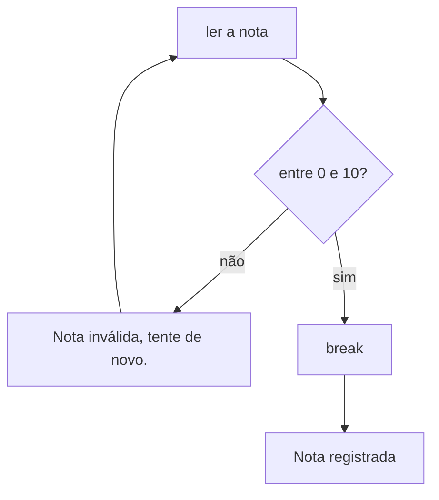

## Passo 1 · Leitura · Sair antes e pular a vez

Até agora, um laço só terminava de um jeito: a condição do `while` ficava falsa ou a sequência do `for` acabava. Dois comandos mudam o caminho **no meio** do bloco.

- **`break`** encerra o laço na hora. O programa continua na primeira linha depois do laço.
- **`continue`** encerra só a volta atual. O programa pula o resto do bloco e segue para a próxima volta.

Os dois quase sempre aparecem dentro de um `if`: "se aconteceu tal coisa, saia" ou "se for tal caso, pule". No visualizador, veja que o laço nem chega a olhar o 3: o `break` sai quando encontra o 10.

```python visualizar
numeros = [4, 7, 10, 3]
for n in numeros:
    if n > 8:
        print("achei", n)
        break
    print("passei por", n)
```

#### Repetir até dar certo: `while True` + `break`

Para pedir um dado até ele ser válido, você não sabe quantas voltas serão necessárias. O padrão é um laço cuja condição é sempre verdadeira (`while True`) e que só termina por um `break`:

```python
while True:
    nota = float(input())
    if 0 <= nota <= 10:
        break                 # nota válida: sai do laço
    print("Nota inválida, tente de novo.")
print("Nota registrada")
```



Um `while True` sem `break` alcançável é um laço infinito. Confira sempre que existe um caminho até o `break`.

#### Flag ou `break`?

**Flag** é uma variável booleana que registra se algo aconteceu. A mesma busca pode ser escrita das duas formas:

```python
# com flag: o laço olha todos os itens
achou = False
for n in numeros:
    if n > 8:
        achou = True

# com flag e break: para no primeiro que serve
achou = False
for n in numeros:
    if n > 8:
        achou = True
        break
```

As duas terminam com o mesmo valor em `achou`. A segunda não perde tempo com o resto da lista. Use `break` quando continuar olhando não muda a resposta.

## Passo 2 · Previsão · Pula ou sai?

O laço abaixo tem um `continue` e um `break`. Acompanhe o valor de `i` volta por volta e digite exatamente o que o programa imprime.

### Código
```python
for i in range(1, 10):
    if i == 3:
        continue
    if i == 6:
        break
    print(i)
```

### Dicas
1. `continue` pula só a volta atual: nessa volta o `print` não roda, mas o laço segue.
2. `break` encerra o laço inteiro: nada depois dele é impresso, nem nas voltas que faltavam.

### Saída esperada
```text
1
2
4
5
```

## Passo 3 · Exercício · Até digitar fim
modo: ordenar

O programa que você vai montar lê linhas de texto (com `input()` sem texto) até receber a palavra `fim`. Depois imprime quantas linhas foram lidas, no formato `Lidos: N`. A linha `fim` é só o aviso de parada: ela não entra na contagem.

Exemplo de execução, com as entradas `a`, `b` e `fim`:

```
Lidos: 2
```

Se a primeira linha já for `fim`, a saída é `Lidos: 0`.

Arraste as linhas para a ordem certa e ajuste a indentação de cada uma. Duas linhas estão sobrando.

### Instruções
1. Comece o contador `lidos` com zero.
2. Repita para sempre, lendo uma linha a cada volta.
3. Saia do laço quando a linha for `fim`, antes de contar.
4. Imprima o total uma única vez, depois do laço.

### Solução
```python
lidos = 0
while True:
    linha = input()
    if linha == "fim":
        break
    lidos += 1
print(f"Lidos: {lidos}")
```

### Distratores
```python
continue
lidos = 1
```

### Dicas
1. Teste antes de contar: se a contagem vier antes do `if`, o `fim` também é contado.
2. O `break` fica dois níveis à direita: dentro do `if`, que está dentro do `while`.
3. O `print` não tem indentação: ele roda uma vez, quando o laço já terminou.

### Verificação
```json
[
  { "id": "contador-zero", "checkpoint": 1, "kind": "io", "stdin": "fim\n", "expected_stdout": "Lidos: 0",
    "name": "Só a linha fim", "hint": "Sem nenhuma linha antes do fim, o contador continua com o valor inicial." },
  { "id": "usa-while", "checkpoint": 2, "kind": "source", "rule": { "type": "uses", "construct": "while" },
    "name": "Usa while" },
  { "id": "duas-linhas", "checkpoint": 3, "kind": "io", "stdin": "a\nb\nfim\n", "expected_stdout": "Lidos: 2",
    "name": "Entradas a, b, fim", "hint": "A linha fim encerra a leitura e não é contada." },
  { "id": "quatro-linhas", "checkpoint": 3, "kind": "io", "stdin": "Ana\nBia\nCaio\nDavi\nfim\n", "expected_stdout": "Lidos: 4",
    "name": "Quatro nomes e fim" },
  { "id": "uma-vez", "checkpoint": 4, "kind": "io", "stdin": "x\nfim\n", "expected_stdout": "Lidos: 1",
    "name": "O total aparece uma vez só", "hint": "A saída tem uma única linha, impressa depois do laço." }
]
```

### Soluções erradas
```python name="conta antes de testar (conta o fim)"
lidos = 0
while True:
    linha = input()
    lidos += 1
    if linha == "fim":
        break
print(f"Lidos: {lidos}")
```
```python name="print dentro do laço"
lidos = 0
while True:
    linha = input()
    if linha == "fim":
        break
    lidos += 1
    print(f"Lidos: {lidos}")
```
```python name="contador começa em 1"
lidos = 1
while True:
    linha = input()
    if linha == "fim":
        break
    lidos += 1
print(f"Lidos: {lidos}")
```

## Passo 4 · Exercício · Pulando múltiplos de 3

O `continue` serve para tirar um caso do caminho logo no começo do bloco: "se for este caso, pule; para todos os outros, faça o trabalho".

Escreva um programa que imprime os números de 1 a 20, um por linha, **pulando os múltiplos de 3** (3, 6, 9, 12, 15 e 18). Use um `for` e o comando `continue`.

A saída começa assim:

```
1
2
4
5
7
```

e continua até o `20`. São 14 linhas no total.

### Instruções
1. Percorra os números de 1 a 20 com `for` e `range`.
2. No começo do bloco, se o número for múltiplo de 3, pule a volta com `continue`.
   Dica: um número é múltiplo de 3 quando o resto da divisão por 3 é zero.
3. Depois do `if`, imprima o número.

### Código inicial
```python
# Percorra de 1 a 20

# Se for múltiplo de 3, pule a volta

# Imprima o número
```

### Solução
```python
for i in range(1, 21):
    if i % 3 == 0:
        continue
    print(i)
```

### Dicas
1. `i % 3 == 0` é verdadeiro exatamente para os múltiplos de 3.
2. O `print` vem depois do `if`, alinhado com ele: só as voltas que não foram puladas chegam até lá.

### Verificação
```json
[
  { "id": "usa-for", "checkpoint": 1, "kind": "source", "rule": { "type": "uses", "construct": "for" },
    "name": "Usa um laço for" },
  { "id": "vai-ate-20", "checkpoint": 1, "kind": "io", "stdin": "", "expected_stdout": "(^|\\n)20\\s*$", "match": "regex",
    "name": "A última linha é 20", "hint": "O fim do range é exclusivo: para o 20 aparecer, o fim precisa ser 21." },
  { "id": "pula-o-3", "checkpoint": 2, "kind": "io", "stdin": "", "expected_stdout": "^1\\n2\\n4\\n5\\n7\\n", "match": "regex",
    "name": "Começa com 1, 2, 4, 5, 7", "hint": "O 3 e o 6 não aparecem, mas o laço segue depois deles." },
  { "id": "saida", "checkpoint": 3, "kind": "io", "stdin": "", "expected_stdout": "1\n2\n4\n5\n7\n8\n10\n11\n13\n14\n16\n17\n19\n20",
    "name": "As 14 linhas, na ordem", "hint": "Todos os números de 1 a 20 que não são múltiplos de 3, um por linha." }
]
```

### Soluções erradas
```python name="condição invertida (imprime só os múltiplos)"
for i in range(1, 21):
    if i % 3 != 0:
        continue
    print(i)
```
```python name="break no lugar de continue (para no 2)"
for i in range(1, 21):
    if i % 3 == 0:
        break
    print(i)
```
```python name="range(1, 20) (falta o 20)"
for i in range(1, 20):
    if i % 3 == 0:
        continue
    print(i)
```

## Passo 5 · Quiz · break e continue

### Pergunta
Um `break` está dentro de um `for`, que por sua vez está dentro de um `while`. De qual laço ele sai?
- [ ] Dos dois ao mesmo tempo
- [x] Só do `for`, o laço mais interno em que ele está
- [ ] Só do `while`, o laço mais externo
- [ ] De nenhum: `break` só funciona em `while`
> O `break` encerra apenas o laço mais interno que o contém. O laço de fora continua normalmente.

### Pergunta
O que acontece ao executar este programa?
```python
i = 0
while i < 5:
    if i == 2:
        continue
    print(i)
    i += 1
```
- [ ] Imprime 0, 1, 3 e 4
- [ ] Imprime 0 e 1 e termina
- [x] Imprime 0 e 1 e entra em laço infinito
- [ ] Dá erro, porque `continue` só pode ser usado em `for`
> Quando `i` vale 2, o `continue` volta ao teste **sem passar** por `i += 1`. O `i` fica em 2 para sempre. Em um `while`, a atualização precisa acontecer antes do `continue`. No `for` esse risco não existe, porque o próprio `for` avança.

### Pergunta
O que acontece com este programa?
```python
idade = 20
if idade >= 18:
    print("maior de idade")
    break
```
- [ ] Imprime `maior de idade` e termina normalmente
- [ ] O `break` sai do `if` e o programa continua
- [x] O Python recusa o programa com `SyntaxError: 'break' outside loop`, sem executar nenhuma linha
- [ ] Imprime `maior de idade` e depois dá `NameError`
> `break` e `continue` só existem dentro de laços. Um `if` não é um laço: para "sair" de um `if`, basta o bloco terminar. Como é um erro de sintaxe, o Python nem começa a executar.

## Passo 6 · Exercício · Nota válida

Programas reais não confiam no que o usuário digita. Você vai usar o padrão `while True` + `break` para pedir uma nota até receber uma que faça sentido.

O programa lê uma nota (com `float(input())`, sem texto no `input`). Uma nota é válida quando está entre 0 e 10, incluindo o 0 e o 10.

- Se a nota for inválida, o programa imprime `Nota inválida, tente de novo.` e lê outra.
- Quando a nota for válida, o programa para de pedir e imprime `Nota registrada: X`, em que X é a nota, com `print(f"Nota registrada: {nota}")`.

Exemplo de execução, com as entradas `11`, `-1` e `8.5`:

```
Nota inválida, tente de novo.
Nota inválida, tente de novo.
Nota registrada: 8.5
```

Com a entrada `10`, a saída é `Nota registrada: 10.0` (a nota é um `float`, por isso o `.0`).

### Instruções
1. Dentro de um `while True`, leia a nota e converta para `float`.
2. Se a nota estiver entre 0 e 10 (0 e 10 valem), saia do laço com `break`. Senão, imprima `Nota inválida, tente de novo.` e deixe o laço pedir outra.
3. Depois do laço, imprima `Nota registrada: X`.

### Código inicial
```python
while True:
    # Leia a nota

    # Se for válida, saia do laço; senão, avise
    break

# Depois do laço, imprima a nota registrada
```

### Solução
```python
while True:
    nota = float(input())
    if 0 <= nota <= 10:
        break
    print("Nota inválida, tente de novo.")
print(f"Nota registrada: {nota}")
```

### Dicas
1. Use `while True` e um `break` dentro do `if` que testa se a nota é válida.
2. A mensagem de erro fica no caminho do inválido: depois do `if`, ainda dentro do laço.
3. 0 e 10 são válidos: a condição é `0 <= nota <= 10`, com `<=` dos dois lados.

### Verificação
```json
[
  { "id": "valida-direto", "checkpoint": 1, "kind": "io", "stdin": "7.5\n", "expected_stdout": "Nota registrada: 7.5",
    "name": "Entrada 7.5: registra na primeira leitura", "hint": "Com uma nota válida, não aparece nenhuma mensagem de erro." },
  { "id": "duas-invalidas", "checkpoint": 2, "kind": "io", "stdin": "11\n-1\n8.5\n",
    "expected_stdout": "Nota inválida, tente de novo.\nNota inválida, tente de novo.\nNota registrada: 8.5",
    "name": "Entradas 11, -1 e 8.5", "hint": "Cada nota inválida gera um aviso, e o programa lê de novo até vir uma válida." },
  { "id": "borda-10", "checkpoint": 2, "kind": "io", "stdin": "10\n", "expected_stdout": "Nota registrada: 10.0",
    "name": "Entrada 10: é válida", "hint": "O 10 faz parte do intervalo." },
  { "id": "borda-0", "checkpoint": 2, "kind": "io", "stdin": "0\n", "expected_stdout": "Nota registrada: 0.0",
    "name": "Entrada 0: é válida", "hint": "O 0 faz parte do intervalo." },
  { "id": "pouco-acima", "checkpoint": 2, "kind": "io", "stdin": "10.5\n9\n",
    "expected_stdout": "Nota inválida, tente de novo.\nNota registrada: 9.0",
    "name": "Entradas 10.5 e 9", "hint": "Qualquer valor acima de 10 é inválido, mesmo por pouco." },
  { "id": "tres-invalidas", "checkpoint": 3, "kind": "io", "stdin": "-3\n12\n100\n6\n",
    "expected_stdout": "Nota inválida, tente de novo.\nNota inválida, tente de novo.\nNota inválida, tente de novo.\nNota registrada: 6.0",
    "name": "Três inválidas antes da válida", "hint": "O programa não desiste: repete quantas vezes for preciso e registra uma vez só." }
]
```

### Soluções erradas
```python name="aceita até 11 (<= 11)"
while True:
    nota = float(input())
    if 0 <= nota <= 11:
        break
    print("Nota inválida, tente de novo.")
print(f"Nota registrada: {nota}")
```
```python name="if em vez de laço (só dá uma segunda chance)"
nota = float(input())
if nota < 0 or nota > 10:
    print("Nota inválida, tente de novo.")
    nota = float(input())
print(f"Nota registrada: {nota}")
```
```python name="não aceita 0 nem 10 (< no lugar de <=)"
while True:
    nota = float(input())
    if 0 < nota < 10:
        break
    print("Nota inválida, tente de novo.")
print(f"Nota registrada: {nota}")
```
