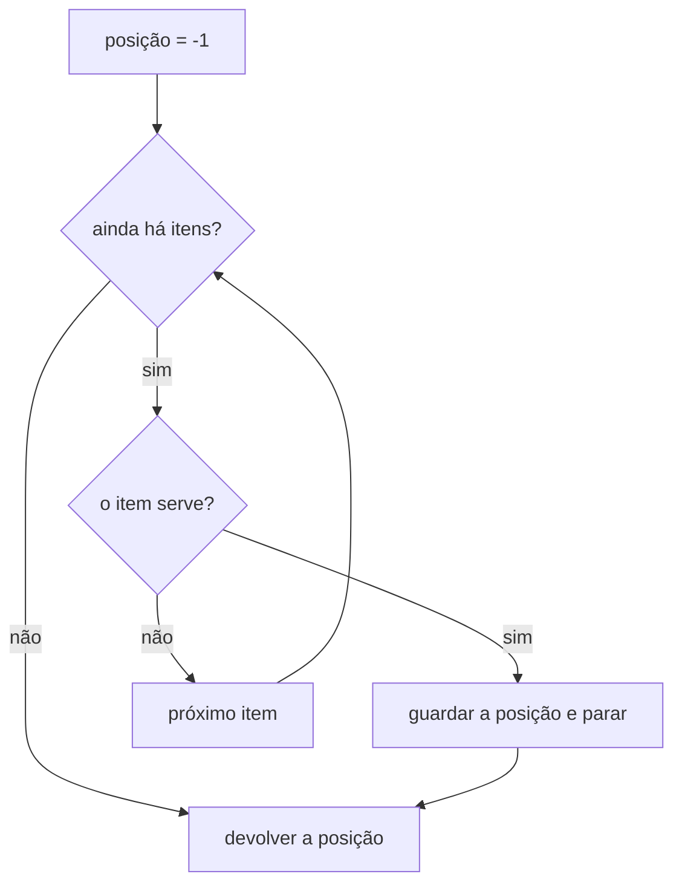

## Passo 1 · Leitura · Quatro padrões que se repetem

Boa parte dos problemas com laços é uma variação de quatro perguntas sobre uma sequência. Quem reconhece a pergunta já sabe que laço escrever.

| Pergunta | Variável e valor inicial | O que muda no laço | Pode parar antes? |
|---|---|---|---|
| **Existe algum?** | flag `achou = False` | vira `True` quando um item serve | sim, no primeiro que serve |
| **Onde está o primeiro?** | `posicao = -1` | recebe o índice do item que serve | sim, no primeiro que serve |
| **Quantos são?** | contador `quantos = 0` | soma 1 a cada item que serve | não: precisa ver todos |
| **Todos são?** | flag `todos = True` | vira `False` quando um item **não** serve | sim, no primeiro que falha |

Repare nos valores iniciais. Cada um é a resposta certa para o caso em que o laço não encontra nada: não existe (`False`), não está em lugar nenhum (`-1`, que não é posição de nenhum item), são zero (`0`).

O padrão "todos" é o que mais confunde, porque começa em `True`. A lógica é a de um fiscal: a regra vale **até aparecer uma prova contrária**. Um único item que falha decide o `False`; o `True` só pode ser confirmado depois de olhar o último item.

O fluxograma mostra a busca do primeiro item que serve:



No visualizador está o padrão "existe algum?", com flag e `break`. Veja `tem_negativo` mudar uma única vez e o laço parar sem olhar o 5:

```python visualizar
numeros = [3, 8, -2, 5]
tem_negativo = False
for n in numeros:
    if n < 0:
        tem_negativo = True
        break
print(tem_negativo)
```

#### Dentro de uma função, `return` também para

O `return` encerra a função na hora, e com ela o laço. Por isso, em uma função, a busca costuma dispensar a flag: `return` dentro do `if` quando acha, e um `return` com o valor inicial **depois do laço**, para o caso em que nada foi achado.

```python
def tem_negativo(lista):
    for n in lista:
        if n < 0:
            return True      # achou: a resposta já está decidida
    return False             # o laço terminou sem achar
```

O segundo `return` fica fora do laço. Essa posição é o ponto mais importante da lição.

## Passo 2 · Exercício · primeiro_negativo(lista)

Este é o padrão "onde está o primeiro?". A resposta é uma **posição** (índice), não o valor encontrado. Lembre que as posições de uma lista começam em 0, que `range(len(lista))` percorre todas elas e que `lista[i]` é o item da posição `i`.

Escreva a função `primeiro_negativo(lista)`, que devolve o índice do primeiro número negativo da lista. Se a lista não tiver nenhum negativo, a função devolve `-1`.

| Chamada | Resultado | Por quê |
|---|---|---|
| `primeiro_negativo([3, -1, -5])` | `1` | o `-1` está na posição 1 |
| `primeiro_negativo([1, 2])` | `-1` | não há negativos |
| `primeiro_negativo([])` | `-1` | não há itens |

### Instruções
1. Percorra as posições da lista com `for i in range(len(lista))`.
2. Assim que encontrar um item negativo, pare e devolva a posição dele.
   Dica: a resposta é `i`, não `lista[i]`.
3. Se o laço terminar sem encontrar nenhum negativo, devolva `-1`.

### Código inicial
```python
def primeiro_negativo(lista):
    # percorra as posições e pare no primeiro negativo

    # se não achou nenhum, devolva -1
    pass
```

### Solução
```python
def primeiro_negativo(lista):
    for i in range(len(lista)):
        if lista[i] < 0:
            return i
    return -1
```

### Dicas
1. Percorra as posições com `range(len(lista))`: você precisa do índice para devolver.
2. Pare assim que achar: um `return i` dentro do `if` encerra a função no primeiro negativo.
3. Se o laço terminar sem achar, a resposta é `-1`: um `return -1` depois do laço, fora dele.

### Verificação
```json
[
  { "id": "no-comeco", "checkpoint": 1, "kind": "call", "function": "primeiro_negativo", "args": [[-4, 2, 9]], "expected": 0, "type": "int",
    "name": "O negativo está na posição 0", "hint": "As posições começam em 0. A função devolve a posição, não o valor." },
  { "id": "dois-negativos", "checkpoint": 2, "kind": "call", "function": "primeiro_negativo", "args": [[3, -1, -5]], "expected": 1, "type": "int",
    "name": "primeiro_negativo([3, -1, -5])", "hint": "Há dois negativos: a resposta é a posição do primeiro, e a busca para nele." },
  { "id": "no-fim", "checkpoint": 2, "kind": "call", "function": "primeiro_negativo", "args": [[5, 0, 7, -2]], "expected": 3, "type": "int",
    "name": "O negativo é o último item", "hint": "O zero não é negativo, e a função só desiste depois de olhar todos os itens." },
  { "id": "sem-negativos", "checkpoint": 3, "kind": "call", "function": "primeiro_negativo", "args": [[1, 2]], "expected": -1, "type": "int",
    "name": "primeiro_negativo([1, 2])", "hint": "Sem nenhum negativo, a função devolve o valor combinado para não achou." },
  { "id": "vazia", "checkpoint": 3, "kind": "call", "function": "primeiro_negativo", "args": [[]], "expected": -1, "type": "int",
    "name": "primeiro_negativo([])", "hint": "Com a lista vazia o laço não dá nenhuma volta; o return depois do laço responde." }
]
```

### Soluções erradas
```python name="devolve o valor em vez do índice"
def primeiro_negativo(lista):
    for i in range(len(lista)):
        if lista[i] < 0:
            return lista[i]
    return -1
```
```python name="não para: devolve o último negativo"
def primeiro_negativo(lista):
    posicao = -1
    for i in range(len(lista)):
        if lista[i] < 0:
            posicao = i
    return posicao
```
```python name="return -1 no else (decide pelo primeiro item)"
def primeiro_negativo(lista):
    for i in range(len(lista)):
        if lista[i] < 0:
            return i
        else:
            return -1
```
```python name="sem return depois do laço (devolve None)"
def primeiro_negativo(lista):
    for i in range(len(lista)):
        if lista[i] < 0:
            return i
```

## Passo 3 · Previsão · O return apressado

A função abaixo deveria responder se **todos** os números da lista são pares. Leia com atenção onde estão os dois `return` e digite o que o programa imprime de verdade.

### Código
```python
def todos_pares(lista):
    for n in lista:
        if n % 2 == 0:
            return True
        else:
            return False

print(todos_pares([2, 3, 5]))
print(todos_pares([1, 2, 4]))
```

### Dicas
1. `return` encerra a função na hora, mesmo no meio de um laço.
2. Os dois caminhos do `if` têm `return`: a função decide olhando só o primeiro item e nunca chega ao segundo.

### Saída esperada
```text
True
False
```

## Passo 4 · Exercício · conta_pares e todos_positivos

Na previsão, `todos_pares([2, 3, 5])` respondeu `True` porque a função se decidiu no primeiro item. O conserto é o padrão "todos são?": um item que falha decide o `False` na hora, mas o `True` só pode ser devolvido **depois do laço**, quando todos já foram vistos.

Escreva duas funções.

- `conta_pares(lista)` devolve quantos números pares a lista tem (padrão "quantos são?").
- `todos_positivos(lista)` devolve `True` se todos os números da lista forem maiores que zero, e `False` se pelo menos um não for (padrão "todos são?").

| Chamada | Resultado |
|---|---|
| `conta_pares([2, 3, 4])` | `2` |
| `conta_pares([])` | `0` |
| `todos_positivos([1, 2, 3])` | `True` |
| `todos_positivos([1, -2])` | `False` |
| `todos_positivos([])` | `True` |

A última linha parece estranha, mas segue a lógica do fiscal: em uma lista vazia, nenhum item contraria a regra, então ela vale. O zero não é positivo: `todos_positivos([0, 1])` é `False`.

### Instruções
1. Em `conta_pares`, use um contador que começa em 0 e soma 1 a cada número par. Devolva o contador depois do laço.
2. Em `todos_positivos`, devolva `False` assim que encontrar um número que não é maior que zero.
3. Em `todos_positivos`, devolva `True` somente depois do laço, fora dele.
   Dica: com a lista vazia, é esse `return` que responde.

### Código inicial
```python
def conta_pares(lista):
    pass


def todos_positivos(lista):
    pass
```

### Solução
```python
def conta_pares(lista):
    quantos = 0
    for n in lista:
        if n % 2 == 0:
            quantos += 1
    return quantos


def todos_positivos(lista):
    for n in lista:
        if n <= 0:
            return False
    return True
```

### Dicas
1. Só dá para dizer "todos" depois de ver todos: o `return True` não pode estar dentro do laço.
2. Um único item que falha já decide o `False`: teste o caso que **contraria** a regra (`n <= 0`) e devolva `False` dentro do `if`.
3. Em `conta_pares` não há parada antecipada: o `return` do contador vem depois do laço.

### Verificação
```json
[
  { "id": "conta-3", "checkpoint": 1, "kind": "call", "function": "conta_pares", "args": [[2, 3, 4]], "expected": 2, "type": "int",
    "name": "conta_pares([2, 3, 4])", "hint": "A contagem continua até o fim da lista." },
  { "id": "conta-vazia", "checkpoint": 1, "kind": "call", "function": "conta_pares", "args": [[]], "expected": 0, "type": "int",
    "name": "conta_pares([])", "hint": "Sem itens, a função devolve o valor inicial do contador." },
  { "id": "conta-impares", "checkpoint": 1, "kind": "call", "function": "conta_pares", "args": [[1, 3, 5, 7]], "expected": 0, "type": "int",
    "name": "Nenhum par na lista" },
  { "id": "conta-todos", "checkpoint": 1, "kind": "call", "function": "conta_pares", "args": [[0, 10, -4, 8]], "expected": 4, "type": "int",
    "name": "conta_pares([0, 10, -4, 8])", "hint": "Zero e números negativos também podem ser pares." },
  { "id": "falha-no-meio", "checkpoint": 2, "kind": "call", "function": "todos_positivos", "args": [[1, -2]], "expected": false, "type": "bool",
    "name": "todos_positivos([1, -2])", "hint": "O primeiro item é positivo, mas o segundo não. A função não pode se decidir no primeiro." },
  { "id": "falha-no-fim", "checkpoint": 2, "kind": "call", "function": "todos_positivos", "args": [[4, 9, 2, -1]], "expected": false, "type": "bool",
    "name": "O negativo é o último item", "hint": "Todos os itens precisam ser examinados antes de um True." },
  { "id": "zero", "checkpoint": 2, "kind": "call", "function": "todos_positivos", "args": [[0, 1]], "expected": false, "type": "bool",
    "name": "todos_positivos([0, 1])", "hint": "O zero não é positivo." },
  { "id": "todos", "checkpoint": 3, "kind": "call", "function": "todos_positivos", "args": [[1, 2, 3]], "expected": true, "type": "bool",
    "name": "todos_positivos([1, 2, 3])", "hint": "Se nenhum item falhou, a resposta é True, devolvida depois do laço." },
  { "id": "vazia", "checkpoint": 3, "kind": "call", "function": "todos_positivos", "args": [[]], "expected": true, "type": "bool",
    "name": "todos_positivos([])", "hint": "Na lista vazia nenhum item contraria a regra." }
]
```

### Soluções erradas
```python name="return True dentro do laço (decide pelo primeiro item)"
def conta_pares(lista):
    quantos = 0
    for n in lista:
        if n % 2 == 0:
            quantos += 1
    return quantos


def todos_positivos(lista):
    for n in lista:
        if n > 0:
            return True
        else:
            return False
    return True
```
```python name="lista vazia devolve False"
def conta_pares(lista):
    quantos = 0
    for n in lista:
        if n % 2 == 0:
            quantos += 1
    return quantos


def todos_positivos(lista):
    resposta = False
    for n in lista:
        if n > 0:
            resposta = True
        else:
            return False
    return resposta
```
```python name="conta_pares devolve dentro do laço"
def conta_pares(lista):
    quantos = 0
    for n in lista:
        if n % 2 == 0:
            quantos += 1
        return quantos
    return quantos


def todos_positivos(lista):
    for n in lista:
        if n <= 0:
            return False
    return True
```
```python name="zero conta como positivo (n < 0)"
def conta_pares(lista):
    quantos = 0
    for n in lista:
        if n % 2 == 0:
            quantos += 1
    return quantos


def todos_positivos(lista):
    for n in lista:
        if n < 0:
            return False
    return True
```

## Passo 5 · Quiz · Padrões

### Pergunta
Você vai verificar com uma flag se **todos** os itens de uma lista cumprem uma regra. Com que valor a flag começa?
- [ ] `False`, e vira `True` quando um item cumpre a regra
- [x] `True`, e vira `False` quando um item não cumpre a regra
- [ ] `0`, e soma 1 a cada item que cumpre a regra
- [ ] `-1`, e recebe a posição do item
> No padrão "todos", a regra vale até aparecer uma prova contrária. Começar em `False` e trocar para `True` no primeiro item que serve responde outra pergunta: "existe algum?".

### Pergunta
Em uma busca pelo primeiro item que serve, o que o `break` faz quando o item é encontrado?
- [ ] Pula o item encontrado e continua procurando
- [ ] Reinicia o laço desde o primeiro item
- [x] Encerra o laço na hora, porque olhar os itens seguintes não muda a resposta
- [ ] Encerra o programa inteiro
> O `break` sai só do laço, e o programa segue na linha depois dele. Sem o `break`, a busca continuaria e poderia guardar um item posterior no lugar do primeiro.

### Pergunta
Qual é a diferença entre um contador e um acumulador de soma?
- [ ] O contador só funciona com `while`; o acumulador, só com `for`
- [ ] O contador começa em 1; o acumulador começa em 0
- [x] O contador soma sempre 1 e responde "quantos?"; o acumulador soma o próprio valor do item e responde "quanto dá no total?"
- [ ] Não há diferença: os dois sempre terminam com o mesmo valor
> Os dois começam em 0 e são atualizados com `+=`. Para a lista `[5, 5]`, o contador termina em 2 e o acumulador, em 10.

## Passo 6 · Exercício · eh_primo(n)

Um número inteiro maior que 1 é **primo** quando só é divisível por 1 e por ele mesmo: 2, 3, 5, 7, 11, 13… O 9 não é primo, porque 3 divide 9. Os números 0 e 1 não são primos, por definição.

Testar se `n` é primo é um problema de busca: procure um **divisor** entre 2 e `n - 1`. Um número `d` divide `n` quando o resto da divisão é zero (`n % d == 0`).

- Achou um divisor? Não é primo, e a busca pode parar.
- O laço terminou sem achar nenhum? É primo.

É o padrão "todos são?": todos os candidatos precisam falhar como divisores.

Escreva a função `eh_primo(n)`, que devolve `True` se `n` for primo e `False` caso contrário.

| Chamada | Resultado |
|---|---|
| `eh_primo(0)` | `False` |
| `eh_primo(1)` | `False` |
| `eh_primo(2)` | `True` |
| `eh_primo(9)` | `False` |
| `eh_primo(17)` | `True` |
| `eh_primo(25)` | `False` |

### Instruções
1. Se `n` for menor que 2, devolva `False` antes de qualquer laço.
2. Percorra os candidatos a divisor de 2 até `n - 1` e devolva `False` assim que um deles dividir `n`.
3. Devolva `True` somente depois do laço, quando nenhum candidato dividiu `n`.

### Código inicial
```python
def eh_primo(n):
    # números menores que 2 não são primos

    # procure um divisor entre 2 e n - 1

    # nenhum divisor encontrado: é primo
    pass
```

### Solução
```python
def eh_primo(n):
    if n < 2:
        return False
    for divisor in range(2, n):
        if n % divisor == 0:
            return False
    return True
```

### Dicas
1. Números menores que 2 não são primos: trate esse caso primeiro, com um `if` e um `return False`.
2. Achou um divisor, não é primo: `return False` dentro do `if`, no meio do laço. `range(2, n)` gera os candidatos de 2 até `n - 1`.
3. Só depois do laço dá para devolver `True`. Para `n = 2`, o `range(2, 2)` é vazio, o laço não roda e a resposta é `True`.

### Verificação
```json
[
  { "id": "zero", "checkpoint": 1, "kind": "call", "function": "eh_primo", "args": [0], "expected": false, "type": "bool",
    "name": "eh_primo(0)", "hint": "Números menores que 2 não são primos." },
  { "id": "um", "checkpoint": 1, "kind": "call", "function": "eh_primo", "args": [1], "expected": false, "type": "bool",
    "name": "eh_primo(1)", "hint": "O 1 não é primo, por definição. Trate esse caso antes do laço." },
  { "id": "quatro", "checkpoint": 2, "kind": "call", "function": "eh_primo", "args": [4], "expected": false, "type": "bool",
    "name": "eh_primo(4)", "hint": "O 2 divide o 4." },
  { "id": "nove", "checkpoint": 2, "kind": "call", "function": "eh_primo", "args": [9], "expected": false, "type": "bool",
    "name": "eh_primo(9)", "hint": "O 2 não divide o 9, mas o 3 divide. A função não pode se decidir no primeiro candidato." },
  { "id": "vinte-e-cinco", "checkpoint": 2, "kind": "call", "function": "eh_primo", "args": [25], "expected": false, "type": "bool",
    "name": "eh_primo(25)", "hint": "O único divisor entre 2 e 24 é o 5: a busca precisa chegar até ele." },
  { "id": "dois", "checkpoint": 3, "kind": "call", "function": "eh_primo", "args": [2], "expected": true, "type": "bool",
    "name": "eh_primo(2)", "hint": "O 2 é primo. O próprio n não entra na lista de candidatos a divisor." },
  { "id": "tres", "checkpoint": 3, "kind": "call", "function": "eh_primo", "args": [3], "expected": true, "type": "bool",
    "name": "eh_primo(3)" },
  { "id": "dezessete", "checkpoint": 3, "kind": "call", "function": "eh_primo", "args": [17], "expected": true, "type": "bool",
    "name": "eh_primo(17)", "hint": "Se nenhum candidato divide n, a função devolve True depois do laço." }
]
```

### Soluções erradas
```python name="eh_primo(1) devolve True (falta o caso n < 2)"
def eh_primo(n):
    for divisor in range(2, n):
        if n % divisor == 0:
            return False
    return True
```
```python name="decide pelo primeiro divisor testado (9 vira primo)"
def eh_primo(n):
    if n < 2:
        return False
    for divisor in range(2, n):
        if n % divisor == 0:
            return False
        else:
            return True
    return True
```
```python name="range(2, n + 1) (testa o próprio n)"
def eh_primo(n):
    if n < 2:
        return False
    for divisor in range(2, n + 1):
        if n % divisor == 0:
            return False
    return True
```
```python name="começa os divisores em 1"
def eh_primo(n):
    if n < 2:
        return False
    for divisor in range(1, n):
        if n % divisor == 0:
            return False
    return True
```
