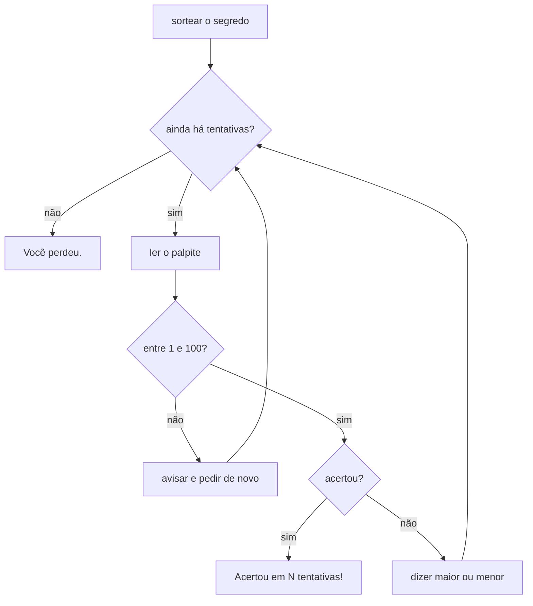

## Passo 1 · Leitura · As regras do jogo

Neste mini-projeto você monta um jogo completo, em quatro etapas. Cada etapa acrescenta uma parte e é corrigida sozinha. Leia a especificação inteira antes de começar: ela vale para a lição toda.

#### Regras

1. O computador escolhe um número secreto entre 1 e 100.
2. O jogador tem **5 tentativas**. Antes de cada palpite, o jogo imprime `Tentativa N de 5:`.
3. O palpite é lido com `int(input())`, sem texto no `input`.
4. Palpite fora de 1 a 100: o jogo imprime `Digite um número entre 1 e 100.` e **não gasta a tentativa**.
5. Palpite errado: o jogo imprime `O número é maior.` ou `O número é menor.`, falando do número secreto em relação ao palpite.
6. Palpite certo: o jogo imprime `Acertou em N tentativas!` e termina. O texto é sempre esse, mesmo com N igual a 1.
7. Se as 5 tentativas acabarem: `Você perdeu. O número era X.`



#### Três partidas de exemplo

Nas três, o número secreto é 42.

**Partida 1.** Entradas: `10`, `50`, `42`.

```
Tentativa 1 de 5:
O número é maior.
Tentativa 2 de 5:
O número é menor.
Tentativa 3 de 5:
Acertou em 3 tentativas!
```

**Partida 2.** Entradas: `0`, `101`, `42`. Os dois primeiros palpites são inválidos e a tentativa continua sendo a primeira.

```
Tentativa 1 de 5:
Digite um número entre 1 e 100.
Tentativa 1 de 5:
Digite um número entre 1 e 100.
Tentativa 1 de 5:
Acertou em 1 tentativas!
```

**Partida 3.** Entradas: `1`, `2`, `3`, `4`, `5`. Nenhum palpite acerta e as tentativas acabam.

```
Tentativa 1 de 5:
O número é maior.
Tentativa 2 de 5:
O número é maior.
Tentativa 3 de 5:
O número é maior.
Tentativa 4 de 5:
O número é maior.
Tentativa 5 de 5:
O número é maior.
Você perdeu. O número era 42.
```

#### Regra separada da interação

O programa tem duas partes com papéis diferentes. A **regra** decide o resultado de um palpite e não lê nem imprime nada: é uma função que recebe valores e devolve uma resposta. A **interação** é o laço que lê, chama a regra e imprime. Separadas, cada uma pode ser testada e corrigida sem mexer na outra. Você começa pela regra.

## Passo 2 · Exercício · avaliar_palpite(palpite, segredo)

A regra do jogo cabe em uma função. Ela compara o palpite com o segredo e devolve um de três textos, em minúsculas e sem ponto final:

- `"acertou"` se o palpite é igual ao segredo;
- `"maior"` se o segredo é **maior** que o palpite;
- `"menor"` se o segredo é **menor** que o palpite.

Atenção ao sentido: a resposta fala do segredo, como uma dica para o jogador. Se o segredo é 70 e o palpite foi 50, a dica é "o número é maior".

| Chamada | Resultado |
|---|---|
| `avaliar_palpite(50, 70)` | `"maior"` |
| `avaliar_palpite(80, 70)` | `"menor"` |
| `avaliar_palpite(70, 70)` | `"acertou"` |

A função não usa `input` nem `print`: ela só devolve o texto com `return`.

### Instruções
1. Devolva `"acertou"` quando o palpite for igual ao segredo.
2. Devolva `"maior"` quando o segredo for maior que o palpite.
3. Devolva `"menor"` quando o segredo for menor que o palpite.

### Código inicial
```python
def avaliar_palpite(palpite, segredo):
    pass
```

### Solução
```python
def avaliar_palpite(palpite, segredo):
    if palpite == segredo:
        return "acertou"
    elif segredo > palpite:
        return "maior"
    else:
        return "menor"
```

### Dicas
1. A dica fala do segredo em relação ao palpite: "maior" quer dizer que o jogador precisa chutar mais alto.
2. Teste a igualdade primeiro, com `==`. Depois sobram só dois casos, que cabem em um `elif` e um `else`.

### Verificação
```json
[
  { "id": "acertou", "checkpoint": 1, "kind": "call", "function": "avaliar_palpite", "args": [70, 70], "expected": "acertou", "type": "str",
    "name": "avaliar_palpite(70, 70)", "hint": "Palpite igual ao segredo. A função devolve o texto com return, em minúsculas." },
  { "id": "acertou-borda", "checkpoint": 1, "kind": "call", "function": "avaliar_palpite", "args": [1, 1], "expected": "acertou", "type": "str",
    "name": "avaliar_palpite(1, 1)" },
  { "id": "maior", "checkpoint": 2, "kind": "call", "function": "avaliar_palpite", "args": [50, 70], "expected": "maior", "type": "str",
    "name": "avaliar_palpite(50, 70)", "hint": "O segredo (70) é maior que o palpite (50)." },
  { "id": "maior-por-um", "checkpoint": 2, "kind": "call", "function": "avaliar_palpite", "args": [41, 42], "expected": "maior", "type": "str",
    "name": "avaliar_palpite(41, 42)", "hint": "O primeiro valor é o palpite; o segundo é o segredo." },
  { "id": "menor", "checkpoint": 3, "kind": "call", "function": "avaliar_palpite", "args": [80, 70], "expected": "menor", "type": "str",
    "name": "avaliar_palpite(80, 70)", "hint": "O segredo (70) é menor que o palpite (80)." },
  { "id": "menor-por-um", "checkpoint": 3, "kind": "call", "function": "avaliar_palpite", "args": [100, 99], "expected": "menor", "type": "str",
    "name": "avaliar_palpite(100, 99)" }
]
```

### Soluções erradas
```python name="maior e menor invertidos"
def avaliar_palpite(palpite, segredo):
    if palpite == segredo:
        return "acertou"
    elif palpite > segredo:
        return "maior"
    else:
        return "menor"
```
```python name="acertou só no else de um teste >="
def avaliar_palpite(palpite, segredo):
    if segredo >= palpite:
        return "maior"
    elif segredo < palpite:
        return "menor"
    else:
        return "acertou"
```
```python name="imprime em vez de devolver"
def avaliar_palpite(palpite, segredo):
    if palpite == segredo:
        print("acertou")
    elif segredo > palpite:
        print("maior")
    else:
        print("menor")
```

## Passo 3 · Exercício · Laço de tentativas com segredo fixo

Agora a interação. Para conseguir testar o jogo, o segredo fica fixo por enquanto: `segredo = 42`. O sorteio entra na última etapa.

Nesta etapa o jogo ainda não valida o intervalo: todo palpite gasta uma tentativa. O programa faz o seguinte, no máximo 5 vezes:

- imprime `Tentativa N de 5:` (N começa em 1);
- lê o palpite com `int(input())`;
- chama `avaliar_palpite` e reage ao resultado: com `"acertou"`, imprime `Acertou em N tentativas!` e o jogo acaba; com `"maior"`, imprime `O número é maior.`; com `"menor"`, imprime `O número é menor.`

Se as 5 tentativas acabarem sem acerto, o programa imprime `Você perdeu. O número era 42.` Quem acerta, mesmo na quinta tentativa, não vê essa mensagem.

Exemplo, com as entradas `10`, `50` e `42`:

```
Tentativa 1 de 5:
O número é maior.
Tentativa 2 de 5:
O número é menor.
Tentativa 3 de 5:
Acertou em 3 tentativas!
```

Para saber, depois do laço, se o jogador ganhou, use uma flag: `acertou = False` antes do laço, e `True` no momento do acerto.

### Instruções
1. Repita no máximo 5 vezes: imprima `Tentativa N de 5:`, leia o palpite como inteiro e chame `avaliar_palpite(palpite, segredo)`.
2. Imprima a dica (`O número é maior.` ou `O número é menor.`) ou, no acerto, `Acertou em N tentativas!`, e encerre o laço ao acertar.
   Dica: lembre de avançar o número da tentativa no fim de cada volta.
3. Depois do laço, imprima `Você perdeu. O número era 42.` somente se o jogador não acertou.

### Código inicial
```python
def avaliar_palpite(palpite, segredo):
    if palpite == segredo:
        return "acertou"
    elif segredo > palpite:
        return "maior"
    else:
        return "menor"


segredo = 42
limite = 5
tentativa = 1
acertou = False

# Laço de tentativas: imprima "Tentativa N de 5:", leia o palpite e reaja

# Depois do laço: mensagem de derrota, se não acertou
```

### Solução
```python
def avaliar_palpite(palpite, segredo):
    if palpite == segredo:
        return "acertou"
    elif segredo > palpite:
        return "maior"
    else:
        return "menor"


segredo = 42
limite = 5
tentativa = 1
acertou = False
while tentativa <= limite:
    print(f"Tentativa {tentativa} de {limite}:")
    palpite = int(input())
    resultado = avaliar_palpite(palpite, segredo)
    if resultado == "acertou":
        print(f"Acertou em {tentativa} tentativas!")
        acertou = True
        break
    elif resultado == "maior":
        print("O número é maior.")
    else:
        print("O número é menor.")
    tentativa += 1
if not acertou:
    print(f"Você perdeu. O número era {segredo}.")
```

### Dicas
1. Use `while tentativa <= limite:` e, no fim de cada volta com palpite errado, `tentativa += 1`. Ao acertar, saia com `break`.
2. A mensagem de derrota só aparece se as 5 tentativas acabarem: marque `acertou = True` antes do `break` e teste `if not acertou:` depois do laço.
3. As mensagens usam f-string: `print(f"Tentativa {tentativa} de {limite}:")` e `print(f"Acertou em {tentativa} tentativas!")`.

### Verificação
```json
[
  {"id": "usa-funcao", "checkpoint": 1, "kind": "source", "rule": {"type": "calls", "name": "avaliar_palpite"}, "name": "O laço usa avaliar_palpite", "hint": "A regra já está pronta na função: chame-a em vez de repetir as comparações."},
  {"id": "primeira", "checkpoint": 2, "kind": "io", "stdin": "42\n", "expected_stdout": "Tentativa 1 de 5:\nAcertou em 1 tentativas!", "name": "Partida 42: acerta na primeira", "hint": "Ao acertar, o jogo imprime a mensagem de vitória e termina, sem pedir outro palpite."},
  {"id": "terceira", "checkpoint": 2, "kind": "io", "stdin": "10\n50\n42\n", "expected_stdout": "Tentativa 1 de 5:\nO número é maior.\nTentativa 2 de 5:\nO número é menor.\nTentativa 3 de 5:\nAcertou em 3 tentativas!", "name": "Partida 10, 50, 42: acerta na terceira", "hint": "Confira as dicas (maior/menor), a numeração das tentativas, que começa em 1, e a mensagem final."},
  {"id": "ultima", "checkpoint": 3, "kind": "io", "stdin": "1\n99\n30\n60\n42\n", "expected_stdout": "Tentativa 1 de 5:\nO número é maior.\nTentativa 2 de 5:\nO número é menor.\nTentativa 3 de 5:\nO número é maior.\nTentativa 4 de 5:\nO número é menor.\nTentativa 5 de 5:\nAcertou em 5 tentativas!", "name": "Acerta na quinta tentativa", "hint": "Quem acerta na última tentativa ganhou: a mensagem de derrota não aparece."},
  {"id": "derrota", "checkpoint": 3, "kind": "io", "stdin": "1\n2\n3\n4\n5\n", "expected_stdout": "Tentativa 1 de 5:\nO número é maior.\nTentativa 2 de 5:\nO número é maior.\nTentativa 3 de 5:\nO número é maior.\nTentativa 4 de 5:\nO número é maior.\nTentativa 5 de 5:\nO número é maior.\nVocê perdeu. O número era 42.", "name": "Partida 1, 2, 3, 4, 5: derrota", "hint": "Depois da quinta tentativa errada, o jogo imprime a dica e, em seguida, a mensagem de derrota com o número secreto."}
]
```

### Soluções erradas
```python name="não para ao acertar (falta o break)"
def avaliar_palpite(palpite, segredo):
    if palpite == segredo:
        return "acertou"
    elif segredo > palpite:
        return "maior"
    else:
        return "menor"


segredo = 42
limite = 5
tentativa = 1
acertou = False
while tentativa <= limite:
    print(f"Tentativa {tentativa} de {limite}:")
    palpite = int(input())
    resultado = avaliar_palpite(palpite, segredo)
    if resultado == "acertou":
        print(f"Acertou em {tentativa} tentativas!")
        acertou = True
    elif resultado == "maior":
        print("O número é maior.")
    else:
        print("O número é menor.")
    tentativa += 1
if not acertou:
    print(f"Você perdeu. O número era {segredo}.")
```
```python name="contador começa em 0 (Tentativa 0 de 5:)"
def avaliar_palpite(palpite, segredo):
    if palpite == segredo:
        return "acertou"
    elif segredo > palpite:
        return "maior"
    else:
        return "menor"


segredo = 42
limite = 5
tentativa = 0
acertou = False
while tentativa < limite:
    print(f"Tentativa {tentativa} de {limite}:")
    palpite = int(input())
    resultado = avaliar_palpite(palpite, segredo)
    if resultado == "acertou":
        print(f"Acertou em {tentativa} tentativas!")
        acertou = True
        break
    elif resultado == "maior":
        print("O número é maior.")
    else:
        print("O número é menor.")
    tentativa += 1
if not acertou:
    print(f"Você perdeu. O número era {segredo}.")
```
```python name="imprime a derrota mesmo quando o jogador acerta"
def avaliar_palpite(palpite, segredo):
    if palpite == segredo:
        return "acertou"
    elif segredo > palpite:
        return "maior"
    else:
        return "menor"


segredo = 42
limite = 5
tentativa = 1
acertou = False
while tentativa <= limite:
    print(f"Tentativa {tentativa} de {limite}:")
    palpite = int(input())
    resultado = avaliar_palpite(palpite, segredo)
    if resultado == "acertou":
        print(f"Acertou em {tentativa} tentativas!")
        acertou = True
        break
    elif resultado == "maior":
        print("O número é maior.")
    else:
        print("O número é menor.")
    tentativa += 1
print(f"Você perdeu. O número era {segredo}.")
```
```python name="compara o texto do input com o número (falta o int)"
def avaliar_palpite(palpite, segredo):
    if palpite == segredo:
        return "acertou"
    elif segredo > palpite:
        return "maior"
    else:
        return "menor"


segredo = 42
limite = 5
tentativa = 1
acertou = False
while tentativa <= limite:
    print(f"Tentativa {tentativa} de {limite}:")
    palpite = input()
    if palpite == segredo:
        print(f"Acertou em {tentativa} tentativas!")
        acertou = True
        break
    else:
        print("O número é maior.")
    tentativa += 1
if not acertou:
    print(f"Você perdeu. O número era {segredo}.")
```

## Passo 4 · Exercício · Validação

Você continua o programa do passo anterior. Falta a regra 4: um palpite fora do intervalo de 1 a 100 não é um palpite de verdade, e o jogador não deve perder uma tentativa por causa dele.

Logo depois de ler o palpite, e **antes** de avaliar ou contar, o jogo confere o intervalo. Se o palpite for menor que 1 ou maior que 100, o programa imprime `Digite um número entre 1 e 100.` e volta ao começo do laço, sem avançar o número da tentativa. O 1 e o 100 são palpites válidos.

Exemplo, com as entradas `0`, `101` e `42`:

```
Tentativa 1 de 5:
Digite um número entre 1 e 100.
Tentativa 1 de 5:
Digite um número entre 1 e 100.
Tentativa 1 de 5:
Acertou em 1 tentativas!
```

O comando `continue` faz exatamente esse "volte ao começo". Aqui ele vem antes de `tentativa += 1` de propósito: a tentativa não deve avançar. O laço não fica infinito porque cada volta lê um palpite novo, e o jogador acaba digitando um válido.

### Instruções
1. Depois de ler o palpite, teste se ele está fora do intervalo de 1 a 100. Se estiver, imprima `Digite um número entre 1 e 100.`
2. Nesse caso, volte ao começo do laço sem avaliar o palpite e sem gastar a tentativa.

### Solução
```python
def avaliar_palpite(palpite, segredo):
    if palpite == segredo:
        return "acertou"
    elif segredo > palpite:
        return "maior"
    else:
        return "menor"


segredo = 42
limite = 5
tentativa = 1
acertou = False
while tentativa <= limite:
    print(f"Tentativa {tentativa} de {limite}:")
    palpite = int(input())
    if palpite < 1 or palpite > 100:
        print("Digite um número entre 1 e 100.")
        continue
    resultado = avaliar_palpite(palpite, segredo)
    if resultado == "acertou":
        print(f"Acertou em {tentativa} tentativas!")
        acertou = True
        break
    elif resultado == "maior":
        print("O número é maior.")
    else:
        print("O número é menor.")
    tentativa += 1
if not acertou:
    print(f"Você perdeu. O número era {segredo}.")
```

### Dicas
1. Valide antes de contar: o teste do intervalo vem logo depois do `int(input())`, antes da chamada de `avaliar_palpite`.
2. `continue` volta ao começo do laço. Como ele vem antes de `tentativa += 1`, a tentativa não avança.
3. A condição do inválido é `palpite < 1 or palpite > 100`.

### Verificação
```json
[
  {"id": "invalidos", "checkpoint": 1, "kind": "io", "stdin": "0\n101\n42\n", "expected_stdout": "Tentativa 1 de 5:\nDigite um número entre 1 e 100.\nTentativa 1 de 5:\nDigite um número entre 1 e 100.\nTentativa 1 de 5:\nAcertou em 1 tentativas!", "name": "Partida 0, 101, 42", "hint": "Palpites fora do intervalo geram o aviso e não avançam o número da tentativa."},
  {"id": "muitos-invalidos", "checkpoint": 2, "kind": "io", "stdin": "0\n-5\n300\n0\n150\n1000\n42\n", "expected_stdout": "Tentativa 1 de 5:\nDigite um número entre 1 e 100.\nTentativa 1 de 5:\nDigite um número entre 1 e 100.\nTentativa 1 de 5:\nDigite um número entre 1 e 100.\nTentativa 1 de 5:\nDigite um número entre 1 e 100.\nTentativa 1 de 5:\nDigite um número entre 1 e 100.\nTentativa 1 de 5:\nDigite um número entre 1 e 100.\nTentativa 1 de 5:\nAcertou em 1 tentativas!", "name": "Seis palpites inválidos e depois o acerto", "hint": "Palpite inválido não gasta tentativa, por mais que se repita."},
  {"id": "bordas", "checkpoint": 1, "kind": "io", "stdin": "1\n100\n42\n", "expected_stdout": "Tentativa 1 de 5:\nO número é maior.\nTentativa 2 de 5:\nO número é menor.\nTentativa 3 de 5:\nAcertou em 3 tentativas!", "name": "1 e 100 são palpites válidos", "hint": "O intervalo inclui o 1 e o 100."},
  {"id": "invalido-no-meio", "checkpoint": 2, "kind": "io", "stdin": "50\n0\n20\n42\n", "expected_stdout": "Tentativa 1 de 5:\nO número é menor.\nTentativa 2 de 5:\nDigite um número entre 1 e 100.\nTentativa 2 de 5:\nO número é maior.\nTentativa 3 de 5:\nAcertou em 3 tentativas!", "name": "Palpite inválido no meio da partida", "hint": "Depois do aviso, o jogo repete a mesma tentativa."},
  {"id": "derrota", "checkpoint": 2, "kind": "io", "stdin": "1\n2\n200\n3\n4\n5\n", "expected_stdout": "Tentativa 1 de 5:\nO número é maior.\nTentativa 2 de 5:\nO número é maior.\nTentativa 3 de 5:\nDigite um número entre 1 e 100.\nTentativa 3 de 5:\nO número é maior.\nTentativa 4 de 5:\nO número é maior.\nTentativa 5 de 5:\nO número é maior.\nVocê perdeu. O número era 42.", "name": "Derrota com um palpite inválido no caminho", "hint": "As cinco tentativas válidas são gastas; a inválida não conta."}
]
```

### Soluções erradas
```python name="palpite inválido consome tentativa"
def avaliar_palpite(palpite, segredo):
    if palpite == segredo:
        return "acertou"
    elif segredo > palpite:
        return "maior"
    else:
        return "menor"


segredo = 42
limite = 5
tentativa = 1
acertou = False
while tentativa <= limite:
    print(f"Tentativa {tentativa} de {limite}:")
    palpite = int(input())
    if palpite < 1 or palpite > 100:
        print("Digite um número entre 1 e 100.")
        tentativa += 1
        continue
    resultado = avaliar_palpite(palpite, segredo)
    if resultado == "acertou":
        print(f"Acertou em {tentativa} tentativas!")
        acertou = True
        break
    elif resultado == "maior":
        print("O número é maior.")
    else:
        print("O número é menor.")
    tentativa += 1
if not acertou:
    print(f"Você perdeu. O número era {segredo}.")
```
```python name="aceita o 0 (palpite < 0)"
def avaliar_palpite(palpite, segredo):
    if palpite == segredo:
        return "acertou"
    elif segredo > palpite:
        return "maior"
    else:
        return "menor"


segredo = 42
limite = 5
tentativa = 1
acertou = False
while tentativa <= limite:
    print(f"Tentativa {tentativa} de {limite}:")
    palpite = int(input())
    if palpite < 0 or palpite > 100:
        print("Digite um número entre 1 e 100.")
        continue
    resultado = avaliar_palpite(palpite, segredo)
    if resultado == "acertou":
        print(f"Acertou em {tentativa} tentativas!")
        acertou = True
        break
    elif resultado == "maior":
        print("O número é maior.")
    else:
        print("O número é menor.")
    tentativa += 1
if not acertou:
    print(f"Você perdeu. O número era {segredo}.")
```
```python name="avisa, mas não volta ao começo do laço (falta o continue)"
def avaliar_palpite(palpite, segredo):
    if palpite == segredo:
        return "acertou"
    elif segredo > palpite:
        return "maior"
    else:
        return "menor"


segredo = 42
limite = 5
tentativa = 1
acertou = False
while tentativa <= limite:
    print(f"Tentativa {tentativa} de {limite}:")
    palpite = int(input())
    if palpite < 1 or palpite > 100:
        print("Digite um número entre 1 e 100.")
    resultado = avaliar_palpite(palpite, segredo)
    if resultado == "acertou":
        print(f"Acertou em {tentativa} tentativas!")
        acertou = True
        break
    elif resultado == "maior":
        print("O número é maior.")
    else:
        print("O número é menor.")
    tentativa += 1
if not acertou:
    print(f"Você perdeu. O número era {segredo}.")
```
```python name="recusa o 100 (>= 100)"
def avaliar_palpite(palpite, segredo):
    if palpite == segredo:
        return "acertou"
    elif segredo > palpite:
        return "maior"
    else:
        return "menor"


segredo = 42
limite = 5
tentativa = 1
acertou = False
while tentativa <= limite:
    print(f"Tentativa {tentativa} de {limite}:")
    palpite = int(input())
    if palpite < 1 or palpite >= 100:
        print("Digite um número entre 1 e 100.")
        continue
    resultado = avaliar_palpite(palpite, segredo)
    if resultado == "acertou":
        print(f"Acertou em {tentativa} tentativas!")
        acertou = True
        break
    elif resultado == "maior":
        print("O número é maior.")
    else:
        print("O número é menor.")
    tentativa += 1
if not acertou:
    print(f"Você perdeu. O número era {segredo}.")
```

## Passo 5 · Exercício · Versão final

Falta o computador escolher o número. O módulo `random` ("aleatório") faz sorteios. Um **módulo** é um arquivo de funções prontas que você carrega com `import`:

```python
import random

segredo = random.randint(1, 100)   # um inteiro entre 1 e 100, incluindo os dois
```

Um jogo que sorteia um número diferente a cada execução não pode ser conferido: ninguém sabe qual saída esperar. A solução é a **semente**. O computador não sorteia de verdade: ele calcula uma sequência de números que parece aleatória, a partir de um valor inicial. `random.seed(42)` fixa esse valor, e a sequência passa a ser sempre a mesma.

Com `random.seed(42)`, o primeiro `random.randint(1, 100)` devolve sempre **82**. É com esse segredo que o seu jogo será corrigido.

Você continua o programa do passo anterior. Troque o segredo fixo pelo sorteio. Exemplo, com as entradas `50`, `90` e `82`:

```
Tentativa 1 de 5:
O número é maior.
Tentativa 2 de 5:
O número é menor.
Tentativa 3 de 5:
Acertou em 3 tentativas!
```

Em caso de derrota, a mensagem mostra o número sorteado: `Você perdeu. O número era 82.`

### Instruções
1. Importe o módulo `random` na primeira linha e chame `random.seed(42)` antes do sorteio.
2. Troque `segredo = 42` por um sorteio com `random.randint(1, 100)`, feito uma única vez, antes do laço.
3. Confira que a mensagem de derrota mostra o valor da variável `segredo`, não um número escrito à mão.

### Solução
```python
import random


def avaliar_palpite(palpite, segredo):
    if palpite == segredo:
        return "acertou"
    elif segredo > palpite:
        return "maior"
    else:
        return "menor"


random.seed(42)
segredo = random.randint(1, 100)
limite = 5
tentativa = 1
acertou = False
while tentativa <= limite:
    print(f"Tentativa {tentativa} de {limite}:")
    palpite = int(input())
    if palpite < 1 or palpite > 100:
        print("Digite um número entre 1 e 100.")
        continue
    resultado = avaliar_palpite(palpite, segredo)
    if resultado == "acertou":
        print(f"Acertou em {tentativa} tentativas!")
        acertou = True
        break
    elif resultado == "maior":
        print("O número é maior.")
    else:
        print("O número é menor.")
    tentativa += 1
if not acertou:
    print(f"Você perdeu. O número era {segredo}.")
```

### Dicas
1. A semente vem antes do `randint`: primeiro `random.seed(42)`, depois `segredo = random.randint(1, 100)`.
2. Sorteie uma vez só, antes do laço. Um sorteio dentro do laço troca o segredo a cada tentativa.
3. Na mensagem de derrota, use a variável: `print(f"Você perdeu. O número era {segredo}.")`.

### Verificação
```json
[
  {"id": "importa-random", "checkpoint": 1, "kind": "source", "rule": {"type": "imports", "module": "random"}, "name": "Importa o módulo random"},
  {"id": "usa-seed", "checkpoint": 1, "kind": "source", "rule": {"type": "calls", "name": "seed"}, "name": "Fixa a semente com random.seed", "hint": "Sem semente, o segredo muda a cada execução e a partida não pode ser conferida."},
  {"id": "usa-randint", "checkpoint": 2, "kind": "source", "rule": {"type": "calls", "name": "randint"}, "name": "Sorteia o segredo com random.randint"},
  {"id": "primeira", "checkpoint": 2, "kind": "io", "stdin": "82\n", "expected_stdout": "Tentativa 1 de 5:\nAcertou em 1 tentativas!", "name": "Acerta o número sorteado na primeira", "hint": "Com a semente 42, o primeiro sorteio entre 1 e 100 é sempre o mesmo número."},
  {"id": "terceira", "checkpoint": 2, "kind": "io", "stdin": "50\n90\n82\n", "expected_stdout": "Tentativa 1 de 5:\nO número é maior.\nTentativa 2 de 5:\nO número é menor.\nTentativa 3 de 5:\nAcertou em 3 tentativas!", "name": "Partida 50, 90, 82", "hint": "O segredo é sorteado uma única vez, antes do laço, e não muda durante a partida."},
  {"id": "derrota", "checkpoint": 3, "kind": "io", "stdin": "1\n2\n3\n4\n5\n", "expected_stdout": "Tentativa 1 de 5:\nO número é maior.\nTentativa 2 de 5:\nO número é maior.\nTentativa 3 de 5:\nO número é maior.\nTentativa 4 de 5:\nO número é maior.\nTentativa 5 de 5:\nO número é maior.\nVocê perdeu. O número era 82.", "name": "Partida 1, 2, 3, 4, 5: derrota", "hint": "A mensagem de derrota mostra o número sorteado."},
  {"id": "validacao", "checkpoint": 3, "kind": "io", "stdin": "0\n101\n60\n82\n", "expected_stdout": "Tentativa 1 de 5:\nDigite um número entre 1 e 100.\nTentativa 1 de 5:\nDigite um número entre 1 e 100.\nTentativa 1 de 5:\nO número é maior.\nTentativa 2 de 5:\nAcertou em 2 tentativas!", "name": "A validação continua funcionando", "hint": "Palpites fora de 1 a 100 não gastam tentativa."}
]
```

### Soluções erradas
```python name="sorteia um segredo novo a cada volta"
import random


def avaliar_palpite(palpite, segredo):
    if palpite == segredo:
        return "acertou"
    elif segredo > palpite:
        return "maior"
    else:
        return "menor"


random.seed(42)
segredo = 0
limite = 5
tentativa = 1
acertou = False
while tentativa <= limite:
    print(f"Tentativa {tentativa} de {limite}:")
    segredo = random.randint(1, 100)
    palpite = int(input())
    if palpite < 1 or palpite > 100:
        print("Digite um número entre 1 e 100.")
        continue
    resultado = avaliar_palpite(palpite, segredo)
    if resultado == "acertou":
        print(f"Acertou em {tentativa} tentativas!")
        acertou = True
        break
    elif resultado == "maior":
        print("O número é maior.")
    else:
        print("O número é menor.")
    tentativa += 1
if not acertou:
    print(f"Você perdeu. O número era {segredo}.")
```
```python name="sem seed (segredo diferente a cada execução)"
import random


def avaliar_palpite(palpite, segredo):
    if palpite == segredo:
        return "acertou"
    elif segredo > palpite:
        return "maior"
    else:
        return "menor"


segredo = random.randint(1, 100)
limite = 5
tentativa = 1
acertou = False
while tentativa <= limite:
    print(f"Tentativa {tentativa} de {limite}:")
    palpite = int(input())
    if palpite < 1 or palpite > 100:
        print("Digite um número entre 1 e 100.")
        continue
    resultado = avaliar_palpite(palpite, segredo)
    if resultado == "acertou":
        print(f"Acertou em {tentativa} tentativas!")
        acertou = True
        break
    elif resultado == "maior":
        print("O número é maior.")
    else:
        print("O número é menor.")
    tentativa += 1
if not acertou:
    print(f"Você perdeu. O número era {segredo}.")
```
```python name="semente diferente da pedida"
import random


def avaliar_palpite(palpite, segredo):
    if palpite == segredo:
        return "acertou"
    elif segredo > palpite:
        return "maior"
    else:
        return "menor"


random.seed(1)
segredo = random.randint(1, 100)
limite = 5
tentativa = 1
acertou = False
while tentativa <= limite:
    print(f"Tentativa {tentativa} de {limite}:")
    palpite = int(input())
    if palpite < 1 or palpite > 100:
        print("Digite um número entre 1 e 100.")
        continue
    resultado = avaliar_palpite(palpite, segredo)
    if resultado == "acertou":
        print(f"Acertou em {tentativa} tentativas!")
        acertou = True
        break
    elif resultado == "maior":
        print("O número é maior.")
    else:
        print("O número é menor.")
    tentativa += 1
if not acertou:
    print(f"Você perdeu. O número era {segredo}.")
```
```python name="segredo escrito à mão, sem sorteio"
def avaliar_palpite(palpite, segredo):
    if palpite == segredo:
        return "acertou"
    elif segredo > palpite:
        return "maior"
    else:
        return "menor"


segredo = 82
limite = 5
tentativa = 1
acertou = False
while tentativa <= limite:
    print(f"Tentativa {tentativa} de {limite}:")
    palpite = int(input())
    if palpite < 1 or palpite > 100:
        print("Digite um número entre 1 e 100.")
        continue
    resultado = avaliar_palpite(palpite, segredo)
    if resultado == "acertou":
        print(f"Acertou em {tentativa} tentativas!")
        acertou = True
        break
    elif resultado == "maior":
        print("O número é maior.")
    else:
        print("O número é menor.")
    tentativa += 1
if not acertou:
    print(f"Você perdeu. O número era {segredo}.")
```

## Passo 6 · Quiz · Revisão do módulo

### Pergunta
Para que serve `random.seed(42)` no jogo?
- [ ] Para limitar o sorteio a números de 1 a 42
- [ ] Para deixar o sorteio mais aleatório
- [x] Para fixar o ponto de partida do sorteio, de modo que o programa sorteie os mesmos números em toda execução e possa ser testado
- [ ] Para definir que o número secreto é 42
> A semente não é o número sorteado nem um limite: com a semente 42, o segredo sorteado foi 82. Ela só torna a sequência reproduzível, e é isso que permite conferir o programa.

### Pergunta
No jogo, o laço termina com `break` quando o jogador acerta. Por que ainda foi preciso a flag `acertou`?
- [ ] Porque o `break` não funciona dentro de `while`
- [x] Porque o laço pode terminar de dois jeitos (acerto ou fim das tentativas), e depois dele o programa precisa saber qual dos dois aconteceu
- [ ] Porque sem a flag o laço seria infinito
- [ ] Porque toda variável booleana precisa ser criada antes de um laço
> O `break` só interrompe o laço; ele não deixa registro. A flag guarda a informação "houve acerto" para a decisão que vem depois: imprimir ou não a mensagem de derrota.

### Pergunta
Por que o teste do intervalo (1 a 100) vem antes de `tentativa += 1`?
- [ ] Porque o Python exige que todo `if` venha antes de um `+=`
- [ ] Porque assim o programa roda mais rápido
- [ ] Porque depois de `tentativa += 1` a variável `palpite` deixa de existir
- [x] Porque um palpite inválido não deve gastar tentativa: o `continue` precisa voltar ao começo do laço antes de a contagem avançar
> A ordem das linhas dentro do laço é a regra do jogo. Se a contagem viesse primeiro, cada erro de digitação custaria uma tentativa ao jogador.
