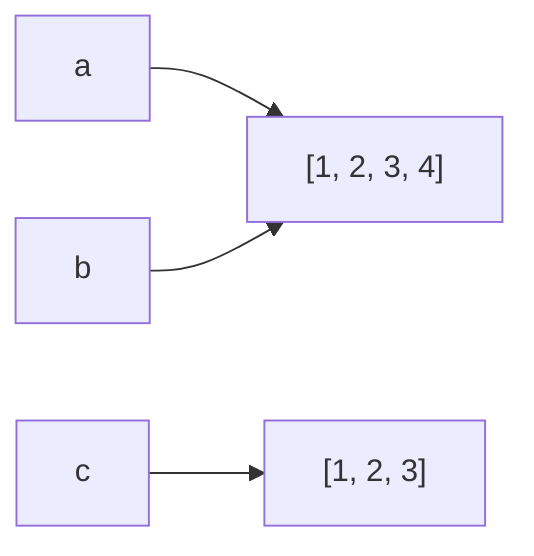

## Passo 1 · Leitura · Métodos que mudam a lista

Você já conhece `append`, que acrescenta um item ao fim. A lista tem outros métodos. Para cada um, faça sempre duas perguntas: **o que ele faz com a lista** e **o que ele devolve**.

| Método | O que faz | O que devolve |
|---|---|---|
| `lista.insert(i, x)` | põe `x` na posição `i` e empurra os seguintes | `None` |
| `lista.remove(x)` | apaga a primeira ocorrência do valor `x` | `None` |
| `lista.pop()` | tira o último item | o item retirado |
| `lista.pop(i)` | tira o item da posição `i` | o item retirado |
| `lista.sort()` | ordena a própria lista, do menor para o maior | `None` |
| `lista.reverse()` | inverte a própria lista | `None` |
| `lista.index(x)` | não muda nada | a posição da primeira ocorrência de `x` |
| `lista.count(x)` | não muda nada | quantas vezes `x` aparece |

Um exemplo com a fila do RU:

```python
fila = ["Bia", "Caio"]
fila.insert(0, "Ana")       # ['Ana', 'Bia', 'Caio']
fila.remove("Bia")          # ['Ana', 'Caio']
atendido = fila.pop(0)      # atendido = 'Ana'; fila = ['Caio']
print(fila.index("Caio"))   # 0
print(fila.count("Davi"))   # 0
```

Três cuidados.

**Quem só altera a lista devolve `None`.** `insert`, `remove`, `sort` e `reverse` fazem o trabalho na própria lista e não devolvem nada. Por isso `lista = lista.sort()` é um erro clássico: a lista é ordenada e, logo em seguida, a variável passa a guardar `None`.

**`pop` é a exceção útil.** Ele altera a lista **e** devolve o item retirado. Se você precisa do item, guarde-o em uma variável: `saiu = fila.pop()`.

**`remove` e `index` exigem que o valor exista.** Se o valor não está na lista, o programa para com `ValueError`. Na dúvida, pergunte antes com `in`.

Para ordenar sem mexer na lista original existe a função `sorted(lista)`. Ela não é um método (não leva ponto) e devolve uma **lista nova**, já ordenada:

```python
notas = [7, 10, 4]
em_ordem = sorted(notas)   # [4, 7, 10]; notas continua [7, 10, 4]
notas.sort()               # agora a própria notas é [4, 7, 10]
```

## Passo 2 · Exercício · Sequência de operações
modo: ordenar

A fila do RU começa com `["Bia", "Caio", "Davi"]`. Acontecem quatro coisas, nesta ordem: Ana chega e fura a fila, indo para a frente; Caio desiste e sai; quem está no fim da fila também sai; por último, chega Eva.

No fim, a fila precisa ser `["Ana", "Bia", "Eva"]` e a variável `saiu` precisa guardar `"Davi"`.

Arraste as linhas para a ordem certa. Nenhuma linha é indentada, e uma linha está sobrando.

### Instruções
1. Crie a fila e ponha `"Ana"` na frente.
2. Tire `"Caio"` da fila.
3. Tire o último da fila, guardando quem saiu na variável `saiu`.
4. Acrescente `"Eva"` ao fim.

### Solução
```python
fila = ["Bia", "Caio", "Davi"]
fila.insert(0, "Ana")
fila.remove("Caio")
saiu = fila.pop()
fila.append("Eva")
```

### Distratores
```python
saiu = fila.pop(0)
```

### Dicas
1. `pop()` sem índice tira o último item; `pop(0)` tira o primeiro.
2. A ordem das operações muda o resultado: quem está no fim da fila depende do que já aconteceu antes.
3. Eva só entra depois que o último saiu. Se ela entrar antes, é ela quem sai.

### Verificação
```json
[
  { "id": "ana-na-frente", "checkpoint": 1, "kind": "expr", "expr": "fila[0]", "expected": "Ana",
    "name": "Ana fica na frente da fila", "hint": "insert(0, ...) põe o item na posição 0. Confira também se ninguém tirou a Ana depois." },
  { "id": "caio-saiu", "checkpoint": 2, "kind": "expr", "expr": "\"Caio\" in fila", "expected": false,
    "name": "Caio não está mais na fila", "hint": "remove apaga pelo valor, não pela posição." },
  { "id": "saiu-davi", "checkpoint": 3, "kind": "variable", "variable": "saiu", "expected": "Davi",
    "name": "saiu guarda quem estava no fim da fila", "hint": "No momento do pop, quem era o último? Confira se a Eva já tinha entrado." },
  { "id": "fila-final", "checkpoint": 4, "kind": "variable", "variable": "fila", "expected": ["Ana", "Bia", "Eva"], "type": "list",
    "name": "A fila termina com Ana, Bia e Eva", "hint": "Refaça as quatro operações no papel, uma por linha, anotando a fila depois de cada uma." }
]
```

### Soluções erradas
```python name="append antes do pop (quem sai é a Eva)"
fila = ["Bia", "Caio", "Davi"]
fila.insert(0, "Ana")
fila.remove("Caio")
fila.append("Eva")
saiu = fila.pop()
```
```python name="pop(0) tira a Ana em vez do último"
fila = ["Bia", "Caio", "Davi"]
fila.insert(0, "Ana")
fila.remove("Caio")
saiu = fila.pop(0)
fila.append("Eva")
```
```python name="pop sem guardar o retorno"
fila = ["Bia", "Caio", "Davi"]
fila.insert(0, "Ana")
fila.remove("Caio")
fila.pop()
fila.append("Eva")
```

## Passo 3 · Leitura · Fatias e cópias

Um índice pega um item. Uma **fatia** pega um trecho e devolve uma **lista nova**, sem alterar a original. A forma é `lista[início:fim]`: começa em `início` e para **antes** de `fim`.

Com `dias = ["seg", "ter", "qua", "qui", "sex"]`:

| Fatia | Resultado | Como ler |
|---|---|---|
| `dias[1:3]` | `['ter', 'qua']` | do índice 1 até antes do 3 |
| `dias[:2]` | `['seg', 'ter']` | do começo até antes do 2 |
| `dias[3:]` | `['qui', 'sex']` | do índice 3 até o fim |
| `dias[::2]` | `['seg', 'qua', 'sex']` | a lista toda, de 2 em 2 |
| `dias[::-1]` | `['sex', 'qui', 'qua', 'ter', 'seg']` | de trás para a frente |
| `dias[:]` | os cinco itens | uma cópia da lista inteira |

O terceiro número é o **passo**. Passo negativo anda para trás; por isso `[::-1]` devolve a lista invertida. O tamanho de `lista[a:b]` é `b - a`: `dias[1:3]` tem 2 itens, não 3. Diferentemente do índice, a fatia não dá erro quando passa do fim: `dias[3:10]` devolve só o que existe.

#### Copiar não é dar outro nome

Uma variável não contém a lista: ela é um nome que **aponta** para a lista. Escrever `b = a` não cria outra lista; cria um segundo nome para a mesma. Para ter uma lista independente é preciso copiar, e a fatia completa `a[:]` faz isso.



O diagrama mostra o fim do programa abaixo: `a` e `b` são dois nomes para uma lista só, e `c` aponta para a cópia feita antes do `append`. Execute passo a passo e repare que `a` e `b` mostram a mesma lista, enquanto `c` não muda:

```python visualizar
a = [1, 2, 3]
b = a
c = a[:]
a.append(4)
print(b)
print(c)
```

Esse é o efeito prático da mutabilidade: alterar a lista por um nome altera o que todos os outros nomes enxergam.

## Passo 4 · Previsão · sort, sorted e fatias

Leia o programa sem executar e digite exatamente o que ele imprime. São seis linhas de saída.

### Código
```python
numeros = [3, 1, 2]
ordenada = sorted(numeros)
print(numeros)
print(ordenada)
resultado = numeros.sort()
print(numeros)
print(resultado)
print(numeros[::-1])
print(numeros[1:])
```

### Dicas
1. `sorted` devolve uma lista nova e deixa a original como estava; `sort` muda a própria lista.
2. Um método que só altera a lista devolve `None`, e é isso que fica guardado em `resultado`.
3. As duas fatias do fim são tiradas da lista já ordenada, e uma fatia não altera a lista.

### Saída esperada
```text
[3, 1, 2]
[1, 2, 3]
[1, 2, 3]
None
[3, 2, 1]
[2, 3]
```

## Passo 5 · Exercício · Fatias

Escreva três funções. Cada uma recebe uma lista e devolve uma **lista nova**, feita com uma fatia. Nenhuma delas pode alterar a lista recebida.

| Chamada | Devolve |
|---|---|
| `metade_inicial([1, 2, 3, 4, 5])` | `[1, 2]` |
| `metade_inicial([1, 2, 3, 4])` | `[1, 2]` |
| `inverter([1, 2, 3, 4, 5])` | `[5, 4, 3, 2, 1]` |
| `a_cada_dois([1, 2, 3, 4, 5])` | `[1, 3, 5]` |

Para a lista vazia, as três devolvem `[]`.

### Instruções
1. Complete `metade_inicial(lista)`: devolve a primeira metade da lista. Quando a quantidade de itens é ímpar, o item do meio fica de fora.
   Dica: a divisão inteira `//` devolve um inteiro, que serve como fim da fatia.
2. Complete `inverter(lista)`: devolve os itens de trás para a frente, **sem** usar o método `reverse` e sem alterar a lista recebida.
3. Complete `a_cada_dois(lista)`: devolve os itens das posições 0, 2, 4...

### Código inicial
```python
def metade_inicial(lista):
    pass


def inverter(lista):
    pass


def a_cada_dois(lista):
    pass
```

### Solução
```python
def metade_inicial(lista):
    meio = len(lista) // 2
    return lista[:meio]


def inverter(lista):
    return lista[::-1]


def a_cada_dois(lista):
    return lista[::2]
```

### Dicas
1. A metade é `len(lista) // 2`. A fatia `lista[:meio]` vai do começo até antes de `meio`.
2. `lista[::-1]` percorre a lista de trás para a frente e devolve uma lista nova.
3. O terceiro número da fatia é o passo: `lista[::2]` pega um item sim, um não.

### Verificação
```json
[
  { "id": "metade-impar", "checkpoint": 1, "kind": "call", "function": "metade_inicial", "args": [[1, 2, 3, 4, 5]], "expected": [1, 2], "type": "list",
    "name": "metade_inicial([1, 2, 3, 4, 5]) é [1, 2]", "hint": "Com 5 itens, a metade inteira é 2: use // em vez de /." },
  { "id": "metade-par", "checkpoint": 1, "kind": "call", "function": "metade_inicial", "args": [["a", "b", "c", "d"]], "expected": ["a", "b"], "type": "list",
    "name": "metade_inicial de 4 itens devolve os 2 primeiros" },
  { "id": "metade-vazia", "checkpoint": 1, "kind": "call", "function": "metade_inicial", "args": [[]], "expected": [], "type": "list",
    "name": "metade_inicial([]) é []" },
  { "id": "inverter-5", "checkpoint": 2, "kind": "call", "function": "inverter", "args": [[1, 2, 3, 4, 5]], "expected": [5, 4, 3, 2, 1], "type": "list",
    "name": "inverter([1, 2, 3, 4, 5]) é [5, 4, 3, 2, 1]", "hint": "A função precisa devolver uma lista com return, não None." },
  { "id": "inverter-vazia", "checkpoint": 2, "kind": "call", "function": "inverter", "args": [[]], "expected": [], "type": "list",
    "name": "inverter([]) é []" },
  { "id": "inverter-preserva", "checkpoint": 2, "kind": "expr", "setup": "original = [1, 2, 3]\nr = inverter(original)", "expr": "original", "expected": [1, 2, 3],
    "name": "inverter não altera a lista recebida", "hint": "Uma fatia devolve uma lista nova; reverse() mexe na própria lista." },
  { "id": "sem-reverse", "checkpoint": 2, "kind": "source", "rule": { "type": "not_calls", "name": "reverse" },
    "name": "Inverte com fatia, sem reverse()", "hint": "Use o passo negativo da fatia." },
  { "id": "cada-dois-5", "checkpoint": 3, "kind": "call", "function": "a_cada_dois", "args": [[1, 2, 3, 4, 5]], "expected": [1, 3, 5], "type": "list",
    "name": "a_cada_dois([1, 2, 3, 4, 5]) é [1, 3, 5]", "hint": "Comece do primeiro item e ande de 2 em 2." },
  { "id": "cada-dois-par", "checkpoint": 3, "kind": "call", "function": "a_cada_dois", "args": [["a", "b", "c", "d"]], "expected": ["a", "c"], "type": "list",
    "name": "a_cada_dois de 4 itens devolve o 1º e o 3º" },
  { "id": "cada-dois-vazia", "checkpoint": 3, "kind": "call", "function": "a_cada_dois", "args": [[]], "expected": [], "type": "list",
    "name": "a_cada_dois([]) é []" }
]
```

### Soluções erradas
```python name="reverse() e return lista (altera a original)"
def metade_inicial(lista):
    meio = len(lista) // 2
    return lista[:meio]


def inverter(lista):
    lista.reverse()
    return lista


def a_cada_dois(lista):
    return lista[::2]
```
```python name="return lista.reverse() (devolve None)"
def metade_inicial(lista):
    meio = len(lista) // 2
    return lista[:meio]


def inverter(lista):
    return lista.reverse()


def a_cada_dois(lista):
    return lista[::2]
```
```python name="metade com / em vez de // (TypeError)"
def metade_inicial(lista):
    meio = len(lista) / 2
    return lista[:meio]


def inverter(lista):
    return lista[::-1]


def a_cada_dois(lista):
    return lista[::2]
```
```python name="a_cada_dois começa do segundo item"
def metade_inicial(lista):
    meio = len(lista) // 2
    return lista[:meio]


def inverter(lista):
    return lista[::-1]


def a_cada_dois(lista):
    return lista[1::2]
```

## Passo 6 · Quiz · Métodos e fatias

### Pergunta
O que este código imprime?
```python
notas = [7, 4, 9]
resultado = notas.sort()
print(resultado)
```
- [ ] `[4, 7, 9]`
- [ ] `[7, 4, 9]`
- [x] `None`
- [ ] Um erro, porque `sort` não pode ser guardado em variável
> `sort()` ordena a própria lista e devolve `None`. A lista ordenada está em `notas`; para receber uma lista nova, use `sorted(notas)`.

### Pergunta
Quantos itens tem `lista[1:3]`, se `lista` tem 5 itens?
- [ ] 3: os itens dos índices 1, 2 e 3
- [x] 2: os itens dos índices 1 e 2
- [ ] 1: só o item do índice 1
- [ ] 5: a fatia devolve a lista inteira
> O fim da fatia é exclusivo: ela para antes do índice 3. O tamanho é `3 - 1 = 2`.

### Pergunta
Depois deste código, o `9` aparece em `b`?
```python
a = [1, 2]
b = a
a.append(9)
print(b)
```
- [x] Sim: `b = a` cria outro nome para a mesma lista, e imprime `[1, 2, 9]`
- [ ] Não: `b` é uma cópia feita antes do `append`, e imprime `[1, 2]`
- [ ] Não: o programa dá erro, porque duas variáveis não podem guardar a mesma lista
- [ ] Sim, mas só porque `b` foi criada depois de `a`
> A atribuição não copia a lista. Para uma lista independente, copie: `b = a[:]`.

## Passo 7 · Exercício · Remover só se existir

`lista.remove(x)` para o programa com `ValueError` quando `x` não está na lista. Escreva a função `remover_se_existir(lista, item)`, que evita esse erro:

- se `item` está na lista, remove a **primeira ocorrência** dele da própria lista recebida e devolve `True`;
- se `item` não está, não altera nada e devolve `False`.

Exemplo: com `frutas = ["uva", "kiwi", "uva"]`, a chamada `remover_se_existir(frutas, "uva")` devolve `True` e `frutas` passa a ser `["kiwi", "uva"]`. Já `remover_se_existir(frutas, "caju")` devolve `False` e a lista fica como estava.

### Instruções
1. Quando o item está na lista, remova-o e devolva `True`.
   Dica: pergunte com `in` antes de chamar `remove`.
2. Quando o item não está na lista, devolva `False` sem alterar a lista e sem erro.

### Código inicial
```python
def remover_se_existir(lista, item):
    pass
```

### Solução
```python
def remover_se_existir(lista, item):
    if item in lista:
        lista.remove(item)
        return True
    return False
```

### Dicas
1. `if item in lista:` responde se o valor está na lista antes de você tentar remover.
2. Cada caminho tem o seu `return`: um dentro do `if`, outro depois dele.
3. Dentro do `if` ficam duas linhas: `lista.remove(item)` e `return True`.

### Verificação
```json
[
  { "id": "existe-true", "checkpoint": 1, "kind": "call", "function": "remover_se_existir", "args": [[1, 2, 3], 2], "expected": true, "type": "bool",
    "name": "remover_se_existir([1, 2, 3], 2) devolve True", "hint": "Devolva o booleano True, não um texto nem a lista." },
  { "id": "existe-lista", "checkpoint": 1, "kind": "expr", "setup": "numeros = [1, 2, 3]\nr = remover_se_existir(numeros, 2)", "expr": "numeros", "expected": [1, 3],
    "name": "Depois da chamada, o item saiu da lista", "hint": "A função altera a própria lista recebida, com remove." },
  { "id": "repetido", "checkpoint": 1, "kind": "expr", "setup": "frutas = [\"uva\", \"kiwi\", \"uva\"]\nr = remover_se_existir(frutas, \"uva\")", "expr": "[r, frutas]", "expected": [true, ["kiwi", "uva"]],
    "name": "Com item repetido, só a primeira ocorrência sai", "hint": "remove já apaga só a primeira ocorrência: chame uma vez." },
  { "id": "ausente-false", "checkpoint": 2, "kind": "call", "function": "remover_se_existir", "args": [[1, 2, 3], 9], "expected": false, "type": "bool",
    "name": "remover_se_existir([1, 2, 3], 9) devolve False, sem erro", "hint": "remove dá ValueError quando o item não existe: confira com in antes." },
  { "id": "ausente-lista", "checkpoint": 2, "kind": "expr", "setup": "numeros = [1, 2, 3]\nr = remover_se_existir(numeros, 9)", "expr": "[r, numeros]", "expected": [false, [1, 2, 3]],
    "name": "Item ausente: a lista fica como estava" },
  { "id": "borda-vazia", "checkpoint": 2, "kind": "call", "function": "remover_se_existir", "args": [[], "a"], "expected": false, "type": "bool",
    "name": "Lista vazia: devolve False" }
]
```

### Soluções erradas
```python name="remove sem conferir (ValueError)"
def remover_se_existir(lista, item):
    lista.remove(item)
    return True
```
```python name="devolve True sempre"
def remover_se_existir(lista, item):
    if item in lista:
        lista.remove(item)
    return True
```
```python name="confere mas esquece de remover"
def remover_se_existir(lista, item):
    if item in lista:
        return True
    return False
```
```python name="devolve o retorno de remove (None)"
def remover_se_existir(lista, item):
    if item in lista:
        return lista.remove(item)
    return False
```
