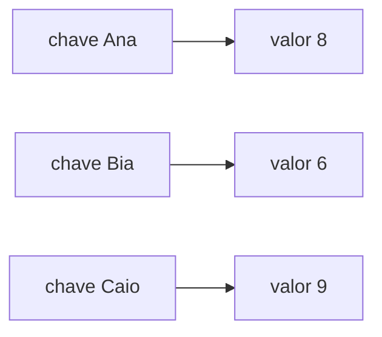

## Passo 1 · Leitura · Do nome ao valor

Em uma lista, você chega a um item pela posição: `notas[0]`. Mas quem lembra em que posição está a nota da Ana? O **dicionário** resolve isso: ele guarda pares **chave → valor**, e você chega ao valor pela chave, como numa agenda em que o nome leva ao telefone.

O dicionário se escreve entre chaves, com dois-pontos entre a chave e o valor:

```python
notas = {"Ana": 8, "Bia": 6, "Caio": 9}
print(notas["Ana"])    # 8
print(len(notas))      # 3 pares
```



Quem procura pela chave chega direto ao valor, sem percorrer os outros pares. Cada chave aparece uma vez só.

**Inserir e atualizar** usam a mesma forma, `d[chave] = valor`. Se a chave não existe, o par é criado; se já existe, o valor antigo é substituído. **Apagar** um par é com `del`.

```python
notas["Davi"] = 7     # chave nova: insere
notas["Bia"] = 10     # chave que já existe: atualiza
del notas["Caio"]     # apaga o par inteiro
```

**Consultar uma chave que não existe** com colchetes interrompe o programa:

```python
print(notas["Eva"])   # KeyError: 'Eva'
```

Há duas formas de evitar o erro. O operador `in` pergunta se a **chave** existe: `"Eva" in notas` vale `False`. E o método `get` consulta sem risco: `notas.get("Eva", 0)` devolve o valor da chave ou, quando ela não existe, o valor padrão que você passou (aqui, `0`). Sem o segundo argumento, o padrão é `None`.

Execute o programa abaixo passo a passo. Veja o par da Bia ser criado, o valor da Ana ser trocado e o `get` devolver o padrão sem criar nenhuma chave:

```python visualizar
notas = {"Ana": 8}
notas["Bia"] = 6
notas["Ana"] = 9
falta = notas.get("Caio", 0)
print(notas, falta)
```

## Passo 2 · Exercício · Estoque
modo: lacunas

O estoque da cantina é um dicionário: o produto é a chave e a quantidade é o valor. Complete as três lacunas (`___`) para registrar o que mudou hoje. No fim, o dicionário deve ser `{"arroz": 8, "café": 3}`.

### Instruções
1. Atualize a quantidade de arroz para 8.
   Dica: a chave é um texto, então vai entre aspas.
2. Inclua o café no estoque, com quantidade 3.
3. Apague o feijão do estoque.
   Dica: é uma palavra do Python que vem antes de `estoque[...]`, não um método.

### Código inicial
```python
estoque = {"arroz": 10, "feijão": 5}
estoque[___] = 8
estoque["café"] = ___
___ estoque["feijão"]
```

### Solução
```python
estoque = {"arroz": 10, "feijão": 5}
estoque["arroz"] = 8
estoque["café"] = 3
del estoque["feijão"]
```

### Dicas
1. Inserir e atualizar usam a mesma forma: `d[chave] = valor`.
2. A chave do arroz é o texto `"arroz"`, com aspas. Sem aspas, o Python procura uma variável chamada `arroz`.
3. A palavra que apaga uma chave é `del`.

### Verificação
```json
[
  { "id": "arroz-8", "checkpoint": 1, "kind": "expr", "expr": "estoque.get(\"arroz\")", "expected": 8,
    "name": "O arroz fica com quantidade 8", "hint": "Atualize o valor da chave que já existe; ela não pode sumir do estoque." },
  { "id": "cafe-3", "checkpoint": 2, "kind": "expr", "expr": "estoque.get(\"café\")", "expected": 3, "type": "int",
    "name": "O café entra com quantidade 3", "hint": "A quantidade é um número inteiro, sem aspas." },
  { "id": "sem-feijao", "checkpoint": 3, "kind": "expr", "expr": "\"feijão\" in estoque", "expected": false,
    "name": "O feijão sai do estoque", "hint": "Apague o par da chave feijão." },
  { "id": "estoque-final", "checkpoint": 3, "kind": "variable", "variable": "estoque", "expected": { "arroz": 8, "café": 3 }, "type": "dict",
    "name": "O estoque final tem só arroz (8) e café (3)", "hint": "Confira os três passos: atualizar o arroz, incluir o café e apagar o feijão." }
]
```

### Soluções erradas
```python name="append em dicionário (AttributeError)"
estoque = {"arroz": 10, "feijão": 5}
estoque["arroz"] = 8
estoque.append("café")
del estoque["feijão"]
```
```python name="apaga o arroz em vez do feijão"
estoque = {"arroz": 10, "feijão": 5}
estoque["arroz"] = 8
estoque["café"] = 3
del estoque["arroz"]
```
```python name="quantidade do café como texto"
estoque = {"arroz": 10, "feijão": 5}
estoque["arroz"] = 8
estoque["café"] = "3"
del estoque["feijão"]
```

## Passo 3 · Exercício · Contar frequências

Um uso clássico do dicionário é **contar**: cada item diferente vira uma chave, e o valor é quantas vezes ele apareceu. Escreva `frequencia(lista)`, que devolve esse dicionário de contagens.

| Chamada | Devolve |
|---|---|
| `frequencia(["a", "b", "a"])` | `{"a": 2, "b": 1}` |
| `frequencia(["sim", "sim", "sim"])` | `{"sim": 3}` |
| `frequencia([])` | `{}` |

O cuidado está na primeira vez que um item aparece: a chave dele ainda não existe, e `contagem[item] += 1` daria `KeyError`.

### Instruções
1. Crie um dicionário vazio e percorra a lista. A cada item, some 1 à contagem dele, começando do 0 quando o item ainda não tem chave.
   Dica: `get` com valor padrão resolve a primeira aparição sem `if`.
2. Devolva o dicionário depois do laço. Para a lista vazia, o resultado é o dicionário vazio.

### Código inicial
```python
def frequencia(lista):
    pass
```

### Solução
```python
def frequencia(lista):
    contagem = {}
    for item in lista:
        contagem[item] = contagem.get(item, 0) + 1
    return contagem
```

### Dicas
1. `contagem.get(item, 0)` devolve a contagem atual do item, ou 0 quando a chave ainda não existe.
2. Some 1 ao que já havia e guarde de volta na mesma chave. Guardar sempre 1 apaga a contagem anterior.
3. A linha dentro do laço é `contagem[item] = contagem.get(item, 0) + 1`, e o `return contagem` vem depois do laço.

### Verificação
```json
[
  { "id": "letras", "checkpoint": 1, "kind": "call", "function": "frequencia", "args": [["a", "b", "a"]], "expected": { "a": 2, "b": 1 }, "type": "dict",
    "name": "frequencia([\"a\", \"b\", \"a\"]) conta 2 e 1", "hint": "Na primeira aparição a chave ainda não existe; depois, a contagem precisa acumular." },
  { "id": "tres-iguais", "checkpoint": 1, "kind": "call", "function": "frequencia", "args": [["sim", "sim", "sim"]], "expected": { "sim": 3 }, "type": "dict",
    "name": "Três itens iguais: uma chave com contagem 3", "hint": "Some 1 à contagem anterior em vez de guardar sempre o mesmo número." },
  { "id": "todos-diferentes", "checkpoint": 1, "kind": "call", "function": "frequencia", "args": [["x", "y", "z"]], "expected": { "x": 1, "y": 1, "z": 1 }, "type": "dict",
    "name": "Itens todos diferentes: cada um com contagem 1" },
  { "id": "borda-vazia", "checkpoint": 2, "kind": "call", "function": "frequencia", "args": [[]], "expected": {}, "type": "dict",
    "name": "frequencia([]) é {}", "hint": "Com a lista vazia o laço não roda; a função ainda devolve o dicionário vazio." }
]
```

### Soluções erradas
```python name="+= 1 sem inicializar (KeyError)"
def frequencia(lista):
    contagem = {}
    for item in lista:
        contagem[item] += 1
    return contagem
```
```python name="guarda 1 sempre (não acumula)"
def frequencia(lista):
    contagem = {}
    for item in lista:
        contagem[item] = 1
    return contagem
```
```python name="return dentro do laço (conta só o primeiro)"
def frequencia(lista):
    contagem = {}
    for item in lista:
        contagem[item] = contagem.get(item, 0) + 1
        return contagem
```

## Passo 4 · Leitura · Percorrendo um dicionário

O `for` também percorre dicionários. O ponto de atenção: percorrer um dicionário diretamente entrega **as chaves**, não os valores nem os pares.

```python
estoque = {"feijão": 5, "arroz": 10}
for produto in estoque:
    print(produto, estoque[produto])    # feijão 5, depois arroz 10
```

Três métodos dizem o que você quer percorrer:

| Forma | O que entrega em cada volta |
|---|---|
| `for chave in d` ou `d.keys()` | cada chave |
| `for valor in d.values()` | cada valor |
| `for chave, valor in d.items()` | o par, como uma tupla que o `for` desempacota |

```python
for produto, quantidade in estoque.items():
    print(produto, quantidade)

print(sum(estoque.values()))    # 15
```

Esquecer o `.items()` e escrever `for chave, valor in d` é um erro comum: o laço recebe só a chave e tenta desempacotá-la em duas variáveis, o que dá `ValueError` ou um resultado sem sentido.

**A ordem.** O dicionário guarda os pares na ordem em que foram inseridos: no exemplo, `feijão` vem antes de `arroz`. Quando você precisa de ordem alfabética, use `sorted(d)`, que devolve uma **lista com as chaves em ordem**, sem alterar o dicionário:

```python
for produto in sorted(estoque):
    print(produto, estoque[produto])    # arroz 10, depois feijão 5
```

**Dicionário dentro de dicionário.** O valor pode ser qualquer coisa, inclusive uma lista ou outro dicionário. É assim que se representa um registro com vários campos:

```python
alunos = {
    "Ana": {"idade": 20, "curso": "Física"},
    "Bia": {"idade": 35, "curso": "Letras"},
}
print(alunos["Ana"]["curso"])    # Física
```

Leia da esquerda para a direita: `alunos["Ana"]` devolve o dicionário da Ana, e `["curso"]` consulta esse dicionário.

**O que pode ser chave.** A chave precisa ser um valor **imutável**: texto, número ou tupla. Uma lista não serve, porque pode mudar depois de guardada: `{[1, 2]: "x"}` dá `TypeError`. O valor não tem restrição.

## Passo 5 · Previsão · Chaves em ordem

Leia o programa sem executar e digite exatamente o que ele imprime. São seis linhas de saída.

### Código
```python
idades = {"Bia": 35, "Ana": 20}
idades["Caio"] = 27
for nome in sorted(idades):
    print(nome, idades[nome])
print(len(idades))
print("Davi" in idades)
print(idades.get("Davi", 0))
```

### Dicas
1. `sorted(idades)` devolve as chaves em ordem alfabética, não na ordem em que foram inseridas.
2. `in` procura entre as chaves do dicionário.
3. `get` com segundo argumento não dá erro: quando a chave não existe, devolve o valor padrão.

### Saída esperada
```text
Ana 20
Bia 35
Caio 27
3
False
0
```

## Passo 6 · Exercício · Relatório ordenado

O estoque da cantina já vem no código inicial, na ordem em que os produtos foram cadastrados. Imprima um relatório com uma linha por produto, no formato `produto: quantidade`, em **ordem alfabética dos produtos**. A saída deve ser exatamente:

```
arroz: 10
feijão: 2
leite: 6
macarrão: 4
```

O programa precisa funcionar para qualquer estoque: percorra o dicionário com um laço, sem escrever os produtos à mão.

### Instruções
1. Percorra as chaves do dicionário em ordem alfabética.
   Dica: `sorted` aplicado a um dicionário devolve as chaves em ordem.
2. Em cada volta, imprima a chave, dois-pontos, um espaço e a quantidade.

### Código inicial
```python
estoque = {"macarrão": 4, "arroz": 10, "leite": 6, "feijão": 2}

# Imprima produto: quantidade, em ordem alfabética dos produtos
```

### Solução
```python
estoque = {"macarrão": 4, "arroz": 10, "leite": 6, "feijão": 2}

for produto in sorted(estoque):
    print(f"{produto}: {estoque[produto]}")
```

### Dicas
1. `sorted(estoque)` percorre as chaves em ordem alfabética, sem mudar o dicionário.
2. Dentro do laço você tem a chave; busque o valor com `estoque[produto]`.
3. O laço é `for produto in sorted(estoque):` e o `print` usa uma f-string com a chave e o valor.

### Verificação
```json
[
  { "id": "usa-for", "checkpoint": 1, "kind": "source", "rule": { "type": "uses", "construct": "for" },
    "name": "Percorre o dicionário com um laço for", "hint": "Não escreva os produtos à mão: o laço precisa servir para qualquer estoque." },
  { "id": "usa-sorted", "checkpoint": 1, "kind": "source", "rule": { "type": "calls", "name": "sorted" },
    "name": "Ordena as chaves com sorted", "hint": "O dicionário guarda a ordem de inserção; quem põe em ordem alfabética é sorted." },
  { "id": "comeca-arroz", "checkpoint": 1, "kind": "io", "stdin": "", "expected_stdout": "^arroz: ", "match": "regex",
    "name": "A primeira linha é a do arroz", "hint": "A ordem é a alfabética dos nomes dos produtos, não a de cadastro nem a das quantidades." },
  { "id": "relatorio", "checkpoint": 2, "kind": "io", "stdin": "", "expected_stdout": "arroz: 10\nfeijão: 2\nleite: 6\nmacarrão: 4",
    "name": "Relatório completo, em ordem alfabética", "hint": "Cada linha: produto, dois-pontos, um espaço e a quantidade daquele produto." }
]
```

### Soluções erradas
```python name="ordem de inserção (sem sorted)"
estoque = {"macarrão": 4, "arroz": 10, "leite": 6, "feijão": 2}

for produto in estoque:
    print(f"{produto}: {estoque[produto]}")
```
```python name="ordena pelos valores em vez das chaves"
estoque = {"macarrão": 4, "arroz": 10, "leite": 6, "feijão": 2}

for quantidade in sorted(estoque.values()):
    for produto in estoque:
        if estoque[produto] == quantidade:
            print(f"{produto}: {quantidade}")
```
```python name="imprime só as chaves, sem a quantidade"
estoque = {"macarrão": 4, "arroz": 10, "leite": 6, "feijão": 2}

for produto in sorted(estoque):
    print(produto)
```
```python name="linhas escritas à mão, sem laço"
estoque = {"macarrão": 4, "arroz": 10, "leite": 6, "feijão": 2}

print("arroz: 10")
print("feijão: 2")
print("leite: 6")
print("macarrão: 4")
```

## Passo 7 · Quiz · Dicionários

### Pergunta
Em qual linha acontece um `KeyError`?
```python
precos = {"café": 5}
a = precos.get("suco")
b = "suco" in precos
c = precos["suco"]
precos["suco"] = 8
```
- [ ] Na linha de `a`, porque `get` não encontra a chave
- [ ] Na linha de `b`, porque `in` não encontra a chave
- [x] Na linha de `c`, porque os colchetes consultam uma chave que não existe
- [ ] Na última linha, porque não se pode atribuir a uma chave que não existe
> Só a consulta com colchetes dá `KeyError`. `get` devolve `None`, `in` devolve `False` e a atribuição cria a chave.

### Pergunta
O que este código imprime?
```python
pontos = {"Ana": 3}
print(pontos.get("Bia", 0))
```
- [x] `0`
- [ ] `None`
- [ ] `3`
- [ ] Um `KeyError`, porque `"Bia"` não é chave
> `get` devolve o valor da chave quando ela existe e, quando não existe, o padrão passado como segundo argumento. O dicionário não é alterado.

### Pergunta
O que a variável `x` recebe em cada volta deste laço?
```python
d = {"a": 1, "b": 2}
for x in d:
    print(x)
```
- [ ] Os valores: `1` e depois `2`
- [x] As chaves: `a` e depois `b`
- [ ] Os pares: `('a', 1)` e depois `('b', 2)`
- [ ] As posições: `0` e depois `1`
> Percorrer um dicionário diretamente entrega as chaves, na ordem de inserção. Para os valores use `d.values()`; para os pares, `d.items()`.

## Passo 8 · Exercício · Inverter um dicionário

Um dicionário leva da chave ao valor. Às vezes você precisa do caminho contrário: do valor à chave. Escreva `inverter(d)`, que devolve um **dicionário novo** em que cada valor de `d` virou chave e cada chave virou valor. Pode supor que os valores de `d` não se repetem.

| Chamada | Devolve |
|---|---|
| `inverter({"a": 1, "b": 2})` | `{1: "a", 2: "b"}` |
| `inverter({"SP": "São Paulo", "RJ": "Rio de Janeiro"})` | `{"São Paulo": "SP", "Rio de Janeiro": "RJ"}` |
| `inverter({})` | `{}` |

### Instruções
1. Crie um dicionário vazio e percorra os pares de `d`, guardando cada par ao contrário: o valor como chave e a chave como valor.
   Dica: é `items()` que entrega a chave e o valor juntos.
2. Devolva o dicionário novo, sem alterar `d`. Para o dicionário vazio, o resultado é `{}`.

### Código inicial
```python
def inverter(d):
    pass
```

### Solução
```python
def inverter(d):
    invertido = {}
    for chave, valor in d.items():
        invertido[valor] = chave
    return invertido
```

### Dicas
1. Comece com um dicionário vazio: `invertido = {}`.
2. `for chave, valor in d.items():` entrega os dois lados de cada par.
3. Dentro do laço, a atribuição troca os papéis: `invertido[valor] = chave`.

### Verificação
```json
[
  { "id": "siglas", "checkpoint": 1, "kind": "call", "function": "inverter", "args": [{ "SP": "São Paulo", "RJ": "Rio de Janeiro" }],
    "expected": { "São Paulo": "SP", "Rio de Janeiro": "RJ" }, "type": "dict",
    "name": "inverter troca siglas e nomes", "hint": "No dicionário novo, o valor antigo é a chave e a chave antiga é o valor." },
  { "id": "numeros", "checkpoint": 1, "kind": "expr", "expr": "inverter({\"a\": 1, \"b\": 2}) == {1: \"a\", 2: \"b\"}", "expected": true,
    "name": "inverter({\"a\": 1, \"b\": 2}) é {1: \"a\", 2: \"b\"}", "hint": "As chaves do resultado são os números 1 e 2, não textos." },
  { "id": "um-par", "checkpoint": 1, "kind": "call", "function": "inverter", "args": [{ "x": "y" }], "expected": { "y": "x" }, "type": "dict",
    "name": "Um par só: {\"x\": \"y\"} vira {\"y\": \"x\"}" },
  { "id": "borda-vazio", "checkpoint": 2, "kind": "call", "function": "inverter", "args": [{}], "expected": {}, "type": "dict",
    "name": "inverter({}) é {}", "hint": "Sem pares, o laço não roda e a função devolve o dicionário vazio." },
  { "id": "original-intacto", "checkpoint": 2, "kind": "expr", "setup": "original = {\"a\": \"b\"}\nr = inverter(original)", "expr": "[original, r]", "expected": [{ "a": "b" }, { "b": "a" }],
    "name": "O dicionário recebido não muda", "hint": "Guarde os pares invertidos em outro dicionário." }
]
```

### Soluções erradas
```python name="devolve lista de tuplas"
def inverter(d):
    invertido = []
    for chave, valor in d.items():
        invertido.append((valor, chave))
    return invertido
```
```python name="devolve o próprio dicionário"
def inverter(d):
    invertido = {}
    for chave, valor in d.items():
        invertido[chave] = valor
    return d
```
```python name="for chave, valor in d, sem items()"
def inverter(d):
    invertido = {}
    for chave, valor in d:
        invertido[valor] = chave
    return invertido
```
