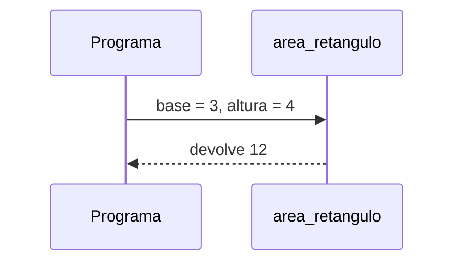

## Passo 1 · Leitura · O que entra e o que sai

As funções da lição anterior faziam sempre a mesma coisa. Para uma função trabalhar com dados diferentes a cada chamada, ela precisa de **parâmetros**.

Um **parâmetro** é um nome escrito entre os parênteses da definição. Um **argumento** é o valor que você escreve entre os parênteses da chamada. Na chamada, cada argumento é guardado no parâmetro da mesma posição:

```python
def area_retangulo(base, altura):   # base e altura são parâmetros
    area = base * altura
    return area


sala = area_retangulo(3, 4)         # 3 e 4 são argumentos
print(sala)                         # 12
```

Em `area_retangulo(3, 4)`, `base` recebe 3 e `altura` recebe 4. A quantidade precisa bater: `area_retangulo(3)` dá `TypeError`, porque falta um argumento.

A palavra `return` faz duas coisas: **entrega um valor** a quem chamou e **encerra a função** naquele ponto. Dizemos que a função *devolve* (ou *retorna*) o valor. É como uma pergunta e uma resposta:



Quando a função devolve, a chamada inteira passa a valer o valor devolvido. O Python troca `area_retangulo(3, 4)` por `12` e continua a conta. Por isso uma chamada pode aparecer em qualquer lugar onde caberia um valor:

```python
total = area_retangulo(3, 4) + area_retangulo(2, 2)   # 12 + 4
print(area_retangulo(5, 2))                           # dentro de outra chamada
dobro_da_sala = area_retangulo(3, 4) * 2              # dentro de uma conta
```

Se você chamar a função e não guardar nem usar o resultado, ele se perde: a linha `area_retangulo(3, 4)` sozinha calcula 12 e joga fora.

Acompanhe a execução no visualizador. Veja o quadro da função aparecer com `base` e `altura` a cada chamada e sumir depois do `return`. Os parâmetros só existem enquanto a função está rodando.

```python visualizar
def area_retangulo(base, altura):
    area = base * altura
    return area


sala = area_retangulo(3, 4)
total = sala + area_retangulo(2, 2)
print(total)
```

## Passo 2 · Exercício · Três funções
modo: lacunas

Complete as lacunas (`___`) de três funções pequenas. Cada uma recebe dados pelos parâmetros e devolve o resultado com `return`.

- `area_retangulo(base, altura)` devolve a área do retângulo.
- `celsius_para_fahrenheit(c)` converte uma temperatura de graus Celsius para Fahrenheit com a fórmula $F = C \cdot \dfrac{9}{5} + 32$. Por exemplo, 100 °C são 212 °F.
- `eh_maior_de_idade(idade)` devolve `True` para quem tem 18 anos ou mais e `False` para os demais.

### Instruções
1. Em `area_retangulo`, complete a conta da área usando os dois parâmetros.
2. Em `celsius_para_fahrenheit`, complete a palavra que devolve o valor calculado.
3. Em `eh_maior_de_idade`, complete o nome do parâmetro.
   Dica: o corpo da função mostra qual nome ela espera.

### Código inicial
```python
def area_retangulo(base, altura):
    return ___ * ___


def celsius_para_fahrenheit(c):
    ___ c * 9 / 5 + 32


def eh_maior_de_idade(___):
    return idade >= 18
```

### Solução
```python
def area_retangulo(base, altura):
    return base * altura


def celsius_para_fahrenheit(c):
    return c * 9 / 5 + 32


def eh_maior_de_idade(idade):
    return idade >= 18
```

### Dicas
1. A área do retângulo é a base vezes a altura.
2. Quem devolve um valor para quem chamou é a palavra `return`.
3. O parâmetro precisa ter o mesmo nome que o corpo da função usa: `idade`.

### Verificação
```json
[
  { "id": "area-5-2", "checkpoint": 1, "kind": "call", "function": "area_retangulo", "args": [5, 2], "expected": 10,
    "name": "area_retangulo(5, 2) é 10", "hint": "Multiplique um parâmetro pelo outro." },
  { "id": "area-1-7", "checkpoint": 1, "kind": "call", "function": "area_retangulo", "args": [1, 7], "expected": 7,
    "name": "area_retangulo(1, 7) é 7" },
  { "id": "area-0", "checkpoint": 1, "kind": "call", "function": "area_retangulo", "args": [0, 9], "expected": 0,
    "name": "area_retangulo(0, 9) é 0", "hint": "Use os parâmetros, não números fixos." },
  { "id": "celsius-100", "checkpoint": 2, "kind": "call", "function": "celsius_para_fahrenheit", "args": [100], "expected": 212.0, "tolerance": 0.01,
    "name": "celsius_para_fahrenheit(100) é 212.0", "hint": "A função precisa devolver o valor, não imprimir." },
  { "id": "celsius-0", "checkpoint": 2, "kind": "call", "function": "celsius_para_fahrenheit", "args": [0], "expected": 32.0, "tolerance": 0.01,
    "name": "celsius_para_fahrenheit(0) é 32.0" },
  { "id": "celsius-37", "checkpoint": 2, "kind": "call", "function": "celsius_para_fahrenheit", "args": [37], "expected": 98.6, "tolerance": 0.01,
    "name": "celsius_para_fahrenheit(37) é 98.6" },
  { "id": "maior-18", "checkpoint": 3, "kind": "call", "function": "eh_maior_de_idade", "args": [18], "expected": true, "type": "bool",
    "name": "eh_maior_de_idade(18) é True", "hint": "Quem tem exatamente 18 anos já é maior de idade." },
  { "id": "maior-17", "checkpoint": 3, "kind": "call", "function": "eh_maior_de_idade", "args": [17], "expected": false, "type": "bool",
    "name": "eh_maior_de_idade(17) é False" },
  { "id": "maior-30", "checkpoint": 3, "kind": "call", "function": "eh_maior_de_idade", "args": [30], "expected": true, "type": "bool",
    "name": "eh_maior_de_idade(30) é True" }
]
```

### Soluções erradas
```python name="print no lugar de return na conversão"
def area_retangulo(base, altura):
    return base * altura


def celsius_para_fahrenheit(c):
    print(c * 9 / 5 + 32)


def eh_maior_de_idade(idade):
    return idade >= 18
```
```python name="soma base e altura em vez de multiplicar"
def area_retangulo(base, altura):
    return base + altura


def celsius_para_fahrenheit(c):
    return c * 9 / 5 + 32


def eh_maior_de_idade(idade):
    return idade >= 18
```
```python name="parâmetro com nome diferente do usado no corpo"
def area_retangulo(base, altura):
    return base * altura


def celsius_para_fahrenheit(c):
    return c * 9 / 5 + 32


def eh_maior_de_idade(anos):
    return idade >= 18
```

## Passo 3 · Leitura · Imprimir não é devolver

`print` e `return` parecem fazer a mesma coisa, porque nos dois casos um valor "sai" da função. Mas eles entregam o valor a destinos diferentes.

- `print` **mostra** o valor na tela, para a pessoa que está olhando. O programa não fica com nada.
- `return` **entrega** o valor ao código que chamou a função. Nada aparece na tela, mas o programa pode guardar o valor, fazer contas com ele e passá-lo adiante.

Compare duas versões da mesma função:

```python
def dobro_print(n):
    print(n * 2)


def dobro_return(n):
    return n * 2
```

Com a segunda, o resultado pode ser usado:

```python
x = dobro_return(5) + 1                # x vale 11
print(dobro_return(dobro_return(3)))   # 12
```

Com a primeira, não. Toda função que termina sem passar por um `return` devolve um valor especial chamado `None`, que significa "nenhum valor". Então `dobro_print(5)` mostra `10` na tela e devolve `None`. A conta abaixo quebra:

```python
x = dobro_print(5) + 1
```

O Python responde `TypeError: unsupported operand type(s) for +: 'NoneType' and 'int'`: ele tentou somar `None` com 1.

A regra prática: **função que calcula devolve com `return`; quem decide imprimir é quem chamou.** Assim a mesma função serve para mostrar na tela, para somar com outro valor ou para ser testada. É por isso que os exercícios desta plataforma conferem o valor devolvido pela função, e não o que ela imprime.

Um último detalhe. Como o `return` encerra a função, o que vem depois dele no mesmo bloco nunca roda:

```python
def dobro(n):
    return n * 2
    print("calculei!")   # esta linha nunca é executada
```

## Passo 4 · Previsão · print ou return?

Leia o programa com calma, sem executar, e digite exatamente o que ele imprime (uma linha de saída por linha da sua resposta). As duas funções fazem a mesma conta, mas só uma devolve o resultado.

### Código
```python
def dobro_print(n):
    print(n * 2)


def dobro_return(n):
    return n * 2


a = dobro_print(5)
b = dobro_return(5)
print(a)
print(b)
```

### Dicas
1. A primeira função imprime durante a chamada, mas não devolve nada: pense no que fica guardado em `a`.
2. O que uma função sem `return` devolve tem nome: `None`.

### Saída esperada
```text
10
None
10
```

## Passo 5 · Exercício · Conserte: print vira return

As três funções abaixo fazem a conta certa, mas imprimem o resultado em vez de devolvê-lo. Quem chama fica com `None` na mão. Conserte as três para que **devolvam** o valor.

- `dobro(n)` devolve o dobro de `n`: `dobro(4)` vale `8`.
- `media(a, b)` devolve a média de dois números: `media(6, 9)` vale `7.5`.
- `saudacao(nome)` devolve o texto `Olá, ` seguido do nome e de um ponto de exclamação: `saudacao("Ana")` vale `"Olá, Ana!"`.

### Instruções
1. Faça `dobro(n)` devolver o resultado.
2. Faça `media(a, b)` devolver o resultado.
3. Faça `saudacao(nome)` devolver o texto.
4. Não deixe nenhum `print` no programa: aqui, as funções só devolvem.
   Dica: se quiser testar com um print, apague-o antes de verificar.

### Código inicial
```python
def dobro(n):
    print(n * 2)


def media(a, b):
    print((a + b) / 2)


def saudacao(nome):
    print(f"Olá, {nome}!")
```

### Solução
```python
def dobro(n):
    return n * 2


def media(a, b):
    return (a + b) / 2


def saudacao(nome):
    return f"Olá, {nome}!"
```

### Dicas
1. Quem imprime é quem chama a função; a função só entrega o valor.
2. Troque a palavra `print` por `return` e mantenha a conta. O `return` não precisa de parênteses em volta do valor.

### Verificação
```json
[
  { "id": "dobro-4", "checkpoint": 1, "kind": "call", "function": "dobro", "args": [4], "expected": 8,
    "name": "dobro(4) é 8", "hint": "A função precisa devolver o valor com return." },
  { "id": "dobro-neg", "checkpoint": 1, "kind": "call", "function": "dobro", "args": [-3], "expected": -6,
    "name": "dobro(-3) é -6" },
  { "id": "media-6-9", "checkpoint": 2, "kind": "call", "function": "media", "args": [6, 9], "expected": 7.5, "tolerance": 0.01,
    "name": "media(6, 9) é 7.5", "hint": "A função precisa devolver o valor com return." },
  { "id": "media-iguais", "checkpoint": 2, "kind": "call", "function": "media", "args": [10, 10], "expected": 10.0, "tolerance": 0.01,
    "name": "media(10, 10) é 10.0" },
  { "id": "saudacao-ana", "checkpoint": 3, "kind": "call", "function": "saudacao", "args": ["Ana"], "expected": "Olá, Ana!", "type": "str",
    "name": "saudacao(\"Ana\") é \"Olá, Ana!\"", "hint": "Devolva o texto montado, sem imprimir." },
  { "id": "saudacao-caio", "checkpoint": 3, "kind": "call", "function": "saudacao", "args": ["Caio"], "expected": "Olá, Caio!", "type": "str",
    "name": "saudacao(\"Caio\") é \"Olá, Caio!\"" },
  { "id": "sem-print", "checkpoint": 4, "kind": "source", "rule": { "type": "not_calls", "name": "print" },
    "name": "Nenhum print no programa", "hint": "Apague todos os print, inclusive os de teste." }
]
```

### Soluções erradas
```python name="mantém o print e acrescenta o return"
def dobro(n):
    print(n * 2)
    return n * 2


def media(a, b):
    print((a + b) / 2)
    return (a + b) / 2


def saudacao(nome):
    print(f"Olá, {nome}!")
    return f"Olá, {nome}!"
```
```python name="return print(...) devolve None"
def dobro(n):
    return print(n * 2)


def media(a, b):
    return print((a + b) / 2)


def saudacao(nome):
    return print(f"Olá, {nome}!")
```
```python name="consertou só a primeira função"
def dobro(n):
    return n * 2


def media(a, b):
    print((a + b) / 2)


def saudacao(nome):
    print(f"Olá, {nome}!")
```

## Passo 6 · Quiz · Parâmetros e retorno

### Pergunta
O que este programa imprime?
```python
def somar(a, b):
    resultado = a + b


print(somar(2, 3))
```
- [ ] `5`
- [x] `None`
- [ ] Nada: a tela fica vazia
- [ ] Um `NameError`, porque `resultado` não foi devolvido
> A função calcula a soma, mas não tem `return`. Toda função que termina sem `return` devolve `None`, e é isso que o `print` mostra.

### Pergunta
O que este programa imprime?
```python
def avaliar(nota):
    return "aprovado"
    print("fim da função")


print(avaliar(7))
```
- [ ] `fim da função` e depois `aprovado`
- [ ] `aprovado` e depois `fim da função`
- [x] Só `aprovado`
- [ ] Só `fim da função`
> O `return` encerra a função na hora. A linha que vem depois dele, no mesmo bloco, nunca é executada.

### Pergunta
Qual frase descreve corretamente a diferença entre `print` e `return`?
- [ ] Os dois fazem o mesmo; `return` é só o nome usado dentro de funções
- [ ] `return` mostra o valor na tela e também o guarda em uma variável
- [x] `print` mostra o valor na tela; `return` entrega o valor ao código que chamou a função
- [ ] `print` entrega o valor a quem chamou; `return` apenas encerra a função
> `print` é para a pessoa ver. `return` é para o programa continuar usando o valor: guardar, somar, passar para outra função.

## Passo 7 · Exercício · dividir(a, b)

Uma função pode devolver mais de um valor de uma vez. Basta separá-los por vírgula depois do `return`: o Python os empacota em uma **tupla**, que você conheceu no módulo 5.

```python
def menor_e_maior(a, b):
    if a < b:
        return a, b
    return b, a


menor, maior = menor_e_maior(8, 3)   # menor = 3, maior = 8
```

Agora é a sua vez. Ao repartir 17 balas entre 5 crianças, cada uma recebe 3 e sobram 2. Escreva a função `dividir(a, b)`, que devolve o **quociente inteiro** e o **resto** da divisão de `a` por `b`, nessa ordem. Exemplos: `dividir(17, 5)` devolve `(3, 2)` e `dividir(10, 2)` devolve `(5, 0)`. Considere que `b` nunca é zero.

### Instruções
1. Defina `dividir(a, b)` e devolva dois valores de uma vez, em uma tupla: primeiro o quociente inteiro, depois o resto.
   Dica: o quociente inteiro vem de `//` e o resto, de `%`.

### Código inicial
```python
def dividir(a, b):
    pass
```

### Solução
```python
def dividir(a, b):
    quociente = a // b
    resto = a % b
    return quociente, resto
```

### Dicas
1. Você já conhece os dois operadores: `//` dá o quociente inteiro e `%` dá o resto.
2. `return x, y` devolve os dois valores de uma vez, como uma tupla. Não use colchetes: eles criariam uma lista.

### Verificação
```json
[
  { "id": "dividir-17-5", "checkpoint": 1, "kind": "call", "function": "dividir", "args": [17, 5], "expected": [3, 2], "type": "tuple",
    "name": "dividir(17, 5) é (3, 2)", "hint": "Devolva uma tupla: primeiro o quociente inteiro, depois o resto." },
  { "id": "dividir-10-2", "checkpoint": 1, "kind": "call", "function": "dividir", "args": [10, 2], "expected": [5, 0], "type": "tuple",
    "name": "dividir(10, 2) é (5, 0)", "hint": "Quando a divisão é exata, o resto é 0." },
  { "id": "dividir-3-7", "checkpoint": 1, "kind": "call", "function": "dividir", "args": [3, 7], "expected": [0, 3], "type": "tuple",
    "name": "dividir(3, 7) é (0, 3)", "hint": "Quando a é menor que b, o quociente inteiro é 0 e sobra tudo." },
  { "id": "dividir-9-4", "checkpoint": 1, "kind": "call", "function": "dividir", "args": [9, 4], "expected": [2, 1], "type": "tuple",
    "name": "dividir(9, 4) é (2, 1)" }
]
```

### Soluções erradas
```python name="devolve uma lista em vez de tupla"
def dividir(a, b):
    return [a // b, a % b]
```
```python name="ordem trocada: resto antes do quociente"
def dividir(a, b):
    return a % b, a // b
```
```python name="divisão com / em vez de //"
def dividir(a, b):
    return a / b, a % b
```
```python name="devolve só o quociente"
def dividir(a, b):
    return a // b
```
