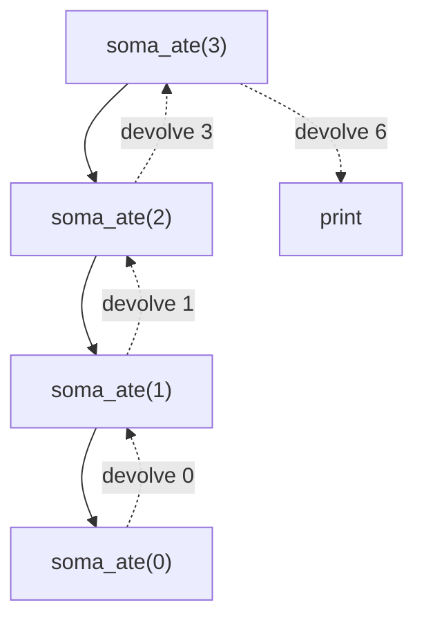

## Passo 1 · Leitura · Uma função que chama a si mesma

Uma função pode chamar outras funções. Ela também pode chamar **a si mesma**. Isso se chama **recursão** e serve para problemas que contêm uma versão menor deles mesmos.

Um exemplo: a soma dos números de 1 até $n$. A soma até 3 é 3 mais a soma até 2. A soma até 2 é 2 mais a soma até 1. E assim por diante, até chegar à soma até 0, que é 0 e não precisa de conta nenhuma. Em símbolos:

$$
S(n) = n + S(n - 1), \qquad S(0) = 0
$$

Em Python, a definição fica quase igual à fórmula:

```python
def soma_ate(n):
    if n == 0:
        return 0                    # caso base
    return n + soma_ate(n - 1)      # caso recursivo
```

Toda função recursiva tem duas partes:

- o **caso base**: a entrada mais simples, respondida na hora, sem nova chamada;
- o **caso recursivo**: a função chama a si mesma com uma entrada **menor**, mais perto do caso base.

Como o Python calcula `soma_ate(3)`? Para devolver `3 + soma_ate(2)`, ele precisa antes do valor de `soma_ate(2)`. A primeira chamada fica esperando, e uma nova começa. As chamadas em espera formam a **pilha de chamadas**: a última a entrar é a primeira a terminar.



A descida (setas cheias) só empilha chamadas. A subida (setas tracejadas) faz as contas: 1 + 0, depois 2 + 1, depois 3 + 3.

Veja isso acontecer no visualizador. Conte os quadros empilhados antes do primeiro `return`: são quatro, um para cada valor de `n`, de 3 até 0.

```python visualizar
def soma_ate(n):
    if n == 0:
        return 0
    return n + soma_ate(n - 1)


print(soma_ate(3))
```

E sem o caso base? A função chamaria a si mesma para sempre. O Python não deixa: a pilha tem um limite (cerca de mil chamadas) e, ao atingi-lo, o programa para com `RecursionError: maximum recursion depth exceeded`. O mesmo erro aparece quando o caso base existe, mas a entrada nunca chega nele; por exemplo, `soma_ate(-1)` desce para -2, -3… e nunca passa pelo zero.

Tudo o que se faz com recursão simples também se faz com um laço, e a soma até $n$ ficaria ótima com `for`. A recursão vale a pena quando o problema já é definido em termos de si mesmo, como uma pasta que contém outras pastas. Aqui, o objetivo é aprender a ler e a escrever as duas partes.

## Passo 2 · Previsão · Ida e volta

Leia o programa com calma, sem executar, e digite exatamente o que ele imprime (uma linha de saída por linha da sua resposta). Repare que há um `print` antes da chamada recursiva e outro depois dela. O `return` sozinho, sem valor, apenas encerra a função.

### Código
```python
def contagem(n):
    if n == 0:
        print("Fogo!")
        return
    print(n)
    contagem(n - 1)
    print("voltei", n)


contagem(2)
```

### Dicas
1. O que vem antes da chamada recursiva roda na ida; o que vem depois só roda na volta, quando a chamada de dentro termina.
2. A última chamada a entrar é a primeira a terminar: quem "volta" primeiro é a chamada com o menor `n`.

### Saída esperada
```text
2
1
Fogo!
voltei 1
voltei 2
```

## Passo 3 · Exercício · fatorial(n)
modo: lacunas

O **fatorial** de $n$, escrito $n!$, é o produto de todos os inteiros de 1 até $n$: $5! = 5 \cdot 4 \cdot 3 \cdot 2 \cdot 1 = 120$. Ele conta, por exemplo, de quantas maneiras 5 pessoas podem se organizar em uma fila. A definição recursiva é:

$$
n! = n \cdot (n - 1)!, \qquad 0! = 1
$$

Complete as lacunas (`___`) da função `fatorial(n)`, seguindo a fórmula. Considere que `n` nunca é negativo.

### Instruções
1. Complete o caso base: para qual valor de `n` a resposta é imediata, e que valor a função devolve nesse caso.
   Dica: a segunda parte da fórmula responde às duas perguntas.
2. Complete o caso recursivo com o nome da função que deve ser chamada com `n - 1`.

### Código inicial
```python
def fatorial(n):
    if n == ___:
        return ___
    return n * ___(n - 1)
```

### Solução
```python
def fatorial(n):
    if n == 0:
        return 1
    return n * fatorial(n - 1)
```

### Dicas
1. A fórmula diz quanto vale o fatorial de 0: esse é o caso base.
2. No caso recursivo, a função chama a si mesma pelo próprio nome: `fatorial`.

### Verificação
```json
[
  { "id": "fat-0", "checkpoint": 1, "kind": "call", "function": "fatorial", "args": [0], "expected": 1,
    "name": "fatorial(0) é 1", "hint": "O caso base é n igual a 0, e o fatorial de 0 vale 1." },
  { "id": "fat-1", "checkpoint": 1, "kind": "call", "function": "fatorial", "args": [1], "expected": 1,
    "name": "fatorial(1) é 1", "hint": "1! é 1 vezes 0!. Se o caso base devolver 0, todo fatorial vira 0." },
  { "id": "fat-5", "checkpoint": 2, "kind": "call", "function": "fatorial", "args": [5], "expected": 120,
    "name": "fatorial(5) é 120" },
  { "id": "fat-10", "checkpoint": 2, "kind": "call", "function": "fatorial", "args": [10], "expected": 3628800,
    "name": "fatorial(10) é 3628800" },
  { "id": "usa-recursao", "checkpoint": 2, "kind": "source", "rule": { "type": "uses", "construct": "recursion" },
    "name": "fatorial chama a si mesma", "hint": "Dentro da função, chame fatorial com n - 1." },
  { "id": "sem-for", "checkpoint": 2, "kind": "source", "rule": { "type": "not_uses", "construct": "for" },
    "name": "Sem laço for", "hint": "Aqui a repetição vem da recursão, não de um laço." },
  { "id": "sem-while", "checkpoint": 2, "kind": "source", "rule": { "type": "not_uses", "construct": "while" },
    "name": "Sem laço while", "hint": "Aqui a repetição vem da recursão, não de um laço." }
]
```

### Soluções erradas
```python name="versão com laço, sem recursão"
def fatorial(n):
    resultado = 1
    for i in range(1, n + 1):
        resultado = resultado * i
    return resultado
```
```python name="caso base devolve 0"
def fatorial(n):
    if n == 0:
        return 0
    return n * fatorial(n - 1)
```
```python name="caso base n <= 1 devolve o próprio n"
def fatorial(n):
    if n <= 1:
        return n
    return n * fatorial(n - 1)
```
```python name="soma em vez de multiplicar"
def fatorial(n):
    if n == 0:
        return 1
    return n + fatorial(n - 1)
```

## Passo 4 · Exercício · soma_lista(lista) e inverter(texto)

A recursão também funciona com listas e textos. O truque é o mesmo: separar o **primeiro item** do **resto** e chamar a função com o resto, que é menor. Você já sabe fazer isso com fatias: `lista[0]` é o primeiro item e `lista[1:]` é a lista sem ele.

Escreva duas funções recursivas, sem laços.

- `soma_lista(lista)` devolve a soma dos números da lista. A soma da lista vazia é 0. Para as demais, é o primeiro item mais a soma do resto. Exemplo: `soma_lista([1, 2, 3])` devolve `6`.
- `inverter(texto)` devolve o texto de trás para a frente. O inverso do texto vazio é o texto vazio. Para os demais, é o inverso do resto seguido da primeira letra. Exemplo: `inverter("abc")` devolve `"cba"`.

### Instruções
1. Defina `soma_lista(lista)` de forma recursiva: caso base para a lista vazia e, no caso recursivo, o primeiro item mais a soma do resto.
2. Defina `inverter(texto)` de forma recursiva: caso base para o texto vazio e, no caso recursivo, o inverso do resto seguido da primeira letra.
   Dica: fatias funcionam em textos como em listas: texto[1:] é o texto sem a primeira letra.

### Código inicial
```python
def soma_lista(lista):
    pass


def inverter(texto):
    pass
```

### Solução
```python
def soma_lista(lista):
    if lista == []:
        return 0
    return lista[0] + soma_lista(lista[1:])


def inverter(texto):
    if texto == "":
        return ""
    return inverter(texto[1:]) + texto[0]
```

### Dicas
1. Comece pelos casos base: a lista vazia soma 0 e o texto vazio invertido é o texto vazio.
2. A soma é o primeiro item mais a soma do resto: `lista[0] + soma_lista(lista[1:])`.
3. O inverso é o inverso do resto seguido da primeira letra: a chamada recursiva vem antes do `+`, e `texto[0]` vem depois.

### Verificação
```json
[
  { "id": "soma-123", "checkpoint": 1, "kind": "call", "function": "soma_lista", "args": [[1, 2, 3]], "expected": 6,
    "name": "soma_lista([1, 2, 3]) é 6", "hint": "Some o primeiro item com a soma do resto da lista." },
  { "id": "soma-vazia", "checkpoint": 1, "kind": "call", "function": "soma_lista", "args": [[]], "expected": 0,
    "name": "soma_lista([]) é 0", "hint": "A lista vazia é o caso base." },
  { "id": "soma-um", "checkpoint": 1, "kind": "call", "function": "soma_lista", "args": [[7]], "expected": 7,
    "name": "soma_lista([7]) é 7" },
  { "id": "soma-negativos", "checkpoint": 1, "kind": "call", "function": "soma_lista", "args": [[10, -4, 5, 2]], "expected": 13,
    "name": "soma_lista([10, -4, 5, 2]) é 13" },
  { "id": "soma-recursiva", "checkpoint": 1, "kind": "expr",
    "setup": "_original = soma_lista\n_chamadas = [0]\ndef soma_lista(lista):\n    _chamadas[0] += 1\n    return _original(lista)",
    "expr": "[soma_lista([4, 5, 6]), _chamadas[0] > 1]", "expected": [15, true],
    "name": "soma_lista chama a si mesma", "hint": "Sem sum() e sem laço: chame soma_lista com o resto da lista." },
  { "id": "inv-abc", "checkpoint": 2, "kind": "call", "function": "inverter", "args": ["abc"], "expected": "cba", "type": "str",
    "name": "inverter(\"abc\") é \"cba\"", "hint": "O inverso do resto vem primeiro; a primeira letra vai para o fim." },
  { "id": "inv-vazio", "checkpoint": 2, "kind": "call", "function": "inverter", "args": [""], "expected": "", "type": "str",
    "name": "inverter(\"\") é \"\"", "hint": "O texto vazio é o caso base." },
  { "id": "inv-um", "checkpoint": 2, "kind": "call", "function": "inverter", "args": ["a"], "expected": "a", "type": "str",
    "name": "inverter(\"a\") é \"a\"" },
  { "id": "inv-python", "checkpoint": 2, "kind": "call", "function": "inverter", "args": ["Python"], "expected": "nohtyP", "type": "str",
    "name": "inverter(\"Python\") é \"nohtyP\"" },
  { "id": "inv-recursiva", "checkpoint": 2, "kind": "expr",
    "setup": "_original = inverter\n_chamadas = [0]\ndef inverter(texto):\n    _chamadas[0] += 1\n    return _original(texto)",
    "expr": "[inverter(\"RU\"), _chamadas[0] > 1]", "expected": ["UR", true],
    "name": "inverter chama a si mesma", "hint": "Sem fatia [::-1] e sem laço: chame inverter com o resto do texto." },
  { "id": "sem-for", "checkpoint": 2, "kind": "source", "rule": { "type": "not_uses", "construct": "for" },
    "name": "Sem laço for", "hint": "Aqui a repetição vem da recursão, não de um laço." },
  { "id": "sem-while", "checkpoint": 2, "kind": "source", "rule": { "type": "not_uses", "construct": "while" },
    "name": "Sem laço while", "hint": "Aqui a repetição vem da recursão, não de um laço." }
]
```

### Soluções erradas
```python name="soma_lista esquece de somar o primeiro item"
def soma_lista(lista):
    if lista == []:
        return 0
    return soma_lista(lista[1:])


def inverter(texto):
    if texto == "":
        return ""
    return inverter(texto[1:]) + texto[0]
```
```python name="inverter sem caso base para o texto vazio"
def soma_lista(lista):
    if lista == []:
        return 0
    return lista[0] + soma_lista(lista[1:])


def inverter(texto):
    if len(texto) == 1:
        return texto
    return texto[-1] + inverter(texto[:-1])
```
```python name="inverter monta na ordem original"
def soma_lista(lista):
    if lista == []:
        return 0
    return lista[0] + soma_lista(lista[1:])


def inverter(texto):
    if texto == "":
        return ""
    return texto[0] + inverter(texto[1:])
```
```python name="sem recursão: sum e fatia"
def soma_lista(lista):
    return sum(lista)


def inverter(texto):
    return texto[::-1]
```
```python name="soma_lista recursiva, mas inverter com fatia"
def soma_lista(lista):
    if lista == []:
        return 0
    return lista[0] + soma_lista(lista[1:])


def inverter(texto):
    return texto[::-1]
```
```python name="inverter recursiva, mas soma_lista com sum"
def soma_lista(lista):
    return sum(lista)


def inverter(texto):
    if texto == "":
        return ""
    return inverter(texto[1:]) + texto[0]
```
```python name="esquece o return na chamada recursiva"
def soma_lista(lista):
    if lista == []:
        return 0
    lista[0] + soma_lista(lista[1:])


def inverter(texto):
    if texto == "":
        return ""
    inverter(texto[1:]) + texto[0]
```

## Passo 5 · Quiz · Recursão

### Pergunta
O que acontece ao executar este programa?
```python
def contar(n):
    print(n)
    contar(n - 1)


contar(3)
```
- [ ] Imprime 3, 2, 1, 0 e para
- [ ] Imprime só o 3
- [x] Imprime 3, 2, 1, 0, -1… e termina com `RecursionError`, porque não há caso base
- [ ] O programa roda para sempre, sem erro
> Sem caso base, a função nunca deixa de chamar a si mesma. A pilha de chamadas tem limite e, quando ele é atingido, o Python interrompe o programa com `RecursionError: maximum recursion depth exceeded`.

### Pergunta
Com a definição abaixo, quantas vezes a função `fatorial` é chamada, ao todo, para calcular `fatorial(4)`?
```python
def fatorial(n):
    if n == 0:
        return 1
    return n * fatorial(n - 1)
```
- [ ] 1
- [ ] 4
- [x] 5
- [ ] 24
> São as chamadas com `n` igual a 4, 3, 2, 1 e 0. A chamada com 0 é o caso base, que devolve sem chamar de novo. O 24 é o resultado, não o número de chamadas.

### Pergunta
O que este programa imprime?
```python
def misterio(n):
    if n == 0:
        return 0
    return 2 + misterio(n - 1)


print(misterio(3))
```
- [ ] `0`
- [ ] `5`
- [x] `6`
- [ ] `8`
> Cada chamada soma 2 ao resultado da chamada seguinte: 2 + (2 + (2 + 0)). São três chamadas que somam 2 e o caso base, que devolve 0.

## Passo 6 · Exercício · potencia(base, expoente)

Feche a lição escrevendo uma função recursiva do começo ao fim. Elevar um número a um expoente é multiplicá-lo por ele mesmo várias vezes, e isso tem uma definição recursiva: $b^e = b \cdot b^{e-1}$, com $b^0 = 1$. Por exemplo, $2^3 = 2 \cdot 2^2$.

Escreva `potencia(base, expoente)`, que devolve `base` elevada a `expoente` usando recursão, sem o operador `**` e sem laços. Considere que `expoente` é um inteiro maior ou igual a 0. Exemplos: `potencia(2, 10)` devolve `1024` e `potencia(5, 0)` devolve `1`.

### Instruções
1. Escreva o caso base: quando `expoente` é 0, a função devolve 1.
2. Escreva o caso recursivo: devolva `base` multiplicada pela potência com o expoente uma unidade menor, chamando a própria função.

### Código inicial
```python
def potencia(base, expoente):
    pass
```

### Solução
```python
def potencia(base, expoente):
    if expoente == 0:
        return 1
    return base * potencia(base, expoente - 1)
```

### Dicas
1. Qualquer número elevado a 0 é 1: esse é o caso base, testado com um `if` no começo da função.
2. No caso recursivo, o expoente diminui de 1 em 1 e a base continua a mesma: `potencia(base, expoente - 1)`.
3. Não esqueça o `return` na linha da chamada recursiva: sem ele, a conta é feita e o resultado se perde.

### Verificação
```json
[
  { "id": "pot-2-0", "checkpoint": 1, "kind": "call", "function": "potencia", "args": [2, 0], "expected": 1,
    "name": "potencia(2, 0) é 1", "hint": "Com expoente 0, a resposta é 1, sem nova chamada." },
  { "id": "pot-5-0", "checkpoint": 1, "kind": "call", "function": "potencia", "args": [5, 0], "expected": 1,
    "name": "potencia(5, 0) é 1" },
  { "id": "pot-2-10", "checkpoint": 2, "kind": "call", "function": "potencia", "args": [2, 10], "expected": 1024,
    "name": "potencia(2, 10) é 1024", "hint": "Multiplique a base pela potência com o expoente menor." },
  { "id": "pot-5-3", "checkpoint": 2, "kind": "call", "function": "potencia", "args": [5, 3], "expected": 125,
    "name": "potencia(5, 3) é 125" },
  { "id": "pot-7-1", "checkpoint": 2, "kind": "call", "function": "potencia", "args": [7, 1], "expected": 7,
    "name": "potencia(7, 1) é 7" },
  { "id": "pot-3-2", "checkpoint": 2, "kind": "call", "function": "potencia", "args": [3, 2], "expected": 9,
    "name": "potencia(3, 2) é 9", "hint": "A base se repete; quem diminui é o expoente." },
  { "id": "usa-recursao", "checkpoint": 2, "kind": "source", "rule": { "type": "uses", "construct": "recursion" },
    "name": "potencia chama a si mesma", "hint": "Sem o operador ** e sem laço: chame potencia com o expoente menor." },
  { "id": "sem-for", "checkpoint": 2, "kind": "source", "rule": { "type": "not_uses", "construct": "for" },
    "name": "Sem laço for", "hint": "Aqui a repetição vem da recursão, não de um laço." },
  { "id": "sem-while", "checkpoint": 2, "kind": "source", "rule": { "type": "not_uses", "construct": "while" },
    "name": "Sem laço while", "hint": "Aqui a repetição vem da recursão, não de um laço." }
]
```

### Soluções erradas
```python name="caso base no expoente 1: erra o expoente 0"
def potencia(base, expoente):
    if expoente <= 1:
        return base
    return base * potencia(base, expoente - 1)
```
```python name="usa ** sem recursão"
def potencia(base, expoente):
    return base ** expoente
```
```python name="esquece o return na chamada recursiva"
def potencia(base, expoente):
    if expoente == 0:
        return 1
    base * potencia(base, expoente - 1)
```
```python name="caso base devolve 0"
def potencia(base, expoente):
    if expoente == 0:
        return 0
    return base * potencia(base, expoente - 1)
```
```python name="multiplica base por expoente"
def potencia(base, expoente):
    if expoente == 0:
        return 1
    return base * expoente
```
