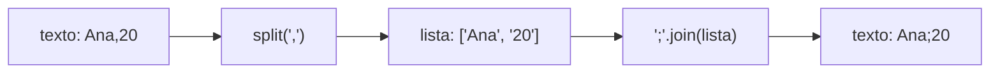

## Passo 1 · Leitura · Quebrar e juntar

Muito texto que um programa recebe vem "empacotado": uma frase com várias palavras, uma linha com valores separados por vírgula, um arquivo com várias linhas. Dois métodos fazem o caminho de ida e volta: `split` **quebra** um texto em uma lista de textos, e `join` **junta** uma lista de textos em um texto só.



#### split: do texto para a lista

```python
print("o rato roeu".split())         # ['o', 'rato', 'roeu']
print("Ana,20,Ribeirão Preto".split(","))   # ['Ana', '20', 'Ribeirão Preto']
print("14/11/2026".split("/"))       # ['14', '11', '2026']
```

Sem argumento, `split()` separa pelos espaços e ignora espaços repetidos ou sobrando nas pontas. Com argumento, `split(sep)` corta em **cada** ocorrência do separador, e o separador some do resultado.

#### join: da lista para o texto

O `join` se escreve ao contrário do que parece natural: **quem chama é o separador**, e a lista vai entre parênteses.

```python
palavras = ["roeu", "rato", "o"]
print(" ".join(palavras))    # roeu rato o
print("-".join(palavras))    # roeu-rato-o
```

O `join` só aceita textos. Com números na lista, `",".join([1, 2])` dá `TypeError: sequence item 0: expected str instance, int found`. Converta antes com `str`.

#### splitlines: uma linha por item

Um texto com várias linhas tem o caractere `\n` (quebra de linha) entre elas. `splitlines()` devolve a lista das linhas, já sem o `\n`:

```python
texto = "Ana,20\nBia,35"
print(texto.splitlines())    # ['Ana,20', 'Bia,35']
```

#### Os campos são textos

Valores separados por vírgula, um registro por linha: esse formato se chama **CSV** e é o jeito mais comum de trocar tabelas entre programas. Depois do `split`, todo campo é texto, inclusive os que parecem números. Para fazer conta, converta com `int` ou `float`.

Execute o bloco abaixo passo a passo. Repare que `campos` é uma lista de textos e que a idade só vira número depois do `int`:

```python visualizar
linha = "Ana,20,Ribeirão Preto"
campos = linha.split(",")
idade = int(campos[1])
de_volta = " | ".join(campos)
print(idade + 1, de_volta)
```

## Passo 2 · Previsão · O que o split devolve

Leia o programa, sem executar, e digite exatamente o que ele imprime. Na segunda e na terceira linha há **dois** espaços entre `um` e `dois`.

### Código
```python
print("a,b,c".split(","))
print("um  dois".split())
print("um  dois".split(" "))
print("-".join(["x", "y", "z"]))
print("l1\nl2".splitlines())
```

### Dicas
1. `split()` sem argumento ignora espaços repetidos; `split(" ")` corta em cada espaço, mesmo que entre dois espaços não haja nada.
2. Quando o `print` mostra uma lista, ela aparece com colchetes, vírgula e espaço entre os itens, e cada texto entre aspas simples.

### Saída esperada
```text
['a', 'b', 'c']
['um', 'dois']
['um', '', 'dois']
x-y-z
['l1', 'l2']
```

## Passo 3 · Exercício · inverter_palavras(frase) e iniciais(nome)

Duas funções pequenas, as duas no mesmo molde: quebrar o texto em palavras, trabalhar com a lista e montar um texto novo.

```
inverter_palavras("o rato roeu")   devolve   "roeu rato o"
iniciais("Ana Clara Souza")        devolve   "A.C.S."
```

Quem digita às vezes deixa dois espaços entre as palavras. As duas funções precisam funcionar mesmo assim.

### Instruções
1. Defina `inverter_palavras(frase)`, que devolve as palavras da frase na ordem contrária, separadas por **um** espaço. Uma frase vazia devolve `""`.
   Dica: uma lista invertida é `lista[::-1]`.
2. Defina `iniciais(nome)`, que devolve a primeira letra de cada palavra do nome, em maiúscula, cada uma seguida de um ponto. Exemplo: `iniciais("érica ávila")` devolve `"É.Á."`.
   Dica: percorra as palavras e vá acumulando em um texto que começa vazio.

### Código inicial
```python
def inverter_palavras(frase):
    pass


def iniciais(nome):
    pass
```

### Solução
```python
def inverter_palavras(frase):
    palavras = frase.split()
    return " ".join(palavras[::-1])


def iniciais(nome):
    resultado = ""
    for palavra in nome.split():
        resultado += palavra[0].upper() + "."
    return resultado
```

### Dicas
1. Use `split()` sem argumento: ele já ignora os espaços repetidos.
2. Para inverter e juntar: `" ".join(palavras[::-1])`.
3. Em `iniciais`, cada palavra contribui com `palavra[0].upper() + "."`; o ponto vem depois de **cada** inicial, inclusive da última.

### Verificação
```json
[
  { "id": "inverte-3", "checkpoint": 1, "kind": "call", "function": "inverter_palavras", "args": ["o rato roeu"], "expected": "roeu rato o", "type": "str",
    "name": "inverter_palavras(\"o rato roeu\")", "hint": "A função devolve um texto, não uma lista: junte as palavras com um espaço." },
  { "id": "inverte-dois-espacos", "checkpoint": 1, "kind": "call", "function": "inverter_palavras", "args": ["o  rato"], "expected": "rato o", "type": "str",
    "name": "Frase com dois espaços seguidos", "hint": "split(\" \") cria um item vazio entre dois espaços; split() sem argumento não." },
  { "id": "inverte-acentos", "checkpoint": 1, "kind": "call", "function": "inverter_palavras", "args": ["São Paulo é grande"], "expected": "grande é Paulo São", "type": "str",
    "name": "inverter_palavras(\"São Paulo é grande\")" },
  { "id": "inverte-uma", "checkpoint": 1, "kind": "call", "function": "inverter_palavras", "args": ["sozinha"], "expected": "sozinha", "type": "str",
    "name": "Uma palavra só volta igual" },
  { "id": "inverte-vazia", "checkpoint": 1, "kind": "call", "function": "inverter_palavras", "args": [""], "expected": "", "type": "str",
    "name": "Frase vazia devolve texto vazio" },
  { "id": "iniciais-3", "checkpoint": 2, "kind": "call", "function": "iniciais", "args": ["Ana Clara Souza"], "expected": "A.C.S.", "type": "str",
    "name": "iniciais(\"Ana Clara Souza\")", "hint": "Cada inicial é seguida de um ponto, inclusive a última." },
  { "id": "iniciais-minusculas-acento", "checkpoint": 2, "kind": "call", "function": "iniciais", "args": ["érica ávila"], "expected": "É.Á.", "type": "str",
    "name": "iniciais(\"érica ávila\")", "hint": "As iniciais saem em maiúscula, mesmo que o nome venha em minúsculas." },
  { "id": "iniciais-dois-espacos", "checkpoint": 2, "kind": "call", "function": "iniciais", "args": ["Davi  Lima"], "expected": "D.L.", "type": "str",
    "name": "Nome com dois espaços seguidos", "hint": "Use split() sem argumento para não receber uma palavra vazia." },
  { "id": "iniciais-uma", "checkpoint": 2, "kind": "call", "function": "iniciais", "args": ["Eva"], "expected": "E.", "type": "str",
    "name": "iniciais(\"Eva\")" }
]
```

### Soluções erradas
```python name="split com espaço: sobra item vazio"
def inverter_palavras(frase):
    palavras = frase.split(" ")
    return " ".join(palavras[::-1])


def iniciais(nome):
    resultado = ""
    for palavra in nome.split(" "):
        resultado += palavra[0].upper() + "."
    return resultado
```
```python name="iniciais sem o ponto final"
def inverter_palavras(frase):
    return " ".join(frase.split()[::-1])


def iniciais(nome):
    letras = []
    for palavra in nome.split():
        letras.append(palavra[0].upper())
    return ".".join(letras)
```
```python name="inverter devolve a lista, sem join"
def inverter_palavras(frase):
    return frase.split()[::-1]


def iniciais(nome):
    resultado = ""
    for palavra in nome.split():
        resultado += palavra[0].upper() + "."
    return resultado
```
```python name="inverte as letras em vez das palavras"
def inverter_palavras(frase):
    return frase[::-1]


def iniciais(nome):
    resultado = ""
    for palavra in nome.split():
        resultado += palavra[0].upper() + "."
    return resultado
```
```python name="iniciais sem maiúscula"
def inverter_palavras(frase):
    return " ".join(frase.split()[::-1])


def iniciais(nome):
    resultado = ""
    for palavra in nome.split():
        resultado += palavra[0] + "."
    return resultado
```

## Passo 4 · Exercício · CSV em variável
modo: ordenar

Um CSV pequeno está guardado em uma variável: a primeira linha é o cabeçalho (`nome,idade`) e cada linha seguinte é uma pessoa. Monte o programa que calcula a **média das idades**, em `media_idade`, e o **nome mais longo**, em `nome_mais_longo`.

Arraste as linhas para a ordem certa e ajuste a indentação de cada uma. Duas linhas estão sobrando: elas não fazem parte do programa.

Com estes dados, `media_idade` termina valendo `27.33` e `nome_mais_longo`, `"Caio"`.

### Instruções
1. Crie `dados` e separe as linhas em `linhas`, pulando o cabeçalho. Depois, comece `soma` em zero e `nome_mais_longo` vazio.
   Dica: o cabeçalho é a primeira linha; uma fatia pula.
2. Para cada linha, separe o nome e a idade, some a idade e guarde o nome se ele for o mais longo até agora.
   Dica: a idade chega como texto.
3. Depois do laço, calcule a média das idades, arredondada para duas casas, em `media_idade`.

### Solução
```python
dados = "nome,idade\nAna,20\nCaio,27\nBia,35"
linhas = dados.splitlines()[1:]
soma = 0
nome_mais_longo = ""
for linha in linhas:
    nome, idade = linha.split(",")
    soma += int(idade)
    if len(nome) > len(nome_mais_longo):
        nome_mais_longo = nome
media_idade = round(soma / len(linhas), 2)
```

### Distratores
```python
linhas = dados.splitlines()
soma += idade
```

### Dicas
1. O cabeçalho é a primeira linha de `dados`: a fatia `[1:]` pula essa linha.
2. A média só é calculada depois do laço, sem indentação, quando `soma` já tem todas as idades.
3. A linha que guarda o nome fica dentro do `if`, dois níveis para dentro; o `if` fica dentro do `for`.

### Verificação
```json
[
  { "id": "linhas-sem-cabecalho", "checkpoint": 1, "kind": "variable", "variable": "linhas", "expected": ["Ana,20", "Caio,27", "Bia,35"], "type": "list",
    "name": "linhas tem as três pessoas, sem o cabeçalho", "hint": "A primeira linha de dados não é uma pessoa." },
  { "id": "nome", "checkpoint": 2, "kind": "variable", "variable": "nome_mais_longo", "expected": "Caio", "type": "str",
    "name": "nome_mais_longo é o nome com mais letras", "hint": "O nome só é trocado quando é mais longo que o guardado até agora." },
  { "id": "soma", "checkpoint": 2, "kind": "variable", "variable": "soma", "expected": 82, "type": "int",
    "name": "soma acumula as três idades como números", "hint": "Converta a idade antes de somar." },
  { "id": "media", "checkpoint": 3, "kind": "variable", "variable": "media_idade", "expected": 27.33, "type": "float", "tolerance": 0.01,
    "name": "media_idade com duas casas", "hint": "Divida a soma pela quantidade de pessoas, não pela quantidade de linhas do texto." }
]
```

### Soluções erradas
```python name="inclui o cabeçalho: int('idade') dá ValueError"
dados = "nome,idade\nAna,20\nCaio,27\nBia,35"
linhas = dados.splitlines()
soma = 0
nome_mais_longo = ""
for linha in linhas:
    nome, idade = linha.split(",")
    soma += int(idade)
    if len(nome) > len(nome_mais_longo):
        nome_mais_longo = nome
media_idade = round(soma / len(linhas), 2)
```
```python name="divide por 4: conta o cabeçalho como pessoa"
dados = "nome,idade\nAna,20\nCaio,27\nBia,35"
linhas = dados.splitlines()[1:]
soma = 0
nome_mais_longo = ""
for linha in linhas:
    nome, idade = linha.split(",")
    soma += int(idade)
    if len(nome) > len(nome_mais_longo):
        nome_mais_longo = nome
media_idade = round(soma / len(dados.splitlines()), 2)
```
```python name="soma a idade sem converter: TypeError"
dados = "nome,idade\nAna,20\nCaio,27\nBia,35"
linhas = dados.splitlines()[1:]
soma = 0
nome_mais_longo = ""
for linha in linhas:
    nome, idade = linha.split(",")
    soma += idade
    if len(nome) > len(nome_mais_longo):
        nome_mais_longo = nome
media_idade = round(soma / len(linhas), 2)
```
```python name="guarda o nome fora do if: fica o último, não o mais longo"
dados = "nome,idade\nAna,20\nCaio,27\nBia,35"
linhas = dados.splitlines()[1:]
soma = 0
nome_mais_longo = ""
for linha in linhas:
    nome, idade = linha.split(",")
    soma += int(idade)
    if len(nome) > len(nome_mais_longo):
        pass
    nome_mais_longo = nome
media_idade = round(soma / len(linhas), 2)
```
```python name="média dentro do laço, dividindo por 1 a cada volta"
dados = "nome,idade\nAna,20\nCaio,27\nBia,35"
linhas = dados.splitlines()[1:]
soma = 0
nome_mais_longo = ""
for linha in linhas:
    nome, idade = linha.split(",")
    soma += int(idade)
    media_idade = round(soma / 1, 2)
    if len(nome) > len(nome_mais_longo):
        nome_mais_longo = nome
```

## Passo 5 · Quiz · split e join

### Pergunta
Quanto vale `"a,b".split(",")`?
- [ ] `"a b"`
- [x] `['a', 'b']`
- [ ] `['a', ',', 'b']`
- [ ] `('a', 'b')`
> `split` devolve uma lista de textos, e o separador não entra no resultado.

### Pergunta
Por que `",".join([1, 2])` dá `TypeError`?
- [ ] Porque o separador deveria vir entre os parênteses, e a lista antes do ponto
- [ ] Porque `join` só funciona com listas de três ou mais itens
- [x] Porque `join` só junta textos, e a lista tem inteiros
- [ ] Porque a vírgula não pode ser usada como separador
> A mensagem diz isso: `expected str instance, int found`. Converta os itens com `str` antes de juntar.

### Pergunta
A frase `"um  dois"` tem dois espaços no meio. Qual é a diferença entre `split()` e `split(" ")` nesse texto?
- [ ] Nenhuma: os dois devolvem `['um', 'dois']`
- [x] `split()` devolve `['um', 'dois']`; `split(" ")` devolve `['um', '', 'dois']`
- [ ] `split()` devolve `['um', '', 'dois']`; `split(" ")` devolve `['um', 'dois']`
- [ ] `split()` dá erro, porque falta o separador
> Sem argumento, `split` trata qualquer sequência de espaços como um separador só. Com `" "`, corta em cada espaço, e entre dois espaços seguidos sobra um texto vazio.

## Passo 6 · Exercício · para_csv(registros)

Agora o caminho de volta: transformar dados do programa em texto para gravar ou enviar. A função `para_csv` recebe uma lista de tuplas, uma por registro, e devolve um texto com um registro por linha e os campos separados por ponto e vírgula.

```
para_csv([("Ana", 20), ("Bia", 35)])   devolve   "Ana;20\nBia;35"
```

Impresso, esse texto aparece em duas linhas: `Ana;20` e `Bia;35`. As tuplas podem ter qualquer quantidade de campos, e os campos podem ser textos ou números. O texto devolvido **não** termina com `\n`, e uma lista vazia devolve `""`.

### Instruções
1. Defina `para_csv(registros)`. Para cada registro, monte uma linha com os campos convertidos em texto e unidos por `;`.
   Dica: o `join` só aceita textos.
2. Devolva as linhas unidas por `"\n"`, sem quebra de linha sobrando no fim.
   Dica: guarde as linhas prontas em uma lista e deixe o `join` pôr o separador só entre elas.

### Código inicial
```python
def para_csv(registros):
    pass
```

### Solução
```python
def para_csv(registros):
    linhas = []
    for registro in registros:
        campos = [str(campo) for campo in registro]
        linhas.append(";".join(campos))
    return "\n".join(linhas)
```

### Dicas
1. Converta cada campo com `str` antes de juntar: `[str(campo) for campo in registro]`.
2. Junte os campos com `";".join(...)` e guarde cada linha pronta em uma lista.
3. No fim, `"\n".join(linhas)` põe a quebra só **entre** as linhas; somar `"\n"` a cada linha deixa uma sobrando.

### Verificação
```json
[
  { "id": "dois-registros", "checkpoint": 1, "kind": "call", "function": "para_csv", "args": [[["Ana", 20], ["Bia", 35]]], "expected": "Ana;20\nBia;35", "type": "str",
    "name": "Dois registros de dois campos", "hint": "Os campos são unidos por ponto e vírgula; as linhas, por \\n, sem \\n no fim." },
  { "id": "um-registro", "checkpoint": 1, "kind": "call", "function": "para_csv", "args": [[["Davi", 41]]], "expected": "Davi;41", "type": "str",
    "name": "Um registro só: nenhuma quebra de linha", "hint": "Com um registro, o texto não tem \\n." },
  { "id": "quatro-campos", "checkpoint": 1, "kind": "call", "function": "para_csv", "args": [[["Caio", 27, "São Paulo", 7.5], ["Eva", 19, "Ribeirão Preto", 10]]],
    "expected": "Caio;27;São Paulo;7.5\nEva;19;Ribeirão Preto;10", "type": "str",
    "name": "Registros com quatro campos", "hint": "A função não pode supor que cada tupla tem dois campos: percorra todos." },
  { "id": "sem-quebra-no-fim", "checkpoint": 2, "kind": "expr", "expr": "para_csv([(\"Ana\", 20), (\"Bia\", 35), (\"Caio\", 27)]).endswith(\"\\n\")", "expected": false, "type": "bool",
    "name": "O texto não termina com quebra de linha", "hint": "Deixe o join pôr o \\n só entre as linhas." },
  { "id": "tres-linhas", "checkpoint": 2, "kind": "expr", "expr": "para_csv([(\"Ana\", 20), (\"Bia\", 35), (\"Caio\", 27)]).splitlines()", "expected": ["Ana;20", "Bia;35", "Caio;27"],
    "name": "Três registros viram três linhas" },
  { "id": "vazia", "checkpoint": 2, "kind": "call", "function": "para_csv", "args": [[]], "expected": "", "type": "str",
    "name": "Lista vazia devolve texto vazio" }
]
```

### Soluções erradas
```python name="join com inteiros: TypeError"
def para_csv(registros):
    linhas = []
    for registro in registros:
        linhas.append(";".join(registro))
    return "\n".join(linhas)
```
```python name="quebra de linha sobrando no fim"
def para_csv(registros):
    texto = ""
    for registro in registros:
        campos = [str(campo) for campo in registro]
        texto += ";".join(campos) + "\n"
    return texto
```
```python name="supõe dois campos por registro"
def para_csv(registros):
    linhas = []
    for nome, idade in registros:
        linhas.append(f"{nome};{idade}")
    return "\n".join(linhas)
```
```python name="separador errado: vírgula"
def para_csv(registros):
    linhas = []
    for registro in registros:
        campos = [str(campo) for campo in registro]
        linhas.append(",".join(campos))
    return "\n".join(linhas)
```
```python name="devolve a lista de linhas, sem o join final"
def para_csv(registros):
    linhas = []
    for registro in registros:
        campos = [str(campo) for campo in registro]
        linhas.append(";".join(campos))
    return linhas
```
