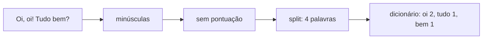

## Passo 1 · Leitura · Normalizar, separar, contar

Qual é a palavra mais usada em um texto? Quantas vezes cada uma aparece? Quase toda análise de texto segue as mesmas três etapas: **normalizar** (deixar o texto em um padrão só), **separar** (quebrar em palavras) e **contar** (acumular em um dicionário).



Sem a normalização, o Python conta errado: para ele `"Oi,"`, `"oi!"` e `"oi"` são três textos diferentes.

```python
texto = "Oi, oi! Tudo bem?"
texto = texto.lower()                  # "oi, oi! tudo bem?"
for sinal in ".,!?;:":
    texto = texto.replace(sinal, " ")  # troca cada sinal por um espaço
palavras = texto.split()               # ['oi', 'oi', 'tudo', 'bem']

contagem = {}
for palavra in palavras:
    contagem[palavra] = contagem.get(palavra, 0) + 1
print(contagem)                        # {'oi': 2, 'tudo': 1, 'bem': 1}
```

O laço `for sinal in ".,!?;:"` percorre os sinais um a um, porque uma string também é uma sequência. Trocar o sinal por espaço, e não por texto vazio, evita grudar duas palavras em casos como `"sim,não"`. Os espaços a mais não atrapalham: `split()` sem argumento ignora espaços repetidos.

Sobre acentos: `lower()` trata as letras acentuadas (`"ÁGUA".lower()` é `"água"`), mas não tira o acento. Para o Python, `"á"` e `"a"` são letras diferentes, e `"água"` e `"agua"` são duas palavras.

#### A chave de maior valor

Com o dicionário pronto, `max(contagem, key=contagem.get)` devolve a **palavra** de maior contagem (aqui, `"oi"`). Sem o `key`, `max(contagem)` compara as chaves entre si e devolve a última em ordem alfabética (`"tudo"`), que não é o que você quer.

#### Palíndromo e anagrama

Dois testes clássicos usam a mesma receita de normalizar antes de comparar:

- **Palíndromo** é o texto que, lido de trás para frente, fica igual: `arara`, `ovo`. Texto invertido é `texto[::-1]`.
- **Anagramas** são dois textos com exatamente as mesmas letras, em outra ordem: `amor` e `roma`. Como `sorted` devolve a lista das letras em ordem, dois anagramas têm o mesmo `sorted`.

```python
print("arara" == "arara"[::-1])          # True
print(sorted("amor"))                    # ['a', 'm', 'o', 'r']
print(sorted("amor") == sorted("roma"))  # True
```

## Passo 2 · Exercício · frequencia_de_palavras(texto)

Monte a função que faz as três etapas da leitura e devolve o dicionário de contagem. As palavras são contadas em minúsculas, e os sinais `.` `,` `!` `?` `;` `:` não fazem parte de nenhuma palavra.

```
frequencia_de_palavras("Oi, oi! Tudo bem?")   devolve   {"oi": 2, "tudo": 1, "bem": 1}
frequencia_de_palavras("")                    devolve   {}
```

### Instruções
1. Defina `frequencia_de_palavras(texto)`. Dentro dela, ponha o texto em minúsculas e troque cada um dos sinais `.,!?;:` por um espaço.
   Dica: percorra os sinais com um `for` e use `replace` a cada volta, guardando o resultado.
2. Separe o texto em palavras, conte cada uma em um dicionário e devolva o dicionário. Um texto vazio devolve `{}`.
   Dica: `get` devolve a contagem atual ou um valor inicial quando a palavra ainda não está no dicionário.

### Código inicial
```python
def frequencia_de_palavras(texto):
    pass
```

### Solução
```python
def frequencia_de_palavras(texto):
    texto = texto.lower()
    for sinal in ".,!?;:":
        texto = texto.replace(sinal, " ")
    contagem = {}
    for palavra in texto.split():
        contagem[palavra] = contagem.get(palavra, 0) + 1
    return contagem
```

### Dicas
1. Troque cada sinal por espaço: `texto = texto.replace(sinal, " ")`. Sem o `texto =`, a troca se perde.
2. Use `split()` sem argumento: ele ignora os espaços repetidos que a troca deixou.
3. Conte com `contagem[palavra] = contagem.get(palavra, 0) + 1`.

### Verificação
```json
[
  { "id": "sem-pontuacao", "checkpoint": 1, "kind": "call", "function": "frequencia_de_palavras", "args": ["bem, bem; bem: bem. bem! bem?"], "expected": { "bem": 6 }, "type": "dict",
    "name": "Os seis sinais saem das palavras", "hint": "São seis sinais: ponto, vírgula, exclamação, interrogação, ponto e vírgula e dois-pontos." },
  { "id": "minusculas-acento", "checkpoint": 1, "kind": "call", "function": "frequencia_de_palavras", "args": ["Água água ÁGUA"], "expected": { "água": 3 }, "type": "dict",
    "name": "Água, água e ÁGUA são a mesma palavra", "hint": "Ponha o texto em minúsculas antes de separar; as letras acentuadas acompanham." },
  { "id": "sinal-sem-espaco", "checkpoint": 1, "kind": "call", "function": "frequencia_de_palavras", "args": ["sim,não,sim"], "expected": { "sim": 2, "não": 1 }, "type": "dict",
    "name": "Sinal sem espaço depois: \"sim,não,sim\"", "hint": "Troque o sinal por um espaço, não por texto vazio, para as palavras não grudarem." },
  { "id": "exemplo", "checkpoint": 2, "kind": "call", "function": "frequencia_de_palavras", "args": ["Oi, oi! Tudo bem?"], "expected": { "oi": 2, "tudo": 1, "bem": 1 }, "type": "dict",
    "name": "O exemplo do enunciado", "hint": "Oi e oi contam juntas, e a pontuação não faz parte da palavra." },
  { "id": "frase-acentos", "checkpoint": 2, "kind": "call", "function": "frequencia_de_palavras", "args": ["Você viu? Você, não!"], "expected": { "você": 2, "viu": 1, "não": 1 }, "type": "dict",
    "name": "\"Você viu? Você, não!\"" },
  { "id": "vazio", "checkpoint": 2, "kind": "call", "function": "frequencia_de_palavras", "args": [""], "expected": {}, "type": "dict",
    "name": "Texto vazio devolve dicionário vazio" },
  { "id": "so-sinais", "checkpoint": 2, "kind": "call", "function": "frequencia_de_palavras", "args": ["?! ..."], "expected": {}, "type": "dict",
    "name": "Texto só com sinais não tem palavra nenhuma" }
]
```

### Soluções erradas
```python name="sem lower: Oi e oi contam separadas"
def frequencia_de_palavras(texto):
    for sinal in ".,!?;:":
        texto = texto.replace(sinal, " ")
    contagem = {}
    for palavra in texto.split():
        contagem[palavra] = contagem.get(palavra, 0) + 1
    return contagem
```
```python name="pontuação grudada na palavra"
def frequencia_de_palavras(texto):
    contagem = {}
    for palavra in texto.lower().split():
        contagem[palavra] = contagem.get(palavra, 0) + 1
    return contagem
```
```python name="replace sem guardar o resultado"
def frequencia_de_palavras(texto):
    texto = texto.lower()
    for sinal in ".,!?;:":
        texto.replace(sinal, " ")
    contagem = {}
    for palavra in texto.split():
        contagem[palavra] = contagem.get(palavra, 0) + 1
    return contagem
```
```python name="troca o sinal por texto vazio: palavras grudam"
def frequencia_de_palavras(texto):
    texto = texto.lower()
    for sinal in ".,!?;:":
        texto = texto.replace(sinal, "")
    contagem = {}
    for palavra in texto.split():
        contagem[palavra] = contagem.get(palavra, 0) + 1
    return contagem
```
```python name="marca 1 em vez de somar"
def frequencia_de_palavras(texto):
    texto = texto.lower()
    for sinal in ".,!?;:":
        texto = texto.replace(sinal, " ")
    contagem = {}
    for palavra in texto.split():
        contagem[palavra] = 1
    return contagem
```

## Passo 3 · Exercício · eh_palindromo(frase) e sao_anagramas(a, b)

Uma frase inteira também pode ser um palíndromo, desde que você ignore os espaços e a diferença entre maiúsculas e minúsculas: `A base do teto desaba`, sem os espaços e em minúsculas, vira `abasedotetodesaba`, que é igual de trás para frente.

As duas funções deste exercício ignoram **espaços e maiúsculas**. Elas não mexem em acentos nem em pontuação: os testes usam só letras sem acento e espaços.

```
eh_palindromo("A base do teto desaba")   devolve   True
eh_palindromo("Python")                  devolve   False
sao_anagramas("amor", "Roma")            devolve   True
sao_anagramas("amor", "amar")            devolve   False
```

### Instruções
1. Defina `eh_palindromo(frase)`, que devolve `True` se a frase, sem os espaços e em minúsculas, é igual a ela mesma invertida; senão, `False`.
   Dica: tirar todos os espaços é trocar `" "` por texto vazio; `strip` só tira os das pontas.
2. Defina `sao_anagramas(a, b)`, que devolve `True` se os dois textos, sem os espaços e em minúsculas, têm exatamente as mesmas letras, cada uma na mesma quantidade; senão, `False`.
   Dica: compare as letras dos dois textos depois de colocá-las em ordem.

### Código inicial
```python
def eh_palindromo(frase):
    pass


def sao_anagramas(a, b):
    pass
```

### Solução
```python
def limpar(texto):
    return texto.replace(" ", "").lower()


def eh_palindromo(frase):
    limpa = limpar(frase)
    return limpa == limpa[::-1]


def sao_anagramas(a, b):
    return sorted(limpar(a)) == sorted(limpar(b))
```

### Dicas
1. Limpe o texto antes de comparar: `texto.replace(" ", "").lower()`. Como as duas funções precisam disso, vale criar uma função auxiliar.
2. Um texto invertido é `texto[::-1]`; o palíndromo é igual ao seu inverso.
3. Dois anagramas têm as mesmas letras em ordem: compare `sorted(...)` de um com `sorted(...)` do outro.

### Verificação
```json
[
  { "id": "pal-arara", "checkpoint": 1, "kind": "call", "function": "eh_palindromo", "args": ["arara"], "expected": true, "type": "bool",
    "name": "eh_palindromo(\"arara\") é True" },
  { "id": "pal-frase", "checkpoint": 1, "kind": "call", "function": "eh_palindromo", "args": ["A base do teto desaba"], "expected": true, "type": "bool",
    "name": "eh_palindromo(\"A base do teto desaba\") é True", "hint": "Tire todos os espaços, não só os das pontas, e iguale maiúsculas e minúsculas." },
  { "id": "pal-maiuscula", "checkpoint": 1, "kind": "call", "function": "eh_palindromo", "args": ["Ovo"], "expected": true, "type": "bool",
    "name": "eh_palindromo(\"Ovo\") é True", "hint": "O e o precisam contar como a mesma letra." },
  { "id": "pal-espacos", "checkpoint": 1, "kind": "call", "function": "eh_palindromo", "args": ["ame o poema"], "expected": true, "type": "bool",
    "name": "eh_palindromo(\"ame o poema\") é True", "hint": "Os espaços não ficam nas mesmas posições na frase invertida: tire todos antes de comparar." },
  { "id": "pal-nao", "checkpoint": 1, "kind": "call", "function": "eh_palindromo", "args": ["Python"], "expected": false, "type": "bool",
    "name": "eh_palindromo(\"Python\") é False" },
  { "id": "pal-quase", "checkpoint": 1, "kind": "call", "function": "eh_palindromo", "args": ["amora"], "expected": false, "type": "bool",
    "name": "eh_palindromo(\"amora\") é False", "hint": "Começar e terminar com a mesma letra não basta: o texto todo precisa ser igual ao inverso." },
  { "id": "ana-roma", "checkpoint": 2, "kind": "call", "function": "sao_anagramas", "args": ["amor", "Roma"], "expected": true, "type": "bool",
    "name": "sao_anagramas(\"amor\", \"Roma\") é True", "hint": "Iguale maiúsculas e minúsculas antes de comparar." },
  { "id": "ana-espacos", "checkpoint": 2, "kind": "call", "function": "sao_anagramas", "args": ["a gota", "o gata"], "expected": true, "type": "bool",
    "name": "sao_anagramas(\"a gota\", \"o gata\") é True" },
  { "id": "ana-espaco-um-lado", "checkpoint": 2, "kind": "call", "function": "sao_anagramas", "args": ["a roma", "amoras"], "expected": false, "type": "bool",
    "name": "sao_anagramas(\"a roma\", \"amoras\") é False", "hint": "Sem o espaço, um texto tem 5 letras e o outro tem 6." },
  { "id": "ana-espaco-ignorado", "checkpoint": 2, "kind": "call", "function": "sao_anagramas", "args": ["a roma", "amora"], "expected": true, "type": "bool",
    "name": "sao_anagramas(\"a roma\", \"amora\") é True", "hint": "Os espaços não contam como letra: tire todos dos dois textos." },
  { "id": "ana-mesmo-tamanho", "checkpoint": 2, "kind": "call", "function": "sao_anagramas", "args": ["amor", "amar"], "expected": false, "type": "bool",
    "name": "sao_anagramas(\"amor\", \"amar\") é False", "hint": "Ter o mesmo tamanho não basta: as letras precisam ser as mesmas." },
  { "id": "ana-quantidade", "checkpoint": 2, "kind": "call", "function": "sao_anagramas", "args": ["ata", "tat"], "expected": false, "type": "bool",
    "name": "sao_anagramas(\"ata\", \"tat\") é False", "hint": "As letras são as mesmas, mas as quantidades não: um texto tem dois a, o outro tem dois t." }
]
```

### Soluções erradas
```python name="palíndromo sem tirar os espaços"
def eh_palindromo(frase):
    limpa = frase.lower()
    return limpa == limpa[::-1]


def sao_anagramas(a, b):
    return sorted(a.replace(" ", "").lower()) == sorted(b.replace(" ", "").lower())
```
```python name="anagrama comparando só os tamanhos"
def limpar(texto):
    return texto.replace(" ", "").lower()


def eh_palindromo(frase):
    limpa = limpar(frase)
    return limpa == limpa[::-1]


def sao_anagramas(a, b):
    return len(limpar(a)) == len(limpar(b))
```
```python name="sem lower: maiúsculas atrapalham"
def limpar(texto):
    return texto.replace(" ", "")


def eh_palindromo(frase):
    limpa = limpar(frase)
    return limpa == limpa[::-1]


def sao_anagramas(a, b):
    return sorted(limpar(a)) == sorted(limpar(b))
```
```python name="strip em vez de replace: os espaços do meio ficam"
def limpar(texto):
    return texto.strip().lower()


def eh_palindromo(frase):
    limpa = limpar(frase)
    return limpa == limpa[::-1]


def sao_anagramas(a, b):
    return sorted(limpar(a)) == sorted(limpar(b))
```
```python name="anagrama com set: ignora as quantidades"
def limpar(texto):
    return texto.replace(" ", "").lower()


def eh_palindromo(frase):
    limpa = limpar(frase)
    return limpa == limpa[::-1]


def sao_anagramas(a, b):
    return set(limpar(a)) == set(limpar(b))
```
```python name="palíndromo confere só a primeira e a última letra"
def limpar(texto):
    return texto.replace(" ", "").lower()


def eh_palindromo(frase):
    limpa = limpar(frase)
    return limpa[0] == limpa[-1]


def sao_anagramas(a, b):
    return sorted(limpar(a)) == sorted(limpar(b))
```

## Passo 4 · Leitura · Letras são números: a cifra de César

Dentro do computador, cada caractere é guardado como um número, o seu **código**. Duas funções fazem a ponte: `ord(caractere)` devolve o código, e `chr(codigo)` devolve o caractere.

```python
print(ord("a"))   # 97
print(ord("b"))   # 98
print(ord("A"))   # 65
print(chr(100))   # d
```

As letras minúsculas de `a` a `z` têm códigos seguidos, de 97 a 122; as maiúsculas de `A` a `Z`, de 65 a 90. Por isso `ord(letra) - ord("a")` dá a **posição** da letra no alfabeto, contando do zero: a = 0, b = 1, …, z = 25. Também por isso dá para comparar letras: `"a" <= c <= "z"` é `True` exatamente quando `c` é uma minúscula sem acento. As letras acentuadas ficam fora dessas faixas (`ord("ã")` é 227).

#### A cifra de César

É um dos códigos secretos mais antigos: cada letra é trocada pela que fica $k$ posições adiante no alfabeto. Com $k = 3$, `a` vira `d` e `b` vira `e`. Quem passa do `z` dá a volta e recomeça no `a`: `y` vira `b`.

Essa volta é o resto da divisão por 26, a quantidade de letras. Se $p$ é a posição da letra original (a = 0, …, z = 25) e $c$ é a posição da letra cifrada:

$$
c = (p + k) \bmod 26
$$

Em Python, $\bmod$ é o operador `%`. O `y` está na posição 24, e $(24 + 3) \bmod 26 = 1$, que é a posição do `b`.

Execute o bloco abaixo passo a passo e acompanhe uma letra só passar pelas quatro contas: código, posição, posição nova e letra nova.

```python visualizar
letra = "y"
k = 3
posicao = ord(letra) - ord("a")
nova = (posicao + k) % 26
cifrada = chr(nova + ord("a"))
print(letra, "->", cifrada)
```

Para **decifrar**, basta andar $k$ posições para trás, isto é, cifrar com $-k$. O `%` do Python cuida da volta também nesse sentido: `(1 - 3) % 26` vale `24`, nunca um número negativo.

## Passo 5 · Previsão · ord, chr e resto

Leia o programa, sem executar, e digite exatamente o que ele imprime.

### Código
```python
print(ord("a"))
print(chr(ord("a") + 2))
print((25 + 3) % 26)
print(sorted("roma") == sorted("amor"))
print("arara" == "arara"[::-1])
```

### Dicas
1. `ord("a")` é 97, e as letras seguintes vêm em sequência: 98, 99…
2. O resto da divisão por 26 faz a conta "dar a volta": 26 volta a ser 0, 27 volta a ser 1.

### Saída esperada
```text
97
c
2
True
True
```

## Passo 6 · Exercício · cifrar(texto, k) e decifrar(texto, k)

Escreva a cifra de César completa. A regra:

- letra **minúscula** sem acento (`a` a `z`) anda `k` posições e continua minúscula;
- letra **maiúscula** sem acento (`A` a `Z`) anda `k` posições e continua maiúscula;
- **todo o resto** (espaço, pontuação, dígito, letra acentuada) passa sem mudar.

```
cifrar("abc xyz", 3)    devolve   "def abc"
cifrar("Ola", 1)        devolve   "Pmb"
decifrar("def abc", 3)  devolve   "abc xyz"
```

### Instruções
1. Defina `cifrar(texto, k)`, que devolve o texto com cada letra minúscula de `a` a `z` trocada pela que fica `k` posições adiante, dando a volta depois do `z`. Os outros caracteres passam sem mudar.
   Dica: monte o resultado em um texto que começa vazio, um caractere por volta do laço.
2. Faça `cifrar` tratar também as maiúsculas de `A` a `Z`, que continuam maiúsculas.
   Dica: a conta é a mesma, trocando `ord("a")` por `ord("A")`.
3. Defina `decifrar(texto, k)`, que desfaz a cifra: `decifrar(cifrar(texto, k), k)` devolve o texto original.
   Dica: decifrar é andar para trás.

### Código inicial
```python
def cifrar(texto, k):
    pass


def decifrar(texto, k):
    pass
```

### Solução
```python
def cifrar(texto, k):
    resultado = ""
    for c in texto:
        if "a" <= c <= "z":
            posicao = (ord(c) - ord("a") + k) % 26
            resultado += chr(posicao + ord("a"))
        elif "A" <= c <= "Z":
            posicao = (ord(c) - ord("A") + k) % 26
            resultado += chr(posicao + ord("A"))
        else:
            resultado += c
    return resultado


def decifrar(texto, k):
    return cifrar(texto, -k)
```

### Dicas
1. Trabalhe com a posição da letra: `ord(c) - ord("a")` para minúsculas, `ord(c) - ord("A")` para maiúsculas. Some `k`, tire o resto por 26 e volte para letra com `chr`.
2. O que não está entre `"a"` e `"z"` nem entre `"A"` e `"Z"` cai no `else` e entra no resultado sem mudar.
3. Decifrar é cifrar com `-k`: `return cifrar(texto, -k)`.

### Verificação
```json
[
  { "id": "sem-volta", "checkpoint": 1, "kind": "call", "function": "cifrar", "args": ["abc", 3], "expected": "def", "type": "str",
    "name": "cifrar(\"abc\", 3) é \"def\"", "hint": "Cada letra anda k posições; a função devolve um texto." },
  { "id": "com-volta", "checkpoint": 1, "kind": "call", "function": "cifrar", "args": ["abc xyz", 3], "expected": "def abc", "type": "str",
    "name": "cifrar(\"abc xyz\", 3) é \"def abc\"", "hint": "Depois do z a contagem volta ao a (resto por 26), e o espaço passa sem mudar." },
  { "id": "nao-letras", "checkpoint": 1, "kind": "call", "function": "cifrar", "args": ["oi, tudo bem? 10!", 2], "expected": "qk, vwfq dgo? 10!", "type": "str",
    "name": "Espaço, pontuação e dígitos passam sem mudar" },
  { "id": "acentos", "checkpoint": 1, "kind": "call", "function": "cifrar", "args": ["ação", 1], "expected": "bçãp", "type": "str",
    "name": "Letras acentuadas passam sem mudar", "hint": "Só as letras de a a z e de A a Z são deslocadas; ç e ã ficam como estão." },
  { "id": "k-grande", "checkpoint": 1, "kind": "call", "function": "cifrar", "args": ["casa", 26], "expected": "casa", "type": "str",
    "name": "Com k = 26 o texto dá a volta inteira e fica igual" },
  { "id": "maiuscula", "checkpoint": 2, "kind": "call", "function": "cifrar", "args": ["Ola", 1], "expected": "Pmb", "type": "str",
    "name": "cifrar(\"Ola\", 1) é \"Pmb\"", "hint": "A maiúscula continua maiúscula: use a posição em relação a ord(\"A\")." },
  { "id": "maiuscula-volta", "checkpoint": 2, "kind": "call", "function": "cifrar", "args": ["ZEBRA Zen", 2], "expected": "BGDTC Bgp", "type": "str",
    "name": "Maiúsculas também dão a volta depois do Z" },
  { "id": "decifra", "checkpoint": 3, "kind": "call", "function": "decifrar", "args": ["def abc", 3], "expected": "abc xyz", "type": "str",
    "name": "decifrar(\"def abc\", 3) é \"abc xyz\"", "hint": "Decifrar anda k posições para trás." },
  { "id": "ida-e-volta", "checkpoint": 3, "kind": "expr", "expr": "decifrar(cifrar(\"Bom dia\", 5), 5)", "expected": "Bom dia", "type": "str",
    "name": "Cifrar e decifrar com o mesmo k devolve o original" },
  { "id": "ida-e-volta-frase", "checkpoint": 3, "kind": "expr", "expr": "decifrar(cifrar(\"Zero a Zero, que jogo!\", 11), 11)", "expected": "Zero a Zero, que jogo!", "type": "str",
    "name": "Ida e volta em uma frase com pontuação" }
]
```

### Soluções erradas
```python name="sem % 26: z vira símbolo"
def cifrar(texto, k):
    resultado = ""
    for c in texto:
        if "a" <= c <= "z" or "A" <= c <= "Z":
            resultado += chr(ord(c) + k)
        else:
            resultado += c
    return resultado


def decifrar(texto, k):
    return cifrar(texto, -k)
```
```python name="cifra também o espaço e a pontuação"
def cifrar(texto, k):
    resultado = ""
    for c in texto:
        if "A" <= c <= "Z":
            posicao = (ord(c) - ord("A") + k) % 26
            resultado += chr(posicao + ord("A"))
        else:
            posicao = (ord(c) - ord("a") + k) % 26
            resultado += chr(posicao + ord("a"))
    return resultado


def decifrar(texto, k):
    return cifrar(texto, -k)
```
```python name="maiúsculas viram minúsculas"
def cifrar(texto, k):
    resultado = ""
    for c in texto.lower():
        if "a" <= c <= "z":
            posicao = (ord(c) - ord("a") + k) % 26
            resultado += chr(posicao + ord("a"))
        else:
            resultado += c
    return resultado


def decifrar(texto, k):
    return cifrar(texto, -k)
```
```python name="decifrar cifra de novo com +k"
def cifrar(texto, k):
    resultado = ""
    for c in texto:
        if "a" <= c <= "z":
            posicao = (ord(c) - ord("a") + k) % 26
            resultado += chr(posicao + ord("a"))
        elif "A" <= c <= "Z":
            posicao = (ord(c) - ord("A") + k) % 26
            resultado += chr(posicao + ord("A"))
        else:
            resultado += c
    return resultado


def decifrar(texto, k):
    return cifrar(texto, k)
```
```python name="isalpha: desloca também as letras acentuadas"
def cifrar(texto, k):
    resultado = ""
    for c in texto:
        if c.isalpha() and c == c.lower():
            posicao = (ord(c) - ord("a") + k) % 26
            resultado += chr(posicao + ord("a"))
        elif c.isalpha():
            posicao = (ord(c) - ord("A") + k) % 26
            resultado += chr(posicao + ord("A"))
        else:
            resultado += c
    return resultado


def decifrar(texto, k):
    return cifrar(texto, -k)
```

## Passo 7 · Quiz · Texto

### Pergunta
`ord("a")` vale 97. Quanto vale `ord("b")`?
- [ ] 96, porque `b` vem depois e os códigos diminuem
- [x] 98, porque as letras de `a` a `z` têm códigos seguidos
- [ ] 2, porque `b` é a segunda letra do alfabeto
- [ ] Depende do computador em que o programa roda
> Os códigos das minúsculas sem acento vão de 97 (`a`) a 122 (`z`), um depois do outro. É isso que permite calcular a posição com `ord(letra) - ord("a")`.

### Pergunta
Na cifra de César, para que serve o `% 26` em `(posicao + k) % 26`?
- [ ] Para transformar a letra em maiúscula
- [ ] Para pular os espaços e a pontuação
- [x] Para a contagem dar a volta: depois do `z`, recomeça no `a`
- [ ] Para garantir que `k` seja menor que 26 antes da soma
> Sem o resto, uma posição como 24 + 3 = 27 cai fora do alfabeto. O resto da divisão por 26 traz o 27 de volta para 1, a posição do `b`.

### Pergunta
Quais destes dois textos são anagramas um do outro?
- [ ] `"arara"` e `"arara"` lido de trás para frente
- [ ] `"amor"` e `"amar"`
- [x] `"amor"` e `"roma"`
- [ ] `"ata"` e `"tat"`
> Anagramas têm exatamente as mesmas letras, cada uma na mesma quantidade, em outra ordem. `amor` e `amar` diferem em uma letra; `ata` e `tat` usam as mesmas letras em quantidades diferentes. Texto igual de trás para frente é palíndromo, outro conceito.
