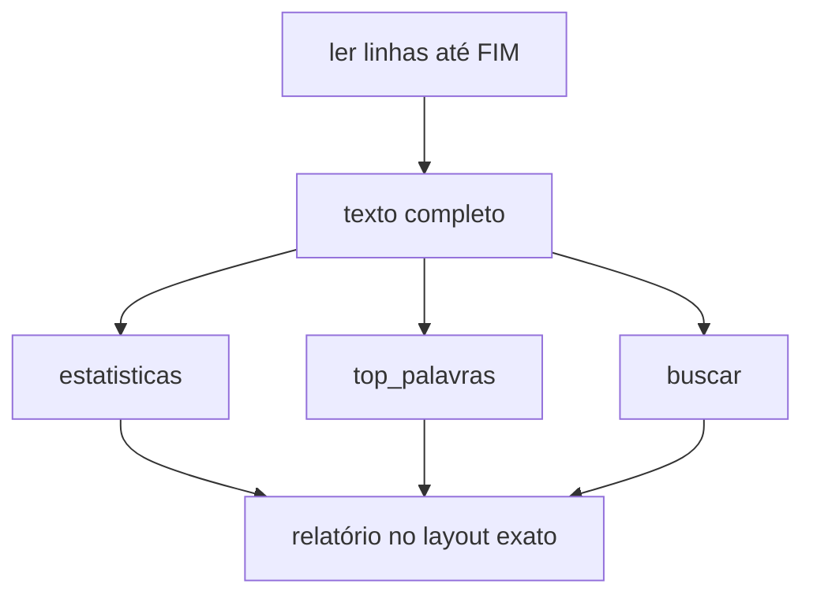

## Passo 1 · Leitura · O que você vai construir

Neste mini-projeto você escreve um **analisador de texto**: um programa que lê um texto, linha por linha, e imprime um relatório com as estatísticas, as três palavras mais usadas e as linhas em que um termo aparece. Tudo o que ele precisa você já viu neste módulo e nos anteriores.

O trabalho é dividido em três funções, escritas e testadas uma de cada vez, e um programa principal que só lê, chama as funções e imprime. O código de cada passo continua o do passo anterior.



#### Entrada

O programa lê linhas com `input()`, sem texto de prompt, até chegar uma linha que é exatamente `FIM`. Essa linha não faz parte do texto. Depois dela vem mais uma linha: o **termo** a buscar.

#### As funções

- `estatisticas(texto)` devolve um dicionário com as chaves `"caracteres"`, `"palavras"`, `"linhas"` e `"frases"`.
- `top_palavras(texto, n)` devolve a lista das `n` palavras mais frequentes, como tuplas `(palavra, frequência)`.
- `buscar(texto, termo)` devolve a lista dos números das linhas que contêm o termo.

#### Exemplo completo

Entrada:

```
O rato roeu a roupa do rei de Roma.
A rainha, de raiva, roeu o resto!
E o rei? O rei riu.
FIM
REI
```

Saída:

```
=== RELATÓRIO ===
Caracteres:    89
Palavras:      22
Linhas:         3
Frases:         4
--- Top 3 ---
1. o (4)
2. rei (3)
3. a (2)
--- Busca: REI ---
Linhas: 1, 3
```

#### Layout, linha por linha

- Linha 1: `=== RELATÓRIO ===`.
- Linhas 2 a 5: o rótulo com os dois-pontos, alinhado à esquerda em 12 posições, e o número alinhado à direita em 5 posições.
- `--- Top 3 ---` e, abaixo, uma linha por palavra: posição a partir de 1, ponto, espaço, a palavra, espaço e a frequência entre parênteses. Se o texto tem menos de três palavras diferentes, saem menos linhas.
- `--- Busca: termo ---`, com o termo como foi digitado.
- `Linhas: ` e os números separados por vírgula e espaço. Se o termo não aparece em nenhuma linha: `Linhas: nenhuma`.

Não há linhas em branco no relatório. Os detalhes de cada conta (o que é uma frase, como desempatar) estão no passo de cada função.

## Passo 2 · Exercício · estatisticas(texto)

A primeira função conta quatro coisas e devolve tudo em um dicionário. As definições, para não haver dúvida:

- **caracteres**: o tamanho do texto inteiro, incluindo espaços, sinais e quebras de linha (`\n`);
- **palavras**: os trechos separados por espaços ou quebras de linha (a pontuação grudada não importa: `bem?` é uma palavra);
- **linhas**: as linhas do texto; uma linha vazia no meio conta;
- **frases**: os trechos separados pelos sinais `.`, `!` e `?`, sem contar os trechos vazios ou só com espaços. Um trecho final sem sinal também é uma frase.

```
estatisticas("Oi. Tudo bem?")
devolve   {"caracteres": 13, "palavras": 3, "linhas": 1, "frases": 2}

estatisticas("Bom dia!\n\nTudo bem? Tudo.")
devolve   {"caracteres": 25, "palavras": 5, "linhas": 3, "frases": 3}
```

No segundo exemplo o texto tem três linhas, e a do meio é vazia. Em `"Oi... tudo bem"` há 2 frases: entre os pontos seguidos não há nada, e trecho vazio não conta.

### Instruções
1. Defina `estatisticas(texto)` e calcule a quantidade de caracteres, de palavras e de linhas do texto.
   Dica: são três medidas de tamanho: do texto, da lista de palavras e da lista de linhas.
2. Conte as frases e devolva o dicionário com as quatro chaves: `"caracteres"`, `"palavras"`, `"linhas"` e `"frases"`.
   Dica: se os três sinais virarem um só, basta um `split` para separar os trechos.

### Código inicial
```python
def estatisticas(texto):
    pass
```

### Solução
```python
def estatisticas(texto):
    marcado = texto.replace("!", ".").replace("?", ".")
    frases = 0
    for trecho in marcado.split("."):
        if trecho.strip() != "":
            frases += 1
    return {
        "caracteres": len(texto),
        "palavras": len(texto.split()),
        "linhas": len(texto.splitlines()),
        "frases": frases,
    }
```

### Dicas
1. Troque `!` e `?` por `.` com `replace` e separe os trechos com `split(".")`.
2. Percorra os trechos e conte só os que não são vazios: `trecho.strip() != ""` descarta também os que têm só espaços ou quebras de linha.
3. As outras três contas são `len(texto)`, `len(texto.split())` e `len(texto.splitlines())`.

### Verificação
```json
[
  {"id": "uma-linha", "checkpoint": 1, "kind": "call", "function": "estatisticas", "args": ["Oi. Tudo bem?"], "expected": {"caracteres": 13, "palavras": 3, "linhas": 1, "frases": 2}, "type": "dict", "name": "estatisticas(\"Oi. Tudo bem?\")", "hint": "São 13 caracteres contando espaços e sinais, 3 palavras, 1 linha e 2 frases."},
  {"id": "espacos-repetidos", "checkpoint": 1, "kind": "expr", "expr": "estatisticas(\"Está  frio.\\nMuito   frio!\")[\"palavras\"]", "expected": 4, "type": "int", "name": "Espaços repetidos e quebra de linha não criam palavras", "hint": "Separe as palavras com split() sem argumento: ele trata espaços repetidos e quebras de linha como um separador só."},
  {"id": "caracteres-com-quebras", "checkpoint": 1, "kind": "expr", "expr": "estatisticas(\"Bom dia!\\n\\nTudo bem? Tudo.\")[\"caracteres\"]", "expected": 25, "type": "int", "name": "As quebras de linha contam como caracteres", "hint": "caracteres é o tamanho do texto inteiro, com espaços e quebras de linha."},
  {"id": "linha-vazia-no-meio", "checkpoint": 1, "kind": "expr", "expr": "estatisticas(\"Bom dia!\\n\\nTudo bem? Tudo.\")[\"linhas\"]", "expected": 3, "type": "int", "name": "A linha vazia do meio conta como linha", "hint": "Conte os itens de splitlines()."},
  {"id": "tres-linhas", "checkpoint": 2, "kind": "call", "function": "estatisticas", "args": ["Bom dia!\n\nTudo bem? Tudo."], "expected": {"caracteres": 25, "palavras": 5, "linhas": 3, "frases": 3}, "type": "dict", "name": "Texto de três linhas, com uma linha vazia no meio", "hint": "A linha vazia conta como linha, mas não como frase."},
  {"id": "reticencias", "checkpoint": 2, "kind": "expr", "expr": "estatisticas(\"Oi... tudo bem\")[\"frases\"]", "expected": 2, "type": "int", "name": "Reticências não criam frases vazias", "hint": "Entre dois pontos seguidos não há nada: trecho vazio não é frase."},
  {"id": "sem-ponto-final", "checkpoint": 2, "kind": "expr", "expr": "estatisticas(\"sem ponto final\")[\"frases\"]", "expected": 1, "type": "int", "name": "Texto sem sinal no fim tem uma frase", "hint": "O trecho depois do último sinal (ou o texto todo, sem sinal nenhum) conta se não for vazio."},
  {"id": "vazio", "checkpoint": 2, "kind": "call", "function": "estatisticas", "args": [""], "expected": {"caracteres": 0, "palavras": 0, "linhas": 0, "frases": 0}, "type": "dict", "name": "Texto vazio: tudo zero"}
]
```

### Soluções erradas
```python name="conta trecho vazio como frase"
def estatisticas(texto):
    marcado = texto.replace("!", ".").replace("?", ".")
    frases = len(marcado.split("."))
    return {
        "caracteres": len(texto),
        "palavras": len(texto.split()),
        "linhas": len(texto.splitlines()),
        "frases": frases,
    }
```
```python name="caracteres sem as quebras de linha"
def estatisticas(texto):
    marcado = texto.replace("!", ".").replace("?", ".")
    frases = 0
    for trecho in marcado.split("."):
        if trecho.strip() != "":
            frases += 1
    return {
        "caracteres": len(texto.replace("\n", "")),
        "palavras": len(texto.split()),
        "linhas": len(texto.splitlines()),
        "frases": frases,
    }
```
```python name="linhas contando só os \\n"
def estatisticas(texto):
    marcado = texto.replace("!", ".").replace("?", ".")
    frases = 0
    for trecho in marcado.split("."):
        if trecho.strip() != "":
            frases += 1
    return {
        "caracteres": len(texto),
        "palavras": len(texto.split()),
        "linhas": texto.count("\n"),
        "frases": frases,
    }
```
```python name="palavras com split(' ')"
def estatisticas(texto):
    marcado = texto.replace("!", ".").replace("?", ".")
    frases = 0
    for trecho in marcado.split("."):
        if trecho.strip() != "":
            frases += 1
    return {
        "caracteres": len(texto),
        "palavras": len(texto.split(" ")),
        "linhas": len(texto.splitlines()),
        "frases": frases,
    }
```
```python name="conta só os pontos, sem ! nem ?"
def estatisticas(texto):
    frases = texto.count(".")
    return {
        "caracteres": len(texto),
        "palavras": len(texto.split()),
        "linhas": len(texto.splitlines()),
        "frases": frases,
    }
```

## Passo 3 · Exercício · top_palavras(texto, n)

Continue no mesmo arquivo: mantenha `estatisticas` e acrescente a segunda função.

`top_palavras(texto, n)` conta as palavras como na lição anterior (em minúsculas, com os sinais `.,!?;:` trocados por espaço) e devolve uma lista com as `n` mais frequentes. Cada item é uma tupla `(palavra, frequência)`. A ordem:

- primeiro a **maior frequência**;
- no empate, a **ordem alfabética** da palavra.

```
top_palavras("b a b a c", 2)                 devolve   [("a", 2), ("b", 2)]
top_palavras("Oi, oi! Tudo bem? Tudo.", 2)   devolve   [("oi", 2), ("tudo", 2)]
top_palavras("a b", 5)                       devolve   [("a", 1), ("b", 1)]
```

O desempate importa: sem ele, a ordem entre palavras de mesma frequência dependeria da ordem em que aparecem no texto. Para ordenar por dois critérios, a função do `key` devolve uma tupla; o Python compara o primeiro item e só olha o segundo no empate. Como a frequência é decrescente e o alfabeto é crescente, o truque é ordenar pela frequência **com o sinal trocado**.

Um aviso sobre acentos: a "ordem alfabética" do Python compara os códigos dos caracteres, e as letras acentuadas têm códigos maiores que `z`. Por isso `"água"` fica depois de `"zebra"`. Neste projeto vale a ordem do Python.

### Instruções
1. Defina `top_palavras(texto, n)`. Dentro dela, normalize o texto (minúsculas, sinais `.,!?;:` trocados por espaço) e conte as palavras em um dicionário.
   Dica: é a mesma contagem de `frequencia_de_palavras`, da lição anterior.
2. Ordene os pares `(palavra, frequência)` pela frequência decrescente e, no empate, pela palavra em ordem alfabética.
   Dica: `contagem.items()` entrega os pares; o `key` do `sorted` recebe um par e devolve uma tupla com os dois critérios.
3. Devolva uma lista só com os `n` primeiros pares. Se houver menos de `n` palavras diferentes, devolva todas; um texto vazio devolve `[]`.

### Solução
```python
def estatisticas(texto):
    marcado = texto.replace("!", ".").replace("?", ".")
    frases = 0
    for trecho in marcado.split("."):
        if trecho.strip() != "":
            frases += 1
    return {
        "caracteres": len(texto),
        "palavras": len(texto.split()),
        "linhas": len(texto.splitlines()),
        "frases": frases,
    }

def top_palavras(texto, n):
    texto = texto.lower()
    for sinal in ".,!?;:":
        texto = texto.replace(sinal, " ")
    contagem = {}
    for palavra in texto.split():
        contagem[palavra] = contagem.get(palavra, 0) + 1
    pares = sorted(contagem.items(), key=lambda par: (-par[1], par[0]))
    return pares[:n]
```

### Dicas
1. Reaproveite a contagem da lição anterior: `lower`, um `replace` por sinal, `split()` e `get(palavra, 0) + 1`.
2. Ordene com `sorted(contagem.items(), key=lambda par: (-par[1], par[0]))`: `par[1]` é a frequência e `par[0]` é a palavra.
3. A fatia `[:n]` pega os `n` primeiros e não dá erro quando a lista é menor.

### Verificação
```json
[
  {"id": "define", "checkpoint": 1, "kind": "source", "rule": {"type": "defines_function", "name": "top_palavras"}, "name": "Define top_palavras"},
  {"id": "normaliza", "checkpoint": 1, "kind": "call", "function": "top_palavras", "args": ["Oi, oi! Tudo bem? Tudo.", 2], "expected": [["oi", 2], ["tudo", 2]], "name": "Maiúsculas e pontuação não separam as palavras", "hint": "Normalize como na lição anterior: minúsculas e os seis sinais trocados por espaço."},
  {"id": "frequencia-decrescente", "checkpoint": 2, "kind": "call", "function": "top_palavras", "args": ["um dois dois três três três", 3], "expected": [["três", 3], ["dois", 2], ["um", 1]], "name": "A palavra mais frequente vem primeiro", "hint": "A ordem é da maior frequência para a menor."},
  {"id": "empate", "checkpoint": 2, "kind": "call", "function": "top_palavras", "args": ["b a b a c", 2], "expected": [["a", 2], ["b", 2]], "name": "Empate na frequência: ordem alfabética", "hint": "No empate, quem decide é a própria palavra, em ordem alfabética, e não a ordem em que apareceu no texto."},
  {"id": "empate-e-frequencia", "checkpoint": 2, "kind": "call", "function": "top_palavras", "args": ["uva pera uva kiwi pera caju uva", 4], "expected": [["uva", 3], ["pera", 2], ["caju", 1], ["kiwi", 1]], "name": "Frequência primeiro, alfabeto no empate"},
  {"id": "corta-em-n", "checkpoint": 3, "kind": "call", "function": "top_palavras", "args": ["o rato e o gato e o pato", 2], "expected": [["o", 3], ["e", 2]], "name": "Só as n primeiras", "hint": "Depois de ordenar, fique só com as n primeiras."},
  {"id": "menos-que-n", "checkpoint": 3, "kind": "call", "function": "top_palavras", "args": ["a b", 5], "expected": [["a", 1], ["b", 1]], "name": "Menos palavras do que n: devolve as que existem"},
  {"id": "vazio", "checkpoint": 3, "kind": "call", "function": "top_palavras", "args": ["", 3], "expected": [], "type": "list", "name": "Texto vazio devolve lista vazia"},
  {"id": "tuplas", "checkpoint": 3, "kind": "expr", "expr": "type(top_palavras(\"a a b\", 1)[0]).__name__", "expected": "tuple", "name": "Cada item da lista é uma tupla (palavra, frequência)", "hint": "contagem.items() já entrega tuplas (chave, valor)."}
]
```

### Soluções erradas
```python name="sem desempate: fica a ordem do texto"
def estatisticas(texto):
    marcado = texto.replace("!", ".").replace("?", ".")
    frases = 0
    for trecho in marcado.split("."):
        if trecho.strip() != "":
            frases += 1
    return {
        "caracteres": len(texto),
        "palavras": len(texto.split()),
        "linhas": len(texto.splitlines()),
        "frases": frases,
    }

def top_palavras(texto, n):
    texto = texto.lower()
    for sinal in ".,!?;:":
        texto = texto.replace(sinal, " ")
    contagem = {}
    for palavra in texto.split():
        contagem[palavra] = contagem.get(palavra, 0) + 1
    pares = sorted(contagem.items(), key=lambda par: -par[1])
    return pares[:n]
```
```python name="frequência em ordem crescente"
def estatisticas(texto):
    marcado = texto.replace("!", ".").replace("?", ".")
    frases = 0
    for trecho in marcado.split("."):
        if trecho.strip() != "":
            frases += 1
    return {
        "caracteres": len(texto),
        "palavras": len(texto.split()),
        "linhas": len(texto.splitlines()),
        "frases": frases,
    }

def top_palavras(texto, n):
    texto = texto.lower()
    for sinal in ".,!?;:":
        texto = texto.replace(sinal, " ")
    contagem = {}
    for palavra in texto.split():
        contagem[palavra] = contagem.get(palavra, 0) + 1
    pares = sorted(contagem.items(), key=lambda par: (par[1], par[0]))
    return pares[:n]
```
```python name="sem normalizar"
def estatisticas(texto):
    marcado = texto.replace("!", ".").replace("?", ".")
    frases = 0
    for trecho in marcado.split("."):
        if trecho.strip() != "":
            frases += 1
    return {
        "caracteres": len(texto),
        "palavras": len(texto.split()),
        "linhas": len(texto.splitlines()),
        "frases": frases,
    }

def top_palavras(texto, n):
    contagem = {}
    for palavra in texto.split():
        contagem[palavra] = contagem.get(palavra, 0) + 1
    pares = sorted(contagem.items(), key=lambda par: (-par[1], par[0]))
    return pares[:n]
```
```python name="esquece de cortar em n"
def estatisticas(texto):
    marcado = texto.replace("!", ".").replace("?", ".")
    frases = 0
    for trecho in marcado.split("."):
        if trecho.strip() != "":
            frases += 1
    return {
        "caracteres": len(texto),
        "palavras": len(texto.split()),
        "linhas": len(texto.splitlines()),
        "frases": frases,
    }

def top_palavras(texto, n):
    texto = texto.lower()
    for sinal in ".,!?;:":
        texto = texto.replace(sinal, " ")
    contagem = {}
    for palavra in texto.split():
        contagem[palavra] = contagem.get(palavra, 0) + 1
    pares = sorted(contagem.items(), key=lambda par: (-par[1], par[0]))
    return pares
```
```python name="reverse=True inverte também o alfabeto"
def estatisticas(texto):
    marcado = texto.replace("!", ".").replace("?", ".")
    frases = 0
    for trecho in marcado.split("."):
        if trecho.strip() != "":
            frases += 1
    return {
        "caracteres": len(texto),
        "palavras": len(texto.split()),
        "linhas": len(texto.splitlines()),
        "frases": frases,
    }

def top_palavras(texto, n):
    texto = texto.lower()
    for sinal in ".,!?;:":
        texto = texto.replace(sinal, " ")
    contagem = {}
    for palavra in texto.split():
        contagem[palavra] = contagem.get(palavra, 0) + 1
    pares = sorted(contagem.items(), key=lambda par: (par[1], par[0]), reverse=True)
    return pares[:n]
```

## Passo 4 · Exercício · buscar(texto, termo)

Mantenha as duas funções prontas e acrescente a terceira.

`buscar(texto, termo)` devolve a lista com os **números das linhas** em que o termo aparece. A primeira linha do texto é a de número 1. A busca não diferencia maiúsculas de minúsculas, e o termo pode estar no meio de uma palavra.

```
buscar("um rato\numa rainha\noutro rato", "rato")   devolve   [1, 3]
buscar("O RATO roeu\nA rainha riu", "rato")         devolve   [1]
buscar("um rato\numa rainha", "gato")               devolve   []
```

Acentos continuam valendo: `buscar("Água\nagua\nÁGUA", "água")` devolve `[1, 3]`. `lower()` transforma `Á` em `á`, mas `agua`, sem acento, é outro texto.

### Instruções
1. Defina `buscar(texto, termo)`, que percorre as linhas do texto e devolve a lista dos números das linhas que contêm o termo, contando a partir de 1. Se nenhuma linha contém o termo, devolve `[]`.
   Dica: o operador `in` diz se um texto está dentro de outro.
2. Faça a busca ignorar a diferença entre maiúsculas e minúsculas, tanto no texto quanto no termo.
   Dica: normalize os dois lados da comparação.

### Solução
```python
def estatisticas(texto):
    marcado = texto.replace("!", ".").replace("?", ".")
    frases = 0
    for trecho in marcado.split("."):
        if trecho.strip() != "":
            frases += 1
    return {
        "caracteres": len(texto),
        "palavras": len(texto.split()),
        "linhas": len(texto.splitlines()),
        "frases": frases,
    }

def top_palavras(texto, n):
    texto = texto.lower()
    for sinal in ".,!?;:":
        texto = texto.replace(sinal, " ")
    contagem = {}
    for palavra in texto.split():
        contagem[palavra] = contagem.get(palavra, 0) + 1
    pares = sorted(contagem.items(), key=lambda par: (-par[1], par[0]))
    return pares[:n]

def buscar(texto, termo):
    numeros = []
    for numero, linha in enumerate(texto.splitlines(), start=1):
        if termo.lower() in linha.lower():
            numeros.append(numero)
    return numeros
```

### Dicas
1. Ponha em minúsculas os dois lados: `termo.lower() in linha.lower()`.
2. `enumerate(texto.splitlines(), start=1)` entrega o número e a linha a cada volta, já contando a partir de 1.
3. Comece com uma lista vazia e use `append(numero)` quando a linha contiver o termo.

### Verificação
```json
[
  {"id": "define", "checkpoint": 1, "kind": "source", "rule": {"type": "defines_function", "name": "buscar"}, "name": "Define buscar"},
  {"id": "duas-linhas", "checkpoint": 1, "kind": "call", "function": "buscar", "args": ["um rato\numa rainha\noutro rato", "rato"], "expected": [1, 3], "type": "list", "name": "Termo em duas das três linhas", "hint": "A primeira linha é a de número 1, não 0."},
  {"id": "todas", "checkpoint": 1, "kind": "call", "function": "buscar", "args": ["sol\nsolo\ngirassol", "sol"], "expected": [1, 2, 3], "type": "list", "name": "O termo pode estar no meio de uma palavra"},
  {"id": "ausente", "checkpoint": 1, "kind": "call", "function": "buscar", "args": ["um rato\numa rainha", "gato"], "expected": [], "type": "list", "name": "Termo ausente devolve lista vazia"},
  {"id": "texto-maiusculo", "checkpoint": 2, "kind": "call", "function": "buscar", "args": ["O RATO roeu\nA rainha riu\nRato de novo", "rato"], "expected": [1, 3], "type": "list", "name": "Texto em maiúsculas, termo em minúsculas", "hint": "Compare as duas partes em minúsculas."},
  {"id": "termo-maiusculo", "checkpoint": 2, "kind": "call", "function": "buscar", "args": ["um\ndois\num dois", "DOIS"], "expected": [2, 3], "type": "list", "name": "Termo em maiúsculas, texto em minúsculas", "hint": "O termo também precisa ser posto em minúsculas, não só a linha."},
  {"id": "acentos", "checkpoint": 2, "kind": "call", "function": "buscar", "args": ["Água\nagua\nÁGUA", "água"], "expected": [1, 3], "type": "list", "name": "Maiúsculas acentuadas contam; falta de acento não", "hint": "lower() transforma Á em á, mas não tira o acento: agua, sem acento, é outro texto."}
]
```

### Soluções erradas
```python name="sensível a maiúsculas"
def estatisticas(texto):
    marcado = texto.replace("!", ".").replace("?", ".")
    frases = 0
    for trecho in marcado.split("."):
        if trecho.strip() != "":
            frases += 1
    return {
        "caracteres": len(texto),
        "palavras": len(texto.split()),
        "linhas": len(texto.splitlines()),
        "frases": frases,
    }

def top_palavras(texto, n):
    texto = texto.lower()
    for sinal in ".,!?;:":
        texto = texto.replace(sinal, " ")
    contagem = {}
    for palavra in texto.split():
        contagem[palavra] = contagem.get(palavra, 0) + 1
    pares = sorted(contagem.items(), key=lambda par: (-par[1], par[0]))
    return pares[:n]

def buscar(texto, termo):
    numeros = []
    for numero, linha in enumerate(texto.splitlines(), start=1):
        if termo in linha:
            numeros.append(numero)
    return numeros
```
```python name="numeração a partir de 0"
def estatisticas(texto):
    marcado = texto.replace("!", ".").replace("?", ".")
    frases = 0
    for trecho in marcado.split("."):
        if trecho.strip() != "":
            frases += 1
    return {
        "caracteres": len(texto),
        "palavras": len(texto.split()),
        "linhas": len(texto.splitlines()),
        "frases": frases,
    }

def top_palavras(texto, n):
    texto = texto.lower()
    for sinal in ".,!?;:":
        texto = texto.replace(sinal, " ")
    contagem = {}
    for palavra in texto.split():
        contagem[palavra] = contagem.get(palavra, 0) + 1
    pares = sorted(contagem.items(), key=lambda par: (-par[1], par[0]))
    return pares[:n]

def buscar(texto, termo):
    numeros = []
    for numero, linha in enumerate(texto.splitlines()):
        if termo.lower() in linha.lower():
            numeros.append(numero)
    return numeros
```
```python name="lower só na linha: termo em maiúsculas não é achado"
def estatisticas(texto):
    marcado = texto.replace("!", ".").replace("?", ".")
    frases = 0
    for trecho in marcado.split("."):
        if trecho.strip() != "":
            frases += 1
    return {
        "caracteres": len(texto),
        "palavras": len(texto.split()),
        "linhas": len(texto.splitlines()),
        "frases": frases,
    }

def top_palavras(texto, n):
    texto = texto.lower()
    for sinal in ".,!?;:":
        texto = texto.replace(sinal, " ")
    contagem = {}
    for palavra in texto.split():
        contagem[palavra] = contagem.get(palavra, 0) + 1
    pares = sorted(contagem.items(), key=lambda par: (-par[1], par[0]))
    return pares[:n]

def buscar(texto, termo):
    numeros = []
    for numero, linha in enumerate(texto.splitlines(), start=1):
        if termo in linha.lower():
            numeros.append(numero)
    return numeros
```
```python name="devolve as linhas em vez dos números"
def estatisticas(texto):
    marcado = texto.replace("!", ".").replace("?", ".")
    frases = 0
    for trecho in marcado.split("."):
        if trecho.strip() != "":
            frases += 1
    return {
        "caracteres": len(texto),
        "palavras": len(texto.split()),
        "linhas": len(texto.splitlines()),
        "frases": frases,
    }

def top_palavras(texto, n):
    texto = texto.lower()
    for sinal in ".,!?;:":
        texto = texto.replace(sinal, " ")
    contagem = {}
    for palavra in texto.split():
        contagem[palavra] = contagem.get(palavra, 0) + 1
    pares = sorted(contagem.items(), key=lambda par: (-par[1], par[0]))
    return pares[:n]

def buscar(texto, termo):
    numeros = []
    for numero, linha in enumerate(texto.splitlines(), start=1):
        if termo.lower() in linha.lower():
            numeros.append(linha)
    return numeros
```
```python name="procura no texto inteiro, não linha a linha"
def estatisticas(texto):
    marcado = texto.replace("!", ".").replace("?", ".")
    frases = 0
    for trecho in marcado.split("."):
        if trecho.strip() != "":
            frases += 1
    return {
        "caracteres": len(texto),
        "palavras": len(texto.split()),
        "linhas": len(texto.splitlines()),
        "frases": frases,
    }

def top_palavras(texto, n):
    texto = texto.lower()
    for sinal in ".,!?;:":
        texto = texto.replace(sinal, " ")
    contagem = {}
    for palavra in texto.split():
        contagem[palavra] = contagem.get(palavra, 0) + 1
    pares = sorted(contagem.items(), key=lambda par: (-par[1], par[0]))
    return pares[:n]

def buscar(texto, termo):
    numeros = []
    for numero, linha in enumerate(texto.splitlines(), start=1):
        if termo.lower() in texto.lower():
            numeros.append(numero)
    return numeros
```

## Passo 5 · Exercício · Programa principal

As três funções estão prontas e testadas. Falta o programa que lê a entrada, chama cada uma e imprime o relatório no layout do passo 1. Escreva-o depois das funções, sem indentação.

Lembre a entrada: linhas de texto até uma linha `FIM` (que não entra no texto) e, depois, uma linha com o termo da busca. Use `input()` sem texto de prompt.

Exemplo de execução. Entrada:

```
O rato roeu a roupa do rei de Roma.
A rainha, de raiva, roeu o resto!
E o rei? O rei riu.
FIM
REI
```

Saída:

```
=== RELATÓRIO ===
Caracteres:    89
Palavras:      22
Linhas:         3
Frases:         4
--- Top 3 ---
1. o (4)
2. rei (3)
3. a (2)
--- Busca: REI ---
Linhas: 1, 3
```

Se o termo não aparece, a última linha é `Linhas: nenhuma`. Se a primeira linha da entrada já é `FIM`, o texto é vazio: as quatro contagens são 0 e não sai nenhuma linha abaixo de `--- Top 3 ---`.

### Instruções
1. Leia as linhas até `FIM`, guardando-as em uma lista, e depois leia o termo. Monte o texto completo unindo as linhas com `"\n"`.
   Dica: leia a primeira linha antes do `while` e a próxima no fim de cada volta.
2. Imprima `=== RELATÓRIO ===` e as quatro linhas de `estatisticas(texto)`: rótulo com dois-pontos em 12 posições à esquerda, número em 5 posições à direita.
   Dica: texto entre aspas também aceita especificador: `{'Linhas:':<12}`.
3. Imprima `--- Top 3 ---` e uma linha para cada item de `top_palavras(texto, 3)`, no formato `1. palavra (frequência)`.
   Dica: o `for` pode desempacotar cada tupla em duas variáveis.
4. Imprima `--- Busca: termo ---` e a linha `Linhas: ` com os números de `buscar(texto, termo)` separados por vírgula e espaço, ou `Linhas: nenhuma` se a lista vier vazia.
   Dica: o `join` só aceita textos; os números precisam de `str`.

### Solução
```python
def estatisticas(texto):
    marcado = texto.replace("!", ".").replace("?", ".")
    frases = 0
    for trecho in marcado.split("."):
        if trecho.strip() != "":
            frases += 1
    return {
        "caracteres": len(texto),
        "palavras": len(texto.split()),
        "linhas": len(texto.splitlines()),
        "frases": frases,
    }

def top_palavras(texto, n):
    texto = texto.lower()
    for sinal in ".,!?;:":
        texto = texto.replace(sinal, " ")
    contagem = {}
    for palavra in texto.split():
        contagem[palavra] = contagem.get(palavra, 0) + 1
    pares = sorted(contagem.items(), key=lambda par: (-par[1], par[0]))
    return pares[:n]

def buscar(texto, termo):
    numeros = []
    for numero, linha in enumerate(texto.splitlines(), start=1):
        if termo.lower() in linha.lower():
            numeros.append(numero)
    return numeros

linhas = []
linha = input()
while linha != "FIM":
    linhas.append(linha)
    linha = input()
termo = input()
texto = "\n".join(linhas)

dados = estatisticas(texto)
print("=== RELATÓRIO ===")
print(f"{'Caracteres:':<12}{dados['caracteres']:>5}")
print(f"{'Palavras:':<12}{dados['palavras']:>5}")
print(f"{'Linhas:':<12}{dados['linhas']:>5}")
print(f"{'Frases:':<12}{dados['frases']:>5}")
print("--- Top 3 ---")
posicao = 1
for palavra, vezes in top_palavras(texto, 3):
    print(f"{posicao}. {palavra} ({vezes})")
    posicao += 1
print(f"--- Busca: {termo} ---")
encontradas = buscar(texto, termo)
if encontradas:
    print("Linhas: " + ", ".join([str(numero) for numero in encontradas]))
else:
    print("Linhas: nenhuma")
```

### Dicas
1. Guarde as linhas em uma lista e junte com `"\n".join(linhas)`; a linha `FIM` encerra o `while` antes de entrar na lista.
2. Chame as três funções já prontas e só formate o que elas devolvem: `f"{'Palavras:':<12}{dados['palavras']:>5}"`.
3. Para a última linha: `", ".join([str(numero) for numero in encontradas])` quando a lista não é vazia; senão, `nenhuma`.

### Verificação
```json
[
  {"id": "le-ate-fim", "checkpoint": 1, "kind": "io", "stdin": "Fim de semana!\nfim\nFIM\nferiado\n", "expected_stdout": "Linhas:         2", "match": "contains", "name": "Lê até FIM: a linha fim, em minúsculas, faz parte do texto", "hint": "Só a linha exatamente igual a FIM encerra a leitura, e ela não entra no texto."},
  {"id": "usa-estatisticas", "checkpoint": 2, "kind": "source", "rule": {"type": "calls", "name": "estatisticas"}, "name": "O programa chama estatisticas"},
  {"id": "cabecalho-estatisticas", "checkpoint": 2, "kind": "io", "stdin": "O rato roeu a roupa do rei de Roma.\nA rainha, de raiva, roeu o resto!\nE o rei? O rei riu.\nFIM\nREI\n", "expected_stdout": "=== RELATÓRIO ===\nCaracteres:    89\nPalavras:      22\nLinhas:         3\nFrases:         4\n", "match": "contains", "name": "As cinco primeiras linhas do relatório do exemplo", "hint": "Rótulo em 12 posições à esquerda e número em 5 posições à direita."},
  {"id": "usa-top", "checkpoint": 3, "kind": "source", "rule": {"type": "calls", "name": "top_palavras"}, "name": "O programa chama top_palavras"},
  {"id": "top-3", "checkpoint": 3, "kind": "io", "stdin": "O rato roeu a roupa do rei de Roma.\nA rainha, de raiva, roeu o resto!\nE o rei? O rei riu.\nFIM\nREI\n", "expected_stdout": "--- Top 3 ---\n1. o (4)\n2. rei (3)\n3. a (2)\n", "match": "contains", "name": "Top 3 do exemplo, numerado a partir de 1", "hint": "Cada linha tem a posição, um ponto, a palavra e a frequência entre parênteses."},
  {"id": "usa-buscar", "checkpoint": 4, "kind": "source", "rule": {"type": "calls", "name": "buscar"}, "name": "O programa chama buscar"},
  {"id": "exemplo", "checkpoint": 4, "kind": "io", "stdin": "O rato roeu a roupa do rei de Roma.\nA rainha, de raiva, roeu o resto!\nE o rei? O rei riu.\nFIM\nREI\n", "expected_stdout": "=== RELATÓRIO ===\nCaracteres:    89\nPalavras:      22\nLinhas:         3\nFrases:         4\n--- Top 3 ---\n1. o (4)\n2. rei (3)\n3. a (2)\n--- Busca: REI ---\nLinhas: 1, 3", "name": "O exemplo completo do passo 1", "hint": "Compare linha por linha com o exemplo: títulos, espaços, vírgulas e nenhuma linha em branco."},
  {"id": "linha-vazia-e-acentos", "checkpoint": 4, "kind": "io", "stdin": "Água mole em pedra dura.\n\nTanto bate até que fura...\nFIM\nágua\n", "expected_stdout": "=== RELATÓRIO ===\nCaracteres:    52\nPalavras:      10\nLinhas:         3\nFrases:         2\n--- Top 3 ---\n1. até (1)\n2. bate (1)\n3. dura (1)\n--- Busca: água ---\nLinhas: 1", "name": "Texto com linha vazia, acentos e empate triplo no top", "hint": "A linha vazia faz parte do texto, e o termo aparece na busca como foi digitado."},
  {"id": "busca-sem-resultado", "checkpoint": 4, "kind": "io", "stdin": "Fim de semana!\nfim\nFIM\nferiado\n", "expected_stdout": "=== RELATÓRIO ===\nCaracteres:    18\nPalavras:       4\nLinhas:         2\nFrases:         2\n--- Top 3 ---\n1. fim (2)\n2. de (1)\n3. semana (1)\n--- Busca: feriado ---\nLinhas: nenhuma", "name": "Termo que não aparece: Linhas: nenhuma", "hint": "Quando buscar devolve lista vazia, a última linha é Linhas: nenhuma."},
  {"id": "texto-vazio", "checkpoint": 4, "kind": "io", "stdin": "FIM\nnada\n", "expected_stdout": "=== RELATÓRIO ===\nCaracteres:     0\nPalavras:       0\nLinhas:         0\nFrases:         0\n--- Top 3 ---\n--- Busca: nada ---\nLinhas: nenhuma", "name": "FIM logo na primeira linha: texto vazio", "hint": "Sem palavras, o bloco do top fica só com o título."}
]
```

### Soluções erradas
```python name="inclui a linha FIM no texto"
def estatisticas(texto):
    marcado = texto.replace("!", ".").replace("?", ".")
    frases = 0
    for trecho in marcado.split("."):
        if trecho.strip() != "":
            frases += 1
    return {
        "caracteres": len(texto),
        "palavras": len(texto.split()),
        "linhas": len(texto.splitlines()),
        "frases": frases,
    }

def top_palavras(texto, n):
    texto = texto.lower()
    for sinal in ".,!?;:":
        texto = texto.replace(sinal, " ")
    contagem = {}
    for palavra in texto.split():
        contagem[palavra] = contagem.get(palavra, 0) + 1
    pares = sorted(contagem.items(), key=lambda par: (-par[1], par[0]))
    return pares[:n]

def buscar(texto, termo):
    numeros = []
    for numero, linha in enumerate(texto.splitlines(), start=1):
        if termo.lower() in linha.lower():
            numeros.append(numero)
    return numeros

linhas = []
linha = input()
linhas.append(linha)
while linha != "FIM":
    linha = input()
    linhas.append(linha)
termo = input()
texto = "\n".join(linhas)

dados = estatisticas(texto)
print("=== RELATÓRIO ===")
print(f"{'Caracteres:':<12}{dados['caracteres']:>5}")
print(f"{'Palavras:':<12}{dados['palavras']:>5}")
print(f"{'Linhas:':<12}{dados['linhas']:>5}")
print(f"{'Frases:':<12}{dados['frases']:>5}")
print("--- Top 3 ---")
posicao = 1
for palavra, vezes in top_palavras(texto, 3):
    print(f"{posicao}. {palavra} ({vezes})")
    posicao += 1
print(f"--- Busca: {termo} ---")
encontradas = buscar(texto, termo)
if encontradas:
    print("Linhas: " + ", ".join([str(numero) for numero in encontradas]))
else:
    print("Linhas: nenhuma")
```
```python name="linha em branco a mais entre os blocos"
def estatisticas(texto):
    marcado = texto.replace("!", ".").replace("?", ".")
    frases = 0
    for trecho in marcado.split("."):
        if trecho.strip() != "":
            frases += 1
    return {
        "caracteres": len(texto),
        "palavras": len(texto.split()),
        "linhas": len(texto.splitlines()),
        "frases": frases,
    }

def top_palavras(texto, n):
    texto = texto.lower()
    for sinal in ".,!?;:":
        texto = texto.replace(sinal, " ")
    contagem = {}
    for palavra in texto.split():
        contagem[palavra] = contagem.get(palavra, 0) + 1
    pares = sorted(contagem.items(), key=lambda par: (-par[1], par[0]))
    return pares[:n]

def buscar(texto, termo):
    numeros = []
    for numero, linha in enumerate(texto.splitlines(), start=1):
        if termo.lower() in linha.lower():
            numeros.append(numero)
    return numeros

linhas = []
linha = input()
while linha != "FIM":
    linhas.append(linha)
    linha = input()
termo = input()
texto = "\n".join(linhas)

dados = estatisticas(texto)
print("=== RELATÓRIO ===")
print(f"{'Caracteres:':<12}{dados['caracteres']:>5}")
print(f"{'Palavras:':<12}{dados['palavras']:>5}")
print(f"{'Linhas:':<12}{dados['linhas']:>5}")
print(f"{'Frases:':<12}{dados['frases']:>5}")
print()
print("--- Top 3 ---")
posicao = 1
for palavra, vezes in top_palavras(texto, 3):
    print(f"{posicao}. {palavra} ({vezes})")
    posicao += 1
print()
print(f"--- Busca: {termo} ---")
encontradas = buscar(texto, termo)
if encontradas:
    print("Linhas: " + ", ".join([str(numero) for numero in encontradas]))
else:
    print("Linhas: nenhuma")
```
```python name="junta as linhas com espaço: o texto vira uma linha só"
def estatisticas(texto):
    marcado = texto.replace("!", ".").replace("?", ".")
    frases = 0
    for trecho in marcado.split("."):
        if trecho.strip() != "":
            frases += 1
    return {
        "caracteres": len(texto),
        "palavras": len(texto.split()),
        "linhas": len(texto.splitlines()),
        "frases": frases,
    }

def top_palavras(texto, n):
    texto = texto.lower()
    for sinal in ".,!?;:":
        texto = texto.replace(sinal, " ")
    contagem = {}
    for palavra in texto.split():
        contagem[palavra] = contagem.get(palavra, 0) + 1
    pares = sorted(contagem.items(), key=lambda par: (-par[1], par[0]))
    return pares[:n]

def buscar(texto, termo):
    numeros = []
    for numero, linha in enumerate(texto.splitlines(), start=1):
        if termo.lower() in linha.lower():
            numeros.append(numero)
    return numeros

linhas = []
linha = input()
while linha != "FIM":
    linhas.append(linha)
    linha = input()
termo = input()
texto = " ".join(linhas)

dados = estatisticas(texto)
print("=== RELATÓRIO ===")
print(f"{'Caracteres:':<12}{dados['caracteres']:>5}")
print(f"{'Palavras:':<12}{dados['palavras']:>5}")
print(f"{'Linhas:':<12}{dados['linhas']:>5}")
print(f"{'Frases:':<12}{dados['frases']:>5}")
print("--- Top 3 ---")
posicao = 1
for palavra, vezes in top_palavras(texto, 3):
    print(f"{posicao}. {palavra} ({vezes})")
    posicao += 1
print(f"--- Busca: {termo} ---")
encontradas = buscar(texto, termo)
if encontradas:
    print("Linhas: " + ", ".join([str(numero) for numero in encontradas]))
else:
    print("Linhas: nenhuma")
```
```python name="números sem largura: colunas desalinhadas"
def estatisticas(texto):
    marcado = texto.replace("!", ".").replace("?", ".")
    frases = 0
    for trecho in marcado.split("."):
        if trecho.strip() != "":
            frases += 1
    return {
        "caracteres": len(texto),
        "palavras": len(texto.split()),
        "linhas": len(texto.splitlines()),
        "frases": frases,
    }

def top_palavras(texto, n):
    texto = texto.lower()
    for sinal in ".,!?;:":
        texto = texto.replace(sinal, " ")
    contagem = {}
    for palavra in texto.split():
        contagem[palavra] = contagem.get(palavra, 0) + 1
    pares = sorted(contagem.items(), key=lambda par: (-par[1], par[0]))
    return pares[:n]

def buscar(texto, termo):
    numeros = []
    for numero, linha in enumerate(texto.splitlines(), start=1):
        if termo.lower() in linha.lower():
            numeros.append(numero)
    return numeros

linhas = []
linha = input()
while linha != "FIM":
    linhas.append(linha)
    linha = input()
termo = input()
texto = "\n".join(linhas)

dados = estatisticas(texto)
print("=== RELATÓRIO ===")
print("Caracteres:", dados["caracteres"])
print("Palavras:", dados["palavras"])
print("Linhas:", dados["linhas"])
print("Frases:", dados["frases"])
print("--- Top 3 ---")
posicao = 1
for palavra, vezes in top_palavras(texto, 3):
    print(f"{posicao}. {palavra} ({vezes})")
    posicao += 1
print(f"--- Busca: {termo} ---")
encontradas = buscar(texto, termo)
if encontradas:
    print("Linhas: " + ", ".join([str(numero) for numero in encontradas]))
else:
    print("Linhas: nenhuma")
```
```python name="imprime a lista da busca com colchetes"
def estatisticas(texto):
    marcado = texto.replace("!", ".").replace("?", ".")
    frases = 0
    for trecho in marcado.split("."):
        if trecho.strip() != "":
            frases += 1
    return {
        "caracteres": len(texto),
        "palavras": len(texto.split()),
        "linhas": len(texto.splitlines()),
        "frases": frases,
    }

def top_palavras(texto, n):
    texto = texto.lower()
    for sinal in ".,!?;:":
        texto = texto.replace(sinal, " ")
    contagem = {}
    for palavra in texto.split():
        contagem[palavra] = contagem.get(palavra, 0) + 1
    pares = sorted(contagem.items(), key=lambda par: (-par[1], par[0]))
    return pares[:n]

def buscar(texto, termo):
    numeros = []
    for numero, linha in enumerate(texto.splitlines(), start=1):
        if termo.lower() in linha.lower():
            numeros.append(numero)
    return numeros

linhas = []
linha = input()
while linha != "FIM":
    linhas.append(linha)
    linha = input()
termo = input()
texto = "\n".join(linhas)

dados = estatisticas(texto)
print("=== RELATÓRIO ===")
print(f"{'Caracteres:':<12}{dados['caracteres']:>5}")
print(f"{'Palavras:':<12}{dados['palavras']:>5}")
print(f"{'Linhas:':<12}{dados['linhas']:>5}")
print(f"{'Frases:':<12}{dados['frases']:>5}")
print("--- Top 3 ---")
posicao = 1
for palavra, vezes in top_palavras(texto, 3):
    print(f"{posicao}. {palavra} ({vezes})")
    posicao += 1
print(f"--- Busca: {termo} ---")
encontradas = buscar(texto, termo)
print("Linhas:", encontradas)
```
```python name="não trata a busca sem resultado"
def estatisticas(texto):
    marcado = texto.replace("!", ".").replace("?", ".")
    frases = 0
    for trecho in marcado.split("."):
        if trecho.strip() != "":
            frases += 1
    return {
        "caracteres": len(texto),
        "palavras": len(texto.split()),
        "linhas": len(texto.splitlines()),
        "frases": frases,
    }

def top_palavras(texto, n):
    texto = texto.lower()
    for sinal in ".,!?;:":
        texto = texto.replace(sinal, " ")
    contagem = {}
    for palavra in texto.split():
        contagem[palavra] = contagem.get(palavra, 0) + 1
    pares = sorted(contagem.items(), key=lambda par: (-par[1], par[0]))
    return pares[:n]

def buscar(texto, termo):
    numeros = []
    for numero, linha in enumerate(texto.splitlines(), start=1):
        if termo.lower() in linha.lower():
            numeros.append(numero)
    return numeros

linhas = []
linha = input()
while linha != "FIM":
    linhas.append(linha)
    linha = input()
termo = input()
texto = "\n".join(linhas)

dados = estatisticas(texto)
print("=== RELATÓRIO ===")
print(f"{'Caracteres:':<12}{dados['caracteres']:>5}")
print(f"{'Palavras:':<12}{dados['palavras']:>5}")
print(f"{'Linhas:':<12}{dados['linhas']:>5}")
print(f"{'Frases:':<12}{dados['frases']:>5}")
print("--- Top 3 ---")
posicao = 1
for palavra, vezes in top_palavras(texto, 3):
    print(f"{posicao}. {palavra} ({vezes})")
    posicao += 1
print(f"--- Busca: {termo} ---")
encontradas = buscar(texto, termo)
print("Linhas: " + ", ".join([str(numero) for numero in encontradas]))
```
```python name="top numerado a partir de 0"
def estatisticas(texto):
    marcado = texto.replace("!", ".").replace("?", ".")
    frases = 0
    for trecho in marcado.split("."):
        if trecho.strip() != "":
            frases += 1
    return {
        "caracteres": len(texto),
        "palavras": len(texto.split()),
        "linhas": len(texto.splitlines()),
        "frases": frases,
    }

def top_palavras(texto, n):
    texto = texto.lower()
    for sinal in ".,!?;:":
        texto = texto.replace(sinal, " ")
    contagem = {}
    for palavra in texto.split():
        contagem[palavra] = contagem.get(palavra, 0) + 1
    pares = sorted(contagem.items(), key=lambda par: (-par[1], par[0]))
    return pares[:n]

def buscar(texto, termo):
    numeros = []
    for numero, linha in enumerate(texto.splitlines(), start=1):
        if termo.lower() in linha.lower():
            numeros.append(numero)
    return numeros

linhas = []
linha = input()
while linha != "FIM":
    linhas.append(linha)
    linha = input()
termo = input()
texto = "\n".join(linhas)

dados = estatisticas(texto)
print("=== RELATÓRIO ===")
print(f"{'Caracteres:':<12}{dados['caracteres']:>5}")
print(f"{'Palavras:':<12}{dados['palavras']:>5}")
print(f"{'Linhas:':<12}{dados['linhas']:>5}")
print(f"{'Frases:':<12}{dados['frases']:>5}")
print("--- Top 3 ---")
posicao = 0
for palavra, vezes in top_palavras(texto, 3):
    print(f"{posicao}. {palavra} ({vezes})")
    posicao += 1
print(f"--- Busca: {termo} ---")
encontradas = buscar(texto, termo)
if encontradas:
    print("Linhas: " + ", ".join([str(numero) for numero in encontradas]))
else:
    print("Linhas: nenhuma")
```

## Passo 6 · Quiz · Revisão do módulo

### Pergunta
Por que o texto é normalizado (minúsculas, sem pontuação) antes de contar as palavras?
- [ ] Porque o `split` dá erro quando encontra letras maiúsculas
- [x] Porque, para o Python, `"Oi,"`, `"oi!"` e `"oi"` são textos diferentes e seriam contados separados
- [ ] Porque dicionários só aceitam chaves em minúsculas
- [ ] Porque a normalização deixa o programa mais rápido
> A comparação de textos é exata, caractere por caractere. Normalizar faz as variações da mesma palavra virarem a mesma chave do dicionário.

### Pergunta
Uma lista de tuplas `(palavra, frequência)` deve ficar em ordem decrescente de frequência e, no empate, em ordem alfabética. Qual `key` faz isso no `sorted`?
- [ ] `key=lambda par: par[1]`
- [ ] `key=lambda par: (par[1], par[0])`
- [x] `key=lambda par: (-par[1], par[0])`
- [ ] `key=lambda par: par[0]`
> O `sorted` compara as tuplas item a item: primeiro a frequência com sinal trocado (a maior vem antes), e só no empate a palavra, em ordem crescente.

### Pergunta
Quanto valem `"um dois\ntrês".split()` e `"um dois\ntrês".splitlines()`, nesta ordem?
- [ ] `['um dois', 'três']` e `['um', 'dois', 'três']`
- [x] `['um', 'dois', 'três']` e `['um dois', 'três']`
- [ ] `['um', 'dois', 'três']` nos dois casos
- [ ] `['um', 'dois\ntrês']` e `['um dois', 'três']`
> `split()` sem argumento corta em qualquer espaço em branco, inclusive na quebra de linha, e devolve as palavras. `splitlines()` corta só nas quebras de linha e devolve as linhas inteiras.
