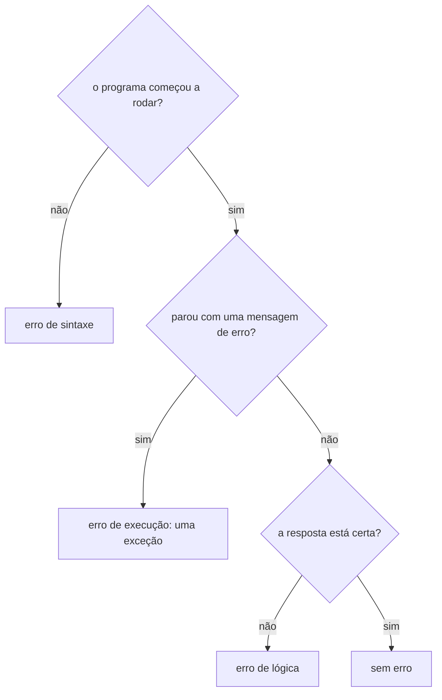
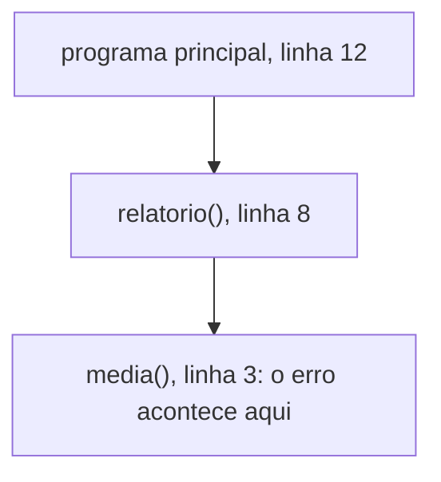

## Passo 1 · Leitura · Três famílias de erro

Todo programador erra, todos os dias. O que muda com a prática é a velocidade para descobrir **que tipo** de erro apareceu. Existem três famílias.

**Erro de sintaxe.** O texto do programa está malformado: faltou um dois-pontos, uma aspa, um parêntese. O Python lê o arquivo inteiro antes de executar e, se não entende o texto, não roda **nenhuma** linha.

**Erro de execução.** O texto está bem escrito e o programa começa a rodar, mas uma linha pede algo impossível, como dividir por zero. O Python para nessa linha e mostra uma mensagem. Esse erro tem nome: é uma **exceção**.

**Erro de lógica.** O programa roda até o fim, sem mensagem nenhuma, e a resposta está errada. É a família mais traiçoeira, porque o Python não avisa: ele fez exatamente o que você escreveu, e o que você escreveu não era o que queria.



Cada exceção tem um nome, e o nome já diz muito sobre a causa. Estas sete são as que você mais vai encontrar:

| Exceção | Causa típica | Exemplo de uma linha |
|---|---|---|
| `ValueError` | o tipo está certo, mas o valor não serve | `int("abc")` |
| `TypeError` | operação entre tipos que não combinam | `"5" + 5` |
| `ZeroDivisionError` | divisão por zero | `10 / 0` |
| `IndexError` | posição que não existe na lista | `[1, 2][5]` |
| `KeyError` | chave que não existe no dicionário | `{"a": 1}["b"]` |
| `NameError` | nome que não foi definido | `print(idade)` |
| `AttributeError` | método que aquele tipo não tem | `"Ana".append("!")` |

A mensagem completa tem o nome da exceção, dois-pontos e um detalhe em inglês. Para `int("abc")`, a última linha é:

```
ValueError: invalid literal for int() with base 10: 'abc'
```

Você não precisa traduzir tudo. Leia o nome (`ValueError`: o valor não serve) e procure no detalhe o valor que causou o problema (`'abc'`).

## Passo 2 · Exercício · Qual exceção
modo: lacunas

Cada trecho abaixo, executado sozinho, para com uma exceção diferente:

| Variável | Trecho |
|---|---|
| `erro_1` | `int("abc")` |
| `erro_2` | `[1, 2][5]` |
| `erro_3` | `{"a": 1}["b"]` |
| `erro_4` | `10 / 0` |
| `erro_5` | `"5" + 5` |

Troque cada lacuna (`___`) pelo nome exato da exceção, com as maiúsculas no lugar. As aspas já estão no código: escreva só o nome dentro delas.

### Instruções
1. Preencha `erro_1` e `erro_2` com os nomes das exceções de `int("abc")` e de `[1, 2][5]`.
   Dica: um deles é um valor que não serve; o outro é uma posição que não existe.
2. Preencha `erro_3` e `erro_4` com os nomes das exceções de `{"a": 1}["b"]` e de `10 / 0`.
3. Preencha `erro_5` com o nome da exceção de `"5" + 5`.

### Código inicial
```python
erro_1 = "___"
erro_2 = "___"
erro_3 = "___"
erro_4 = "___"
erro_5 = "___"
```

### Solução
```python
erro_1 = "ValueError"
erro_2 = "IndexError"
erro_3 = "KeyError"
erro_4 = "ZeroDivisionError"
erro_5 = "TypeError"
```

### Dicas
1. Rode cada trecho sozinho no editor e leia a última linha da mensagem: o nome da exceção vem antes dos dois-pontos.
2. Lista usa posição (índice); dicionário usa chave. Cada um tem a sua exceção.
3. Em `"5" + 5` os dois valores existem e são válidos; o problema é que os tipos não combinam na soma.

### Verificação
```json
[
  { "id": "erro-1", "checkpoint": 1, "kind": "variable", "variable": "erro_1", "expected": "ValueError", "type": "str",
    "name": "erro_1: a exceção de int(\"abc\")", "hint": "O tipo (texto) é aceito por int(); o que não serve é o valor." },
  { "id": "erro-2", "checkpoint": 1, "kind": "variable", "variable": "erro_2", "expected": "IndexError", "type": "str",
    "name": "erro_2: a exceção de [1, 2][5]", "hint": "A lista tem só as posições 0 e 1. Posição de lista se chama índice." },
  { "id": "erro-3", "checkpoint": 2, "kind": "variable", "variable": "erro_3", "expected": "KeyError", "type": "str",
    "name": "erro_3: a exceção de {\"a\": 1}[\"b\"]", "hint": "O dicionário não tem a chave pedida." },
  { "id": "erro-4", "checkpoint": 2, "kind": "variable", "variable": "erro_4", "expected": "ZeroDivisionError", "type": "str",
    "name": "erro_4: a exceção de 10 / 0", "hint": "O nome junta três palavras em inglês: zero, divisão e erro. Confira as maiúsculas." },
  { "id": "erro-5", "checkpoint": 3, "kind": "variable", "variable": "erro_5", "expected": "TypeError", "type": "str",
    "name": "erro_5: a exceção de \"5\" + 5", "hint": "Texto e número não se somam: o problema está nos tipos." }
]
```

### Soluções erradas
```python name="IndexError e KeyError trocados"
erro_1 = "ValueError"
erro_2 = "KeyError"
erro_3 = "IndexError"
erro_4 = "ZeroDivisionError"
erro_5 = "TypeError"
```
```python name="erro_5 como ValueError"
erro_1 = "ValueError"
erro_2 = "IndexError"
erro_3 = "KeyError"
erro_4 = "ZeroDivisionError"
erro_5 = "ValueError"
```
```python name="nomes sem as maiúsculas"
erro_1 = "valueerror"
erro_2 = "indexerror"
erro_3 = "keyerror"
erro_4 = "zerodivisionerror"
erro_5 = "typeerror"
```
```python name="erro_1 como TypeError"
erro_1 = "TypeError"
erro_2 = "IndexError"
erro_3 = "KeyError"
erro_4 = "ZeroDivisionError"
erro_5 = "TypeError"
```

## Passo 3 · Leitura · Lendo um traceback

Quando uma exceção acontece dentro de uma função chamada por outra função, o Python imprime um ***traceback***: o relatório do caminho que a execução percorreu até o erro. Veja este programa de 12 linhas:

```python
def media(notas):
    total = sum(notas)
    return total / len(notas)


def relatorio(turma, notas):
    print("Turma:", turma)
    valor = media(notas)
    print("Média:", valor)


relatorio("A", [])
```

Ao executar, ele imprime `Turma: A` e depois para com este relatório:

```
Traceback (most recent call last):
  File "main.py", line 12, in <module>
    relatorio("A", [])
    ~~~~~~~~~^^^^^^^^^
  File "main.py", line 8, in relatorio
    valor = media(notas)
  File "main.py", line 3, in media
    return total / len(notas)
           ~~~~~~^~~~~~~~~~~~
ZeroDivisionError: division by zero
```

Cada parte tem um papel:

- **`Traceback (most recent call last):`** é o título. Ele avisa a ordem: a chamada mais recente vem por último.
- **`File "main.py", line 12, in <module>`** é uma entrada da cadeia: o arquivo, o número da linha e onde ela está. `<module>` é o programa principal, fora de qualquer função.
- Abaixo de cada entrada vem a **linha de código**. Os sinais `~` e `^`, quando aparecem, sublinham o trecho exato.
- A **última linha** traz o nome da exceção e a mensagem.

A cadeia segue a ordem das chamadas:



Leia **de baixo para cima**:

1. A última linha diz **o quê**: `ZeroDivisionError`, uma divisão por zero.
2. A entrada logo acima diz **onde**: linha 3, dentro de `media`.
3. As entradas anteriores dizem **por qual caminho**: `media` foi chamada na linha 8 de `relatorio`, que foi chamada na linha 12 do programa principal.

O lugar onde o erro acontece nem sempre é o lugar a consertar. Aqui a divisão da linha 3 está certa; o problema nasceu na linha 12, que passou uma lista vazia. O caminho mostra de onde veio o dado ruim.

O engano mais comum é ler só a primeira entrada e ir mexer na linha 12 sem saber o que houve. Comece sempre pelo fim.

## Passo 4 · Exercício · Leia o traceback

Um colega rodou o programa de recibos da cantina e recebeu a saída abaixo. Você não tem o código, só o relatório:

```
café 4.5
Traceback (most recent call last):
  File "main.py", line 13, in <module>
    imprimir_recibo(tabela, ["café", "suco"])
    ~~~~~~~~~~~~~~~^^^^^^^^^^^^^^^^^^^^^^^^^^
  File "main.py", line 8, in imprimir_recibo
    final = preco_final(precos, produto)
  File "main.py", line 2, in preco_final
    valor = precos[produto]
            ~~~~~~^^^^^^^^^
KeyError: 'suco'
```

Leia de baixo para cima e registre em duas variáveis onde o erro aconteceu.

### Instruções
1. Guarde em `linha_do_erro` o número da linha em que a exceção aconteceu, como número inteiro.
   Dica: o número vem depois da palavra `line`.
2. Guarde em `funcao_do_erro` o nome da função em que a exceção aconteceu, como texto, sem parênteses.

### Código inicial
```python
# Troque os valores pelas respostas tiradas do traceback
linha_do_erro = 0
funcao_do_erro = ""
```

### Solução
```python
linha_do_erro = 2
funcao_do_erro = "preco_final"
```

### Dicas
1. A última entrada da cadeia, logo acima da linha `KeyError: 'suco'`, é onde o erro aconteceu.
2. Em cada entrada, o número da linha aparece depois de `line` e o nome da função depois de `in`.
3. As entradas das linhas 13 e 8 são o caminho até o erro. A resposta está na entrada que sobra.

### Verificação
```json
[
  { "id": "linha", "checkpoint": 1, "kind": "variable", "variable": "linha_do_erro", "expected": 2, "type": "int",
    "name": "linha_do_erro é a linha onde a exceção aconteceu", "hint": "Use a última entrada da cadeia, não a primeira, e escreva o número sem aspas." },
  { "id": "funcao", "checkpoint": 2, "kind": "variable", "variable": "funcao_do_erro", "expected": "preco_final", "type": "str",
    "name": "funcao_do_erro é a função onde a exceção aconteceu", "hint": "É o nome depois de in na última entrada, entre aspas e sem parênteses." }
]
```

### Soluções erradas
```python name="linha e função da chamada mais externa"
linha_do_erro = 13
funcao_do_erro = "<module>"
```
```python name="a função que chamou, não a que falhou"
linha_do_erro = 8
funcao_do_erro = "imprimir_recibo"
```
```python name="linha certa, função que chamou"
linha_do_erro = 2
funcao_do_erro = "imprimir_recibo"
```
```python name="linha como texto"
linha_do_erro = "2"
funcao_do_erro = "preco_final"
```

## Passo 5 · Quiz · Erros

### Pergunta
Um programa que calcula o troco roda até o fim, não mostra nenhuma mensagem de erro e imprime um valor R\$ 10,00 maior que o correto. A que família esse erro pertence?
- [ ] Erro de sintaxe, porque o programa foi escrito errado
- [ ] Erro de execução, porque o problema só aparece quando o programa roda
- [x] Erro de lógica, porque o programa rodou sem mensagem e a resposta está errada
- [ ] Nenhuma: se o Python não reclamou, o programa está certo
> Erro de sintaxe impede o programa de começar; erro de execução para o programa com uma exceção. Rodar até o fim com resposta errada é erro de lógica, e o Python não avisa.

### Pergunta
O que a frase `Traceback (most recent call last):` informa?
- [ ] Que o erro está na primeira linha listada logo abaixo dela
- [x] Que as chamadas aparecem em ordem e a mais recente, onde o erro aconteceu, é a última
- [ ] Que o programa será executado mais uma vez depois do erro
- [ ] Que só a última chamada do programa tem defeito e as outras estão corretas
> A cadeia vai do programa principal até a chamada mais recente. Por isso a leitura começa de baixo: a última linha diz o quê, a entrada acima dela diz onde.

### Pergunta
Qual exceção este programa levanta?
```python
notas = {"ana": 7, "bia": 9}
print(notas["caio"])
```
- [ ] `IndexError`, porque `"caio"` seria a terceira posição e ela não existe
- [x] `KeyError`, porque o dicionário não tem a chave `"caio"`
- [ ] `NameError`, porque `caio` não foi definido
- [ ] `ValueError`, porque `"caio"` não é um valor do dicionário
> Dicionário é acessado por chave: chave inexistente dá `KeyError: 'caio'`. `IndexError` é para posição inexistente em lista. `"caio"` está entre aspas, então é um texto, não um nome de variável.

## Passo 6 · Exercício · Dois bugs

A função `media_segura(lista)` deveria devolver a média dos números da lista e, quando a lista está vazia, devolver `0.0` em vez de quebrar. Rode o código inicial e observe as duas chamadas do final:

- `media_segura([4, 6])` imprime `10.0`. A média de 4 e 6 é 5. Não há mensagem nenhuma: é um erro de lógica.
- `media_segura([7])` para o programa com `ZeroDivisionError: division by zero`. É um erro de execução.

O divisor está errado. Mas, depois de consertá-lo, sobra outro problema: a lista vazia passa a causar a divisão por zero. Os dois precisam ser resolvidos.

### Instruções
1. Faça `media_segura` devolver `0.0` quando a lista estiver vazia, sem levantar exceção.
   Dica: confira o tamanho da lista antes de dividir.
2. Corrija a conta para que a função devolva a média de verdade: a soma dividida pela quantidade de itens.

### Código inicial
```python
def media_segura(lista):
    return sum(lista) / (len(lista) - 1)


print(media_segura([4, 6]))
print(media_segura([7]))
```

### Solução
```python
def media_segura(lista):
    if len(lista) == 0:
        return 0.0
    return sum(lista) / len(lista)


print(media_segura([4, 6]))
print(media_segura([7]))
```

### Dicas
1. Trate a lista vazia primeiro: um `if` no começo da função, com o seu próprio `return`.
2. Teste com `[4, 6]` e faça a conta à mão: 10 dividido por quanto dá 5?
3. A média divide por `len(lista)`, sem somar nem subtrair nada.

### Verificação
```json
[
  { "id": "borda-vazia", "checkpoint": 1, "kind": "call", "function": "media_segura", "args": [[]], "expected": 0.0, "tolerance": 0.001,
    "name": "media_segura([]) devolve 0.0 sem quebrar", "hint": "Com a lista vazia, len(lista) é 0: devolva 0.0 antes de chegar à divisão." },
  { "id": "dois-itens", "checkpoint": 2, "kind": "call", "function": "media_segura", "args": [[4, 6]], "expected": 5.0, "tolerance": 0.001,
    "name": "media_segura([4, 6]) é 5.0", "hint": "A soma é 10 e há 2 itens. Confira por quanto a função divide." },
  { "id": "um-item", "checkpoint": 2, "kind": "call", "function": "media_segura", "args": [[7]], "expected": 7.0, "tolerance": 0.001,
    "name": "media_segura([7]) é 7.0", "hint": "Com um item só, a média é o próprio item. O divisor não pode virar zero aqui." },
  { "id": "tres-itens", "checkpoint": 2, "kind": "call", "function": "media_segura", "args": [[1, 2, 6]], "expected": 3.0, "tolerance": 0.001,
    "name": "media_segura([1, 2, 6]) é 3.0", "hint": "A regra vale para qualquer tamanho: soma dividida pela quantidade de itens." }
]
```

### Soluções erradas
```python name="corrige só a lista vazia"
def media_segura(lista):
    if len(lista) == 0:
        return 0.0
    return sum(lista) / (len(lista) - 1)
```
```python name="corrige só o divisor"
def media_segura(lista):
    return sum(lista) / len(lista)
```
```python name="trata o tamanho 1 em vez do divisor"
def media_segura(lista):
    if len(lista) == 0:
        return 0.0
    if len(lista) == 1:
        return lista[0]
    return sum(lista) / (len(lista) - 1)
```
```python name="divide sempre por 2"
def media_segura(lista):
    if len(lista) == 0:
        return 0.0
    return sum(lista) / 2
```
