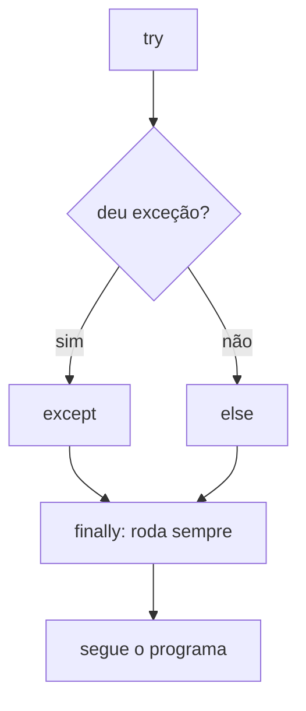

## Passo 1 · Leitura · Tentar e tratar

Alguns erros de execução são previsíveis. Se o programa pede um número, cedo ou tarde alguém digita `abc`. Sem cuidado nenhum, a conversão derruba o programa:

```
ValueError: invalid literal for int() with base 10: 'abc'
```

O `try`/`except` permite **tratar** a exceção: o programa tenta executar um trecho e, se aquela exceção acontecer, executa um plano B em vez de parar.

```python
texto = "abc"
try:
    numero = int(texto)
    print("número:", numero)
except ValueError:
    print("não é número:", texto)
print("fim")
```

Saída:

```
não é número: abc
fim
```

Funciona assim:

1. O Python executa o bloco do `try`, linha por linha.
2. Se nenhuma linha levantar exceção, o bloco do `except` é **pulado**.
3. Se uma linha levantar `ValueError`, o resto do `try` é abandonado na hora e a execução salta para o bloco do `except`.
4. Nos dois casos, o programa continua na linha depois da estrutura.

No programa abaixo o laço passa por um texto bom e um ruim. Clique em "Visualizar" e avance: na segunda volta a execução pula do `int` direto para o `except`, sem passar pelo `print("número:", ...)`.

```python visualizar
entradas = ["42", "abc"]
for texto in entradas:
    try:
        numero = int(texto)
        print("número:", numero)
    except ValueError:
        print("não é número:", texto)
print("fim")
```

Duas regras de bom uso.

**Só o trecho arriscado vai dentro do `try`.** Um `try` em volta do programa inteiro esconde onde o problema aconteceu, e o plano B acaba respondendo a erros que ele não foi pensado para tratar.

**Capture a exceção específica.** O Python aceita `except:` sem nome, que captura qualquer coisa. Parece prático e é uma armadilha: se você digitar errado o nome de uma variável dentro do `try`, o `NameError` também será engolido, e o programa dirá "não é número" para um defeito que é seu. Com `except ValueError:`, só o erro previsto é tratado; os outros continuam aparecendo com traceback, que é o que você quer enquanto programa.

Uma exceção diferente da nomeada **não** é capturada. Um `except ValueError:` não segura um `ZeroDivisionError`: o programa para como se o `try` não existisse.

## Passo 2 · Exercício · para_inteiro(texto)
modo: ordenar

A função `para_inteiro(texto)` tenta converter um texto em número inteiro. Se der certo, devolve o número. Se o texto não for um inteiro válido, devolve `None` em vez de quebrar:

- `para_inteiro("42")` devolve `42`
- `para_inteiro("abc")` devolve `None`
- `para_inteiro("4.2")` devolve `None`, porque `int("4.2")` também levanta `ValueError`

Arraste as linhas para a ordem certa e ajuste a indentação de cada uma. Uma linha está sobrando.

### Instruções
1. Monte a função com o `return int(texto)` dentro do `try`.
   Dica: `try` e `except` ficam no mesmo nível, um nível à direita do `def`.
2. Capture só o `ValueError` e devolva `None` nesse caso.

### Solução
```python
def para_inteiro(texto):
    try:
        return int(texto)
    except ValueError:
        return None
```

### Distratores
```python
except:
```

### Dicas
1. `try:` e `except ValueError:` ficam alinhados entre si, dentro da função.
2. O que cada um faz fica um nível mais à direita: a conversão sob o `try`, o `return None` sob o `except`.
3. A linha `except:` sem nome de exceção é a que sobra: ela capturaria qualquer erro.

### Verificação
```json
[
  { "id": "usa-try", "checkpoint": 1, "kind": "source", "rule": { "type": "uses", "construct": "try" },
    "name": "A função usa try", "hint": "A conversão precisa estar dentro de um bloco try." },
  { "id": "valido", "checkpoint": 1, "kind": "call", "function": "para_inteiro", "args": ["42"], "expected": 42, "type": "int",
    "name": "para_inteiro(\"42\") devolve o inteiro 42", "hint": "No caminho sem erro, devolva o resultado de int(texto)." },
  { "id": "negativo", "checkpoint": 1, "kind": "call", "function": "para_inteiro", "args": ["-7"], "expected": -7, "type": "int",
    "name": "para_inteiro(\"-7\") devolve -7" },
  { "id": "captura", "checkpoint": 2, "kind": "source", "rule": { "type": "catches", "exception": "ValueError" },
    "name": "Captura só o ValueError", "hint": "Use except ValueError:, com o nome da exceção, e não except: sozinho." },
  { "id": "letras", "checkpoint": 2, "kind": "call", "function": "para_inteiro", "args": ["abc"], "expected": null, "type": "NoneType",
    "name": "para_inteiro(\"abc\") devolve None", "hint": "A conversão que falha precisa estar dentro do try, e o except devolve None." },
  { "id": "decimal", "checkpoint": 2, "kind": "call", "function": "para_inteiro", "args": ["4.2"], "expected": null, "type": "NoneType",
    "name": "para_inteiro(\"4.2\") devolve None", "hint": "int() não aceita texto com ponto decimal: é o mesmo ValueError." }
]
```

### Soluções erradas
```python name="except nu, sem o nome da exceção"
def para_inteiro(texto):
    try:
        return int(texto)
    except:
        return None
```
```python name="conversão fora do try"
def para_inteiro(texto):
    numero = int(texto)
    try:
        return numero
    except ValueError:
        return None
```
```python name="devolve o texto sem converter"
def para_inteiro(texto):
    try:
        int(texto)
        return texto
    except ValueError:
        return None
```

## Passo 3 · Exercício · dividir_seguro(a, b)

Agora sem andaime. A função `dividir_seguro(a, b)` devolve o resultado de `a / b`. Quando `b` é zero, a divisão levanta uma exceção; a função deve tratá-la com `try`/`except` e devolver `None`:

- `dividir_seguro(10, 2)` devolve `5.0`
- `dividir_seguro(1, 0)` devolve `None`

Daria para resolver com um `if b == 0`, mas o objetivo aqui é praticar o tratamento da exceção: a verificação exige o `try` com o `except` da exceção certa.

### Instruções
1. Coloque a divisão dentro de um `try` e devolva o resultado quando ela der certo.
2. Capture a exceção da divisão por zero, pelo nome, e devolva `None` nesse caso.
   Dica: rode `10 / 0` no editor e leia o nome na última linha da mensagem.

### Código inicial
```python
def dividir_seguro(a, b):
    # Trate a divisão por zero com try/except
    pass
```

### Solução
```python
def dividir_seguro(a, b):
    try:
        return a / b
    except ZeroDivisionError:
        return None
```

### Dicas
1. A linha arriscada é a divisão: é ela que vai dentro do `try`.
2. O nome da exceção está na mensagem de `10 / 0`: `ZeroDivisionError: division by zero`.
3. A estrutura é a mesma de `para_inteiro`: `try:` com um `return`, `except NomeDaExcecao:` com `return None`.

### Verificação
```json
[
  { "id": "usa-try", "checkpoint": 1, "kind": "source", "rule": { "type": "uses", "construct": "try", "function": "dividir_seguro" },
    "name": "dividir_seguro usa try", "hint": "O enunciado pede tratar a exceção: a divisão vai dentro de um try." },
  { "id": "exata", "checkpoint": 1, "kind": "call", "function": "dividir_seguro", "args": [10, 2], "expected": 5.0, "tolerance": 0.001,
    "name": "dividir_seguro(10, 2) é 5.0" },
  { "id": "quebrada", "checkpoint": 1, "kind": "call", "function": "dividir_seguro", "args": [7, 2], "expected": 3.5, "tolerance": 0.001,
    "name": "dividir_seguro(7, 2) é 3.5", "hint": "Use a divisão comum, com uma barra só." },
  { "id": "zero-em-cima", "checkpoint": 1, "kind": "call", "function": "dividir_seguro", "args": [0, 5], "expected": 0.0, "type": "float", "tolerance": 0.001,
    "name": "dividir_seguro(0, 5) é 0.0", "hint": "Zero dividido por 5 é uma divisão válida: o resultado é 0.0, não None." },
  { "id": "captura", "checkpoint": 2, "kind": "source", "rule": { "type": "catches", "exception": "ZeroDivisionError" },
    "name": "Captura ZeroDivisionError", "hint": "O except precisa nomear a exceção da divisão por zero." },
  { "id": "por-zero", "checkpoint": 2, "kind": "call", "function": "dividir_seguro", "args": [1, 0], "expected": null, "type": "NoneType",
    "name": "dividir_seguro(1, 0) devolve None", "hint": "No bloco do except, devolva None." }
]
```

### Soluções erradas
```python name="if no lugar do try"
def dividir_seguro(a, b):
    if b == 0:
        return None
    return a / b
```
```python name="except com a exceção errada"
def dividir_seguro(a, b):
    try:
        return a / b
    except ValueError:
        return None
```
```python name="except nu"
def dividir_seguro(a, b):
    try:
        return a / b
    except:
        return None
```
```python name="devolve 0 em vez de None"
def dividir_seguro(a, b):
    try:
        return a / b
    except ZeroDivisionError:
        return 0
```

## Passo 4 · Leitura · else, finally e raise

O `try` aceita mais dois blocos opcionais, sempre nesta ordem: `try`, `except`, `else`, `finally`.

- **`else`** roda só quando o `try` terminou **sem** exceção. É o lugar do código que depende de ter dado certo.
- **`finally`** roda **sempre**, com ou sem exceção. Serve para o que precisa acontecer de qualquer jeito, como um aviso de encerramento.

```python
try:
    numero = int("12")
except ValueError:
    print("inválido")
else:
    print("dobro:", numero * 2)
finally:
    print("fim")
```

Saída:

```
dobro: 24
fim
```

Com `int("doze")` no lugar, a saída seria `inválido` e depois `fim`: o `else` é pulado, o `finally` não.



#### Guardando a exceção com as

`except Tipo as e` guarda a exceção na variável `e`. Ao imprimir `e`, você vê a mensagem original, sem o traceback:

```python
try:
    idade = int("abc")
except ValueError as e:
    print("Erro:", e)
```

Saída:

```
Erro: invalid literal for int() with base 10: 'abc'
```

#### Levantando uma exceção com raise

Até aqui o Python levantou as exceções. Você também pode levantar uma, com `raise`, quando a sua função recebe um valor que não faz sentido:

```python
def definir_idade(idade):
    if idade < 0:
        raise ValueError("idade não pode ser negativa")
    return idade
```

`definir_idade(-3)` para a função na linha do `raise`, e a última linha do traceback é:

```
ValueError: idade não pode ser negativa
```

O `raise` é o aviso para quem chamou: "não consigo continuar com esse valor". Quem chamou decide o que fazer, e pode tratar com `try`/`except ValueError`, como qualquer outra exceção. Devolver um número inventado, como `0`, esconderia o problema e criaria um erro de lógica mais adiante.

## Passo 5 · Previsão · Quais blocos rodam

A função `testar` tem os quatro blocos. Ela é chamada duas vezes: uma com um divisor que funciona e outra com zero. A exceção é tratada, então o programa termina sem erro.

Leia o código sem executar e digite exatamente o que ele imprime.

### Código
```python
def testar(divisor):
    try:
        resultado = 10 / divisor
    except ZeroDivisionError:
        print("divisão por zero")
    else:
        print("resultado:", resultado)
    finally:
        print("fim do teste")


testar(2)
testar(0)
```

### Dicas
1. O `else` só roda quando o `try` terminou sem exceção.
2. O `finally` roda nas duas chamadas, sempre por último.
3. Cada chamada imprime duas linhas. A divisão com `/` devolve um número com ponto decimal.

### Saída esperada
```text
resultado: 5.0
fim do teste
divisão por zero
fim do teste
```

## Passo 6 · Exercício · Idade válida

Um padrão muito usado junta laço e `try`: **repetir a leitura até a entrada ser válida**. O programa fica num `while True` e só sai, com `break`, quando recebe um valor aceitável.

Escreva um programa que lê uma idade. A idade válida é um número inteiro entre 0 e 120, incluindo o 0 e o 120. Para cada entrada:

- se não for um número inteiro, imprima `Digite um número inteiro.` e leia de novo;
- se for um inteiro fora do intervalo, imprima `Idade fora do intervalo.` e leia de novo;
- se for válida, pare de ler e imprima `Idade: ` seguido do número.

Use `input()` sem texto dentro dos parênteses, para a saída ter só as mensagens pedidas.

Exemplo de execução, com as entradas `abc`, `200` e `30`, uma por linha:

```
Digite um número inteiro.
Idade fora do intervalo.
Idade: 30
```

### Instruções
1. Leia a entrada dentro de um laço e converta com `int` dentro de um `try`. Se a conversão falhar com `ValueError`, imprima `Digite um número inteiro.` e volte a ler.
   Dica: sem o tratamento, a entrada `abc` derruba o programa.
2. Se o número estiver fora do intervalo de 0 a 120, imprima `Idade fora do intervalo.` e volte a ler.
3. Quando a idade for válida, saia do laço e imprima `Idade: ` seguido do número, como em `Idade: 30`.

### Código inicial
```python
# Leia até receber uma idade válida (inteiro de 0 a 120)
```

### Solução
```python
while True:
    try:
        idade = int(input())
    except ValueError:
        print("Digite um número inteiro.")
    else:
        if idade < 0 or idade > 120:
            print("Idade fora do intervalo.")
        else:
            break

print(f"Idade: {idade}")
```

### Dicas
1. O esqueleto é `while True:` com um `try` dentro; o `break` só acontece quando tudo deu certo.
2. Depois de converter, confira o intervalo: menor que 0 ou maior que 120 é inválido; 0 e 120 valem.
3. Cada problema tem a sua mensagem, e o `print` de `Idade: ...` fica depois do laço, sem indentação.

### Verificação
```json
[
  { "id": "captura", "checkpoint": 1, "kind": "source", "rule": { "type": "catches", "exception": "ValueError" },
    "name": "Trata o ValueError da conversão", "hint": "Coloque o int(input()) dentro de um try com except ValueError:." },
  { "id": "nao-numero", "checkpoint": 1, "kind": "io", "stdin": "abc\n25\n", "expected_stdout": "Digite um número inteiro.\nIdade: 25",
    "name": "Entradas abc e 25", "hint": "Depois de uma entrada que não é número, avise com a mensagem exata e leia de novo." },
  { "id": "decimal", "checkpoint": 1, "kind": "io", "stdin": "12.5\nquinze\n15\n", "expected_stdout": "Digite um número inteiro.\nDigite um número inteiro.\nIdade: 15",
    "name": "Entradas 12.5, quinze e 15", "hint": "12.5 não é inteiro: int() levanta o mesmo ValueError. O laço precisa aguentar vários erros seguidos." },
  { "id": "fora", "checkpoint": 2, "kind": "io", "stdin": "200\n-1\n121\n40\n", "expected_stdout": "Idade fora do intervalo.\nIdade fora do intervalo.\nIdade fora do intervalo.\nIdade: 40",
    "name": "Entradas 200, -1, 121 e 40", "hint": "Negativos e valores acima de 120 são inválidos: avise e leia de novo." },
  { "id": "exemplo", "checkpoint": 3, "kind": "io", "stdin": "abc\n200\n30\n", "expected_stdout": "Digite um número inteiro.\nIdade fora do intervalo.\nIdade: 30",
    "name": "O exemplo do enunciado: abc, 200 e 30", "hint": "Compare sua saída com o exemplo do enunciado, linha por linha." },
  { "id": "borda-zero", "checkpoint": 3, "kind": "io", "stdin": "0\n", "expected_stdout": "Idade: 0",
    "name": "A idade 0 é válida", "hint": "O intervalo inclui o 0: confira se a comparação usa < ou <=." },
  { "id": "borda-120", "checkpoint": 3, "kind": "io", "stdin": "120\n", "expected_stdout": "Idade: 120",
    "name": "A idade 120 é válida", "hint": "O intervalo inclui o 120." }
]
```

### Soluções erradas
```python name="sem break: continua lendo depois da idade válida"
while True:
    try:
        idade = int(input())
    except ValueError:
        print("Digite um número inteiro.")
    else:
        if idade < 0 or idade > 120:
            print("Idade fora do intervalo.")
        else:
            print(f"Idade: {idade}")
```
```python name="conversão fora do try"
while True:
    idade = int(input())
    try:
        if idade < 0 or idade > 120:
            print("Idade fora do intervalo.")
        else:
            break
    except ValueError:
        print("Digite um número inteiro.")

print(f"Idade: {idade}")
```
```python name="bordas excluídas: 0 e 120 recusados"
while True:
    try:
        idade = int(input())
    except ValueError:
        print("Digite um número inteiro.")
    else:
        if idade <= 0 or idade >= 120:
            print("Idade fora do intervalo.")
        else:
            break

print(f"Idade: {idade}")
```
```python name="uma mensagem só para os dois problemas"
while True:
    try:
        idade = int(input())
        if idade < 0 or idade > 120:
            raise ValueError("fora")
        break
    except ValueError:
        print("Digite um número inteiro.")

print(f"Idade: {idade}")
```
```python name="trata o erro mas não repete a leitura"
try:
    idade = int(input())
    if idade < 0 or idade > 120:
        print("Idade fora do intervalo.")
    else:
        print(f"Idade: {idade}")
except ValueError:
    print("Digite um número inteiro.")
```

## Passo 7 · Quiz · try e except

### Pergunta
Em que ordem os blocos precisam ser escritos quando os quatro aparecem?
- [ ] `try`, `else`, `except`, `finally`
- [x] `try`, `except`, `else`, `finally`
- [ ] `try`, `finally`, `except`, `else`
- [ ] Em qualquer ordem, desde que o `try` venha primeiro
> A ordem é fixa: `try`, depois os `except`, depois `else` e por último `finally`. Fora dessa ordem o Python acusa erro de sintaxe e nem começa a rodar.

### Pergunta
Por que `except:` sem o nome da exceção é uma má ideia?
- [ ] Porque o Python não aceita essa forma e acusa erro de sintaxe
- [ ] Porque ele deixa o programa mais lento
- [x] Porque ele captura qualquer exceção, inclusive as causadas por defeitos do seu código, e esconde o problema
- [ ] Porque ele só captura `ValueError` e deixa as outras passarem
> O `except:` nu é aceito e captura tudo. Um nome digitado errado dentro do `try` vira um `NameError` engolido em silêncio, e você perde o traceback que mostraria o defeito.

### Pergunta
O que este programa imprime?
```python
try:
    print("A")
    valor = int("x")
    print("B")
except ValueError:
    print("C")
finally:
    print("D")
```
- [ ] `A`, `B`, `C` e `D`
- [ ] `A` e `C`
- [x] `A`, `C` e `D`
- [ ] `A` e `D`
> `A` é impresso antes da conversão. `int("x")` levanta `ValueError`: o resto do `try` é abandonado (`B` não aparece), o `except` imprime `C` e o `finally` roda sempre, imprimindo `D`.
