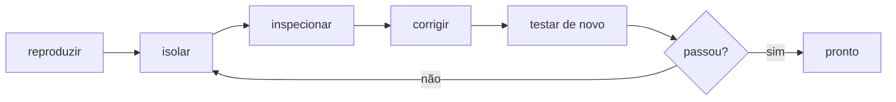

## Passo 1 · Leitura · Um roteiro para achar o bug

*Bug* é o apelido de um defeito no programa, e **depurar** é procurar e consertar esse defeito. Diante de um bug, a tentação é sair mudando linhas ao acaso até "dar certo". Isso demora e costuma criar defeitos novos. Quem depura bem segue um roteiro de cinco passos:

1. **Reproduzir.** Ache uma entrada pequena que mostre o defeito toda vez. Sem isso, você não tem como saber se consertou.
2. **Isolar.** Reduza o problema: qual função, qual trecho, qual linha? Uma entrada menor e um teste feito à mão ajudam a cercar o lugar.
3. **Inspecionar.** Olhe os valores das variáveis naquele trecho e compare com o que você esperava.
4. **Corrigir.** Mude só o que a inspeção mostrou estar errado.
5. **Testar de novo.** Rode a entrada do passo 1 e também os casos que já funcionavam.



#### O print de inspeção

Para inspecionar, a ferramenta mais simples é um `print` no meio do código. A f-string tem um atalho feito para isso: um `=` depois da expressão, dentro das chaves, imprime a expressão **e** o valor.

```python
total = 17
print(f"{total=}")
```

Saída:

```
total=17
```

Assim você não se perde quando há vários `print`: cada linha da saída diz de quem é o valor.

#### Teste de mesa, à mão ou automático

O teste de mesa é executar o programa no papel, linha por linha, anotando o valor de cada variável. O botão "Visualizar" faz o mesmo sozinho: a cada avanço ele mostra a linha atual e as variáveis. Use um ou outro quando o `print` não bastar.

#### Antes de entregar

Os `print` de inspeção são andaimes. Depois de achar o bug, apague todos: uma linha a mais na saída muda o que o programa imprime, e a saída deixa de ser a pedida.

## Passo 2 · Previsão · O print de inspeção

Este programa usa três vezes o atalho `=` da f-string: com um número, com um texto e com uma conta.

Leia o código sem executar e digite exatamente o que ele imprime.

### Código
```python
x = 3
nome = "Ana"
print(f"{x=}")
print(f"{nome=}")
print(f"{x * 2=}")
```

### Dicas
1. O `=` dentro das chaves mostra a expressão, o sinal de igual e o valor, tudo junto.
2. Nesse formato, um texto aparece entre aspas simples, do jeito que o Python mostra um valor de texto.
3. Na terceira linha, a expressão é copiada como foi escrita, com os espaços, e depois vem o resultado da conta.

### Saída esperada
```text
x=3
nome='Ana'
x * 2=6
```

## Passo 3 · Exercício · Bug 1: um a menos

A função `media(lista)` do código inicial deveria devolver a média dos números. Siga o roteiro.

**Reproduzir.** O programa chama `media([2, 2])`. A média de 2 e 2 é 2, e o programa imprime `4.0`. O defeito aparece toda vez.

**Isolar.** A função tem uma linha só, com uma soma e um divisor. A soma de `[2, 2]` é 4, e `4.0` é justamente a soma. O suspeito é o divisor.

**Inspecionar.** Acrescente, como primeira linha da função, um `print` de inspeção do divisor:

```python
print(f"{len(lista) - 1=}")
```

A saída passa a mostrar `len(lista) - 1=1`. A lista tem dois itens e a função está dividindo por 1.

Agora é com você: corrija e teste de novo.

### Instruções
1. Corrija o divisor para que `media` devolva a soma dividida pela quantidade de itens.
2. Apague os `print` de inspeção que você acrescentou. Mantenha a última linha do programa, que imprime `media([2, 2])`: a saída precisa ser só `2.0`.
   Dica: um `print` esquecido dentro da função aparece na saída a cada chamada.

### Código inicial
```python
def media(lista):
    return sum(lista) / (len(lista) - 1)


print(media([2, 2]))
```

### Solução
```python
def media(lista):
    return sum(lista) / len(lista)


print(media([2, 2]))
```

### Dicas
1. Teste com `[2, 2]`: a média tem de ser 2, e a soma é 4. Por quanto é preciso dividir?
2. Imprima o divisor com `print(f"{len(lista) - 1=}")` e compare com a quantidade de itens da lista.
3. O divisor é `len(lista)`, sem subtrair nada. Depois de corrigir, apague o `print` de inspeção.

### Verificação
```json
[
  { "id": "dois-iguais", "checkpoint": 1, "kind": "call", "function": "media", "args": [[2, 2]], "expected": 2.0, "tolerance": 0.001,
    "name": "media([2, 2]) é 2.0", "hint": "A soma é 4 e há 2 itens. Confira por quanto a função divide." },
  { "id": "tres-itens", "checkpoint": 1, "kind": "call", "function": "media", "args": [[1, 2, 3]], "expected": 2.0, "tolerance": 0.001,
    "name": "media([1, 2, 3]) é 2.0", "hint": "A soma é 6 e há 3 itens." },
  { "id": "um-item", "checkpoint": 1, "kind": "call", "function": "media", "args": [[10]], "expected": 10.0, "tolerance": 0.001,
    "name": "media([10]) é 10.0", "hint": "Com um item só, a média é o próprio item, e o divisor não pode ser zero." },
  { "id": "saida-limpa", "checkpoint": 2, "kind": "io", "expected_stdout": "2.0", "match": "trimmed",
    "name": "A saída do programa é só 2.0", "hint": "Mantenha o print(media([2, 2])) do final e apague qualquer print de inspeção." }
]
```

### Soluções erradas
```python name="soma 1 em vez de subtrair"
def media(lista):
    return sum(lista) / (len(lista) + 1)


print(media([2, 2]))
```
```python name="devolve a soma sem dividir"
def media(lista):
    return sum(lista)


print(media([2, 2]))
```
```python name="divide sempre por 2"
def media(lista):
    return sum(lista) / 2


print(media([2, 2]))
```
```python name="corrige mas esquece o print de inspeção"
def media(lista):
    print(f"{len(lista)=}")
    return sum(lista) / len(lista)


print(media([2, 2]))
```

## Passo 4 · Exercício · Bug 2: acumulador no lugar errado

A função `soma_pares(numeros)` deveria somar só os números pares da lista. Para `[2, 4, 5]` a resposta certa é 6, e o programa imprime `0`. Não há mensagem de erro: é um bug de lógica.

Desta vez, inspecione com o visualizador. O programa abaixo é o do código inicial, com o defeito. Clique em "Visualizar", avance linha por linha e acompanhe `total`: veja a variável voltar a zero a cada volta do laço.

```python visualizar
def soma_pares(numeros):
    for n in numeros:
        total = 0
        if n % 2 == 0:
            total += n
    return total


print(soma_pares([2, 4, 5]))
```

Uma linha está no lugar errado. Mova essa linha, sem reescrever a função. Depois teste também com a lista vazia: a função precisa devolver `0` nesse caso, e não parar com erro.

### Instruções
1. Corrija `soma_pares` para que `soma_pares([2, 4, 5])` devolva `6`.
   Dica: o acumulador precisa guardar o valor de uma volta para a outra.
2. Garanta que a função devolve `0` quando não há pares e quando a lista está vazia.

### Código inicial
```python
def soma_pares(numeros):
    for n in numeros:
        total = 0
        if n % 2 == 0:
            total += n
    return total


print(soma_pares([2, 4, 5]))
```

### Solução
```python
def soma_pares(numeros):
    total = 0
    for n in numeros:
        if n % 2 == 0:
            total += n
    return total


print(soma_pares([2, 4, 5]))
```

### Dicas
1. O acumulador nasce uma vez só, antes do laço.
2. Com a lista vazia o laço não dá nenhuma volta, e a função ainda precisa ter um `total` para devolver.
3. Mova a linha `total = 0` para antes do `for`, alinhada com ele.

### Verificação
```json
[
  { "id": "exemplo", "checkpoint": 1, "kind": "call", "function": "soma_pares", "args": [[2, 4, 5]], "expected": 6, "type": "int",
    "name": "soma_pares([2, 4, 5]) é 6", "hint": "Acompanhe total no visualizador: ele não pode voltar a zero no meio do laço." },
  { "id": "par-no-meio", "checkpoint": 1, "kind": "call", "function": "soma_pares", "args": [[1, 8, 3, 10, 7]], "expected": 18, "type": "int",
    "name": "soma_pares([1, 8, 3, 10, 7]) é 18", "hint": "Os ímpares não entram na soma, e os pares anteriores não podem ser esquecidos." },
  { "id": "sem-pares", "checkpoint": 2, "kind": "call", "function": "soma_pares", "args": [[1, 3]], "expected": 0, "type": "int",
    "name": "soma_pares([1, 3]) é 0" },
  { "id": "borda-vazia", "checkpoint": 2, "kind": "call", "function": "soma_pares", "args": [[]], "expected": 0, "type": "int",
    "name": "soma_pares([]) é 0", "hint": "Com a lista vazia o laço não roda. A variável total precisa existir mesmo assim." }
]
```

### Soluções erradas
```python name="total = 0 dentro do if"
def soma_pares(numeros):
    for n in numeros:
        if n % 2 == 0:
            total = 0
            total += n
    return total


print(soma_pares([2, 4, 5]))
```
```python name="apaga a linha total = 0"
def soma_pares(numeros):
    for n in numeros:
        if n % 2 == 0:
            total += n
    return total


print(soma_pares([2, 4, 5]))
```
```python name="return dentro do laço"
def soma_pares(numeros):
    total = 0
    for n in numeros:
        if n % 2 == 0:
            total += n
        return total


print(soma_pares([2, 4, 5]))
```

## Passo 5 · Exercício · Bug 3: and e or

A função `senha_valida(senha)` deveria seguir esta regra: a senha vale quando tem **8 caracteres ou mais** e, além disso, tem **um dígito ou uma letra maiúscula** (basta um dos dois).

O laço do código inicial está certo. Ele usa dois métodos de texto: `letra.isdigit()` devolve `True` quando o caractere é um dígito, e `letra.isupper()`, quando é uma letra maiúscula. O defeito está na última linha.

**Reproduzir.** A senha `"Ab"` tem só 2 caracteres e deveria ser recusada. A função devolve `True`.

**Inspecionar.** Com `"Ab"`, as três partes da condição valem:

| Parte | Valor |
|---|---|
| `len(senha) >= 8` | `False` |
| `tem_digito` | `False` |
| `tem_maiuscula` | `True` |

Faça a conta à mão, lembrando a ordem em que o Python avalia `and` e `or`, e descubra por que o resultado é `True`.

### Instruções
1. Corrija a última linha para que senhas com menos de 8 caracteres sejam sempre recusadas.
   Dica: sem parênteses, o `and` é avaliado antes do `or`.
2. Mantenha o resto da regra: com 8 caracteres ou mais, basta ter um dígito **ou** uma maiúscula.

### Código inicial
```python
def senha_valida(senha):
    tem_digito = False
    tem_maiuscula = False
    for letra in senha:
        if letra.isdigit():
            tem_digito = True
        if letra.isupper():
            tem_maiuscula = True
    return len(senha) >= 8 and tem_digito or tem_maiuscula
```

### Solução
```python
def senha_valida(senha):
    tem_digito = False
    tem_maiuscula = False
    for letra in senha:
        if letra.isdigit():
            tem_digito = True
        if letra.isupper():
            tem_maiuscula = True
    return len(senha) >= 8 and (tem_digito or tem_maiuscula)
```

### Dicas
1. Monte a conta com `"Ab"`: `False and False or True`. O que o Python calcula primeiro?
2. O `and` é avaliado antes do `or`. Do jeito que está, a condição é lida como `(tamanho and dígito) or maiúscula`.
3. Use parênteses para juntar as duas partes que são alternativas: `(tem_digito or tem_maiuscula)`.

### Verificação
```json
[
  { "id": "curta-com-maiuscula", "checkpoint": 1, "kind": "call", "function": "senha_valida", "args": ["Ab"], "expected": false, "type": "bool",
    "name": "senha_valida(\"Ab\") é False", "hint": "Só 2 caracteres: a maiúscula sozinha não pode aprovar a senha." },
  { "id": "curta-com-digito", "checkpoint": 1, "kind": "call", "function": "senha_valida", "args": ["a1"], "expected": false, "type": "bool",
    "name": "senha_valida(\"a1\") é False", "hint": "O tamanho mínimo vale para qualquer senha." },
  { "id": "longa-sem-nada", "checkpoint": 2, "kind": "call", "function": "senha_valida", "args": ["abcdefgh"], "expected": false, "type": "bool",
    "name": "senha_valida(\"abcdefgh\") é False", "hint": "Tem 8 caracteres, mas nenhum dígito e nenhuma maiúscula." },
  { "id": "longa-com-digito", "checkpoint": 2, "kind": "call", "function": "senha_valida", "args": ["abcdefg1"], "expected": true, "type": "bool",
    "name": "senha_valida(\"abcdefg1\") é True", "hint": "8 caracteres e um dígito: basta um dos dois, dígito ou maiúscula." },
  { "id": "longa-com-maiuscula", "checkpoint": 2, "kind": "call", "function": "senha_valida", "args": ["Abcdefgh"], "expected": true, "type": "bool",
    "name": "senha_valida(\"Abcdefgh\") é True", "hint": "8 caracteres e uma maiúscula: basta um dos dois, dígito ou maiúscula." },
  { "id": "longa-com-os-dois", "checkpoint": 2, "kind": "call", "function": "senha_valida", "args": ["Abcdefg1"], "expected": true, "type": "bool",
    "name": "senha_valida(\"Abcdefg1\") é True" }
]
```

### Soluções erradas
```python name="parênteses em volta do and"
def senha_valida(senha):
    tem_digito = False
    tem_maiuscula = False
    for letra in senha:
        if letra.isdigit():
            tem_digito = True
        if letra.isupper():
            tem_maiuscula = True
    return (len(senha) >= 8 and tem_digito) or tem_maiuscula
```
```python name="troca o or por and"
def senha_valida(senha):
    tem_digito = False
    tem_maiuscula = False
    for letra in senha:
        if letra.isdigit():
            tem_digito = True
        if letra.isupper():
            tem_maiuscula = True
    return len(senha) >= 8 and tem_digito and tem_maiuscula
```
```python name="troca o and por or"
def senha_valida(senha):
    tem_digito = False
    tem_maiuscula = False
    for letra in senha:
        if letra.isdigit():
            tem_digito = True
        if letra.isupper():
            tem_maiuscula = True
    return len(senha) >= 8 or (tem_digito or tem_maiuscula)
```

## Passo 6 · Quiz · Depuração

### Pergunta
Um colega avisa que o seu programa "às vezes dá o total errado". Qual é o primeiro passo do roteiro de depuração?
- [ ] Reescrever a função do total, para garantir
- [ ] Espalhar `print` em todas as linhas do programa
- [x] Reproduzir: achar uma entrada pequena em que o total sai errado toda vez
- [ ] Trocar os operadores, um por um, até o total sair certo
> Sem reproduzir, você não sabe onde procurar nem tem como conferir se consertou. Com uma entrada pequena que sempre mostra o defeito, os outros passos (isolar, inspecionar, corrigir, testar de novo) têm onde se apoiar.

### Pergunta
Você corrigiu o bug, mas deixou um `print(f"{total=}")` dentro da função. O exercício confere se a saída do programa é exatamente a pedida. O que acontece?
- [ ] Nada: a verificação ignora as linhas que começam com o nome de uma variável
- [x] A verificação reprova: a saída ganhou uma linha que não foi pedida
- [ ] O Python acusa erro de sintaxe, porque `{total=}` só vale durante a depuração
- [ ] O `print` de inspeção aparece só para você, não na saída do programa
> O `print` de inspeção escreve na mesma saída que os outros. Para quem compara a saída, `total=6` é uma linha a mais, e o resultado deixa de ser o pedido. Por isso os `print` de inspeção saem antes da entrega.

### Pergunta
Depois de uma mudança, um `assert` que passava começa a falhar. Por que apagar esse `assert` é uma má ideia?
- [ ] Porque o Python não deixa apagar um `assert` que já foi executado
- [ ] Porque sem `assert` o programa fica mais lento
- [ ] Porque o `assert` também corrige o valor quando a condição é falsa
- [x] Porque o teste que falha é o aviso de que há um defeito: sem ele, o defeito continua lá e ninguém fica sabendo
> O teste não é o problema; ele é o mensageiro. O certo é ler a mensagem, achar o defeito e corrigir o código. Só se muda um teste quando o comportamento combinado mudou de verdade.

## Passo 7 · Exercício · Bug 4: altera a entrada

A função `ordenada(lista)` deveria devolver uma lista **nova**, com os mesmos itens em ordem crescente, **sem mexer na lista recebida**. O resultado devolvido está certo, e é por isso que este bug engana: o estrago acontece em outro lugar.

Rode o código inicial. Ele imprime:

```
[1, 2, 3]
[1, 2, 3]
```

A primeira linha é o resultado, e está certa. A segunda é a lista `notas` depois da chamada: ela deveria continuar `[3, 1, 2]`, na ordem original. A função alterou a lista de quem chamou.

Lembre a diferença: `lista.sort()` ordena a própria lista e devolve `None`; `sorted(lista)` deixa a lista como está e devolve uma lista nova.

### Instruções
1. Faça `ordenada` devolver uma lista nova com os itens em ordem crescente.
2. Garanta que a lista recebida continua como estava depois da chamada: o programa deve imprimir `[1, 2, 3]` e depois `[3, 1, 2]`.
   Dica: confira a lista original depois de chamar a função.

### Código inicial
```python
def ordenada(lista):
    lista.sort()
    return lista


notas = [3, 1, 2]
print(ordenada(notas))
print(notas)
```

### Solução
```python
def ordenada(lista):
    return sorted(lista)


notas = [3, 1, 2]
print(ordenada(notas))
print(notas)
```

### Dicas
1. `sorted(lista)` devolve uma lista nova e não mexe na original.
2. Confira a lista original depois da chamada: o segundo `print` do programa mostra se ela mudou.
3. A função cabe em uma linha: `return sorted(lista)`.

### Verificação
```json
[
  { "id": "ordena", "checkpoint": 1, "kind": "call", "function": "ordenada", "args": [[3, 1, 2]], "expected": [1, 2, 3], "type": "list",
    "name": "ordenada([3, 1, 2]) devolve [1, 2, 3]", "hint": "A função precisa devolver uma lista, não None. Lembre o que lista.sort() devolve." },
  { "id": "repetidos", "checkpoint": 1, "kind": "call", "function": "ordenada", "args": [[5, 1, 5, 0]], "expected": [0, 1, 5, 5], "type": "list",
    "name": "ordenada([5, 1, 5, 0]) devolve [0, 1, 5, 5]" },
  { "id": "borda-vazia", "checkpoint": 1, "kind": "call", "function": "ordenada", "args": [[]], "expected": [], "type": "list",
    "name": "ordenada([]) devolve []" },
  { "id": "original-intacta", "checkpoint": 2, "kind": "expr", "setup": "original = [3, 1, 2]\nr = ordenada(original)", "expr": "original", "expected": [3, 1, 2],
    "name": "A lista recebida não muda", "hint": "Depois da chamada, a lista original precisa continuar na ordem em que estava. Qual das duas formas de ordenar não altera a lista?" },
  { "id": "resultado-novo", "checkpoint": 2, "kind": "expr", "setup": "original = [9, 4]\nr = ordenada(original)", "expr": "[r, original]", "expected": [[4, 9], [9, 4]],
    "name": "O resultado está em ordem e a original, não", "hint": "O resultado e a lista original precisam ser duas listas diferentes." }
]
```

### Soluções erradas
```python name="return lista.sort()"
def ordenada(lista):
    return lista.sort()


notas = [3, 1, 2]
print(ordenada(notas))
print(notas)
```
```python name="copia depois de ordenar"
def ordenada(lista):
    lista.sort()
    return lista[:]


notas = [3, 1, 2]
print(ordenada(notas))
print(notas)
```
```python name="devolve uma cópia sem ordenar"
def ordenada(lista):
    return lista[:]


notas = [3, 1, 2]
print(ordenada(notas))
print(notas)
```
```python name="guarda em outra variável sem copiar"
def ordenada(lista):
    nova = lista
    nova.sort()
    return nova


notas = [3, 1, 2]
print(ordenada(notas))
print(notas)
```
