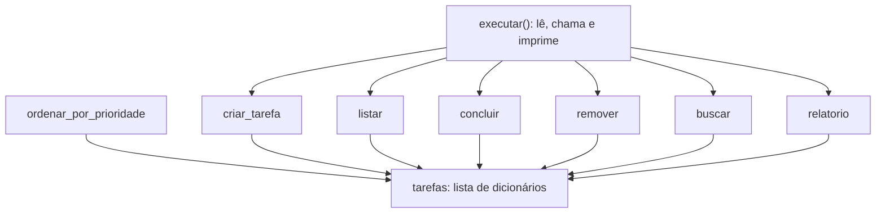
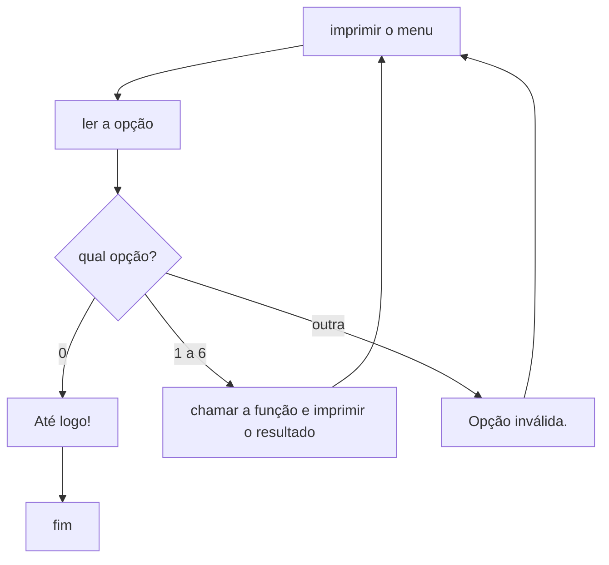

## Passo 1 · Leitura · O que você vai construir

Este é o projeto que fecha o nível e conta para o certificado: um **gerenciador de tarefas** em modo texto, em um único arquivo `main.py`. Ele usa o que você viu nos oito módulos: listas, dicionários, funções, strings, laços, condicionais e `try/except`.

#### O estado: uma lista de dicionários

Tudo o que o programa sabe está em uma lista. Cada tarefa é um dicionário com quatro chaves:

```python
{"id": 1, "titulo": "Estudar para a prova", "prioridade": "alta", "concluida": False}
```

A prioridade é sempre `"alta"`, `"media"` ou `"baixa"`, em minúsculas e sem acento. Clique em "Visualizar" e veja a lista crescer e uma tarefa mudar: o estado do programa inteiro é esta lista.

```python visualizar
tarefas = []
tarefas.append({"id": 1, "titulo": "Estudar", "prioridade": "alta", "concluida": False})
tarefas.append({"id": 2, "titulo": "Lavar a louça", "prioridade": "media", "concluida": False})
tarefas[1]["concluida"] = True
pendentes = [t for t in tarefas if not t["concluida"]]
print(len(tarefas), len(pendentes))
```

#### As funções

Toda a lógica fica em sete funções que **recebem a lista `tarefas` por parâmetro**. Nenhuma usa `input` nem `print`. Os nomes e os parâmetros precisam ser exatamente estes:

| Função | O que faz |
|---|---|
| `criar_tarefa(tarefas, titulo, prioridade="media")` | cria a tarefa, acrescenta à lista e devolve o dicionário; levanta `ValueError` se o título for vazio ou a prioridade for inválida |
| `listar(tarefas, apenas_pendentes=False)` | devolve uma lista **nova** com todas as tarefas ou só com as pendentes |
| `concluir(tarefas, id_tarefa)` | marca a tarefa como concluída; devolve `True`, ou `False` se o id não existe |
| `remover(tarefas, id_tarefa)` | tira a tarefa da lista; devolve `True`, ou `False` se o id não existe |
| `buscar(tarefas, termo)` | devolve as tarefas cujo título contém o termo, sem diferenciar maiúsculas |
| `ordenar_por_prioridade(tarefas)` | devolve uma lista **nova**: `alta`, depois `media`, depois `baixa`; no empate, menor id primeiro |
| `relatorio(tarefas)` | devolve o texto do relatório |

A oitava função, `executar()`, é o menu. Só ela conversa com o usuário: lê, chama as outras e imprime.



`ordenar_por_prioridade` não tem opção no menu: ela é conferida por chamadas diretas, como as outras seis.

#### O relatório

`relatorio(tarefas)` devolve um texto neste layout, com as linhas separadas por `\n` e sem linha em branco no fim:

```
RELATÓRIO DE TAREFAS
Total: 3 | Pendentes: 2 | Concluídas: 1
[ ] 1 (alta) Estudar para a prova
[x] 2 (media) Lavar a louça
[ ] 3 (baixa) Organizar a estante
```

#### O menu

`executar()` imprime as oito linhas abaixo antes de **cada** leitura de opção. Todo `input()` é chamado sem texto de prompt.

```
=== GERENCIADOR DE TAREFAS ===
1 - Adicionar tarefa
2 - Listar tarefas
3 - Concluir tarefa
4 - Remover tarefa
5 - Buscar tarefa
6 - Relatório
0 - Sair
```

As mensagens de cada opção estão no passo 7. Uma sessão completa, para você ter o alvo em vista. Entrada, uma resposta por linha:

```
1
Estudar para a prova
alta
1
Lavar a louça
media
3
2
6
0
```

Saída:

```
=== GERENCIADOR DE TAREFAS ===
1 - Adicionar tarefa
2 - Listar tarefas
3 - Concluir tarefa
4 - Remover tarefa
5 - Buscar tarefa
6 - Relatório
0 - Sair
Tarefa 1 criada.
=== GERENCIADOR DE TAREFAS ===
1 - Adicionar tarefa
2 - Listar tarefas
3 - Concluir tarefa
4 - Remover tarefa
5 - Buscar tarefa
6 - Relatório
0 - Sair
Tarefa 2 criada.
=== GERENCIADOR DE TAREFAS ===
1 - Adicionar tarefa
2 - Listar tarefas
3 - Concluir tarefa
4 - Remover tarefa
5 - Buscar tarefa
6 - Relatório
0 - Sair
Tarefa 2 concluída.
=== GERENCIADOR DE TAREFAS ===
1 - Adicionar tarefa
2 - Listar tarefas
3 - Concluir tarefa
4 - Remover tarefa
5 - Buscar tarefa
6 - Relatório
0 - Sair
RELATÓRIO DE TAREFAS
Total: 2 | Pendentes: 1 | Concluídas: 1
[ ] 1 (alta) Estudar para a prova
[x] 2 (media) Lavar a louça
=== GERENCIADOR DE TAREFAS ===
1 - Adicionar tarefa
2 - Listar tarefas
3 - Concluir tarefa
4 - Remover tarefa
5 - Buscar tarefa
6 - Relatório
0 - Sair
Até logo!
```

#### Como o trabalho é dividido

Os passos 3 a 7 constroem o mesmo arquivo: cada um começa do código aprovado no anterior. Não apague as funções prontas. A verificação chama cada função com várias listas, inclusive vazias e com ids fora de sequência, e confere o que ela devolve e o que acontece com a lista.

## Passo 2 · Previsão · Qual é o próximo id?

Cada tarefa tem um `id`, o número que o usuário digita para concluir ou remover. Antes de escrever `criar_tarefa`, veja o que acontece com os ids depois de uma remoção. O programa abaixo calcula o "próximo id" de dois jeitos.

Leia com calma, sem executar, e digite exatamente o que ele imprime.

### Código
```python
tarefas = [{"id": 1}, {"id": 2}, {"id": 3}]
tarefas.pop(1)
ids = [t["id"] for t in tarefas]
print(ids)
print(len(tarefas) + 1)
print(max(ids) + 1)
```

### Dicas
1. `pop(1)` tira da lista a tarefa que está na posição 1, e as posições começam em 0.
2. Compare os dois jeitos de calcular o próximo id: pelo tamanho da lista e pelo maior id que sobrou.

### Saída esperada
```text
[1, 3]
3
4
```

## Passo 3 · Exercício · criar_tarefa

Na previsão, o tamanho da lista mais 1 deu 3, mas já existe uma tarefa com id 3. Duas tarefas com o mesmo id tornariam "concluir a 3" ambíguo. Por isso a regra do projeto é outra:

- o id da tarefa nova é **o maior id que está na lista, mais 1**;
- se a lista está vazia, o id é 1.

`criar_tarefa(tarefas, titulo, prioridade="media")` faz, nesta ordem:

1. tira os espaços das pontas do título (`strip`). Se sobrar um texto vazio, levanta `ValueError("Título vazio.")`;
2. se a prioridade não for exatamente `"alta"`, `"media"` ou `"baixa"`, levanta `ValueError("Prioridade inválida.")`;
3. monta o dicionário com as chaves `"id"`, `"titulo"` (já sem os espaços), `"prioridade"` e `"concluida"` (sempre `False`), acrescenta-o no fim da lista recebida e o devolve.

Uma criação recusada não pode deixar nada na lista. Com título vazio **e** prioridade inválida, vale a mensagem do título.

```
tarefas = []
criar_tarefa(tarefas, "  Estudar para a prova ", "alta")
devolve   {"id": 1, "titulo": "Estudar para a prova", "prioridade": "alta", "concluida": False}

criar_tarefa(tarefas, "Lavar a louça")
devolve   {"id": 2, "titulo": "Lavar a louça", "prioridade": "media", "concluida": False}

criar_tarefa(tarefas, "Dormir", "urgente")
levanta   ValueError: Prioridade inválida.
```

Depois das três chamadas, `tarefas` tem duas tarefas.

A função trabalha só com a lista que recebeu. Não crie uma lista nem um contador de ids fora dela: a verificação chama `criar_tarefa` com listas diferentes, e cada lista tem a própria numeração.

Enquanto testa, você pode escrever chamadas com `print` no fim do arquivo. Do passo 3 ao 6 elas não atrapalham a verificação.

### Instruções
1. Defina `criar_tarefa(tarefas, titulo, prioridade="media")` e calcule o id da tarefa nova: o maior id da lista mais 1, ou 1 se a lista está vazia.
   Dica: `max` não aceita lista vazia; trate esse caso antes.
2. Valide antes de inserir: título vazio depois do `strip` levanta `ValueError("Título vazio.")`; prioridade fora de `alta`, `media` e `baixa` levanta `ValueError("Prioridade inválida.")`.
   Dica: o operador `in` testa se um valor está em uma lista.
3. Monte o dicionário da tarefa, acrescente-o à lista e devolva-o.

### Código inicial
```python
def criar_tarefa(tarefas, titulo, prioridade="media"):
    pass
```

### Solução
```python
def criar_tarefa(tarefas, titulo, prioridade="media"):
    titulo = titulo.strip()
    if titulo == "":
        raise ValueError("Título vazio.")
    if prioridade not in ["alta", "media", "baixa"]:
        raise ValueError("Prioridade inválida.")
    novo_id = 1
    if len(tarefas) > 0:
        novo_id = max([tarefa["id"] for tarefa in tarefas]) + 1
    tarefa = {"id": novo_id, "titulo": titulo, "prioridade": prioridade, "concluida": False}
    tarefas.append(tarefa)
    return tarefa
```

### Dicas
1. O próximo id é o `max` dos ids mais 1, ou 1 se não houver tarefas. Uma compreensão de lista junta os ids: `[tarefa["id"] for tarefa in tarefas]`.
2. Valide antes de inserir: as duas checagens vêm antes do `append`, e a do título vem primeiro.
3. `raise ValueError("Título vazio.")` interrompe a função na hora; o que vem depois não é executado. No fim: `tarefas.append(tarefa)` e `return tarefa`.

### Verificação
```json
[
  {"id": "define", "checkpoint": 1, "kind": "source", "rule": {"type": "defines_function", "name": "criar_tarefa"}, "name": "O arquivo define criar_tarefa"},
  {"id": "primeira", "checkpoint": 1, "kind": "call", "function": "criar_tarefa", "args": [[], "Estudar para a prova", "alta"], "expected": {"id": 1, "titulo": "Estudar para a prova", "prioridade": "alta", "concluida": false}, "type": "dict", "name": "Na lista vazia, a primeira tarefa recebe o id 1", "hint": "Confira as quatro chaves do dicionário: id, titulo, prioridade e concluida."},
  {"id": "terceira-padrao", "checkpoint": 1, "kind": "call", "function": "criar_tarefa", "args": [[{"id": 1, "titulo": "Estudar", "prioridade": "alta", "concluida": false}, {"id": 2, "titulo": "Lavar a louça", "prioridade": "media", "concluida": true}], "Organizar a estante"], "expected": {"id": 3, "titulo": "Organizar a estante", "prioridade": "media", "concluida": false}, "type": "dict", "name": "Com duas tarefas na lista e sem informar a prioridade: id 3 e prioridade media", "hint": "A prioridade tem valor padrão e a tarefa nasce pendente."},
  {"id": "id-apos-remocao", "checkpoint": 1, "kind": "expr", "setup": "t = []\ncriar_tarefa(t, \"Estudar para a prova\", \"alta\")\ncriar_tarefa(t, \"Lavar a louça\")\ncriar_tarefa(t, \"Organizar a estante\", \"baixa\")\nt.pop(0)\nr = criar_tarefa(t, \"Ir ao mercado\")", "expr": "r[\"id\"]", "expected": 4, "type": "int", "name": "Depois de remover a tarefa 1 de três, a nova recebe o id 4", "hint": "Com as tarefas 2 e 3 na lista, o tamanho + 1 daria 3, um id que já existe."},
  {"id": "maior-id", "checkpoint": 1, "kind": "expr", "setup": "t = [{'id': 2, 'titulo': 'A', 'prioridade': 'alta', 'concluida': False}, {'id': 7, 'titulo': 'B', 'prioridade': 'media', 'concluida': False}, {'id': 4, 'titulo': 'C', 'prioridade': 'baixa', 'concluida': False}]\nr = criar_tarefa(t, \"D\", \"alta\")", "expr": "r[\"id\"]", "expected": 8, "type": "int", "name": "O id novo é o maior id da lista + 1, esteja ele em que posição estiver", "hint": "Olhe o id de todas as tarefas, não só o da última."},
  {"id": "strip", "checkpoint": 2, "kind": "call", "function": "criar_tarefa", "args": [[], "  Ler o capítulo 3  ", "baixa"], "expected": {"id": 1, "titulo": "Ler o capítulo 3", "prioridade": "baixa", "concluida": false}, "type": "dict", "name": "Os espaços nas pontas do título não são guardados", "hint": "Limpe o título antes de validar e de guardar."},
  {"id": "titulo-vazio", "checkpoint": 2, "kind": "expr", "expr": "criar_tarefa([], \"\", \"alta\")", "raises": "ValueError", "message_contains": "Título vazio.", "name": "Título vazio levanta ValueError com a mensagem Título vazio.", "hint": "Use raise ValueError(...) com a mensagem exata do enunciado."},
  {"id": "titulo-so-espacos", "checkpoint": 2, "kind": "expr", "expr": "criar_tarefa([], \"    \")", "raises": "ValueError", "message_contains": "Título vazio.", "name": "Título só com espaços também é vazio", "hint": "Faça a comparação depois do strip."},
  {"id": "prioridade-urgente", "checkpoint": 2, "kind": "expr", "expr": "criar_tarefa([], \"Estudar\", \"urgente\")", "raises": "ValueError", "message_contains": "Prioridade inválida.", "name": "A prioridade urgente não existe: ValueError com Prioridade inválida.", "hint": "Só valem alta, media e baixa."},
  {"id": "prioridade-vazia", "checkpoint": 2, "kind": "expr", "expr": "criar_tarefa([], \"Estudar\", \"\")", "raises": "ValueError", "message_contains": "Prioridade inválida.", "name": "Prioridade vazia é inválida", "hint": "O valor padrão só entra quando o argumento não é passado; texto vazio é um valor inválido."},
  {"id": "os-dois-invalidos", "checkpoint": 2, "kind": "expr", "expr": "criar_tarefa([], \"  \", \"urgente\")", "raises": "ValueError", "message_contains": "Título vazio.", "name": "Com título vazio e prioridade inválida, a mensagem é a do título", "hint": "Valide o título primeiro."},
  {"id": "nao-insere-invalida", "checkpoint": 2, "kind": "expr", "setup": "t = [{\"id\": 1, \"titulo\": \"Estudar\", \"prioridade\": \"alta\", \"concluida\": False}]\ntry:\n    criar_tarefa(t, \"Dormir cedo\", \"urgente\")\nexcept ValueError:\n    pass\ntry:\n    criar_tarefa(t, \"   \", \"alta\")\nexcept ValueError:\n    pass", "expr": "len(t)", "expected": 1, "type": "int", "name": "Uma criação recusada não altera a lista", "hint": "Valide tudo antes de acrescentar a tarefa."},
  {"id": "lista-cresce", "checkpoint": 3, "kind": "expr", "setup": "t = []\ncriar_tarefa(t, \"Estudar para a prova\", \"alta\")\ncriar_tarefa(t, \"Lavar a louça\")\ncriar_tarefa(t, \"Organizar a estante\", \"baixa\")", "expr": "t", "expected": [{"id": 1, "titulo": "Estudar para a prova", "prioridade": "alta", "concluida": false}, {"id": 2, "titulo": "Lavar a louça", "prioridade": "media", "concluida": false}, {"id": 3, "titulo": "Organizar a estante", "prioridade": "baixa", "concluida": false}], "type": "list", "name": "Três criações seguidas deixam três tarefas na lista, com ids 1, 2 e 3", "hint": "Acrescente cada tarefa no fim da lista recebida."},
  {"id": "devolve-a-da-lista", "checkpoint": 3, "kind": "expr", "setup": "t = []\nr = criar_tarefa(t, \"Estudar\", \"alta\")", "expr": "[r == t[0], len(t)]", "expected": [true, 1], "name": "O dicionário devolvido é a tarefa que entrou na lista", "hint": "Devolva o mesmo dicionário que você acrescentou."},
  {"id": "concluida-bool", "checkpoint": 3, "kind": "expr", "setup": "t = []\ncriar_tarefa(t, \"Estudar\")", "expr": "t[0][\"concluida\"]", "expected": false, "type": "bool", "name": "A tarefa nasce com concluida igual a False (booleano)", "hint": "False sem aspas é o booleano; \"False\" é um texto."},
  {"id": "listas-independentes", "checkpoint": 3, "kind": "expr", "setup": "a = []\nb = []\ncriar_tarefa(a, \"Estudar\")\ncriar_tarefa(a, \"Lavar a louça\")\ncriar_tarefa(b, \"Correr\")", "expr": "[len(a), len(b), a[1][\"id\"], b[0][\"id\"]]", "expected": [2, 1, 2, 1], "name": "Duas listas diferentes não se misturam: cada uma tem a própria numeração", "hint": "A função só pode usar a lista que recebeu por parâmetro, sem variáveis globais."}
]
```

### Soluções erradas
```python name="id pelo tamanho da lista (repete id depois de uma remoção)"
def criar_tarefa(tarefas, titulo, prioridade="media"):
    titulo = titulo.strip()
    if titulo == "":
        raise ValueError("Título vazio.")
    if prioridade not in ["alta", "media", "baixa"]:
        raise ValueError("Prioridade inválida.")
    novo_id = len(tarefas) + 1
    tarefa = {"id": novo_id, "titulo": titulo, "prioridade": prioridade, "concluida": False}
    tarefas.append(tarefa)
    return tarefa
```
```python name="sem strip no título"
def criar_tarefa(tarefas, titulo, prioridade="media"):
    if titulo == "":
        raise ValueError("Título vazio.")
    if prioridade not in ["alta", "media", "baixa"]:
        raise ValueError("Prioridade inválida.")
    novo_id = 1
    if len(tarefas) > 0:
        novo_id = max([tarefa["id"] for tarefa in tarefas]) + 1
    tarefa = {"id": novo_id, "titulo": titulo, "prioridade": prioridade, "concluida": False}
    tarefas.append(tarefa)
    return tarefa
```
```python name="aceita qualquer prioridade"
def criar_tarefa(tarefas, titulo, prioridade="media"):
    titulo = titulo.strip()
    if titulo == "":
        raise ValueError("Título vazio.")
    novo_id = 1
    if len(tarefas) > 0:
        novo_id = max([tarefa["id"] for tarefa in tarefas]) + 1
    tarefa = {"id": novo_id, "titulo": titulo, "prioridade": prioridade, "concluida": False}
    tarefas.append(tarefa)
    return tarefa
```
```python name="contador de ids em variável global"
proximo_id = 1

def criar_tarefa(tarefas, titulo, prioridade="media"):
    global proximo_id
    titulo = titulo.strip()
    if titulo == "":
        raise ValueError("Título vazio.")
    if prioridade not in ["alta", "media", "baixa"]:
        raise ValueError("Prioridade inválida.")
    tarefa = {"id": proximo_id, "titulo": titulo, "prioridade": prioridade, "concluida": False}
    proximo_id += 1
    tarefas.append(tarefa)
    return tarefa
```
```python name="insere na lista antes de validar"
def criar_tarefa(tarefas, titulo, prioridade="media"):
    titulo = titulo.strip()
    novo_id = 1
    if len(tarefas) > 0:
        novo_id = max([tarefa["id"] for tarefa in tarefas]) + 1
    tarefa = {"id": novo_id, "titulo": titulo, "prioridade": prioridade, "concluida": False}
    tarefas.append(tarefa)
    if titulo == "":
        raise ValueError("Título vazio.")
    if prioridade not in ["alta", "media", "baixa"]:
        raise ValueError("Prioridade inválida.")
    return tarefa
```
```python name="imprime a mensagem em vez de levantar ValueError"
def criar_tarefa(tarefas, titulo, prioridade="media"):
    titulo = titulo.strip()
    if titulo == "":
        print("Título vazio.")
        return None
    if prioridade not in ["alta", "media", "baixa"]:
        print("Prioridade inválida.")
        return None
    novo_id = 1
    if len(tarefas) > 0:
        novo_id = max([tarefa["id"] for tarefa in tarefas]) + 1
    tarefa = {"id": novo_id, "titulo": titulo, "prioridade": prioridade, "concluida": False}
    tarefas.append(tarefa)
    return tarefa
```

## Passo 4 · Exercício · listar, concluir e remover

Agora três funções que consultam e alteram a lista. Continue no mesmo arquivo, abaixo de `criar_tarefa`.

**`listar(tarefas, apenas_pendentes=False)`** devolve uma lista **nova** com as tarefas, na mesma ordem em que estão. Com `apenas_pendentes=True`, entram só as que têm `"concluida"` igual a `False`. A lista recebida não muda. "Lista nova" quer dizer outra lista: quem chamou pode esvaziá-la ou reordená-la sem estragar o estado do programa.

**`concluir(tarefas, id_tarefa)`** procura a tarefa com esse id e põe `True` em `"concluida"`. Devolve `True` se achou e `False` se não existe tarefa com esse id. Concluir uma tarefa já concluída também devolve `True`.

**`remover(tarefas, id_tarefa)`** tira da lista a tarefa com esse id. Devolve `True` se tirou e `False` se o id não existe.

Atenção: id não é posição. Depois de algumas remoções, a lista pode ter as tarefas de ids 1, 2 e 4. Nela, a tarefa 4 está na posição 2, e não existe tarefa 3.

```
tarefas tem os ids 1, 2 (concluída) e 4

listar(tarefas, apenas_pendentes=True)    devolve as tarefas 1 e 4
concluir(tarefas, 4)                      devolve True; a tarefa 4 fica concluída
concluir(tarefas, 3)                      devolve False; nada muda
remover(tarefas, 2)                       devolve True; sobram as tarefas 1 e 4
remover(tarefas, 2)                       devolve False; ela já não está lá
```

Nenhuma das três levanta exceção quando o id não existe: a resposta é `False`.

### Instruções
1. Defina `listar(tarefas, apenas_pendentes=False)`, que devolve uma lista nova com todas as tarefas ou só com as pendentes, sem alterar a lista recebida.
   Dica: comece com uma lista vazia e acrescente as tarefas que entram na resposta.
2. Defina `concluir(tarefas, id_tarefa)`, que marca a tarefa como concluída e devolve `True`, ou devolve `False` se o id não existe.
   Dica: é o padrão de busca do módulo 4: percorra, compare e saia quando achar.
3. Defina `remover(tarefas, id_tarefa)`, que tira a tarefa da lista e devolve `True`, ou devolve `False` se o id não existe.
   Dica: `lista.remove(item)` tira o item da lista.

### Solução
```python
def criar_tarefa(tarefas, titulo, prioridade="media"):
    titulo = titulo.strip()
    if titulo == "":
        raise ValueError("Título vazio.")
    if prioridade not in ["alta", "media", "baixa"]:
        raise ValueError("Prioridade inválida.")
    novo_id = 1
    if len(tarefas) > 0:
        novo_id = max([tarefa["id"] for tarefa in tarefas]) + 1
    tarefa = {"id": novo_id, "titulo": titulo, "prioridade": prioridade, "concluida": False}
    tarefas.append(tarefa)
    return tarefa

def listar(tarefas, apenas_pendentes=False):
    resultado = []
    for tarefa in tarefas:
        if not apenas_pendentes or not tarefa["concluida"]:
            resultado.append(tarefa)
    return resultado

def concluir(tarefas, id_tarefa):
    for tarefa in tarefas:
        if tarefa["id"] == id_tarefa:
            tarefa["concluida"] = True
            return True
    return False

def remover(tarefas, id_tarefa):
    for tarefa in tarefas:
        if tarefa["id"] == id_tarefa:
            tarefas.remove(tarefa)
            return True
    return False
```

### Dicas
1. Em `listar`, construa a lista de resposta com um laço ou com uma compreensão. Devolver `tarefas` não serve, mesmo quando todas entram.
2. Em `concluir` e `remover`, procure a tarefa comparando `tarefa["id"]` com `id_tarefa`. Quando achar, faça a alteração e dê `return True` ali mesmo.
3. Se o laço terminar sem achar, devolva `False`. Esse `return False` fica depois do `for`, alinhado com ele, não dentro de um `else` do `if`.

### Verificação
```json
[
  {"id": "listar-todas", "checkpoint": 1, "kind": "call", "function": "listar", "args": [[{"id": 1, "titulo": "Estudar para a prova", "prioridade": "alta", "concluida": false}, {"id": 2, "titulo": "Lavar a louça", "prioridade": "media", "concluida": true}, {"id": 4, "titulo": "Organizar a estante", "prioridade": "baixa", "concluida": false}]], "expected": [{"id": 1, "titulo": "Estudar para a prova", "prioridade": "alta", "concluida": false}, {"id": 2, "titulo": "Lavar a louça", "prioridade": "media", "concluida": true}, {"id": 4, "titulo": "Organizar a estante", "prioridade": "baixa", "concluida": false}], "type": "list", "name": "listar devolve todas as tarefas, na ordem da lista"},
  {"id": "listar-pendentes", "checkpoint": 1, "kind": "call", "function": "listar", "args": [[{"id": 1, "titulo": "Estudar para a prova", "prioridade": "alta", "concluida": false}, {"id": 2, "titulo": "Lavar a louça", "prioridade": "media", "concluida": true}, {"id": 4, "titulo": "Organizar a estante", "prioridade": "baixa", "concluida": false}]], "kwargs": {"apenas_pendentes": true}, "expected": [{"id": 1, "titulo": "Estudar para a prova", "prioridade": "alta", "concluida": false}, {"id": 4, "titulo": "Organizar a estante", "prioridade": "baixa", "concluida": false}], "type": "list", "name": "listar(tarefas, apenas_pendentes=True) deixa de fora as concluídas", "hint": "Com apenas_pendentes verdadeiro, só entram as tarefas com concluida igual a False."},
  {"id": "listar-pendentes-posicional", "checkpoint": 1, "kind": "call", "function": "listar", "args": [[{"id": 1, "titulo": "Estudar para a prova", "prioridade": "alta", "concluida": false}, {"id": 2, "titulo": "Lavar a louça", "prioridade": "media", "concluida": true}, {"id": 4, "titulo": "Organizar a estante", "prioridade": "baixa", "concluida": false}], true], "expected": [{"id": 1, "titulo": "Estudar para a prova", "prioridade": "alta", "concluida": false}, {"id": 4, "titulo": "Organizar a estante", "prioridade": "baixa", "concluida": false}], "type": "list", "name": "listar(tarefas, True) também filtra"},
  {"id": "listar-vazia", "checkpoint": 1, "kind": "call", "function": "listar", "args": [[]], "expected": [], "type": "list", "name": "listar([]) devolve uma lista vazia"},
  {"id": "listar-todas-concluidas", "checkpoint": 1, "kind": "call", "function": "listar", "args": [[{"id": 1, "titulo": "Estudar", "prioridade": "alta", "concluida": true}, {"id": 2, "titulo": "Correr", "prioridade": "baixa", "concluida": true}], true], "expected": [], "type": "list", "name": "Sem nenhuma pendente, o filtro devolve uma lista vazia"},
  {"id": "listar-lista-nova", "checkpoint": 1, "kind": "expr", "setup": "t = [{'id': 1, 'titulo': 'Estudar para a prova', 'prioridade': 'alta', 'concluida': False}, {'id': 2, 'titulo': 'Lavar a louça', 'prioridade': 'media', 'concluida': True}, {'id': 4, 'titulo': 'Organizar a estante', 'prioridade': 'baixa', 'concluida': False}]\nr = listar(t)\nr.clear()", "expr": "len(t)", "expected": 3, "type": "int", "name": "Esvaziar a lista devolvida por listar não mexe na original", "hint": "Monte uma lista nova em vez de devolver a que você recebeu."},
  {"id": "listar-nao-e-a-mesma", "checkpoint": 1, "kind": "expr", "setup": "t = [{'id': 1, 'titulo': 'Estudar para a prova', 'prioridade': 'alta', 'concluida': False}, {'id': 2, 'titulo': 'Lavar a louça', 'prioridade': 'media', 'concluida': True}, {'id': 4, 'titulo': 'Organizar a estante', 'prioridade': 'baixa', 'concluida': False}]", "expr": "[listar(t) is t, listar(t, True) is t]", "expected": [false, false], "name": "listar nunca devolve a própria lista recebida", "hint": "Mesmo quando todas as tarefas entram na resposta, a lista devolvida é outra."},
  {"id": "listar-nao-altera", "checkpoint": 1, "kind": "expr", "setup": "t = [{'id': 1, 'titulo': 'Estudar para a prova', 'prioridade': 'alta', 'concluida': False}, {'id': 2, 'titulo': 'Lavar a louça', 'prioridade': 'media', 'concluida': True}, {'id': 4, 'titulo': 'Organizar a estante', 'prioridade': 'baixa', 'concluida': False}]\nlistar(t, True)\nlistar(t)", "expr": "t", "expected": [{"id": 1, "titulo": "Estudar para a prova", "prioridade": "alta", "concluida": false}, {"id": 2, "titulo": "Lavar a louça", "prioridade": "media", "concluida": true}, {"id": 4, "titulo": "Organizar a estante", "prioridade": "baixa", "concluida": false}], "name": "listar não altera a lista recebida", "hint": "Filtrar é copiar para outra lista as que interessam, sem remover nada da original."},
  {"id": "concluir-existente", "checkpoint": 2, "kind": "expr", "setup": "t = [{'id': 1, 'titulo': 'Estudar para a prova', 'prioridade': 'alta', 'concluida': False}, {'id': 2, 'titulo': 'Lavar a louça', 'prioridade': 'media', 'concluida': True}, {'id': 4, 'titulo': 'Organizar a estante', 'prioridade': 'baixa', 'concluida': False}]\nr = concluir(t, 4)", "expr": "[r, t[0][\"concluida\"], t[1][\"concluida\"], t[2][\"concluida\"]]", "expected": [true, false, true, true], "name": "concluir(tarefas, 4) devolve True e marca só a tarefa de id 4", "hint": "Procure a tarefa pelo valor de t[\"id\"], não pela posição."},
  {"id": "concluir-inexistente", "checkpoint": 2, "kind": "call", "function": "concluir", "args": [[{"id": 1, "titulo": "Estudar para a prova", "prioridade": "alta", "concluida": false}, {"id": 2, "titulo": "Lavar a louça", "prioridade": "media", "concluida": true}, {"id": 4, "titulo": "Organizar a estante", "prioridade": "baixa", "concluida": false}], 99], "expected": false, "type": "bool", "name": "concluir com id que não existe devolve False", "hint": "Se o laço terminar sem achar o id, devolva False."},
  {"id": "concluir-tipo", "checkpoint": 2, "kind": "call", "function": "concluir", "args": [[{"id": 1, "titulo": "Estudar para a prova", "prioridade": "alta", "concluida": false}, {"id": 2, "titulo": "Lavar a louça", "prioridade": "media", "concluida": true}, {"id": 4, "titulo": "Organizar a estante", "prioridade": "baixa", "concluida": false}], 1], "expected": true, "type": "bool", "name": "concluir devolve o booleano True quando acha a tarefa"},
  {"id": "concluir-vazia", "checkpoint": 2, "kind": "call", "function": "concluir", "args": [[], 1], "expected": false, "type": "bool", "name": "concluir na lista vazia devolve False"},
  {"id": "concluir-ja-concluida", "checkpoint": 2, "kind": "call", "function": "concluir", "args": [[{"id": 1, "titulo": "Estudar para a prova", "prioridade": "alta", "concluida": false}, {"id": 2, "titulo": "Lavar a louça", "prioridade": "media", "concluida": true}, {"id": 4, "titulo": "Organizar a estante", "prioridade": "baixa", "concluida": false}], 2], "expected": true, "type": "bool", "name": "Concluir uma tarefa já concluída devolve True (ela existe)"},
  {"id": "concluir-id-3", "checkpoint": 2, "kind": "expr", "setup": "t = [{'id': 1, 'titulo': 'Estudar para a prova', 'prioridade': 'alta', 'concluida': False}, {'id': 2, 'titulo': 'Lavar a louça', 'prioridade': 'media', 'concluida': True}, {'id': 4, 'titulo': 'Organizar a estante', 'prioridade': 'baixa', 'concluida': False}]\nr = concluir(t, 3)", "expr": "[r, t]", "expected": [false, [{"id": 1, "titulo": "Estudar para a prova", "prioridade": "alta", "concluida": false}, {"id": 2, "titulo": "Lavar a louça", "prioridade": "media", "concluida": true}, {"id": 4, "titulo": "Organizar a estante", "prioridade": "baixa", "concluida": false}]], "name": "Na lista com os ids 1, 2 e 4, concluir(tarefas, 3) devolve False e não muda nada", "hint": "O id 3 não existe nessa lista, embora ela tenha três tarefas."},
  {"id": "concluir-ultima", "checkpoint": 2, "kind": "expr", "setup": "t = [{'id': 1, 'titulo': 'Estudar para a prova', 'prioridade': 'alta', 'concluida': False}, {'id': 2, 'titulo': 'Lavar a louça', 'prioridade': 'media', 'concluida': True}, {'id': 4, 'titulo': 'Organizar a estante', 'prioridade': 'baixa', 'concluida': False}]\nr = concluir(t, 1)\ns = concluir(t, 4)", "expr": "[r, s, len(listar(t, True))]", "expected": [true, true, 0], "name": "Depois de concluir as tarefas 1 e 4, não sobra nenhuma pendente", "hint": "O laço precisa olhar todas as tarefas, não só a primeira."},
  {"id": "remover-meio", "checkpoint": 3, "kind": "expr", "setup": "t = [{'id': 1, 'titulo': 'Estudar para a prova', 'prioridade': 'alta', 'concluida': False}, {'id': 2, 'titulo': 'Lavar a louça', 'prioridade': 'media', 'concluida': True}, {'id': 4, 'titulo': 'Organizar a estante', 'prioridade': 'baixa', 'concluida': False}]\nr = remover(t, 2)", "expr": "[r, [x[\"id\"] for x in t]]", "expected": [true, [1, 4]], "name": "remover(tarefas, 2) devolve True e deixa os ids 1 e 4"},
  {"id": "remover-id-4", "checkpoint": 3, "kind": "expr", "setup": "t = [{'id': 1, 'titulo': 'Estudar para a prova', 'prioridade': 'alta', 'concluida': False}, {'id': 2, 'titulo': 'Lavar a louça', 'prioridade': 'media', 'concluida': True}, {'id': 4, 'titulo': 'Organizar a estante', 'prioridade': 'baixa', 'concluida': False}]\nr = remover(t, 4)", "expr": "[r, [x[\"id\"] for x in t]]", "expected": [true, [1, 2]], "name": "Na lista com os ids 1, 2 e 4, remover(tarefas, 4) tira a última tarefa", "hint": "O id 4 está na posição 2 da lista: compare ids, não posições."},
  {"id": "remover-id-3", "checkpoint": 3, "kind": "expr", "setup": "t = [{'id': 1, 'titulo': 'Estudar para a prova', 'prioridade': 'alta', 'concluida': False}, {'id': 2, 'titulo': 'Lavar a louça', 'prioridade': 'media', 'concluida': True}, {'id': 4, 'titulo': 'Organizar a estante', 'prioridade': 'baixa', 'concluida': False}]\nr = remover(t, 3)", "expr": "[r, [x[\"id\"] for x in t]]", "expected": [false, [1, 2, 4]], "name": "Na mesma lista, remover(tarefas, 3) devolve False e não tira nada", "hint": "Não existe tarefa com id 3 nessa lista."},
  {"id": "remover-vazia", "checkpoint": 3, "kind": "call", "function": "remover", "args": [[], 1], "expected": false, "type": "bool", "name": "remover na lista vazia devolve False"},
  {"id": "remover-tipo", "checkpoint": 3, "kind": "call", "function": "remover", "args": [[{"id": 1, "titulo": "Estudar para a prova", "prioridade": "alta", "concluida": false}, {"id": 2, "titulo": "Lavar a louça", "prioridade": "media", "concluida": true}, {"id": 4, "titulo": "Organizar a estante", "prioridade": "baixa", "concluida": false}], 1], "expected": true, "type": "bool", "name": "remover devolve o booleano True quando acha a tarefa"},
  {"id": "remover-duas-vezes", "checkpoint": 3, "kind": "expr", "setup": "t = [{'id': 1, 'titulo': 'Estudar para a prova', 'prioridade': 'alta', 'concluida': False}, {'id': 2, 'titulo': 'Lavar a louça', 'prioridade': 'media', 'concluida': True}, {'id': 4, 'titulo': 'Organizar a estante', 'prioridade': 'baixa', 'concluida': False}]\nr = remover(t, 1)\ns = remover(t, 1)", "expr": "[r, s, [x[\"id\"] for x in t]]", "expected": [true, false, [2, 4]], "name": "Remover o mesmo id duas vezes: True e depois False", "hint": "Na segunda chamada a tarefa já não está na lista."},
  {"id": "criar-depois-de-remover", "checkpoint": 3, "kind": "expr", "setup": "t = []\ncriar_tarefa(t, \"Estudar para a prova\", \"alta\")\ncriar_tarefa(t, \"Lavar a louça\")\ncriar_tarefa(t, \"Organizar a estante\", \"baixa\")\nremover(t, 2)\nconcluir(t, 3)\nr = criar_tarefa(t, \"Ir ao mercado\", \"alta\")", "expr": "[r[\"id\"], [x[\"id\"] for x in t], [x[\"id\"] for x in listar(t, True)]]", "expected": [4, [1, 3, 4], [1, 4]], "name": "As quatro funções juntas: criar três, remover a 2, concluir a 3 e criar outra", "hint": "A tarefa nova recebe o id 4; ficam pendentes a 1 e a 4."}
]
```

### Soluções erradas
```python name="listar devolve a própria lista"
def criar_tarefa(tarefas, titulo, prioridade="media"):
    titulo = titulo.strip()
    if titulo == "":
        raise ValueError("Título vazio.")
    if prioridade not in ["alta", "media", "baixa"]:
        raise ValueError("Prioridade inválida.")
    novo_id = 1
    if len(tarefas) > 0:
        novo_id = max([tarefa["id"] for tarefa in tarefas]) + 1
    tarefa = {"id": novo_id, "titulo": titulo, "prioridade": prioridade, "concluida": False}
    tarefas.append(tarefa)
    return tarefa

def listar(tarefas, apenas_pendentes=False):
    if not apenas_pendentes:
        return tarefas
    resultado = []
    for tarefa in tarefas:
        if not tarefa["concluida"]:
            resultado.append(tarefa)
    return resultado

def concluir(tarefas, id_tarefa):
    for tarefa in tarefas:
        if tarefa["id"] == id_tarefa:
            tarefa["concluida"] = True
            return True
    return False

def remover(tarefas, id_tarefa):
    for tarefa in tarefas:
        if tarefa["id"] == id_tarefa:
            tarefas.remove(tarefa)
            return True
    return False
```
```python name="listar apaga as concluídas da lista original"
def criar_tarefa(tarefas, titulo, prioridade="media"):
    titulo = titulo.strip()
    if titulo == "":
        raise ValueError("Título vazio.")
    if prioridade not in ["alta", "media", "baixa"]:
        raise ValueError("Prioridade inválida.")
    novo_id = 1
    if len(tarefas) > 0:
        novo_id = max([tarefa["id"] for tarefa in tarefas]) + 1
    tarefa = {"id": novo_id, "titulo": titulo, "prioridade": prioridade, "concluida": False}
    tarefas.append(tarefa)
    return tarefa

def listar(tarefas, apenas_pendentes=False):
    if apenas_pendentes:
        for tarefa in list(tarefas):
            if tarefa["concluida"]:
                tarefas.remove(tarefa)
    return list(tarefas)

def concluir(tarefas, id_tarefa):
    for tarefa in tarefas:
        if tarefa["id"] == id_tarefa:
            tarefa["concluida"] = True
            return True
    return False

def remover(tarefas, id_tarefa):
    for tarefa in tarefas:
        if tarefa["id"] == id_tarefa:
            tarefas.remove(tarefa)
            return True
    return False
```
```python name="concluir levanta exceção quando o id não existe"
def criar_tarefa(tarefas, titulo, prioridade="media"):
    titulo = titulo.strip()
    if titulo == "":
        raise ValueError("Título vazio.")
    if prioridade not in ["alta", "media", "baixa"]:
        raise ValueError("Prioridade inválida.")
    novo_id = 1
    if len(tarefas) > 0:
        novo_id = max([tarefa["id"] for tarefa in tarefas]) + 1
    tarefa = {"id": novo_id, "titulo": titulo, "prioridade": prioridade, "concluida": False}
    tarefas.append(tarefa)
    return tarefa

def listar(tarefas, apenas_pendentes=False):
    resultado = []
    for tarefa in tarefas:
        if not apenas_pendentes or not tarefa["concluida"]:
            resultado.append(tarefa)
    return resultado

def concluir(tarefas, id_tarefa):
    for tarefa in tarefas:
        if tarefa["id"] == id_tarefa:
            tarefa["concluida"] = True
            return True
    raise ValueError("Tarefa não encontrada.")

def remover(tarefas, id_tarefa):
    for tarefa in tarefas:
        if tarefa["id"] == id_tarefa:
            tarefas.remove(tarefa)
            return True
    return False
```
```python name="remover pela posição em vez do id"
def criar_tarefa(tarefas, titulo, prioridade="media"):
    titulo = titulo.strip()
    if titulo == "":
        raise ValueError("Título vazio.")
    if prioridade not in ["alta", "media", "baixa"]:
        raise ValueError("Prioridade inválida.")
    novo_id = 1
    if len(tarefas) > 0:
        novo_id = max([tarefa["id"] for tarefa in tarefas]) + 1
    tarefa = {"id": novo_id, "titulo": titulo, "prioridade": prioridade, "concluida": False}
    tarefas.append(tarefa)
    return tarefa

def listar(tarefas, apenas_pendentes=False):
    resultado = []
    for tarefa in tarefas:
        if not apenas_pendentes or not tarefa["concluida"]:
            resultado.append(tarefa)
    return resultado

def concluir(tarefas, id_tarefa):
    for tarefa in tarefas:
        if tarefa["id"] == id_tarefa:
            tarefa["concluida"] = True
            return True
    return False

def remover(tarefas, id_tarefa):
    if id_tarefa < 1 or id_tarefa > len(tarefas):
        return False
    tarefas.pop(id_tarefa - 1)
    return True
```
```python name="concluir pela posição em vez do id"
def criar_tarefa(tarefas, titulo, prioridade="media"):
    titulo = titulo.strip()
    if titulo == "":
        raise ValueError("Título vazio.")
    if prioridade not in ["alta", "media", "baixa"]:
        raise ValueError("Prioridade inválida.")
    novo_id = 1
    if len(tarefas) > 0:
        novo_id = max([tarefa["id"] for tarefa in tarefas]) + 1
    tarefa = {"id": novo_id, "titulo": titulo, "prioridade": prioridade, "concluida": False}
    tarefas.append(tarefa)
    return tarefa

def listar(tarefas, apenas_pendentes=False):
    resultado = []
    for tarefa in tarefas:
        if not apenas_pendentes or not tarefa["concluida"]:
            resultado.append(tarefa)
    return resultado

def concluir(tarefas, id_tarefa):
    if id_tarefa < 1 or id_tarefa > len(tarefas):
        return False
    tarefas[id_tarefa - 1]["concluida"] = True
    return True

def remover(tarefas, id_tarefa):
    for tarefa in tarefas:
        if tarefa["id"] == id_tarefa:
            tarefas.remove(tarefa)
            return True
    return False
```
```python name="sem return False no fim (devolve None)"
def criar_tarefa(tarefas, titulo, prioridade="media"):
    titulo = titulo.strip()
    if titulo == "":
        raise ValueError("Título vazio.")
    if prioridade not in ["alta", "media", "baixa"]:
        raise ValueError("Prioridade inválida.")
    novo_id = 1
    if len(tarefas) > 0:
        novo_id = max([tarefa["id"] for tarefa in tarefas]) + 1
    tarefa = {"id": novo_id, "titulo": titulo, "prioridade": prioridade, "concluida": False}
    tarefas.append(tarefa)
    return tarefa

def listar(tarefas, apenas_pendentes=False):
    resultado = []
    for tarefa in tarefas:
        if not apenas_pendentes or not tarefa["concluida"]:
            resultado.append(tarefa)
    return resultado

def concluir(tarefas, id_tarefa):
    for tarefa in tarefas:
        if tarefa["id"] == id_tarefa:
            tarefa["concluida"] = True
            return True

def remover(tarefas, id_tarefa):
    for tarefa in tarefas:
        if tarefa["id"] == id_tarefa:
            tarefas.remove(tarefa)
            return True
```
```python name="return False dentro do laço (só olha a primeira tarefa)"
def criar_tarefa(tarefas, titulo, prioridade="media"):
    titulo = titulo.strip()
    if titulo == "":
        raise ValueError("Título vazio.")
    if prioridade not in ["alta", "media", "baixa"]:
        raise ValueError("Prioridade inválida.")
    novo_id = 1
    if len(tarefas) > 0:
        novo_id = max([tarefa["id"] for tarefa in tarefas]) + 1
    tarefa = {"id": novo_id, "titulo": titulo, "prioridade": prioridade, "concluida": False}
    tarefas.append(tarefa)
    return tarefa

def listar(tarefas, apenas_pendentes=False):
    resultado = []
    for tarefa in tarefas:
        if not apenas_pendentes or not tarefa["concluida"]:
            resultado.append(tarefa)
    return resultado

def concluir(tarefas, id_tarefa):
    for tarefa in tarefas:
        if tarefa["id"] == id_tarefa:
            tarefa["concluida"] = True
            return True
        else:
            return False
    return False

def remover(tarefas, id_tarefa):
    for tarefa in tarefas:
        if tarefa["id"] == id_tarefa:
            tarefas.remove(tarefa)
            return True
    return False
```

## Passo 5 · Exercício · buscar e ordenar_por_prioridade

Duas funções de consulta. Nenhuma altera a lista recebida.

**`buscar(tarefas, termo)`** devolve a lista das tarefas cujo título contém o termo, na ordem em que estão. A busca não diferencia maiúsculas de minúsculas e ignora os espaços nas pontas do termo. O termo pode ser um trecho qualquer do título. Sem resultado, devolve lista vazia.

```
títulos: "Estudar para a prova", "Lavar a louça", "Entregar a PROVA de Cálculo"

buscar(tarefas, "prova")       devolve a primeira e a terceira tarefa
buscar(tarefas, "  LOUÇA ")    devolve a segunda
buscar(tarefas, "dentista")    devolve []
```

Os títulos guardados não mudam: `"Entregar a PROVA de Cálculo"` continua com as maiúsculas.

**`ordenar_por_prioridade(tarefas)`** devolve uma lista **nova** com as mesmas tarefas: primeiro as de prioridade `alta`, depois as `media`, depois as `baixa`. Dentro da mesma prioridade, a de menor id vem antes. A lista recebida pode estar em qualquer ordem e continua como estava. Use `sorted` com `key`.

```
tarefas, nesta ordem: 5 (media), 3 (baixa), 4 (alta), 1 (alta), 2 (media)

ordenar_por_prioridade(tarefas)    devolve, nesta ordem: 1, 4, 2, 5, 3
```

Cuidado com a ordem alfabética: nela, `"baixa"` vem antes de `"media"`. A ordem do projeto é outra, e o Python não a conhece. Você precisa informar que posição cada prioridade ocupa.

### Instruções
1. Defina `buscar(tarefas, termo)`: devolve as tarefas cujo título contém o termo, sem diferenciar maiúsculas e ignorando os espaços nas pontas do termo.
   Dica: se os dois lados da comparação estiverem em minúsculas, a diferença desaparece.
2. Defina `ordenar_por_prioridade(tarefas)` com `sorted`: devolve uma lista nova, `alta` antes de `media` antes de `baixa`, com o empate decidido pelo menor id.
   Dica: o `sorted` compara tuplas item por item, como você viu ao ordenar pares no módulo 7.

### Solução
```python
def criar_tarefa(tarefas, titulo, prioridade="media"):
    titulo = titulo.strip()
    if titulo == "":
        raise ValueError("Título vazio.")
    if prioridade not in ["alta", "media", "baixa"]:
        raise ValueError("Prioridade inválida.")
    novo_id = 1
    if len(tarefas) > 0:
        novo_id = max([tarefa["id"] for tarefa in tarefas]) + 1
    tarefa = {"id": novo_id, "titulo": titulo, "prioridade": prioridade, "concluida": False}
    tarefas.append(tarefa)
    return tarefa

def listar(tarefas, apenas_pendentes=False):
    resultado = []
    for tarefa in tarefas:
        if not apenas_pendentes or not tarefa["concluida"]:
            resultado.append(tarefa)
    return resultado

def concluir(tarefas, id_tarefa):
    for tarefa in tarefas:
        if tarefa["id"] == id_tarefa:
            tarefa["concluida"] = True
            return True
    return False

def remover(tarefas, id_tarefa):
    for tarefa in tarefas:
        if tarefa["id"] == id_tarefa:
            tarefas.remove(tarefa)
            return True
    return False

def buscar(tarefas, termo):
    termo = termo.strip().lower()
    encontradas = []
    for tarefa in tarefas:
        if termo in tarefa["titulo"].lower():
            encontradas.append(tarefa)
    return encontradas

def ordenar_por_prioridade(tarefas):
    ordem = {"alta": 0, "media": 1, "baixa": 2}
    return sorted(tarefas, key=lambda tarefa: (ordem[tarefa["prioridade"]], tarefa["id"]))
```

### Dicas
1. Na busca, use `lower()` nos dois lados da comparação: `termo.strip().lower() in tarefa["titulo"].lower()`.
2. Um dicionário `{"alta": 0, "media": 1, "baixa": 2}` dá a ordem: a prioridade vira um número, e número o `sorted` sabe comparar.
3. A chave de ordenação pode ser uma tupla `(ordem, id)`: `key=lambda tarefa: (ordem[tarefa["prioridade"]], tarefa["id"])`.

### Verificação
```json
[
  {"id": "buscar-minusculas", "checkpoint": 1, "kind": "call", "function": "buscar", "args": [[{"id": 1, "titulo": "Estudar para a prova", "prioridade": "alta", "concluida": false}, {"id": 2, "titulo": "Lavar a louça", "prioridade": "media", "concluida": true}, {"id": 3, "titulo": "Comprar PÃO e leite", "prioridade": "baixa", "concluida": false}, {"id": 4, "titulo": "Entregar a PROVA de Cálculo", "prioridade": "alta", "concluida": false}, {"id": 5, "titulo": "Ligar para a Bia", "prioridade": "media", "concluida": false}], "prova"], "expected": [{"id": 1, "titulo": "Estudar para a prova", "prioridade": "alta", "concluida": false}, {"id": 4, "titulo": "Entregar a PROVA de Cálculo", "prioridade": "alta", "concluida": false}], "type": "list", "name": "buscar(tarefas, \"prova\") acha prova e PROVA", "hint": "Compare o termo e o título depois de passar os dois para minúsculas."},
  {"id": "buscar-maiusculas", "checkpoint": 1, "kind": "call", "function": "buscar", "args": [[{"id": 1, "titulo": "Estudar para a prova", "prioridade": "alta", "concluida": false}, {"id": 2, "titulo": "Lavar a louça", "prioridade": "media", "concluida": true}, {"id": 3, "titulo": "Comprar PÃO e leite", "prioridade": "baixa", "concluida": false}, {"id": 4, "titulo": "Entregar a PROVA de Cálculo", "prioridade": "alta", "concluida": false}, {"id": 5, "titulo": "Ligar para a Bia", "prioridade": "media", "concluida": false}], "PROVA"], "expected": [{"id": 1, "titulo": "Estudar para a prova", "prioridade": "alta", "concluida": false}, {"id": 4, "titulo": "Entregar a PROVA de Cálculo", "prioridade": "alta", "concluida": false}], "type": "list", "name": "buscar(tarefas, \"PROVA\") devolve o mesmo resultado", "hint": "O termo também pode vir em maiúsculas."},
  {"id": "buscar-espacos", "checkpoint": 1, "kind": "call", "function": "buscar", "args": [[{"id": 1, "titulo": "Estudar para a prova", "prioridade": "alta", "concluida": false}, {"id": 2, "titulo": "Lavar a louça", "prioridade": "media", "concluida": true}, {"id": 3, "titulo": "Comprar PÃO e leite", "prioridade": "baixa", "concluida": false}, {"id": 4, "titulo": "Entregar a PROVA de Cálculo", "prioridade": "alta", "concluida": false}, {"id": 5, "titulo": "Ligar para a Bia", "prioridade": "media", "concluida": false}], "  Louça "], "expected": [{"id": 2, "titulo": "Lavar a louça", "prioridade": "media", "concluida": true}], "type": "list", "name": "Os espaços nas pontas do termo são ignorados", "hint": "Limpe o termo com strip antes de comparar."},
  {"id": "buscar-acento", "checkpoint": 1, "kind": "call", "function": "buscar", "args": [[{"id": 1, "titulo": "Estudar para a prova", "prioridade": "alta", "concluida": false}, {"id": 2, "titulo": "Lavar a louça", "prioridade": "media", "concluida": true}, {"id": 3, "titulo": "Comprar PÃO e leite", "prioridade": "baixa", "concluida": false}, {"id": 4, "titulo": "Entregar a PROVA de Cálculo", "prioridade": "alta", "concluida": false}, {"id": 5, "titulo": "Ligar para a Bia", "prioridade": "media", "concluida": false}], "pão"], "expected": [{"id": 3, "titulo": "Comprar PÃO e leite", "prioridade": "baixa", "concluida": false}], "type": "list", "name": "buscar(tarefas, \"pão\") acha o título com PÃO", "hint": "lower() também funciona com letras acentuadas."},
  {"id": "buscar-trecho", "checkpoint": 1, "kind": "call", "function": "buscar", "args": [[{"id": 1, "titulo": "Estudar para a prova", "prioridade": "alta", "concluida": false}, {"id": 2, "titulo": "Lavar a louça", "prioridade": "media", "concluida": true}, {"id": 3, "titulo": "Comprar PÃO e leite", "prioridade": "baixa", "concluida": false}, {"id": 4, "titulo": "Entregar a PROVA de Cálculo", "prioridade": "alta", "concluida": false}, {"id": 5, "titulo": "Ligar para a Bia", "prioridade": "media", "concluida": false}], "para a"], "expected": [{"id": 1, "titulo": "Estudar para a prova", "prioridade": "alta", "concluida": false}, {"id": 5, "titulo": "Ligar para a Bia", "prioridade": "media", "concluida": false}], "type": "list", "name": "O termo pode ser um trecho no meio do título, com espaço no meio", "hint": "Use o operador in: o termo não precisa ser o título inteiro, e só os espaços das pontas são descartados."},
  {"id": "buscar-nada", "checkpoint": 1, "kind": "call", "function": "buscar", "args": [[{"id": 1, "titulo": "Estudar para a prova", "prioridade": "alta", "concluida": false}, {"id": 2, "titulo": "Lavar a louça", "prioridade": "media", "concluida": true}, {"id": 3, "titulo": "Comprar PÃO e leite", "prioridade": "baixa", "concluida": false}, {"id": 4, "titulo": "Entregar a PROVA de Cálculo", "prioridade": "alta", "concluida": false}, {"id": 5, "titulo": "Ligar para a Bia", "prioridade": "media", "concluida": false}], "dentista"], "expected": [], "type": "list", "name": "Termo que não aparece em nenhum título devolve lista vazia"},
  {"id": "buscar-vazia", "checkpoint": 1, "kind": "call", "function": "buscar", "args": [[], "prova"], "expected": [], "type": "list", "name": "buscar na lista vazia devolve lista vazia"},
  {"id": "buscar-nao-altera", "checkpoint": 1, "kind": "expr", "setup": "t = [{'id': 1, 'titulo': 'Estudar para a prova', 'prioridade': 'alta', 'concluida': False}, {'id': 2, 'titulo': 'Lavar a louça', 'prioridade': 'media', 'concluida': True}, {'id': 3, 'titulo': 'Comprar PÃO e leite', 'prioridade': 'baixa', 'concluida': False}, {'id': 4, 'titulo': 'Entregar a PROVA de Cálculo', 'prioridade': 'alta', 'concluida': False}, {'id': 5, 'titulo': 'Ligar para a Bia', 'prioridade': 'media', 'concluida': False}]\nr = buscar(t, \"PROVA\")\nr.clear()", "expr": "t", "expected": [{"id": 1, "titulo": "Estudar para a prova", "prioridade": "alta", "concluida": false}, {"id": 2, "titulo": "Lavar a louça", "prioridade": "media", "concluida": true}, {"id": 3, "titulo": "Comprar PÃO e leite", "prioridade": "baixa", "concluida": false}, {"id": 4, "titulo": "Entregar a PROVA de Cálculo", "prioridade": "alta", "concluida": false}, {"id": 5, "titulo": "Ligar para a Bia", "prioridade": "media", "concluida": false}], "name": "buscar não altera a lista recebida nem os títulos", "hint": "Passe o título para minúsculas só na hora de comparar, sem guardar o resultado na tarefa."},
  {"id": "usa-sorted", "checkpoint": 2, "kind": "source", "rule": {"type": "calls", "name": "sorted"}, "name": "ordenar_por_prioridade usa sorted", "hint": "sorted devolve uma lista nova e aceita key."},
  {"id": "ordenar-exemplo", "checkpoint": 2, "kind": "call", "function": "ordenar_por_prioridade", "args": [[{"id": 1, "titulo": "Estudar para a prova", "prioridade": "alta", "concluida": false}, {"id": 2, "titulo": "Lavar a louça", "prioridade": "media", "concluida": true}, {"id": 3, "titulo": "Comprar PÃO e leite", "prioridade": "baixa", "concluida": false}, {"id": 4, "titulo": "Entregar a PROVA de Cálculo", "prioridade": "alta", "concluida": false}, {"id": 5, "titulo": "Ligar para a Bia", "prioridade": "media", "concluida": false}]], "expected": [{"id": 1, "titulo": "Estudar para a prova", "prioridade": "alta", "concluida": false}, {"id": 4, "titulo": "Entregar a PROVA de Cálculo", "prioridade": "alta", "concluida": false}, {"id": 2, "titulo": "Lavar a louça", "prioridade": "media", "concluida": true}, {"id": 5, "titulo": "Ligar para a Bia", "prioridade": "media", "concluida": false}, {"id": 3, "titulo": "Comprar PÃO e leite", "prioridade": "baixa", "concluida": false}], "type": "list", "name": "alta antes de media, media antes de baixa", "hint": "A ordem alfabética não serve: baixa viria antes de media. Dê um número a cada prioridade."},
  {"id": "ordenar-desempate", "checkpoint": 2, "kind": "expr", "setup": "t = [{'id': 5, 'titulo': 'Ligar para a Bia', 'prioridade': 'media', 'concluida': False}, {'id': 3, 'titulo': 'Comprar PÃO e leite', 'prioridade': 'baixa', 'concluida': False}, {'id': 4, 'titulo': 'Entregar a PROVA de Cálculo', 'prioridade': 'alta', 'concluida': False}, {'id': 1, 'titulo': 'Estudar para a prova', 'prioridade': 'alta', 'concluida': False}, {'id': 2, 'titulo': 'Lavar a louça', 'prioridade': 'media', 'concluida': True}]", "expr": "[x[\"id\"] for x in ordenar_por_prioridade(t)]", "expected": [1, 4, 2, 5, 3], "name": "Lista fora de ordem de id: dentro de cada prioridade, o menor id vem antes", "hint": "A chave de ordenação precisa de duas partes: a ordem da prioridade e o id."},
  {"id": "ordenar-mesma-prioridade", "checkpoint": 2, "kind": "expr", "setup": "t = [{'id': 9, 'titulo': 'C', 'prioridade': 'media', 'concluida': False}, {'id': 3, 'titulo': 'A', 'prioridade': 'media', 'concluida': False}, {'id': 6, 'titulo': 'B', 'prioridade': 'media', 'concluida': False}]", "expr": "[x[\"id\"] for x in ordenar_por_prioridade(t)]", "expected": [3, 6, 9], "name": "Todas com a mesma prioridade: ordem crescente de id"},
  {"id": "ordenar-so-baixa-e-media", "checkpoint": 2, "kind": "expr", "setup": "t = [{'id': 1, 'titulo': 'A', 'prioridade': 'baixa', 'concluida': False}, {'id': 2, 'titulo': 'B', 'prioridade': 'media', 'concluida': False}, {'id': 3, 'titulo': 'C', 'prioridade': 'baixa', 'concluida': False}, {'id': 4, 'titulo': 'D', 'prioridade': 'media', 'concluida': False}]", "expr": "[x[\"id\"] for x in ordenar_por_prioridade(t)]", "expected": [2, 4, 1, 3], "name": "Sem nenhuma alta: as de prioridade media vêm antes das de baixa"},
  {"id": "ordenar-vazia", "checkpoint": 2, "kind": "call", "function": "ordenar_por_prioridade", "args": [[]], "expected": [], "type": "list", "name": "ordenar_por_prioridade([]) devolve lista vazia"},
  {"id": "ordenar-nao-altera", "checkpoint": 2, "kind": "expr", "setup": "t = [{'id': 5, 'titulo': 'Ligar para a Bia', 'prioridade': 'media', 'concluida': False}, {'id': 3, 'titulo': 'Comprar PÃO e leite', 'prioridade': 'baixa', 'concluida': False}, {'id': 4, 'titulo': 'Entregar a PROVA de Cálculo', 'prioridade': 'alta', 'concluida': False}, {'id': 1, 'titulo': 'Estudar para a prova', 'prioridade': 'alta', 'concluida': False}, {'id': 2, 'titulo': 'Lavar a louça', 'prioridade': 'media', 'concluida': True}]\nr = ordenar_por_prioridade(t)", "expr": "[r is t, [x[\"id\"] for x in t]]", "expected": [false, [5, 3, 4, 1, 2]], "name": "A lista recebida continua na ordem em que estava", "hint": "sorted(lista) devolve uma lista nova; lista.sort() reordena a própria lista."}
]
```

### Soluções erradas
```python name="busca que diferencia maiúsculas de minúsculas"
def criar_tarefa(tarefas, titulo, prioridade="media"):
    titulo = titulo.strip()
    if titulo == "":
        raise ValueError("Título vazio.")
    if prioridade not in ["alta", "media", "baixa"]:
        raise ValueError("Prioridade inválida.")
    novo_id = 1
    if len(tarefas) > 0:
        novo_id = max([tarefa["id"] for tarefa in tarefas]) + 1
    tarefa = {"id": novo_id, "titulo": titulo, "prioridade": prioridade, "concluida": False}
    tarefas.append(tarefa)
    return tarefa

def listar(tarefas, apenas_pendentes=False):
    resultado = []
    for tarefa in tarefas:
        if not apenas_pendentes or not tarefa["concluida"]:
            resultado.append(tarefa)
    return resultado

def concluir(tarefas, id_tarefa):
    for tarefa in tarefas:
        if tarefa["id"] == id_tarefa:
            tarefa["concluida"] = True
            return True
    return False

def remover(tarefas, id_tarefa):
    for tarefa in tarefas:
        if tarefa["id"] == id_tarefa:
            tarefas.remove(tarefa)
            return True
    return False

def buscar(tarefas, termo):
    termo = termo.strip()
    encontradas = []
    for tarefa in tarefas:
        if termo in tarefa["titulo"]:
            encontradas.append(tarefa)
    return encontradas

def ordenar_por_prioridade(tarefas):
    ordem = {"alta": 0, "media": 1, "baixa": 2}
    return sorted(tarefas, key=lambda tarefa: (ordem[tarefa["prioridade"]], tarefa["id"]))
```
```python name="busca sem strip no termo"
def criar_tarefa(tarefas, titulo, prioridade="media"):
    titulo = titulo.strip()
    if titulo == "":
        raise ValueError("Título vazio.")
    if prioridade not in ["alta", "media", "baixa"]:
        raise ValueError("Prioridade inválida.")
    novo_id = 1
    if len(tarefas) > 0:
        novo_id = max([tarefa["id"] for tarefa in tarefas]) + 1
    tarefa = {"id": novo_id, "titulo": titulo, "prioridade": prioridade, "concluida": False}
    tarefas.append(tarefa)
    return tarefa

def listar(tarefas, apenas_pendentes=False):
    resultado = []
    for tarefa in tarefas:
        if not apenas_pendentes or not tarefa["concluida"]:
            resultado.append(tarefa)
    return resultado

def concluir(tarefas, id_tarefa):
    for tarefa in tarefas:
        if tarefa["id"] == id_tarefa:
            tarefa["concluida"] = True
            return True
    return False

def remover(tarefas, id_tarefa):
    for tarefa in tarefas:
        if tarefa["id"] == id_tarefa:
            tarefas.remove(tarefa)
            return True
    return False

def buscar(tarefas, termo):
    termo = termo.lower()
    encontradas = []
    for tarefa in tarefas:
        if termo in tarefa["titulo"].lower():
            encontradas.append(tarefa)
    return encontradas

def ordenar_por_prioridade(tarefas):
    ordem = {"alta": 0, "media": 1, "baixa": 2}
    return sorted(tarefas, key=lambda tarefa: (ordem[tarefa["prioridade"]], tarefa["id"]))
```
```python name="busca pelo título inteiro em vez de um trecho"
def criar_tarefa(tarefas, titulo, prioridade="media"):
    titulo = titulo.strip()
    if titulo == "":
        raise ValueError("Título vazio.")
    if prioridade not in ["alta", "media", "baixa"]:
        raise ValueError("Prioridade inválida.")
    novo_id = 1
    if len(tarefas) > 0:
        novo_id = max([tarefa["id"] for tarefa in tarefas]) + 1
    tarefa = {"id": novo_id, "titulo": titulo, "prioridade": prioridade, "concluida": False}
    tarefas.append(tarefa)
    return tarefa

def listar(tarefas, apenas_pendentes=False):
    resultado = []
    for tarefa in tarefas:
        if not apenas_pendentes or not tarefa["concluida"]:
            resultado.append(tarefa)
    return resultado

def concluir(tarefas, id_tarefa):
    for tarefa in tarefas:
        if tarefa["id"] == id_tarefa:
            tarefa["concluida"] = True
            return True
    return False

def remover(tarefas, id_tarefa):
    for tarefa in tarefas:
        if tarefa["id"] == id_tarefa:
            tarefas.remove(tarefa)
            return True
    return False

def buscar(tarefas, termo):
    termo = termo.strip().lower()
    encontradas = []
    for tarefa in tarefas:
        if termo == tarefa["titulo"].lower():
            encontradas.append(tarefa)
    return encontradas

def ordenar_por_prioridade(tarefas):
    ordem = {"alta": 0, "media": 1, "baixa": 2}
    return sorted(tarefas, key=lambda tarefa: (ordem[tarefa["prioridade"]], tarefa["id"]))
```
```python name="ordenação alfabética da prioridade"
def criar_tarefa(tarefas, titulo, prioridade="media"):
    titulo = titulo.strip()
    if titulo == "":
        raise ValueError("Título vazio.")
    if prioridade not in ["alta", "media", "baixa"]:
        raise ValueError("Prioridade inválida.")
    novo_id = 1
    if len(tarefas) > 0:
        novo_id = max([tarefa["id"] for tarefa in tarefas]) + 1
    tarefa = {"id": novo_id, "titulo": titulo, "prioridade": prioridade, "concluida": False}
    tarefas.append(tarefa)
    return tarefa

def listar(tarefas, apenas_pendentes=False):
    resultado = []
    for tarefa in tarefas:
        if not apenas_pendentes or not tarefa["concluida"]:
            resultado.append(tarefa)
    return resultado

def concluir(tarefas, id_tarefa):
    for tarefa in tarefas:
        if tarefa["id"] == id_tarefa:
            tarefa["concluida"] = True
            return True
    return False

def remover(tarefas, id_tarefa):
    for tarefa in tarefas:
        if tarefa["id"] == id_tarefa:
            tarefas.remove(tarefa)
            return True
    return False

def buscar(tarefas, termo):
    termo = termo.strip().lower()
    encontradas = []
    for tarefa in tarefas:
        if termo in tarefa["titulo"].lower():
            encontradas.append(tarefa)
    return encontradas

def ordenar_por_prioridade(tarefas):
    return sorted(tarefas, key=lambda tarefa: (tarefa["prioridade"], tarefa["id"]))
```
```python name="ordenação sem desempate pelo id"
def criar_tarefa(tarefas, titulo, prioridade="media"):
    titulo = titulo.strip()
    if titulo == "":
        raise ValueError("Título vazio.")
    if prioridade not in ["alta", "media", "baixa"]:
        raise ValueError("Prioridade inválida.")
    novo_id = 1
    if len(tarefas) > 0:
        novo_id = max([tarefa["id"] for tarefa in tarefas]) + 1
    tarefa = {"id": novo_id, "titulo": titulo, "prioridade": prioridade, "concluida": False}
    tarefas.append(tarefa)
    return tarefa

def listar(tarefas, apenas_pendentes=False):
    resultado = []
    for tarefa in tarefas:
        if not apenas_pendentes or not tarefa["concluida"]:
            resultado.append(tarefa)
    return resultado

def concluir(tarefas, id_tarefa):
    for tarefa in tarefas:
        if tarefa["id"] == id_tarefa:
            tarefa["concluida"] = True
            return True
    return False

def remover(tarefas, id_tarefa):
    for tarefa in tarefas:
        if tarefa["id"] == id_tarefa:
            tarefas.remove(tarefa)
            return True
    return False

def buscar(tarefas, termo):
    termo = termo.strip().lower()
    encontradas = []
    for tarefa in tarefas:
        if termo in tarefa["titulo"].lower():
            encontradas.append(tarefa)
    return encontradas

def ordenar_por_prioridade(tarefas):
    ordem = {"alta": 0, "media": 1, "baixa": 2}
    return sorted(tarefas, key=lambda tarefa: ordem[tarefa["prioridade"]])
```
```python name="ordena a própria lista com sort"
def criar_tarefa(tarefas, titulo, prioridade="media"):
    titulo = titulo.strip()
    if titulo == "":
        raise ValueError("Título vazio.")
    if prioridade not in ["alta", "media", "baixa"]:
        raise ValueError("Prioridade inválida.")
    novo_id = 1
    if len(tarefas) > 0:
        novo_id = max([tarefa["id"] for tarefa in tarefas]) + 1
    tarefa = {"id": novo_id, "titulo": titulo, "prioridade": prioridade, "concluida": False}
    tarefas.append(tarefa)
    return tarefa

def listar(tarefas, apenas_pendentes=False):
    resultado = []
    for tarefa in tarefas:
        if not apenas_pendentes or not tarefa["concluida"]:
            resultado.append(tarefa)
    return resultado

def concluir(tarefas, id_tarefa):
    for tarefa in tarefas:
        if tarefa["id"] == id_tarefa:
            tarefa["concluida"] = True
            return True
    return False

def remover(tarefas, id_tarefa):
    for tarefa in tarefas:
        if tarefa["id"] == id_tarefa:
            tarefas.remove(tarefa)
            return True
    return False

def buscar(tarefas, termo):
    termo = termo.strip().lower()
    encontradas = []
    for tarefa in tarefas:
        if termo in tarefa["titulo"].lower():
            encontradas.append(tarefa)
    return encontradas

def ordenar_por_prioridade(tarefas):
    ordem = {"alta": 0, "media": 1, "baixa": 2}
    tarefas.sort(key=lambda tarefa: (ordem[tarefa["prioridade"]], tarefa["id"]))
    return tarefas
```

## Passo 6 · Exercício · relatorio

`relatorio(tarefas)` **devolve** um texto, sem imprimir nada. Quem decide imprimir é o menu, no próximo passo. O layout, caractere por caractere:

```
RELATÓRIO DE TAREFAS
Total: 3 | Pendentes: 2 | Concluídas: 1
[ ] 1 (alta) Estudar para a prova
[x] 2 (media) Lavar a louça
[ ] 3 (baixa) Organizar a estante
```

- Linha 1: `RELATÓRIO DE TAREFAS`.
- Linha 2: as três contagens, separadas por ` | ` (espaço, barra vertical, espaço). Pendentes vem antes de Concluídas.
- Depois, uma linha por tarefa, na ordem em que estão na lista: `[ ]` para pendente (com um espaço entre os colchetes) ou `[x]` para concluída (x minúsculo), um espaço, o id, um espaço, a prioridade entre parênteses, um espaço e o título.
- As linhas são separadas por `\n`. Não há `\n` depois da última linha.

Com a lista vazia, o relatório tem só as duas primeiras linhas:

```
RELATÓRIO DE TAREFAS
Total: 0 | Pendentes: 0 | Concluídas: 0
```

O número de cada linha é o **id** da tarefa, não a posição dela na lista.

Uma sugestão: a linha de uma tarefa (`[ ] 1 (alta) Estudar para a prova`) vai aparecer de novo no menu, nas opções de listar e de buscar. Escreva uma função auxiliar que recebe uma tarefa e devolve essa linha, e use-a no relatório. A solução chama essa função de `formatar_tarefa`; o nome é livre, porque a verificação só chama `relatorio`.

### Instruções
1. Defina `relatorio(tarefas)`, que devolve um texto com a linha `RELATÓRIO DE TAREFAS` e, depois de um `\n`, a linha das contagens: `Total: 0 | Pendentes: 0 | Concluídas: 0` para a lista vazia.
   Dica: conte as concluídas com um laço; as pendentes são o resto.
2. Acrescente uma linha por tarefa, no formato `[ ] 1 (alta) Estudar para a prova`, com `[x]` nas concluídas, sem quebra de linha depois da última.
   Dica: dentro de uma f-string com aspas duplas, use aspas simples nas chaves do dicionário: `{tarefa['id']}`.

### Solução
```python
def criar_tarefa(tarefas, titulo, prioridade="media"):
    titulo = titulo.strip()
    if titulo == "":
        raise ValueError("Título vazio.")
    if prioridade not in ["alta", "media", "baixa"]:
        raise ValueError("Prioridade inválida.")
    novo_id = 1
    if len(tarefas) > 0:
        novo_id = max([tarefa["id"] for tarefa in tarefas]) + 1
    tarefa = {"id": novo_id, "titulo": titulo, "prioridade": prioridade, "concluida": False}
    tarefas.append(tarefa)
    return tarefa

def listar(tarefas, apenas_pendentes=False):
    resultado = []
    for tarefa in tarefas:
        if not apenas_pendentes or not tarefa["concluida"]:
            resultado.append(tarefa)
    return resultado

def concluir(tarefas, id_tarefa):
    for tarefa in tarefas:
        if tarefa["id"] == id_tarefa:
            tarefa["concluida"] = True
            return True
    return False

def remover(tarefas, id_tarefa):
    for tarefa in tarefas:
        if tarefa["id"] == id_tarefa:
            tarefas.remove(tarefa)
            return True
    return False

def buscar(tarefas, termo):
    termo = termo.strip().lower()
    encontradas = []
    for tarefa in tarefas:
        if termo in tarefa["titulo"].lower():
            encontradas.append(tarefa)
    return encontradas

def ordenar_por_prioridade(tarefas):
    ordem = {"alta": 0, "media": 1, "baixa": 2}
    return sorted(tarefas, key=lambda tarefa: (ordem[tarefa["prioridade"]], tarefa["id"]))

def formatar_tarefa(tarefa):
    marca = "[ ]"
    if tarefa["concluida"]:
        marca = "[x]"
    return f"{marca} {tarefa['id']} ({tarefa['prioridade']}) {tarefa['titulo']}"

def relatorio(tarefas):
    concluidas = 0
    for tarefa in tarefas:
        if tarefa["concluida"]:
            concluidas += 1
    pendentes = len(tarefas) - concluidas
    linhas = ["RELATÓRIO DE TAREFAS"]
    linhas.append(f"Total: {len(tarefas)} | Pendentes: {pendentes} | Concluídas: {concluidas}")
    for tarefa in tarefas:
        linhas.append(formatar_tarefa(tarefa))
    return "\n".join(linhas)
```

### Dicas
1. Monte uma lista de linhas e junte tudo no fim com `"\n".join(linhas)`. O `join` põe o separador só entre as linhas, nunca depois da última.
2. A segunda linha tem três contagens: o total é `len(tarefas)`, as concluídas você conta, e as pendentes são a diferença.
3. `[x]` para concluída e `[ ]` para pendente: escolha a marca com um `if` e monte a linha com `f"{marca} {tarefa['id']} ({tarefa['prioridade']}) {tarefa['titulo']}"`.

### Verificação
```json
[
  {"id": "vazia", "checkpoint": 1, "kind": "call", "function": "relatorio", "args": [[]], "expected": "RELATÓRIO DE TAREFAS\nTotal: 0 | Pendentes: 0 | Concluídas: 0", "type": "str", "name": "Lista vazia: só as duas primeiras linhas", "hint": "O título e a linha das contagens aparecem sempre; não há quebra de linha depois da última linha."},
  {"id": "duas-linhas-fixas", "checkpoint": 1, "kind": "expr", "expr": "relatorio([]).split(\"\\n\")", "expected": ["RELATÓRIO DE TAREFAS", "Total: 0 | Pendentes: 0 | Concluídas: 0"], "name": "As linhas são separadas por \\n, sem linha em branco no fim", "hint": "Junte as linhas com \"\\n\".join(...): o join não põe nada depois da última."},
  {"id": "so-pendentes", "checkpoint": 2, "kind": "call", "function": "relatorio", "args": [[{"id": 1, "titulo": "Estudar para a prova", "prioridade": "alta", "concluida": false}, {"id": 2, "titulo": "Ligar para a Bia", "prioridade": "media", "concluida": false}]], "expected": "RELATÓRIO DE TAREFAS\nTotal: 2 | Pendentes: 2 | Concluídas: 0\n[ ] 1 (alta) Estudar para a prova\n[ ] 2 (media) Ligar para a Bia", "type": "str", "name": "Duas tarefas pendentes", "hint": "Pendentes vem antes de Concluídas; a tarefa pendente começa com [ ], com um espaço entre os colchetes."},
  {"id": "exemplo", "checkpoint": 2, "kind": "call", "function": "relatorio", "args": [[{"id": 1, "titulo": "Estudar para a prova", "prioridade": "alta", "concluida": false}, {"id": 2, "titulo": "Lavar a louça", "prioridade": "media", "concluida": true}, {"id": 3, "titulo": "Organizar a estante", "prioridade": "baixa", "concluida": false}]], "expected": "RELATÓRIO DE TAREFAS\nTotal: 3 | Pendentes: 2 | Concluídas: 1\n[ ] 1 (alta) Estudar para a prova\n[x] 2 (media) Lavar a louça\n[ ] 3 (baixa) Organizar a estante", "type": "str", "name": "O exemplo do enunciado, caractere por caractere", "hint": "Compare com o exemplo: [x] com x minúsculo, a prioridade entre parênteses, um espaço entre as partes."},
  {"id": "ids-salteados", "checkpoint": 2, "kind": "call", "function": "relatorio", "args": [[{"id": 2, "titulo": "Lavar a louça", "prioridade": "media", "concluida": true}, {"id": 7, "titulo": "Ir ao mercado", "prioridade": "alta", "concluida": true}, {"id": 9, "titulo": "Pagar o boleto", "prioridade": "baixa", "concluida": true}, {"id": 12, "titulo": "Correr", "prioridade": "media", "concluida": false}]], "expected": "RELATÓRIO DE TAREFAS\nTotal: 4 | Pendentes: 1 | Concluídas: 3\n[x] 2 (media) Lavar a louça\n[x] 7 (alta) Ir ao mercado\n[x] 9 (baixa) Pagar o boleto\n[ ] 12 (media) Correr", "type": "str", "name": "Ids 2, 7, 9 e 12: o número de cada linha é o id da tarefa", "hint": "Mostre tarefa[\"id\"], não a posição da tarefa na lista."},
  {"id": "nao-altera", "checkpoint": 2, "kind": "expr", "setup": "t = [{'id': 1, 'titulo': 'Estudar para a prova', 'prioridade': 'alta', 'concluida': False}, {'id': 2, 'titulo': 'Lavar a louça', 'prioridade': 'media', 'concluida': True}, {'id': 3, 'titulo': 'Organizar a estante', 'prioridade': 'baixa', 'concluida': False}]\nrelatorio(t)", "expr": "t", "expected": [{"id": 1, "titulo": "Estudar para a prova", "prioridade": "alta", "concluida": false}, {"id": 2, "titulo": "Lavar a louça", "prioridade": "media", "concluida": true}, {"id": 3, "titulo": "Organizar a estante", "prioridade": "baixa", "concluida": false}], "name": "relatorio não altera a lista recebida"}
]
```

### Soluções erradas
```python name="linha em branco no fim"
def criar_tarefa(tarefas, titulo, prioridade="media"):
    titulo = titulo.strip()
    if titulo == "":
        raise ValueError("Título vazio.")
    if prioridade not in ["alta", "media", "baixa"]:
        raise ValueError("Prioridade inválida.")
    novo_id = 1
    if len(tarefas) > 0:
        novo_id = max([tarefa["id"] for tarefa in tarefas]) + 1
    tarefa = {"id": novo_id, "titulo": titulo, "prioridade": prioridade, "concluida": False}
    tarefas.append(tarefa)
    return tarefa

def listar(tarefas, apenas_pendentes=False):
    resultado = []
    for tarefa in tarefas:
        if not apenas_pendentes or not tarefa["concluida"]:
            resultado.append(tarefa)
    return resultado

def concluir(tarefas, id_tarefa):
    for tarefa in tarefas:
        if tarefa["id"] == id_tarefa:
            tarefa["concluida"] = True
            return True
    return False

def remover(tarefas, id_tarefa):
    for tarefa in tarefas:
        if tarefa["id"] == id_tarefa:
            tarefas.remove(tarefa)
            return True
    return False

def buscar(tarefas, termo):
    termo = termo.strip().lower()
    encontradas = []
    for tarefa in tarefas:
        if termo in tarefa["titulo"].lower():
            encontradas.append(tarefa)
    return encontradas

def ordenar_por_prioridade(tarefas):
    ordem = {"alta": 0, "media": 1, "baixa": 2}
    return sorted(tarefas, key=lambda tarefa: (ordem[tarefa["prioridade"]], tarefa["id"]))

def formatar_tarefa(tarefa):
    marca = "[ ]"
    if tarefa["concluida"]:
        marca = "[x]"
    return f"{marca} {tarefa['id']} ({tarefa['prioridade']}) {tarefa['titulo']}"

def relatorio(tarefas):
    concluidas = 0
    for tarefa in tarefas:
        if tarefa["concluida"]:
            concluidas += 1
    pendentes = len(tarefas) - concluidas
    texto = "RELATÓRIO DE TAREFAS\n"
    texto += f"Total: {len(tarefas)} | Pendentes: {pendentes} | Concluídas: {concluidas}\n"
    for tarefa in tarefas:
        texto += formatar_tarefa(tarefa) + "\n"
    return texto
```
```python name="[X] maiúsculo"
def criar_tarefa(tarefas, titulo, prioridade="media"):
    titulo = titulo.strip()
    if titulo == "":
        raise ValueError("Título vazio.")
    if prioridade not in ["alta", "media", "baixa"]:
        raise ValueError("Prioridade inválida.")
    novo_id = 1
    if len(tarefas) > 0:
        novo_id = max([tarefa["id"] for tarefa in tarefas]) + 1
    tarefa = {"id": novo_id, "titulo": titulo, "prioridade": prioridade, "concluida": False}
    tarefas.append(tarefa)
    return tarefa

def listar(tarefas, apenas_pendentes=False):
    resultado = []
    for tarefa in tarefas:
        if not apenas_pendentes or not tarefa["concluida"]:
            resultado.append(tarefa)
    return resultado

def concluir(tarefas, id_tarefa):
    for tarefa in tarefas:
        if tarefa["id"] == id_tarefa:
            tarefa["concluida"] = True
            return True
    return False

def remover(tarefas, id_tarefa):
    for tarefa in tarefas:
        if tarefa["id"] == id_tarefa:
            tarefas.remove(tarefa)
            return True
    return False

def buscar(tarefas, termo):
    termo = termo.strip().lower()
    encontradas = []
    for tarefa in tarefas:
        if termo in tarefa["titulo"].lower():
            encontradas.append(tarefa)
    return encontradas

def ordenar_por_prioridade(tarefas):
    ordem = {"alta": 0, "media": 1, "baixa": 2}
    return sorted(tarefas, key=lambda tarefa: (ordem[tarefa["prioridade"]], tarefa["id"]))

def formatar_tarefa(tarefa):
    marca = "[ ]"
    if tarefa["concluida"]:
        marca = "[X]"
    return f"{marca} {tarefa['id']} ({tarefa['prioridade']}) {tarefa['titulo']}"

def relatorio(tarefas):
    concluidas = 0
    for tarefa in tarefas:
        if tarefa["concluida"]:
            concluidas += 1
    pendentes = len(tarefas) - concluidas
    linhas = ["RELATÓRIO DE TAREFAS"]
    linhas.append(f"Total: {len(tarefas)} | Pendentes: {pendentes} | Concluídas: {concluidas}")
    for tarefa in tarefas:
        linhas.append(formatar_tarefa(tarefa))
    return "\n".join(linhas)
```
```python name="pendentes e concluídas trocadas"
def criar_tarefa(tarefas, titulo, prioridade="media"):
    titulo = titulo.strip()
    if titulo == "":
        raise ValueError("Título vazio.")
    if prioridade not in ["alta", "media", "baixa"]:
        raise ValueError("Prioridade inválida.")
    novo_id = 1
    if len(tarefas) > 0:
        novo_id = max([tarefa["id"] for tarefa in tarefas]) + 1
    tarefa = {"id": novo_id, "titulo": titulo, "prioridade": prioridade, "concluida": False}
    tarefas.append(tarefa)
    return tarefa

def listar(tarefas, apenas_pendentes=False):
    resultado = []
    for tarefa in tarefas:
        if not apenas_pendentes or not tarefa["concluida"]:
            resultado.append(tarefa)
    return resultado

def concluir(tarefas, id_tarefa):
    for tarefa in tarefas:
        if tarefa["id"] == id_tarefa:
            tarefa["concluida"] = True
            return True
    return False

def remover(tarefas, id_tarefa):
    for tarefa in tarefas:
        if tarefa["id"] == id_tarefa:
            tarefas.remove(tarefa)
            return True
    return False

def buscar(tarefas, termo):
    termo = termo.strip().lower()
    encontradas = []
    for tarefa in tarefas:
        if termo in tarefa["titulo"].lower():
            encontradas.append(tarefa)
    return encontradas

def ordenar_por_prioridade(tarefas):
    ordem = {"alta": 0, "media": 1, "baixa": 2}
    return sorted(tarefas, key=lambda tarefa: (ordem[tarefa["prioridade"]], tarefa["id"]))

def formatar_tarefa(tarefa):
    marca = "[ ]"
    if tarefa["concluida"]:
        marca = "[x]"
    return f"{marca} {tarefa['id']} ({tarefa['prioridade']}) {tarefa['titulo']}"

def relatorio(tarefas):
    concluidas = 0
    for tarefa in tarefas:
        if tarefa["concluida"]:
            concluidas += 1
    pendentes = len(tarefas) - concluidas
    linhas = ["RELATÓRIO DE TAREFAS"]
    linhas.append(f"Total: {len(tarefas)} | Pendentes: {concluidas} | Concluídas: {pendentes}")
    for tarefa in tarefas:
        linhas.append(formatar_tarefa(tarefa))
    return "\n".join(linhas)
```
```python name="numera pela posição em vez de mostrar o id"
def criar_tarefa(tarefas, titulo, prioridade="media"):
    titulo = titulo.strip()
    if titulo == "":
        raise ValueError("Título vazio.")
    if prioridade not in ["alta", "media", "baixa"]:
        raise ValueError("Prioridade inválida.")
    novo_id = 1
    if len(tarefas) > 0:
        novo_id = max([tarefa["id"] for tarefa in tarefas]) + 1
    tarefa = {"id": novo_id, "titulo": titulo, "prioridade": prioridade, "concluida": False}
    tarefas.append(tarefa)
    return tarefa

def listar(tarefas, apenas_pendentes=False):
    resultado = []
    for tarefa in tarefas:
        if not apenas_pendentes or not tarefa["concluida"]:
            resultado.append(tarefa)
    return resultado

def concluir(tarefas, id_tarefa):
    for tarefa in tarefas:
        if tarefa["id"] == id_tarefa:
            tarefa["concluida"] = True
            return True
    return False

def remover(tarefas, id_tarefa):
    for tarefa in tarefas:
        if tarefa["id"] == id_tarefa:
            tarefas.remove(tarefa)
            return True
    return False

def buscar(tarefas, termo):
    termo = termo.strip().lower()
    encontradas = []
    for tarefa in tarefas:
        if termo in tarefa["titulo"].lower():
            encontradas.append(tarefa)
    return encontradas

def ordenar_por_prioridade(tarefas):
    ordem = {"alta": 0, "media": 1, "baixa": 2}
    return sorted(tarefas, key=lambda tarefa: (ordem[tarefa["prioridade"]], tarefa["id"]))

def relatorio(tarefas):
    concluidas = 0
    for tarefa in tarefas:
        if tarefa["concluida"]:
            concluidas += 1
    pendentes = len(tarefas) - concluidas
    linhas = ["RELATÓRIO DE TAREFAS"]
    linhas.append(f"Total: {len(tarefas)} | Pendentes: {pendentes} | Concluídas: {concluidas}")
    posicao = 1
    for tarefa in tarefas:
        marca = "[ ]"
        if tarefa["concluida"]:
            marca = "[x]"
        linhas.append(f"{marca} {posicao} ({tarefa['prioridade']}) {tarefa['titulo']}")
        posicao += 1
    return "\n".join(linhas)
```
```python name="imprime com print em vez de devolver o texto"
def criar_tarefa(tarefas, titulo, prioridade="media"):
    titulo = titulo.strip()
    if titulo == "":
        raise ValueError("Título vazio.")
    if prioridade not in ["alta", "media", "baixa"]:
        raise ValueError("Prioridade inválida.")
    novo_id = 1
    if len(tarefas) > 0:
        novo_id = max([tarefa["id"] for tarefa in tarefas]) + 1
    tarefa = {"id": novo_id, "titulo": titulo, "prioridade": prioridade, "concluida": False}
    tarefas.append(tarefa)
    return tarefa

def listar(tarefas, apenas_pendentes=False):
    resultado = []
    for tarefa in tarefas:
        if not apenas_pendentes or not tarefa["concluida"]:
            resultado.append(tarefa)
    return resultado

def concluir(tarefas, id_tarefa):
    for tarefa in tarefas:
        if tarefa["id"] == id_tarefa:
            tarefa["concluida"] = True
            return True
    return False

def remover(tarefas, id_tarefa):
    for tarefa in tarefas:
        if tarefa["id"] == id_tarefa:
            tarefas.remove(tarefa)
            return True
    return False

def buscar(tarefas, termo):
    termo = termo.strip().lower()
    encontradas = []
    for tarefa in tarefas:
        if termo in tarefa["titulo"].lower():
            encontradas.append(tarefa)
    return encontradas

def ordenar_por_prioridade(tarefas):
    ordem = {"alta": 0, "media": 1, "baixa": 2}
    return sorted(tarefas, key=lambda tarefa: (ordem[tarefa["prioridade"]], tarefa["id"]))

def formatar_tarefa(tarefa):
    marca = "[ ]"
    if tarefa["concluida"]:
        marca = "[x]"
    return f"{marca} {tarefa['id']} ({tarefa['prioridade']}) {tarefa['titulo']}"

def relatorio(tarefas):
    concluidas = 0
    for tarefa in tarefas:
        if tarefa["concluida"]:
            concluidas += 1
    pendentes = len(tarefas) - concluidas
    print("RELATÓRIO DE TAREFAS")
    print(f"Total: {len(tarefas)} | Pendentes: {pendentes} | Concluídas: {concluidas}")
    for tarefa in tarefas:
        print(formatar_tarefa(tarefa))
```
```python name="lista vazia sem a linha das contagens"
def criar_tarefa(tarefas, titulo, prioridade="media"):
    titulo = titulo.strip()
    if titulo == "":
        raise ValueError("Título vazio.")
    if prioridade not in ["alta", "media", "baixa"]:
        raise ValueError("Prioridade inválida.")
    novo_id = 1
    if len(tarefas) > 0:
        novo_id = max([tarefa["id"] for tarefa in tarefas]) + 1
    tarefa = {"id": novo_id, "titulo": titulo, "prioridade": prioridade, "concluida": False}
    tarefas.append(tarefa)
    return tarefa

def listar(tarefas, apenas_pendentes=False):
    resultado = []
    for tarefa in tarefas:
        if not apenas_pendentes or not tarefa["concluida"]:
            resultado.append(tarefa)
    return resultado

def concluir(tarefas, id_tarefa):
    for tarefa in tarefas:
        if tarefa["id"] == id_tarefa:
            tarefa["concluida"] = True
            return True
    return False

def remover(tarefas, id_tarefa):
    for tarefa in tarefas:
        if tarefa["id"] == id_tarefa:
            tarefas.remove(tarefa)
            return True
    return False

def buscar(tarefas, termo):
    termo = termo.strip().lower()
    encontradas = []
    for tarefa in tarefas:
        if termo in tarefa["titulo"].lower():
            encontradas.append(tarefa)
    return encontradas

def ordenar_por_prioridade(tarefas):
    ordem = {"alta": 0, "media": 1, "baixa": 2}
    return sorted(tarefas, key=lambda tarefa: (ordem[tarefa["prioridade"]], tarefa["id"]))

def formatar_tarefa(tarefa):
    marca = "[ ]"
    if tarefa["concluida"]:
        marca = "[x]"
    return f"{marca} {tarefa['id']} ({tarefa['prioridade']}) {tarefa['titulo']}"

def relatorio(tarefas):
    if len(tarefas) == 0:
        return "RELATÓRIO DE TAREFAS"
    concluidas = 0
    for tarefa in tarefas:
        if tarefa["concluida"]:
            concluidas += 1
    pendentes = len(tarefas) - concluidas
    linhas = ["RELATÓRIO DE TAREFAS"]
    linhas.append(f"Total: {len(tarefas)} | Pendentes: {pendentes} | Concluídas: {concluidas}")
    for tarefa in tarefas:
        linhas.append(formatar_tarefa(tarefa))
    return "\n".join(linhas)
```

## Passo 7 · Exercício · executar: o menu

Falta a parte que conversa com o usuário. `executar()` cria a lista `tarefas = []` **dentro dela** e repete: imprime o menu, lê a opção, chama a função certa e imprime o resultado.



O menu são as oito linhas do passo 1, impressas antes de cada leitura de opção. Todo `input()` vai sem texto entre os parênteses. O que cada opção lê e imprime:

| Opção | Lê | Imprime |
|---|---|---|
| `1` | o título e, na linha seguinte, a prioridade | `Tarefa 1 criada.` (com o id da tarefa criada), ou `Título vazio.`, ou `Prioridade inválida.` |
| `2` | nada | todas as tarefas, uma por linha, como `[ ] 1 (alta) Estudar para a prova`; com a lista vazia, `Nenhuma tarefa.` |
| `3` | o id | `Tarefa 2 concluída.`, ou `Tarefa não encontrada.`, ou `Id inválido.` |
| `4` | o id | `Tarefa 2 removida.`, ou `Tarefa não encontrada.`, ou `Id inválido.` |
| `5` | o termo | as tarefas encontradas, no formato da opção 2; sem resultado, `Nenhuma tarefa encontrada.` |
| `6` | nada | o texto de `relatorio(tarefas)` |
| `0` | nada | `Até logo!`, e o programa termina |
| outra | nada | `Opção inválida.` |

Detalhes que a verificação confere:

- Na opção 1, as duas linhas são sempre lidas. As mensagens de recusa são as do `ValueError` de `criar_tarefa`: capture a exceção e imprima a mensagem dela. A tarefa recusada não entra na lista.
- Nas opções 3 e 4, `Id inválido.` é para o que não é número inteiro (`abc`, uma linha vazia): converta com `int` dentro de um `try` e trate o `ValueError`. `Tarefa não encontrada.` é para o número que não é id de nenhuma tarefa.
- Depois de qualquer opção que não seja `0`, inclusive uma inválida, o menu aparece de novo.
- A última linha do arquivo, fora de qualquer função, é a chamada `executar()`.

A sessão completa do passo 1 é o primeiro teste. Outro exemplo. Entrada:

```
7
3
abc
0
```

Saída:

```
=== GERENCIADOR DE TAREFAS ===
1 - Adicionar tarefa
2 - Listar tarefas
3 - Concluir tarefa
4 - Remover tarefa
5 - Buscar tarefa
6 - Relatório
0 - Sair
Opção inválida.
=== GERENCIADOR DE TAREFAS ===
1 - Adicionar tarefa
2 - Listar tarefas
3 - Concluir tarefa
4 - Remover tarefa
5 - Buscar tarefa
6 - Relatório
0 - Sair
Id inválido.
=== GERENCIADOR DE TAREFAS ===
1 - Adicionar tarefa
2 - Listar tarefas
3 - Concluir tarefa
4 - Remover tarefa
5 - Buscar tarefa
6 - Relatório
0 - Sair
Até logo!
```

A partir deste passo a saída inteira é comparada: apague do fim do arquivo as chamadas de teste com `print` que você tenha deixado nos passos anteriores.

### Instruções
1. Defina `executar()` com a lista `tarefas = []` criada dentro dela e um laço que imprime as oito linhas do menu antes de cada leitura de opção. Chame `executar()` na última linha do arquivo.
   Dica: uma função só para imprimir o menu deixa o laço mais fácil de ler.
2. Trate as opções 1 a 6 chamando as funções dos passos anteriores e imprimindo as mensagens exatas da tabela.
   Dica: `except ValueError as erro:` guarda a exceção, e `print(erro)` imprime a mensagem dela.
3. Nas opções 3 e 4, imprima `Id inválido.` quando o id digitado não for um número inteiro, usando `try/except ValueError`, e continue no menu.
4. Na opção 0, imprima `Até logo!` e encerre; para qualquer outra entrada, imprima `Opção inválida.` e mostre o menu de novo.

### Solução
```python
def criar_tarefa(tarefas, titulo, prioridade="media"):
    titulo = titulo.strip()
    if titulo == "":
        raise ValueError("Título vazio.")
    if prioridade not in ["alta", "media", "baixa"]:
        raise ValueError("Prioridade inválida.")
    novo_id = 1
    if len(tarefas) > 0:
        novo_id = max([tarefa["id"] for tarefa in tarefas]) + 1
    tarefa = {"id": novo_id, "titulo": titulo, "prioridade": prioridade, "concluida": False}
    tarefas.append(tarefa)
    return tarefa

def listar(tarefas, apenas_pendentes=False):
    resultado = []
    for tarefa in tarefas:
        if not apenas_pendentes or not tarefa["concluida"]:
            resultado.append(tarefa)
    return resultado

def concluir(tarefas, id_tarefa):
    for tarefa in tarefas:
        if tarefa["id"] == id_tarefa:
            tarefa["concluida"] = True
            return True
    return False

def remover(tarefas, id_tarefa):
    for tarefa in tarefas:
        if tarefa["id"] == id_tarefa:
            tarefas.remove(tarefa)
            return True
    return False

def buscar(tarefas, termo):
    termo = termo.strip().lower()
    encontradas = []
    for tarefa in tarefas:
        if termo in tarefa["titulo"].lower():
            encontradas.append(tarefa)
    return encontradas

def ordenar_por_prioridade(tarefas):
    ordem = {"alta": 0, "media": 1, "baixa": 2}
    return sorted(tarefas, key=lambda tarefa: (ordem[tarefa["prioridade"]], tarefa["id"]))

def formatar_tarefa(tarefa):
    marca = "[ ]"
    if tarefa["concluida"]:
        marca = "[x]"
    return f"{marca} {tarefa['id']} ({tarefa['prioridade']}) {tarefa['titulo']}"

def relatorio(tarefas):
    concluidas = 0
    for tarefa in tarefas:
        if tarefa["concluida"]:
            concluidas += 1
    pendentes = len(tarefas) - concluidas
    linhas = ["RELATÓRIO DE TAREFAS"]
    linhas.append(f"Total: {len(tarefas)} | Pendentes: {pendentes} | Concluídas: {concluidas}")
    for tarefa in tarefas:
        linhas.append(formatar_tarefa(tarefa))
    return "\n".join(linhas)

def mostrar_menu():
    print("=== GERENCIADOR DE TAREFAS ===")
    print("1 - Adicionar tarefa")
    print("2 - Listar tarefas")
    print("3 - Concluir tarefa")
    print("4 - Remover tarefa")
    print("5 - Buscar tarefa")
    print("6 - Relatório")
    print("0 - Sair")

def executar():
    tarefas = []
    while True:
        mostrar_menu()
        opcao = input()
        if opcao == "0":
            print("Até logo!")
            break
        elif opcao == "1":
            titulo = input()
            prioridade = input()
            try:
                tarefa = criar_tarefa(tarefas, titulo, prioridade)
                print(f"Tarefa {tarefa['id']} criada.")
            except ValueError as erro:
                print(erro)
        elif opcao == "2":
            todas = listar(tarefas)
            if len(todas) == 0:
                print("Nenhuma tarefa.")
            for tarefa in todas:
                print(formatar_tarefa(tarefa))
        elif opcao == "3":
            try:
                id_tarefa = int(input())
                if concluir(tarefas, id_tarefa):
                    print(f"Tarefa {id_tarefa} concluída.")
                else:
                    print("Tarefa não encontrada.")
            except ValueError:
                print("Id inválido.")
        elif opcao == "4":
            try:
                id_tarefa = int(input())
                if remover(tarefas, id_tarefa):
                    print(f"Tarefa {id_tarefa} removida.")
                else:
                    print("Tarefa não encontrada.")
            except ValueError:
                print("Id inválido.")
        elif opcao == "5":
            encontradas = buscar(tarefas, input())
            if len(encontradas) == 0:
                print("Nenhuma tarefa encontrada.")
            for tarefa in encontradas:
                print(formatar_tarefa(tarefa))
        elif opcao == "6":
            print(relatorio(tarefas))
        else:
            print("Opção inválida.")

executar()
```

### Dicas
1. A estrutura é um `while True` com `break` na opção 0. A opção lida é um texto: compare com `"1"`, `"2"`, sem converter para número.
2. Converta o id dentro de `try/except ValueError`: `id_tarefa = int(input())` no `try`, `print("Id inválido.")` no `except`. Depois use o `True` ou `False` devolvido por `concluir` e por `remover` para escolher a mensagem.
3. Uma função `mostrar_menu()`, com os oito `print`, chamada na primeira linha de dentro do `while`, garante o menu antes de cada `input()` de opção.

### Verificação
```json
[
  {"id": "so-sair", "checkpoint": 1, "kind": "io", "stdin": "0\n", "expected_stdout": "=== GERENCIADOR DE TAREFAS ===\n1 - Adicionar tarefa\n2 - Listar tarefas\n3 - Concluir tarefa\n4 - Remover tarefa\n5 - Buscar tarefa\n6 - Relatório\n0 - Sair\nAté logo!", "name": "Entrada 0: o menu aparece e o programa se despede", "hint": "Chame executar() na última linha do arquivo, imprima as 8 linhas do menu e use input() sem texto entre os parênteses."},
  {"id": "usa-while", "checkpoint": 1, "kind": "source", "rule": {"type": "uses", "construct": "while", "function": "executar"}, "name": "executar repete o menu com while"},
  {"id": "exemplo", "checkpoint": 2, "kind": "io", "stdin": "1\nEstudar para a prova\nalta\n1\nLavar a louça\nmedia\n3\n2\n6\n0\n", "expected_stdout": "=== GERENCIADOR DE TAREFAS ===\n1 - Adicionar tarefa\n2 - Listar tarefas\n3 - Concluir tarefa\n4 - Remover tarefa\n5 - Buscar tarefa\n6 - Relatório\n0 - Sair\nTarefa 1 criada.\n=== GERENCIADOR DE TAREFAS ===\n1 - Adicionar tarefa\n2 - Listar tarefas\n3 - Concluir tarefa\n4 - Remover tarefa\n5 - Buscar tarefa\n6 - Relatório\n0 - Sair\nTarefa 2 criada.\n=== GERENCIADOR DE TAREFAS ===\n1 - Adicionar tarefa\n2 - Listar tarefas\n3 - Concluir tarefa\n4 - Remover tarefa\n5 - Buscar tarefa\n6 - Relatório\n0 - Sair\nTarefa 2 concluída.\n=== GERENCIADOR DE TAREFAS ===\n1 - Adicionar tarefa\n2 - Listar tarefas\n3 - Concluir tarefa\n4 - Remover tarefa\n5 - Buscar tarefa\n6 - Relatório\n0 - Sair\nRELATÓRIO DE TAREFAS\nTotal: 2 | Pendentes: 1 | Concluídas: 1\n[ ] 1 (alta) Estudar para a prova\n[x] 2 (media) Lavar a louça\n=== GERENCIADOR DE TAREFAS ===\n1 - Adicionar tarefa\n2 - Listar tarefas\n3 - Concluir tarefa\n4 - Remover tarefa\n5 - Buscar tarefa\n6 - Relatório\n0 - Sair\nAté logo!", "name": "A sessão de exemplo do passo 1", "hint": "Compare linha por linha: o menu inteiro antes de cada leitura de opção e as mensagens com ponto final."},
  {"id": "lista-vazia", "checkpoint": 2, "kind": "io", "stdin": "2\n5\nprova\n6\n3\n1\n4\n1\n0\n", "expected_stdout": "=== GERENCIADOR DE TAREFAS ===\n1 - Adicionar tarefa\n2 - Listar tarefas\n3 - Concluir tarefa\n4 - Remover tarefa\n5 - Buscar tarefa\n6 - Relatório\n0 - Sair\nNenhuma tarefa.\n=== GERENCIADOR DE TAREFAS ===\n1 - Adicionar tarefa\n2 - Listar tarefas\n3 - Concluir tarefa\n4 - Remover tarefa\n5 - Buscar tarefa\n6 - Relatório\n0 - Sair\nNenhuma tarefa encontrada.\n=== GERENCIADOR DE TAREFAS ===\n1 - Adicionar tarefa\n2 - Listar tarefas\n3 - Concluir tarefa\n4 - Remover tarefa\n5 - Buscar tarefa\n6 - Relatório\n0 - Sair\nRELATÓRIO DE TAREFAS\nTotal: 0 | Pendentes: 0 | Concluídas: 0\n=== GERENCIADOR DE TAREFAS ===\n1 - Adicionar tarefa\n2 - Listar tarefas\n3 - Concluir tarefa\n4 - Remover tarefa\n5 - Buscar tarefa\n6 - Relatório\n0 - Sair\nTarefa não encontrada.\n=== GERENCIADOR DE TAREFAS ===\n1 - Adicionar tarefa\n2 - Listar tarefas\n3 - Concluir tarefa\n4 - Remover tarefa\n5 - Buscar tarefa\n6 - Relatório\n0 - Sair\nTarefa não encontrada.\n=== GERENCIADOR DE TAREFAS ===\n1 - Adicionar tarefa\n2 - Listar tarefas\n3 - Concluir tarefa\n4 - Remover tarefa\n5 - Buscar tarefa\n6 - Relatório\n0 - Sair\nAté logo!", "name": "Sem nenhuma tarefa: listar, buscar, relatório, concluir e remover", "hint": "Lista vazia tem mensagens próprias: Nenhuma tarefa. na opção 2 e Nenhuma tarefa encontrada. na opção 5."},
  {"id": "criacao-recusada", "checkpoint": 2, "kind": "io", "stdin": "1\n   \nalta\n1\nEstudar\nurgente\n6\n1\n  Estudar  \nbaixa\n2\n0\n", "expected_stdout": "=== GERENCIADOR DE TAREFAS ===\n1 - Adicionar tarefa\n2 - Listar tarefas\n3 - Concluir tarefa\n4 - Remover tarefa\n5 - Buscar tarefa\n6 - Relatório\n0 - Sair\nTítulo vazio.\n=== GERENCIADOR DE TAREFAS ===\n1 - Adicionar tarefa\n2 - Listar tarefas\n3 - Concluir tarefa\n4 - Remover tarefa\n5 - Buscar tarefa\n6 - Relatório\n0 - Sair\nPrioridade inválida.\n=== GERENCIADOR DE TAREFAS ===\n1 - Adicionar tarefa\n2 - Listar tarefas\n3 - Concluir tarefa\n4 - Remover tarefa\n5 - Buscar tarefa\n6 - Relatório\n0 - Sair\nRELATÓRIO DE TAREFAS\nTotal: 0 | Pendentes: 0 | Concluídas: 0\n=== GERENCIADOR DE TAREFAS ===\n1 - Adicionar tarefa\n2 - Listar tarefas\n3 - Concluir tarefa\n4 - Remover tarefa\n5 - Buscar tarefa\n6 - Relatório\n0 - Sair\nTarefa 1 criada.\n=== GERENCIADOR DE TAREFAS ===\n1 - Adicionar tarefa\n2 - Listar tarefas\n3 - Concluir tarefa\n4 - Remover tarefa\n5 - Buscar tarefa\n6 - Relatório\n0 - Sair\n[ ] 1 (baixa) Estudar\n=== GERENCIADOR DE TAREFAS ===\n1 - Adicionar tarefa\n2 - Listar tarefas\n3 - Concluir tarefa\n4 - Remover tarefa\n5 - Buscar tarefa\n6 - Relatório\n0 - Sair\nAté logo!", "name": "Título vazio, prioridade inválida e, depois, uma criação válida", "hint": "Leia sempre as duas linhas (título e prioridade). A mensagem do ValueError de criar_tarefa é a que deve ser impressa, e a tarefa recusada não entra na lista."},
  {"id": "ids-e-busca", "checkpoint": 2, "kind": "io", "stdin": "1\nEstudar para a prova\nalta\n1\nLavar a louça\nmedia\n1\nEntregar a PROVA de Cálculo\nbaixa\n4\n1\n1\nIr ao mercado\nmedia\n3\n3\n2\n5\n  prova \n5\ndentista\n6\n0\n", "expected_stdout": "=== GERENCIADOR DE TAREFAS ===\n1 - Adicionar tarefa\n2 - Listar tarefas\n3 - Concluir tarefa\n4 - Remover tarefa\n5 - Buscar tarefa\n6 - Relatório\n0 - Sair\nTarefa 1 criada.\n=== GERENCIADOR DE TAREFAS ===\n1 - Adicionar tarefa\n2 - Listar tarefas\n3 - Concluir tarefa\n4 - Remover tarefa\n5 - Buscar tarefa\n6 - Relatório\n0 - Sair\nTarefa 2 criada.\n=== GERENCIADOR DE TAREFAS ===\n1 - Adicionar tarefa\n2 - Listar tarefas\n3 - Concluir tarefa\n4 - Remover tarefa\n5 - Buscar tarefa\n6 - Relatório\n0 - Sair\nTarefa 3 criada.\n=== GERENCIADOR DE TAREFAS ===\n1 - Adicionar tarefa\n2 - Listar tarefas\n3 - Concluir tarefa\n4 - Remover tarefa\n5 - Buscar tarefa\n6 - Relatório\n0 - Sair\nTarefa 1 removida.\n=== GERENCIADOR DE TAREFAS ===\n1 - Adicionar tarefa\n2 - Listar tarefas\n3 - Concluir tarefa\n4 - Remover tarefa\n5 - Buscar tarefa\n6 - Relatório\n0 - Sair\nTarefa 4 criada.\n=== GERENCIADOR DE TAREFAS ===\n1 - Adicionar tarefa\n2 - Listar tarefas\n3 - Concluir tarefa\n4 - Remover tarefa\n5 - Buscar tarefa\n6 - Relatório\n0 - Sair\nTarefa 3 concluída.\n=== GERENCIADOR DE TAREFAS ===\n1 - Adicionar tarefa\n2 - Listar tarefas\n3 - Concluir tarefa\n4 - Remover tarefa\n5 - Buscar tarefa\n6 - Relatório\n0 - Sair\n[ ] 2 (media) Lavar a louça\n[x] 3 (baixa) Entregar a PROVA de Cálculo\n[ ] 4 (media) Ir ao mercado\n=== GERENCIADOR DE TAREFAS ===\n1 - Adicionar tarefa\n2 - Listar tarefas\n3 - Concluir tarefa\n4 - Remover tarefa\n5 - Buscar tarefa\n6 - Relatório\n0 - Sair\n[x] 3 (baixa) Entregar a PROVA de Cálculo\n=== GERENCIADOR DE TAREFAS ===\n1 - Adicionar tarefa\n2 - Listar tarefas\n3 - Concluir tarefa\n4 - Remover tarefa\n5 - Buscar tarefa\n6 - Relatório\n0 - Sair\nNenhuma tarefa encontrada.\n=== GERENCIADOR DE TAREFAS ===\n1 - Adicionar tarefa\n2 - Listar tarefas\n3 - Concluir tarefa\n4 - Remover tarefa\n5 - Buscar tarefa\n6 - Relatório\n0 - Sair\nRELATÓRIO DE TAREFAS\nTotal: 3 | Pendentes: 2 | Concluídas: 1\n[ ] 2 (media) Lavar a louça\n[x] 3 (baixa) Entregar a PROVA de Cálculo\n[ ] 4 (media) Ir ao mercado\n=== GERENCIADOR DE TAREFAS ===\n1 - Adicionar tarefa\n2 - Listar tarefas\n3 - Concluir tarefa\n4 - Remover tarefa\n5 - Buscar tarefa\n6 - Relatório\n0 - Sair\nAté logo!", "name": "Criar três, remover a 1, criar outra (id 4), concluir, listar, buscar e relatório", "hint": "As linhas de tarefa têm o mesmo formato nas opções 2, 5 e 6; a busca usa a função buscar, que ignora maiúsculas."},
  {"id": "chama-criar", "checkpoint": 2, "kind": "source", "rule": {"type": "calls", "name": "criar_tarefa"}, "name": "O menu usa criar_tarefa"},
  {"id": "chama-listar", "checkpoint": 2, "kind": "source", "rule": {"type": "calls", "name": "listar"}, "name": "O menu usa listar"},
  {"id": "chama-concluir", "checkpoint": 2, "kind": "source", "rule": {"type": "calls", "name": "concluir"}, "name": "O menu usa concluir"},
  {"id": "chama-remover", "checkpoint": 2, "kind": "source", "rule": {"type": "calls", "name": "remover"}, "name": "O menu usa remover"},
  {"id": "chama-buscar", "checkpoint": 2, "kind": "source", "rule": {"type": "calls", "name": "buscar"}, "name": "O menu usa buscar"},
  {"id": "chama-relatorio", "checkpoint": 2, "kind": "source", "rule": {"type": "calls", "name": "relatorio"}, "name": "O menu usa relatorio"},
  {"id": "funcoes-continuam", "checkpoint": 2, "kind": "expr", "setup": "t = []\ncriar_tarefa(t, \"  Estudar para a prova \", \"baixa\")\ncriar_tarefa(t, \"Lavar a louça\")\ncriar_tarefa(t, \"Ir ao mercado\", \"alta\")\nconcluir(t, 2)\nremover(t, 1)\ncriar_tarefa(t, \"Entregar a PROVA\", \"alta\")", "expr": "relatorio(t)", "stdin": "0\n", "expected": "RELATÓRIO DE TAREFAS\nTotal: 3 | Pendentes: 2 | Concluídas: 1\n[x] 2 (media) Lavar a louça\n[ ] 3 (alta) Ir ao mercado\n[ ] 4 (alta) Entregar a PROVA", "type": "str", "name": "As funções dos passos anteriores continuam funcionando no arquivo final", "hint": "Não apague nem altere as funções já aprovadas ao escrever o menu."},
  {"id": "funcoes-continuam-2", "checkpoint": 2, "kind": "expr", "setup": "t = []\ncriar_tarefa(t, \"  Estudar para a prova \", \"baixa\")\ncriar_tarefa(t, \"Lavar a louça\")\ncriar_tarefa(t, \"Ir ao mercado\", \"alta\")\nconcluir(t, 2)\nremover(t, 1)\ncriar_tarefa(t, \"Entregar a PROVA\", \"alta\")", "expr": "[[x[\"id\"] for x in ordenar_por_prioridade(t)], [x[\"id\"] for x in buscar(t, \" prova \")], [x[\"id\"] for x in listar(t, True)]]", "stdin": "0\n", "expected": [[3, 4, 2], [4], [3, 4]], "name": "ordenar_por_prioridade, buscar e listar continuam funcionando no arquivo final", "hint": "Não apague nem altere as funções já aprovadas ao escrever o menu."},
  {"id": "id-invalido", "checkpoint": 3, "kind": "io", "stdin": "1\nEstudar\nalta\n3\nabc\n4\ndois\n3\n\n3\n7\n4\n7\n3\n1\n2\n4\n1\n2\n0\n", "expected_stdout": "=== GERENCIADOR DE TAREFAS ===\n1 - Adicionar tarefa\n2 - Listar tarefas\n3 - Concluir tarefa\n4 - Remover tarefa\n5 - Buscar tarefa\n6 - Relatório\n0 - Sair\nTarefa 1 criada.\n=== GERENCIADOR DE TAREFAS ===\n1 - Adicionar tarefa\n2 - Listar tarefas\n3 - Concluir tarefa\n4 - Remover tarefa\n5 - Buscar tarefa\n6 - Relatório\n0 - Sair\nId inválido.\n=== GERENCIADOR DE TAREFAS ===\n1 - Adicionar tarefa\n2 - Listar tarefas\n3 - Concluir tarefa\n4 - Remover tarefa\n5 - Buscar tarefa\n6 - Relatório\n0 - Sair\nId inválido.\n=== GERENCIADOR DE TAREFAS ===\n1 - Adicionar tarefa\n2 - Listar tarefas\n3 - Concluir tarefa\n4 - Remover tarefa\n5 - Buscar tarefa\n6 - Relatório\n0 - Sair\nId inválido.\n=== GERENCIADOR DE TAREFAS ===\n1 - Adicionar tarefa\n2 - Listar tarefas\n3 - Concluir tarefa\n4 - Remover tarefa\n5 - Buscar tarefa\n6 - Relatório\n0 - Sair\nTarefa não encontrada.\n=== GERENCIADOR DE TAREFAS ===\n1 - Adicionar tarefa\n2 - Listar tarefas\n3 - Concluir tarefa\n4 - Remover tarefa\n5 - Buscar tarefa\n6 - Relatório\n0 - Sair\nTarefa não encontrada.\n=== GERENCIADOR DE TAREFAS ===\n1 - Adicionar tarefa\n2 - Listar tarefas\n3 - Concluir tarefa\n4 - Remover tarefa\n5 - Buscar tarefa\n6 - Relatório\n0 - Sair\nTarefa 1 concluída.\n=== GERENCIADOR DE TAREFAS ===\n1 - Adicionar tarefa\n2 - Listar tarefas\n3 - Concluir tarefa\n4 - Remover tarefa\n5 - Buscar tarefa\n6 - Relatório\n0 - Sair\n[x] 1 (alta) Estudar\n=== GERENCIADOR DE TAREFAS ===\n1 - Adicionar tarefa\n2 - Listar tarefas\n3 - Concluir tarefa\n4 - Remover tarefa\n5 - Buscar tarefa\n6 - Relatório\n0 - Sair\nTarefa 1 removida.\n=== GERENCIADOR DE TAREFAS ===\n1 - Adicionar tarefa\n2 - Listar tarefas\n3 - Concluir tarefa\n4 - Remover tarefa\n5 - Buscar tarefa\n6 - Relatório\n0 - Sair\nNenhuma tarefa.\n=== GERENCIADOR DE TAREFAS ===\n1 - Adicionar tarefa\n2 - Listar tarefas\n3 - Concluir tarefa\n4 - Remover tarefa\n5 - Buscar tarefa\n6 - Relatório\n0 - Sair\nAté logo!", "name": "Id que não é número, id que não existe e, depois, ids válidos", "hint": "A conversão int(...) do id fica dentro de um try; no except ValueError, imprima Id inválido. e deixe o laço continuar."},
  {"id": "captura-valueerror", "checkpoint": 3, "kind": "source", "rule": {"type": "catches", "exception": "ValueError"}, "name": "O programa captura ValueError"},
  {"id": "opcao-invalida", "checkpoint": 4, "kind": "io", "stdin": "9\nabc\n\n0\n", "expected_stdout": "=== GERENCIADOR DE TAREFAS ===\n1 - Adicionar tarefa\n2 - Listar tarefas\n3 - Concluir tarefa\n4 - Remover tarefa\n5 - Buscar tarefa\n6 - Relatório\n0 - Sair\nOpção inválida.\n=== GERENCIADOR DE TAREFAS ===\n1 - Adicionar tarefa\n2 - Listar tarefas\n3 - Concluir tarefa\n4 - Remover tarefa\n5 - Buscar tarefa\n6 - Relatório\n0 - Sair\nOpção inválida.\n=== GERENCIADOR DE TAREFAS ===\n1 - Adicionar tarefa\n2 - Listar tarefas\n3 - Concluir tarefa\n4 - Remover tarefa\n5 - Buscar tarefa\n6 - Relatório\n0 - Sair\nOpção inválida.\n=== GERENCIADOR DE TAREFAS ===\n1 - Adicionar tarefa\n2 - Listar tarefas\n3 - Concluir tarefa\n4 - Remover tarefa\n5 - Buscar tarefa\n6 - Relatório\n0 - Sair\nAté logo!", "name": "Três opções inválidas seguidas e, depois, 0", "hint": "Depois de Opção inválida. o laço continua: o menu aparece de novo e o programa lê outra opção."},
  {"id": "sair-encerra", "checkpoint": 4, "kind": "io", "stdin": "1\nEstudar\nalta\n0\n", "expected_stdout": "=== GERENCIADOR DE TAREFAS ===\n1 - Adicionar tarefa\n2 - Listar tarefas\n3 - Concluir tarefa\n4 - Remover tarefa\n5 - Buscar tarefa\n6 - Relatório\n0 - Sair\nTarefa 1 criada.\n=== GERENCIADOR DE TAREFAS ===\n1 - Adicionar tarefa\n2 - Listar tarefas\n3 - Concluir tarefa\n4 - Remover tarefa\n5 - Buscar tarefa\n6 - Relatório\n0 - Sair\nAté logo!", "name": "Depois do 0 o programa termina, sem imprimir mais nada", "hint": "Use break logo depois de imprimir Até logo!"}
]
```

### Soluções erradas
```python name="menu impresso uma vez só"
def criar_tarefa(tarefas, titulo, prioridade="media"):
    titulo = titulo.strip()
    if titulo == "":
        raise ValueError("Título vazio.")
    if prioridade not in ["alta", "media", "baixa"]:
        raise ValueError("Prioridade inválida.")
    novo_id = 1
    if len(tarefas) > 0:
        novo_id = max([tarefa["id"] for tarefa in tarefas]) + 1
    tarefa = {"id": novo_id, "titulo": titulo, "prioridade": prioridade, "concluida": False}
    tarefas.append(tarefa)
    return tarefa

def listar(tarefas, apenas_pendentes=False):
    resultado = []
    for tarefa in tarefas:
        if not apenas_pendentes or not tarefa["concluida"]:
            resultado.append(tarefa)
    return resultado

def concluir(tarefas, id_tarefa):
    for tarefa in tarefas:
        if tarefa["id"] == id_tarefa:
            tarefa["concluida"] = True
            return True
    return False

def remover(tarefas, id_tarefa):
    for tarefa in tarefas:
        if tarefa["id"] == id_tarefa:
            tarefas.remove(tarefa)
            return True
    return False

def buscar(tarefas, termo):
    termo = termo.strip().lower()
    encontradas = []
    for tarefa in tarefas:
        if termo in tarefa["titulo"].lower():
            encontradas.append(tarefa)
    return encontradas

def ordenar_por_prioridade(tarefas):
    ordem = {"alta": 0, "media": 1, "baixa": 2}
    return sorted(tarefas, key=lambda tarefa: (ordem[tarefa["prioridade"]], tarefa["id"]))

def formatar_tarefa(tarefa):
    marca = "[ ]"
    if tarefa["concluida"]:
        marca = "[x]"
    return f"{marca} {tarefa['id']} ({tarefa['prioridade']}) {tarefa['titulo']}"

def relatorio(tarefas):
    concluidas = 0
    for tarefa in tarefas:
        if tarefa["concluida"]:
            concluidas += 1
    pendentes = len(tarefas) - concluidas
    linhas = ["RELATÓRIO DE TAREFAS"]
    linhas.append(f"Total: {len(tarefas)} | Pendentes: {pendentes} | Concluídas: {concluidas}")
    for tarefa in tarefas:
        linhas.append(formatar_tarefa(tarefa))
    return "\n".join(linhas)

def mostrar_menu():
    print("=== GERENCIADOR DE TAREFAS ===")
    print("1 - Adicionar tarefa")
    print("2 - Listar tarefas")
    print("3 - Concluir tarefa")
    print("4 - Remover tarefa")
    print("5 - Buscar tarefa")
    print("6 - Relatório")
    print("0 - Sair")

def executar():
    tarefas = []
    mostrar_menu()
    while True:
        opcao = input()
        if opcao == "0":
            print("Até logo!")
            break
        elif opcao == "1":
            titulo = input()
            prioridade = input()
            try:
                tarefa = criar_tarefa(tarefas, titulo, prioridade)
                print(f"Tarefa {tarefa['id']} criada.")
            except ValueError as erro:
                print(erro)
        elif opcao == "2":
            todas = listar(tarefas)
            if len(todas) == 0:
                print("Nenhuma tarefa.")
            for tarefa in todas:
                print(formatar_tarefa(tarefa))
        elif opcao == "3":
            try:
                id_tarefa = int(input())
                if concluir(tarefas, id_tarefa):
                    print(f"Tarefa {id_tarefa} concluída.")
                else:
                    print("Tarefa não encontrada.")
            except ValueError:
                print("Id inválido.")
        elif opcao == "4":
            try:
                id_tarefa = int(input())
                if remover(tarefas, id_tarefa):
                    print(f"Tarefa {id_tarefa} removida.")
                else:
                    print("Tarefa não encontrada.")
            except ValueError:
                print("Id inválido.")
        elif opcao == "5":
            encontradas = buscar(tarefas, input())
            if len(encontradas) == 0:
                print("Nenhuma tarefa encontrada.")
            for tarefa in encontradas:
                print(formatar_tarefa(tarefa))
        elif opcao == "6":
            print(relatorio(tarefas))
        else:
            print("Opção inválida.")

executar()
```
```python name="int(input()) sem try/except"
def criar_tarefa(tarefas, titulo, prioridade="media"):
    titulo = titulo.strip()
    if titulo == "":
        raise ValueError("Título vazio.")
    if prioridade not in ["alta", "media", "baixa"]:
        raise ValueError("Prioridade inválida.")
    novo_id = 1
    if len(tarefas) > 0:
        novo_id = max([tarefa["id"] for tarefa in tarefas]) + 1
    tarefa = {"id": novo_id, "titulo": titulo, "prioridade": prioridade, "concluida": False}
    tarefas.append(tarefa)
    return tarefa

def listar(tarefas, apenas_pendentes=False):
    resultado = []
    for tarefa in tarefas:
        if not apenas_pendentes or not tarefa["concluida"]:
            resultado.append(tarefa)
    return resultado

def concluir(tarefas, id_tarefa):
    for tarefa in tarefas:
        if tarefa["id"] == id_tarefa:
            tarefa["concluida"] = True
            return True
    return False

def remover(tarefas, id_tarefa):
    for tarefa in tarefas:
        if tarefa["id"] == id_tarefa:
            tarefas.remove(tarefa)
            return True
    return False

def buscar(tarefas, termo):
    termo = termo.strip().lower()
    encontradas = []
    for tarefa in tarefas:
        if termo in tarefa["titulo"].lower():
            encontradas.append(tarefa)
    return encontradas

def ordenar_por_prioridade(tarefas):
    ordem = {"alta": 0, "media": 1, "baixa": 2}
    return sorted(tarefas, key=lambda tarefa: (ordem[tarefa["prioridade"]], tarefa["id"]))

def formatar_tarefa(tarefa):
    marca = "[ ]"
    if tarefa["concluida"]:
        marca = "[x]"
    return f"{marca} {tarefa['id']} ({tarefa['prioridade']}) {tarefa['titulo']}"

def relatorio(tarefas):
    concluidas = 0
    for tarefa in tarefas:
        if tarefa["concluida"]:
            concluidas += 1
    pendentes = len(tarefas) - concluidas
    linhas = ["RELATÓRIO DE TAREFAS"]
    linhas.append(f"Total: {len(tarefas)} | Pendentes: {pendentes} | Concluídas: {concluidas}")
    for tarefa in tarefas:
        linhas.append(formatar_tarefa(tarefa))
    return "\n".join(linhas)

def mostrar_menu():
    print("=== GERENCIADOR DE TAREFAS ===")
    print("1 - Adicionar tarefa")
    print("2 - Listar tarefas")
    print("3 - Concluir tarefa")
    print("4 - Remover tarefa")
    print("5 - Buscar tarefa")
    print("6 - Relatório")
    print("0 - Sair")

def executar():
    tarefas = []
    while True:
        mostrar_menu()
        opcao = input()
        if opcao == "0":
            print("Até logo!")
            break
        elif opcao == "1":
            titulo = input()
            prioridade = input()
            try:
                tarefa = criar_tarefa(tarefas, titulo, prioridade)
                print(f"Tarefa {tarefa['id']} criada.")
            except ValueError as erro:
                print(erro)
        elif opcao == "2":
            todas = listar(tarefas)
            if len(todas) == 0:
                print("Nenhuma tarefa.")
            for tarefa in todas:
                print(formatar_tarefa(tarefa))
        elif opcao == "3":
            id_tarefa = int(input())
            if concluir(tarefas, id_tarefa):
                print(f"Tarefa {id_tarefa} concluída.")
            else:
                print("Tarefa não encontrada.")
        elif opcao == "4":
            id_tarefa = int(input())
            if remover(tarefas, id_tarefa):
                print(f"Tarefa {id_tarefa} removida.")
            else:
                print("Tarefa não encontrada.")
        elif opcao == "5":
            encontradas = buscar(tarefas, input())
            if len(encontradas) == 0:
                print("Nenhuma tarefa encontrada.")
            for tarefa in encontradas:
                print(formatar_tarefa(tarefa))
        elif opcao == "6":
            print(relatorio(tarefas))
        else:
            print("Opção inválida.")

executar()
```
```python name="encerra depois de uma opção inválida"
def criar_tarefa(tarefas, titulo, prioridade="media"):
    titulo = titulo.strip()
    if titulo == "":
        raise ValueError("Título vazio.")
    if prioridade not in ["alta", "media", "baixa"]:
        raise ValueError("Prioridade inválida.")
    novo_id = 1
    if len(tarefas) > 0:
        novo_id = max([tarefa["id"] for tarefa in tarefas]) + 1
    tarefa = {"id": novo_id, "titulo": titulo, "prioridade": prioridade, "concluida": False}
    tarefas.append(tarefa)
    return tarefa

def listar(tarefas, apenas_pendentes=False):
    resultado = []
    for tarefa in tarefas:
        if not apenas_pendentes or not tarefa["concluida"]:
            resultado.append(tarefa)
    return resultado

def concluir(tarefas, id_tarefa):
    for tarefa in tarefas:
        if tarefa["id"] == id_tarefa:
            tarefa["concluida"] = True
            return True
    return False

def remover(tarefas, id_tarefa):
    for tarefa in tarefas:
        if tarefa["id"] == id_tarefa:
            tarefas.remove(tarefa)
            return True
    return False

def buscar(tarefas, termo):
    termo = termo.strip().lower()
    encontradas = []
    for tarefa in tarefas:
        if termo in tarefa["titulo"].lower():
            encontradas.append(tarefa)
    return encontradas

def ordenar_por_prioridade(tarefas):
    ordem = {"alta": 0, "media": 1, "baixa": 2}
    return sorted(tarefas, key=lambda tarefa: (ordem[tarefa["prioridade"]], tarefa["id"]))

def formatar_tarefa(tarefa):
    marca = "[ ]"
    if tarefa["concluida"]:
        marca = "[x]"
    return f"{marca} {tarefa['id']} ({tarefa['prioridade']}) {tarefa['titulo']}"

def relatorio(tarefas):
    concluidas = 0
    for tarefa in tarefas:
        if tarefa["concluida"]:
            concluidas += 1
    pendentes = len(tarefas) - concluidas
    linhas = ["RELATÓRIO DE TAREFAS"]
    linhas.append(f"Total: {len(tarefas)} | Pendentes: {pendentes} | Concluídas: {concluidas}")
    for tarefa in tarefas:
        linhas.append(formatar_tarefa(tarefa))
    return "\n".join(linhas)

def mostrar_menu():
    print("=== GERENCIADOR DE TAREFAS ===")
    print("1 - Adicionar tarefa")
    print("2 - Listar tarefas")
    print("3 - Concluir tarefa")
    print("4 - Remover tarefa")
    print("5 - Buscar tarefa")
    print("6 - Relatório")
    print("0 - Sair")

def executar():
    tarefas = []
    while True:
        mostrar_menu()
        opcao = input()
        if opcao == "0":
            print("Até logo!")
            break
        elif opcao == "1":
            titulo = input()
            prioridade = input()
            try:
                tarefa = criar_tarefa(tarefas, titulo, prioridade)
                print(f"Tarefa {tarefa['id']} criada.")
            except ValueError as erro:
                print(erro)
        elif opcao == "2":
            todas = listar(tarefas)
            if len(todas) == 0:
                print("Nenhuma tarefa.")
            for tarefa in todas:
                print(formatar_tarefa(tarefa))
        elif opcao == "3":
            try:
                id_tarefa = int(input())
                if concluir(tarefas, id_tarefa):
                    print(f"Tarefa {id_tarefa} concluída.")
                else:
                    print("Tarefa não encontrada.")
            except ValueError:
                print("Id inválido.")
        elif opcao == "4":
            try:
                id_tarefa = int(input())
                if remover(tarefas, id_tarefa):
                    print(f"Tarefa {id_tarefa} removida.")
                else:
                    print("Tarefa não encontrada.")
            except ValueError:
                print("Id inválido.")
        elif opcao == "5":
            encontradas = buscar(tarefas, input())
            if len(encontradas) == 0:
                print("Nenhuma tarefa encontrada.")
            for tarefa in encontradas:
                print(formatar_tarefa(tarefa))
        elif opcao == "6":
            print(relatorio(tarefas))
        else:
            print("Opção inválida.")
            break

executar()
```
```python name="input com texto de prompt"
def criar_tarefa(tarefas, titulo, prioridade="media"):
    titulo = titulo.strip()
    if titulo == "":
        raise ValueError("Título vazio.")
    if prioridade not in ["alta", "media", "baixa"]:
        raise ValueError("Prioridade inválida.")
    novo_id = 1
    if len(tarefas) > 0:
        novo_id = max([tarefa["id"] for tarefa in tarefas]) + 1
    tarefa = {"id": novo_id, "titulo": titulo, "prioridade": prioridade, "concluida": False}
    tarefas.append(tarefa)
    return tarefa

def listar(tarefas, apenas_pendentes=False):
    resultado = []
    for tarefa in tarefas:
        if not apenas_pendentes or not tarefa["concluida"]:
            resultado.append(tarefa)
    return resultado

def concluir(tarefas, id_tarefa):
    for tarefa in tarefas:
        if tarefa["id"] == id_tarefa:
            tarefa["concluida"] = True
            return True
    return False

def remover(tarefas, id_tarefa):
    for tarefa in tarefas:
        if tarefa["id"] == id_tarefa:
            tarefas.remove(tarefa)
            return True
    return False

def buscar(tarefas, termo):
    termo = termo.strip().lower()
    encontradas = []
    for tarefa in tarefas:
        if termo in tarefa["titulo"].lower():
            encontradas.append(tarefa)
    return encontradas

def ordenar_por_prioridade(tarefas):
    ordem = {"alta": 0, "media": 1, "baixa": 2}
    return sorted(tarefas, key=lambda tarefa: (ordem[tarefa["prioridade"]], tarefa["id"]))

def formatar_tarefa(tarefa):
    marca = "[ ]"
    if tarefa["concluida"]:
        marca = "[x]"
    return f"{marca} {tarefa['id']} ({tarefa['prioridade']}) {tarefa['titulo']}"

def relatorio(tarefas):
    concluidas = 0
    for tarefa in tarefas:
        if tarefa["concluida"]:
            concluidas += 1
    pendentes = len(tarefas) - concluidas
    linhas = ["RELATÓRIO DE TAREFAS"]
    linhas.append(f"Total: {len(tarefas)} | Pendentes: {pendentes} | Concluídas: {concluidas}")
    for tarefa in tarefas:
        linhas.append(formatar_tarefa(tarefa))
    return "\n".join(linhas)

def mostrar_menu():
    print("=== GERENCIADOR DE TAREFAS ===")
    print("1 - Adicionar tarefa")
    print("2 - Listar tarefas")
    print("3 - Concluir tarefa")
    print("4 - Remover tarefa")
    print("5 - Buscar tarefa")
    print("6 - Relatório")
    print("0 - Sair")

def executar():
    tarefas = []
    while True:
        mostrar_menu()
        opcao = input("Opção: ")
        if opcao == "0":
            print("Até logo!")
            break
        elif opcao == "1":
            titulo = input()
            prioridade = input()
            try:
                tarefa = criar_tarefa(tarefas, titulo, prioridade)
                print(f"Tarefa {tarefa['id']} criada.")
            except ValueError as erro:
                print(erro)
        elif opcao == "2":
            todas = listar(tarefas)
            if len(todas) == 0:
                print("Nenhuma tarefa.")
            for tarefa in todas:
                print(formatar_tarefa(tarefa))
        elif opcao == "3":
            try:
                id_tarefa = int(input())
                if concluir(tarefas, id_tarefa):
                    print(f"Tarefa {id_tarefa} concluída.")
                else:
                    print("Tarefa não encontrada.")
            except ValueError:
                print("Id inválido.")
        elif opcao == "4":
            try:
                id_tarefa = int(input())
                if remover(tarefas, id_tarefa):
                    print(f"Tarefa {id_tarefa} removida.")
                else:
                    print("Tarefa não encontrada.")
            except ValueError:
                print("Id inválido.")
        elif opcao == "5":
            encontradas = buscar(tarefas, input())
            if len(encontradas) == 0:
                print("Nenhuma tarefa encontrada.")
            for tarefa in encontradas:
                print(formatar_tarefa(tarefa))
        elif opcao == "6":
            print(relatorio(tarefas))
        else:
            print("Opção inválida.")

executar()
```
```python name="id comparado como texto, sem converter para int"
def criar_tarefa(tarefas, titulo, prioridade="media"):
    titulo = titulo.strip()
    if titulo == "":
        raise ValueError("Título vazio.")
    if prioridade not in ["alta", "media", "baixa"]:
        raise ValueError("Prioridade inválida.")
    novo_id = 1
    if len(tarefas) > 0:
        novo_id = max([tarefa["id"] for tarefa in tarefas]) + 1
    tarefa = {"id": novo_id, "titulo": titulo, "prioridade": prioridade, "concluida": False}
    tarefas.append(tarefa)
    return tarefa

def listar(tarefas, apenas_pendentes=False):
    resultado = []
    for tarefa in tarefas:
        if not apenas_pendentes or not tarefa["concluida"]:
            resultado.append(tarefa)
    return resultado

def concluir(tarefas, id_tarefa):
    for tarefa in tarefas:
        if tarefa["id"] == id_tarefa:
            tarefa["concluida"] = True
            return True
    return False

def remover(tarefas, id_tarefa):
    for tarefa in tarefas:
        if tarefa["id"] == id_tarefa:
            tarefas.remove(tarefa)
            return True
    return False

def buscar(tarefas, termo):
    termo = termo.strip().lower()
    encontradas = []
    for tarefa in tarefas:
        if termo in tarefa["titulo"].lower():
            encontradas.append(tarefa)
    return encontradas

def ordenar_por_prioridade(tarefas):
    ordem = {"alta": 0, "media": 1, "baixa": 2}
    return sorted(tarefas, key=lambda tarefa: (ordem[tarefa["prioridade"]], tarefa["id"]))

def formatar_tarefa(tarefa):
    marca = "[ ]"
    if tarefa["concluida"]:
        marca = "[x]"
    return f"{marca} {tarefa['id']} ({tarefa['prioridade']}) {tarefa['titulo']}"

def relatorio(tarefas):
    concluidas = 0
    for tarefa in tarefas:
        if tarefa["concluida"]:
            concluidas += 1
    pendentes = len(tarefas) - concluidas
    linhas = ["RELATÓRIO DE TAREFAS"]
    linhas.append(f"Total: {len(tarefas)} | Pendentes: {pendentes} | Concluídas: {concluidas}")
    for tarefa in tarefas:
        linhas.append(formatar_tarefa(tarefa))
    return "\n".join(linhas)

def mostrar_menu():
    print("=== GERENCIADOR DE TAREFAS ===")
    print("1 - Adicionar tarefa")
    print("2 - Listar tarefas")
    print("3 - Concluir tarefa")
    print("4 - Remover tarefa")
    print("5 - Buscar tarefa")
    print("6 - Relatório")
    print("0 - Sair")

def executar():
    tarefas = []
    while True:
        mostrar_menu()
        opcao = input()
        if opcao == "0":
            print("Até logo!")
            break
        elif opcao == "1":
            titulo = input()
            prioridade = input()
            try:
                tarefa = criar_tarefa(tarefas, titulo, prioridade)
                print(f"Tarefa {tarefa['id']} criada.")
            except ValueError as erro:
                print(erro)
        elif opcao == "2":
            todas = listar(tarefas)
            if len(todas) == 0:
                print("Nenhuma tarefa.")
            for tarefa in todas:
                print(formatar_tarefa(tarefa))
        elif opcao == "3":
            id_tarefa = input()
            if concluir(tarefas, id_tarefa):
                print(f"Tarefa {id_tarefa} concluída.")
            else:
                print("Tarefa não encontrada.")
        elif opcao == "4":
            id_tarefa = input()
            if remover(tarefas, id_tarefa):
                print(f"Tarefa {id_tarefa} removida.")
            else:
                print("Tarefa não encontrada.")
        elif opcao == "5":
            encontradas = buscar(tarefas, input())
            if len(encontradas) == 0:
                print("Nenhuma tarefa encontrada.")
            for tarefa in encontradas:
                print(formatar_tarefa(tarefa))
        elif opcao == "6":
            print(relatorio(tarefas))
        else:
            print("Opção inválida.")

executar()
```
```python name="toda falha na criação vira Prioridade inválida."
def criar_tarefa(tarefas, titulo, prioridade="media"):
    titulo = titulo.strip()
    if titulo == "":
        raise ValueError("Título vazio.")
    if prioridade not in ["alta", "media", "baixa"]:
        raise ValueError("Prioridade inválida.")
    novo_id = 1
    if len(tarefas) > 0:
        novo_id = max([tarefa["id"] for tarefa in tarefas]) + 1
    tarefa = {"id": novo_id, "titulo": titulo, "prioridade": prioridade, "concluida": False}
    tarefas.append(tarefa)
    return tarefa

def listar(tarefas, apenas_pendentes=False):
    resultado = []
    for tarefa in tarefas:
        if not apenas_pendentes or not tarefa["concluida"]:
            resultado.append(tarefa)
    return resultado

def concluir(tarefas, id_tarefa):
    for tarefa in tarefas:
        if tarefa["id"] == id_tarefa:
            tarefa["concluida"] = True
            return True
    return False

def remover(tarefas, id_tarefa):
    for tarefa in tarefas:
        if tarefa["id"] == id_tarefa:
            tarefas.remove(tarefa)
            return True
    return False

def buscar(tarefas, termo):
    termo = termo.strip().lower()
    encontradas = []
    for tarefa in tarefas:
        if termo in tarefa["titulo"].lower():
            encontradas.append(tarefa)
    return encontradas

def ordenar_por_prioridade(tarefas):
    ordem = {"alta": 0, "media": 1, "baixa": 2}
    return sorted(tarefas, key=lambda tarefa: (ordem[tarefa["prioridade"]], tarefa["id"]))

def formatar_tarefa(tarefa):
    marca = "[ ]"
    if tarefa["concluida"]:
        marca = "[x]"
    return f"{marca} {tarefa['id']} ({tarefa['prioridade']}) {tarefa['titulo']}"

def relatorio(tarefas):
    concluidas = 0
    for tarefa in tarefas:
        if tarefa["concluida"]:
            concluidas += 1
    pendentes = len(tarefas) - concluidas
    linhas = ["RELATÓRIO DE TAREFAS"]
    linhas.append(f"Total: {len(tarefas)} | Pendentes: {pendentes} | Concluídas: {concluidas}")
    for tarefa in tarefas:
        linhas.append(formatar_tarefa(tarefa))
    return "\n".join(linhas)

def mostrar_menu():
    print("=== GERENCIADOR DE TAREFAS ===")
    print("1 - Adicionar tarefa")
    print("2 - Listar tarefas")
    print("3 - Concluir tarefa")
    print("4 - Remover tarefa")
    print("5 - Buscar tarefa")
    print("6 - Relatório")
    print("0 - Sair")

def executar():
    tarefas = []
    while True:
        mostrar_menu()
        opcao = input()
        if opcao == "0":
            print("Até logo!")
            break
        elif opcao == "1":
            titulo = input()
            prioridade = input()
            try:
                tarefa = criar_tarefa(tarefas, titulo, prioridade)
                print(f"Tarefa {tarefa['id']} criada.")
            except ValueError:
                print("Prioridade inválida.")
        elif opcao == "2":
            todas = listar(tarefas)
            if len(todas) == 0:
                print("Nenhuma tarefa.")
            for tarefa in todas:
                print(formatar_tarefa(tarefa))
        elif opcao == "3":
            try:
                id_tarefa = int(input())
                if concluir(tarefas, id_tarefa):
                    print(f"Tarefa {id_tarefa} concluída.")
                else:
                    print("Tarefa não encontrada.")
            except ValueError:
                print("Id inválido.")
        elif opcao == "4":
            try:
                id_tarefa = int(input())
                if remover(tarefas, id_tarefa):
                    print(f"Tarefa {id_tarefa} removida.")
                else:
                    print("Tarefa não encontrada.")
            except ValueError:
                print("Id inválido.")
        elif opcao == "5":
            encontradas = buscar(tarefas, input())
            if len(encontradas) == 0:
                print("Nenhuma tarefa encontrada.")
            for tarefa in encontradas:
                print(formatar_tarefa(tarefa))
        elif opcao == "6":
            print(relatorio(tarefas))
        else:
            print("Opção inválida.")

executar()
```
```python name="define executar mas não chama"
def criar_tarefa(tarefas, titulo, prioridade="media"):
    titulo = titulo.strip()
    if titulo == "":
        raise ValueError("Título vazio.")
    if prioridade not in ["alta", "media", "baixa"]:
        raise ValueError("Prioridade inválida.")
    novo_id = 1
    if len(tarefas) > 0:
        novo_id = max([tarefa["id"] for tarefa in tarefas]) + 1
    tarefa = {"id": novo_id, "titulo": titulo, "prioridade": prioridade, "concluida": False}
    tarefas.append(tarefa)
    return tarefa

def listar(tarefas, apenas_pendentes=False):
    resultado = []
    for tarefa in tarefas:
        if not apenas_pendentes or not tarefa["concluida"]:
            resultado.append(tarefa)
    return resultado

def concluir(tarefas, id_tarefa):
    for tarefa in tarefas:
        if tarefa["id"] == id_tarefa:
            tarefa["concluida"] = True
            return True
    return False

def remover(tarefas, id_tarefa):
    for tarefa in tarefas:
        if tarefa["id"] == id_tarefa:
            tarefas.remove(tarefa)
            return True
    return False

def buscar(tarefas, termo):
    termo = termo.strip().lower()
    encontradas = []
    for tarefa in tarefas:
        if termo in tarefa["titulo"].lower():
            encontradas.append(tarefa)
    return encontradas

def ordenar_por_prioridade(tarefas):
    ordem = {"alta": 0, "media": 1, "baixa": 2}
    return sorted(tarefas, key=lambda tarefa: (ordem[tarefa["prioridade"]], tarefa["id"]))

def formatar_tarefa(tarefa):
    marca = "[ ]"
    if tarefa["concluida"]:
        marca = "[x]"
    return f"{marca} {tarefa['id']} ({tarefa['prioridade']}) {tarefa['titulo']}"

def relatorio(tarefas):
    concluidas = 0
    for tarefa in tarefas:
        if tarefa["concluida"]:
            concluidas += 1
    pendentes = len(tarefas) - concluidas
    linhas = ["RELATÓRIO DE TAREFAS"]
    linhas.append(f"Total: {len(tarefas)} | Pendentes: {pendentes} | Concluídas: {concluidas}")
    for tarefa in tarefas:
        linhas.append(formatar_tarefa(tarefa))
    return "\n".join(linhas)

def mostrar_menu():
    print("=== GERENCIADOR DE TAREFAS ===")
    print("1 - Adicionar tarefa")
    print("2 - Listar tarefas")
    print("3 - Concluir tarefa")
    print("4 - Remover tarefa")
    print("5 - Buscar tarefa")
    print("6 - Relatório")
    print("0 - Sair")

def executar():
    tarefas = []
    while True:
        mostrar_menu()
        opcao = input()
        if opcao == "0":
            print("Até logo!")
            break
        elif opcao == "1":
            titulo = input()
            prioridade = input()
            try:
                tarefa = criar_tarefa(tarefas, titulo, prioridade)
                print(f"Tarefa {tarefa['id']} criada.")
            except ValueError as erro:
                print(erro)
        elif opcao == "2":
            todas = listar(tarefas)
            if len(todas) == 0:
                print("Nenhuma tarefa.")
            for tarefa in todas:
                print(formatar_tarefa(tarefa))
        elif opcao == "3":
            try:
                id_tarefa = int(input())
                if concluir(tarefas, id_tarefa):
                    print(f"Tarefa {id_tarefa} concluída.")
                else:
                    print("Tarefa não encontrada.")
            except ValueError:
                print("Id inválido.")
        elif opcao == "4":
            try:
                id_tarefa = int(input())
                if remover(tarefas, id_tarefa):
                    print(f"Tarefa {id_tarefa} removida.")
                else:
                    print("Tarefa não encontrada.")
            except ValueError:
                print("Id inválido.")
        elif opcao == "5":
            encontradas = buscar(tarefas, input())
            if len(encontradas) == 0:
                print("Nenhuma tarefa encontrada.")
            for tarefa in encontradas:
                print(formatar_tarefa(tarefa))
        elif opcao == "6":
            print(relatorio(tarefas))
        else:
            print("Opção inválida.")
```

## Passo 8 · Quiz · Autoavaliação

### Pergunta
No projeto, todas as funções recebem a lista `tarefas` por parâmetro, em vez de usar uma lista global criada no começo do arquivo. Qual é a principal vantagem dessa decisão?
- [ ] O programa fica mais rápido, porque parâmetros são lidos mais depressa do que variáveis globais
- [x] Cada função pode ser chamada e testada sozinha, com qualquer lista, e o resultado depende só do que ela recebeu
- [ ] O Python não permite ler uma variável global de dentro de uma função
- [ ] A lista passada por parâmetro é copiada, então a original nunca é alterada
> Uma função que depende só dos parâmetros pode ser testada com uma lista vazia, com uma lista de três tarefas ou com ids fora de sequência, sem preparar nada fora dela. A lista não é copiada na chamada: `criar_tarefa`, `concluir` e `remover` alteram a lista que receberam, e é assim que o estado muda.

### Pergunta
Uma lista tem as tarefas de ids 2 e 3 (a tarefa 1 foi removida). Por que o id da próxima tarefa é calculado como o maior id mais 1, e não como `len(tarefas) + 1`?
- [ ] Porque `len` não funciona com listas de dicionários
- [ ] Porque `len(tarefas) + 1` daria 2 nesse caso, e o id 2 é reservado
- [x] Porque `len(tarefas) + 1` daria 3, um id que já está em uso, e duas tarefas ficariam com o mesmo id
- [ ] Porque `max` é mais rápido do que `len`
> A lista tem 2 tarefas, então o tamanho mais 1 é 3, e já existe uma tarefa 3. Com ids repetidos, "concluir a tarefa 3" não diria qual das duas. O maior id mais 1 dá 4, que nenhuma tarefa da lista tem.

### Pergunta
O que acontece com o estado do programa se `listar(tarefas)` for escrita como `return tarefas` e quem a chamou executar `resultado.clear()` na lista devolvida?
- [ ] Nada: `return` sempre devolve uma cópia da lista
- [ ] O Python levanta um erro, porque uma lista devolvida por função não pode ser alterada
- [x] Todas as tarefas somem, porque a lista devolvida e a lista do programa são a mesma lista
- [ ] Só as tarefas concluídas somem
> `return tarefas` devolve a própria lista, não uma cópia: são dois nomes para o mesmo objeto, como você viu no módulo de coleções. Por isso `listar` monta e devolve uma lista nova. Quem recebe pode esvaziá-la ou reordená-la sem mexer no estado.
