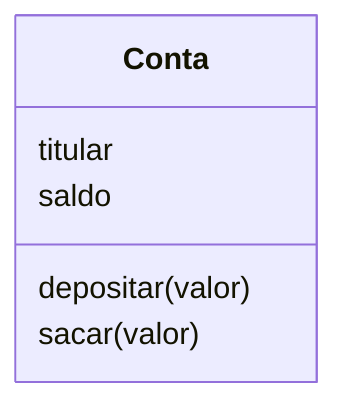

## Passo 1 · Leitura · Dados e funções soltos

No Nível 1, uma conta bancária seria um dicionário e algumas funções que o recebem:

```python
def depositar(conta, valor):
    conta["saldo"] += valor


conta_ana = {"titular": "Ana", "saldo": 100}
depositar(conta_ana, 50)
conta_ana["sado"] = 0      # erro de digitação: cria uma chave nova
```

Funciona, mas tem dois problemas. Os dados e as funções que os alteram vivem separados: nada diz que `depositar` só serve para dicionários com a chave `"saldo"`. E um erro de digitação como `"sado"` não dá erro nenhum, só cria uma chave a mais, e o saldo verdadeiro continua lá, intacto.

Uma **classe** junta as duas coisas: descreve quais dados um tipo de coisa tem e o que ela sabe fazer. É o molde. Cada **objeto** (ou **instância**) criado a partir dela é uma peça feita com esse molde, com os próprios valores.

```python
class Conta:
    def __init__(self, titular, saldo):
        self.titular = titular
        self.saldo = saldo

    def depositar(self, valor):
        self.saldo += valor


conta_ana = Conta("Ana", 100)
conta_ana.depositar(50)
print(conta_ana.saldo)     # 150
```

O vocabulário:

- **Atributo**: um dado guardado no objeto (`conta_ana.saldo`).
- **Método**: uma função definida dentro da classe (`depositar`). Ele é chamado com ponto, a partir de um objeto.
- **`__init__`**: o método especial que o Python executa sozinho quando você escreve `Conta("Ana", 100)`. É nele que os atributos ganham o valor inicial.

O nome da classe segue a convenção `PascalCase` (cada palavra com maiúscula, sem `_`): `Conta`, `ContaPoupanca`, `AlunoUsp`. Variáveis, funções e métodos continuam em `snake_case`.

Um diagrama de classe resume o molde: o nome em cima, os atributos no meio e os métodos embaixo.



`type(conta_ana)` responde `<class '__main__.Conta'>`: o tipo do objeto é a classe que você escreveu, do mesmo jeito que o tipo de `"oi"` é `str`.

## Passo 2 · Leitura · self e objetos independentes

Dentro da classe, os métodos recebem como primeiro parâmetro o próprio objeto. Por convenção ele se chama `self`. Quando você escreve

```python
conta_ana.depositar(50)
```

o Python executa, na prática, `Conta.depositar(conta_ana, 50)`: o objeto antes do ponto vira o `self`. Por isso `self.saldo += valor` altera o saldo **daquela** conta, e não de outra. A classe guarda o código uma vez só; o `self` diz a esse código, a cada chamada, sobre qual objeto ele está trabalhando. É o mesmo papel que o dicionário `conta` fazia como primeiro argumento das funções soltas do passo anterior, só que agora o Python o passa sozinho.

Cada `Conta(...)` cria um objeto novo, com os próprios atributos. Clique em "Visualizar" e avance linha a linha: veja que o depósito na conta da Bia não mexe na conta da Ana.

```python visualizar
class Conta:
    def __init__(self, titular, saldo):
        self.titular = titular
        self.saldo = saldo

    def depositar(self, valor):
        self.saldo += valor


ana = Conta("Ana", 100)
bia = Conta("Bia", 20)
bia.depositar(30)
print(ana.saldo, bia.saldo)
```

#### Dois erros clássicos

**Esquecer o `self` na assinatura.** O Python passa o objeto mesmo assim, e sobra um argumento:

```python
class Conta:
    def depositar(valor):          # faltou self
        ...
```

Chamar `conta.depositar(50)` dá:

```
TypeError: Conta.depositar() takes 1 positional argument but 2 were given
```

Os "2 argumentos" são o objeto e o `50`.

**Esquecer o `self.` na atribuição.** Dentro do `__init__`, `titular = titular` só cria uma variável local, que some quando o método termina. O objeto fica sem o atributo, e o erro aparece depois, longe da causa:

```
AttributeError: 'Conta' object has no attribute 'titular'
```

Regra prática: tudo o que o objeto precisa lembrar entre uma chamada e outra vai em `self.alguma_coisa`. Variável sem `self.` é rascunho do método.

## Passo 3 · Exercício · Complete a classe Aluno
modo: lacunas

A classe `Aluno` guarda o nome, a matrícula e a lista de notas de um aluno. Cada aluno precisa ter **a sua** lista: a nota da Ana não pode aparecer no boletim do Caio.

Complete as lacunas (`___`).

### Instruções
1. Complete o `__init__`: o primeiro parâmetro é o objeto, o nome vai para `self.nome` e cada aluno começa com uma lista de notas vazia.
2. Complete `adicionar_nota(nota)`, que acrescenta a nota à lista do próprio aluno.
3. Complete `media()`, que devolve a média das notas do aluno (ou `0.0` se ele ainda não tem notas).

### Código inicial
```python
class Aluno:
    def __init__(___, nome, matricula):
        self.nome = ___
        self.matricula = matricula
        self.notas = ___

    def adicionar_nota(self, nota):
        ___.notas.append(nota)

    def media(self):
        if not self.notas:
            return 0.0
        return sum(___) / len(self.notas)
```

### Solução
```python
class Aluno:
    def __init__(self, nome, matricula):
        self.nome = nome
        self.matricula = matricula
        self.notas = []

    def adicionar_nota(self, nota):
        self.notas.append(nota)

    def media(self):
        if not self.notas:
            return 0.0
        return sum(self.notas) / len(self.notas)
```

### Dicas
1. O primeiro parâmetro de todo método é o objeto, e o nome combinado para ele é `self`.
2. A lista vazia é criada dentro do `__init__`, que roda uma vez para cada aluno novo.
3. Em `adicionar_nota`, a lista que recebe a nota é a do objeto que chamou o método.

### Verificação
```json
[
  { "id": "classe", "checkpoint": 1, "kind": "source", "rule": { "type": "defines_class", "name": "Aluno" },
    "name": "Define a classe Aluno" },
  { "id": "atributos", "checkpoint": 1, "kind": "expr", "setup": "a = Aluno(\"Davi\", \"2025031\")",
    "expr": "(a.nome, a.matricula, a.notas)", "expected": ["Davi", "2025031", []],
    "name": "Aluno(\"Davi\", \"2025031\") guarda nome, matrícula e lista vazia",
    "hint": "Cada parâmetro do __init__ precisa ir para um atributo com self." },
  { "id": "adiciona", "checkpoint": 2, "kind": "expr", "setup": "a = Aluno(\"Eva\", \"1\")\na.adicionar_nota(7)\na.adicionar_nota(9.5)",
    "expr": "a.notas", "expected": [7, 9.5],
    "name": "Duas notas adicionadas aparecem na ordem", "hint": "adicionar_nota acrescenta ao fim da lista do aluno." },
  { "id": "independentes", "checkpoint": 2, "kind": "expr",
    "setup": "a = Aluno(\"Ana\", \"1\")\nb = Aluno(\"Caio\", \"2\")\na.adicionar_nota(8)\nb.adicionar_nota(3)\na.adicionar_nota(10)",
    "expr": "(a.notas, b.notas)", "expected": [[8, 10], [3]],
    "name": "Cada aluno tem a sua própria lista de notas",
    "hint": "Se as notas de um aluno aparecem no outro, a lista está sendo compartilhada. Ela precisa nascer no __init__." },
  { "id": "media", "checkpoint": 3, "kind": "expr", "setup": "a = Aluno(\"Bia\", \"3\")\nfor n in [6, 7, 10]:\n    a.adicionar_nota(n)",
    "expr": "a.media()", "expected": 7.666666666666667, "tolerance": 1e-9,
    "name": "Média de 6, 7 e 10" },
  { "id": "media-vazia", "checkpoint": 3, "kind": "expr", "expr": "Aluno(\"Davi\", \"4\").media()", "expected": 0.0, "type": "float",
    "name": "Aluno sem notas tem média 0.0" }
]
```

### Soluções erradas
```python name="nome sem self: vira variável local"
class Aluno:
    def __init__(self, nome, matricula):
        nome = nome
        self.matricula = matricula
        self.notas = []

    def adicionar_nota(self, nota):
        self.notas.append(nota)

    def media(self):
        if not self.notas:
            return 0.0
        return sum(self.notas) / len(self.notas)
```
```python name="lista de notas criada na classe e compartilhada"
class Aluno:
    notas = []

    def __init__(self, nome, matricula):
        self.nome = nome
        self.matricula = matricula

    def adicionar_nota(self, nota):
        self.notas.append(nota)

    def media(self):
        if not self.notas:
            return 0.0
        return sum(self.notas) / len(self.notas)
```
```python name="adicionar_nota troca a lista em vez de acrescentar"
class Aluno:
    def __init__(self, nome, matricula):
        self.nome = nome
        self.matricula = matricula
        self.notas = []

    def adicionar_nota(self, nota):
        self.notas = [nota]

    def media(self):
        if not self.notas:
            return 0.0
        return sum(self.notas) / len(self.notas)
```

## Passo 4 · Previsão · Quem é quem

Três variáveis, mas quantos objetos? Lembre que `Caixa(...)` cria um objeto novo e que `=` só dá mais um nome a um objeto que já existe.

Leia o programa sem executar e digite exatamente o que ele imprime.

### Código
```python
class Caixa:
    def __init__(self, dono):
        self.dono = dono
        self.itens = []


a = Caixa("Ana")
b = Caixa("Bia")
c = a
a.itens.append("lápis")
c.itens.append("borracha")
b.itens.append("caderno")
print(a.dono, a.itens)
print(b.dono, b.itens)
print(c.dono, len(c.itens))
```

### Dicas
1. Só existem dois objetos: `Caixa` foi chamada duas vezes.
2. `c = a` não copia nada: `c` e `a` são dois nomes para a mesma caixa.

### Saída esperada
```text
Ana ['lápis', 'borracha']
Bia ['caderno']
Ana 2
```

## Passo 5 · Exercício · Retângulos

Agora sem lacunas. Escreva a classe `Retangulo`. Além das contas de sempre, ela tem um método que **altera** o objeto e um que **compara** o objeto com outro retângulo.

`cabe_dentro(outro)` responde se este retângulo cabe dentro de `outro`, podendo ser girado 90 graus. Um retângulo 5 × 2 cabe dentro de um 3 × 6 se for girado (vira 2 × 5); um 4 × 4 não cabe dentro do 3 × 6 de jeito nenhum. Medidas iguais cabem.

### Instruções
1. Defina a classe `Retangulo` com `__init__(self, largura, altura)`, guardando os valores nos atributos `largura` e `altura`.
2. `area()` devolve a área e `perimetro()` devolve o perímetro (a soma dos quatro lados).
3. `escalar(fator)` multiplica a largura e a altura do próprio retângulo pelo fator. Ele altera o objeto e não devolve nada.
   Dica: depois de `r.escalar(2)`, `r.area()` já usa os lados novos.
4. `cabe_dentro(outro)` devolve `True` se o retângulo cabe dentro de `outro` na posição normal ou girado, e `False` caso contrário.

### Código inicial
```python
class Retangulo:
    def __init__(self, largura, altura):
        pass
```

### Solução
```python
class Retangulo:
    def __init__(self, largura, altura):
        self.largura = largura
        self.altura = altura

    def area(self):
        return self.largura * self.altura

    def perimetro(self):
        return 2 * (self.largura + self.altura)

    def escalar(self, fator):
        self.largura *= fator
        self.altura *= fator

    def cabe_dentro(self, outro):
        normal = self.largura <= outro.largura and self.altura <= outro.altura
        girado = self.largura <= outro.altura and self.altura <= outro.largura
        return normal or girado
```

### Dicas
1. Todo método começa com `self`, e todo acesso aos lados é `self.largura` ou `self.altura`.
2. `escalar` precisa reatribuir os atributos do objeto; criar um retângulo novo não altera o que já existe.
3. Em `cabe_dentro`, `outro` é um `Retangulo` também: os lados dele são `outro.largura` e `outro.altura`. Teste as duas posições.

### Verificação
```json
[
  { "id": "classe", "checkpoint": 1, "kind": "source", "rule": { "type": "defines_class", "name": "Retangulo" },
    "name": "Define a classe Retangulo" },
  { "id": "atributos", "checkpoint": 1, "kind": "expr", "setup": "r = Retangulo(3, 8)", "expr": "(r.largura, r.altura)",
    "expected": [3, 8], "name": "Retangulo(3, 8) guarda largura 3 e altura 8" },
  { "id": "area", "checkpoint": 2, "kind": "expr", "expr": "Retangulo(4, 2.5).area()", "expected": 10.0, "tolerance": 1e-9,
    "name": "Área de 4 × 2.5" },
  { "id": "perimetro", "checkpoint": 2, "kind": "expr", "expr": "Retangulo(7, 2).perimetro()", "expected": 18,
    "name": "Perímetro de 7 × 2", "hint": "O perímetro soma os quatro lados, não só dois." },
  { "id": "escalar", "checkpoint": 3, "kind": "expr", "setup": "r = Retangulo(2, 3)\nr.escalar(3)",
    "expr": "(r.largura, r.altura, r.area())", "expected": [6, 9, 54],
    "name": "Depois de escalar(3), um 2 × 3 vira 6 × 9", "hint": "escalar precisa alterar os atributos do próprio objeto." },
  { "id": "escalar-um-so", "checkpoint": 3, "kind": "expr", "setup": "r1 = Retangulo(1, 4)\nr2 = Retangulo(1, 4)\nr1.escalar(2)",
    "expr": "(r1.area(), r2.area())", "expected": [16, 4],
    "name": "Escalar um retângulo não muda outro" },
  { "id": "cabe-normal", "checkpoint": 4, "kind": "expr", "expr": "Retangulo(2, 5).cabe_dentro(Retangulo(3, 6))", "expected": true,
    "name": "2 × 5 cabe em 3 × 6" },
  { "id": "cabe-girado", "checkpoint": 4, "kind": "expr", "expr": "Retangulo(6, 1).cabe_dentro(Retangulo(2, 7))", "expected": true,
    "name": "6 × 1 cabe em 2 × 7 se for girado", "hint": "Teste também a posição girada: largura contra altura." },
  { "id": "nao-cabe", "checkpoint": 4, "kind": "expr", "expr": "Retangulo(4, 4).cabe_dentro(Retangulo(3, 6))", "expected": false,
    "name": "4 × 4 não cabe em 3 × 6" },
  { "id": "nao-cabe-grande", "checkpoint": 4, "kind": "expr", "expr": "Retangulo(3, 6).cabe_dentro(Retangulo(2, 5))", "expected": false,
    "name": "3 × 6 não cabe em 2 × 5", "hint": "Os dois lados precisam caber ao mesmo tempo." },
  { "id": "iguais", "checkpoint": 4, "kind": "expr", "expr": "Retangulo(5, 3).cabe_dentro(Retangulo(5, 3))", "expected": true,
    "name": "Medidas iguais cabem" }
]
```

### Soluções erradas
```python name="perímetro soma só dois lados"
class Retangulo:
    def __init__(self, largura, altura):
        self.largura = largura
        self.altura = altura

    def area(self):
        return self.largura * self.altura

    def perimetro(self):
        return self.largura + self.altura

    def escalar(self, fator):
        self.largura *= fator
        self.altura *= fator

    def cabe_dentro(self, outro):
        normal = self.largura <= outro.largura and self.altura <= outro.altura
        girado = self.largura <= outro.altura and self.altura <= outro.largura
        return normal or girado
```
```python name="escalar devolve um retângulo novo e não altera o objeto"
class Retangulo:
    def __init__(self, largura, altura):
        self.largura = largura
        self.altura = altura

    def area(self):
        return self.largura * self.altura

    def perimetro(self):
        return 2 * (self.largura + self.altura)

    def escalar(self, fator):
        return Retangulo(self.largura * fator, self.altura * fator)

    def cabe_dentro(self, outro):
        normal = self.largura <= outro.largura and self.altura <= outro.altura
        girado = self.largura <= outro.altura and self.altura <= outro.largura
        return normal or girado
```
```python name="cabe_dentro sem testar a posição girada"
class Retangulo:
    def __init__(self, largura, altura):
        self.largura = largura
        self.altura = altura

    def area(self):
        return self.largura * self.altura

    def perimetro(self):
        return 2 * (self.largura + self.altura)

    def escalar(self, fator):
        self.largura *= fator
        self.altura *= fator

    def cabe_dentro(self, outro):
        return self.largura <= outro.largura and self.altura <= outro.altura
```
```python name="cabe_dentro compara só as áreas"
class Retangulo:
    def __init__(self, largura, altura):
        self.largura = largura
        self.altura = altura

    def area(self):
        return self.largura * self.altura

    def perimetro(self):
        return 2 * (self.largura + self.altura)

    def escalar(self, fator):
        self.largura *= fator
        self.altura *= fator

    def cabe_dentro(self, outro):
        return self.area() <= outro.area()
```
```python name="método sem self"
class Retangulo:
    def __init__(self, largura, altura):
        self.largura = largura
        self.altura = altura

    def area():
        return largura * altura

    def perimetro(self):
        return 2 * (self.largura + self.altura)

    def escalar(self, fator):
        self.largura *= fator
        self.altura *= fator

    def cabe_dentro(self, outro):
        normal = self.largura <= outro.largura and self.altura <= outro.altura
        girado = self.largura <= outro.altura and self.altura <= outro.largura
        return normal or girado
```

## Passo 6 · Leitura · Atributo de classe e atributo de instância

Até aqui todos os atributos foram criados com `self.` dentro de um método: são **atributos de instância**, um por objeto. Uma variável escrita direto no corpo da classe, fora dos métodos, é um **atributo de classe**: existe uma vez só, na classe, e todos os objetos enxergam o mesmo.

```python
class Turma:
    alunos = []              # atributo de classe: uma lista para TODAS as turmas

    def __init__(self, nome):
        self.nome = nome     # atributo de instância: um por turma

    def matricular(self, aluno):
        self.alunos.append(aluno)


t1 = Turma("Cálculo")
t2 = Turma("Física")
t1.matricular("Ana")
print(t2.alunos)             # ['Ana']
```

A Ana aparece na turma de Física sem ter se matriculado nela. Ao ler `self.alunos`, o Python procura primeiro no objeto; como o objeto não tem `alunos`, ele encontra o da classe, e `append` altera essa lista única. A correção é criar a lista no `__init__`, com `self.alunos = []`: cada chamada de `Turma(...)` roda o `__init__` de novo e gera uma lista nova.

Atributo de classe tem uso legítimo: um valor que é o mesmo para todos os objetos e não muda pelo objeto, como `capacidade_maxima = 40`. Lista e dicionário mutáveis no corpo da classe quase sempre são engano.

#### Método chamado pela classe

Um método precisa de um objeto para ser o `self`. Chamá-lo pela classe, sem objeto, desloca os argumentos:

```python
Turma.matricular("Ana")
```

```
TypeError: Turma.matricular() missing 1 required positional argument: 'aluno'
```

O `"Ana"` virou o `self`, e o `aluno` ficou faltando. O certo é criar a turma e chamar pelo objeto: `t1.matricular("Ana")`.

## Passo 7 · Exercício · Contador de cliques

Um contador de catraca do RU começa num valor, sobe a cada passagem e pode ser zerado no fim do dia. Escreva a classe `Contador`.

O detalhe: zerar **volta ao valor inicial** daquele contador (que pode não ser 0), e o contador também lembra quantas vezes `incrementar` foi chamado desde que foi criado, número que **não** é apagado por `zerar`.

```python
c = Contador(10)
c.incrementar()
c.incrementar(4)
print(c.valor, c.cliques)   # 15 2
c.zerar()
print(c.valor, c.cliques)   # 10 2
```

### Instruções
1. Defina `Contador` com `__init__(self, inicio=0)`. O atributo `valor` começa em `inicio` e o atributo `cliques` começa em 0.
2. `incrementar(passo=1)` soma `passo` ao `valor` e soma 1 a `cliques`.
3. `zerar()` devolve `valor` ao valor inicial daquele contador, sem mexer em `cliques`.
   Dica: o contador precisa lembrar o `inicio` para usar depois.
4. Contadores diferentes não podem interferir um no outro.

### Código inicial
```python
class Contador:
    pass
```

### Solução
```python
class Contador:
    def __init__(self, inicio=0):
        self.inicio = inicio
        self.valor = inicio
        self.cliques = 0

    def incrementar(self, passo=1):
        self.valor += passo
        self.cliques += 1

    def zerar(self):
        self.valor = self.inicio
```

### Dicas
1. `inicio` é um parâmetro: ele some quando o `__init__` termina, a menos que seja guardado em `self`.
2. `cliques` conta chamadas, não unidades: `incrementar(5)` soma 1 a `cliques`.
3. Tudo que muda vai em atributos criados no `__init__`, nunca no corpo da classe.

### Verificação
```json
[
  { "id": "padrao", "checkpoint": 1, "kind": "expr", "setup": "c = Contador()", "expr": "(c.valor, c.cliques)", "expected": [0, 0],
    "name": "Contador() começa com valor 0 e 0 cliques" },
  { "id": "inicio", "checkpoint": 1, "kind": "expr", "setup": "c = Contador(25)", "expr": "(c.valor, c.cliques)", "expected": [25, 0],
    "name": "Contador(25) começa em 25" },
  { "id": "incrementa", "checkpoint": 2, "kind": "expr", "setup": "c = Contador()\nc.incrementar()\nc.incrementar()\nc.incrementar(5)",
    "expr": "(c.valor, c.cliques)", "expected": [7, 3],
    "name": "Três chamadas: +1, +1 e +5", "hint": "valor soma o passo; cliques soma 1 por chamada." },
  { "id": "zera", "checkpoint": 3, "kind": "expr", "setup": "c = Contador(4)\nc.incrementar(6)\nc.incrementar()\nc.zerar()",
    "expr": "(c.valor, c.cliques)", "expected": [4, 2],
    "name": "zerar() volta ao início e mantém os cliques", "hint": "Zerar volta para o valor com que o contador foi criado." },
  { "id": "depois-de-zerar", "checkpoint": 3, "kind": "expr", "setup": "c = Contador(3)\nc.incrementar(2)\nc.zerar()\nc.incrementar(10)",
    "expr": "(c.valor, c.cliques)", "expected": [13, 2],
    "name": "O contador continua funcionando depois de zerar" },
  { "id": "independentes", "checkpoint": 4, "kind": "expr", "setup": "a = Contador()\nb = Contador(100)\na.incrementar(3)\nb.incrementar()\na.zerar()",
    "expr": "(a.valor, a.cliques, b.valor, b.cliques)", "expected": [0, 1, 101, 1],
    "name": "Dois contadores não interferem um no outro",
    "hint": "Se um contador muda o outro, algum dado está guardado na classe e não no objeto." }
]
```

### Soluções erradas
```python name="valor guardado na classe e compartilhado"
class Contador:
    valor = 0
    cliques = 0

    def __init__(self, inicio=0):
        self.inicio = inicio
        Contador.valor = inicio

    def incrementar(self, passo=1):
        Contador.valor += passo
        Contador.cliques += 1

    def zerar(self):
        Contador.valor = self.inicio
```
```python name="zerar sempre volta para 0"
class Contador:
    def __init__(self, inicio=0):
        self.valor = inicio
        self.cliques = 0

    def incrementar(self, passo=1):
        self.valor += passo
        self.cliques += 1

    def zerar(self):
        self.valor = 0
```
```python name="cliques soma o passo em vez de contar chamadas"
class Contador:
    def __init__(self, inicio=0):
        self.inicio = inicio
        self.valor = inicio
        self.cliques = 0

    def incrementar(self, passo=1):
        self.valor += passo
        self.cliques += passo

    def zerar(self):
        self.valor = self.inicio
```
```python name="zerar também apaga os cliques"
class Contador:
    def __init__(self, inicio=0):
        self.inicio = inicio
        self.valor = inicio
        self.cliques = 0

    def incrementar(self, passo=1):
        self.valor += passo
        self.cliques += 1

    def zerar(self):
        self.valor = self.inicio
        self.cliques = 0
```

## Passo 8 · Quiz · Classes e objetos

### Pergunta
Na chamada `bia.depositar(30)`, quem é o `self` dentro de `depositar`?
- [ ] A classe `Conta`
- [x] O objeto `bia`
- [ ] O número `30`
- [ ] Nada: `self` só existe dentro do `__init__`
> O objeto antes do ponto é passado como primeiro argumento: a chamada equivale a `Conta.depositar(bia, 30)`. Por isso `self.saldo` é o saldo da Bia.

### Pergunta
Este `__init__` roda sem erro, mas `p.nome` falha logo depois. Por quê?
```python
class Pessoa:
    def __init__(self, nome):
        nome = nome

p = Pessoa("Caio")
```
- [ ] Porque o parâmetro e o atributo não podem ter o mesmo nome
- [ ] Porque o `__init__` precisa terminar com `return self`
- [x] Porque `nome = nome` cria só uma variável local; o atributo seria `self.nome = nome`
- [ ] Porque `Pessoa` deveria ser escrito em minúsculas
> Sem `self.`, a atribuição fica dentro do método e some no fim dele. O objeto nunca ganha o atributo, e `p.nome` dá `AttributeError: 'Pessoa' object has no attribute 'nome'`. Parâmetro e atributo com o mesmo nome é o padrão comum.

### Pergunta
`Fila` tem `pessoas = []` escrito no corpo da classe e um método `entrar(nome)` que faz `self.pessoas.append(nome)`. Depois de `f1 = Fila()`, `f2 = Fila()` e `f1.entrar("Eva")`, quanto vale `f2.pessoas`?
- [ ] `[]`, porque cada fila é um objeto diferente
- [x] `['Eva']`, porque as duas filas usam a mesma lista, que é atributo da classe
- [ ] Dá `AttributeError`, porque `f2` nunca recebeu `pessoas`
- [ ] Dá `TypeError`, porque lista não pode ser atributo
> `pessoas` foi criada uma vez, na classe. Nenhum objeto tem `pessoas` próprio, então `self.pessoas` encontra a lista da classe, a mesma para todas as filas. A lista de cada fila precisa nascer no `__init__`.
