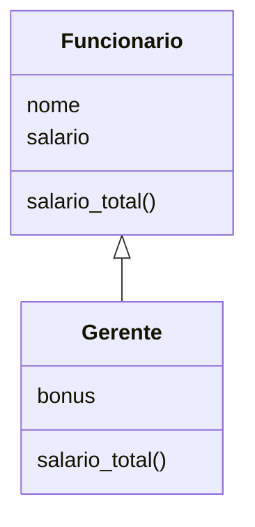

## Passo 1 · Leitura · Duas classes quase iguais

A folha de pagamento tem funcionários e gerentes. Um gerente é um funcionário com uma coisa a mais: um bônus. Escrever as duas classes do zero repete quase tudo:

```python
class Funcionario:
    def __init__(self, nome, salario):
        self.nome = nome
        self.salario = salario

    def salario_total(self):
        return self.salario


class Gerente:
    def __init__(self, nome, salario, bonus):
        self.nome = nome              # repetido
        self.salario = salario        # repetido
        self.bonus = bonus

    def salario_total(self):
        return self.salario + self.bonus
```

Se amanhã todo funcionário ganhar um campo `cpf`, você precisa lembrar de mudar as duas classes. Esquecer uma é questão de tempo. E o defeito não avisa: o programa continua rodando, até que um relatório peça `gerente.cpf` e estoure um `AttributeError` só para os gerentes. Código copiado diverge em silêncio; código compartilhado muda num lugar só.

**Herança** resolve isso. Ao escrever `class Gerente(Funcionario):`, você diz que `Gerente` é uma **subclasse** (classe filha) de `Funcionario`, a **classe base** (classe mãe). A subclasse recebe tudo o que a base tem, atributos e métodos, e só escreve o que é diferente.

```python
class Gerente(Funcionario):
    pass


g = Gerente("Eva", 5000)
print(g.salario_total())     # 5000: método herdado de Funcionario
```

Mesmo sem uma linha própria, `Gerente` já funciona: o `__init__` e o `salario_total` vêm da base. Quando o Python procura `g.salario_total`, ele olha primeiro em `Gerente`; como não encontra, sobe para `Funcionario`.

No diagrama de classes, a seta com ponta vazada sai da subclasse e aponta para a base. Leia como "Gerente **é um** Funcionario":



A herança só faz sentido quando a frase "X é um Y" é verdadeira: gerente é um funcionário, círculo é uma forma, carro é um veículo. O próximo passo mostra como o gerente acrescenta o bônus sem repetir o que a base já faz.

## Passo 2 · Leitura · Sobrescrever e estender com super()

Quando a subclasse define um método com o mesmo nome de um método da base, ela **sobrescreve** esse método: para objetos da subclasse, vale a versão nova.

Muitas vezes você não quer substituir o comportamento da base, e sim **estender**: fazer o que a base faz e mais alguma coisa. `super()` dá acesso aos métodos da classe base a partir da subclasse:

```python
class Gerente(Funcionario):
    def __init__(self, nome, salario, bonus):
        super().__init__(nome, salario)      # a base cuida de nome e salario
        self.bonus = bonus                   # o gerente cuida só do que é dele

    def salario_total(self):
        return super().salario_total() + self.bonus
```

`super().__init__(nome, salario)` roda o `__init__` de `Funcionario` sobre o próprio objeto: ele ganha `nome` e `salario`. Repare que não se passa `self`: o `super()` já sabe qual é o objeto.

Em `salario_total`, `super().salario_total()` pergunta à base quanto é o salário, e o gerente soma o bônus. Se um dia a regra do funcionário mudar (um adicional por tempo de casa, por exemplo), o gerente acompanha sem nenhuma mudança na classe dele.

#### Esquecer o super().__init__

Ao escrever um `__init__` na subclasse, você **substitui** o da base. Se ele não chamar `super().__init__`, o código da base não roda, e o objeto nasce sem os atributos dela:

```python
class Gerente(Funcionario):
    def __init__(self, nome, salario, bonus):
        self.bonus = bonus                   # esqueceu o super().__init__
```

O erro só aparece quando alguém usa o atributo que faltou:

```
AttributeError: 'Gerente' object has no attribute 'salario'
```

#### Chamar o próprio método por engano

Dentro de `salario_total` do gerente, escrever `self.salario_total()` em vez de `super().salario_total()` chama o método do próprio gerente, que chama ele mesmo de novo, sem fim: `RecursionError`. Para chegar na versão da base, o caminho é `super()`.

## Passo 3 · Exercício · Gerente com bônus
modo: lacunas

O `Funcionario` está pronto e tem um método `descricao()` que usa `salario_total()`. Complete o `Gerente` para que ele herde de `Funcionario`, reaproveite o `__init__` da base e **estenda** o salário total com o bônus.

### Instruções
1. Faça `Gerente` ser subclasse de `Funcionario`.
2. No `__init__` do gerente, deixe a base cuidar de `nome` e `salario`.
3. `salario_total()` do gerente devolve o salário total calculado pela base mais o bônus.
   Dica: `descricao()` é herdada e passa a mostrar o total com bônus sem você reescrevê-la.

### Código inicial
```python
class Funcionario:
    def __init__(self, nome, salario):
        self.nome = nome
        self.salario = salario

    def salario_total(self):
        return self.salario

    def descricao(self):
        return f"{self.nome}: R$ {self.salario_total():.2f}"


class Gerente(___):
    def __init__(self, nome, salario, bonus):
        ___.__init__(nome, salario)
        self.bonus = bonus

    def salario_total(self):
        return ___.salario_total() + self.bonus
```

### Solução
```python
class Funcionario:
    def __init__(self, nome, salario):
        self.nome = nome
        self.salario = salario

    def salario_total(self):
        return self.salario

    def descricao(self):
        return f"{self.nome}: R$ {self.salario_total():.2f}"


class Gerente(Funcionario):
    def __init__(self, nome, salario, bonus):
        super().__init__(nome, salario)
        self.bonus = bonus

    def salario_total(self):
        return super().salario_total() + self.bonus
```

### Dicas
1. A classe base vai entre parênteses depois do nome da subclasse.
2. As duas outras lacunas são a mesma chamada, que dá acesso aos métodos da base.
3. `super()` leva parênteses e não recebe `self`.

### Verificação
```json
[
  { "id": "subclasse", "checkpoint": 1, "kind": "expr", "expr": "issubclass(Gerente, Funcionario)", "expected": true,
    "name": "Gerente é subclasse de Funcionario" },
  { "id": "atributos", "checkpoint": 2, "kind": "expr", "setup": "g = Gerente(\"Davi\", 4200, 800)",
    "expr": "(g.nome, g.salario, g.bonus)", "expected": ["Davi", 4200, 800],
    "name": "Gerente(\"Davi\", 4200, 800) tem nome, salário e bônus",
    "hint": "Sem chamar o __init__ da base, o gerente fica sem nome e salário." },
  { "id": "total", "checkpoint": 3, "kind": "expr", "expr": "Gerente(\"Eva\", 5000, 1500).salario_total()", "expected": 6500,
    "name": "Salário total de 5000 com bônus de 1500" },
  { "id": "estende-base", "checkpoint": 3, "kind": "expr",
    "setup": "Funcionario.salario_total = lambda self: self.salario * 2",
    "expr": "Gerente(\"Ana\", 1000, 300).salario_total()", "expected": 2300,
    "name": "O gerente usa o total calculado pela base",
    "hint": "Se a regra da base mudar, o gerente precisa acompanhar: peça o total à base em vez de repetir a conta." },
  { "id": "descricao", "checkpoint": 3, "kind": "expr", "expr": "Gerente(\"Caio\", 3000, 250.5).descricao()", "expected": "Caio: R$ 3250.50",
    "name": "descricao() herdada mostra o total com bônus" },
  { "id": "base-intacta", "checkpoint": 3, "kind": "expr", "expr": "Funcionario(\"Bia\", 3000).descricao()", "expected": "Bia: R$ 3000.00",
    "name": "Funcionario continua sem bônus" }
]
```

### Soluções erradas
```python name="esquece o super().__init__"
class Funcionario:
    def __init__(self, nome, salario):
        self.nome = nome
        self.salario = salario

    def salario_total(self):
        return self.salario

    def descricao(self):
        return f"{self.nome}: R$ {self.salario_total():.2f}"


class Gerente(Funcionario):
    def __init__(self, nome, salario, bonus):
        self.bonus = bonus

    def salario_total(self):
        return super().salario_total() + self.bonus
```
```python name="repete a conta da base em vez de usar super()"
class Funcionario:
    def __init__(self, nome, salario):
        self.nome = nome
        self.salario = salario

    def salario_total(self):
        return self.salario

    def descricao(self):
        return f"{self.nome}: R$ {self.salario_total():.2f}"


class Gerente(Funcionario):
    def __init__(self, nome, salario, bonus):
        super().__init__(nome, salario)
        self.bonus = bonus

    def salario_total(self):
        return self.salario + self.bonus
```
```python name="chama self.salario_total() e entra em recursão"
class Funcionario:
    def __init__(self, nome, salario):
        self.nome = nome
        self.salario = salario

    def salario_total(self):
        return self.salario

    def descricao(self):
        return f"{self.nome}: R$ {self.salario_total():.2f}"


class Gerente(Funcionario):
    def __init__(self, nome, salario, bonus):
        super().__init__(nome, salario)
        self.bonus = bonus

    def salario_total(self):
        return self.salario_total() + self.bonus
```
```python name="Gerente sem herança, tudo copiado"
class Funcionario:
    def __init__(self, nome, salario):
        self.nome = nome
        self.salario = salario

    def salario_total(self):
        return self.salario

    def descricao(self):
        return f"{self.nome}: R$ {self.salario_total():.2f}"


class Gerente:
    def __init__(self, nome, salario, bonus):
        self.nome = nome
        self.salario = salario
        self.bonus = bonus

    def salario_total(self):
        return self.salario + self.bonus
```

## Passo 4 · Previsão · Quem roda primeiro

`Cachorro` herda de `Animal`, chama o construtor da base com `super()` e sobrescreve só o método `som`. O método `apresentar` existe apenas em `Animal`, e dentro dele há uma chamada a `self.som()`.

Leia o programa sem executar e digite exatamente o que ele imprime.

### Código
```python
class Animal:
    def __init__(self, nome):
        print("Animal.__init__")
        self.nome = nome

    def apresentar(self):
        return f"{self.nome} faz {self.som()}"

    def som(self):
        return "..."


class Cachorro(Animal):
    def __init__(self, nome, raca):
        print("Cachorro.__init__ começa")
        super().__init__(nome)
        self.raca = raca
        print("Cachorro.__init__ termina")

    def som(self):
        return "au au"


rex = Cachorro("Rex", "vira-lata")
print(rex.apresentar())
print(Animal("Mimi").apresentar())
```

### Dicas
1. O `super().__init__(nome)` fica no meio do `__init__` do cachorro: o que vem antes dele imprime antes.
2. Em `rex.apresentar()`, o `self` é o Rex, um `Cachorro`: `self.som()` procura `som` primeiro em `Cachorro`.
3. `Animal("Mimi")` também é um objeto novo, e o construtor dele imprime.

### Saída esperada
```text
Cachorro.__init__ começa
Animal.__init__
Cachorro.__init__ termina
Rex faz au au
Animal.__init__
Mimi faz ...
```

## Passo 5 · Exercício · Formas geométricas

A classe `Forma` guarda o nome da forma e sabe se descrever. Cada forma concreta só precisa dizer como calcula a própria área. O resultado da previsão anterior é a chave: um método da base que chama `self.area()` usa a versão da subclasse.

```python
print(Circulo(1).descricao())      # Círculo: área 3.14
print(Quadrado(1.5).descricao())   # Quadrado: área 2.25
print(area_total([Circulo(1), Quadrado(2)]))   # 7.141592653589793
```

A área do círculo é $\pi r^2$; use `math.pi`.

### Instruções
1. `Circulo(raio)` e `Quadrado(lado)` são subclasses de `Forma`. Cada uma guarda a medida (`raio` ou `lado`) e passa o nome (`"Círculo"` ou `"Quadrado"`) ao `__init__` da base.
2. Cada subclasse sobrescreve `area()` com a sua fórmula.
3. `descricao()` fica escrita uma vez só, em `Forma`, e funciona para qualquer subclasse.
   Dica: não copie `descricao` para as subclasses.
4. A função `area_total(formas)` devolve a soma das áreas de uma lista de formas, de qualquer tipo, inclusive formas que ainda não existem.

### Código inicial
```python
import math


class Forma:
    def __init__(self, nome):
        self.nome = nome

    def area(self):
        return 0

    def descricao(self):
        return f"{self.nome}: área {self.area():.2f}"
```

### Solução
```python
import math


class Forma:
    def __init__(self, nome):
        self.nome = nome

    def area(self):
        return 0

    def descricao(self):
        return f"{self.nome}: área {self.area():.2f}"


class Circulo(Forma):
    def __init__(self, raio):
        super().__init__("Círculo")
        self.raio = raio

    def area(self):
        return math.pi * self.raio ** 2


class Quadrado(Forma):
    def __init__(self, lado):
        super().__init__("Quadrado")
        self.lado = lado

    def area(self):
        return self.lado ** 2


def area_total(formas):
    total = 0
    for forma in formas:
        total += forma.area()
    return total
```

### Dicas
1. O `__init__` de cada subclasse recebe só a medida; o nome é fixo e vai para `super().__init__(...)`.
2. `descricao` chama `self.area()`, e o `self` é o círculo ou o quadrado: cada um responde com a sua área.
3. Em `area_total`, não pergunte o tipo de cada forma: peça a área a ela.

### Verificação
```json
[
  { "id": "circulo-forma", "checkpoint": 1, "kind": "expr", "setup": "c = Circulo(3)\nq = Quadrado(4)",
    "expr": "(isinstance(c, Forma), isinstance(q, Forma), c.nome, q.nome, c.raio, q.lado)",
    "expected": [true, true, "Círculo", "Quadrado", 3, 4], "name": "Circulo e Quadrado são formas com nome e medida",
    "hint": "Passe o nome para o __init__ da base com super()." },
  { "id": "area-circulo", "checkpoint": 2, "kind": "expr", "expr": "Circulo(2).area()", "expected": 12.566370614359172, "tolerance": 1e-9,
    "name": "Área do círculo de raio 2", "hint": "Use math.pi, não 3.14." },
  { "id": "area-quadrado", "checkpoint": 2, "kind": "expr", "expr": "Quadrado(2.5).area()", "expected": 6.25, "tolerance": 1e-9,
    "name": "Área do quadrado de lado 2.5" },
  { "id": "descricao", "checkpoint": 3, "kind": "expr", "expr": "(Circulo(0.5).descricao(), Quadrado(3).descricao())",
    "expected": ["Círculo: área 0.79", "Quadrado: área 9.00"], "name": "descricao() de um círculo e de um quadrado" },
  { "id": "descricao-herdada", "checkpoint": 3, "kind": "expr",
    "setup": "Forma.descricao = lambda self: self.nome.upper()",
    "expr": "(Circulo(1).descricao(), Quadrado(1).descricao())", "expected": ["CÍRCULO", "QUADRADO"],
    "name": "As subclasses usam a descricao() de Forma",
    "hint": "descricao deve existir só em Forma; as subclasses herdam." },
  { "id": "total", "checkpoint": 4, "kind": "expr", "expr": "area_total([Circulo(1), Quadrado(2), Quadrado(0.5)])",
    "expected": 7.391592653589793, "tolerance": 1e-9, "name": "Área total de um círculo e dois quadrados" },
  { "id": "total-vazio", "checkpoint": 4, "kind": "expr", "expr": "area_total([])", "expected": 0,
    "name": "Lista vazia tem área total 0" },
  { "id": "total-forma-nova", "checkpoint": 4, "kind": "expr",
    "setup": "class Retangulo(Forma):\n    def __init__(self, b, h):\n        super().__init__(\"Retângulo\")\n        self.b = b\n        self.h = h\n\n    def area(self):\n        return self.b * self.h",
    "expr": "area_total([Retangulo(2, 3), Quadrado(1)])", "expected": 7, "tolerance": 1e-9,
    "name": "area_total funciona com uma forma nova, criada depois",
    "hint": "Se area_total pergunta o tipo de cada forma, uma forma nova fica de fora. Chame forma.area()." }
]
```

### Soluções erradas
```python name="pi aproximado por 3.14"
import math


class Forma:
    def __init__(self, nome):
        self.nome = nome

    def area(self):
        return 0

    def descricao(self):
        return f"{self.nome}: área {self.area():.2f}"


class Circulo(Forma):
    def __init__(self, raio):
        super().__init__("Círculo")
        self.raio = raio

    def area(self):
        return 3.14 * self.raio ** 2


class Quadrado(Forma):
    def __init__(self, lado):
        super().__init__("Quadrado")
        self.lado = lado

    def area(self):
        return self.lado ** 2


def area_total(formas):
    total = 0
    for forma in formas:
        total += forma.area()
    return total
```
```python name="subclasses sem super().__init__: ficam sem nome"
import math


class Forma:
    def __init__(self, nome):
        self.nome = nome

    def area(self):
        return 0

    def descricao(self):
        return f"{self.nome}: área {self.area():.2f}"


class Circulo(Forma):
    def __init__(self, raio):
        self.raio = raio

    def area(self):
        return math.pi * self.raio ** 2


class Quadrado(Forma):
    def __init__(self, lado):
        self.lado = lado

    def area(self):
        return self.lado ** 2


def area_total(formas):
    total = 0
    for forma in formas:
        total += forma.area()
    return total
```
```python name="descricao copiada em cada subclasse"
import math


class Forma:
    def __init__(self, nome):
        self.nome = nome

    def area(self):
        return 0

    def descricao(self):
        return f"{self.nome}: área {self.area():.2f}"


class Circulo(Forma):
    def __init__(self, raio):
        super().__init__("Círculo")
        self.raio = raio

    def area(self):
        return math.pi * self.raio ** 2

    def descricao(self):
        return f"Círculo: área {self.area():.2f}"


class Quadrado(Forma):
    def __init__(self, lado):
        super().__init__("Quadrado")
        self.lado = lado

    def area(self):
        return self.lado ** 2

    def descricao(self):
        return f"Quadrado: área {self.area():.2f}"


def area_total(formas):
    total = 0
    for forma in formas:
        total += forma.area()
    return total
```
```python name="area_total pergunta o tipo de cada forma"
import math


class Forma:
    def __init__(self, nome):
        self.nome = nome

    def area(self):
        return 0

    def descricao(self):
        return f"{self.nome}: área {self.area():.2f}"


class Circulo(Forma):
    def __init__(self, raio):
        super().__init__("Círculo")
        self.raio = raio

    def area(self):
        return math.pi * self.raio ** 2


class Quadrado(Forma):
    def __init__(self, lado):
        super().__init__("Quadrado")
        self.lado = lado

    def area(self):
        return self.lado ** 2


def area_total(formas):
    total = 0
    for forma in formas:
        if isinstance(forma, Circulo):
            total += math.pi * forma.raio ** 2
        elif isinstance(forma, Quadrado):
            total += forma.lado ** 2
    return total
```

## Passo 6 · Leitura · isinstance, a ordem de busca e quando não herdar

`isinstance(obj, Classe)` responde se o objeto é daquela classe **ou de uma subclasse dela**. `issubclass(A, B)` faz a mesma pergunta sobre duas classes:

```python
rex = Cachorro("Rex", "vira-lata")
print(isinstance(rex, Cachorro))        # True
print(isinstance(rex, Animal))          # True: todo cachorro é um animal
print(isinstance(Animal("Mimi"), Cachorro))   # False: nem todo animal é cachorro
print(issubclass(Cachorro, Animal))     # True
```

Prefira `isinstance(obj, Animal)` a `type(obj) == Animal`: a comparação com `type` exige a classe exata e recusa as subclasses, que também são animais.

#### A ordem de busca

Quando você chama `rex.som()`, o Python procura `som` na classe do objeto, depois na base, depois na base da base, até chegar em `object`, a classe que está no topo de toda hierarquia. Essa sequência é a **ordem de resolução de métodos** (MRO, de *method resolution order*), e o primeiro método encontrado é o que roda. Dá para ver a ordem:

```python
print(Cachorro.__mro__)
```

```
(<class '__main__.Cachorro'>, <class '__main__.Animal'>, <class 'object'>)
```

#### Quando não herdar

Herança é para a relação "**é um**". Quando a relação é "**tem um**", o certo é **composição**: um objeto guarda outro em um atributo.

Uma garagem não é uma lista de veículos; ela **tem** uma lista de veículos. Fazer `class Garagem(list)` só para aproveitar o `append` traz junto todos os métodos de lista, como `sort`, `clear` e `insert`, e qualquer um pode pular as regras da garagem, como a capacidade máxima:

```python
class Garagem:
    def __init__(self, capacidade):
        self.capacidade = capacidade
        self.vagas = []                  # composição: a garagem TEM uma lista

    def estacionar(self, veiculo):
        if len(self.vagas) >= self.capacidade:
            raise ValueError("garagem lotada")
        self.vagas.append(veiculo)
```

Com composição, a garagem expõe só os métodos que fazem sentido para ela, e a regra da capacidade não tem como ser contornada pelos métodos da lista.

## Passo 7 · Exercício · Veículos e garagem

Junte as duas ideias: herança para "carro é um veículo" e composição para "garagem tem veículos".

```python
g = Garagem(2)
g.estacionar(Carro("VW", 2022, 4))
g.estacionar(Veiculo("Fiat", 2019))
print(g.listar())        # ['VW (2022), 4 portas', 'Fiat (2019)']
g.estacionar("Fusca")    # TypeError: só veículos
```

### Instruções
1. `Veiculo(marca, ano)` guarda os dois atributos e tem `__str__` no formato `Fiat (2019)`.
2. `Carro(marca, ano, portas)` é subclasse de `Veiculo`, reaproveita o `__init__` da base e guarda `portas`.
3. O `__str__` de `Carro` **estende** o da base, acrescentando `, 4 portas`: `VW (2022), 4 portas`.
   Dica: se o formato de `Veiculo` mudar, o de `Carro` precisa acompanhar.
4. `Garagem(capacidade)` guarda os veículos numa lista (composição, sem herdar de `list`). `estacionar(veiculo)` levanta `TypeError` se o objeto não for um `Veiculo` (carros também são) e `ValueError` se a garagem estiver lotada. `listar()` devolve a lista dos textos dos veículos, na ordem em que entraram.

### Código inicial
```python
class Veiculo:
    def __init__(self, marca, ano):
        self.marca = marca
        self.ano = ano
```

### Solução
```python
class Veiculo:
    def __init__(self, marca, ano):
        self.marca = marca
        self.ano = ano

    def __str__(self):
        return f"{self.marca} ({self.ano})"


class Carro(Veiculo):
    def __init__(self, marca, ano, portas):
        super().__init__(marca, ano)
        self.portas = portas

    def __str__(self):
        return f"{super().__str__()}, {self.portas} portas"


class Garagem:
    def __init__(self, capacidade):
        self.capacidade = capacidade
        self.vagas = []

    def estacionar(self, veiculo):
        if not isinstance(veiculo, Veiculo):
            raise TypeError("só veículos podem estacionar")
        if len(self.vagas) >= self.capacidade:
            raise ValueError("garagem lotada")
        self.vagas.append(veiculo)

    def listar(self):
        return [str(veiculo) for veiculo in self.vagas]
```

### Dicas
1. `super().__str__()` devolve o texto da base; o carro acrescenta o que é dele.
2. `isinstance(veiculo, Veiculo)` também é verdadeiro para um `Carro`.
3. `listar` pode usar uma compreensão de lista com `str(...)` em cada veículo.

### Verificação
```json
[
  { "id": "veiculo-str", "checkpoint": 1, "kind": "expr", "expr": "str(Veiculo(\"Renault\", 2015))", "expected": "Renault (2015)",
    "name": "str de Veiculo(\"Renault\", 2015)" },
  { "id": "carro-atributos", "checkpoint": 2, "kind": "expr", "setup": "c = Carro(\"Kia\", 2021, 2)",
    "expr": "(isinstance(c, Veiculo), c.marca, c.ano, c.portas)", "expected": [true, "Kia", 2021, 2],
    "name": "Carro é um Veiculo com marca, ano e portas", "hint": "Chame o __init__ da base com super()." },
  { "id": "carro-str", "checkpoint": 3, "kind": "expr", "expr": "print(Carro(\"Honda\", 2018, 4))",
    "expected_stdout": "Honda (2018), 4 portas", "name": "print de um carro" },
  { "id": "carro-estende", "checkpoint": 3, "kind": "expr",
    "setup": "Veiculo.__str__ = lambda self: f\"{self.marca}/{self.ano}\"",
    "expr": "str(Carro(\"Kia\", 2020, 2))", "expected": "Kia/2020, 2 portas",
    "name": "O carro usa o __str__ da base", "hint": "Estenda com super().__str__() em vez de repetir o formato." },
  { "id": "listar", "checkpoint": 4, "kind": "expr",
    "setup": "g = Garagem(3)\ng.estacionar(Veiculo(\"Fiat\", 2019))\ng.estacionar(Carro(\"VW\", 2022, 4))",
    "expr": "g.listar()", "expected": ["Fiat (2019)", "VW (2022), 4 portas"], "name": "listar() na ordem de entrada" },
  { "id": "so-veiculo", "checkpoint": 4, "kind": "expr", "setup": "g = Garagem(3)", "expr": "g.estacionar(\"Fusca\")",
    "raises": "TypeError", "name": "Um texto não pode estacionar", "hint": "Confira o tipo com isinstance antes de guardar." },
  { "id": "lotada", "checkpoint": 4, "kind": "expr",
    "setup": "g = Garagem(1)\ng.estacionar(Carro(\"VW\", 2022, 4))", "expr": "g.estacionar(Veiculo(\"Fiat\", 2019))",
    "raises": "ValueError", "name": "Garagem com capacidade 1 recusa o segundo veículo" },
  { "id": "capacidade-cheia", "checkpoint": 4, "kind": "expr",
    "setup": "g = Garagem(2)\ng.estacionar(Veiculo(\"A\", 2000))\ng.estacionar(Veiculo(\"B\", 2001))",
    "expr": "len(g.listar())", "expected": 2, "name": "Cabem exatamente 2 veículos numa garagem de capacidade 2",
    "hint": "Lotada é quando a quantidade já é igual à capacidade." },
  { "id": "nao-e-lista", "checkpoint": 4, "kind": "expr", "expr": "isinstance(Garagem(1), list)", "expected": false,
    "name": "Garagem não herda de list" }
]
```

### Soluções erradas
```python name="Carro sem super().__init__"
class Veiculo:
    def __init__(self, marca, ano):
        self.marca = marca
        self.ano = ano

    def __str__(self):
        return f"{self.marca} ({self.ano})"


class Carro(Veiculo):
    def __init__(self, marca, ano, portas):
        self.portas = portas

    def __str__(self):
        return f"{super().__str__()}, {self.portas} portas"


class Garagem:
    def __init__(self, capacidade):
        self.capacidade = capacidade
        self.vagas = []

    def estacionar(self, veiculo):
        if not isinstance(veiculo, Veiculo):
            raise TypeError("só veículos podem estacionar")
        if len(self.vagas) >= self.capacidade:
            raise ValueError("garagem lotada")
        self.vagas.append(veiculo)

    def listar(self):
        return [str(veiculo) for veiculo in self.vagas]
```
```python name="__str__ do carro repete o formato da base"
class Veiculo:
    def __init__(self, marca, ano):
        self.marca = marca
        self.ano = ano

    def __str__(self):
        return f"{self.marca} ({self.ano})"


class Carro(Veiculo):
    def __init__(self, marca, ano, portas):
        super().__init__(marca, ano)
        self.portas = portas

    def __str__(self):
        return f"{self.marca} ({self.ano}), {self.portas} portas"


class Garagem:
    def __init__(self, capacidade):
        self.capacidade = capacidade
        self.vagas = []

    def estacionar(self, veiculo):
        if not isinstance(veiculo, Veiculo):
            raise TypeError("só veículos podem estacionar")
        if len(self.vagas) >= self.capacidade:
            raise ValueError("garagem lotada")
        self.vagas.append(veiculo)

    def listar(self):
        return [str(veiculo) for veiculo in self.vagas]
```
```python name="garagem compara o tipo exato e recusa carros"
class Veiculo:
    def __init__(self, marca, ano):
        self.marca = marca
        self.ano = ano

    def __str__(self):
        return f"{self.marca} ({self.ano})"


class Carro(Veiculo):
    def __init__(self, marca, ano, portas):
        super().__init__(marca, ano)
        self.portas = portas

    def __str__(self):
        return f"{super().__str__()}, {self.portas} portas"


class Garagem:
    def __init__(self, capacidade):
        self.capacidade = capacidade
        self.vagas = []

    def estacionar(self, veiculo):
        if type(veiculo) != Veiculo:
            raise TypeError("só veículos podem estacionar")
        if len(self.vagas) >= self.capacidade:
            raise ValueError("garagem lotada")
        self.vagas.append(veiculo)

    def listar(self):
        return [str(veiculo) for veiculo in self.vagas]
```
```python name="garagem herda de list"
class Veiculo:
    def __init__(self, marca, ano):
        self.marca = marca
        self.ano = ano

    def __str__(self):
        return f"{self.marca} ({self.ano})"


class Carro(Veiculo):
    def __init__(self, marca, ano, portas):
        super().__init__(marca, ano)
        self.portas = portas

    def __str__(self):
        return f"{super().__str__()}, {self.portas} portas"


class Garagem(list):
    def __init__(self, capacidade):
        super().__init__()
        self.capacidade = capacidade

    def estacionar(self, veiculo):
        if not isinstance(veiculo, Veiculo):
            raise TypeError("só veículos podem estacionar")
        if len(self) >= self.capacidade:
            raise ValueError("garagem lotada")
        self.append(veiculo)

    def listar(self):
        return [str(veiculo) for veiculo in self]
```
```python name="capacidade conferida com > e cabe um a mais"
class Veiculo:
    def __init__(self, marca, ano):
        self.marca = marca
        self.ano = ano

    def __str__(self):
        return f"{self.marca} ({self.ano})"


class Carro(Veiculo):
    def __init__(self, marca, ano, portas):
        super().__init__(marca, ano)
        self.portas = portas

    def __str__(self):
        return f"{super().__str__()}, {self.portas} portas"


class Garagem:
    def __init__(self, capacidade):
        self.capacidade = capacidade
        self.vagas = []

    def estacionar(self, veiculo):
        if not isinstance(veiculo, Veiculo):
            raise TypeError("só veículos podem estacionar")
        if len(self.vagas) > self.capacidade:
            raise ValueError("garagem lotada")
        self.vagas.append(veiculo)

    def listar(self):
        return [str(veiculo) for veiculo in self.vagas]
```

## Passo 8 · Quiz · Herança

### Pergunta
Com `class Animal`, `class Mamifero(Animal)` e `class Gato(Mamifero)`, e `g = Gato()`, qual expressão é `False`?
- [ ] `isinstance(g, Animal)`
- [ ] `isinstance(g, Mamifero)`
- [ ] `issubclass(Gato, Animal)`
- [x] `isinstance(Mamifero(), Gato)`
> `isinstance` sobe a hierarquia: um gato é mamífero e é animal. O caminho contrário não vale: um mamífero qualquer não é necessariamente um gato.

### Pergunta
`Aluno(Pessoa)` define um `__init__` que só faz `self.matricula = matricula`. A classe `Pessoa` define `self.nome` no `__init__` dela. O que acontece em `Aluno("Ana", "123").nome`?
- [ ] Devolve `"Ana"`, porque o `__init__` da base roda sozinho antes do da subclasse
- [x] Levanta `AttributeError`, porque o `__init__` de `Aluno` substituiu o da base e não chamou `super().__init__`
- [ ] Devolve `None`
- [ ] Levanta `TypeError` na criação, porque a base exige `nome`
> Ao definir um `__init__` na subclasse, o da base deixa de rodar automaticamente. Sem `super().__init__(nome)`, o objeto nunca ganha `nome`.

### Pergunta
Em qual caso a herança é a ferramenta errada?
- [ ] `Gerente` herdando de `Funcionario`
- [ ] `Circulo` herdando de `Forma`
- [x] `Pedido` herdando de `list` só para guardar os itens com `append`
- [ ] `ContaPoupanca` herdando de `Conta`
> Um pedido **tem** itens; ele não **é** uma lista. Herdar de `list` expõe métodos como `clear` e `sort`, que deixam qualquer um passar por cima das regras do pedido. O certo é composição: um atributo `self.itens = []`.
