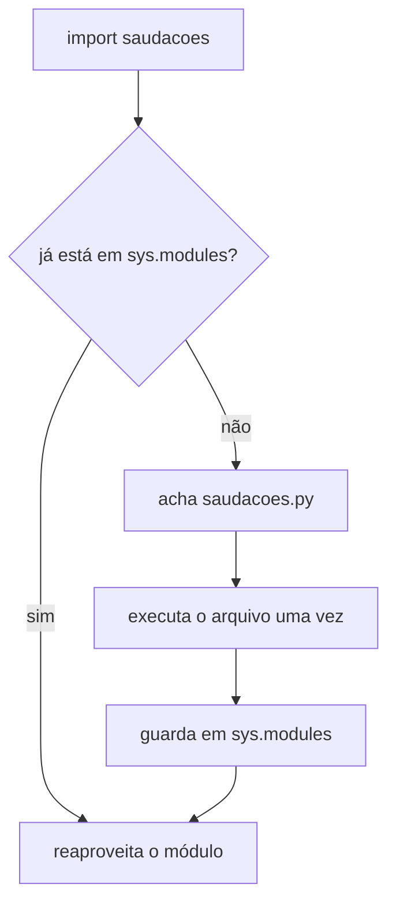

## Passo 1 · Leitura · Um programa em vários arquivos

Até aqui, todo programa seu morava em um arquivo só. Funciona com 50 linhas. Com 500, você passa mais tempo rolando a tela do que programando, e quando outro projeto precisa da mesma função de conversão, a saída é copiar e colar. Aí um conserto feito numa cópia não chega na outra.

A solução do Python é o **módulo**: qualquer arquivo `.py` é um módulo, e o nome do módulo é o nome do arquivo sem o `.py`. Um projeto com dois arquivos na mesma pasta:

```python
# conversoes.py
def celsius_para_fahrenheit(c):
    return c * 9 / 5 + 32


def km_para_milhas(km):
    return km / 1.609344
```

```python
# main.py
import conversoes

print(conversoes.celsius_para_fahrenheit(100))   # 212.0
```

`import conversoes` procura o arquivo `conversoes.py` e cria no `main.py` um nome, `conversoes`, que dá acesso a tudo o que foi definido lá dentro, com ponto: `conversoes.km_para_milhas(5)`.

Há três formas de importar, e você vai encontrar as três em código de outras pessoas:

| Forma | Como usar depois | Quando |
|---|---|---|
| `import conversoes` | `conversoes.km_para_milhas(5)` | padrão: fica claro de onde vem cada função |
| `from conversoes import km_para_milhas` | `km_para_milhas(5)` | poucas funções, usadas muitas vezes |
| `import conversoes as cv` | `cv.km_para_milhas(5)` | nome longo ou apelido consagrado, como `import numpy as np` |

Cada forma cria **um nome diferente** no seu arquivo. Com `import conversoes`, o nome `km_para_milhas` sozinho não existe, e chamá-lo dá `NameError: name 'km_para_milhas' is not defined`. Com `import conversoes as cv`, o nome criado é `cv`, e não `conversoes`. Um erro de digitação no nome do módulo aparece assim: `ModuleNotFoundError: No module named 'conversao'`.

Nos exercícios desta lição o projeto tem mais de um arquivo: além do `main.py`, aparecem os módulos que ele usa.

## Passo 2 · Exercício · Três jeitos de importar
modo: lacunas

O módulo `conversoes.py` já está pronto. O `main.py` usa as funções dele de três jeitos diferentes, mas as três linhas de importação estão incompletas. Leia o corpo de cada função do `main.py` para descobrir qual nome ela espera que exista.

### Instruções
1. Complete a primeira linha para que `temperatura_em_f` consiga usar `conversoes.celsius_para_fahrenheit`.
2. Complete a segunda linha para que `distancia_em_milhas` consiga chamar `km_para_milhas` sem prefixo.
3. Complete a terceira linha para que `peso_em_libras` consiga usar o apelido `cv`.
   Dica: o apelido vem depois da palavra `as`.

### Código inicial
```python
import ___
from conversoes import ___
import conversoes as ___


def temperatura_em_f(celsius):
    return conversoes.celsius_para_fahrenheit(celsius)


def distancia_em_milhas(km):
    return km_para_milhas(km)


def peso_em_libras(kg):
    return cv.kg_para_libras(kg)
```
```python path=conversoes.py
def celsius_para_fahrenheit(c):
    return c * 9 / 5 + 32


def km_para_milhas(km):
    return km / 1.609344


def kg_para_libras(kg):
    return kg * 2.20462
```

### Solução
```python
import conversoes
from conversoes import km_para_milhas
import conversoes as cv


def temperatura_em_f(celsius):
    return conversoes.celsius_para_fahrenheit(celsius)


def distancia_em_milhas(km):
    return km_para_milhas(km)


def peso_em_libras(kg):
    return cv.kg_para_libras(kg)
```
```python path=conversoes.py
def celsius_para_fahrenheit(c):
    return c * 9 / 5 + 32


def km_para_milhas(km):
    return km / 1.609344


def kg_para_libras(kg):
    return kg * 2.20462
```

### Dicas
1. Depois de `import`, vai o nome do arquivo sem o `.py`.
2. Depois de `from conversoes import`, vai o nome da função que você quer usar sem o prefixo `conversoes.`.
3. Confira cada nome letra por letra: um nome diferente do usado no corpo da função dá `NameError`.

### Verificação
```json
[
  { "id": "temp-25", "checkpoint": 1, "kind": "call", "function": "temperatura_em_f", "args": [25], "expected": 77.0, "tolerance": 1e-6,
    "name": "temperatura_em_f(25) é 77.0", "hint": "O nome conversoes precisa existir no main.py." },
  { "id": "temp-neg", "checkpoint": 1, "kind": "call", "function": "temperatura_em_f", "args": [-10], "expected": 14.0, "tolerance": 1e-6,
    "name": "temperatura_em_f(-10) é 14.0" },
  { "id": "milhas-maratona", "checkpoint": 2, "kind": "call", "function": "distancia_em_milhas", "args": [42.195], "expected": 26.2188, "tolerance": 0.001,
    "name": "distancia_em_milhas(42.195) é cerca de 26.22", "hint": "Importe a função de distância, e não outra do módulo." },
  { "id": "milhas-10", "checkpoint": 2, "kind": "call", "function": "distancia_em_milhas", "args": [16.09344], "expected": 10.0, "tolerance": 1e-6,
    "name": "distancia_em_milhas(16.09344) é 10.0" },
  { "id": "libras-70", "checkpoint": 3, "kind": "call", "function": "peso_em_libras", "args": [70], "expected": 154.3234, "tolerance": 1e-6,
    "name": "peso_em_libras(70) é 154.3234", "hint": "O corpo da função usa o apelido cv." },
  { "id": "libras-2-5", "checkpoint": 3, "kind": "call", "function": "peso_em_libras", "args": [2.5], "expected": 5.51155, "tolerance": 1e-6,
    "name": "peso_em_libras(2.5) é 5.51155" }
]
```

### Soluções erradas
```python name="importou a função errada no from"
import conversoes
from conversoes import kg_para_libras
import conversoes as cv


def temperatura_em_f(celsius):
    return conversoes.celsius_para_fahrenheit(celsius)


def distancia_em_milhas(km):
    return km_para_milhas(km)


def peso_em_libras(kg):
    return cv.kg_para_libras(kg)
```
```python name="apelido diferente do usado no código"
import conversoes
from conversoes import km_para_milhas
import conversoes as conv


def temperatura_em_f(celsius):
    return conversoes.celsius_para_fahrenheit(celsius)


def distancia_em_milhas(km):
    return km_para_milhas(km)


def peso_em_libras(kg):
    return cv.kg_para_libras(kg)
```
```python name="usou só o apelido e esqueceu o import simples"
import conversoes as cv
from conversoes import km_para_milhas
import conversoes as cv


def temperatura_em_f(celsius):
    return conversoes.celsius_para_fahrenheit(celsius)


def distancia_em_milhas(km):
    return km_para_milhas(km)


def peso_em_libras(kg):
    return cv.kg_para_libras(kg)
```

## Passo 3 · Previsão · O que roda quando você importa

Antes de ler como a importação funciona por dentro, tente prever. O projeto tem dois arquivos: o `saudacoes.py`, que imprime uma linha no topo, e o `main.py`, que importa o módulo duas vezes e depois troca uma variável dele. As importações estão no meio do arquivo de propósito, para você ver em que momento cada coisa acontece.

Digite exatamente o que o programa imprime.

### Código
```python
print("início do main")
import saudacoes
import saudacoes
from saudacoes import PREFIXO, saudar

saudacoes.PREFIXO = "Oi"
print(PREFIXO)
print(saudar("Bia"))
print(saudacoes.__name__, __name__)
```
```python path=saudacoes.py
print("carregando saudacoes")
PREFIXO = "Olá"


def saudar(nome):
    return f"{PREFIXO}, {nome}!"
```

### Dicas
1. O código de topo de um módulo roda na primeira vez que ele é importado. E na segunda?
2. `from saudacoes import PREFIXO` cria no `main.py` um nome que aponta para o valor que `PREFIXO` tinha naquele momento.
3. `saudar` procura `PREFIXO` dentro do próprio módulo, na hora em que é chamada.

### Saída esperada
```text
início do main
carregando saudacoes
Olá
Oi, Bia!
saudacoes __main__
```

## Passo 4 · Leitura · O que o import faz de verdade

Na primeira vez que um módulo é importado, o Python **executa o arquivo inteiro, de cima para baixo**. Os `def` criam funções, as atribuições criam variáveis e um `print` solto no topo imprime. Tudo o que foi criado vira atributo do objeto módulo, e ele fica guardado num dicionário chamado `sys.modules`.



Por isso, na previsão, `carregando saudacoes` apareceu uma vez só: o segundo `import` encontrou o módulo pronto e não executou nada. Isso é bom: um módulo pesado é carregado uma vez, mesmo que dez arquivos o importem.

#### from-import copia o nome, não liga os dois

`from saudacoes import PREFIXO` cria no seu arquivo uma variável `PREFIXO` apontando para `"Olá"`. Depois, `saudacoes.PREFIXO = "Oi"` muda a variável **do módulo**, e a sua continua em `"Olá"`. Já `saudar` lê `PREFIXO` do próprio módulo na hora da chamada, por isso imprimiu `Oi, Bia!`. Regra prática: para ler um valor que pode mudar, use `modulo.NOME`, nunca uma cópia feita com `from`.

#### Dois tropeços comuns

**Nome igual ao de um módulo da biblioteca.** Salve um arquivo seu como `random.py` e o `import random` de qualquer arquivo da pasta passa a achar o **seu** arquivo primeiro. O Python 3.14 até avisa:

```text
AttributeError: module 'random' has no attribute 'randint' (consider renaming '.../random.py' since it has the same name as the standard library module named 'random' and prevents importing that standard library module)
```

**Importação circular.** Se `pedidos.py` faz `from clientes import buscar_cliente` e `clientes.py` faz `from pedidos import total`, um módulo pede um nome do outro antes que ele exista, e o resultado é um `ImportError: cannot import name 'total' from 'pedidos'`. A saída é tirar do ciclo o que os dois compartilham, num terceiro módulo que ambos importam.

## Passo 5 · Exercício · Tire as funções do main

O `main.py` abaixo cresceu demais: as funções de texto estão misturadas com o programa que as usa. Seu trabalho é mover as três funções para o módulo `texto.py` (hoje só com uma docstring) e deixar no `main.py` apenas o programa, que importa o módulo. A saída do programa não pode mudar.

### Instruções
1. Mova `contar_palavras`, `iniciais` e `inverter_palavras` para `texto.py`, sem mudar o que elas fazem.
2. No `main.py`, apague as definições das funções e importe o módulo `texto` (qualquer uma das três formas serve).
3. Mantenha o programa do `main.py` funcionando: ele precisa imprimir exatamente o que imprimia antes, usando as funções do módulo.

### Código inicial
```python
def contar_palavras(frase):
    return len(frase.split())


def iniciais(frase):
    return "".join(palavra[0].upper() for palavra in frase.split())


def inverter_palavras(frase):
    return " ".join(reversed(frase.split()))


frases = ["Universidade de São Paulo", "o rato roeu a roupa do rei"]
for frase in frases:
    print("Palavras:", contar_palavras(frase))
    print("Iniciais:", iniciais(frase))
    print("Invertida:", inverter_palavras(frase))
```
```python path=texto.py
"""Funções de texto usadas pelo main.py."""
```

### Solução
```python
import texto

frases = ["Universidade de São Paulo", "o rato roeu a roupa do rei"]
for frase in frases:
    print("Palavras:", texto.contar_palavras(frase))
    print("Iniciais:", texto.iniciais(frase))
    print("Invertida:", texto.inverter_palavras(frase))
```
```python path=texto.py
"""Funções de texto usadas pelo main.py."""


def contar_palavras(frase):
    return len(frase.split())


def iniciais(frase):
    return "".join(palavra[0].upper() for palavra in frase.split())


def inverter_palavras(frase):
    return " ".join(reversed(frase.split()))
```

### Dicas
1. Recorte as três funções do `main.py` e cole no `texto.py`, abaixo da docstring.
2. Com `import texto`, cada chamada no `main.py` ganha o prefixo `texto.`. Com `from texto import ...`, liste as três funções.
3. Se aparecer `NameError`, o `main.py` está chamando um nome que não foi importado.

### Verificação
```json
[
  { "id": "modulo-contar", "checkpoint": 1, "kind": "expr", "setup": "import texto", "expr": "texto.contar_palavras('  fila   do RU  ')", "expected": 3,
    "name": "texto.contar_palavras existe e conta palavras", "hint": "A função precisa estar definida em texto.py." },
  { "id": "modulo-iniciais", "checkpoint": 1, "kind": "expr", "setup": "import texto", "expr": "texto.iniciais('ribeirão preto')", "expected": "RP",
    "name": "texto.iniciais existe e devolve as iniciais" },
  { "id": "modulo-inverter", "checkpoint": 1, "kind": "expr", "setup": "import texto", "expr": "texto.inverter_palavras('um dois tres')", "expected": "tres dois um",
    "name": "texto.inverter_palavras existe e inverte as palavras" },
  { "id": "main-sem-def", "checkpoint": 2, "kind": "expr",
    "expr": "[n for n in ('contar_palavras', 'iniciais', 'inverter_palavras') if getattr(globals().get(n), '__module__', None) == '__main__']",
    "expected": [], "name": "main.py não define mais as funções", "hint": "Apague as definições do main.py: elas agora moram em texto.py." },
  { "id": "main-importa", "checkpoint": 2, "kind": "source", "rule": { "type": "imports", "module": "texto" },
    "name": "main.py importa o módulo texto" },
  { "id": "saida-igual", "checkpoint": 3, "kind": "io",
    "expected_stdout": "Palavras: 4\nIniciais: UDSP\nInvertida: Paulo São de Universidade\nPalavras: 7\nIniciais: ORRARDR\nInvertida: rei do roupa a roeu rato o",
    "name": "A saída do programa continua a mesma", "hint": "Confira se cada chamada usa o nome importado." },
  { "id": "usa-o-modulo", "checkpoint": 3, "kind": "expr",
    "setup": "import contextlib, io as _io, runpy, texto\ntexto.contar_palavras = lambda frase: 99\n_saida = _io.StringIO()\nwith contextlib.redirect_stdout(_saida):\n    runpy.run_path('main.py')",
    "expr": "'Palavras: 99' in _saida.getvalue()", "expected": true,
    "name": "O programa do main.py usa as funções de texto.py", "hint": "Chame as funções do módulo, em vez de escrever o resultado pronto." }
]
```

### Soluções erradas
```python name="copiou para o módulo mas deixou as definições no main"
import texto


def contar_palavras(frase):
    return len(frase.split())


def iniciais(frase):
    return "".join(palavra[0].upper() for palavra in frase.split())


def inverter_palavras(frase):
    return " ".join(reversed(frase.split()))


frases = ["Universidade de São Paulo", "o rato roeu a roupa do rei"]
for frase in frases:
    print("Palavras:", contar_palavras(frase))
    print("Iniciais:", iniciais(frase))
    print("Invertida:", inverter_palavras(frase))
```
```python name="import texto mas chama os nomes sem prefixo"
import texto

frases = ["Universidade de São Paulo", "o rato roeu a roupa do rei"]
for frase in frases:
    print("Palavras:", contar_palavras(frase))
    print("Iniciais:", iniciais(frase))
    print("Invertida:", inverter_palavras(frase))
```
```python name="esqueceu de mover uma das funções"
from texto import contar_palavras, iniciais


def inverter_palavras(frase):
    return " ".join(reversed(frase.split()))


frases = ["Universidade de São Paulo", "o rato roeu a roupa do rei"]
for frase in frases:
    print("Palavras:", contar_palavras(frase))
    print("Iniciais:", iniciais(frase))
    print("Invertida:", inverter_palavras(frase))
```
```python name="esqueceu de mover uma das funções" path=texto.py
"""Funções de texto usadas pelo main.py."""


def contar_palavras(frase):
    return len(frase.split())


def iniciais(frase):
    return "".join(palavra[0].upper() for palavra in frase.split())
```
```python name="imprime a saída pronta em vez de chamar o módulo"
print("Palavras: 4")
print("Iniciais: UDSP")
print("Invertida: Paulo São de Universidade")
print("Palavras: 7")
print("Iniciais: ORRARDR")
print("Invertida: rei do roupa a roeu rato o")
```

## Passo 6 · Leitura · Biblioteca ou programa: o guarda __main__

Um módulo costuma ter, no fim, umas linhas para testar as próprias funções:

```python
# notas.py
def media(valores):
    return sum(valores) / len(valores)


print("testando:", media([7, 8, 9]))
```

Rodando `python notas.py`, ótimo: aparece `testando: 8.0`. O problema surge quando outro arquivo faz `import notas`. Como o import executa o arquivo inteiro, o teste roda também, e o `testando: 8.0` aparece no meio da saída de quem importou. Num módulo que, no teste, apaga um arquivo ou lê o teclado, o estrago é maior.

Todo módulo tem uma variável `__name__`, criada pelo próprio Python:

| Como o arquivo foi carregado | Valor de `__name__` |
|---|---|
| executado direto: `python notas.py` | `"__main__"` |
| importado: `import notas` | `"notas"` (o nome do módulo) |

Você viu isso na previsão: `saudacoes.__name__` era `saudacoes` e o `__name__` do `main.py` era `__main__`. Então basta perguntar:

```python
# notas.py
def media(valores):
    return sum(valores) / len(valores)


if __name__ == "__main__":
    print("testando:", media([7, 8, 9]))
```

Agora o teste só roda quando `notas.py` é o programa principal. Quem importa recebe só as funções. Esse `if` é chamado de **guarda** e é o jeito padrão de um arquivo servir ao mesmo tempo de biblioteca e de programa.

Dois detalhes que derrubam muita gente. Os dois lados têm **dois sublinhados antes e dois depois**: `__name__` e `"__main__"`. E o guarda vai **no módulo que tem o código de teste**, não no arquivo que importa: colocar um `if` no `main.py` não impede o `notas.py` de imprimir.

## Passo 7 · Exercício · Proteja o módulo de estatísticas

O `main.py` usa o módulo `estatisticas.py` para mostrar o resultado de uma turma. Só que o módulo tem, no fim, umas linhas de teste que imprimem toda vez que ele é importado, e a saída do `main.py` sai poluída. Corrija o **`estatisticas.py`** (o `main.py` já está certo).

### Instruções
1. Coloque as linhas de teste do `estatisticas.py` dentro de um guarda `if __name__ == "__main__":`, para que importar o módulo não imprima nada.
2. Mantenha as linhas de teste: executado direto, o `estatisticas.py` ainda precisa imprimir os três resultados de teste.
3. Não altere as funções `media` e `situacao`: o `main.py` precisa continuar usando as duas.

### Código inicial
```python
import estatisticas

turma = {"Ana": [7, 8, 9], "Caio": [3, 4, 2.5], "Davi": [2, 1, 3]}
for nome, notas in turma.items():
    m = estatisticas.media(notas)
    print(f"{nome}: {m:.1f} ({estatisticas.situacao(m)})")
```
```python path=estatisticas.py
def media(notas):
    return sum(notas) / len(notas)


def situacao(media_final):
    if media_final >= 5:
        return "aprovado"
    if media_final >= 3:
        return "recuperação"
    return "reprovado"


print("Testando estatisticas.py")
print(media([6, 7, 8]))
print(situacao(4.0))
```

### Solução
```python
import estatisticas

turma = {"Ana": [7, 8, 9], "Caio": [3, 4, 2.5], "Davi": [2, 1, 3]}
for nome, notas in turma.items():
    m = estatisticas.media(notas)
    print(f"{nome}: {m:.1f} ({estatisticas.situacao(m)})")
```
```python path=estatisticas.py
def media(notas):
    return sum(notas) / len(notas)


def situacao(media_final):
    if media_final >= 5:
        return "aprovado"
    if media_final >= 3:
        return "recuperação"
    return "reprovado"


if __name__ == "__main__":
    print("Testando estatisticas.py")
    print(media([6, 7, 8]))
    print(situacao(4.0))
```

### Dicas
1. O guarda é um `if` comum; as linhas de teste vão indentadas dentro dele.
2. Quando o módulo é importado, `__name__` vale `"estatisticas"`; quando é executado direto, vale `"__main__"`.
3. Confira os sublinhados: são dois antes e dois depois, dos dois lados da comparação.

### Verificação
```json
[
  { "id": "import-silencioso", "checkpoint": 1, "kind": "expr",
    "setup": "import contextlib, io as _io, sys\nsys.modules.pop('estatisticas', None)\n_saida = _io.StringIO()\nwith contextlib.redirect_stdout(_saida):\n    import estatisticas",
    "expr": "_saida.getvalue()", "expected": "",
    "name": "Importar estatisticas não imprime nada", "hint": "As linhas de teste precisam ficar dentro do guarda." },
  { "id": "saida-main", "checkpoint": 1, "kind": "io",
    "expected_stdout": "Ana: 8.0 (aprovado)\nCaio: 3.2 (recuperação)\nDavi: 2.0 (reprovado)",
    "name": "A saída do main.py tem só o resultado da turma" },
  { "id": "executado-direto", "checkpoint": 2, "kind": "expr",
    "setup": "import contextlib, io as _io, runpy\n_saida = _io.StringIO()\nwith contextlib.redirect_stdout(_saida):\n    runpy.run_path('estatisticas.py', run_name='__main__')",
    "expr": "_saida.getvalue().split()", "expected": ["Testando", "estatisticas.py", "7.0", "recuperação"],
    "name": "Executado direto, estatisticas.py ainda imprime os testes", "hint": "Não apague os testes: proteja-os com o guarda." },
  { "id": "media-funciona", "checkpoint": 3, "kind": "expr", "setup": "import estatisticas", "expr": "estatisticas.media([10, 5, 6])", "expected": 7.0, "tolerance": 1e-9,
    "name": "estatisticas.media continua funcionando" },
  { "id": "situacao-limite", "checkpoint": 3, "kind": "expr", "setup": "import estatisticas", "expr": "[estatisticas.situacao(v) for v in (5, 4.9, 3, 2.9)]",
    "expected": ["aprovado", "recuperação", "recuperação", "reprovado"],
    "name": "estatisticas.situacao continua funcionando" }
]
```

### Soluções erradas
```python name="apagou as linhas de teste" path=estatisticas.py
def media(notas):
    return sum(notas) / len(notas)


def situacao(media_final):
    if media_final >= 5:
        return "aprovado"
    if media_final >= 3:
        return "recuperação"
    return "reprovado"
```
```python name="compara com main, sem os sublinhados" path=estatisticas.py
def media(notas):
    return sum(notas) / len(notas)


def situacao(media_final):
    if media_final >= 5:
        return "aprovado"
    if media_final >= 3:
        return "recuperação"
    return "reprovado"


if __name__ == "main":
    print("Testando estatisticas.py")
    print(media([6, 7, 8]))
    print(situacao(4.0))
```
```python name="guarda no main.py em vez do módulo"
if __name__ == "__main__":
    import estatisticas

    turma = {"Ana": [7, 8, 9], "Caio": [3, 4, 2.5], "Davi": [2, 1, 3]}
    for nome, notas in turma.items():
        m = estatisticas.media(notas)
        print(f"{nome}: {m:.1f} ({estatisticas.situacao(m)})")
```
```python name="guarda no main.py em vez do módulo" path=estatisticas.py
def media(notas):
    return sum(notas) / len(notas)


def situacao(media_final):
    if media_final >= 5:
        return "aprovado"
    if media_final >= 3:
        return "recuperação"
    return "reprovado"


print("Testando estatisticas.py")
print(media([6, 7, 8]))
print(situacao(4.0))
```
```python name="guarda envolvendo também as funções" path=estatisticas.py
if __name__ == "__main__":
    def media(notas):
        return sum(notas) / len(notas)

    def situacao(media_final):
        if media_final >= 5:
            return "aprovado"
        if media_final >= 3:
            return "recuperação"
        return "reprovado"

    print("Testando estatisticas.py")
    print(media([6, 7, 8]))
    print(situacao(4.0))
```

## Passo 8 · Quiz · Módulos sem tropeço

### Pergunta
A Eva salvou o programa de sorteio dela como `random.py`, na mesma pasta, com `import random` e depois `random.choice(nomes)`. Ao rodar, aparece `AttributeError: module 'random' has no attribute 'choice'`. Por quê?
- [ ] O módulo `random` não tem a função `choice`
- [x] O `import random` encontrou o próprio arquivo `random.py` dela antes do módulo da biblioteca padrão
- [ ] Faltou escrever `from random import choice`
- [ ] Um arquivo não pode importar a si mesmo, então o Python apagou o módulo
> A pasta do programa vem primeiro na busca de módulos. O arquivo dela se chama `random.py`, então `import random` carrega esse arquivo, que não define `choice`. A correção é renomear o arquivo, por exemplo para `sorteio.py`.

### Pergunta
Os módulos `utilidades.py` e `texto.py` definem, cada um, uma função `limpar`. Um programa faz `from utilidades import *` e, na linha seguinte, `from texto import *`. Qual `limpar` o programa usa?
- [ ] A de `utilidades`, porque foi importada primeiro
- [x] A de `texto`: a segunda importação substitui o nome `limpar` sem nenhum aviso
- [ ] Nenhuma: o Python levanta `ImportError` por causa do nome repetido
- [ ] As duas: o Python escolhe na hora conforme o argumento
> `import *` despeja todos os nomes do módulo no seu arquivo, e a última atribuição vence, em silêncio. É por isso que se evita `import *`: quem lê o código não sabe de onde veio cada nome. Com `import texto` e `texto.limpar(...)`, a origem fica explícita.

### Pergunta
`pedidos.py` começa com `from clientes import buscar_cliente`, e `clientes.py` começa com `from pedidos import total`. Ao rodar, o programa para com `ImportError`. Qual é a correção mais adequada?
- [ ] Trocar as duas linhas para `import *`
- [ ] Importar `clientes` duas vezes, para garantir que ele carregue
- [x] Mover para um terceiro módulo o que os dois precisam compartilhar, para que nenhum dependa do outro em círculo
- [ ] Renomear `pedidos.py` para `Pedidos.py`
> É uma importação circular: cada módulo precisa de um nome do outro antes que esse nome exista. Quebrar o ciclo, com um terceiro módulo de que os dois dependem, resolve na raiz.
