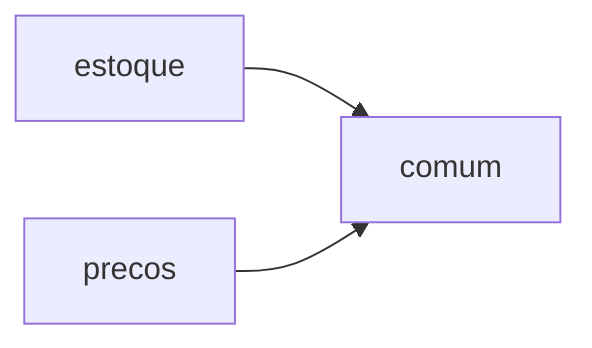

## Passo 1 · Leitura · Quando os módulos viram muitos

Separar o programa em módulos resolve o arquivo gigante. Mas o sistema da cantina da faculdade logo tem `estoque.py`, `precos.py`, `clientes.py`, `pedidos.py`, `relatorios.py`... todos soltos na mesma pasta do `main.py`. Fica difícil saber o que pertence a quê, e dois assuntos diferentes acabam brigando pelo mesmo nome de arquivo.

O próximo nível de organização é o **pacote**: uma pasta de módulos que se importa como uma unidade. Em Python, uma pasta vira pacote quando tem dentro um arquivo `__init__.py` (pode estar vazio):

```text
cantina/
    main.py
    loja/
        __init__.py
        estoque.py
        precos.py
```

Para chegar a um módulo dentro do pacote, você escreve o **caminho pontilhado**: o nome da pasta, um ponto e o nome do módulo. As três formas de importar da lição anterior continuam valendo:

```python
import loja.precos                        # uso: loja.precos.aplicar_desconto(...)
from loja.estoque import Produto          # uso: Produto(...)
import loja.precos as precos              # uso: precos.formatar_reais(...)
```

O caminho pontilhado sempre começa pelo pacote. `import precos` sozinho não acha nada, porque não existe `precos.py` na pasta do `main.py`, e o Python responde `ModuleNotFoundError: No module named 'precos'`.

#### Nomes de pacote

O nome da pasta vira um nome em Python, então segue as mesmas regras de variável: letras minúsculas, dígitos e sublinhado. Uma pasta `minha-loja` até existe no disco, mas `import minha-loja` é um `SyntaxError`, porque o hífen é lido como sinal de menos. Use `minha_loja`. E, como na lição anterior, não dê ao pacote o nome de um módulo da biblioteca padrão (`random`, `math`, `json`).

Pacotes podem ter **subpacotes**: uma pasta com `__init__.py` dentro de outra. O caminho só fica mais longo: `from loja.relatorios.vendas import total_do_dia`.

## Passo 2 · Exercício · Importe do pacote loja
modo: lacunas

O pacote `loja` já está pronto, com os módulos `estoque.py` (a classe `Produto`) e `precos.py` (desconto e formatação em reais). O `__init__.py` está vazio. Complete as importações do `main.py`, lendo o corpo das funções para saber que nome cada uma espera.

### Instruções
1. Complete a primeira linha para importar a classe `Produto` do módulo certo do pacote.
2. Complete a segunda linha com o nome do pacote, para importar `aplicar_desconto`.
3. Complete a terceira linha para que o módulo de preços fique disponível com o nome que `etiqueta` usa.

### Código inicial
```python
from loja.___ import Produto
from ___.precos import aplicar_desconto
import loja.precos as ___


def preco_promocional(produto, percentual):
    return aplicar_desconto(produto.preco, percentual)


def etiqueta(produto, percentual):
    preco = preco_promocional(produto, percentual)
    return f"{produto.nome}: {precos.formatar_reais(preco)}"
```
```python path=loja/__init__.py
```
```python path=loja/estoque.py
class Produto:
    def __init__(self, nome, preco, quantidade):
        self.nome = nome
        self.preco = preco
        self.quantidade = quantidade

    def valor_em_estoque(self):
        return self.preco * self.quantidade
```
```python path=loja/precos.py
def aplicar_desconto(preco, percentual):
    return round(preco * (1 - percentual / 100), 2)


def formatar_reais(valor):
    return f"R$ {valor:.2f}".replace(".", ",")
```

### Solução
```python
from loja.estoque import Produto
from loja.precos import aplicar_desconto
import loja.precos as precos


def preco_promocional(produto, percentual):
    return aplicar_desconto(produto.preco, percentual)


def etiqueta(produto, percentual):
    preco = preco_promocional(produto, percentual)
    return f"{produto.nome}: {precos.formatar_reais(preco)}"
```
```python path=loja/__init__.py
```
```python path=loja/estoque.py
class Produto:
    def __init__(self, nome, preco, quantidade):
        self.nome = nome
        self.preco = preco
        self.quantidade = quantidade

    def valor_em_estoque(self):
        return self.preco * self.quantidade
```
```python path=loja/precos.py
def aplicar_desconto(preco, percentual):
    return round(preco * (1 - percentual / 100), 2)


def formatar_reais(valor):
    return f"R$ {valor:.2f}".replace(".", ",")
```

### Dicas
1. O caminho pontilhado é `pacote.modulo`: o pacote é a pasta e o módulo é o arquivo, sem `.py`.
2. A classe `Produto` está em `estoque.py`; as funções de preço estão em `precos.py`.
3. O apelido depois de `as` precisa ser o nome que aparece em `etiqueta`.

### Verificação
```json
[
  { "id": "produto", "checkpoint": 1, "kind": "expr", "expr": "Produto('Lápis', 2.5, 12).valor_em_estoque()", "expected": 30.0, "tolerance": 1e-9,
    "name": "Produto vem de loja.estoque", "hint": "A classe está no módulo estoque do pacote loja." },
  { "id": "promo-mochila", "checkpoint": 2, "kind": "expr", "expr": "preco_promocional(Produto('Mochila', 150.0, 1), 10)", "expected": 135.0, "tolerance": 1e-9,
    "name": "preco_promocional com 10% de desconto" },
  { "id": "promo-caneta", "checkpoint": 2, "kind": "expr", "expr": "preco_promocional(Produto('Caneta', 3.5, 40), 10)", "expected": 3.15, "tolerance": 1e-9,
    "name": "preco_promocional de uma caneta" },
  { "id": "etiqueta-caderno", "checkpoint": 3, "kind": "expr", "expr": "etiqueta(Produto('Caderno', 25.0, 3), 20)", "expected": "Caderno: R$ 20,00",
    "name": "etiqueta de um caderno com 20% de desconto", "hint": "etiqueta usa o nome precos para chegar ao módulo de preços." },
  { "id": "etiqueta-cola", "checkpoint": 3, "kind": "expr", "expr": "etiqueta(Produto('Cola', 8.0, 5), 0)", "expected": "Cola: R$ 8,00",
    "name": "etiqueta sem desconto" }
]
```

### Soluções erradas
```python name="importa Produto direto do pacote com __init__ vazio"
from loja import Produto
from loja.precos import aplicar_desconto
import loja.precos as precos


def preco_promocional(produto, percentual):
    return aplicar_desconto(produto.preco, percentual)


def etiqueta(produto, percentual):
    preco = preco_promocional(produto, percentual)
    return f"{produto.nome}: {precos.formatar_reais(preco)}"
```
```python name="esquece o pacote no caminho"
from estoque import Produto
from loja.precos import aplicar_desconto
import loja.precos as precos


def preco_promocional(produto, percentual):
    return aplicar_desconto(produto.preco, percentual)


def etiqueta(produto, percentual):
    preco = preco_promocional(produto, percentual)
    return f"{produto.nome}: {precos.formatar_reais(preco)}"
```
```python name="apelido diferente do usado em etiqueta"
from loja.estoque import Produto
from loja.precos import aplicar_desconto
import loja.precos as preco


def preco_promocional(produto, percentual):
    return aplicar_desconto(produto.preco, percentual)


def etiqueta(produto, percentual):
    preco = preco_promocional(produto, percentual)
    return f"{produto.nome}: {precos.formatar_reais(preco)}"
```

## Passo 3 · Leitura · O que vai no __init__.py

O `__init__.py` não é só uma etiqueta que diz "esta pasta é um pacote". Ele é um módulo de verdade: na primeira vez que qualquer parte do pacote é importada, o Python **executa o `__init__.py` antes**, e os nomes criados nele viram nomes do próprio pacote.

Com o `__init__.py` vazio, o pacote `loja` não tem nome nenhum dentro dele. Por isso, no exercício anterior, `from loja import Produto` falharia:

```text
ImportError: cannot import name 'Produto' from 'loja'
```

Quem usa o pacote precisa saber que `Produto` mora em `loja.estoque`. Isso expõe a arrumação interna: se um dia `Produto` mudar de arquivo, todo código que importa quebra. O uso mais comum do `__init__.py` é **reexportar** os nomes principais:

```python
# loja/__init__.py
from loja.estoque import Produto
from loja.precos import aplicar_desconto, formatar_reais
```

Agora quem usa escreve só `from loja import Produto, aplicar_desconto`. O `__init__.py` vira a vitrine do pacote: mostra o que é para usar e esconde em que arquivo cada coisa está. Note que ele **importa** os nomes, e não copia o código: `loja.Produto` e `loja.estoque.Produto` são a mesma classe.

O que **não** pôr no `__init__.py`: código demorado, `print` ou lógica de verdade. Ele roda em todo import do pacote, e ninguém espera que importar alguma coisa faça trabalho.

#### E se a pasta não tiver __init__.py?

Desde o Python 3.3, uma pasta sem `__init__.py` ainda pode ser importada, como um *namespace package* (pacote de espaço de nomes), um recurso feito para dividir um pacote enorme entre várias instalações. Funciona, mas confunde: não há lugar para reexportar nomes, e um erro de digitação no nome da pasta pode virar um pacote vazio em vez de um erro claro. Em projeto seu, crie sempre o `__init__.py`, mesmo vazio.

## Passo 4 · Exercício · Monte a vitrine do pacote

O `main.py` agora usa a forma curta, `from loja import Produto, aplicar_desconto, formatar_reais`, mas o `__init__.py` do pacote está vazio e o programa quebra. Escreva o **`loja/__init__.py`** para reexportar os três nomes. Não mude o `main.py`, o `estoque.py` nem o `precos.py`.

### Instruções
1. No `loja/__init__.py`, importe `Produto` do módulo `estoque` do pacote.
2. No mesmo arquivo, importe `aplicar_desconto` e `formatar_reais` do módulo `precos`.
   Dica: importe os nomes; não copie o código das funções para o `__init__.py`.
3. Confira que o `main.py` roda e imprime o carrinho com o desconto.

### Código inicial
```python
from loja import Produto, aplicar_desconto, formatar_reais

carrinho = [Produto("Caderno", 25.0, 2), Produto("Caneta", 3.5, 10)]
for item in carrinho:
    preco = aplicar_desconto(item.preco, 10)
    print(f"{item.nome}: {formatar_reais(preco)} x {item.quantidade}")
```
```python path=loja/__init__.py
"""Pacote loja: estoque e preços da cantina."""
```
```python path=loja/estoque.py
class Produto:
    def __init__(self, nome, preco, quantidade):
        self.nome = nome
        self.preco = preco
        self.quantidade = quantidade

    def valor_em_estoque(self):
        return self.preco * self.quantidade
```
```python path=loja/precos.py
def aplicar_desconto(preco, percentual):
    return round(preco * (1 - percentual / 100), 2)


def formatar_reais(valor):
    return f"R$ {valor:.2f}".replace(".", ",")
```

### Solução
```python
from loja import Produto, aplicar_desconto, formatar_reais

carrinho = [Produto("Caderno", 25.0, 2), Produto("Caneta", 3.5, 10)]
for item in carrinho:
    preco = aplicar_desconto(item.preco, 10)
    print(f"{item.nome}: {formatar_reais(preco)} x {item.quantidade}")
```
```python path=loja/__init__.py
"""Pacote loja: estoque e preços da cantina."""

from loja.estoque import Produto
from loja.precos import aplicar_desconto, formatar_reais
```
```python path=loja/estoque.py
class Produto:
    def __init__(self, nome, preco, quantidade):
        self.nome = nome
        self.preco = preco
        self.quantidade = quantidade

    def valor_em_estoque(self):
        return self.preco * self.quantidade
```
```python path=loja/precos.py
def aplicar_desconto(preco, percentual):
    return round(preco * (1 - percentual / 100), 2)


def formatar_reais(valor):
    return f"R$ {valor:.2f}".replace(".", ",")
```

### Dicas
1. O `__init__.py` usa as mesmas importações que você escreveria no `main.py`, com o caminho pontilhado completo.
2. Dentro do pacote, `from estoque import Produto` não funciona: o caminho começa pelo nome do pacote.
3. Um nome importado no `__init__.py` passa a existir como `loja.nome`.

### Verificação
```json
[
  { "id": "reexporta-produto", "checkpoint": 1, "kind": "expr", "setup": "import loja", "expr": "loja.Produto('Régua', 4.0, 3).valor_em_estoque()", "expected": 12.0, "tolerance": 1e-9,
    "name": "loja.Produto existe", "hint": "Importe Produto no __init__.py." },
  { "id": "mesma-classe", "checkpoint": 1, "kind": "expr", "setup": "import loja, loja.estoque", "expr": "loja.Produto is loja.estoque.Produto", "expected": true,
    "name": "loja.Produto é a mesma classe de loja.estoque", "hint": "Importe a classe em vez de copiar o código dela." },
  { "id": "reexporta-desconto", "checkpoint": 2, "kind": "expr", "setup": "import loja", "expr": "loja.aplicar_desconto(80, 25)", "expected": 60.0, "tolerance": 1e-9,
    "name": "loja.aplicar_desconto existe" },
  { "id": "reexporta-reais", "checkpoint": 2, "kind": "expr", "setup": "import loja", "expr": "loja.formatar_reais(1234.5)", "expected": "R$ 1234,50",
    "name": "loja.formatar_reais existe" },
  { "id": "mesmas-funcoes", "checkpoint": 2, "kind": "expr", "setup": "import loja, loja.precos",
    "expr": "(loja.aplicar_desconto is loja.precos.aplicar_desconto, loja.formatar_reais is loja.precos.formatar_reais)", "expected": [true, true],
    "name": "As funções do pacote são as de loja.precos", "hint": "Importe as funções em vez de copiar o código delas." },
  { "id": "carrinho", "checkpoint": 3, "kind": "io", "expected_stdout": "Caderno: R$ 22,50 x 2\nCaneta: R$ 3,15 x 10",
    "name": "O main.py imprime o carrinho com desconto" }
]
```

### Soluções erradas
```python name="importa sem o nome do pacote" path=loja/__init__.py
from estoque import Produto
from precos import aplicar_desconto, formatar_reais
```
```python name="copia o código para o __init__" path=loja/__init__.py
class Produto:
    def __init__(self, nome, preco, quantidade):
        self.nome = nome
        self.preco = preco
        self.quantidade = quantidade

    def valor_em_estoque(self):
        return self.preco * self.quantidade


def aplicar_desconto(preco, percentual):
    return round(preco * (1 - percentual / 100), 2)


def formatar_reais(valor):
    return f"R$ {valor:.2f}".replace(".", ",")
```
```python name="importa os módulos e não os nomes" path=loja/__init__.py
import loja.estoque
import loja.precos
```

## Passo 5 · Leitura · Absoluta ou relativa

Dentro de um pacote, um módulo pode importar o vizinho de dois jeitos:

```python
# loja/pedidos.py
from loja.precos import aplicar_desconto     # absoluta: caminho completo desde o pacote
from .precos import aplicar_desconto         # relativa: o ponto quer dizer "este pacote"
```

Na importação **relativa**, um ponto é o pacote do módulo atual e dois pontos (`..`) sobem um nível. Ela é mais curta, mas tem duas desvantagens. Primeiro, quem lê `from .precos import ...` precisa olhar onde o arquivo está para saber o que é `.precos`. Segundo, ela só funciona quando o arquivo é carregado **como parte de um pacote**. Execute o módulo direto, com `python loja/pedidos.py`, e o Python não sabe a que pacote ele pertence:

```text
ImportError: attempted relative import with no known parent package
```

A recomendação oficial de estilo do Python (a PEP 8) é usar **importação absoluta por padrão**. Ela funciona de qualquer lugar e diz exatamente de onde vem cada nome. A relativa fica para pacotes grandes, em que o caminho absoluto ficaria comprido demais.

#### Ciclos dentro do pacote

Com vários módulos se importando, é fácil criar um ciclo sem perceber: `loja.estoque` importa algo de `loja.precos`, e `loja.precos` importa algo de `loja.estoque`. Quando o primeiro começa a carregar, pede um nome ao segundo, que pede de volta um nome do primeiro, que ainda não terminou de ser executado:

```text
ImportError: cannot import name 'Produto' from partially initialized module 'loja.estoque' (most likely due to a circular import)
```

*Partially initialized* quer dizer "carregado pela metade". O conserto é desenhar as dependências em uma direção só: o que os dois módulos precisam vai para um terceiro módulo, que não importa nenhum deles.



Na figura, a seta quer dizer "importa": `estoque` e `precos` dependem de `comum`, e `comum` não depende de ninguém. Não há caminho que volte ao começo, então não há ciclo.

## Passo 6 · Exercício · Conserte o pacote escola

O pacote `escola` tem dois problemas de importação, e o `main.py` não roda. O `relatorio.py` importa `notas` como se fosse um arquivo solto. E, mesmo consertando isso, `notas.py` e `relatorio.py` se importam em círculo, porque `formatar_nota` está no lugar errado. O módulo `escola/formatacao.py` foi criado para resolver isso e está vazio. Não mude o `main.py`.

### Instruções
1. Corrija a importação de `media` no `escola/relatorio.py` para usar o caminho do pacote.
2. Mova `formatar_nota` para `escola/formatacao.py` e faça `notas.py` e `relatorio.py` importarem a função de lá, para que `notas.py` não importe mais `relatorio.py`.
   Dica: depois da mudança, as setas de importação vão todas em uma direção.
3. Confira que o `main.py` imprime o boletim e a média da turma, e que `boletim` e `media_formatada` continuam funcionando.

### Código inicial
```python
from escola.relatorio import boletim
from escola.notas import media_formatada

print(boletim("Ana", [7, 8, 10]))
print("Média da turma:", media_formatada([8.5, 6.0, 7.0]))
```
```python path=escola/__init__.py
"""Pacote escola: notas e relatórios."""
```
```python path=escola/formatacao.py
"""Formatação compartilhada pelos módulos do pacote."""
```
```python path=escola/notas.py
from escola.relatorio import formatar_nota


def media(notas):
    return sum(notas) / len(notas)


def media_formatada(notas):
    return formatar_nota(media(notas))
```
```python path=escola/relatorio.py
from notas import media


def formatar_nota(valor):
    return f"{valor:.1f}".replace(".", ",")


def boletim(aluno, notas):
    return f"{aluno}: média {formatar_nota(media(notas))}"
```

### Solução
```python
from escola.relatorio import boletim
from escola.notas import media_formatada

print(boletim("Ana", [7, 8, 10]))
print("Média da turma:", media_formatada([8.5, 6.0, 7.0]))
```
```python path=escola/__init__.py
"""Pacote escola: notas e relatórios."""
```
```python path=escola/formatacao.py
"""Formatação compartilhada pelos módulos do pacote."""


def formatar_nota(valor):
    return f"{valor:.1f}".replace(".", ",")
```
```python path=escola/notas.py
from escola.formatacao import formatar_nota


def media(notas):
    return sum(notas) / len(notas)


def media_formatada(notas):
    return formatar_nota(media(notas))
```
```python path=escola/relatorio.py
from escola.formatacao import formatar_nota
from escola.notas import media


def boletim(aluno, notas):
    return f"{aluno}: média {formatar_nota(media(notas))}"
```

### Dicas
1. `from notas import media` procura um `notas.py` na pasta do `main.py`. Dentro do pacote, o caminho começa por `escola.`.
2. Siga o ciclo: `relatorio` precisa de `notas.media`, e `notas` precisa de `relatorio.formatar_nota`. Quem não precisa morar em nenhum dos dois?
3. Depois de mover a função, cada módulo que a usa precisa importá-la do novo endereço.

### Verificação
```json
[
  { "id": "boletim-bia", "checkpoint": 1, "kind": "expr", "setup": "import escola.relatorio", "expr": "escola.relatorio.boletim('Bia', [4, 5])", "expected": "Bia: média 4,5",
    "name": "escola.relatorio.boletim funciona", "hint": "Dentro do pacote, importe com o caminho que começa por escola." },
  { "id": "formatacao", "checkpoint": 2, "kind": "expr", "setup": "from escola.formatacao import formatar_nota", "expr": "[formatar_nota(6.04), formatar_nota(7.96)]",
    "expected": ["6,0", "8,0"], "name": "formatar_nota está em escola.formatacao", "hint": "Mova a função para o módulo formatacao." },
  { "id": "sem-ciclo", "checkpoint": 2, "kind": "expr",
    "setup": "import sys\nfor _nome in [n for n in sys.modules if n == 'escola' or n.startswith('escola.')]:\n    del sys.modules[_nome]\nimport escola.notas",
    "expr": "'escola.relatorio' in sys.modules", "expected": false,
    "name": "Importar escola.notas não carrega escola.relatorio", "hint": "notas.py não pode mais importar relatorio.py." },
  { "id": "notas-primeiro", "checkpoint": 2, "kind": "expr",
    "setup": "import sys\nfor _nome in [n for n in sys.modules if n == 'escola' or n.startswith('escola.')]:\n    del sys.modules[_nome]\nimport escola.notas\nimport escola.relatorio",
    "expr": "(escola.notas.media_formatada([5, 6]), escola.relatorio.boletim('Caio', [9, 10]))", "expected": ["5,5", "Caio: média 9,5"],
    "name": "Os módulos funcionam em qualquer ordem de importação" },
  { "id": "saida-main", "checkpoint": 3, "kind": "io", "expected_stdout": "Ana: média 8,3\nMédia da turma: 7,2",
    "name": "O main.py imprime o boletim e a média da turma" },
  { "id": "media-formatada", "checkpoint": 3, "kind": "expr", "setup": "import escola.notas", "expr": "escola.notas.media_formatada([10, 9, 9.5])", "expected": "9,5",
    "name": "escola.notas.media_formatada funciona" }
]
```

### Soluções erradas
```python name="consertou o caminho mas manteve o ciclo" path=escola/formatacao.py
"""Formatação compartilhada pelos módulos do pacote."""
```
```python name="consertou o caminho mas manteve o ciclo" path=escola/notas.py
from escola.relatorio import formatar_nota


def media(notas):
    return sum(notas) / len(notas)


def media_formatada(notas):
    return formatar_nota(media(notas))
```
```python name="consertou o caminho mas manteve o ciclo" path=escola/relatorio.py
from escola.notas import media


def formatar_nota(valor):
    return f"{valor:.1f}".replace(".", ",")


def boletim(aluno, notas):
    return f"{aluno}: média {formatar_nota(media(notas))}"
```
```python name="moveu a função mas deixou o import sem o pacote" path=escola/relatorio.py
from escola.formatacao import formatar_nota
from notas import media


def boletim(aluno, notas):
    return f"{aluno}: média {formatar_nota(media(notas))}"
```
```python name="relativa no lugar da absoluta, ciclo mantido" path=escola/formatacao.py
"""Formatação compartilhada pelos módulos do pacote."""
```
```python name="relativa no lugar da absoluta, ciclo mantido" path=escola/notas.py
from .relatorio import formatar_nota


def media(notas):
    return sum(notas) / len(notas)


def media_formatada(notas):
    return formatar_nota(media(notas))
```
```python name="relativa no lugar da absoluta, ciclo mantido" path=escola/relatorio.py
from .notas import media


def formatar_nota(valor):
    return f"{valor:.1f}".replace(".", ",")


def boletim(aluno, notas):
    return f"{aluno}: média {formatar_nota(media(notas))}"
```
```python name="moveu a função mas esqueceu de importá-la no relatorio" path=escola/relatorio.py
from escola.notas import media


def boletim(aluno, notas):
    return f"{aluno}: média {formatar_nota(media(notas))}"
```

## Passo 7 · Leitura · A cara de um projeto Python

Pacotes resolvem a organização do código. Um projeto de verdade tem mais coisas em volta, e quase todos os projetos Python seguem a mesma arrumação. Saber ler essa estrutura ajuda a se achar em qualquer repositório:

```text
cantina/
    README.md
    requirements.txt
    pyproject.toml
    .gitignore
    src/
        loja/
            __init__.py
            estoque.py
            precos.py
    tests/
        test_estoque.py
        test_precos.py
```

| Item | Para que serve |
|---|---|
| `README.md` | a porta de entrada: o que o projeto faz, como instalar e como rodar |
| `src/` | o código do projeto, com o pacote dentro |
| `tests/` | os testes, separados do código que testam |
| `requirements.txt` | a lista de bibliotecas de terceiros de que o projeto precisa |
| `pyproject.toml` | o arquivo de configuração do projeto: nome, versão, dependências e ferramentas |
| `.gitignore` | arquivos que não devem ir para o controle de versão |

A pasta `src/` parece um degrau a mais, mas evita uma armadilha. Sem ela, o pacote `loja/` fica na raiz do projeto, e um teste rodado dali importa a pasta direto, mesmo que o pacote não esteja instalado direito. Com `src/`, os testes usam o pacote do jeito que um usuário usaria.

Projetos pequenos, como os desta lição, podem dispensar `src/` e `pyproject.toml`: um `main.py` e um pacote ao lado bastam. O que não muda em nenhum tamanho é a ideia: código em pacotes com nomes claros, testes separados e um README que explica como começar.

## Passo 8 · Quiz · Pacotes

### Pergunta
O pacote `loja` tem um `__init__.py` vazio e um módulo `estoque.py` que define `Produto`. O que acontece com `from loja import Produto`?
- [ ] Funciona, porque o Python procura `Produto` em todos os módulos do pacote
- [x] Dá `ImportError`: o pacote só tem os nomes criados no `__init__.py`, e ele está vazio
- [ ] Dá `ModuleNotFoundError`, porque o pacote `loja` não existe sem código no `__init__.py`
- [ ] Funciona, mas cria uma cópia de `Produto` dentro do pacote
> O Python não vasculha os módulos do pacote. Ou você importa do módulo certo (`from loja.estoque import Produto`), ou o `__init__.py` reexporta o nome.

### Pergunta
O `loja/pedidos.py` começa com `from .precos import aplicar_desconto`. Rodando `python loja/pedidos.py`, aparece `ImportError: attempted relative import with no known parent package`. O que explica o erro?
- [ ] O arquivo `precos.py` não existe
- [ ] Importação relativa não existe no Python 3.14
- [x] Executado direto, o arquivo não é carregado como parte do pacote, então o ponto não aponta para pacote nenhum
- [ ] Faltou o `__init__.py` dentro de `precos.py`
> A importação relativa depende de o módulo saber a que pacote pertence. A importação absoluta, `from loja.precos import aplicar_desconto`, não tem essa dependência, e por isso é a escolha padrão.

### Pergunta
A Bia vai criar um pacote para o sistema de notas da turma. Qual nome de pasta é a melhor escolha?
- [ ] `controle-de-notas`
- [ ] `2025_notas`
- [x] `controle_de_notas`
- [ ] `statistics`
> O nome do pacote precisa ser um nome válido em Python: sem hífen (lido como subtração) e sem começar com dígito. E `statistics` é o nome de um módulo da biblioteca padrão: o pacote dela passaria a esconder esse módulo para o resto do programa.
