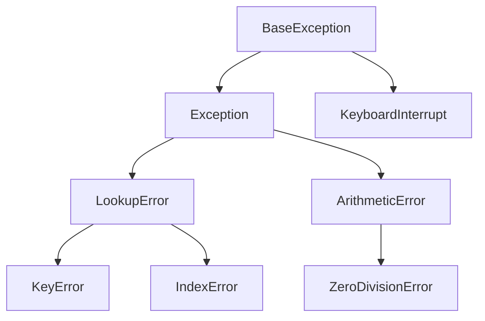

## Passo 1 · Leitura · Exceções são classes

Você tem um dicionário de turmas, cada turma com uma lista de notas, e quer ler `dados["turmas"][0]["notas"][3]`. Duas coisas podem dar errado: a chave não existir (`KeyError`) ou a posição não existir (`IndexError`). Escrever um `except` para cada uma funciona, mas existe um jeito melhor, e ele vem de algo que você aprendeu no módulo de classes: **toda exceção é uma classe, e as exceções formam uma hierarquia de herança**.

```python
print(KeyError.__mro__)
print(issubclass(IndexError, LookupError))
```

```
(<class 'KeyError'>, <class 'LookupError'>, <class 'Exception'>, <class 'BaseException'>, <class 'object'>)
True
```

`KeyError` e `IndexError` são filhas de `LookupError` ("erro de busca"). Um pedaço da árvore:



`ValueError` e `TypeError` também são filhas diretas de `Exception`.

#### A regra do except

`except X:` captura `X` **e todas as subclasses de `X`**, porque uma `KeyError` *é uma* `LookupError`, do mesmo jeito que um `Gato` é um `Animal`. Por isso um único `except LookupError:` trata chave e posição ausentes ao mesmo tempo. Quando um `try` tem vários `except`, o Python testa de cima para baixo e executa **só o primeiro** que combina.

#### Por que não BaseException

No topo fica `BaseException`. Abaixo dela, fora de `Exception`, estão `KeyboardInterrupt` (o usuário apertou Ctrl+C) e `SystemExit` (o programa pediu para encerrar com `sys.exit`). Elas não são erros do programa: são pedidos para parar. `except BaseException:` engoliria esses pedidos, e o programa ignoraria o Ctrl+C.

#### O erro comum: capturar largo demais

`except Exception:` captura quase tudo, inclusive defeitos seus. Se você digitar `dados["turma"]` sem o `s`, o `KeyError` é esperado; mas se você escrever `notas[0] + "1"`, o `TypeError` é um defeito, e um `except Exception: return None` o transforma em silêncio. Capture a família **mais estreita** que cobre os casos que você sabe tratar; o resto deve continuar subindo com traceback.

## Passo 2 · Exercício · Um except para chave e posição
modo: lacunas

A função `valor_por_caminho(dados, caminho, padrao)` percorre uma estrutura aninhada de dicionários e listas seguindo os passos de `caminho`:

```python
dados = {"turmas": [{"nome": "A", "notas": [7, 9]}]}
valor_por_caminho(dados, ["turmas", 0, "notas", 1], None)   # 9
valor_por_caminho(dados, ["turmas", 0, "notas", 5], -1)     # -1: posição não existe
valor_por_caminho(dados, ["turmas", 0, "sala"], -1)         # -1: chave não existe
```

Se algum passo não existir, seja chave ou posição, a função devolve `padrao`. Mas se o caminho tentar indexar algo que não é coleção (por exemplo, pedir `["x"]` de um texto), isso é um defeito de quem chamou: o `TypeError` precisa **continuar subindo**, sem ser tratado.

Complete as três lacunas (`___`).

### Instruções
1. A cada passo do caminho, desça um nível: `atual` passa a ser `atual[passo]`.
2. Capture, com um único `except`, a família que cobre `KeyError` e `IndexError`, e só ela.
   Dica: procure o pai das duas na árvore do passo anterior.
3. No `except`, devolva o valor padrão recebido.

### Código inicial
```python
def valor_por_caminho(dados, caminho, padrao):
    atual = dados
    try:
        for passo in caminho:
            atual = atual[___]
    except ___:
        return ___
    return atual
```

### Solução
```python
def valor_por_caminho(dados, caminho, padrao):
    atual = dados
    try:
        for passo in caminho:
            atual = atual[passo]
    except LookupError:
        return padrao
    return atual
```

### Dicas
1. `atual[passo]` funciona tanto para dicionário (chave) quanto para lista (posição).
2. `except KeyError:` sozinho deixa a posição inexistente derrubar a função.
3. `except Exception:` cobre os dois, mas também engole o `TypeError`, que deveria subir.

### Verificação
```json
[
  { "id": "fundo", "checkpoint": 1, "kind": "call", "function": "valor_por_caminho",
    "args": [{ "cursos": [{ "sigla": "BCC", "vagas": [40, 35, 12] }] }, ["cursos", 0, "vagas", 2], 0], "expected": 12, "type": "int",
    "name": "Desce quatro níveis e devolve 12", "hint": "A cada passo, atual vira atual[passo]." },
  { "id": "negativo", "checkpoint": 1, "kind": "call", "function": "valor_por_caminho",
    "args": [{ "cursos": [{ "sigla": "BCC" }, { "sigla": "EST" }] }, ["cursos", -1, "sigla"], "?"], "expected": "EST",
    "name": "Posição -1 continua valendo", "hint": "Índices negativos são posições válidas: não é preciso tratá-los à parte." },
  { "id": "vazio", "checkpoint": 1, "kind": "call", "function": "valor_por_caminho",
    "args": [{ "a": 1 }, [], 0], "expected": { "a": 1 },
    "name": "Caminho vazio devolve os próprios dados" },
  { "id": "captura", "checkpoint": 2, "kind": "source", "rule": { "type": "catches", "exception": "LookupError" },
    "name": "Captura LookupError", "hint": "Um único except com a classe-mãe de KeyError e IndexError." },
  { "id": "sem-posicao", "checkpoint": 2, "kind": "call", "function": "valor_por_caminho",
    "args": [{ "cursos": [{ "vagas": [] }] }, ["cursos", 0, "vagas", 0], "sem vagas"], "expected": "sem vagas",
    "name": "Posição inexistente devolve o padrão", "hint": "IndexError também precisa ser tratado pelo seu except." },
  { "id": "sem-chave", "checkpoint": 2, "kind": "call", "function": "valor_por_caminho",
    "args": [{ "cursos": [{ "vagas": [3] }] }, ["cursos", 0, "turno"], "sem turno"], "expected": "sem turno",
    "name": "Chave inexistente devolve o padrão", "hint": "KeyError precisa ser tratado pelo seu except." },
  { "id": "type-sobe", "checkpoint": 2, "kind": "expr",
    "expr": "valor_por_caminho({\"cursos\": [{\"sigla\": \"BCC\"}]}, [\"cursos\", 0, \"sigla\", \"x\"], 0)",
    "raises": "TypeError",
    "name": "Indexar um texto com \"x\" deixa o TypeError subir", "hint": "Esse erro é defeito de quem chamou: não o capture." },
  { "id": "padrao-none", "checkpoint": 3, "kind": "call", "function": "valor_por_caminho",
    "args": [{ "x": [1] }, ["x", 3], null], "expected": null, "type": "NoneType",
    "name": "Devolve o padrão recebido, mesmo que seja None" },
  { "id": "padrao-lista", "checkpoint": 3, "kind": "call", "function": "valor_por_caminho",
    "args": [{ "x": [1] }, ["y"], [0, 0]], "expected": [0, 0],
    "name": "Devolve o padrão recebido como está", "hint": "Devolva o parâmetro padrao, não um valor fixo." }
]
```

### Soluções erradas
```python name="captura só KeyError"
def valor_por_caminho(dados, caminho, padrao):
    atual = dados
    try:
        for passo in caminho:
            atual = atual[passo]
    except KeyError:
        return padrao
    return atual
```
```python name="captura Exception e engole o TypeError"
def valor_por_caminho(dados, caminho, padrao):
    atual = dados
    try:
        for passo in caminho:
            atual = atual[passo]
    except Exception:
        return padrao
    return atual
```
```python name="devolve None em vez do padrão"
def valor_por_caminho(dados, caminho, padrao):
    atual = dados
    try:
        for passo in caminho:
            atual = atual[passo]
    except LookupError:
        return None
    return atual
```

## Passo 3 · Leitura · raise com mensagem que ajuda

No Nível 1 você levantou exceções com `raise ValueError("...")`. Agora, dois cuidados que separam uma exceção útil de uma que atrapalha.

#### Escolha a classe certa

Quem chama a sua função vai escrever um `except`. Se você levanta `raise Exception("erro")`, a única forma de tratar é `except Exception:`, que, como você viu, captura defeitos junto. Use a classe que descreve o problema:

| Situação | Classe |
|---|---|
| tipo errado (recebeu `int`, esperava `str`) | `TypeError` |
| tipo certo, valor inaceitável (CPF com 10 dígitos) | `ValueError` |
| chave ou posição que não existe | `KeyError`, `IndexError` |

E escreva na mensagem **o que estava errado e qual valor chegou**. Compare a última linha do traceback nos dois casos:

```
Exception: erro
ValueError: CPF deve ter 11 dígitos, recebi 10
```

A primeira obriga quem lê a abrir o código. A segunda já diz o que consertar.

#### Valide na entrada da função (fail fast)

"Falhar cedo" (*fail fast*) quer dizer conferir os argumentos **antes** de fazer qualquer coisa com eles. Veja o defeito de validar tarde:

```python
def matricular(turma, nome, idade):
    turma.append(nome)
    if idade < 0:
        raise ValueError(f"idade inválida: {idade}")
```

`matricular(turma, "Caio", -2)` levanta o erro, mas `"Caio"` **já entrou** na lista: o programa ficou num estado meio feito. Com o `if` como primeira linha, nada muda quando a entrada é ruim.

Validar tarde também produz mensagens confusas. Uma função de CPF que chama `texto.strip()` sem conferir o tipo, ao receber o número `52998224725`, quebra com:

```
AttributeError: 'int' object has no attribute 'strip'
```

A mensagem fala de `strip`, que quem chamou nem sabe que existe. Uma conferência no começo troca isso por `TypeError: CPF deve ser texto, recebi int`.

## Passo 4 · Exercício · validar_cpf(texto)

Escreva `validar_cpf(texto)`, que confere o formato de um CPF e devolve só os dígitos. Faça as conferências **nesta ordem**, cada uma com a sua exceção e a mensagem exata:

| Ordem | Problema | Exceção e mensagem |
|---|---|---|
| 1 | `texto` não é `str` | `TypeError: CPF deve ser texto, recebi int` (o nome do tipo recebido) |
| 2 | depois de limpar, sobra um caractere que não é dígito | `ValueError: CPF com caractere inválido: '123.456.78a-09'` (o texto original, com aspas) |
| 3 | não são 11 dígitos | `ValueError: CPF deve ter 11 dígitos, recebi 10` |
| 4 | os 11 dígitos são todos iguais | `ValueError: CPF inválido: todos os dígitos são iguais` |

"Limpar" é tirar os espaços das pontas e remover todos os `.` e `-`. Se nada der errado, devolva o texto com os 11 dígitos: `validar_cpf("123.456.789-09")` devolve `"12345678909"`.

### Instruções
1. Se `texto` não for `str`, levante `TypeError` com a mensagem da tabela.
   Dica: `type(texto).__name__` dá o nome do tipo, como `int` ou `NoneType`.
2. Limpe o texto e, se algum caractere restante não for dígito, levante o `ValueError` com o texto original na mensagem.
   Dica: `{texto!r}` dentro da f-string escreve o texto com aspas.
3. Confira a quantidade de dígitos e levante o `ValueError` dizendo quantos chegaram.
4. Recuse os 11 dígitos iguais e, se tudo passou, devolva os dígitos.

### Código inicial
```python
def validar_cpf(texto):
    # 1. tipo   2. caracteres   3. quantidade   4. todos iguais
    pass
```

### Solução
```python
def validar_cpf(texto):
    if not isinstance(texto, str):
        raise TypeError(f"CPF deve ser texto, recebi {type(texto).__name__}")
    digitos = texto.strip().replace(".", "").replace("-", "")
    for caractere in digitos:
        if not caractere.isdigit():
            raise ValueError(f"CPF com caractere inválido: {texto!r}")
    if len(digitos) != 11:
        raise ValueError(f"CPF deve ter 11 dígitos, recebi {len(digitos)}")
    if len(set(digitos)) == 1:
        raise ValueError("CPF inválido: todos os dígitos são iguais")
    return digitos
```

### Dicas
1. Cada conferência é um `if` com `raise` dentro; a função só chega ao `return` se nenhum `raise` aconteceu.
2. Cuidado com `digitos.isdigit()` no texto inteiro: para o texto vazio ela devolve `False`, e o CPF vazio deve cair na regra da quantidade, não na do caractere.
3. Todos os dígitos são iguais quando o conjunto deles tem um único elemento.

### Verificação
```json
[
  { "id": "tipo-int", "checkpoint": 1, "kind": "expr", "expr": "validar_cpf(52998224725)", "raises": "TypeError",
    "message_contains": "CPF deve ser texto, recebi int",
    "name": "Um número em vez de texto levanta TypeError", "hint": "Confira o tipo antes de chamar qualquer método do texto." },
  { "id": "tipo-none", "checkpoint": 1, "kind": "expr", "expr": "validar_cpf(None)", "raises": "TypeError",
    "message_contains": "recebi NoneType",
    "name": "None levanta TypeError com o nome do tipo", "hint": "Use o nome do tipo recebido, não um texto fixo." },
  { "id": "letra", "checkpoint": 2, "kind": "expr", "expr": "validar_cpf(\"529.982.247-2x\")", "raises": "ValueError",
    "message_contains": "CPF com caractere inválido: '529.982.247-2x'",
    "name": "Uma letra no CPF levanta ValueError com o texto original", "hint": "A mensagem mostra o texto como chegou, com aspas." },
  { "id": "barra", "checkpoint": 2, "kind": "expr", "expr": "validar_cpf(\"529/982/247-25\")", "raises": "ValueError",
    "message_contains": "caractere inválido",
    "name": "Barra não é separador aceito", "hint": "Só pontos, hífens e espaços nas pontas são limpos." },
  { "id": "curto", "checkpoint": 3, "kind": "expr", "expr": "validar_cpf(\"529.982.247-2\")", "raises": "ValueError",
    "message_contains": "CPF deve ter 11 dígitos, recebi 10",
    "name": "Dez dígitos levantam ValueError dizendo quantos chegaram" },
  { "id": "longo", "checkpoint": 3, "kind": "expr", "expr": "validar_cpf(\"5299822472512\")", "raises": "ValueError",
    "message_contains": "recebi 13",
    "name": "Treze dígitos também são recusados", "hint": "A conferência é de diferente de 11, não só de menos de 11." },
  { "id": "vazio", "checkpoint": 3, "kind": "expr", "expr": "validar_cpf(\"\")", "raises": "ValueError",
    "message_contains": "recebi 0",
    "name": "Texto vazio cai na regra da quantidade", "hint": "Para o texto vazio, não há caractere inválido: há zero dígitos." },
  { "id": "iguais", "checkpoint": 4, "kind": "expr", "expr": "validar_cpf(\"000.000.000-00\")", "raises": "ValueError",
    "message_contains": "CPF inválido: todos os dígitos são iguais",
    "name": "Onze dígitos iguais são recusados" },
  { "id": "valido", "checkpoint": 4, "kind": "call", "function": "validar_cpf", "args": ["529.982.247-25"], "expected": "52998224725", "type": "str",
    "name": "CPF com pontuação devolve só os dígitos", "hint": "Devolva o texto limpo, com os 11 dígitos." },
  { "id": "valido-espacos", "checkpoint": 4, "kind": "call", "function": "validar_cpf", "args": ["  11144477735 "], "expected": "11144477735", "type": "str",
    "name": "Espaços nas pontas são ignorados" }
]
```

### Soluções erradas
```python name="raise Exception genérico"
def validar_cpf(texto):
    if not isinstance(texto, str):
        raise Exception(f"CPF deve ser texto, recebi {type(texto).__name__}")
    digitos = texto.strip().replace(".", "").replace("-", "")
    for caractere in digitos:
        if not caractere.isdigit():
            raise Exception(f"CPF com caractere inválido: {texto!r}")
    if len(digitos) != 11:
        raise Exception(f"CPF deve ter 11 dígitos, recebi {len(digitos)}")
    if len(set(digitos)) == 1:
        raise Exception("CPF inválido: todos os dígitos são iguais")
    return digitos
```
```python name="não confere o tipo (AttributeError no strip)"
def validar_cpf(texto):
    digitos = texto.strip().replace(".", "").replace("-", "")
    for caractere in digitos:
        if not caractere.isdigit():
            raise ValueError(f"CPF com caractere inválido: {texto!r}")
    if len(digitos) != 11:
        raise ValueError(f"CPF deve ter 11 dígitos, recebi {len(digitos)}")
    if len(set(digitos)) == 1:
        raise ValueError("CPF inválido: todos os dígitos são iguais")
    return digitos
```
```python name="isdigit no texto inteiro (vazio vira caractere inválido)"
def validar_cpf(texto):
    if not isinstance(texto, str):
        raise TypeError(f"CPF deve ser texto, recebi {type(texto).__name__}")
    digitos = texto.strip().replace(".", "").replace("-", "")
    if not digitos.isdigit():
        raise ValueError(f"CPF com caractere inválido: {texto!r}")
    if len(digitos) != 11:
        raise ValueError(f"CPF deve ter 11 dígitos, recebi {len(digitos)}")
    if len(set(digitos)) == 1:
        raise ValueError("CPF inválido: todos os dígitos são iguais")
    return digitos
```
```python name="conta os caracteres antes de limpar"
def validar_cpf(texto):
    if not isinstance(texto, str):
        raise TypeError(f"CPF deve ser texto, recebi {type(texto).__name__}")
    if len(texto) != 11:
        raise ValueError(f"CPF deve ter 11 dígitos, recebi {len(texto)}")
    digitos = texto.strip().replace(".", "").replace("-", "")
    for caractere in digitos:
        if not caractere.isdigit():
            raise ValueError(f"CPF com caractere inválido: {texto!r}")
    if len(set(digitos)) == 1:
        raise ValueError("CPF inválido: todos os dígitos são iguais")
    return digitos
```
```python name="devolve False em vez de levantar"
def validar_cpf(texto):
    if not isinstance(texto, str):
        return False
    digitos = texto.strip().replace(".", "").replace("-", "")
    for caractere in digitos:
        if not caractere.isdigit():
            return False
    if len(digitos) != 11 or len(set(digitos)) == 1:
        return False
    return digitos
```

## Passo 5 · Leitura · Relançar e encadear

Às vezes você quer **fazer algo** quando a exceção passa (registrar, avisar) mas não sabe resolvê-la. Aí você relança com `raise` sozinho, sem nada depois:

```python
try:
    n = int(texto)
except ValueError:
    print("falhou com", texto)
    raise
```

O `raise` nu, dentro de um `except`, levanta de novo **a mesma exceção**, com o traceback original intacto. Evite `except ValueError as e: raise e`: funciona, mas acrescenta ao traceback mais uma linha apontando para o próprio `raise e`, e quem lê perde tempo com ela.

#### Traduzir uma exceção: raise ... from

Outras vezes o erro de baixo nível não faz sentido para quem chamou. Uma função que lê configurações guarda tudo num dicionário, mas quem a usa não deveria precisar saber disso: para ele, "configuração ausente" é um `ValueError`, não um `KeyError`. Você traduz e **encadeia** com `from`:

```python
def buscar(config, chave):
    try:
        return config[chave]
    except KeyError as e:
        raise ValueError(f"configuração ausente: {chave!r}") from e
```

`buscar({"porta": "8080"}, "host")` sem tratamento mostra as duas exceções, ligadas por uma frase:

```
Traceback (most recent call last):
  File "main.py", line 3, in buscar
    return config[chave]
           ~~~~~~^^^^^^^
KeyError: 'host'

The above exception was the direct cause of the following exception:

Traceback (most recent call last):
  File "main.py", line 8, in <module>
    buscar({"porta": "8080"}, "host")
    ~~~~~~^^^^^^^^^^^^^^^^^^^^^^^^^^^
  File "main.py", line 5, in buscar
    raise ValueError(f"configuração ausente: {chave!r}") from e
ValueError: configuração ausente: 'host'
```

A exceção original fica guardada no atributo `__cause__` da nova: `erro.__cause__` é o `KeyError`. Sem o `from e`, o Python ainda mostra as duas, mas com outra frase: `During handling of the above exception, another exception occurred:`, que significa "deu um **segundo** erro enquanto tratava o primeiro", como se o seu `except` tivesse um defeito. O `from` diz que a troca foi de propósito.

## Passo 6 · Previsão · Quem imprime o quê

A função `converter` relança o erro com `raise` nu; quem chama trata. Leia o código sem executar e digite exatamente o que ele imprime.

### Código
```python
def converter(texto):
    try:
        n = int(texto)
    except ValueError:
        print("converter: falhou com", texto)
        raise
    else:
        print("converter: ok")
        return n


for t in ["7", "x"]:
    try:
        print("valor", converter(t))
    except ValueError as e:
        print("chamador:", e)
```

### Dicas
1. O `print("valor", ...)` só imprime depois que `converter` devolve: o que `converter` imprime aparece antes.
2. Quando o `raise` nu acontece, o `print("valor", ...)` do chamador não chega a rodar.
3. Imprimir uma exceção mostra só a mensagem, a mesma de `int("x")` no Nível 1.

### Saída esperada
```text
converter: ok
valor 7
converter: falhou com x
chamador: invalid literal for int() with base 10: 'x'
```

## Passo 7 · Exercício · ler_inteiro(config, chave)

Escreva `ler_inteiro(config, chave)`, que lê uma configuração de um dicionário e a devolve como inteiro. Quem chama só precisa tratar `ValueError`, venha o problema de onde vier, e o erro original fica encadeado:

| Situação | O que acontece |
|---|---|
| a chave existe e o valor vira inteiro | devolve o inteiro: `ler_inteiro({"porta": "8080"}, "porta")` é `8080` |
| a chave não existe | `ValueError: configuração ausente: 'porta'`, encadeado (`from`) ao `KeyError` |
| o valor não vira inteiro | `ValueError: configuração 'porta' não é um inteiro: 'oito'`, encadeado ao `ValueError` do `int` |

### Instruções
1. Leia `config[chave]` dentro de um `try` e converta o valor com `int`, devolvendo o resultado.
2. Se a chave não existir, levante o `ValueError` de configuração ausente encadeado ao `KeyError` com `from`.
   Dica: `{chave!r}` escreve a chave com aspas.
3. Se a conversão falhar, levante o `ValueError` de valor inválido encadeado ao erro do `int`.

### Código inicial
```python
def ler_inteiro(config, chave):
    return int(config[chave])
```

### Solução
```python
def ler_inteiro(config, chave):
    try:
        texto = config[chave]
    except KeyError as e:
        raise ValueError(f"configuração ausente: {chave!r}") from e
    try:
        return int(texto)
    except ValueError as e:
        raise ValueError(f"configuração {chave!r} não é um inteiro: {texto!r}") from e
```

### Dicas
1. Dois `try` separados deixam claro qual linha gerou qual erro.
2. Para o valor aparecer na mensagem, guarde `config[chave]` numa variável antes de converter.
3. O encadeamento é `raise NovaExcecao(...) from e`, com `e` vindo de `except ... as e`.

### Verificação
```json
[
  { "id": "texto", "checkpoint": 1, "kind": "call", "function": "ler_inteiro", "args": [{ "tentativas": "3", "modo": "lento" }, "tentativas"],
    "expected": 3, "type": "int", "name": "Texto \"3\" vira o inteiro 3", "hint": "Converta o valor lido com int()." },
  { "id": "inteiro", "checkpoint": 1, "kind": "call", "function": "ler_inteiro", "args": [{ "limite": 250 }, "limite"],
    "expected": 250, "type": "int", "name": "Um valor que já é inteiro também serve" },
  { "id": "ausente", "checkpoint": 2, "kind": "expr", "expr": "ler_inteiro({\"limite\": 250}, \"timeout\")", "raises": "ValueError",
    "message_contains": "configuração ausente: 'timeout'",
    "name": "Chave ausente vira ValueError com a chave na mensagem", "hint": "Quem chama só trata ValueError: traduza o KeyError." },
  { "id": "ausente-causa", "checkpoint": 2, "kind": "expr",
    "setup": "erro = None\ntry:\n    ler_inteiro({\"limite\": 250}, \"timeout\")\nexcept ValueError as e:\n    erro = e",
    "expr": "type(erro.__cause__).__name__", "expected": "KeyError",
    "name": "O KeyError original fica encadeado como causa", "hint": "Use raise ... from e dentro do except KeyError as e." },
  { "id": "invalido", "checkpoint": 3, "kind": "expr", "expr": "ler_inteiro({\"modo\": \"lento\"}, \"modo\")", "raises": "ValueError",
    "message_contains": "configuração 'modo' não é um inteiro: 'lento'",
    "name": "Valor que não vira inteiro gera a mensagem com chave e valor" },
  { "id": "invalido-causa", "checkpoint": 3, "kind": "expr",
    "setup": "erro = None\ntry:\n    ler_inteiro({\"modo\": \"2.5\"}, \"modo\")\nexcept ValueError as e:\n    erro = e",
    "expr": "str(erro.__cause__)", "expected": "invalid literal for int() with base 10: '2.5'",
    "name": "O erro do int fica encadeado como causa", "hint": "Encadeie com from o ValueError que o int levantou." }
]
```

### Soluções erradas
```python name="deixa o KeyError passar"
def ler_inteiro(config, chave):
    texto = config[chave]
    try:
        return int(texto)
    except ValueError as e:
        raise ValueError(f"configuração {chave!r} não é um inteiro: {texto!r}") from e
```
```python name="traduz sem from"
def ler_inteiro(config, chave):
    try:
        texto = config[chave]
    except KeyError:
        raise ValueError(f"configuração ausente: {chave!r}")
    try:
        return int(texto)
    except ValueError:
        raise ValueError(f"configuração {chave!r} não é um inteiro: {texto!r}")
```
```python name="um try só, mensagem errada para valor inválido"
def ler_inteiro(config, chave):
    try:
        return int(config[chave])
    except (KeyError, ValueError) as e:
        raise ValueError(f"configuração ausente: {chave!r}") from e
```
```python name="from None apaga a causa"
def ler_inteiro(config, chave):
    try:
        texto = config[chave]
    except KeyError:
        raise ValueError(f"configuração ausente: {chave!r}") from None
    try:
        return int(texto)
    except ValueError:
        raise ValueError(f"configuração {chave!r} não é um inteiro: {texto!r}") from None
```

## Passo 8 · Quiz · A árvore e o raise

### Pergunta
Qual `except` trata `notas[10]` e `turma["Ana"]` (posição e chave ausentes) e deixa passar o erro de `int("abc")`?
- [ ] `except Exception:`
- [x] `except LookupError:`
- [ ] `except KeyError:`
- [ ] `except ValueError:`
> `IndexError` e `KeyError` herdam de `LookupError`, e `int("abc")` levanta `ValueError`, que não está nessa família. `except Exception:` também pegaria o `ValueError`; `except KeyError:` deixaria passar o `IndexError`.

### Pergunta
O que este código imprime?
```python
try:
    media = 10 / 0
except LookupError:
    print("A")
except ArithmeticError:
    print("B")
except Exception:
    print("C")
```
- [ ] `B` e `C`
- [x] `B`
- [ ] `C`
- [ ] Nada: o programa para com `ZeroDivisionError`
> `ZeroDivisionError` é subclasse de `ArithmeticError`. Os `except` são testados de cima para baixo e só o primeiro que combina roda; `Exception` também combinaria, mas nunca chega a ser testado.

### Pergunta
Dentro de um `except KeyError as e:`, qual a diferença entre `raise ValueError("ausente") from e` e o mesmo `raise` sem `from e`?
- [ ] Sem `from e`, o `KeyError` some do traceback
- [ ] Com `from e`, o `ValueError` vira um `KeyError`
- [x] Os dois mostram as duas exceções, mas só o `from e` marca o `KeyError` como causa direta (`__cause__`), em vez de "erro durante o tratamento de outro"
- [ ] Nenhuma: `from e` é só um comentário para quem lê
> Sem `from`, o traceback diz `During handling of the above exception, another exception occurred:`, o que sugere um defeito no `except`. Com `from e`, diz `The above exception was the direct cause of the following exception:` e guarda o original em `__cause__`.
