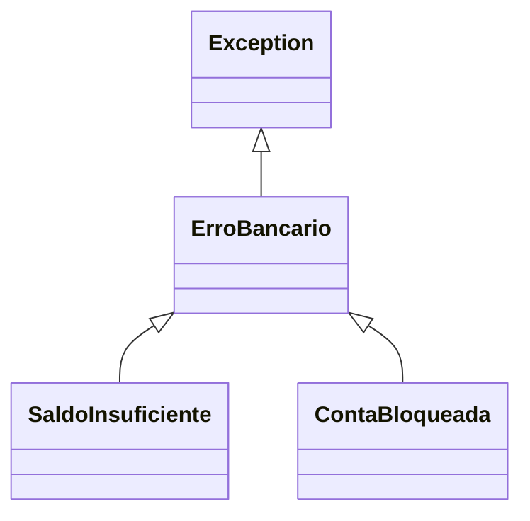

## Passo 1 · Leitura · Quando ValueError não basta

O método `sacar` de uma conta pode falhar por dois motivos bem diferentes: o saldo não cobre o saque, ou a conta está bloqueada pelo banco. Com o que você sabe até aqui, os dois viram `ValueError`:

```python
if self.bloqueada:
    raise ValueError("conta bloqueada")
if valor > self.saldo:
    raise ValueError("saldo insuficiente")
```

O caixa eletrônico quer oferecer o cheque especial **só** no caso do saldo. Para separar os dois, ele teria de ler o texto: `if "insuficiente" in str(e):`. Basta alguém corrigir a mensagem para `"Saldo insuficiente"` e o `if` deixa de funcionar, sem erro nenhum.

#### A saída: uma classe por situação

Exceções são classes, então você pode criar as suas herdando de `Exception`:

```python
class ErroBancario(Exception):
    """Base de todos os erros do banco."""


class SaldoInsuficiente(ErroBancario):
    pass


class ContaBloqueada(ErroBancario):
    pass
```

Uma classe de exceção não precisa de nada além do nome e da base: a docstring ou o `pass` bastam como corpo. Agora quem chama escolhe o nível de detalhe:

- `except SaldoInsuficiente:` só para oferecer o cheque especial;
- `except ErroBancario:` para "qualquer problema do banco", sem precisar listar um por um.



A **base comum** é o que dá esse poder. Se `SaldoInsuficiente` herdasse direto de `Exception`, o `except ErroBancario:` não a pegaria.

#### O erro comum: herdar de BaseException

`class ErroBancario(BaseException)` funciona, mas tira os seus erros da família `Exception`. Um `except Exception:` que alguém escreveu para registrar falhas não vai mais vê-los, e eles passam como se fossem um Ctrl+C. Erros do seu programa herdam de `Exception` (ou de uma subclasse dela).

## Passo 2 · Exercício · A hierarquia do banco
modo: lacunas

Complete as quatro lacunas (`___`) para montar a hierarquia e usá-la em `Conta.sacar`. A conta bloqueada é conferida **antes** do saldo: se a conta está bloqueada, esse é o problema, seja qual for o valor.

### Instruções
1. `ErroBancario` herda de `Exception`, e `SaldoInsuficiente` herda de `ErroBancario`.
2. Uma conta bloqueada levanta `ContaBloqueada`, antes de olhar o saldo.
3. Um saque acima do saldo levanta `SaldoInsuficiente` e não muda o saldo; um saque válido desconta e devolve o novo saldo.

### Código inicial
```python
class ErroBancario(___):
    pass


class SaldoInsuficiente(___):
    pass


class ContaBloqueada(ErroBancario):
    pass


class Conta:
    def __init__(self, titular, saldo):
        self.titular = titular
        self.saldo = saldo
        self.bloqueada = False

    def sacar(self, valor):
        if self.bloqueada:
            raise ___(f"conta de {self.titular} está bloqueada")
        if valor > self.saldo:
            raise ___(f"saldo insuficiente: saldo {self.saldo}, saque {valor}")
        self.saldo -= valor
        return self.saldo
```

### Solução
```python
class ErroBancario(Exception):
    pass


class SaldoInsuficiente(ErroBancario):
    pass


class ContaBloqueada(ErroBancario):
    pass


class Conta:
    def __init__(self, titular, saldo):
        self.titular = titular
        self.saldo = saldo
        self.bloqueada = False

    def sacar(self, valor):
        if self.bloqueada:
            raise ContaBloqueada(f"conta de {self.titular} está bloqueada")
        if valor > self.saldo:
            raise SaldoInsuficiente(f"saldo insuficiente: saldo {self.saldo}, saque {valor}")
        self.saldo -= valor
        return self.saldo
```

### Dicas
1. Erros do seu programa entram na família `Exception`, nunca direto em `BaseException`.
2. Para `except ErroBancario:` pegar o saldo insuficiente, `SaldoInsuficiente` precisa herdar de `ErroBancario`.
3. Cada `raise` usa a classe que descreve o seu `if`.

### Verificação
```json
[
  { "id": "base-exception", "checkpoint": 1, "kind": "expr", "expr": "issubclass(ErroBancario, Exception)", "expected": true,
    "name": "ErroBancario é da família Exception", "hint": "Herde de Exception, não de BaseException." },
  { "id": "familia", "checkpoint": 1, "kind": "expr", "expr": "[issubclass(SaldoInsuficiente, ErroBancario), issubclass(ContaBloqueada, ErroBancario)]",
    "expected": [true, true], "name": "As duas exceções herdam de ErroBancario" },
  { "id": "captura-base", "checkpoint": 1, "kind": "expr",
    "setup": "c = Conta(\"Bia\", 30)\nmotivo = \"nada\"\ntry:\n    c.sacar(80)\nexcept ErroBancario as e:\n    motivo = type(e).__name__",
    "expr": "motivo", "expected": "SaldoInsuficiente",
    "name": "except ErroBancario pega o saldo insuficiente", "hint": "A base comum é o que permite capturar a família inteira." },
  { "id": "bloqueada", "checkpoint": 2, "kind": "expr", "setup": "c = Conta(\"Davi\", 500)\nc.bloqueada = True",
    "expr": "c.sacar(10)", "raises": "ContaBloqueada", "message_contains": "conta de Davi está bloqueada",
    "name": "Conta bloqueada levanta ContaBloqueada" },
  { "id": "bloqueada-primeiro", "checkpoint": 2, "kind": "expr", "setup": "c = Conta(\"Davi\", 5)\nc.bloqueada = True",
    "expr": "c.sacar(900)", "raises": "ContaBloqueada",
    "name": "Bloqueada e sem saldo: o motivo é o bloqueio", "hint": "Confira o bloqueio antes do saldo." },
  { "id": "insuficiente", "checkpoint": 3, "kind": "expr", "setup": "c = Conta(\"Eva\", 120)",
    "expr": "c.sacar(150)", "raises": "SaldoInsuficiente", "message_contains": "saldo 120, saque 150",
    "name": "Saque acima do saldo levanta SaldoInsuficiente" },
  { "id": "saldo-intacto", "checkpoint": 3, "kind": "expr",
    "setup": "c = Conta(\"Eva\", 120)\ntry:\n    c.sacar(150)\nexcept SaldoInsuficiente:\n    pass",
    "expr": "c.saldo", "expected": 120, "name": "Saque recusado não muda o saldo" },
  { "id": "valido", "checkpoint": 3, "kind": "expr", "setup": "c = Conta(\"Eva\", 120)\nc.sacar(20)",
    "expr": "c.sacar(100)", "expected": 0, "name": "Sacar o saldo inteiro é permitido e devolve 0" }
]
```

### Soluções erradas
```python name="base herda de BaseException"
class ErroBancario(BaseException):
    pass


class SaldoInsuficiente(ErroBancario):
    pass


class ContaBloqueada(ErroBancario):
    pass


class Conta:
    def __init__(self, titular, saldo):
        self.titular = titular
        self.saldo = saldo
        self.bloqueada = False

    def sacar(self, valor):
        if self.bloqueada:
            raise ContaBloqueada(f"conta de {self.titular} está bloqueada")
        if valor > self.saldo:
            raise SaldoInsuficiente(f"saldo insuficiente: saldo {self.saldo}, saque {valor}")
        self.saldo -= valor
        return self.saldo
```
```python name="SaldoInsuficiente fora da família"
class ErroBancario(Exception):
    pass


class SaldoInsuficiente(Exception):
    pass


class ContaBloqueada(ErroBancario):
    pass


class Conta:
    def __init__(self, titular, saldo):
        self.titular = titular
        self.saldo = saldo
        self.bloqueada = False

    def sacar(self, valor):
        if self.bloqueada:
            raise ContaBloqueada(f"conta de {self.titular} está bloqueada")
        if valor > self.saldo:
            raise SaldoInsuficiente(f"saldo insuficiente: saldo {self.saldo}, saque {valor}")
        self.saldo -= valor
        return self.saldo
```
```python name="confere o saldo antes do bloqueio"
class ErroBancario(Exception):
    pass


class SaldoInsuficiente(ErroBancario):
    pass


class ContaBloqueada(ErroBancario):
    pass


class Conta:
    def __init__(self, titular, saldo):
        self.titular = titular
        self.saldo = saldo
        self.bloqueada = False

    def sacar(self, valor):
        if valor > self.saldo:
            raise SaldoInsuficiente(f"saldo insuficiente: saldo {self.saldo}, saque {valor}")
        if self.bloqueada:
            raise ContaBloqueada(f"conta de {self.titular} está bloqueada")
        self.saldo -= valor
        return self.saldo
```

## Passo 3 · Leitura · Exceções que carregam dados

Quando o caixa eletrônico pega um `SaldoInsuficiente`, ele quer mostrar "faltam 30 reais". O número está na mensagem, mas tirar número de texto é o mesmo problema do passo 1. A solução é guardar os dados **como atributos** da exceção:

```python
class SaldoInsuficiente(ErroBancario):
    def __init__(self, saldo, valor):
        super().__init__(f"saldo {saldo}, saque {valor}")
        self.saldo = saldo
        self.valor = valor
        self.faltam = valor - saldo
```

Quem trata lê os atributos direto:

```python
try:
    conta.sacar(80)
except SaldoInsuficiente as e:
    print(f"faltam {e.faltam}")
```

#### Não esqueça o super().__init__

O `super().__init__(mensagem)` entrega a mensagem para `Exception`, que a guarda e a mostra no traceback e no `str(e)`. Sem ele, o Python usa os argumentos crus. `raise SaldoInsuficiente(50, 80)` termina assim:

```
SaldoInsuficiente: (50, 80)
```

em vez de `SaldoInsuficiente: saldo 50, saque 80`.

#### A ordem dos except

Os `except` são testados de cima para baixo. Se `except ErroBancario:` vem antes de `except SaldoInsuficiente:`, o segundo **nunca roda**: o saldo insuficiente já combinou com a base. Coloque sempre a específica primeiro.

#### Exceções fazem parte do contrato

Quem chama precisa saber o que tratar. Escreva na docstring, numa seção `Raises:`, cada exceção e quando ela acontece:

```python
def sacar(self, valor):
    """Desconta valor do saldo e devolve o saldo novo.

    Raises:
        ContaBloqueada: se a conta estiver bloqueada.
        SaldoInsuficiente: se valor for maior que o saldo.
    """
```

#### Exceção ou None?

Use exceção para o que **impede** a função de cumprir o que prometeu (sacar sem saldo). Devolva `None` ou `False` quando a ausência é um resultado normal: `buscar_aluno("Caio")` numa turma sem Caio pode devolver `None`, porque "não achei" é uma resposta. Exceção para o caminho comum vira um `try` em cada chamada e esconde a lógica.

## Passo 4 · Previsão · Qual except pega

A loja tem uma base `ErroDaLoja` e uma específica `SemEstoque`. Repare na ordem dos `except` no laço. Leia o código sem executar e digite exatamente o que ele imprime.

### Código
```python
class ErroDaLoja(Exception):
    pass


class SemEstoque(ErroDaLoja):
    pass


def vender(qtd):
    if qtd <= 0:
        raise ErroDaLoja("quantidade inválida")
    if qtd > 3:
        raise SemEstoque(f"pedido de {qtd}, há 3")
    return "vendido"


for qtd in [2, 5, 0]:
    try:
        print(vender(qtd))
    except ErroDaLoja as e:
        print("loja:", type(e).__name__, e)
    except SemEstoque as e:
        print("estoque:", e)
```

### Dicas
1. Só o primeiro `except` que combina roda.
2. Um `SemEstoque` também *é um* `ErroDaLoja`.
3. `type(e).__name__` mostra a classe de verdade da exceção, mesmo quando ela foi pega pela base.

### Saída esperada
```text
vendido
loja: SemEstoque pedido de 5, há 3
loja: ErroDaLoja quantidade inválida
```

## Passo 5 · Exercício · Estoque com erros que explicam

Monte o estoque de uma papelaria. A base `ErroDeEstoque` já está pronta. Crie:

- `ProdutoInexistente(produto)`: guarda `produto` e tem a mensagem `produto inexistente: 'lápis'` (o nome com aspas).
- `EstoqueInsuficiente(produto, pedido, disponivel)`: guarda os três valores e mais `faltam` (`pedido - disponivel`), com a mensagem `estoque insuficiente de caneta: pedido 5, disponível 2`.

Depois complete `Estoque.retirar(produto, quantidade)`, conferindo nesta ordem:

1. quantidade menor ou igual a zero: `ValueError` com `quantidade deve ser positiva: 0` (é defeito de quem chamou, por isso não é erro do estoque);
2. produto fora do estoque: `ProdutoInexistente`;
3. quantidade maior que a disponível: `EstoqueInsuficiente`;
4. tudo certo: desconta e devolve quantas unidades restam.

Por fim, `tentar_retirar(estoque, produto, quantidade)` trata os erros do estoque e devolve um texto para o balcão: `ok, restam 3`, `faltam 2 de caneta` ou `não vendemos lápis`.

### Instruções
1. Crie as duas exceções, herdando de `ErroDeEstoque`, com os atributos e as mensagens pedidas.
   Dica: a mensagem vai para `super().__init__(...)`.
2. Complete `retirar` com as quatro regras, na ordem. Um pedido recusado não muda o estoque.
3. Escreva na docstring de `retirar` uma seção `Raises:` citando as três exceções que ela pode levantar.
4. Complete `tentar_retirar` usando os atributos das exceções, não o texto da mensagem.

### Código inicial
```python
class ErroDeEstoque(Exception):
    """Base dos erros do estoque."""


class Estoque:
    def __init__(self, itens):
        self.itens = dict(itens)

    def retirar(self, produto, quantidade):
        """Retira unidades do produto e devolve quantas restam."""
        pass


def tentar_retirar(estoque, produto, quantidade):
    pass
```

### Solução
```python
class ErroDeEstoque(Exception):
    """Base dos erros do estoque."""


class ProdutoInexistente(ErroDeEstoque):
    def __init__(self, produto):
        super().__init__(f"produto inexistente: {produto!r}")
        self.produto = produto


class EstoqueInsuficiente(ErroDeEstoque):
    def __init__(self, produto, pedido, disponivel):
        super().__init__(f"estoque insuficiente de {produto}: pedido {pedido}, disponível {disponivel}")
        self.produto = produto
        self.pedido = pedido
        self.disponivel = disponivel
        self.faltam = pedido - disponivel


class Estoque:
    def __init__(self, itens):
        self.itens = dict(itens)

    def retirar(self, produto, quantidade):
        """Retira unidades do produto e devolve quantas restam.

        Raises:
            ValueError: se a quantidade não for positiva.
            ProdutoInexistente: se o produto não estiver no estoque.
            EstoqueInsuficiente: se não houver unidades suficientes.
        """
        if quantidade <= 0:
            raise ValueError(f"quantidade deve ser positiva: {quantidade}")
        if produto not in self.itens:
            raise ProdutoInexistente(produto)
        disponivel = self.itens[produto]
        if quantidade > disponivel:
            raise EstoqueInsuficiente(produto, quantidade, disponivel)
        self.itens[produto] = disponivel - quantidade
        return self.itens[produto]


def tentar_retirar(estoque, produto, quantidade):
    try:
        restam = estoque.retirar(produto, quantidade)
    except EstoqueInsuficiente as e:
        return f"faltam {e.faltam} de {e.produto}"
    except ProdutoInexistente as e:
        return f"não vendemos {e.produto}"
    return f"ok, restam {restam}"
```

### Dicas
1. Na exceção, chame `super().__init__(mensagem)` e depois guarde cada dado em `self`.
2. Em `retirar`, confira `produto not in self.itens` antes de ler `self.itens[produto]`, senão o erro vira um `KeyError`.
3. Em `tentar_retirar`, o `except EstoqueInsuficiente as e:` dá acesso a `e.faltam` e `e.produto`.

### Verificação
```json
[
  { "id": "familia", "checkpoint": 1, "kind": "expr", "expr": "[issubclass(ProdutoInexistente, ErroDeEstoque), issubclass(EstoqueInsuficiente, ErroDeEstoque)]",
    "expected": [true, true], "name": "As duas exceções herdam de ErroDeEstoque" },
  { "id": "atributos", "checkpoint": 1, "kind": "expr", "expr": "[EstoqueInsuficiente(\"régua\", 9, 4).faltam, EstoqueInsuficiente(\"régua\", 9, 4).disponivel, ProdutoInexistente(\"cola\").produto]",
    "expected": [5, 4, "cola"], "name": "As exceções guardam os dados como atributos", "hint": "faltam é pedido menos disponivel." },
  { "id": "mensagem-insuf", "checkpoint": 1, "kind": "expr", "expr": "str(EstoqueInsuficiente(\"régua\", 9, 4))",
    "expected": "estoque insuficiente de régua: pedido 9, disponível 4",
    "name": "Mensagem de EstoqueInsuficiente", "hint": "Sem super().__init__(mensagem), str(e) mostra os argumentos crus." },
  { "id": "mensagem-inex", "checkpoint": 1, "kind": "expr", "expr": "str(ProdutoInexistente(\"cola\"))", "expected": "produto inexistente: 'cola'",
    "name": "Mensagem de ProdutoInexistente" },
  { "id": "quantidade", "checkpoint": 2, "kind": "expr", "setup": "e = Estoque({\"borracha\": 4})",
    "expr": "e.retirar(\"borracha\", -2)", "raises": "ValueError", "message_contains": "quantidade deve ser positiva: -2",
    "name": "Quantidade negativa levanta ValueError" },
  { "id": "inexistente", "checkpoint": 2, "kind": "expr", "setup": "e = Estoque({\"borracha\": 4})",
    "expr": "e.retirar(\"apontador\", 1)", "raises": "ProdutoInexistente", "message_contains": "produto inexistente: 'apontador'",
    "name": "Produto fora do estoque levanta ProdutoInexistente", "hint": "Confira se o produto existe antes de ler a quantidade." },
  { "id": "insuficiente", "checkpoint": 2, "kind": "expr", "setup": "e = Estoque({\"borracha\": 4})",
    "expr": "e.retirar(\"borracha\", 10)", "raises": "EstoqueInsuficiente", "message_contains": "pedido 10, disponível 4",
    "name": "Pedido maior que o disponível levanta EstoqueInsuficiente" },
  { "id": "intacto", "checkpoint": 2, "kind": "expr",
    "setup": "e = Estoque({\"borracha\": 4})\ntry:\n    e.retirar(\"borracha\", 10)\nexcept ErroDeEstoque:\n    pass",
    "expr": "e.itens", "expected": { "borracha": 4 }, "name": "Pedido recusado não muda o estoque" },
  { "id": "retira", "checkpoint": 2, "kind": "expr", "setup": "e = Estoque({\"borracha\": 4, \"cola\": 1})\ne.retirar(\"borracha\", 1)",
    "expr": "[e.retirar(\"borracha\", 3), e.itens]", "expected": [0, { "borracha": 0, "cola": 1 }],
    "name": "Retiradas descontam e devolvem o que resta" },
  { "id": "raises-doc", "checkpoint": 3, "kind": "expr",
    "expr": "[nome in (Estoque.retirar.__doc__ or \"\") for nome in [\"Raises:\", \"ValueError\", \"ProdutoInexistente\", \"EstoqueInsuficiente\"]]",
    "expected": [true, true, true, true],
    "name": "A docstring de retirar documenta as exceções", "hint": "Acrescente uma seção Raises: com as três exceções." },
  { "id": "balcao-ok", "checkpoint": 4, "kind": "expr", "setup": "e = Estoque({\"cola\": 7})",
    "expr": "tentar_retirar(e, \"cola\", 2)", "expected": "ok, restam 5", "name": "Retirada possível: ok, restam 5" },
  { "id": "balcao-faltam", "checkpoint": 4, "kind": "expr", "setup": "e = Estoque({\"cola\": 7})",
    "expr": "tentar_retirar(e, \"cola\", 10)", "expected": "faltam 3 de cola", "name": "Sem estoque suficiente: faltam 3 de cola",
    "hint": "Leia e.faltam e e.produto no except." },
  { "id": "balcao-inex", "checkpoint": 4, "kind": "expr", "setup": "e = Estoque({\"cola\": 7})",
    "expr": "tentar_retirar(e, \"tesoura\", 1)", "expected": "não vendemos tesoura", "name": "Produto desconhecido: não vendemos tesoura" },
  { "id": "balcao-valor", "checkpoint": 4, "kind": "expr", "setup": "e = Estoque({\"cola\": 7})",
    "expr": "tentar_retirar(e, \"cola\", 0)", "raises": "ValueError",
    "name": "tentar_retirar não esconde o ValueError da quantidade", "hint": "Trate só os erros do estoque; o ValueError é defeito de quem chamou." }
]
```

### Soluções erradas
```python name="esquece o super().__init__"
class ErroDeEstoque(Exception):
    """Base dos erros do estoque."""


class ProdutoInexistente(ErroDeEstoque):
    def __init__(self, produto):
        self.produto = produto


class EstoqueInsuficiente(ErroDeEstoque):
    def __init__(self, produto, pedido, disponivel):
        self.produto = produto
        self.pedido = pedido
        self.disponivel = disponivel
        self.faltam = pedido - disponivel


class Estoque:
    def __init__(self, itens):
        self.itens = dict(itens)

    def retirar(self, produto, quantidade):
        """Retira unidades do produto e devolve quantas restam.

        Raises:
            ValueError: se a quantidade não for positiva.
            ProdutoInexistente: se o produto não estiver no estoque.
            EstoqueInsuficiente: se não houver unidades suficientes.
        """
        if quantidade <= 0:
            raise ValueError(f"quantidade deve ser positiva: {quantidade}")
        if produto not in self.itens:
            raise ProdutoInexistente(produto)
        disponivel = self.itens[produto]
        if quantidade > disponivel:
            raise EstoqueInsuficiente(produto, quantidade, disponivel)
        self.itens[produto] = disponivel - quantidade
        return self.itens[produto]


def tentar_retirar(estoque, produto, quantidade):
    try:
        restam = estoque.retirar(produto, quantidade)
    except EstoqueInsuficiente as e:
        return f"faltam {e.faltam} de {e.produto}"
    except ProdutoInexistente as e:
        return f"não vendemos {e.produto}"
    return f"ok, restam {restam}"
```
```python name="lê a quantidade antes de conferir o produto (KeyError)"
class ErroDeEstoque(Exception):
    """Base dos erros do estoque."""


class ProdutoInexistente(ErroDeEstoque):
    def __init__(self, produto):
        super().__init__(f"produto inexistente: {produto!r}")
        self.produto = produto


class EstoqueInsuficiente(ErroDeEstoque):
    def __init__(self, produto, pedido, disponivel):
        super().__init__(f"estoque insuficiente de {produto}: pedido {pedido}, disponível {disponivel}")
        self.produto = produto
        self.pedido = pedido
        self.disponivel = disponivel
        self.faltam = pedido - disponivel


class Estoque:
    def __init__(self, itens):
        self.itens = dict(itens)

    def retirar(self, produto, quantidade):
        """Retira unidades do produto e devolve quantas restam.

        Raises:
            ValueError: se a quantidade não for positiva.
            ProdutoInexistente: se o produto não estiver no estoque.
            EstoqueInsuficiente: se não houver unidades suficientes.
        """
        if quantidade <= 0:
            raise ValueError(f"quantidade deve ser positiva: {quantidade}")
        disponivel = self.itens[produto]
        if quantidade > disponivel:
            raise EstoqueInsuficiente(produto, quantidade, disponivel)
        self.itens[produto] = disponivel - quantidade
        return self.itens[produto]


def tentar_retirar(estoque, produto, quantidade):
    try:
        restam = estoque.retirar(produto, quantidade)
    except EstoqueInsuficiente as e:
        return f"faltam {e.faltam} de {e.produto}"
    except KeyError:
        return f"não vendemos {produto}"
    return f"ok, restam {restam}"
```
```python name="tentar_retirar captura Exception e esconde o ValueError"
class ErroDeEstoque(Exception):
    """Base dos erros do estoque."""


class ProdutoInexistente(ErroDeEstoque):
    def __init__(self, produto):
        super().__init__(f"produto inexistente: {produto!r}")
        self.produto = produto


class EstoqueInsuficiente(ErroDeEstoque):
    def __init__(self, produto, pedido, disponivel):
        super().__init__(f"estoque insuficiente de {produto}: pedido {pedido}, disponível {disponivel}")
        self.produto = produto
        self.pedido = pedido
        self.disponivel = disponivel
        self.faltam = pedido - disponivel


class Estoque:
    def __init__(self, itens):
        self.itens = dict(itens)

    def retirar(self, produto, quantidade):
        """Retira unidades do produto e devolve quantas restam.

        Raises:
            ValueError: se a quantidade não for positiva.
            ProdutoInexistente: se o produto não estiver no estoque.
            EstoqueInsuficiente: se não houver unidades suficientes.
        """
        if quantidade <= 0:
            raise ValueError(f"quantidade deve ser positiva: {quantidade}")
        if produto not in self.itens:
            raise ProdutoInexistente(produto)
        disponivel = self.itens[produto]
        if quantidade > disponivel:
            raise EstoqueInsuficiente(produto, quantidade, disponivel)
        self.itens[produto] = disponivel - quantidade
        return self.itens[produto]


def tentar_retirar(estoque, produto, quantidade):
    try:
        restam = estoque.retirar(produto, quantidade)
    except EstoqueInsuficiente as e:
        return f"faltam {e.faltam} de {e.produto}"
    except Exception:
        return f"não vendemos {produto}"
    return f"ok, restam {restam}"
```
```python name="faltam com a conta invertida"
class ErroDeEstoque(Exception):
    """Base dos erros do estoque."""


class ProdutoInexistente(ErroDeEstoque):
    def __init__(self, produto):
        super().__init__(f"produto inexistente: {produto!r}")
        self.produto = produto


class EstoqueInsuficiente(ErroDeEstoque):
    def __init__(self, produto, pedido, disponivel):
        super().__init__(f"estoque insuficiente de {produto}: pedido {pedido}, disponível {disponivel}")
        self.produto = produto
        self.pedido = pedido
        self.disponivel = disponivel
        self.faltam = disponivel - pedido


class Estoque:
    def __init__(self, itens):
        self.itens = dict(itens)

    def retirar(self, produto, quantidade):
        """Retira unidades do produto e devolve quantas restam.

        Raises:
            ValueError: se a quantidade não for positiva.
            ProdutoInexistente: se o produto não estiver no estoque.
            EstoqueInsuficiente: se não houver unidades suficientes.
        """
        if quantidade <= 0:
            raise ValueError(f"quantidade deve ser positiva: {quantidade}")
        if produto not in self.itens:
            raise ProdutoInexistente(produto)
        disponivel = self.itens[produto]
        if quantidade > disponivel:
            raise EstoqueInsuficiente(produto, quantidade, disponivel)
        self.itens[produto] = disponivel - quantidade
        return self.itens[produto]


def tentar_retirar(estoque, produto, quantidade):
    try:
        restam = estoque.retirar(produto, quantidade)
    except EstoqueInsuficiente as e:
        return f"faltam {e.faltam} de {e.produto}"
    except ProdutoInexistente as e:
        return f"não vendemos {e.produto}"
    return f"ok, restam {restam}"
```

## Passo 6 · Exercício · Processar uma fila de pedidos

Continue no mesmo código. Escreva `processar_pedidos(estoque, pedidos)`, que recebe uma lista de pares `(produto, quantidade)` e tenta atender **todos**, na ordem. Um pedido que falha por erro do estoque não interrompe os seguintes: ele vai para a lista de falhas, como o texto `"<produto>: <mensagem da exceção>"`. A função devolve um dicionário:

```python
e = Estoque({"caneta": 5})
processar_pedidos(e, [("caneta", 2), ("lápis", 1), ("caneta", 9)])
# {"atendidos": ["caneta"],
#  "falhas": ["lápis: produto inexistente: 'lápis'",
#             "caneta: estoque insuficiente de caneta: pedido 9, disponível 3"]}
```

Um pedido com quantidade zero ou negativa é defeito de quem montou a lista, não do estoque: o `ValueError` deve **subir**, interrompendo o processamento.

### Instruções
1. Percorra os pedidos e chame `estoque.retirar` em cada um; os que dão certo entram em `"atendidos"`, na ordem.
2. Trate pela base `ErroDeEstoque`: registre a falha em `"falhas"` e siga para o próximo pedido.
   Dica: o `try` fica dentro do laço, em volta de um pedido só.
3. Não trate o `ValueError` da quantidade: ele precisa sair da função.

### Solução
```python
class ErroDeEstoque(Exception):
    """Base dos erros do estoque."""


class ProdutoInexistente(ErroDeEstoque):
    def __init__(self, produto):
        super().__init__(f"produto inexistente: {produto!r}")
        self.produto = produto


class EstoqueInsuficiente(ErroDeEstoque):
    def __init__(self, produto, pedido, disponivel):
        super().__init__(f"estoque insuficiente de {produto}: pedido {pedido}, disponível {disponivel}")
        self.produto = produto
        self.pedido = pedido
        self.disponivel = disponivel
        self.faltam = pedido - disponivel


class Estoque:
    def __init__(self, itens):
        self.itens = dict(itens)

    def retirar(self, produto, quantidade):
        """Retira unidades do produto e devolve quantas restam.

        Raises:
            ValueError: se a quantidade não for positiva.
            ProdutoInexistente: se o produto não estiver no estoque.
            EstoqueInsuficiente: se não houver unidades suficientes.
        """
        if quantidade <= 0:
            raise ValueError(f"quantidade deve ser positiva: {quantidade}")
        if produto not in self.itens:
            raise ProdutoInexistente(produto)
        disponivel = self.itens[produto]
        if quantidade > disponivel:
            raise EstoqueInsuficiente(produto, quantidade, disponivel)
        self.itens[produto] = disponivel - quantidade
        return self.itens[produto]


def tentar_retirar(estoque, produto, quantidade):
    try:
        restam = estoque.retirar(produto, quantidade)
    except EstoqueInsuficiente as e:
        return f"faltam {e.faltam} de {e.produto}"
    except ProdutoInexistente as e:
        return f"não vendemos {e.produto}"
    return f"ok, restam {restam}"


def processar_pedidos(estoque, pedidos):
    atendidos = []
    falhas = []
    for produto, quantidade in pedidos:
        try:
            estoque.retirar(produto, quantidade)
        except ErroDeEstoque as e:
            falhas.append(f"{produto}: {e}")
        else:
            atendidos.append(produto)
    return {"atendidos": atendidos, "falhas": falhas}
```

### Dicas
1. O laço desempacota cada par: `for produto, quantidade in pedidos:`.
2. `else` do `try` é um bom lugar para registrar o pedido atendido.
3. Um `try` em volta do laço inteiro para no primeiro erro: os pedidos seguintes nunca são tentados.

### Verificação
```json
[
  { "id": "todos-ok", "checkpoint": 1, "kind": "expr", "setup": "e = Estoque({\"giz\": 10, \"cola\": 2})",
    "expr": "processar_pedidos(e, [(\"giz\", 3), (\"cola\", 2), (\"giz\", 7)])",
    "expected": { "atendidos": ["giz", "cola", "giz"], "falhas": [] }, "name": "Três pedidos possíveis são todos atendidos" },
  { "id": "estoque-final", "checkpoint": 1, "kind": "expr",
    "setup": "e = Estoque({\"giz\": 10, \"cola\": 2})\nprocessar_pedidos(e, [(\"giz\", 3), (\"cola\", 5), (\"giz\", 4)])",
    "expr": "e.itens", "expected": { "giz": 3, "cola": 2 }, "name": "O estoque fica descontado só pelos pedidos atendidos" },
  { "id": "segue", "checkpoint": 2, "kind": "expr", "setup": "e = Estoque({\"giz\": 4})",
    "expr": "processar_pedidos(e, [(\"tinta\", 1), (\"giz\", 6), (\"giz\", 4)])",
    "expected": { "atendidos": ["giz"], "falhas": ["tinta: produto inexistente: 'tinta'", "giz: estoque insuficiente de giz: pedido 6, disponível 4"] },
    "name": "Falhas são registradas e o pedido seguinte ainda é atendido", "hint": "O try fica dentro do laço, um pedido por vez." },
  { "id": "vazio", "checkpoint": 2, "kind": "expr", "setup": "e = Estoque({})",
    "expr": "processar_pedidos(e, [])", "expected": { "atendidos": [], "falhas": [] }, "name": "Lista vazia de pedidos" },
  { "id": "valor-sobe", "checkpoint": 3, "kind": "expr", "setup": "e = Estoque({\"giz\": 4})",
    "expr": "processar_pedidos(e, [(\"giz\", 1), (\"giz\", 0)])", "raises": "ValueError", "message_contains": "quantidade deve ser positiva: 0",
    "name": "Quantidade zero levanta ValueError para quem chamou", "hint": "Capture só ErroDeEstoque." }
]
```

### Soluções erradas
```python name="try em volta do laço inteiro"
class ErroDeEstoque(Exception):
    """Base dos erros do estoque."""


class ProdutoInexistente(ErroDeEstoque):
    def __init__(self, produto):
        super().__init__(f"produto inexistente: {produto!r}")
        self.produto = produto


class EstoqueInsuficiente(ErroDeEstoque):
    def __init__(self, produto, pedido, disponivel):
        super().__init__(f"estoque insuficiente de {produto}: pedido {pedido}, disponível {disponivel}")
        self.produto = produto
        self.pedido = pedido
        self.disponivel = disponivel
        self.faltam = pedido - disponivel


class Estoque:
    def __init__(self, itens):
        self.itens = dict(itens)

    def retirar(self, produto, quantidade):
        """Retira unidades do produto e devolve quantas restam.

        Raises:
            ValueError: se a quantidade não for positiva.
            ProdutoInexistente: se o produto não estiver no estoque.
            EstoqueInsuficiente: se não houver unidades suficientes.
        """
        if quantidade <= 0:
            raise ValueError(f"quantidade deve ser positiva: {quantidade}")
        if produto not in self.itens:
            raise ProdutoInexistente(produto)
        disponivel = self.itens[produto]
        if quantidade > disponivel:
            raise EstoqueInsuficiente(produto, quantidade, disponivel)
        self.itens[produto] = disponivel - quantidade
        return self.itens[produto]


def tentar_retirar(estoque, produto, quantidade):
    try:
        restam = estoque.retirar(produto, quantidade)
    except EstoqueInsuficiente as e:
        return f"faltam {e.faltam} de {e.produto}"
    except ProdutoInexistente as e:
        return f"não vendemos {e.produto}"
    return f"ok, restam {restam}"


def processar_pedidos(estoque, pedidos):
    atendidos = []
    falhas = []
    try:
        for produto, quantidade in pedidos:
            estoque.retirar(produto, quantidade)
            atendidos.append(produto)
    except ErroDeEstoque as e:
        falhas.append(f"{produto}: {e}")
    return {"atendidos": atendidos, "falhas": falhas}
```
```python name="captura Exception e engole o ValueError"
class ErroDeEstoque(Exception):
    """Base dos erros do estoque."""


class ProdutoInexistente(ErroDeEstoque):
    def __init__(self, produto):
        super().__init__(f"produto inexistente: {produto!r}")
        self.produto = produto


class EstoqueInsuficiente(ErroDeEstoque):
    def __init__(self, produto, pedido, disponivel):
        super().__init__(f"estoque insuficiente de {produto}: pedido {pedido}, disponível {disponivel}")
        self.produto = produto
        self.pedido = pedido
        self.disponivel = disponivel
        self.faltam = pedido - disponivel


class Estoque:
    def __init__(self, itens):
        self.itens = dict(itens)

    def retirar(self, produto, quantidade):
        """Retira unidades do produto e devolve quantas restam.

        Raises:
            ValueError: se a quantidade não for positiva.
            ProdutoInexistente: se o produto não estiver no estoque.
            EstoqueInsuficiente: se não houver unidades suficientes.
        """
        if quantidade <= 0:
            raise ValueError(f"quantidade deve ser positiva: {quantidade}")
        if produto not in self.itens:
            raise ProdutoInexistente(produto)
        disponivel = self.itens[produto]
        if quantidade > disponivel:
            raise EstoqueInsuficiente(produto, quantidade, disponivel)
        self.itens[produto] = disponivel - quantidade
        return self.itens[produto]


def tentar_retirar(estoque, produto, quantidade):
    try:
        restam = estoque.retirar(produto, quantidade)
    except EstoqueInsuficiente as e:
        return f"faltam {e.faltam} de {e.produto}"
    except ProdutoInexistente as e:
        return f"não vendemos {e.produto}"
    return f"ok, restam {restam}"


def processar_pedidos(estoque, pedidos):
    atendidos = []
    falhas = []
    for produto, quantidade in pedidos:
        try:
            estoque.retirar(produto, quantidade)
        except Exception as e:
            falhas.append(f"{produto}: {e}")
        else:
            atendidos.append(produto)
    return {"atendidos": atendidos, "falhas": falhas}
```
```python name="trata só EstoqueInsuficiente"
class ErroDeEstoque(Exception):
    """Base dos erros do estoque."""


class ProdutoInexistente(ErroDeEstoque):
    def __init__(self, produto):
        super().__init__(f"produto inexistente: {produto!r}")
        self.produto = produto


class EstoqueInsuficiente(ErroDeEstoque):
    def __init__(self, produto, pedido, disponivel):
        super().__init__(f"estoque insuficiente de {produto}: pedido {pedido}, disponível {disponivel}")
        self.produto = produto
        self.pedido = pedido
        self.disponivel = disponivel
        self.faltam = pedido - disponivel


class Estoque:
    def __init__(self, itens):
        self.itens = dict(itens)

    def retirar(self, produto, quantidade):
        """Retira unidades do produto e devolve quantas restam.

        Raises:
            ValueError: se a quantidade não for positiva.
            ProdutoInexistente: se o produto não estiver no estoque.
            EstoqueInsuficiente: se não houver unidades suficientes.
        """
        if quantidade <= 0:
            raise ValueError(f"quantidade deve ser positiva: {quantidade}")
        if produto not in self.itens:
            raise ProdutoInexistente(produto)
        disponivel = self.itens[produto]
        if quantidade > disponivel:
            raise EstoqueInsuficiente(produto, quantidade, disponivel)
        self.itens[produto] = disponivel - quantidade
        return self.itens[produto]


def tentar_retirar(estoque, produto, quantidade):
    try:
        restam = estoque.retirar(produto, quantidade)
    except EstoqueInsuficiente as e:
        return f"faltam {e.faltam} de {e.produto}"
    except ProdutoInexistente as e:
        return f"não vendemos {e.produto}"
    return f"ok, restam {restam}"


def processar_pedidos(estoque, pedidos):
    atendidos = []
    falhas = []
    for produto, quantidade in pedidos:
        try:
            estoque.retirar(produto, quantidade)
        except EstoqueInsuficiente as e:
            falhas.append(f"{produto}: {e}")
        else:
            atendidos.append(produto)
    return {"atendidos": atendidos, "falhas": falhas}
```

## Passo 7 · Quiz · Suas exceções

### Pergunta
Uma biblioteca define `class ErroDaLoja(BaseException)`. Qual o problema?
- [ ] O Python recusa a classe com `TypeError`
- [x] Um `except Exception:` escrito para registrar falhas deixa de pegar os erros da loja, que passam a se comportar como um Ctrl+C
- [ ] As subclasses de `ErroDaLoja` não podem ter atributos
- [ ] Nenhum: `BaseException` e `Exception` são a mesma classe
> `BaseException` é a raiz que inclui `KeyboardInterrupt` e `SystemExit`. Erros do programa herdam de `Exception`, para entrar na família que os `except Exception:` esperam.

### Pergunta
`EstoqueInsuficiente` herda de `ErroDaLoja`. Neste trecho, quando `retirar` levanta `EstoqueInsuficiente`, o que acontece?
```python
try:
    estoque.retirar("caneta", 9)
except ErroDaLoja:
    print("problema na loja")
except EstoqueInsuficiente as e:
    print("faltam", e.faltam)
```
- [ ] Imprime `faltam` e o número, porque a exceção específica tem prioridade
- [ ] Imprime as duas mensagens
- [x] Imprime só `problema na loja`; o segundo `except` nunca roda
- [ ] Dá `SyntaxError` por causa da ordem
> Os `except` são testados na ordem escrita e `EstoqueInsuficiente` *é um* `ErroDaLoja`, então o primeiro já combina. O Python não reclama; a específica precisa vir antes da base.

### Pergunta
Qual destas funções deveria **devolver `None`** em vez de levantar uma exceção?
- [ ] `sacar(conta, valor)` quando o saldo não cobre o saque
- [ ] `validar_cpf(texto)` quando o texto tem letras
- [x] `buscar_aluno(turma, nome)` quando não há aluno com esse nome
- [ ] `ler_inteiro(config, chave)` quando a chave não existe
> "Não achei" é uma resposta normal de uma busca, e quem chama testa com `if aluno is None`. Nas outras, a função não consegue cumprir o que prometeu, e seguir em frente esconderia o problema.
