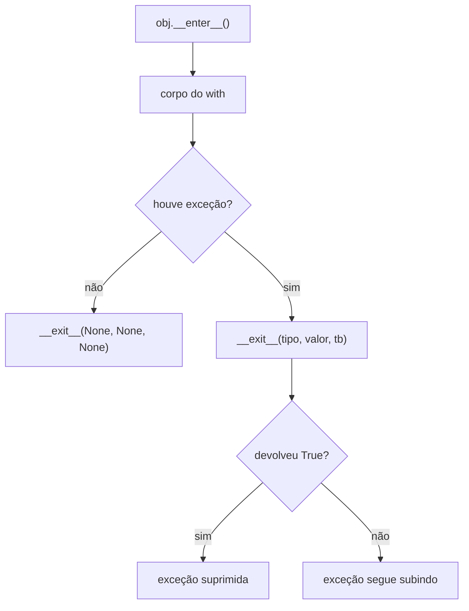

## Passo 1 · Leitura · Limpeza que não pode falhar

A impressora do laboratório atende um programa por vez: quem a reserva precisa liberá-la no fim, senão a fila inteira trava. Veja esta função:

```python
def imprimir(impressora, paginas):
    impressora.reservar()
    for pagina in paginas:
        if pagina == "":
            return "página vazia"
        impressora.enviar(pagina)
    impressora.liberar()
    return "ok"
```

Ela libera a impressora só no caminho feliz. Há duas saídas que pulam o `liberar()`:

- o `return "página vazia"` sai da função no meio do laço;
- se `enviar` levantar uma exceção, a função para ali mesmo.

Recursos assim (arquivos abertos, conexões, travas, cronômetros) aparecem em todo programa de verdade, e esquecer de liberá-los é um defeito difícil de achar, porque o erro aparece longe, em outro programa que espera.

#### finally roda em qualquer saída

No Nível 1 você viu que o `finally` roda "sempre". Esse "sempre" inclui o `return` e as exceções que **não** foram tratadas:

```python
def imprimir(impressora, paginas):
    impressora.reservar()
    try:
        for pagina in paginas:
            if pagina == "":
                return "página vazia"
            impressora.enviar(pagina)
        return "ok"
    finally:
        impressora.liberar()
```

Num `return` dentro do `try`, o Python calcula o valor, executa o `finally` e só então devolve. Numa exceção, ele executa o `finally` e a exceção continua subindo para quem chamou: o `finally` limpa, mas não trata. Repare que não há `except`: `try`/`finally` sozinhos são uma combinação válida e comum.

#### O erro comum: return dentro do finally

Um `return` **dentro** do `finally` substitui o resultado e, pior, descarta a exceção que estava subindo. O Python 3.14 avisa ao ler o arquivo:

```
SyntaxWarning: 'return' in a 'finally' block
```

O `finally` serve para limpar, não para decidir o resultado.

## Passo 2 · Previsão · return, exceção e finally

A função `etapa` abre e fecha alguma coisa em volta de um cálculo. Ela é chamada duas vezes: uma sai pelo `return` do meio, a outra por uma exceção tratada fora dela. Leia o código sem executar e digite exatamente o que ele imprime.

### Código
```python
def etapa(n):
    print("abre", n)
    try:
        if n == 0:
            return "vazio"
        print("processa", 10 // n)
        return "ok"
    finally:
        print("fecha", n)


print(etapa(0))
try:
    print(etapa(None))
except TypeError:
    print("erro tratado fora")
```

### Dicas
1. O `print(etapa(0))` só imprime depois que `etapa` termina, e ela só termina depois do `finally`.
2. `10 // None` levanta `TypeError` antes de imprimir `processa`.
3. O `finally` roda também quando a exceção está saindo da função.

### Saída esperada
```text
abre 0
fecha 0
vazio
abre None
fecha None
erro tratado fora
```

## Passo 3 · Leitura · O protocolo do with

Escrever `try`/`finally` toda vez é repetitivo, e o par "abrir e fechar" é sempre o mesmo. O `with` empacota esse par dentro de um objeto, o **gerenciador de contexto** (*context manager*). É assim que `with open("notas.txt") as arquivo:` garante que o arquivo é fechado.

Qualquer objeto com dois métodos especiais funciona com `with`:

```python
class Reserva:
    def __enter__(self):
        print("reservou")
        return self

    def __exit__(self, tipo, valor, tb):
        print("liberou")
        return False


with Reserva() as r:
    print("imprimindo")
```

```
reservou
imprimindo
liberou
```

- `__enter__()` roda na entrada. **O que ele devolve** é o que vai para a variável depois do `as`; devolver `self` é o mais comum.
- `__exit__(tipo, valor, tb)` roda na saída, por qualquer caminho, como um `finally`. Os três parâmetros descrevem a exceção que interrompeu o bloco: a classe (`ValueError`), o objeto e o traceback. Se o bloco terminou bem, os três chegam como `None`.
- Se `__exit__` devolver `True`, a exceção é **suprimida**: o programa segue depois do `with` como se nada tivesse acontecido. Devolvendo `False` (ou `None`), ela continua subindo.



Suprimir quase nunca é o que você quer: esconde o erro do mesmo jeito que um `except Exception: pass`.

#### O erro comum: __exit__ com parâmetros de menos

O Python sempre chama `__exit__` com os três argumentos, mesmo quando são `None`. Com `def __exit__(self):`, o corpo do `with` roda inteiro e, na saída, o programa quebra:

```
TypeError: Reserva.__exit__() takes 1 positional argument but 4 were given
```

São 4 porque o `self` também conta.

## Passo 4 · Exercício · Sessao que sempre fecha
modo: lacunas

A classe `Sessao` registra em `eventos` o que acontece com ela. Ao sair do `with`, ela anota `"fechou"` se tudo correu bem, ou `"fechou com <nome da exceção>"` se o bloco foi interrompido por um erro, e **deixa o erro seguir**:

```python
with Sessao("ana") as s:
    s.eventos.append("dentro")
# s.eventos == ["abriu", "dentro", "fechou"]
```

Complete as três lacunas (`___`).

### Instruções
1. `__enter__` marca a sessão como ativa, anota `"abriu"` e devolve o próprio objeto, para que ele chegue ao `as`.
2. `__exit__` marca a sessão como inativa e anota `"fechou"` ou `"fechou com <nome da exceção>"`.
   Dica: o primeiro parâmetro de `__exit__` é a classe da exceção; toda classe tem `__name__`.
3. `__exit__` não suprime a exceção: ela continua subindo depois de anotada.

### Código inicial
```python
class Sessao:
    def __init__(self, usuario):
        self.usuario = usuario
        self.eventos = []
        self.ativa = False

    def __enter__(self):
        self.ativa = True
        self.eventos.append("abriu")
        return ___

    def __exit__(self, tipo, valor, tb):
        self.ativa = False
        if tipo is None:
            self.eventos.append("fechou")
        else:
            self.eventos.append(f"fechou com {___.__name__}")
        return ___
```

### Solução
```python
class Sessao:
    def __init__(self, usuario):
        self.usuario = usuario
        self.eventos = []
        self.ativa = False

    def __enter__(self):
        self.ativa = True
        self.eventos.append("abriu")
        return self

    def __exit__(self, tipo, valor, tb):
        self.ativa = False
        if tipo is None:
            self.eventos.append("fechou")
        else:
            self.eventos.append(f"fechou com {tipo.__name__}")
        return False
```

### Dicas
1. O que `__enter__` devolve é exatamente o que o `as` recebe.
2. `valor` é o objeto da exceção; `tipo` é a classe dele. Só a classe tem `__name__`.
3. Para a exceção seguir, `__exit__` devolve um valor falso.

### Verificação
```json
[
  { "id": "as", "checkpoint": 1, "kind": "expr", "setup": "with Sessao(\"bia\") as s:\n    dentro = s.ativa",
    "expr": "[type(s).__name__, dentro, s.usuario]", "expected": ["Sessao", true, "bia"],
    "name": "O as recebe a própria sessão, ativa dentro do bloco", "hint": "__enter__ precisa devolver self." },
  { "id": "normal", "checkpoint": 2, "kind": "expr",
    "setup": "s = Sessao(\"bia\")\nwith s:\n    s.eventos.append(\"consulta\")\n    s.eventos.append(\"compra\")",
    "expr": "[s.eventos, s.ativa]", "expected": [["abriu", "consulta", "compra", "fechou"], false],
    "name": "Bloco sem erro: abriu, o que houve dentro, fechou" },
  { "id": "com-erro", "checkpoint": 2, "kind": "expr",
    "setup": "s = Sessao(\"caio\")\ntry:\n    with s:\n        s.eventos.append(\"busca\")\n        {}[\"x\"]\n        s.eventos.append(\"nunca\")\nexcept KeyError:\n    pass",
    "expr": "[s.eventos, s.ativa]", "expected": [["abriu", "busca", "fechou com KeyError"], false],
    "name": "Bloco interrompido por KeyError anota o nome da exceção", "hint": "Use o parâmetro tipo, que é a classe da exceção." },
  { "id": "outro-erro", "checkpoint": 2, "kind": "expr",
    "setup": "s = Sessao(\"caio\")\ntry:\n    with s:\n        int(\"dez\")\nexcept ValueError:\n    pass",
    "expr": "s.eventos[-1]", "expected": "fechou com ValueError",
    "name": "Com ValueError, anota fechou com ValueError" },
  { "id": "propaga", "checkpoint": 3, "kind": "expr",
    "setup": "s = Sessao(\"eva\")\nwith s:\n    raise ZeroDivisionError(\"teste\")",
    "expr": "s.eventos", "raises": "ZeroDivisionError",
    "name": "A exceção continua subindo depois do with", "hint": "Devolver True em __exit__ suprime a exceção." }
]
```

### Soluções erradas
```python name="__exit__ devolve True e suprime o erro"
class Sessao:
    def __init__(self, usuario):
        self.usuario = usuario
        self.eventos = []
        self.ativa = False

    def __enter__(self):
        self.ativa = True
        self.eventos.append("abriu")
        return self

    def __exit__(self, tipo, valor, tb):
        self.ativa = False
        if tipo is None:
            self.eventos.append("fechou")
        else:
            self.eventos.append(f"fechou com {tipo.__name__}")
        return True
```
```python name="__enter__ não devolve nada"
class Sessao:
    def __init__(self, usuario):
        self.usuario = usuario
        self.eventos = []
        self.ativa = False

    def __enter__(self):
        self.ativa = True
        self.eventos.append("abriu")

    def __exit__(self, tipo, valor, tb):
        self.ativa = False
        if tipo is None:
            self.eventos.append("fechou")
        else:
            self.eventos.append(f"fechou com {tipo.__name__}")
        return False
```
```python name="usa o objeto da exceção em vez da classe"
class Sessao:
    def __init__(self, usuario):
        self.usuario = usuario
        self.eventos = []
        self.ativa = False

    def __enter__(self):
        self.ativa = True
        self.eventos.append("abriu")
        return self

    def __exit__(self, tipo, valor, tb):
        self.ativa = False
        if tipo is None:
            self.eventos.append("fechou")
        else:
            self.eventos.append(f"fechou com {valor}")
        return False
```

## Passo 5 · Exercício · Transacao que desfaz

Uma **transação** é um conjunto de mudanças que vale inteiro ou não vale nada. Escreva a classe `Transacao(lista)`: ao entrar no `with`, ela guarda uma cópia da lista e devolve a própria lista para o `as`; ao sair, se o bloco foi interrompido por uma exceção, ela **devolve a lista ao estado do início** e deixa a exceção seguir. Se o bloco terminou bem, as mudanças ficam.

```python
carrinho = ["caderno"]
try:
    with Transacao(carrinho) as itens:
        itens.append("caneta")
        itens.append(preco_da("mochila"))   # levanta KeyError
except KeyError:
    pass
print(carrinho)   # ['caderno']
```

A lista precisa ser restaurada **no lugar**: quem tem uma referência para `carrinho` deve ver o conteúdo antigo de volta.

### Instruções
1. Em `__enter__`, guarde uma cópia independente da lista e devolva a lista original.
   Dica: `list(lista)` cria uma lista nova com os mesmos elementos.
2. Em `__exit__`, se houve exceção, troque o conteúdo da lista original pelo da cópia.
   Dica: `lista.clear()` seguido de `lista.extend(copia)` muda a lista no lugar.
3. Sem exceção, não mexa na lista; e em nenhum caso suprima a exceção.

### Código inicial
```python
class Transacao:
    def __init__(self, lista):
        self.lista = lista
        self.copia = None
```

### Solução
```python
class Transacao:
    def __init__(self, lista):
        self.lista = lista
        self.copia = None

    def __enter__(self):
        self.copia = list(self.lista)
        return self.lista

    def __exit__(self, tipo, valor, tb):
        if tipo is not None:
            self.lista.clear()
            self.lista.extend(self.copia)
        return False
```

### Dicas
1. `self.copia = self.lista` não copia nada: são dois nomes para a mesma lista, e as mudanças aparecem nos dois.
2. `self.lista = self.copia` troca só o atributo; a lista de quem chamou continua alterada.
3. `tipo is not None` diz que o bloco terminou com exceção.

### Verificação
```json
[
  { "id": "as-lista", "checkpoint": 1, "kind": "expr", "setup": "notas = [7, 8]\nwith Transacao(notas) as t:\n    t.append(10)",
    "expr": "[t is notas, notas]", "expected": [true, [7, 8, 10]],
    "name": "O as recebe a própria lista, e as mudanças sem erro ficam", "hint": "__enter__ devolve a lista original, não a cópia." },
  { "id": "desfaz", "checkpoint": 2, "kind": "expr",
    "setup": "fila = [\"Ana\", \"Bia\"]\ntry:\n    with Transacao(fila) as f:\n        f.append(\"Caio\")\n        f.remove(\"Ana\")\n        f.remove(\"Zeca\")\nexcept ValueError:\n    pass",
    "expr": "fila", "expected": ["Ana", "Bia"],
    "name": "Erro no meio do bloco desfaz todas as mudanças", "hint": "Guarde uma cópia independente na entrada e restaure a lista original no lugar." },
  { "id": "desfaz-vazia", "checkpoint": 2, "kind": "expr",
    "setup": "lote = []\ntry:\n    with Transacao(lote) as l:\n        l.extend([1, 2, 3])\n        1 / 0\nexcept ZeroDivisionError:\n    pass",
    "expr": "lote", "expected": [], "name": "Uma lista que começou vazia volta a ficar vazia" },
  { "id": "mesmo-objeto", "checkpoint": 2, "kind": "expr",
    "setup": "fila = [\"Ana\"]\nalias = fila\ntry:\n    with Transacao(fila) as f:\n        f.append(\"Davi\")\n        raise KeyError(\"x\")\nexcept KeyError:\n    pass",
    "expr": "alias", "expected": ["Ana"], "name": "A restauração acontece no lugar, para todas as referências" },
  { "id": "propaga", "checkpoint": 3, "kind": "expr",
    "setup": "fila = [\"Ana\"]\nwith Transacao(fila) as f:\n    f.append(\"Davi\")\n    raise KeyError(\"x\")",
    "expr": "fila", "raises": "KeyError", "name": "A exceção continua subindo depois de desfazer" },
  { "id": "sem-erro-varias", "checkpoint": 3, "kind": "expr",
    "setup": "pontos = [1]\nwith Transacao(pontos) as p:\n    p.append(2)\nwith Transacao(pontos) as p:\n    p.append(3)\n    p.remove(1)",
    "expr": "pontos", "expected": [2, 3], "name": "Duas transações sem erro acumulam as mudanças" }
]
```

### Soluções erradas
```python name="guarda a mesma lista em vez de uma cópia"
class Transacao:
    def __init__(self, lista):
        self.lista = lista
        self.copia = None

    def __enter__(self):
        self.copia = self.lista
        return self.lista

    def __exit__(self, tipo, valor, tb):
        if tipo is not None:
            self.lista.clear()
            self.lista.extend(self.copia)
        return False
```
```python name="troca o atributo em vez de restaurar no lugar"
class Transacao:
    def __init__(self, lista):
        self.lista = lista
        self.copia = None

    def __enter__(self):
        self.copia = list(self.lista)
        return self.lista

    def __exit__(self, tipo, valor, tb):
        if tipo is not None:
            self.lista = self.copia
        return False
```
```python name="suprime a exceção"
class Transacao:
    def __init__(self, lista):
        self.lista = lista
        self.copia = None

    def __enter__(self):
        self.copia = list(self.lista)
        return self.lista

    def __exit__(self, tipo, valor, tb):
        if tipo is not None:
            self.lista.clear()
            self.lista.extend(self.copia)
        return True
```
```python name="restaura sempre, mesmo sem erro"
class Transacao:
    def __init__(self, lista):
        self.lista = lista
        self.copia = None

    def __enter__(self):
        self.copia = list(self.lista)
        return self.lista

    def __exit__(self, tipo, valor, tb):
        self.lista.clear()
        self.lista.extend(self.copia)
        return False
```

## Passo 6 · Leitura · contextmanager: o with numa função

Escrever uma classe com `__enter__` e `__exit__` para cada recurso dá trabalho. O módulo `contextlib` oferece um atalho: você escreve **uma função** com um `yield` no meio, e a linha `@contextmanager` acima dela (do mesmo jeito que `@property` acima de um método) a transforma num gerenciador de contexto.

```python
from contextlib import contextmanager


@contextmanager
def reserva(eventos):
    eventos.append("reservou")
    try:
        yield "impressora 2"
    finally:
        eventos.append("liberou")


eventos = []
with reserva(eventos) as nome:
    eventos.append(f"usando {nome}")
print(eventos)
```

```
['reservou', 'usando impressora 2', 'liberou']
```

Leia como uma receita em três partes:

| Parte da função | Papel |
|---|---|
| antes do `yield` | o `__enter__`: prepara o recurso |
| o `yield valor` | o ponto onde o corpo do `with` roda; `valor` vai para o `as` |
| depois do `yield` | o `__exit__`: limpa |

O `yield` tem outros usos, que você verá no módulo de geradores. Aqui basta entendê-lo como uma pausa: a função roda até ele, entrega o valor ao `as`, espera o corpo do `with` terminar e só então continua da linha seguinte. É essa pausa que permite escrever preparação e limpeza na mesma função, lado a lado, em vez de separá-las em dois métodos.

#### O erro comum: yield sem try/finally

Quando o corpo do `with` levanta uma exceção, ela reaparece **na linha do `yield`**, dentro da sua função. Sem o `try`/`finally`, a exceção sai da função ali mesmo e a limpeza depois do `yield` nunca roda:

```python
@contextmanager
def reserva(eventos):
    eventos.append("reservou")
    yield "impressora 2"
    eventos.append("liberou")    # pulado se o bloco falhar
```

No caminho feliz as duas versões são iguais, e é por isso que o defeito passa despercebido. Com o `finally`, a limpeza roda e a exceção continua subindo, exatamente como um `__exit__` que devolve `False`.

## Passo 7 · Exercício · cronometro com contextmanager

Escreva `cronometro(registro, nome)` com `@contextmanager`. Ele mede quanto tempo o corpo do `with` levou e guarda a duração, em segundos, em `registro[nome]`:

```python
tempos = {}
with cronometro(tempos, "ordenar"):
    sorted(range(100000), reverse=True)
print(tempos)   # {'ordenar': 0.0042...}
```

Duas regras a mais:

- se `nome` já existir no registro, **some** a nova duração à que já estava lá (para medir várias rodadas da mesma etapa);
- a duração é registrada **mesmo que o bloco falhe**, e a exceção continua subindo.

Para medir, use `time.perf_counter()`: ela devolve um `float` em segundos, e a diferença entre duas chamadas é o tempo que passou entre elas.

### Instruções
1. Importe `contextmanager` e `time`, e defina `cronometro(registro, nome)` decorada com `@contextmanager`.
2. Anote o instante de início antes do `yield` e, depois dele, grave a duração `float` em `registro[nome]`.
3. Se `nome` já estiver no registro, some a duração ao valor existente.
   Dica: `registro.get(nome, 0.0)` devolve o valor atual ou zero.
4. Garanta o registro mesmo quando o bloco levanta exceção, sem suprimi-la.

### Código inicial
```python
def cronometro(registro, nome):
    pass
```

### Solução
```python
import time
from contextlib import contextmanager


@contextmanager
def cronometro(registro, nome):
    inicio = time.perf_counter()
    try:
        yield
    finally:
        duracao = time.perf_counter() - inicio
        registro[nome] = registro.get(nome, 0.0) + duracao
```

### Dicas
1. A estrutura é a da leitura: preparar, `yield` dentro de `try`, limpar no `finally`.
2. O `yield` aqui não precisa de valor: o `with` deste exercício não usa `as`.
3. Para não suprimir a exceção, não use `except` no gerenciador: o `finally` basta.

### Verificação
```json
[
  { "id": "decorador", "checkpoint": 1, "kind": "source", "rule": { "type": "decorator", "name": "contextmanager" },
    "name": "cronometro usa @contextmanager", "hint": "Escreva @contextmanager na linha acima do def." },
  { "id": "registra", "checkpoint": 2, "kind": "expr",
    "setup": "r = {}\nwith cronometro(r, \"somar\"):\n    total = sum(range(5000))",
    "expr": "[list(r), type(r[\"somar\"]).__name__, r[\"somar\"] >= 0, total]", "expected": [["somar"], "float", true, 12497500],
    "name": "Depois do with, registro[\"somar\"] tem uma duração float", "hint": "Grave time.perf_counter() - inicio depois do yield." },
  { "id": "mantem", "checkpoint": 2, "kind": "expr",
    "setup": "r = {\"ler\": 2.5}\nwith cronometro(r, \"gravar\"):\n    pass",
    "expr": "[sorted(r), r[\"ler\"]]", "expected": [["gravar", "ler"], 2.5],
    "name": "Outras entradas do registro ficam como estavam" },
  { "id": "acumula", "checkpoint": 3, "kind": "expr",
    "setup": "r = {\"etapa\": 100.0}\nwith cronometro(r, \"etapa\"):\n    pass\nwith cronometro(r, \"etapa\"):\n    pass",
    "expr": "100.0 <= r[\"etapa\"] < 101.0", "expected": true,
    "name": "Nome repetido soma a duração à anterior", "hint": "Some ao valor existente em vez de substituir." },
  { "id": "falha-registra", "checkpoint": 4, "kind": "expr",
    "setup": "r = {}\ntry:\n    with cronometro(r, \"dividir\"):\n        1 / 0\nexcept ZeroDivisionError:\n    pass",
    "expr": "[list(r), type(r[\"dividir\"]).__name__]", "expected": [["dividir"], "float"],
    "name": "Bloco que falha também tem a duração registrada", "hint": "O yield precisa estar dentro de um try com finally." },
  { "id": "falha-propaga", "checkpoint": 4, "kind": "expr",
    "setup": "r = {}\nwith cronometro(r, \"dividir\"):\n    1 / 0",
    "expr": "r", "raises": "ZeroDivisionError",
    "name": "A exceção do bloco continua subindo", "hint": "Não use except dentro do gerenciador." }
]
```

### Soluções erradas
```python name="yield sem try/finally"
import time
from contextlib import contextmanager


@contextmanager
def cronometro(registro, nome):
    inicio = time.perf_counter()
    yield
    duracao = time.perf_counter() - inicio
    registro[nome] = registro.get(nome, 0.0) + duracao
```
```python name="substitui em vez de somar"
import time
from contextlib import contextmanager


@contextmanager
def cronometro(registro, nome):
    inicio = time.perf_counter()
    try:
        yield
    finally:
        registro[nome] = time.perf_counter() - inicio
```
```python name="except que suprime o erro"
import time
from contextlib import contextmanager


@contextmanager
def cronometro(registro, nome):
    inicio = time.perf_counter()
    try:
        yield
    except Exception:
        pass
    duracao = time.perf_counter() - inicio
    registro[nome] = registro.get(nome, 0.0) + duracao
```
```python name="arredonda para inteiro"
import time
from contextlib import contextmanager


@contextmanager
def cronometro(registro, nome):
    inicio = time.perf_counter()
    try:
        yield
    finally:
        duracao = round(time.perf_counter() - inicio)
        registro[nome] = registro.get(nome, 0) + duracao
```

## Passo 8 · Quiz · Limpeza garantida

### Pergunta
Um gerenciador de contexto tem este `__exit__`. O que acontece quando o corpo do `with` levanta `ValueError`?
```python
def __exit__(self, tipo, valor, tb):
    print("limpando")
    return True
```
- [ ] Imprime `limpando` e o `ValueError` continua subindo
- [x] Imprime `limpando` e o programa segue depois do `with`, como se não houvesse erro
- [ ] O `ValueError` sobe sem imprimir nada
- [ ] O Python levanta `TypeError` porque `__exit__` não pode devolver `True`
> Devolver `True` diz ao `with` que a exceção foi tratada: ela é suprimida. É raro querer isso; o normal é devolver `False` ou nada e deixar o erro seguir.

### Pergunta
O que `pagar()` devolve, e o que é impresso?
```python
def pagar():
    try:
        return "pago"
    finally:
        print("recibo")
```
- [ ] Devolve `"pago"` sem imprimir nada: o `return` sai antes do `finally`
- [x] Imprime `recibo` e depois devolve `"pago"`
- [ ] Imprime `recibo` e devolve `None`
- [ ] Dá erro: não existe `try` sem `except`
> O valor do `return` é calculado, o `finally` roda e só então a função devolve. `try`/`finally` sem `except` é válido.

### Pergunta
Num gerenciador feito com `@contextmanager`, a limpeza foi escrita logo depois do `yield`, sem `try`/`finally`. Quando ela deixa de rodar?
- [ ] Nunca: o `with` sempre executa o que vem depois do `yield`
- [ ] Quando o corpo do `with` termina sem erro
- [x] Quando o corpo do `with` levanta uma exceção, que reaparece na linha do `yield` e sai da função ali
- [ ] Quando o `with` não usa `as`
> A exceção do corpo é relançada no ponto do `yield`. Sem `finally`, ela interrompe a função antes da limpeza. Com `finally`, a limpeza roda e a exceção segue.
