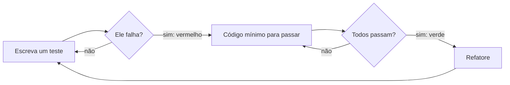

## Passo 1 · Leitura · pytest: testes sem classe

O `unittest` pede uma classe, `self` e um método de asserção para cada tipo de comparação. O **pytest**, a ferramenta de testes mais usada em projetos Python, pede só funções e o `assert` que você já conhece:

```python
import pytest


def aplicar_desconto(preco, percentual):
    if not 0 <= percentual <= 100:
        raise ValueError("percentual fora de 0 a 100")
    return preco * percentual / 100


def test_sem_desconto():
    assert aplicar_desconto(80.0, 0) == 80.0


def test_metade():
    assert aplicar_desconto(50.0, 50) == 25.0


def test_percentual_invalido():
    with pytest.raises(ValueError):
        aplicar_desconto(10.0, 120)
```

O pytest não vem com o Python: no seu computador, com o ambiente virtual ativo, `python -m pip install pytest`. Depois, o comando `pytest` na pasta do projeto **descobre** os testes sozinho: arquivos `test_*.py` (ou `*_test.py`), funções `test_*` e classes `Test*`. A `aplicar_desconto` acima tem um defeito (devolve o desconto, não o preço final), e a saída mostra:

```text
test_desconto.py F..                                                     [100%]

================================== FAILURES ===================================
______________________________ test_sem_desconto ______________________________

    def test_sem_desconto():
>       assert aplicar_desconto(80.0, 0) == 80.0
E       assert 0.0 == 80.0
E        +  where 0.0 = aplicar_desconto(80.0, 0)

test_desconto.py:11: AssertionError
=========================== short test summary info ===========================
FAILED test_desconto.py::test_sem_desconto - assert 0.0 == 80.0
========================= 1 failed, 2 passed in 0.05s =========================
```

Repare nas linhas com `E`: o pytest **abre o `assert`** e mostra o valor de cada lado e de onde ele veio (`where 0.0 = aplicar_desconto(80.0, 0)`). Com o `assert` puro do Python, você veria só `AssertionError`. É essa introspecção que dispensa o `assertEqual`.

Para exigir uma exceção, `pytest.raises` funciona como o `assertRaises` do `unittest`, dentro de um `with`.

#### Nesta plataforma

O ambiente de correção não tem o pytest. Os exercícios usam funções `test_*` com `assert`, exatamente como o pytest as encontraria, e a verificação as chama uma a uma. No lugar do `pytest.raises`, use o padrão que só depende do Python:

```python
def test_percentual_invalido():
    try:
        aplicar_desconto(10.0, 120)
    except ValueError:
        return
    assert False, "devia levantar ValueError"
```

Se a função levantar `ValueError`, o `return` encerra o teste com sucesso; se não levantar nada, o `assert False` derruba o teste. Copiado para o seu computador, o arquivo roda no pytest do mesmo jeito.

#### O erro comum: assert com vírgula para comparar

`assert media([6, 8]), 7.0` não compara nada: depois da vírgula vem a **mensagem**. O teste só confere se `media([6, 8])` é verdadeiro, e passa até com uma média errada. Compare sempre com `==`.

## Passo 2 · Leitura · parametrize e fixtures

Testar `eh_par` com cinco números pede cinco funções quase iguais. O pytest junta os casos numa tabela com `@pytest.mark.parametrize`: o primeiro argumento lista os nomes dos parâmetros; o segundo, os valores de cada caso.

```python
@pytest.mark.parametrize("numero, esperado", [
    (0, True),
    (7, False),
    (-4, True),
])
def test_eh_par(numero, esperado):
    assert eh_par(numero) == esperado
```

Cada linha vira um teste separado, com nome próprio. Com `pytest -v`:

```text
test_param.py::test_eh_par[0-True] PASSED                                [ 33%]
test_param.py::test_eh_par[7-False] PASSED                               [ 66%]
test_param.py::test_eh_par[-4-True] PASSED                               [100%]
```

Se o `-4` falhar, os outros dois continuam rodando e o relatório diz qual linha quebrou.

Cuidado com **casos redundantes**: `(2, True)`, `(4, True)` e `(6, True)` testam a mesma coisa três vezes. Cada linha da tabela deveria representar uma situação diferente: o zero, um ímpar, um negativo.

#### Fixtures

O papel do `setUp` no pytest é de uma **fixture**: uma função marcada com `@pytest.fixture` que prepara um objeto. O teste a recebe pedindo um **parâmetro com o mesmo nome**:

```python
@pytest.fixture
def carrinho():
    return [("caderno", 25.0, 2), ("caneta", 3.5, 4)]


def test_quantidade_de_itens(carrinho):
    assert len(carrinho) == 2
```

O pytest chama a fixture de novo para **cada** teste que a pede, então um teste que altera o carrinho não afeta o seguinte. Fixtures usadas por vários arquivos ficam num arquivo `conftest.py` na pasta dos testes, e o pytest as encontra sem `import`.

Uma fixture que devolve sempre **o mesmo** objeto, criado fora dela (`CARRINHO = [...]` no topo e `return CARRINHO`), recria o problema do estado compartilhado: o teste que adiciona um item contamina os outros.

#### Cobertura

Com o pacote `pytest-cov`, `pytest --cov` mostra quais linhas do seu código os testes executaram. Linha nunca executada é linha nunca testada; cobertura alta, porém, não garante testes bons: um teste sem `assert` também "cobre" as linhas.

## Passo 3 · Exercício · Converta a suíte para o estilo pytest

A suíte do código inicial está em `unittest`. Converta-a para o estilo pytest: **funções** `test_*` no nível do módulo, sem classe e sem `self`, com `assert ... == ...`. Mantenha os quatro casos e apague a classe.

A função `normalizar_nome` tira os espaços das pontas, junta espaços repetidos e deixa cada palavra com a inicial maiúscula. A verificação chama as suas funções `test_*` contra a função correta (todas passam) e contra versões com defeito (alguma falha).

### Instruções
1. Transforme cada método em uma função `test_*` sem `self`, com o mesmo nome.
2. Troque cada `self.assertEqual(a, b)` por `assert a == b`.
   Dica: `assert a, b` não compara: `b` vira a mensagem.
3. Apague a classe `TestNormalizarNome` e a importação de `unittest`.

### Código inicial
```python
import unittest


def normalizar_nome(nome):
    return " ".join(parte.capitalize() for parte in nome.split())


class TestNormalizarNome(unittest.TestCase):
    def test_tira_espacos_das_pontas(self):
        self.assertEqual(normalizar_nome("  bia "), "Bia")

    def test_junta_espacos_repetidos(self):
        self.assertEqual(normalizar_nome("ana   maria"), "Ana Maria")

    def test_inicial_maiuscula(self):
        self.assertEqual(normalizar_nome("CAIO souza"), "Caio Souza")

    def test_so_espacos(self):
        self.assertEqual(normalizar_nome("   "), "")
```

### Solução
```python
def normalizar_nome(nome):
    return " ".join(parte.capitalize() for parte in nome.split())


def test_tira_espacos_das_pontas():
    assert normalizar_nome("  bia ") == "Bia"


def test_junta_espacos_repetidos():
    assert normalizar_nome("ana   maria") == "Ana Maria"


def test_inicial_maiuscula():
    assert normalizar_nome("CAIO souza") == "Caio Souza"


def test_so_espacos():
    assert normalizar_nome("   ") == ""
```

### Dicas
1. Uma função de teste do pytest é uma função comum, no nível do módulo, cujo nome começa com `test_`.
2. `self.assertEqual(x, y)` vira `assert x == y`.
3. Sem a classe, `self` não existe mais: tire-o dos parâmetros também.

### Verificação
```json
[
  { "id": "referencia", "checkpoint": 1, "kind": "expr",
    "setup": "def _rodar():\n    testes = [f for n, f in sorted(globals().items()) if n.startswith('test_') and isinstance(f, type(_rodar))]\n    falhas = 0\n    for f in testes:\n        try:\n            f()\n        except Exception:\n            falhas += 1\n    return [len(testes), falhas]\ndef normalizar_nome(nome):\n    return ' '.join(parte.capitalize() for parte in nome.split())",
    "expr": "_rodar()", "expected": [4, 0], "name": "As quatro funções test_ passam com a função correta",
    "hint": "São quatro funções no nível do módulo, sem self, com assert ... == ..." },
  { "id": "mutante-nao-junta", "checkpoint": 2, "kind": "expr",
    "setup": "def _rodar():\n    testes = [f for n, f in sorted(globals().items()) if n.startswith('test_') and isinstance(f, type(_rodar))]\n    falhas = 0\n    for f in testes:\n        try:\n            f()\n        except Exception:\n            falhas += 1\n    return [len(testes), falhas]\ndef normalizar_nome(nome):\n    return nome.strip().title()",
    "expr": "_rodar()[1] > 0", "expected": true, "name": "Pega a versão que não junta os espaços repetidos",
    "hint": "assert com vírgula não compara: use ==." },
  { "id": "mutante-sem-maiuscula", "checkpoint": 2, "kind": "expr",
    "setup": "def _rodar():\n    testes = [f for n, f in sorted(globals().items()) if n.startswith('test_') and isinstance(f, type(_rodar))]\n    falhas = 0\n    for f in testes:\n        try:\n            f()\n        except Exception:\n            falhas += 1\n    return [len(testes), falhas]\ndef normalizar_nome(nome):\n    return ' '.join(nome.split())",
    "expr": "_rodar()[1] > 0", "expected": true, "name": "Pega a versão que não ajusta as maiúsculas" },
  { "id": "mutante-vazio", "checkpoint": 1, "kind": "expr",
    "setup": "def _rodar():\n    testes = [f for n, f in sorted(globals().items()) if n.startswith('test_') and isinstance(f, type(_rodar))]\n    falhas = 0\n    for f in testes:\n        try:\n            f()\n        except Exception:\n            falhas += 1\n    return [len(testes), falhas]\ndef normalizar_nome(nome):\n    partes = nome.split()\n    return partes[0].capitalize() + ''.join(' ' + p.capitalize() for p in partes[1:])",
    "expr": "_rodar()[1] > 0", "expected": true, "name": "Pega a versão que quebra com um texto só de espaços",
    "hint": "Converta também o teste do texto só com espaços." },
  { "id": "sem-classe", "checkpoint": 3, "kind": "expr",
    "expr": "[n for n, v in globals().items() if isinstance(v, type) and issubclass(v, __import__('unittest').TestCase)]",
    "expected": [], "name": "A classe TestCase foi apagada", "hint": "No estilo pytest, os testes são funções soltas." }
]
```

### Soluções erradas
```python name="assert com vírgula no lugar de =="
def normalizar_nome(nome):
    return " ".join(parte.capitalize() for parte in nome.split())


def test_tira_espacos_das_pontas():
    assert normalizar_nome("  bia "), "Bia"


def test_junta_espacos_repetidos():
    assert normalizar_nome("ana   maria"), "Ana Maria"


def test_inicial_maiuscula():
    assert normalizar_nome("CAIO souza"), "Caio Souza"


def test_so_espacos():
    assert normalizar_nome("   ") == ""
```
```python name="mantém self.assertEqual nas funções"
def normalizar_nome(nome):
    return " ".join(parte.capitalize() for parte in nome.split())


def test_tira_espacos_das_pontas(self):
    self.assertEqual(normalizar_nome("  bia "), "Bia")


def test_junta_espacos_repetidos(self):
    self.assertEqual(normalizar_nome("ana   maria"), "Ana Maria")


def test_inicial_maiuscula(self):
    self.assertEqual(normalizar_nome("CAIO souza"), "Caio Souza")


def test_so_espacos(self):
    self.assertEqual(normalizar_nome("   "), "")
```
```python name="perde o teste do texto só com espaços"
def normalizar_nome(nome):
    return " ".join(parte.capitalize() for parte in nome.split())


def test_tira_espacos_das_pontas():
    assert normalizar_nome("  bia ") == "Bia"


def test_junta_espacos_repetidos():
    assert normalizar_nome("ana   maria") == "Ana Maria"


def test_inicial_maiuscula():
    assert normalizar_nome("CAIO souza") == "Caio Souza"
```
```python name="mantém a classe junto com as funções"
import unittest


def normalizar_nome(nome):
    return " ".join(parte.capitalize() for parte in nome.split())


def test_tira_espacos_das_pontas():
    assert normalizar_nome("  bia ") == "Bia"


def test_junta_espacos_repetidos():
    assert normalizar_nome("ana   maria") == "Ana Maria"


def test_inicial_maiuscula():
    assert normalizar_nome("CAIO souza") == "Caio Souza"


def test_so_espacos():
    assert normalizar_nome("   ") == ""


class TestNormalizarNome(unittest.TestCase):
    def test_so_espacos(self):
        self.assertEqual(normalizar_nome("   "), "")
```

## Passo 4 · Leitura · O ciclo vermelho, verde, refatora

Até aqui você escreveu os testes **depois** do código. O **TDD** (*Test-Driven Development*, desenvolvimento guiado por testes) inverte a ordem, em ciclos curtos:



1. **Vermelho.** Escreva um teste para um comportamento que ainda não existe e rode. Ele **precisa falhar**. Um teste que passa antes de existir o código não está testando nada: ou ele está errado, ou o comportamento já existia.
2. **Verde.** Escreva o código **mínimo** que faz o teste passar, sem adiantar o que nenhum teste pede.
3. **Refatore.** Com tudo verde, melhore nomes, tire repetição, organize. Os testes garantem que o comportamento não mudou.

Veja um ciclo com o FizzBuzz (devolve `"Fizz"` para múltiplos de 3, `"Buzz"` para múltiplos de 5, `"FizzBuzz"` para os dois e o próprio número, como texto, nos outros casos). O primeiro teste:

```python
def test_numero_comum():
    assert fizzbuzz(1) == "1"
```

Rodado, falha com `NameError: name 'fizzbuzz' is not defined`: vermelho. O mínimo para passar é `def fizzbuzz(n): return str(n)`: verde. O próximo teste, `assert fizzbuzz(3) == "Fizz"`, falha de novo, e só então entra o `if n % 3 == 0`. Cada regra nova nasce de um teste que falhou.

#### Por que tanto cuidado com o vermelho

O teste que você nunca viu falhar pode ter um defeito que o faz passar sempre: um `assert` com vírgula, um nome sem `test_`, um `except Exception` que engole qualquer erro. Ver o teste falhar pelo motivo certo é a prova de que ele mede alguma coisa.

#### O erro comum

Implementar tudo primeiro e escrever os testes depois "para cumprir tabela". Os testes viram cópias do código (o que ele faz, certo ou errado, vira o esperado) e não pegam nada. No TDD, o esperado vem da **especificação**, antes do código existir.

## Passo 5 · Exercício · Vermelho: os testes do carrinho primeiro

Você vai construir `calcular_total(carrinho, cupom=None)` com TDD. O carrinho é uma lista de tuplas `(produto, preco, quantidade)`. As regras:

| Regra | Exemplo |
|---|---|
| carrinho vazio custa 0 | `calcular_total([])` é `0.0` |
| soma preço × quantidade | `[("caderno", 25.0, 2), ("caneta", 3.5, 4)]` dá `64.0` |
| cupom `"DEZ"` dá 10% de desconto | o mesmo carrinho com `"DEZ"` dá `57.6` |
| cupom `"VINTE"` dá 20%, só em compras a partir de R\$ 100,00 | `[("mochila", 100.0, 1)]` com `"VINTE"` dá `80.0` |
| abaixo de R\$ 100,00, o `"VINTE"` não dá desconto | o carrinho de 64.0 com `"VINTE"` continua `64.0` |
| cupom desconhecido levanta `ValueError` | `calcular_total([], "XYZ")` |
| o total é arredondado para 2 casas | `[("borracha", 1.99, 3)]` com `"DEZ"` dá `5.37` |

Neste passo você escreve **só os testes**: uma função `test_*` por regra, com `assert ... == ...`. A função ainda não existe de verdade: o código inicial tem uma versão que só levanta `NotImplementedError`. A verificação confere três coisas: com essa versão, **todos** os seus testes falham (vermelho); com a função correta, todos passam; e cada versão com defeito é pega por algum teste.

### Instruções
1. Escreva pelo menos 6 funções `test_*`, uma por regra, que passam com a função correta.
2. Cubra as regras do desconto, incluindo o limite exato de R\$ 100,00 do `"VINTE"`.
3. Cubra o cupom desconhecido com o padrão `try`/`except ValueError`/`assert False`, e o arredondamento.
   Dica: com a versão que só levanta `NotImplementedError`, o teste do cupom também precisa falhar.

### Código inicial
```python
def calcular_total(carrinho, cupom=None):
    raise NotImplementedError("escreva os testes primeiro")


# Escreva as funções test_ abaixo
```

### Solução
```python
def calcular_total(carrinho, cupom=None):
    raise NotImplementedError("escreva os testes primeiro")


CARRINHO = [("caderno", 25.0, 2), ("caneta", 3.5, 4)]


def test_carrinho_vazio():
    assert calcular_total([]) == 0.0


def test_soma_preco_vezes_quantidade():
    assert calcular_total(CARRINHO) == 64.0


def test_cupom_dez():
    assert calcular_total(CARRINHO, "DEZ") == 57.6


def test_cupom_vinte_no_limite():
    assert calcular_total([("mochila", 100.0, 1)], "VINTE") == 80.0


def test_cupom_vinte_abaixo_do_limite():
    assert calcular_total(CARRINHO, "VINTE") == 64.0


def test_cupom_desconhecido():
    try:
        calcular_total([], "XYZ")
    except ValueError:
        return
    assert False, "cupom desconhecido devia levantar ValueError"


def test_arredonda_para_centavos():
    assert calcular_total([("borracha", 1.99, 3)], "DEZ") == 5.37
```

### Dicas
1. Cada linha da tabela vira uma função `test_*` com um `assert calcular_total(...) == valor`.
2. O limite do `"VINTE"` é "a partir de R\$ 100,00": teste uma compra de exatamente 100.
3. No teste do cupom, capture só `ValueError`. Um `except Exception` também captura o `NotImplementedError`, e o teste passaria antes de a função existir.

### Verificação
```json
[
  { "id": "vermelho", "checkpoint": 1, "kind": "expr",
    "setup": "def _rodar():\n    testes = [f for n, f in sorted(globals().items()) if n.startswith('test_') and isinstance(f, type(_rodar))]\n    falhas = 0\n    for f in testes:\n        try:\n            f()\n        except Exception:\n            falhas += 1\n    return [len(testes), falhas]\ndef calcular_total(carrinho, cupom=None):\n    raise NotImplementedError('ainda não')",
    "expr": "(lambda r: r[0] >= 6 and r[1] == r[0])(_rodar())", "expected": true,
    "name": "Vermelho: pelo menos 6 testes, e todos falham antes da implementação",
    "hint": "Um teste que passa sem a função existir não testa nada. Confira o except do teste do cupom." },
  { "id": "referencia", "checkpoint": 1, "kind": "expr",
    "setup": "def _rodar():\n    testes = [f for n, f in sorted(globals().items()) if n.startswith('test_') and isinstance(f, type(_rodar))]\n    falhas = 0\n    for f in testes:\n        try:\n            f()\n        except Exception:\n            falhas += 1\n    return [len(testes), falhas]\ndef calcular_total(carrinho, cupom=None):\n    subtotal = sum(preco * qtd for _, preco, qtd in carrinho)\n    if cupom is None:\n        desconto = 0.0\n    elif cupom == 'DEZ':\n        desconto = 0.10\n    elif cupom == 'VINTE':\n        desconto = 0.20 if subtotal >= 100 else 0.0\n    else:\n        raise ValueError('cupom inválido')\n    return round(subtotal * (1 - desconto), 2)",
    "expr": "_rodar()[1]", "expected": 0, "name": "Todos os testes passam com a função correta",
    "hint": "Algum valor esperado não bate com a tabela das regras." },
  { "id": "mutante-quantidade", "checkpoint": 1, "kind": "expr",
    "setup": "def _rodar():\n    testes = [f for n, f in sorted(globals().items()) if n.startswith('test_') and isinstance(f, type(_rodar))]\n    falhas = 0\n    for f in testes:\n        try:\n            f()\n        except Exception:\n            falhas += 1\n    return [len(testes), falhas]\ndef calcular_total(carrinho, cupom=None):\n    subtotal = sum(preco for _, preco, qtd in carrinho)\n    if cupom is None:\n        desconto = 0.0\n    elif cupom == 'DEZ':\n        desconto = 0.10\n    elif cupom == 'VINTE':\n        desconto = 0.20 if subtotal >= 100 else 0.0\n    else:\n        raise ValueError('cupom inválido')\n    return round(subtotal * (1 - desconto), 2)",
    "expr": "_rodar()[1] > 0", "expected": true, "name": "Pega a versão que ignora a quantidade" },
  { "id": "mutante-vinte-sem-minimo", "checkpoint": 2, "kind": "expr",
    "setup": "def _rodar():\n    testes = [f for n, f in sorted(globals().items()) if n.startswith('test_') and isinstance(f, type(_rodar))]\n    falhas = 0\n    for f in testes:\n        try:\n            f()\n        except Exception:\n            falhas += 1\n    return [len(testes), falhas]\ndef calcular_total(carrinho, cupom=None):\n    subtotal = sum(preco * qtd for _, preco, qtd in carrinho)\n    if cupom is None:\n        desconto = 0.0\n    elif cupom == 'DEZ':\n        desconto = 0.10\n    elif cupom == 'VINTE':\n        desconto = 0.20\n    else:\n        raise ValueError('cupom inválido')\n    return round(subtotal * (1 - desconto), 2)",
    "expr": "_rodar()[1] > 0", "expected": true, "name": "Pega o VINTE que dá desconto em qualquer compra" },
  { "id": "mutante-vinte-estrito", "checkpoint": 2, "kind": "expr",
    "setup": "def _rodar():\n    testes = [f for n, f in sorted(globals().items()) if n.startswith('test_') and isinstance(f, type(_rodar))]\n    falhas = 0\n    for f in testes:\n        try:\n            f()\n        except Exception:\n            falhas += 1\n    return [len(testes), falhas]\ndef calcular_total(carrinho, cupom=None):\n    subtotal = sum(preco * qtd for _, preco, qtd in carrinho)\n    if cupom is None:\n        desconto = 0.0\n    elif cupom == 'DEZ':\n        desconto = 0.10\n    elif cupom == 'VINTE':\n        desconto = 0.20 if subtotal > 100 else 0.0\n    else:\n        raise ValueError('cupom inválido')\n    return round(subtotal * (1 - desconto), 2)",
    "expr": "_rodar()[1] > 0", "expected": true, "name": "Pega o VINTE que recusa a compra de exatamente 100",
    "hint": "Teste o limite exato: uma compra de 100.0 com VINTE." },
  { "id": "mutante-cupom-ignorado", "checkpoint": 3, "kind": "expr",
    "setup": "def _rodar():\n    testes = [f for n, f in sorted(globals().items()) if n.startswith('test_') and isinstance(f, type(_rodar))]\n    falhas = 0\n    for f in testes:\n        try:\n            f()\n        except Exception:\n            falhas += 1\n    return [len(testes), falhas]\ndef calcular_total(carrinho, cupom=None):\n    subtotal = sum(preco * qtd for _, preco, qtd in carrinho)\n    desconto = 0.0\n    if cupom == 'DEZ':\n        desconto = 0.10\n    elif cupom == 'VINTE':\n        desconto = 0.20 if subtotal >= 100 else 0.0\n    return round(subtotal * (1 - desconto), 2)",
    "expr": "_rodar()[1] > 0", "expected": true, "name": "Pega a versão que ignora o cupom desconhecido" },
  { "id": "mutante-sem-arredondar", "checkpoint": 3, "kind": "expr",
    "setup": "def _rodar():\n    testes = [f for n, f in sorted(globals().items()) if n.startswith('test_') and isinstance(f, type(_rodar))]\n    falhas = 0\n    for f in testes:\n        try:\n            f()\n        except Exception:\n            falhas += 1\n    return [len(testes), falhas]\ndef calcular_total(carrinho, cupom=None):\n    subtotal = sum(preco * qtd for _, preco, qtd in carrinho)\n    if cupom is None:\n        desconto = 0.0\n    elif cupom == 'DEZ':\n        desconto = 0.10\n    elif cupom == 'VINTE':\n        desconto = 0.20 if subtotal >= 100 else 0.0\n    else:\n        raise ValueError('cupom inválido')\n    return subtotal * (1 - desconto)",
    "expr": "_rodar()[1] > 0", "expected": true, "name": "Pega a versão que não arredonda", "hint": "Teste o caso da borracha: 3 × 1.99 com DEZ." }
]
```

### Soluções erradas
```python name="except Exception: o teste passa antes da função existir"
def calcular_total(carrinho, cupom=None):
    raise NotImplementedError("escreva os testes primeiro")


CARRINHO = [("caderno", 25.0, 2), ("caneta", 3.5, 4)]


def test_carrinho_vazio():
    assert calcular_total([]) == 0.0


def test_soma_preco_vezes_quantidade():
    assert calcular_total(CARRINHO) == 64.0


def test_cupom_dez():
    assert calcular_total(CARRINHO, "DEZ") == 57.6


def test_cupom_vinte_no_limite():
    assert calcular_total([("mochila", 100.0, 1)], "VINTE") == 80.0


def test_cupom_vinte_abaixo_do_limite():
    assert calcular_total(CARRINHO, "VINTE") == 64.0


def test_cupom_desconhecido():
    try:
        calcular_total([], "XYZ")
    except Exception:
        return
    assert False, "cupom desconhecido devia levantar ValueError"


def test_arredonda_para_centavos():
    assert calcular_total([("borracha", 1.99, 3)], "DEZ") == 5.37
```
```python name="sem o limite exato do VINTE"
def calcular_total(carrinho, cupom=None):
    raise NotImplementedError("escreva os testes primeiro")


CARRINHO = [("caderno", 25.0, 2), ("caneta", 3.5, 4)]


def test_carrinho_vazio():
    assert calcular_total([]) == 0.0


def test_soma_preco_vezes_quantidade():
    assert calcular_total(CARRINHO) == 64.0


def test_cupom_dez():
    assert calcular_total(CARRINHO, "DEZ") == 57.6


def test_cupom_vinte_compra_grande():
    assert calcular_total([("mochila", 150.0, 1)], "VINTE") == 120.0


def test_cupom_vinte_abaixo_do_limite():
    assert calcular_total(CARRINHO, "VINTE") == 64.0


def test_cupom_desconhecido():
    try:
        calcular_total([], "XYZ")
    except ValueError:
        return
    assert False, "cupom desconhecido devia levantar ValueError"


def test_arredonda_para_centavos():
    assert calcular_total([("borracha", 1.99, 3)], "DEZ") == 5.37
```
```python name="valor esperado calculado errado"
def calcular_total(carrinho, cupom=None):
    raise NotImplementedError("escreva os testes primeiro")


CARRINHO = [("caderno", 25.0, 2), ("caneta", 3.5, 4)]


def test_carrinho_vazio():
    assert calcular_total([]) == 0.0


def test_soma_preco_vezes_quantidade():
    assert calcular_total(CARRINHO) == 64.0


def test_cupom_dez():
    assert calcular_total(CARRINHO, "DEZ") == 54.0


def test_cupom_vinte_no_limite():
    assert calcular_total([("mochila", 100.0, 1)], "VINTE") == 80.0


def test_cupom_vinte_abaixo_do_limite():
    assert calcular_total(CARRINHO, "VINTE") == 64.0


def test_cupom_desconhecido():
    try:
        calcular_total([], "XYZ")
    except ValueError:
        return
    assert False, "cupom desconhecido devia levantar ValueError"


def test_arredonda_para_centavos():
    assert calcular_total([("borracha", 1.99, 3)], "DEZ") == 5.37
```
```python name="sem o teste do arredondamento"
def calcular_total(carrinho, cupom=None):
    raise NotImplementedError("escreva os testes primeiro")


CARRINHO = [("caderno", 25.0, 2), ("caneta", 3.5, 4)]


def test_carrinho_vazio():
    assert calcular_total([]) == 0.0


def test_soma_preco_vezes_quantidade():
    assert calcular_total(CARRINHO) == 64.0


def test_cupom_dez():
    assert calcular_total(CARRINHO, "DEZ") == 57.6


def test_cupom_vinte_no_limite():
    assert calcular_total([("mochila", 100.0, 1)], "VINTE") == 80.0


def test_cupom_vinte_abaixo_do_limite():
    assert calcular_total(CARRINHO, "VINTE") == 64.0


def test_cupom_desconhecido():
    try:
        calcular_total([], "XYZ")
    except ValueError:
        return
    assert False, "cupom desconhecido devia levantar ValueError"
```

## Passo 6 · Exercício · Verde: faça os testes passarem

Agora sim: substitua o `raise NotImplementedError` por uma implementação de `calcular_total` que faça **os seus testes** do passo anterior passarem, seguindo a tabela das regras. Não mexa nos testes: eles são a especificação. Se um teste parecer errado, confira a tabela antes de mudá-lo.

### Instruções
1. Some preço × quantidade de cada item do carrinho.
2. Aplique os cupons `"DEZ"` e `"VINTE"` (este só a partir de R\$ 100,00) e levante `ValueError` para qualquer outro cupom.
3. Arredonde o total para 2 casas e mantenha todos os seus testes passando.

### Solução
```python
def calcular_total(carrinho, cupom=None):
    subtotal = sum(preco * quantidade for _, preco, quantidade in carrinho)
    if cupom is None:
        desconto = 0.0
    elif cupom == "DEZ":
        desconto = 0.10
    elif cupom == "VINTE":
        desconto = 0.20 if subtotal >= 100 else 0.0
    else:
        raise ValueError(f"cupom inválido: {cupom}")
    return round(subtotal * (1 - desconto), 2)


CARRINHO = [("caderno", 25.0, 2), ("caneta", 3.5, 4)]


def test_carrinho_vazio():
    assert calcular_total([]) == 0.0


def test_soma_preco_vezes_quantidade():
    assert calcular_total(CARRINHO) == 64.0


def test_cupom_dez():
    assert calcular_total(CARRINHO, "DEZ") == 57.6


def test_cupom_vinte_no_limite():
    assert calcular_total([("mochila", 100.0, 1)], "VINTE") == 80.0


def test_cupom_vinte_abaixo_do_limite():
    assert calcular_total(CARRINHO, "VINTE") == 64.0


def test_cupom_desconhecido():
    try:
        calcular_total([], "XYZ")
    except ValueError:
        return
    assert False, "cupom desconhecido devia levantar ValueError"


def test_arredonda_para_centavos():
    assert calcular_total([("borracha", 1.99, 3)], "DEZ") == 5.37
```

### Dicas
1. Desempacote cada tupla no laço: `for _, preco, quantidade in carrinho`.
2. Decida o percentual de desconto com `if`/`elif` e aplique uma vez só, no fim.
3. O limite do `"VINTE"` olha o subtotal antes do desconto, com `>=`.

### Verificação
```json
[
  { "id": "vazio", "checkpoint": 1, "kind": "call", "function": "calcular_total", "args": [[]], "expected": 0.0, "name": "Carrinho vazio custa 0.0" },
  { "id": "soma", "checkpoint": 1, "kind": "call", "function": "calcular_total", "args": [[["livro", 42.9, 1], ["marca-texto", 4.5, 3]]],
    "expected": 56.4, "tolerance": 0.001, "name": "Soma preço × quantidade", "hint": "Multiplique o preço pela quantidade de cada item." },
  { "id": "dez", "checkpoint": 2, "kind": "call", "function": "calcular_total", "args": [[["livro", 42.9, 1], ["marca-texto", 4.5, 3]], "DEZ"],
    "expected": 50.76, "tolerance": 0.001, "name": "DEZ dá 10% de desconto" },
  { "id": "vinte-acima", "checkpoint": 2, "kind": "call", "function": "calcular_total", "args": [[["fone", 120.0, 1]], "VINTE"],
    "expected": 96.0, "tolerance": 0.001, "name": "VINTE numa compra de 120.0" },
  { "id": "vinte-limite", "checkpoint": 2, "kind": "call", "function": "calcular_total", "args": [[["agenda", 50.0, 2]], "VINTE"],
    "expected": 80.0, "tolerance": 0.001, "name": "VINTE numa compra de exatamente 100.0", "hint": "A partir de 100 inclui o 100." },
  { "id": "vinte-abaixo", "checkpoint": 2, "kind": "call", "function": "calcular_total", "args": [[["agenda", 49.99, 2]], "VINTE"],
    "expected": 99.98, "tolerance": 0.001, "name": "VINTE abaixo de 100.0 não dá desconto" },
  { "id": "invalido", "checkpoint": 2, "kind": "expr", "expr": "calcular_total([(\"giz\", 2.0, 1)], \"METADE\")", "raises": "ValueError",
    "name": "Cupom desconhecido levanta ValueError" },
  { "id": "arredonda", "checkpoint": 3, "kind": "call", "function": "calcular_total", "args": [[["clipe", 0.15, 7]], "DEZ"],
    "expected": 0.95, "type": "float", "name": "Total arredondado para 2 casas", "hint": "Use round(valor, 2) no fim." },
  { "id": "proprios-testes", "checkpoint": 3, "kind": "expr",
    "setup": "def _rodar():\n    testes = [f for n, f in sorted(globals().items()) if n.startswith('test_') and isinstance(f, type(_rodar))]\n    falhas = 0\n    for f in testes:\n        try:\n            f()\n        except Exception:\n            falhas += 1\n    return [len(testes), falhas]",
    "expr": "(lambda r: r[0] >= 6 and r[1] == 0)(_rodar())", "expected": true,
    "name": "Os seus testes (pelo menos 6) passam com a sua implementação", "hint": "Mantenha os testes do passo anterior no arquivo." }
]
```

### Soluções erradas
```python name="VINTE com > em vez de >="
def calcular_total(carrinho, cupom=None):
    subtotal = sum(preco * quantidade for _, preco, quantidade in carrinho)
    if cupom is None:
        desconto = 0.0
    elif cupom == "DEZ":
        desconto = 0.10
    elif cupom == "VINTE":
        desconto = 0.20 if subtotal > 100 else 0.0
    else:
        raise ValueError(f"cupom inválido: {cupom}")
    return round(subtotal * (1 - desconto), 2)


CARRINHO = [("caderno", 25.0, 2), ("caneta", 3.5, 4)]


def test_carrinho_vazio():
    assert calcular_total([]) == 0.0


def test_soma_preco_vezes_quantidade():
    assert calcular_total(CARRINHO) == 64.0


def test_cupom_dez():
    assert calcular_total(CARRINHO, "DEZ") == 57.6


def test_cupom_vinte_abaixo_do_limite():
    assert calcular_total(CARRINHO, "VINTE") == 64.0


def test_cupom_desconhecido():
    try:
        calcular_total([], "XYZ")
    except ValueError:
        return
    assert False, "cupom desconhecido devia levantar ValueError"


def test_arredonda_para_centavos():
    assert calcular_total([("borracha", 1.99, 3)], "DEZ") == 5.37
```
```python name="não arredonda"
def calcular_total(carrinho, cupom=None):
    subtotal = sum(preco * quantidade for _, preco, quantidade in carrinho)
    if cupom is None:
        desconto = 0.0
    elif cupom == "DEZ":
        desconto = 0.10
    elif cupom == "VINTE":
        desconto = 0.20 if subtotal >= 100 else 0.0
    else:
        raise ValueError(f"cupom inválido: {cupom}")
    return subtotal * (1 - desconto)


CARRINHO = [("caderno", 25.0, 2), ("caneta", 3.5, 4)]


def test_carrinho_vazio():
    assert calcular_total([]) == 0.0


def test_soma_preco_vezes_quantidade():
    assert calcular_total(CARRINHO) == 64.0


def test_cupom_dez():
    assert calcular_total(CARRINHO, "DEZ") == 57.6


def test_cupom_vinte_no_limite():
    assert calcular_total([("mochila", 100.0, 1)], "VINTE") == 80.0


def test_cupom_vinte_abaixo_do_limite():
    assert calcular_total(CARRINHO, "VINTE") == 64.0


def test_cupom_desconhecido():
    try:
        calcular_total([], "XYZ")
    except ValueError:
        return
    assert False, "cupom desconhecido devia levantar ValueError"
```
```python name="cupom desconhecido vira sem desconto"
def calcular_total(carrinho, cupom=None):
    subtotal = sum(preco * quantidade for _, preco, quantidade in carrinho)
    desconto = 0.0
    if cupom == "DEZ":
        desconto = 0.10
    elif cupom == "VINTE" and subtotal >= 100:
        desconto = 0.20
    return round(subtotal * (1 - desconto), 2)


CARRINHO = [("caderno", 25.0, 2), ("caneta", 3.5, 4)]


def test_carrinho_vazio():
    assert calcular_total([]) == 0.0


def test_soma_preco_vezes_quantidade():
    assert calcular_total(CARRINHO) == 64.0


def test_cupom_dez():
    assert calcular_total(CARRINHO, "DEZ") == 57.6


def test_cupom_vinte_no_limite():
    assert calcular_total([("mochila", 100.0, 1)], "VINTE") == 80.0


def test_cupom_vinte_abaixo_do_limite():
    assert calcular_total(CARRINHO, "VINTE") == 64.0


def test_arredonda_para_centavos():
    assert calcular_total([("borracha", 1.99, 3)], "DEZ") == 5.37
```
```python name="apaga os testes que falhavam"
def calcular_total(carrinho, cupom=None):
    subtotal = sum(preco for _, preco, quantidade in carrinho)
    if cupom == "DEZ":
        return round(subtotal * 0.9, 2)
    return round(subtotal, 2)


def test_carrinho_vazio():
    assert calcular_total([]) == 0.0


def test_cupom_dez_um_item():
    assert calcular_total([("mochila", 100.0, 1)], "DEZ") == 90.0
```

## Passo 7 · Exercício · Refatore: os cupons numa tabela

Os testes estão verdes. Hora de refatorar: hoje, cada cupom novo pede mais um `elif`. Troque a cadeia de `if` por uma **tabela** no topo do arquivo, um dicionário em que cada cupom guarda o percentual e a compra mínima:

```python
CUPONS = {"DEZ": (0.10, 0.0), "VINTE": (0.20, 100.0)}
```

`calcular_total` passa a consultar `CUPONS`: cupom fora da tabela continua levantando `ValueError`, e o desconto só vale se o subtotal for maior ou igual à compra mínima do cupom. Assim, a loja cria um cupom novo acrescentando uma linha na tabela, sem tocar na função. O comportamento não muda: os seus testes precisam continuar passando.

### Instruções
1. Crie `CUPONS` no topo do arquivo, com os dois cupons como tuplas `(percentual, compra_minima)`.
2. Faça `calcular_total` ler o percentual e a compra mínima de `CUPONS`, sem `if` para cada cupom.
   Dica: confira `cupom not in CUPONS` antes de consultar a tabela, para levantar `ValueError` e não `KeyError`.
3. Mantenha os seus testes passando.

### Solução
```python
CUPONS = {"DEZ": (0.10, 0.0), "VINTE": (0.20, 100.0)}


def calcular_total(carrinho, cupom=None):
    subtotal = sum(preco * quantidade for _, preco, quantidade in carrinho)
    desconto = 0.0
    if cupom is not None:
        if cupom not in CUPONS:
            raise ValueError(f"cupom inválido: {cupom}")
        percentual, compra_minima = CUPONS[cupom]
        if subtotal >= compra_minima:
            desconto = percentual
    return round(subtotal * (1 - desconto), 2)


CARRINHO = [("caderno", 25.0, 2), ("caneta", 3.5, 4)]


def test_carrinho_vazio():
    assert calcular_total([]) == 0.0


def test_soma_preco_vezes_quantidade():
    assert calcular_total(CARRINHO) == 64.0


def test_cupom_dez():
    assert calcular_total(CARRINHO, "DEZ") == 57.6


def test_cupom_vinte_no_limite():
    assert calcular_total([("mochila", 100.0, 1)], "VINTE") == 80.0


def test_cupom_vinte_abaixo_do_limite():
    assert calcular_total(CARRINHO, "VINTE") == 64.0


def test_cupom_desconhecido():
    try:
        calcular_total([], "XYZ")
    except ValueError:
        return
    assert False, "cupom desconhecido devia levantar ValueError"


def test_arredonda_para_centavos():
    assert calcular_total([("borracha", 1.99, 3)], "DEZ") == 5.37
```

### Dicas
1. `percentual, compra_minima = CUPONS[cupom]` desempacota a tupla do cupom.
2. Sem cupom (`None`), não há desconto e não há consulta à tabela.
3. Para conferir a refatoração, rode os testes de novo: o comportamento tem de ser o mesmo.

### Verificação
```json
[
  { "id": "tabela", "checkpoint": 1, "kind": "variable", "variable": "CUPONS", "expected": { "DEZ": [0.1, 0.0], "VINTE": [0.2, 100.0] },
    "name": "CUPONS tem DEZ e VINTE com percentual e compra mínima", "hint": "Cada valor é uma tupla (percentual, compra_minima)." },
  { "id": "cupom-novo", "checkpoint": 2, "kind": "expr", "setup": "CUPONS[\"TRINTA\"] = (0.30, 200.0)",
    "expr": "[calcular_total([(\"bicicleta\", 250.0, 1)], \"TRINTA\"), calcular_total([(\"capacete\", 150.0, 1)], \"TRINTA\")]",
    "expected": [175.0, 150.0], "name": "Um cupom novo na tabela funciona sem mexer na função",
    "hint": "calcular_total precisa ler o percentual e a compra mínima de CUPONS." },
  { "id": "cupom-alterado", "checkpoint": 2, "kind": "expr", "setup": "CUPONS[\"DEZ\"] = (0.5, 0.0)",
    "expr": "calcular_total([(\"caderno\", 30.0, 1)], \"DEZ\")", "expected": 15.0, "tolerance": 0.001,
    "name": "Mudar o DEZ na tabela muda o desconto" },
  { "id": "invalido", "checkpoint": 2, "kind": "expr", "expr": "calcular_total([(\"giz\", 2.0, 1)], \"METADE\")", "raises": "ValueError",
    "name": "Cupom fora da tabela levanta ValueError, não KeyError" },
  { "id": "vinte-abaixo", "checkpoint": 3, "kind": "call", "function": "calcular_total", "args": [[["agenda", 49.99, 2]], "VINTE"],
    "expected": 99.98, "tolerance": 0.001, "name": "VINTE abaixo de 100.0 continua sem desconto" },
  { "id": "vinte-limite", "checkpoint": 3, "kind": "call", "function": "calcular_total", "args": [[["agenda", 50.0, 2]], "VINTE"],
    "expected": 80.0, "tolerance": 0.001, "name": "VINTE no limite continua com desconto" },
  { "id": "sem-cupom", "checkpoint": 3, "kind": "call", "function": "calcular_total", "args": [[["clipe", 0.15, 7]]],
    "expected": 1.05, "type": "float", "name": "Sem cupom, o total continua arredondado" },
  { "id": "proprios-testes", "checkpoint": 3, "kind": "expr",
    "setup": "def _rodar():\n    testes = [f for n, f in sorted(globals().items()) if n.startswith('test_') and isinstance(f, type(_rodar))]\n    falhas = 0\n    for f in testes:\n        try:\n            f()\n        except Exception:\n            falhas += 1\n    return [len(testes), falhas]",
    "expr": "(lambda r: r[0] >= 6 and r[1] == 0)(_rodar())", "expected": true,
    "name": "Os seus testes continuam passando depois da refatoração" }
]
```

### Soluções erradas
```python name="cria a tabela mas mantém os if"
CUPONS = {"DEZ": (0.10, 0.0), "VINTE": (0.20, 100.0)}


def calcular_total(carrinho, cupom=None):
    subtotal = sum(preco * quantidade for _, preco, quantidade in carrinho)
    if cupom is None:
        desconto = 0.0
    elif cupom == "DEZ":
        desconto = 0.10
    elif cupom == "VINTE":
        desconto = 0.20 if subtotal >= 100 else 0.0
    else:
        raise ValueError(f"cupom inválido: {cupom}")
    return round(subtotal * (1 - desconto), 2)


CARRINHO = [("caderno", 25.0, 2), ("caneta", 3.5, 4)]


def test_carrinho_vazio():
    assert calcular_total([]) == 0.0


def test_soma_preco_vezes_quantidade():
    assert calcular_total(CARRINHO) == 64.0


def test_cupom_dez():
    assert calcular_total(CARRINHO, "DEZ") == 57.6


def test_cupom_vinte_no_limite():
    assert calcular_total([("mochila", 100.0, 1)], "VINTE") == 80.0


def test_cupom_vinte_abaixo_do_limite():
    assert calcular_total(CARRINHO, "VINTE") == 64.0


def test_cupom_desconhecido():
    try:
        calcular_total([], "XYZ")
    except ValueError:
        return
    assert False, "cupom desconhecido devia levantar ValueError"


def test_arredonda_para_centavos():
    assert calcular_total([("borracha", 1.99, 3)], "DEZ") == 5.37
```
```python name="KeyError para cupom desconhecido"
CUPONS = {"DEZ": (0.10, 0.0), "VINTE": (0.20, 100.0)}


def calcular_total(carrinho, cupom=None):
    subtotal = sum(preco * quantidade for _, preco, quantidade in carrinho)
    desconto = 0.0
    if cupom is not None:
        percentual, compra_minima = CUPONS[cupom]
        if subtotal >= compra_minima:
            desconto = percentual
    return round(subtotal * (1 - desconto), 2)


CARRINHO = [("caderno", 25.0, 2), ("caneta", 3.5, 4)]


def test_carrinho_vazio():
    assert calcular_total([]) == 0.0


def test_soma_preco_vezes_quantidade():
    assert calcular_total(CARRINHO) == 64.0


def test_cupom_dez():
    assert calcular_total(CARRINHO, "DEZ") == 57.6


def test_cupom_vinte_no_limite():
    assert calcular_total([("mochila", 100.0, 1)], "VINTE") == 80.0


def test_cupom_vinte_abaixo_do_limite():
    assert calcular_total(CARRINHO, "VINTE") == 64.0


def test_cupom_desconhecido():
    try:
        calcular_total([], "XYZ")
    except KeyError:
        return
    assert False, "cupom desconhecido devia levantar erro"


def test_arredonda_para_centavos():
    assert calcular_total([("borracha", 1.99, 3)], "DEZ") == 5.37
```
```python name="esquece a compra mínima"
CUPONS = {"DEZ": (0.10, 0.0), "VINTE": (0.20, 100.0)}


def calcular_total(carrinho, cupom=None):
    subtotal = sum(preco * quantidade for _, preco, quantidade in carrinho)
    desconto = 0.0
    if cupom is not None:
        if cupom not in CUPONS:
            raise ValueError(f"cupom inválido: {cupom}")
        desconto = CUPONS[cupom][0]
    return round(subtotal * (1 - desconto), 2)


CARRINHO = [("caderno", 25.0, 2), ("caneta", 3.5, 4)]


def test_carrinho_vazio():
    assert calcular_total([]) == 0.0


def test_soma_preco_vezes_quantidade():
    assert calcular_total(CARRINHO) == 64.0


def test_cupom_dez():
    assert calcular_total(CARRINHO, "DEZ") == 57.6


def test_cupom_vinte_no_limite():
    assert calcular_total([("mochila", 100.0, 1)], "VINTE") == 80.0


def test_cupom_desconhecido():
    try:
        calcular_total([], "XYZ")
    except ValueError:
        return
    assert False, "cupom desconhecido devia levantar ValueError"


def test_arredonda_para_centavos():
    assert calcular_total([("borracha", 1.99, 3)], "DEZ") == 5.37
```
```python name="tupla com a ordem trocada"
CUPONS = {"DEZ": (0.0, 0.10), "VINTE": (100.0, 0.20)}


def calcular_total(carrinho, cupom=None):
    subtotal = sum(preco * quantidade for _, preco, quantidade in carrinho)
    desconto = 0.0
    if cupom is not None:
        if cupom not in CUPONS:
            raise ValueError(f"cupom inválido: {cupom}")
        compra_minima, percentual = CUPONS[cupom]
        if subtotal >= compra_minima:
            desconto = percentual
    return round(subtotal * (1 - desconto), 2)


CARRINHO = [("caderno", 25.0, 2), ("caneta", 3.5, 4)]


def test_carrinho_vazio():
    assert calcular_total([]) == 0.0


def test_soma_preco_vezes_quantidade():
    assert calcular_total(CARRINHO) == 64.0


def test_cupom_dez():
    assert calcular_total(CARRINHO, "DEZ") == 57.6


def test_cupom_vinte_no_limite():
    assert calcular_total([("mochila", 100.0, 1)], "VINTE") == 80.0


def test_cupom_vinte_abaixo_do_limite():
    assert calcular_total(CARRINHO, "VINTE") == 64.0


def test_cupom_desconhecido():
    try:
        calcular_total([], "XYZ")
    except ValueError:
        return
    assert False, "cupom desconhecido devia levantar ValueError"


def test_arredonda_para_centavos():
    assert calcular_total([("borracha", 1.99, 3)], "DEZ") == 5.37
```

## Passo 8 · Quiz · pytest e TDD

### Pergunta
Num projeto com o arquivo `testes/test_carrinho.py`, quais funções o pytest roda?
```python
def test_total_vazio():
    assert calcular_total([]) == 0.0

def verificar_cupom():
    assert calcular_total([], "DEZ") == 0.0

def test_soma():
    assert calcular_total([("giz", 2.0, 3)]) == 6.0
```
- [ ] As três, porque todas têm `assert`
- [x] Só `test_total_vazio` e `test_soma`: o pytest descobre as funções cujo nome começa com `test`
- [ ] Nenhuma, porque falta a classe `TestCase`
- [ ] Só `verificar_cupom`, porque as outras não recebem parâmetros
> A descoberta é por nome: arquivos `test_*.py` e funções `test_*`. `verificar_cupom` é ignorada sem aviso, como o método sem prefixo do `unittest`.

### Pergunta
Qual parametrização tem casos redundantes para `eh_par(numero)`?
- [x] `[(2, True), (4, True), (6, True)]`
- [ ] `[(0, True), (7, False), (-4, True)]`
- [ ] `[(1, False), (10, True), (-3, False)]`
- [ ] `[(0, True), (-1, False), (100, True)]`
> Três números pares e positivos testam a mesma situação. Uma versão de `eh_par` que devolve sempre `True` passaria nos três. Cada caso da tabela deveria cobrir uma situação diferente: zero, ímpar, negativo.

### Pergunta
No TDD, você escreve um teste novo, roda, e ele **passa** antes de você mexer no código. O que isso indica?
- [ ] Que você pode pular a etapa verde e ir direto à refatoração
- [ ] Que o TDD terminou: todos os testes estão verdes
- [x] Que o teste está defeituoso (um `assert` com vírgula, um `except` amplo demais) ou que o comportamento já existia; antes de seguir, descubra qual dos dois
- [ ] Que o pytest não encontrou o teste
> O vermelho é a prova de que o teste mede alguma coisa. Um teste que nunca falhou pode estar passando por engano, e aí não protege nada quando o código mudar.
