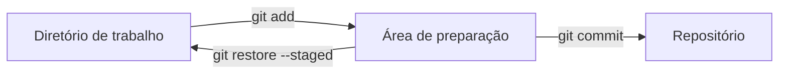

## Passo 1 · Leitura · agenda_final_v2_agora_vai.py

Toda pessoa que programa já teve uma pasta assim: `agenda.py`, `agenda_v2.py`, `agenda_final.py`, `agenda_final_agora_vai.py`. Você mudou algo, quebrou o que funcionava e não lembra qual cópia tinha a versão boa, nem o que mudou de uma para a outra. Em grupo, piora: duas pessoas editam o mesmo arquivo e trocam versões por mensagem.

O **git** é um sistema de controle de versões: ele guarda o histórico do projeto como uma sequência de **commits**, fotografias do projeto inteiro tiradas quando você decide, cada uma com autor, data e uma mensagem dizendo o que mudou. Com ele, você volta a qualquer versão, compara duas versões linha a linha e descobre quando e por que uma linha mudou.

#### As três áreas

O git separa o seu trabalho em três lugares:



- **Diretório de trabalho**: os arquivos como estão na pasta, com as suas edições.
- **Área de preparação** (*staging area* ou *index*): o que vai entrar no **próximo** commit. Você escolhe, arquivo por arquivo, com `git add`.
- **Repositório**: os commits já gravados, guardados na pasta oculta `.git`.

Por que a etapa do meio? Porque nem tudo o que você editou deve ir junto. Você corrigiu um defeito na busca e, no caminho, começou a mexer no relatório, que ainda não funciona. Com o `git add` só no arquivo da busca, o commit grava a correção sozinha, e o relatório continua em edição.

O ponto que mais confunde: o `git add` prepara o arquivo **como ele está naquele momento**. Se você edita de novo depois do `add`, a edição nova não está preparada, e o `git status` mostra o arquivo nas duas listas.

#### O erro comum: git commit sem git add

Editar, rodar `git commit -m "..."` e achar que salvou. Sem `add`, nada está preparado, e o git recusa o commit com `no changes added to commit`: a edição continua só na pasta.

O ambiente desta plataforma não tem o git. Os comandos desta lição são para você repetir no seu computador (instale pelo site git-scm.com); os exercícios modelam em Python o que o git faz.

## Passo 2 · Leitura · O ciclo básico, passo a passo

Repita este roteiro com a agenda da lição de arquivos. Antes do primeiro commit, diga ao git quem você é (uma vez por computador): `git config --global user.name "Ana"` e `git config --global user.email "ana@exemplo.com"`.

**1. Criar o repositório**, dentro da pasta do projeto:

```text
$ git init
Initialized empty Git repository in /home/ana/agenda/.git/
```

**2. Ver o estado.** `git status` é o comando que você mais vai usar:

```text
$ git status
On branch main

No commits yet

Untracked files:
  (use "git add <file>..." to include in what will be committed)
	.env
	agenda.py
```

*Untracked* quer dizer que o git vê os arquivos, mas ainda não os acompanha.

**3. Preparar e gravar**:

```text
$ git add agenda.py
$ git commit -m "Cria a lista de contatos"
[main (root-commit) dc8fc49] Cria a lista de contatos
 1 file changed, 1 insertion(+)
 create mode 100644 agenda.py
```

`dc8fc49` é o começo do identificador do commit (o *hash*). O `.env` ficou de fora, como devia: ele guarda uma senha.

**4. Ver o que mudou.** Depois de editar `agenda.py`, `git diff` mostra as linhas novas com `+` (e as removidas com `-`), comparando a pasta com o que está preparado:

```text
$ git diff
diff --git a/agenda.py b/agenda.py
--- a/agenda.py
+++ b/agenda.py
@@ -1 +1,5 @@
 contatos = []
+
+
+def adicionar(nome):
+    contatos.append(nome)
```

**5. Ver o histórico**, um commit por linha, do mais novo para o mais antigo:

```text
$ git log --oneline
1b3abe3 Adiciona a função adicionar
dc8fc49 Cria a lista de contatos
```

#### Commits pequenos

Cada commit deve fazer **uma** mudança que se explica numa frase: "Adiciona a busca por nome", "Corrige a média da lista vazia". Um commit de três dias com vinte arquivos e a mensagem "ajustes" não diz nada, e desfazer uma parte dele desfaz tudo junto. Faça um commit sempre que uma coisa pequena ficar pronta e funcionando.

Cuidado com o `git add .`, que prepara **tudo** o que mudou na pasta. Rode `git status` antes, para ver o que vai entrar; é assim que um `.env` com senha acaba publicado.

## Passo 3 · Exercício · Simule o git status

Escreva `simular_git(comandos)`, que recebe uma lista de comandos e devolve o estado final de um mini repositório, como o `git status` resumiria. Os comandos possíveis:

- `"editar <arquivo>"`: você muda o arquivo na pasta; ele passa a ter uma mudança **não preparada**.
- `"git add <arquivo>"`: prepara a mudança do arquivo. Se o arquivo não tem mudança não preparada, nada acontece.
- `"git add ."`: prepara as mudanças de todos os arquivos.
- `"git commit -m <mensagem>"`: grava tudo o que está preparado como **um** commit e esvazia a preparação. Se nada estiver preparado, o commit é recusado e nada muda.

A função devolve um dicionário com as listas `"modificados"` (mudanças não preparadas) e `"preparados"`, em ordem alfabética, e o número de `"commits"` gravados:

```python
simular_git(["editar agenda.py", "editar notas.py", "git add agenda.py", "git commit -m 'Cria agenda'"])
# {"modificados": ["notas.py"], "preparados": [], "commits": 1}
```

Lembre do passo 1: o `git add` prepara o arquivo como ele estava. Uma edição **depois** do `add` é uma mudança nova, não preparada, e o arquivo aparece nas duas listas.

### Instruções
1. Trate `editar` e `git add <arquivo>`: a mudança passa de não preparada para preparada.
2. Trate `git add .`, que prepara todos os arquivos modificados.
3. Trate `git commit`: conta um commit e esvazia os preparados, mas só quando há algo preparado.
   Dica: o commit não leva os arquivos que estão só em "modificados".
4. Devolva o dicionário com as duas listas em ordem alfabética e o número de commits.

### Código inicial
```python
def simular_git(comandos):
    pass
```

### Solução
```python
def simular_git(comandos):
    modificados = set()
    preparados = set()
    commits = 0
    for comando in comandos:
        partes = comando.split()
        if partes[0] == "editar":
            modificados.add(partes[1])
        elif partes[:2] == ["git", "add"]:
            if partes[2] == ".":
                novos = set(modificados)
            else:
                novos = modificados & {partes[2]}
            preparados |= novos
            modificados -= novos
        elif partes[:2] == ["git", "commit"]:
            if preparados:
                commits += 1
                preparados = set()
    return {"modificados": sorted(modificados), "preparados": sorted(preparados), "commits": commits}
```

### Dicas
1. Guarde dois conjuntos (modificados e preparados) e um contador de commits; `comando.split()` separa as palavras.
2. Um arquivo pode estar nos dois conjuntos ao mesmo tempo: o `add` tira de um e põe no outro, e uma edição nova põe de volta no primeiro.
3. `sorted(conjunto)` devolve uma lista em ordem alfabética.

### Verificação
```json
[
  { "id": "editar", "checkpoint": 1, "kind": "call", "function": "simular_git", "args": [["editar agenda.py"]],
    "expected": { "modificados": ["agenda.py"], "preparados": [], "commits": 0 }, "name": "Editar deixa o arquivo modificado" },
  { "id": "add", "checkpoint": 1, "kind": "call", "function": "simular_git", "args": [["editar agenda.py", "editar notas.py", "git add notas.py"]],
    "expected": { "modificados": ["agenda.py"], "preparados": ["notas.py"], "commits": 0 }, "name": "git add prepara só o arquivo pedido" },
  { "id": "add-sem-mudanca", "checkpoint": 1, "kind": "call", "function": "simular_git", "args": [["editar agenda.py", "git add leiame.md"]],
    "expected": { "modificados": ["agenda.py"], "preparados": [], "commits": 0 }, "name": "git add de um arquivo sem mudança não faz nada",
    "hint": "Só entra na preparação o arquivo que tem uma mudança não preparada." },
  { "id": "add-ponto", "checkpoint": 2, "kind": "call", "function": "simular_git", "args": [["editar notas.py", "editar agenda.py", "editar .env", "git add ."]],
    "expected": { "modificados": [], "preparados": [".env", "agenda.py", "notas.py"], "commits": 0 },
    "name": "git add . prepara tudo, até o .env", "hint": "As listas saem em ordem alfabética." },
  { "id": "commit", "checkpoint": 3, "kind": "call", "function": "simular_git",
    "args": [["editar agenda.py", "editar notas.py", "git add agenda.py", "git commit -m 'Cria agenda'"]],
    "expected": { "modificados": ["notas.py"], "preparados": [], "commits": 1 }, "name": "O commit grava só o que estava preparado" },
  { "id": "commit-sem-add", "checkpoint": 3, "kind": "call", "function": "simular_git", "args": [["editar agenda.py", "git commit -m 'Salva'"]],
    "expected": { "modificados": ["agenda.py"], "preparados": [], "commits": 0 }, "name": "git commit sem git add é recusado",
    "hint": "Sem nada preparado, o commit não acontece." },
  { "id": "editar-depois-do-add", "checkpoint": 3, "kind": "call", "function": "simular_git",
    "args": [["editar agenda.py", "git add agenda.py", "editar agenda.py"]],
    "expected": { "modificados": ["agenda.py"], "preparados": ["agenda.py"], "commits": 0 },
    "name": "Editar depois do add deixa o arquivo nas duas listas", "hint": "O add preparou a versão antiga; a edição nova não está preparada." },
  { "id": "dois-commits", "checkpoint": 3, "kind": "call", "function": "simular_git",
    "args": [["editar a.py", "git add a.py", "editar a.py", "git commit -m 'Um'", "git commit -m 'Dois'", "git add .", "git commit -m 'Três'"]],
    "expected": { "modificados": [], "preparados": [], "commits": 2 }, "name": "Sequência com um commit recusado no meio" },
  { "id": "vazio", "checkpoint": 4, "kind": "call", "function": "simular_git", "args": [[]],
    "expected": { "modificados": [], "preparados": [], "commits": 0 }, "name": "Sem comandos, o repositório está limpo" }
]
```

### Soluções erradas
```python name="conta o commit mesmo sem nada preparado"
def simular_git(comandos):
    modificados = set()
    preparados = set()
    commits = 0
    for comando in comandos:
        partes = comando.split()
        if partes[0] == "editar":
            modificados.add(partes[1])
        elif partes[:2] == ["git", "add"]:
            if partes[2] == ".":
                novos = set(modificados)
            else:
                novos = modificados & {partes[2]}
            preparados |= novos
            modificados -= novos
        elif partes[:2] == ["git", "commit"]:
            commits += 1
            preparados = set()
    return {"modificados": sorted(modificados), "preparados": sorted(preparados), "commits": commits}
```
```python name="commit leva também os modificados (como se fosse commit -a)"
def simular_git(comandos):
    modificados = set()
    preparados = set()
    commits = 0
    for comando in comandos:
        partes = comando.split()
        if partes[0] == "editar":
            modificados.add(partes[1])
        elif partes[:2] == ["git", "add"]:
            if partes[2] == ".":
                novos = set(modificados)
            else:
                novos = modificados & {partes[2]}
            preparados |= novos
            modificados -= novos
        elif partes[:2] == ["git", "commit"]:
            if preparados or modificados:
                commits += 1
                preparados = set()
                modificados = set()
    return {"modificados": sorted(modificados), "preparados": sorted(preparados), "commits": commits}
```
```python name="cada arquivo tem um estado só"
def simular_git(comandos):
    estado = {}
    commits = 0
    for comando in comandos:
        partes = comando.split()
        if partes[0] == "editar":
            estado[partes[1]] = "modificado"
        elif partes[:2] == ["git", "add"]:
            for arquivo in estado:
                if partes[2] in (".", arquivo):
                    estado[arquivo] = "preparado"
        elif partes[:2] == ["git", "commit"]:
            preparados = [a for a in estado if estado[a] == "preparado"]
            if preparados:
                commits += 1
                for arquivo in preparados:
                    del estado[arquivo]
    return {"modificados": sorted(a for a in estado if estado[a] == "modificado"),
            "preparados": sorted(a for a in estado if estado[a] == "preparado"), "commits": commits}
```
```python name="git add aceita arquivo sem mudança"
def simular_git(comandos):
    modificados = set()
    preparados = set()
    commits = 0
    for comando in comandos:
        partes = comando.split()
        if partes[0] == "editar":
            modificados.add(partes[1])
        elif partes[:2] == ["git", "add"]:
            if partes[2] == ".":
                novos = set(modificados)
            else:
                novos = {partes[2]}
            preparados |= novos
            modificados -= novos
        elif partes[:2] == ["git", "commit"]:
            if preparados:
                commits += 1
                preparados = set()
    return {"modificados": sorted(modificados), "preparados": sorted(preparados), "commits": commits}
```
```python name="listas fora de ordem"
def simular_git(comandos):
    modificados = []
    preparados = []
    commits = 0
    for comando in comandos:
        partes = comando.split()
        if partes[0] == "editar":
            if partes[1] not in modificados:
                modificados.append(partes[1])
        elif partes[:2] == ["git", "add"]:
            for arquivo in list(modificados):
                if partes[2] in (".", arquivo):
                    modificados.remove(arquivo)
                    if arquivo not in preparados:
                        preparados.append(arquivo)
        elif partes[:2] == ["git", "commit"]:
            if preparados:
                commits += 1
                preparados = []
    return {"modificados": modificados, "preparados": preparados, "commits": commits}
```

## Passo 4 · Leitura · Ignorar, desfazer e explicar

#### .gitignore

Alguns arquivos nunca devem entrar no repositório: o `.env` com senhas, a pasta `.venv` do ambiente virtual (milhares de arquivos que só funcionam no seu computador), os `__pycache__` que o Python gera sozinho, os arquivos de log. Liste-os num arquivo chamado `.gitignore`, na raiz do projeto, um padrão por linha:

```text
# segredos
.env
# gerados
.venv/
__pycache__/
*.log
```

Com ele, o `git status` deixa de mostrar esses arquivos, e o `git add .` não os prepara. O `.gitignore` em si **entra** no repositório, para valer para todo o grupo.

O `.gitignore` só ignora arquivos que o git ainda não acompanha. Se o `.env` já foi commitado, acrescentá-lo ao `.gitignore` não o tira do histórico: a senha continua lá, em todos os commits antigos, e precisa ser trocada.

#### Desfazer: restore e revert

São dois comandos para dois momentos diferentes:

| Situação | Comando | O que faz |
|---|---|---|
| editei e quero descartar a edição (ainda sem commit) | `git restore agenda.py` | volta o arquivo para a última versão gravada; **a edição se perde** |
| preparei por engano | `git restore --staged agenda.py` | tira da preparação; a edição continua na pasta |
| já fiz o commit e ele quebrou algo | `git revert <hash>` | cria um commit **novo** que desfaz aquele |

O `revert` não apaga o commit ruim do histórico; ele acrescenta o contrário dele:

```text
$ git revert d50c26f
[main f7266b7] Revert "Guarda os nomes em maiúsculas"
 1 file changed, 1 insertion(+), 1 deletion(-)
$ git log --oneline
f7266b7 Revert "Guarda os nomes em maiúsculas"
d50c26f Guarda os nomes em maiúsculas
013a0d7 Ignora .env, .venv e caches
```

Assim o histórico continua verdadeiro: alguém fez a mudança e alguém a desfez.

#### Mensagens que explicam

A mensagem é para a pessoa que vai ler o `git log` daqui a seis meses (provavelmente você). A convenção:

- uma primeira linha, o **resumo**, de até 72 caracteres, sem ponto final;
- no **imperativo**, completando a frase "este commit vai...": "Corrige a média da lista vazia", e não "corrigido" ou "corrigindo";
- se precisar explicar o porquê, uma linha em branco e depois um corpo com quantas linhas forem necessárias.

"ajustes", "update" e "wip" não dizem nada: com vinte commits assim, o histórico vira a pasta `agenda_final_v2` de novo.

## Passo 5 · Exercício · O que o .gitignore ignora

Escreva `ignorado(caminho, gitignore)`, que diz se o arquivo `caminho` (com `/` separando pastas, como `src/agenda.py`) é ignorado pelo texto `gitignore`. Use uma versão simplificada das regras do git:

- linhas vazias e linhas que começam com `#` não são padrões;
- padrão que termina em `/` (como `.venv/`) ignora tudo o que está **dentro** de uma pasta com esse nome, em qualquer nível: `.venv/lib/site.py` e `src/__pycache__/agenda.pyc`;
- padrão que começa com `*` (como `*.log`) ignora os arquivos cujo **nome** termina com o resto do padrão: `logs/erro.log`;
- qualquer outro padrão (como `.env`) ignora um arquivo ou pasta com **exatamente** esse nome, em qualquer nível: `.env` e `config/.env`, mas não `.env.exemplo`.

Depois, escreva `para_commit(caminhos, gitignore)`, que devolve, na ordem recebida, os caminhos que o `git add .` prepararia.

### Instruções
1. Leia os padrões do texto, ignorando linhas vazias e comentários.
2. Trate os padrões de pasta (`/` no fim) e os de extensão (`*` no começo).
3. Trate os padrões de nome exato, comparando com cada parte do caminho, e não com pedaços do texto.
   Dica: `caminho.split("/")` separa as pastas do nome do arquivo.
4. Escreva `para_commit` usando `ignorado`.

### Código inicial
```python
def ignorado(caminho, gitignore):
    pass


def para_commit(caminhos, gitignore):
    pass
```

### Solução
```python
def ignorado(caminho, gitignore):
    padroes = []
    for linha in gitignore.splitlines():
        linha = linha.strip()
        if linha and not linha.startswith("#"):
            padroes.append(linha)
    partes = caminho.split("/")
    for padrao in padroes:
        if padrao.endswith("/"):
            if padrao[:-1] in partes[:-1]:
                return True
        elif padrao.startswith("*"):
            if partes[-1].endswith(padrao[1:]):
                return True
        elif padrao in partes:
            return True
    return False


def para_commit(caminhos, gitignore):
    return [caminho for caminho in caminhos if not ignorado(caminho, gitignore)]
```

### Dicas
1. Monte primeiro a lista de padrões válidos; depois compare o caminho com cada um.
2. Para o padrão de pasta, tire a `/` do fim e procure o nome entre as pastas do caminho (todas as partes menos a última).
3. `"catalogo.py"` contém o texto `log`, mas não termina com `.log`: compare com `endswith`, nunca com `in` no texto inteiro.

### Verificação
```json
[
  { "id": "comentario", "checkpoint": 1, "kind": "call", "function": "ignorado", "args": [".env", "# .env\n\n*.log\n"], "expected": false, "type": "bool",
    "name": "Padrão comentado não vale", "hint": "Linhas que começam com # são comentários." },
  { "id": "pasta-raiz", "checkpoint": 2, "kind": "call", "function": "ignorado", "args": [".venv/lib/site.py", ".env\n.venv/\n"], "expected": true, "type": "bool",
    "name": "Arquivo dentro de .venv/ é ignorado" },
  { "id": "pasta-funda", "checkpoint": 2, "kind": "call", "function": "ignorado", "args": ["src/__pycache__/agenda.pyc", "__pycache__/\n"], "expected": true, "type": "bool",
    "name": "Padrão de pasta vale em qualquer nível", "hint": "A pasta pode estar no meio do caminho." },
  { "id": "pasta-nao-arquivo", "checkpoint": 2, "kind": "call", "function": "ignorado", "args": ["build", "build/\n"], "expected": false, "type": "bool",
    "name": "Padrão de pasta não ignora um arquivo com o mesmo nome" },
  { "id": "extensao", "checkpoint": 2, "kind": "call", "function": "ignorado", "args": ["logs/erro.log", "*.log\n"], "expected": true, "type": "bool",
    "name": "*.log ignora logs/erro.log" },
  { "id": "extensao-falsa", "checkpoint": 2, "kind": "call", "function": "ignorado", "args": ["catalogo.py", "*.log\n"], "expected": false, "type": "bool",
    "name": "*.log não ignora catalogo.py", "hint": "Compare o fim do nome do arquivo." },
  { "id": "nome-raiz", "checkpoint": 3, "kind": "call", "function": "ignorado", "args": [".env", "# segredos\n.env\n"], "expected": true, "type": "bool",
    "name": ".env é ignorado" },
  { "id": "nome-funda", "checkpoint": 3, "kind": "call", "function": "ignorado", "args": ["config/.env", ".env\n"], "expected": true, "type": "bool",
    "name": "config/.env também é ignorado" },
  { "id": "nome-parecido", "checkpoint": 3, "kind": "call", "function": "ignorado", "args": [".env.exemplo", ".env\n"], "expected": false, "type": "bool",
    "name": ".env não ignora .env.exemplo", "hint": "O nome precisa ser exatamente igual ao padrão." },
  { "id": "para-commit", "checkpoint": 4, "kind": "call", "function": "para_commit",
    "args": [["agenda.py", ".env", ".venv/bin/python", "src/__pycache__/m.pyc", "debug.log", "leiame.md"], ".env\n.venv/\n__pycache__/\n*.log\n"],
    "expected": ["agenda.py", "leiame.md"], "name": "para_commit deixa só o que deve ir para o repositório" }
]
```

### Soluções erradas
```python name="procura o padrão como pedaço do texto"
def ignorado(caminho, gitignore):
    for linha in gitignore.splitlines():
        linha = linha.strip()
        if linha and not linha.startswith("#"):
            if linha.strip("*/") in caminho:
                return True
    return False


def para_commit(caminhos, gitignore):
    return [caminho for caminho in caminhos if not ignorado(caminho, gitignore)]
```
```python name="não pula os comentários"
def ignorado(caminho, gitignore):
    padroes = [linha.strip().lstrip("# ") for linha in gitignore.splitlines() if linha.strip()]
    partes = caminho.split("/")
    for padrao in padroes:
        if padrao.endswith("/"):
            if padrao[:-1] in partes[:-1]:
                return True
        elif padrao.startswith("*"):
            if partes[-1].endswith(padrao[1:]):
                return True
        elif padrao in partes:
            return True
    return False


def para_commit(caminhos, gitignore):
    return [caminho for caminho in caminhos if not ignorado(caminho, gitignore)]
```
```python name="pasta só na raiz do projeto"
def ignorado(caminho, gitignore):
    padroes = []
    for linha in gitignore.splitlines():
        linha = linha.strip()
        if linha and not linha.startswith("#"):
            padroes.append(linha)
    for padrao in padroes:
        if padrao.endswith("/"):
            if caminho.startswith(padrao):
                return True
        elif padrao.startswith("*"):
            if caminho.endswith(padrao[1:]):
                return True
        elif caminho == padrao:
            return True
    return False


def para_commit(caminhos, gitignore):
    return [caminho for caminho in caminhos if not ignorado(caminho, gitignore)]
```
```python name="para_commit devolve os ignorados"
def ignorado(caminho, gitignore):
    padroes = []
    for linha in gitignore.splitlines():
        linha = linha.strip()
        if linha and not linha.startswith("#"):
            padroes.append(linha)
    partes = caminho.split("/")
    for padrao in padroes:
        if padrao.endswith("/"):
            if padrao[:-1] in partes[:-1]:
                return True
        elif padrao.startswith("*"):
            if partes[-1].endswith(padrao[1:]):
                return True
        elif padrao in partes:
            return True
    return False


def para_commit(caminhos, gitignore):
    return [caminho for caminho in caminhos if ignorado(caminho, gitignore)]
```

## Passo 6 · Exercício · Revise a mensagem de commit

Escreva `avaliar_mensagem(mensagem)`, que devolve a lista de problemas de uma mensagem de commit, na ordem abaixo (lista vazia quando está tudo certo). O **resumo** é a primeira linha, sem os espaços das pontas.

1. Resumo vazio: devolva só `["resumo vazio"]`, sem conferir mais nada.
2. Resumo com mais de 72 caracteres: `"resumo longo"`.
3. Resumo terminado em ponto: `"termina com ponto"`.
4. Resumo genérico: `"genérica"`, quando o resumo em minúsculas e sem o ponto final é uma destas palavras: `ajustes`, `update`, `wip`, `correções`, `mudanças`, `teste`, `fix`.
5. Mensagem com mais de uma linha cuja segunda linha não está em branco: `"falta linha em branco"`.

Exemplos: `avaliar_mensagem("Ajustes.")` devolve `["termina com ponto", "genérica"]`; `avaliar_mensagem("Corrige a média da lista vazia\n\nAntes dava ZeroDivisionError.")` devolve `[]`.

### Instruções
1. Separe o resumo e devolva `["resumo vazio"]` quando ele estiver vazio.
2. Confira o tamanho (mais de 72 caracteres) e o ponto final.
3. Confira as palavras genéricas sem diferenciar maiúsculas e ignorando o ponto final.
4. Confira a linha em branco depois do resumo e devolva os problemas na ordem pedida.

### Código inicial
```python
GENERICAS = {"ajustes", "update", "wip", "correções", "mudanças", "teste", "fix"}


def avaliar_mensagem(mensagem):
    pass
```

### Solução
```python
GENERICAS = {"ajustes", "update", "wip", "correções", "mudanças", "teste", "fix"}
LIMITE_RESUMO = 72


def avaliar_mensagem(mensagem):
    linhas = mensagem.split("\n")
    resumo = linhas[0].strip()
    if resumo == "":
        return ["resumo vazio"]
    problemas = []
    if len(resumo) > LIMITE_RESUMO:
        problemas.append("resumo longo")
    if resumo.endswith("."):
        problemas.append("termina com ponto")
    if resumo.lower().rstrip(".") in GENERICAS:
        problemas.append("genérica")
    if len(linhas) > 1 and linhas[1].strip() != "":
        problemas.append("falta linha em branco")
    return problemas
```

### Dicas
1. `mensagem.split("\n")` dá as linhas; a primeira é o resumo.
2. `resumo.lower().rstrip(".")` deixa `"Ajustes."` igual a `"ajustes"`.
3. Mais de 72 é `len(resumo) > 72`: um resumo de exatamente 72 caracteres está dentro do limite.

### Verificação
```json
[
  { "id": "boa", "checkpoint": 4, "kind": "call", "function": "avaliar_mensagem", "args": ["Corrige a média da lista vazia\n\nAntes dava ZeroDivisionError."],
    "expected": [], "name": "Mensagem boa não tem problemas" },
  { "id": "vazia", "checkpoint": 1, "kind": "call", "function": "avaliar_mensagem", "args": ["   \n\nCorpo sem resumo"], "expected": ["resumo vazio"],
    "name": "Resumo vazio", "hint": "Tire os espaços antes de conferir se o resumo está vazio, e pare aí." },
  { "id": "longa", "checkpoint": 2, "kind": "call", "function": "avaliar_mensagem",
    "args": ["Adiciona validação de CPF no cadastro de alunos e corrige a mensagem de erro"], "expected": ["resumo longo"],
    "name": "Resumo de 76 caracteres é longo" },
  { "id": "limite", "checkpoint": 2, "kind": "call", "function": "avaliar_mensagem",
    "args": ["Adiciona validação do CPF no cadastro de aluno e corrige o texto do erro"], "expected": [],
    "name": "Resumo de exatamente 72 caracteres está no limite", "hint": "Mais de 72 é > 72." },
  { "id": "ponto", "checkpoint": 2, "kind": "call", "function": "avaliar_mensagem", "args": ["Adiciona a busca por nome."], "expected": ["termina com ponto"],
    "name": "Resumo com ponto final" },
  { "id": "generica", "checkpoint": 3, "kind": "call", "function": "avaliar_mensagem", "args": ["Ajustes."], "expected": ["termina com ponto", "genérica"],
    "name": "Ajustes. é genérica e tem ponto", "hint": "Compare em minúsculas e sem o ponto final." },
  { "id": "generica-maiuscula", "checkpoint": 3, "kind": "call", "function": "avaliar_mensagem", "args": ["  WIP  "], "expected": ["genérica"],
    "name": "WIP em maiúsculas também é genérica" },
  { "id": "sem-branco", "checkpoint": 4, "kind": "call", "function": "avaliar_mensagem", "args": ["Remove a função antiga\nEla não era usada"],
    "expected": ["falta linha em branco"], "name": "Corpo colado no resumo" },
  { "id": "varios", "checkpoint": 4, "kind": "call", "function": "avaliar_mensagem", "args": ["update.\nmudei umas coisas"],
    "expected": ["termina com ponto", "genérica", "falta linha em branco"], "name": "Vários problemas, na ordem pedida" }
]
```

### Soluções erradas
```python name="genérica diferencia maiúsculas"
GENERICAS = {"ajustes", "update", "wip", "correções", "mudanças", "teste", "fix"}


def avaliar_mensagem(mensagem):
    linhas = mensagem.split("\n")
    resumo = linhas[0].strip()
    if resumo == "":
        return ["resumo vazio"]
    problemas = []
    if len(resumo) > 72:
        problemas.append("resumo longo")
    if resumo.endswith("."):
        problemas.append("termina com ponto")
    if resumo.rstrip(".") in GENERICAS:
        problemas.append("genérica")
    if len(linhas) > 1 and linhas[1].strip() != "":
        problemas.append("falta linha em branco")
    return problemas
```
```python name="limite com >= 72"
GENERICAS = {"ajustes", "update", "wip", "correções", "mudanças", "teste", "fix"}


def avaliar_mensagem(mensagem):
    linhas = mensagem.split("\n")
    resumo = linhas[0].strip()
    if resumo == "":
        return ["resumo vazio"]
    problemas = []
    if len(resumo) >= 72:
        problemas.append("resumo longo")
    if resumo.endswith("."):
        problemas.append("termina com ponto")
    if resumo.lower().rstrip(".") in GENERICAS:
        problemas.append("genérica")
    if len(linhas) > 1 and linhas[1].strip() != "":
        problemas.append("falta linha em branco")
    return problemas
```
```python name="mede a mensagem inteira, não o resumo"
GENERICAS = {"ajustes", "update", "wip", "correções", "mudanças", "teste", "fix"}


def avaliar_mensagem(mensagem):
    linhas = mensagem.split("\n")
    resumo = linhas[0].strip()
    if resumo == "":
        return ["resumo vazio"]
    problemas = []
    if len(mensagem) > 72:
        problemas.append("resumo longo")
    if mensagem.endswith("."):
        problemas.append("termina com ponto")
    if resumo.lower().rstrip(".") in GENERICAS:
        problemas.append("genérica")
    if len(linhas) > 1 and linhas[1].strip() != "":
        problemas.append("falta linha em branco")
    return problemas
```
```python name="não tira os espaços do resumo"
GENERICAS = {"ajustes", "update", "wip", "correções", "mudanças", "teste", "fix"}


def avaliar_mensagem(mensagem):
    linhas = mensagem.split("\n")
    resumo = linhas[0]
    if resumo == "":
        return ["resumo vazio"]
    problemas = []
    if len(resumo) > 72:
        problemas.append("resumo longo")
    if resumo.endswith("."):
        problemas.append("termina com ponto")
    if resumo.lower().rstrip(".") in GENERICAS:
        problemas.append("genérica")
    if len(linhas) > 1 and linhas[1].strip() != "":
        problemas.append("falta linha em branco")
    return problemas
```

## Passo 7 · Quiz · O ciclo do git

### Pergunta
A Bia editou `agenda.py` e `relatorio.py`, rodou `git add agenda.py` e depois `git commit -m "Corrige a busca"`. O que o commit gravou?
- [ ] As mudanças dos dois arquivos, porque os dois foram editados
- [x] Só a mudança de `agenda.py`; a de `relatorio.py` continua na pasta, não preparada
- [ ] Nada, porque faltou `git add relatorio.py`
- [ ] As mudanças dos dois, mas só depois de um `git push`
> O commit grava o que está na área de preparação. É isso que permite separar a correção da busca do relatório ainda em andamento.

### Pergunta
Um commit de ontem quebrou o cálculo da média e já está no histórico do grupo. Qual comando desfaz a mudança do jeito certo?
- [ ] `git restore media.py`, que volta o arquivo para a versão de antes do commit
- [x] `git revert <hash do commit>`, que cria um commit novo desfazendo aquele
- [ ] Apagar a pasta `.git` e começar de novo
- [ ] `git restore --staged media.py`
> `restore` mexe em edições ainda não gravadas (na pasta ou na preparação). Para um commit já gravado, `revert` acrescenta o contrário dele e mantém o histórico verdadeiro.

### Pergunta
O Davi commitou o `.env` com a senha do banco de dados e, no commit seguinte, acrescentou `.env` ao `.gitignore`. A senha está protegida?
- [ ] Sim: o `.gitignore` apaga o arquivo do repositório
- [ ] Sim, desde que ninguém rode `git log`
- [x] Não: o `.gitignore` só vale para arquivos ainda não acompanhados; a senha continua nos commits antigos e precisa ser trocada
- [ ] Não, porque o `.gitignore` só funciona se for criado antes do `git init`
> Tudo o que foi commitado fica no histórico. O `.gitignore` evita o próximo erro, mas não desfaz o anterior: segredo publicado é segredo a trocar.
