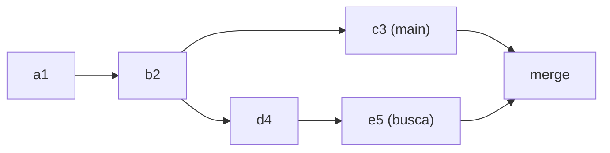

## Passo 1 · Leitura · Branches: trabalhar sem quebrar a main

A Ana está criando a busca por nome da agenda. No meio do trabalho, com a busca pela metade, aparece um defeito urgente na saudação. Se ela trabalha direto na branch principal, a `main`, o conserto vai junto com uma busca que ainda não funciona. A saída é uma **branch** (ramo): uma linha de commits separada, que nasce de um ponto do histórico e anda sem afetar as outras.

```text
$ git switch -c busca
Switched to a new branch 'busca'
$ git branch
* busca
  main
```

`git switch -c busca` cria a branch e passa para ela; `git switch main` volta. O `*` marca a branch atual. Cada commit feito na `busca` fica só nela, até ela ser **integrada** à `main` com `git merge`, rodado de dentro da branch que recebe:

```text
$ git switch main
$ git merge busca
Updating 3d47c8d..d51501f
Fast-forward
 busca.py | 2 ++
 1 file changed, 2 insertions(+)
 create mode 100644 busca.py
```

#### Dois tipos de merge

Por dentro, cada commit guarda quem é o seu **pai**, o commit anterior. O histórico é um grafo: seguindo os pais a partir da ponta de uma branch, você chega ao primeiro commit.



- **Avanço rápido** (*fast-forward*): se a `main` não andou desde que a branch nasceu, a ponta da `main` está no histórico da branch. O git só move o nome `main` para a frente, como na saída acima.
- **Commit de merge**: se as duas andaram (como `c3` e `e5` na figura), o git procura o último commit em comum, a **base do merge** (`b2`), junta as mudanças feitas de cada lado desde ela e cria um commit novo com dois pais. A saída diz `Merge made by the 'ort' strategy.`, o nome do algoritmo de merge do git.

O commit que só existe na branch (`d4` e `e5`) é exatamente o que ela traz de novo: é o que um revisor vai ler antes de aceitar a integração.

#### O erro comum: tudo na main

Trabalhar direto na `main` funciona sozinho, mas em grupo cada pessoa estraga o trabalho em andamento das outras, e a versão "que funciona" deixa de existir. A regra: a `main` só recebe trabalho pronto, por merge; cada tarefa tem a sua branch, com um nome que diz o que ela faz (`busca`, `corrige-saudacao`).

## Passo 2 · Exercício · O grafo de commits

Modele o histórico como o git o guarda: um dicionário em que cada commit aponta para o seu pai (`None` no primeiro commit). Para o grafo do passo 1:

```python
commits = {"a1": None, "b2": "a1", "c3": "b2", "d4": "b2", "e5": "d4"}
```

Escreva quatro funções:

- `historico(commits, ponta)`: a lista de commits seguindo os pais a partir da ponta, como o `git log`: `historico(commits, "e5")` é `["e5", "d4", "b2", "a1"]`.
- `base_do_merge(commits, a, b)`: o commit em comum mais recente das duas pontas: `base_do_merge(commits, "c3", "e5")` é `"b2"`.
- `pode_avancar(commits, destino, origem)`: se o merge de `origem` em `destino` pode ser um avanço rápido, isto é, se a ponta de `destino` está no histórico de `origem`.
- `so_na_branch(commits, branch, principal)`: os commits do histórico de `branch` que vêm antes de chegar à base do merge com `principal`, do mais novo para o mais antigo: `so_na_branch(commits, "e5", "c3")` é `["e5", "d4"]`.

### Instruções
1. Escreva `historico`, incluindo a própria ponta e terminando no commit sem pai.
2. Escreva `base_do_merge` usando `historico`.
   Dica: percorra o histórico de uma ponta e pare no primeiro commit que também está no histórico da outra.
3. Escreva `pode_avancar`.
4. Escreva `so_na_branch`, sem incluir a base.

### Código inicial
```python
def historico(commits, ponta):
    pass


def base_do_merge(commits, a, b):
    pass


def pode_avancar(commits, destino, origem):
    pass


def so_na_branch(commits, branch, principal):
    pass
```

### Solução
```python
def historico(commits, ponta):
    caminho = []
    atual = ponta
    while atual is not None:
        caminho.append(atual)
        atual = commits[atual]
    return caminho


def base_do_merge(commits, a, b):
    ancestrais_a = historico(commits, a)
    for commit in historico(commits, b):
        if commit in ancestrais_a:
            return commit
    return None


def pode_avancar(commits, destino, origem):
    return destino in historico(commits, origem)


def so_na_branch(commits, branch, principal):
    base = base_do_merge(commits, branch, principal)
    novos = []
    for commit in historico(commits, branch):
        if commit == base:
            break
        novos.append(commit)
    return novos
```

### Dicas
1. Em `historico`, um `while` troca o commit atual pelo pai até chegar em `None`.
2. A base do merge é o primeiro commit do histórico de `b` que aparece no histórico de `a`.
3. Em `so_na_branch`, percorra o histórico da branch e pare ao encontrar a base.

### Verificação
```json
[
  { "id": "historico", "checkpoint": 1, "kind": "call", "function": "historico",
    "args": [{ "a1": null, "b2": "a1", "c3": "b2", "d4": "b2", "e5": "d4" }, "e5"], "expected": ["e5", "d4", "b2", "a1"],
    "name": "historico de e5 vai até o primeiro commit", "hint": "Comece pela própria ponta e siga os pais." },
  { "id": "historico-raiz", "checkpoint": 1, "kind": "call", "function": "historico", "args": [{ "a1": null, "b2": "a1" }, "a1"], "expected": ["a1"],
    "name": "historico do primeiro commit é só ele" },
  { "id": "base", "checkpoint": 2, "kind": "call", "function": "base_do_merge",
    "args": [{ "a1": null, "b2": "a1", "c3": "b2", "d4": "b2", "e5": "d4" }, "c3", "e5"], "expected": "b2",
    "name": "A base de c3 e e5 é b2", "hint": "É o commit em comum mais recente, não o mais antigo." },
  { "id": "base-ancestral", "checkpoint": 2, "kind": "call", "function": "base_do_merge",
    "args": [{ "a1": null, "b2": "a1", "c3": "b2", "d4": "c3" }, "b2", "d4"], "expected": "b2",
    "name": "Se uma ponta é ancestral da outra, ela é a base" },
  { "id": "base-funda", "checkpoint": 2, "kind": "call", "function": "base_do_merge",
    "args": [{ "r": null, "m1": "r", "m2": "m1", "m3": "m2", "f1": "m2", "f2": "f1", "f3": "f2" }, "f3", "m3"], "expected": "m2",
    "name": "Base com as duas branches longas" },
  { "id": "avanca", "checkpoint": 3, "kind": "call", "function": "pode_avancar",
    "args": [{ "a1": null, "b2": "a1", "c3": "b2", "d4": "c3" }, "b2", "d4"], "expected": true, "type": "bool",
    "name": "main parada: o merge pode avançar" },
  { "id": "nao-avanca", "checkpoint": 3, "kind": "call", "function": "pode_avancar",
    "args": [{ "a1": null, "b2": "a1", "c3": "b2", "d4": "b2", "e5": "d4" }, "c3", "e5"], "expected": false, "type": "bool",
    "name": "As duas andaram: precisa de commit de merge", "hint": "A ponta do destino precisa estar no histórico da origem." },
  { "id": "nao-avanca-inverso", "checkpoint": 3, "kind": "call", "function": "pode_avancar",
    "args": [{ "a1": null, "b2": "a1", "c3": "b2", "d4": "c3" }, "d4", "b2"], "expected": false, "type": "bool",
    "name": "Destino à frente da origem não é avanço", "hint": "Confira a ordem dos parâmetros: destino, depois origem." },
  { "id": "so-branch", "checkpoint": 4, "kind": "call", "function": "so_na_branch",
    "args": [{ "a1": null, "b2": "a1", "c3": "b2", "d4": "b2", "e5": "d4" }, "e5", "c3"], "expected": ["e5", "d4"],
    "name": "so_na_branch mostra o que a branch traz de novo", "hint": "A base é comum às duas: ela não entra." },
  { "id": "so-branch-nada", "checkpoint": 4, "kind": "call", "function": "so_na_branch",
    "args": [{ "a1": null, "b2": "a1", "c3": "b2" }, "b2", "c3"], "expected": [], "name": "Branch já integrada não traz nada de novo" }
]
```

### Soluções erradas
```python name="historico sem a própria ponta"
def historico(commits, ponta):
    caminho = []
    atual = commits[ponta]
    while atual is not None:
        caminho.append(atual)
        atual = commits[atual]
    return caminho


def base_do_merge(commits, a, b):
    ancestrais_a = historico(commits, a)
    for commit in historico(commits, b):
        if commit in ancestrais_a:
            return commit
    return None


def pode_avancar(commits, destino, origem):
    return destino in historico(commits, origem)


def so_na_branch(commits, branch, principal):
    base = base_do_merge(commits, branch, principal)
    novos = []
    for commit in historico(commits, branch):
        if commit == base:
            break
        novos.append(commit)
    return novos
```
```python name="base é o commit em comum mais antigo"
def historico(commits, ponta):
    caminho = []
    atual = ponta
    while atual is not None:
        caminho.append(atual)
        atual = commits[atual]
    return caminho


def base_do_merge(commits, a, b):
    ancestrais_a = historico(commits, a)
    comuns = [c for c in historico(commits, b) if c in ancestrais_a]
    return comuns[-1]


def pode_avancar(commits, destino, origem):
    return destino in historico(commits, origem)


def so_na_branch(commits, branch, principal):
    base = base_do_merge(commits, branch, principal)
    novos = []
    for commit in historico(commits, branch):
        if commit == base:
            break
        novos.append(commit)
    return novos
```
```python name="pode_avancar com os papéis trocados"
def historico(commits, ponta):
    caminho = []
    atual = ponta
    while atual is not None:
        caminho.append(atual)
        atual = commits[atual]
    return caminho


def base_do_merge(commits, a, b):
    ancestrais_a = historico(commits, a)
    for commit in historico(commits, b):
        if commit in ancestrais_a:
            return commit
    return None


def pode_avancar(commits, destino, origem):
    return origem in historico(commits, destino)


def so_na_branch(commits, branch, principal):
    base = base_do_merge(commits, branch, principal)
    novos = []
    for commit in historico(commits, branch):
        if commit == base:
            break
        novos.append(commit)
    return novos
```
```python name="so_na_branch inclui a base"
def historico(commits, ponta):
    caminho = []
    atual = ponta
    while atual is not None:
        caminho.append(atual)
        atual = commits[atual]
    return caminho


def base_do_merge(commits, a, b):
    ancestrais_a = historico(commits, a)
    for commit in historico(commits, b):
        if commit in ancestrais_a:
            return commit
    return None


def pode_avancar(commits, destino, origem):
    return destino in historico(commits, origem)


def so_na_branch(commits, branch, principal):
    base = base_do_merge(commits, branch, principal)
    novos = []
    for commit in historico(commits, branch):
        novos.append(commit)
        if commit == base:
            break
    return novos
```

## Passo 3 · Leitura · Quando as duas branches mudam a mesma linha

Na `main`, a saudação virou `f"Olá, {nome}!"`. Ao mesmo tempo, na branch `saudacao-formal`, a mesma linha virou `"Bom dia, " + nome`. O git junta sozinho mudanças em linhas diferentes, mas aqui as duas mexeram na **mesma** linha, e ele não tem como saber qual é a certa:

```text
$ git merge saudacao-formal
Auto-merging agenda.py
CONFLICT (content): Merge conflict in agenda.py
Automatic merge failed; fix conflicts and then commit the result.
```

O merge fica pela metade, e o arquivo recebe as duas versões entre **marcações de conflito**:

```text
def saudacao(nome):
<<<<<<< HEAD
    return f"Olá, {nome}!"
=======
    return "Bom dia, " + nome
>>>>>>> saudacao-formal
```

| Marcação | Significa |
|---|---|
| `<<<<<<< HEAD` | começa a **nossa** versão: a da branch em que você está (`HEAD`, aqui a `main`) |
| `=======` | separa as duas versões |
| `>>>>>>> saudacao-formal` | termina a versão **deles**: a da branch que está chegando |

O `git status` lista o arquivo em `Unmerged paths` como `both modified`.

#### Como resolver

1. Abra o arquivo e decida, em cada bloco: fica a nossa versão, a deles, as duas, ou uma terceira que combina as duas ideias (`f"Bom dia, {nome}!"`).
2. **Apague as três marcações.** O arquivo tem de voltar a ser Python válido.
3. Rode os testes.
4. `git add agenda.py` para marcar o conflito como resolvido e `git commit` para concluir o merge.

Se você se perder no meio, `git merge --abort` desfaz o merge e volta ao estado de antes.

#### O erro comum: commitar as marcações

Resolver só o primeiro bloco de um arquivo com três conflitos, ou esquecer uma `=======` no meio do código, e dar `git add`. O git aceita (para ele é só texto), e o programa quebra na hora de rodar, com `SyntaxError` na linha da marcação. Antes do `add`, procure no arquivo por `<<<<<<<`; os editores de código destacam os blocos e oferecem botões para escolher cada lado.

Conflito não é erro de ninguém: é o git avisando que duas pessoas tomaram decisões diferentes sobre a mesma linha, e que uma pessoa precisa decidir. Branches pequenas e integradas com frequência têm menos conflitos.

## Passo 4 · Exercício · Resolva o conflito

Escreva `resolver_conflito(texto, escolha)`, que recebe o conteúdo de um arquivo com marcações de conflito e devolve o texto resolvido:

- `"nosso"`: em cada bloco, fica a versão entre `<<<<<<<` e `=======`;
- `"deles"`: fica a versão entre `=======` e `>>>>>>>`;
- `"ambos"`: fica a nossa versão e, logo depois, a deles;
- qualquer outra escolha levanta `ValueError`.

As linhas fora dos blocos ficam como estão, e as três linhas de marcação somem. O arquivo pode ter vários blocos. Separe e junte as linhas com `"\n"`, para que um `"\n"` no fim do texto continue lá. Uma linha de marcação é a que **começa** com `<<<<<<<`, `=======` ou `>>>>>>>`.

### Instruções
1. Recuse com `ValueError` uma escolha que não seja `"nosso"`, `"deles"` ou `"ambos"`.
2. Percorra as linhas guardando as de fora dos blocos e separando, dentro de cada bloco, a nossa versão e a deles.
   Dica: uma variável que diz em que parte você está (fora, nosso, deles) resolve o laço.
3. No fim de cada bloco, acrescente o lado escolhido (ou os dois, nossa versão primeiro) e tire as marcações.
4. Trate todos os blocos do arquivo, não só o primeiro.

### Código inicial
```python
def resolver_conflito(texto, escolha):
    pass
```

### Solução
```python
def resolver_conflito(texto, escolha):
    if escolha not in ("nosso", "deles", "ambos"):
        raise ValueError(f"escolha inválida: {escolha}")
    resultado = []
    nosso = []
    deles = []
    parte = "fora"
    for linha in texto.split("\n"):
        if linha.startswith("<<<<<<<"):
            parte = "nosso"
            nosso, deles = [], []
        elif linha.startswith("=======") and parte == "nosso":
            parte = "deles"
        elif linha.startswith(">>>>>>>") and parte == "deles":
            if escolha in ("nosso", "ambos"):
                resultado.extend(nosso)
            if escolha in ("deles", "ambos"):
                resultado.extend(deles)
            parte = "fora"
        elif parte == "nosso":
            nosso.append(linha)
        elif parte == "deles":
            deles.append(linha)
        else:
            resultado.append(linha)
    return "\n".join(resultado)
```

### Dicas
1. `texto.split("\n")` e `"\n".join(linhas)` desmontam e remontam o texto sem perder o `\n` final.
2. Ao achar `<<<<<<<`, comece duas listas vazias, uma para cada lado; ao achar `>>>>>>>`, decida o que vai para o resultado.
3. O lado "nosso" é o de cima, o do `HEAD`: a branch em que você estava quando rodou o merge.

### Verificação
```json
[
  { "id": "invalida", "checkpoint": 1, "kind": "expr", "expr": "resolver_conflito('a\\n', 'meu')", "raises": "ValueError",
    "name": "Escolha desconhecida levanta ValueError" },
  { "id": "nosso", "checkpoint": 2, "kind": "call", "function": "resolver_conflito",
    "args": ["def saudacao(nome):\n<<<<<<< HEAD\n    return f\"Olá, {nome}!\"\n=======\n    return \"Bom dia, \" + nome\n>>>>>>> saudacao-formal\n", "nosso"],
    "expected": "def saudacao(nome):\n    return f\"Olá, {nome}!\"\n", "name": "nosso fica com a versão do HEAD",
    "hint": "A nossa versão é a de cima, entre <<<<<<< e =======." },
  { "id": "deles", "checkpoint": 2, "kind": "call", "function": "resolver_conflito",
    "args": ["def saudacao(nome):\n<<<<<<< HEAD\n    return f\"Olá, {nome}!\"\n=======\n    return \"Bom dia, \" + nome\n>>>>>>> saudacao-formal\n", "deles"],
    "expected": "def saudacao(nome):\n    return \"Bom dia, \" + nome\n", "name": "deles fica com a versão da branch que chega" },
  { "id": "ambos", "checkpoint": 3, "kind": "call", "function": "resolver_conflito",
    "args": ["NOTAS = [\n<<<<<<< HEAD\n    7.5,\n=======\n    9.0,\n    6.0,\n>>>>>>> notas-bia\n]\n", "ambos"],
    "expected": "NOTAS = [\n    7.5,\n    9.0,\n    6.0,\n]\n", "name": "ambos junta as duas versões, a nossa primeiro" },
  { "id": "sem-marcas", "checkpoint": 3, "kind": "expr",
    "expr": "[m in resolver_conflito('x = 1\\n<<<<<<< HEAD\\ny = 2\\n=======\\ny = 3\\n>>>>>>> outra\\nz = 4\\n', 'deles') for m in ['<<<<<<<', '=======', '>>>>>>>']]",
    "expected": [false, false, false], "name": "Nenhuma marcação sobra no resultado" },
  { "id": "lado-vazio", "checkpoint": 3, "kind": "call", "function": "resolver_conflito",
    "args": ["import json\n<<<<<<< HEAD\n=======\nimport csv\n>>>>>>> exporta\nimport re\n", "nosso"],
    "expected": "import json\nimport re\n", "name": "Lado vazio: escolher nosso remove a linha deles" },
  { "id": "varios-blocos", "checkpoint": 4, "kind": "call", "function": "resolver_conflito",
    "args": ["a = 1\n<<<<<<< HEAD\nb = 2\n=======\nb = 20\n>>>>>>> outra\nc = 3\n<<<<<<< HEAD\nd = 4\n=======\nd = 40\n>>>>>>> outra\ne = 5", "deles"],
    "expected": "a = 1\nb = 20\nc = 3\nd = 40\ne = 5", "name": "Resolve todos os blocos do arquivo", "hint": "Depois do primeiro >>>>>>>, o laço continua." },
  { "id": "sem-conflito", "checkpoint": 4, "kind": "call", "function": "resolver_conflito", "args": ["print('oi')\n", "ambos"],
    "expected": "print('oi')\n", "name": "Texto sem conflito volta igual" }
]
```

### Soluções erradas
```python name="nosso e deles trocados"
def resolver_conflito(texto, escolha):
    if escolha not in ("nosso", "deles", "ambos"):
        raise ValueError(f"escolha inválida: {escolha}")
    resultado = []
    nosso = []
    deles = []
    parte = "fora"
    for linha in texto.split("\n"):
        if linha.startswith("<<<<<<<"):
            parte = "deles"
            nosso, deles = [], []
        elif linha.startswith("=======") and parte == "deles":
            parte = "nosso"
        elif linha.startswith(">>>>>>>") and parte == "nosso":
            if escolha in ("nosso", "ambos"):
                resultado.extend(nosso)
            if escolha in ("deles", "ambos"):
                resultado.extend(deles)
            parte = "fora"
        elif parte == "nosso":
            nosso.append(linha)
        elif parte == "deles":
            deles.append(linha)
        else:
            resultado.append(linha)
    return "\n".join(resultado)
```
```python name="deixa as marcações no texto"
def resolver_conflito(texto, escolha):
    if escolha not in ("nosso", "deles", "ambos"):
        raise ValueError(f"escolha inválida: {escolha}")
    resultado = []
    parte = "fora"
    for linha in texto.split("\n"):
        if linha.startswith("<<<<<<<"):
            parte = "nosso"
            resultado.append(linha)
        elif linha.startswith("=======") and parte == "nosso":
            parte = "deles"
            resultado.append(linha)
        elif linha.startswith(">>>>>>>") and parte == "deles":
            parte = "fora"
            resultado.append(linha)
        elif parte == "fora" or escolha == "ambos" or parte == escolha:
            resultado.append(linha)
    return "\n".join(resultado)
```
```python name="resolve só o primeiro bloco"
def resolver_conflito(texto, escolha):
    if escolha not in ("nosso", "deles", "ambos"):
        raise ValueError(f"escolha inválida: {escolha}")
    linhas = texto.split("\n")
    inicio = fim = meio = None
    for i, linha in enumerate(linhas):
        if linha.startswith("<<<<<<<") and inicio is None:
            inicio = i
        elif linha.startswith("=======") and meio is None:
            meio = i
        elif linha.startswith(">>>>>>>") and fim is None:
            fim = i
    if inicio is None:
        return texto
    nosso = linhas[inicio + 1:meio]
    deles = linhas[meio + 1:fim]
    escolhido = {"nosso": nosso, "deles": deles, "ambos": nosso + deles}[escolha]
    return "\n".join(linhas[:inicio] + escolhido + linhas[fim + 1:])
```
```python name="ambos com a versão deles primeiro"
def resolver_conflito(texto, escolha):
    if escolha not in ("nosso", "deles", "ambos"):
        raise ValueError(f"escolha inválida: {escolha}")
    resultado = []
    nosso = []
    deles = []
    parte = "fora"
    for linha in texto.split("\n"):
        if linha.startswith("<<<<<<<"):
            parte = "nosso"
            nosso, deles = [], []
        elif linha.startswith("=======") and parte == "nosso":
            parte = "deles"
        elif linha.startswith(">>>>>>>") and parte == "deles":
            if escolha in ("deles", "ambos"):
                resultado.extend(deles)
            if escolha in ("nosso", "ambos"):
                resultado.extend(nosso)
            parte = "fora"
        elif parte == "nosso":
            nosso.append(linha)
        elif parte == "deles":
            deles.append(linha)
        else:
            resultado.append(linha)
    return "\n".join(resultado)
```
```python name="aceita qualquer escolha"
def resolver_conflito(texto, escolha):
    resultado = []
    nosso = []
    deles = []
    parte = "fora"
    for linha in texto.split("\n"):
        if linha.startswith("<<<<<<<"):
            parte = "nosso"
            nosso, deles = [], []
        elif linha.startswith("=======") and parte == "nosso":
            parte = "deles"
        elif linha.startswith(">>>>>>>") and parte == "deles":
            if escolha in ("nosso", "ambos"):
                resultado.extend(nosso)
            if escolha in ("deles", "ambos"):
                resultado.extend(deles)
            parte = "fora"
        elif parte == "nosso":
            nosso.append(linha)
        elif parte == "deles":
            deles.append(linha)
        else:
            resultado.append(linha)
    return "\n".join(resultado)
```

## Passo 5 · Leitura · GitHub, pull requests e revisão

Até aqui tudo aconteceu no seu computador. Para trabalhar em grupo, o repositório também fica num **remoto**, uma cópia num servidor como o GitHub ou o GitLab, de onde todos enviam e recebem commits:

| Comando | O que faz |
|---|---|
| `git clone <endereço>` | baixa o repositório inteiro, com o histórico |
| `git push -u origin busca` | envia a branch `busca` para o remoto chamado `origin` |
| `git pull` | traz os commits novos do remoto e faz o merge na branch atual |

```text
$ git push -u origin main
To https://github.com/ana/agenda.git
 * [new branch]      main -> main
branch 'main' set up to track 'origin/main'.
```

Sem permissão de escrita no repositório (num projeto aberto de outra pessoa), comece por um **fork**: uma cópia dele na sua conta, para onde você envia as suas branches.

#### O pull request

Em vez de fazer o merge na `main` direto, você envia a branch e abre um **pull request** (PR) no site: um pedido para integrar a branch, com uma página que mostra o diff (só os commits que a branch traz de novo) e um espaço para conversa. Um bom PR:

- faz **uma** coisa e é pequeno: algumas centenas de linhas, no máximo; um PR de 3 000 linhas não é revisado, é aprovado no escuro;
- tem um título que diz o que muda e uma descrição com o porquê e como testar.

#### A revisão de código

Outra pessoa lê o diff antes do merge. Um roteiro para quem revisa: os testes passam? O código faz o que a descrição promete? Os nomes dizem o que as coisas são? Falta tratar algum caso de borda? Comentários de revisão falam do **código**, não da pessoa, e explicam o porquê: "este `if not posicao` trata a posição 0 como ausente; que tal `is None`?" ajuda; "isso está errado" não.

#### Proteção da main e CI

Os repositórios costumam **proteger** a `main`: ninguém faz push direto nela, e o merge só é liberado com aprovação na revisão e com os testes passando. Quem roda os testes é a **integração contínua** (CI, de *continuous integration*): a cada push num PR, um servidor baixa o código, instala as dependências e roda a suíte inteira. O PR mostra um ✓ ou um ✗, e o ✗ bloqueia o merge.

#### O erro comum: push --force

`git push --force` substitui o histórico do remoto pelo seu. Numa branch em que outras pessoas também enviam commits, ele **apaga** os commits delas que você ainda não tinha. Em branch compartilhada, nunca; para desfazer algo já enviado, use `git revert`.

## Passo 6 · Exercício · O PR pode entrar na main?

A `main` do projeto é protegida. Escreva `bloqueios(pr)`, que recebe um pull request como dicionário e devolve a lista do que impede o merge, na ordem abaixo (lista vazia quando o merge está liberado):

```python
pr = {
    "origem": "busca",            # branch que quer entrar
    "descricao": "Adiciona a busca por nome.",
    "aprovacoes": 1,              # revisões aprovando
    "testes_ok": True,            # resultado da CI
    "linhas_alteradas": 120,
    "arquivos": {"busca.py": "def buscar(nome):\n    return None\n"},
}
```

1. `"origem é a main"`, se o PR vem da própria `main` (o trabalho foi feito direto nela);
2. `"testes falhando"`, se `testes_ok` é falso;
3. `"sem aprovação"`, se há menos de uma aprovação;
4. `"sem descrição"`, se a descrição está vazia ou só com espaços;
5. `"PR grande demais"`, se há mais de 400 linhas alteradas;
6. `"marcações de conflito em <arquivo>"`, uma para cada arquivo com alguma linha que começa com `<<<<<<<`, `=======` ou `>>>>>>>`, em ordem alfabética do nome do arquivo.

### Instruções
1. Confira a origem, os testes e as aprovações, nessa ordem.
2. Confira a descrição e o tamanho do PR.
   Dica: 400 linhas ainda passam; 401 não.
3. Procure marcações de conflito em cada arquivo, linha por linha, e acrescente um bloqueio por arquivo, em ordem alfabética.

### Código inicial
```python
LIMITE_DE_LINHAS = 400


def bloqueios(pr):
    pass
```

### Solução
```python
LIMITE_DE_LINHAS = 400
MARCACOES = ("<<<<<<<", "=======", ">>>>>>>")


def tem_marcacoes(conteudo):
    return any(linha.startswith(MARCACOES) for linha in conteudo.split("\n"))


def bloqueios(pr):
    problemas = []
    if pr["origem"] == "main":
        problemas.append("origem é a main")
    if not pr["testes_ok"]:
        problemas.append("testes falhando")
    if pr["aprovacoes"] < 1:
        problemas.append("sem aprovação")
    if pr["descricao"].strip() == "":
        problemas.append("sem descrição")
    if pr["linhas_alteradas"] > LIMITE_DE_LINHAS:
        problemas.append("PR grande demais")
    for nome in sorted(pr["arquivos"]):
        if tem_marcacoes(pr["arquivos"][nome]):
            problemas.append(f"marcações de conflito em {nome}")
    return problemas
```

### Dicas
1. Monte a lista com um `if` por regra, na ordem do enunciado.
2. `str.startswith` aceita uma tupla: `linha.startswith(("<<<<<<<", "=======", ">>>>>>>"))`.
3. `sorted(pr["arquivos"])` percorre os nomes dos arquivos em ordem alfabética.

### Verificação
```json
[
  { "id": "liberado", "checkpoint": 1, "kind": "call", "function": "bloqueios",
    "args": [{ "origem": "busca", "descricao": "Adiciona a busca por nome.", "aprovacoes": 1, "testes_ok": true, "linhas_alteradas": 120,
      "arquivos": { "busca.py": "def buscar(nome):\n    return None\n" } }],
    "expected": [], "name": "PR em ordem não tem bloqueios" },
  { "id": "main", "checkpoint": 1, "kind": "call", "function": "bloqueios",
    "args": [{ "origem": "main", "descricao": "Tudo.", "aprovacoes": 2, "testes_ok": true, "linhas_alteradas": 10, "arquivos": {} }],
    "expected": ["origem é a main"], "name": "PR vindo da main é bloqueado" },
  { "id": "testes-aprovacao", "checkpoint": 1, "kind": "call", "function": "bloqueios",
    "args": [{ "origem": "relatorio", "descricao": "Gera o relatório.", "aprovacoes": 0, "testes_ok": false, "linhas_alteradas": 80, "arquivos": {} }],
    "expected": ["testes falhando", "sem aprovação"], "name": "Testes falhando e sem aprovação, nessa ordem" },
  { "id": "descricao", "checkpoint": 2, "kind": "call", "function": "bloqueios",
    "args": [{ "origem": "ajuste", "descricao": "   \n", "aprovacoes": 1, "testes_ok": true, "linhas_alteradas": 30, "arquivos": {} }],
    "expected": ["sem descrição"], "name": "Descrição só com espaços conta como vazia", "hint": "Tire os espaços antes de comparar." },
  { "id": "limite", "checkpoint": 2, "kind": "call", "function": "bloqueios",
    "args": [{ "origem": "notas", "descricao": "Importa notas.", "aprovacoes": 1, "testes_ok": true, "linhas_alteradas": 400, "arquivos": {} }],
    "expected": [], "name": "400 linhas ainda passam" },
  { "id": "grande", "checkpoint": 2, "kind": "call", "function": "bloqueios",
    "args": [{ "origem": "notas", "descricao": "Importa notas.", "aprovacoes": 1, "testes_ok": true, "linhas_alteradas": 3000, "arquivos": {} }],
    "expected": ["PR grande demais"], "name": "PR de 3000 linhas é grande demais" },
  { "id": "conflitos", "checkpoint": 3, "kind": "call", "function": "bloqueios",
    "args": [{ "origem": "saudacao", "descricao": "Muda a saudação.", "aprovacoes": 1, "testes_ok": true, "linhas_alteradas": 12,
      "arquivos": { "views.py": "x = 1\n=======\ny = 2\n", "agenda.py": "def f():\n<<<<<<< HEAD\n    return 1\n", "leiame.md": "Use === para títulos\n" } }],
    "expected": ["marcações de conflito em agenda.py", "marcações de conflito em views.py"],
    "name": "Um bloqueio por arquivo com marcações, em ordem alfabética",
    "hint": "A marcação precisa estar no começo da linha: === no meio do texto não conta." },
  { "id": "tudo", "checkpoint": 3, "kind": "call", "function": "bloqueios",
    "args": [{ "origem": "main", "descricao": "", "aprovacoes": 0, "testes_ok": false, "linhas_alteradas": 401,
      "arquivos": { "a.py": ">>>>>>> outra\n" } }],
    "expected": ["origem é a main", "testes falhando", "sem aprovação", "sem descrição", "PR grande demais", "marcações de conflito em a.py"],
    "name": "Todos os bloqueios, na ordem pedida" }
]
```

### Soluções erradas
```python name="procura a marcação em qualquer lugar do texto"
LIMITE_DE_LINHAS = 400


def bloqueios(pr):
    problemas = []
    if pr["origem"] == "main":
        problemas.append("origem é a main")
    if not pr["testes_ok"]:
        problemas.append("testes falhando")
    if pr["aprovacoes"] < 1:
        problemas.append("sem aprovação")
    if pr["descricao"].strip() == "":
        problemas.append("sem descrição")
    if pr["linhas_alteradas"] > LIMITE_DE_LINHAS:
        problemas.append("PR grande demais")
    for nome in sorted(pr["arquivos"]):
        conteudo = pr["arquivos"][nome]
        if "<<<" in conteudo or "===" in conteudo or ">>>" in conteudo:
            problemas.append(f"marcações de conflito em {nome}")
    return problemas
```
```python name="limite com >= 400"
LIMITE_DE_LINHAS = 400


def bloqueios(pr):
    problemas = []
    if pr["origem"] == "main":
        problemas.append("origem é a main")
    if not pr["testes_ok"]:
        problemas.append("testes falhando")
    if pr["aprovacoes"] < 1:
        problemas.append("sem aprovação")
    if pr["descricao"].strip() == "":
        problemas.append("sem descrição")
    if pr["linhas_alteradas"] >= LIMITE_DE_LINHAS:
        problemas.append("PR grande demais")
    for nome in sorted(pr["arquivos"]):
        linhas = pr["arquivos"][nome].split("\n")
        if any(l.startswith(("<<<<<<<", "=======", ">>>>>>>")) for l in linhas):
            problemas.append(f"marcações de conflito em {nome}")
    return problemas
```
```python name="só procura o <<<<<<<"
LIMITE_DE_LINHAS = 400


def bloqueios(pr):
    problemas = []
    if pr["origem"] == "main":
        problemas.append("origem é a main")
    if not pr["testes_ok"]:
        problemas.append("testes falhando")
    if pr["aprovacoes"] < 1:
        problemas.append("sem aprovação")
    if pr["descricao"].strip() == "":
        problemas.append("sem descrição")
    if pr["linhas_alteradas"] > LIMITE_DE_LINHAS:
        problemas.append("PR grande demais")
    for nome in sorted(pr["arquivos"]):
        if "<<<<<<<" in pr["arquivos"][nome]:
            problemas.append(f"marcações de conflito em {nome}")
    return problemas
```
```python name="descrição com espaços passa"
LIMITE_DE_LINHAS = 400


def bloqueios(pr):
    problemas = []
    if pr["origem"] == "main":
        problemas.append("origem é a main")
    if not pr["testes_ok"]:
        problemas.append("testes falhando")
    if pr["aprovacoes"] < 1:
        problemas.append("sem aprovação")
    if pr["descricao"] == "":
        problemas.append("sem descrição")
    if pr["linhas_alteradas"] > LIMITE_DE_LINHAS:
        problemas.append("PR grande demais")
    for nome in sorted(pr["arquivos"]):
        linhas = pr["arquivos"][nome].split("\n")
        if any(l.startswith(("<<<<<<<", "=======", ">>>>>>>")) for l in linhas):
            problemas.append(f"marcações de conflito em {nome}")
    return problemas
```
```python name="arquivos fora de ordem"
LIMITE_DE_LINHAS = 400


def bloqueios(pr):
    problemas = []
    if pr["origem"] == "main":
        problemas.append("origem é a main")
    if not pr["testes_ok"]:
        problemas.append("testes falhando")
    if pr["aprovacoes"] < 1:
        problemas.append("sem aprovação")
    if pr["descricao"].strip() == "":
        problemas.append("sem descrição")
    if pr["linhas_alteradas"] > LIMITE_DE_LINHAS:
        problemas.append("PR grande demais")
    for nome, conteudo in pr["arquivos"].items():
        linhas = conteudo.split("\n")
        if any(l.startswith(("<<<<<<<", "=======", ">>>>>>>")) for l in linhas):
            problemas.append(f"marcações de conflito em {nome}")
    return problemas
```

## Passo 7 · Quiz · Trabalho em equipe

### Pergunta
Você está na `main`, rodou `git merge relatorio` e apareceu este bloco. O que fica no arquivo se você escolher a versão **da branch `relatorio`**?
```text
<<<<<<< HEAD
LIMITE = 10
=======
LIMITE = 20
>>>>>>> relatorio
```
- [ ] As cinco linhas, porque o git resolve sozinho no próximo commit
- [ ] `LIMITE = 10`
- [x] Só `LIMITE = 20`, sem nenhuma das três marcações
- [ ] `LIMITE = 20` e a linha `>>>>>>> relatorio`, que indica de onde veio
> A parte de cima (`HEAD`) é a da branch em que você está; a de baixo, a da branch que chega. Resolver é deixar o código final e apagar todas as marcações; depois, `git add` e `git commit`.

### Pergunta
O Caio enviou commits errados para a branch `cadastro`, que ele divide com a Eva. Qual é o jeito seguro de desfazer?
- [ ] `git push --force` com o histórico de antes dos commits errados
- [x] `git revert` dos commits errados e um `git push` normal
- [ ] Apagar a branch no GitHub e criar de novo com o mesmo nome
- [ ] Pedir para a Eva parar de usar o git
> `push --force` reescreve o histórico do remoto e apaga os commits da Eva que o Caio ainda não tinha. O `revert` acrescenta commits que desfazem os errados, sem mexer no que os outros já têm.

### Pergunta
Qual comentário de revisão num pull request ajuda mais?
- [ ] "Não gostei."
- [ ] "Você sempre esquece os testes."
- [x] "`calcular_frete` aceita peso negativo e devolve um frete menor que a taxa fixa. Que tal levantar `ValueError` e acrescentar um teste para esse caso?"
- [ ] "LGTM" (*looks good to me*), aprovando um PR de 3 000 linhas sem ler
> O comentário útil aponta o trecho, explica o problema e sugere um caminho, falando do código e não da pessoa. Aprovar sem ler tira o sentido da revisão.
