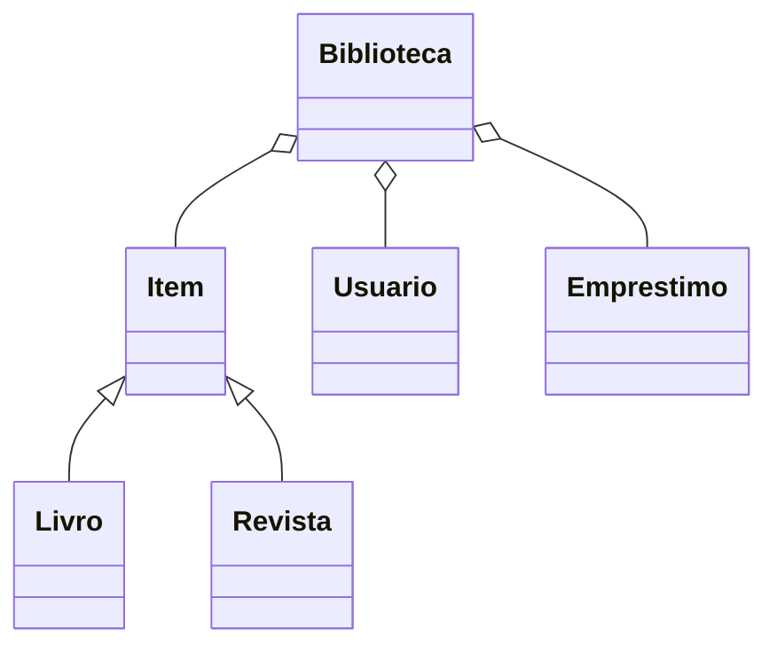

## Passo 1 · Leitura · O que você vai construir

Este é o primeiro dos dois projetos do nível, e ele conta para o certificado: o sistema de empréstimos da sala de leitura de um instituto. Ele junta classes, herança, classes abstratas, exceções próprias, pacotes, datas, JSON e testes.

#### O pacote

| Arquivo | Conteúdo |
|---|---|
| `biblioteca/erros.py` | `ErroBiblioteca` e quatro erros específicos |
| `biblioteca/modelos.py` | dataclasses `Item` (abstrata), `Livro`, `Revista`, `Usuario`, `Emprestimo` |
| `biblioteca/servico.py` | a classe `Biblioteca`, com as regras |
| `biblioteca/persistencia.py` | `salvar` e `carregar` em JSON |
| `main.py` | no passo 7, a suíte de testes |



#### As regras

- Livro fica 14 dias emprestado; revista, 7. Cada classe responde pelo próprio prazo.
- Cada usuário tem um limite de empréstimos simultâneos: 3, se nada for dito.
- Um item emprestado não pode sair de novo até ser devolvido.
- A devolução depois da data prevista custa R\$ 1,00 por dia de atraso. Antes ou na data, nada.
- Quebrar uma regra levanta uma exceção própria, com mensagem em português.

#### A data vem de fora

Nenhuma função chama `date.today()`. Quem empresta, devolve ou pede o relatório informa a data:

```python
b = Biblioteca()
b.cadastrar_item(Livro("L1", "Dom Casmurro", 1899, "Machado de Assis"))
b.cadastrar_usuario(Usuario("1001", "Ana Lima"))
b.emprestar("L1", "1001", date(2026, 3, 2))   # prevista: 2026-03-16
b.devolver("L1", date(2026, 3, 20))            # 4.0
```

Com a data por parâmetro, um teste reproduz o dia 20 de março sempre que rodar; com `date.today()`, o mesmo teste passaria hoje e falharia daqui a um mês.

#### Uma fonte só de verdade

Os empréstimos ativos ficam num único dicionário, `Biblioteca.emprestimos`. Quantos livros a Ana tem é uma consulta a ele, e não um contador guardado em outro lugar: dois registros do mesmo fato acabam divergindo.

#### Como o trabalho é dividido

Os passos 3 a 7 constroem o mesmo projeto, cada um a partir do código aprovado no anterior: modelos e erros, empréstimo, devolução e relatório, persistência e, por fim, a suíte de testes. O `acervo.json` que acompanha o projeto é um acervo salvo, usado no passo 6. A verificação de cada passo usa vários cenários, inclusive os de erro: siga os nomes e as mensagens exatamente como estão no enunciado.

## Passo 2 · Previsão · Contas com datas

O prazo e a multa são contas com `date` e `timedelta`. Antes de escrever o `Emprestimo`, veja o que a subtração de datas devolve quando a devolução é antecipada.

Leia com calma, sem executar, e digite exatamente o que o programa imprime.

### Código
```python
from datetime import date, timedelta

saida = date(2026, 3, 2)
prevista = saida + timedelta(days=14)
print(prevista)
print((date(2026, 3, 20) - prevista).days)
print((date(2026, 3, 10) - prevista).days)
print(max(0, (date(2026, 3, 10) - prevista).days))
```

### Dicas
1. Somar um `timedelta` a uma `date` dá outra `date`, que o `print` mostra no formato `AAAA-MM-DD`.
2. Subtrair duas datas dá um `timedelta`; `.days` é a quantidade de dias, com sinal.

### Saída esperada
```text
2026-03-16
4
-6
0
```

## Passo 3 · Exercício · Modelos e erros

Comece pelos dois módulos que não dependem de ninguém: `erros.py` e `modelos.py`. O `servico.py` e o `persistencia.py` do código inicial ficam como estão até os próximos passos.

#### Os erros

`ErroBiblioteca` herda de `Exception` e é a base de quatro erros: `ItemNaoEncontrado`, `UsuarioNaoEncontrado`, `ItemIndisponivel` e `LimiteDeEmprestimos`. Com a base comum, quem usa a biblioteca trata qualquer regra quebrada com um único `except ErroBiblioteca`.

#### Os modelos

| Classe | Campos | Comportamento |
|---|---|---|
| `Item` (abstrata) | `codigo`, `titulo`, `ano` | tira os espaços das pontas de código e título; vazio levanta `ValueError("código vazio")` ou `ValueError("título vazio")`; `prazo_dias()` e `descricao()` abstratos |
| `Livro(Item)` | + `autor` | prazo 14; `Dom Casmurro (1899), de Machado de Assis` |
| `Revista(Item)` | + `edicao` | prazo 7; `Ciência em Pauta nº 12 (2025)` |
| `Usuario` | `matricula`, `nome`, `limite=3` | tira os espaços do nome; vazio levanta `ValueError("nome vazio")` |
| `Emprestimo` | `codigo`, `matricula`, `data_emprestimo`, `data_prevista` | `dias_de_atraso(data)`: dias depois da data prevista, nunca negativo |

Todas são dataclasses. `Item` também herda de `ABC`: ninguém empresta um "item" genérico, só livros e revistas.

```python
Livro("L1", "Dom Casmurro", 1899, "Machado de Assis").prazo_dias()   # 14
Item("X1", "Qualquer coisa", 2000)                                  # TypeError
Emprestimo("L1", "1001", date(2026, 3, 2), date(2026, 3, 16)).dias_de_atraso(date(2026, 3, 10))   # 0
```

### Instruções
1. Em `biblioteca/erros.py`, crie `ErroBiblioteca`, herdando de `Exception`, e as quatro exceções específicas herdando dela.
   Dica: uma classe de exceção pode ter só uma docstring ou `pass` no corpo.
2. Em `biblioteca/modelos.py`, crie a dataclass abstrata `Item`, com a normalização e a validação no `__post_init__` e os métodos abstratos `prazo_dias` e `descricao`.
   Dica: `@dataclass` em cima de `class Item(ABC):` funciona; os métodos abstratos levam `@abstractmethod`.
3. Crie `Livro` e `Revista`, dataclasses que herdam de `Item`, cada uma com o campo a mais, o prazo e a descrição da tabela.
4. Crie as dataclasses `Usuario` (com `limite` padrão 3 e o nome validado) e `Emprestimo`, com o método `dias_de_atraso(data)`.
   Dica: subtrair duas datas dá um `timedelta`; o atraso é o maior entre 0 e os dias dessa diferença.

### Código inicial
```python
"""Use este arquivo para experimentar o pacote biblioteca; a verificação importa os módulos diretamente."""
```
```python path=biblioteca/__init__.py
"""Pacote da biblioteca: modelos, erros, serviço e persistência."""
```
```python path=biblioteca/erros.py
"""Exceções da biblioteca: uma base e quatro erros específicos."""
```
```python path=biblioteca/modelos.py
"""Classes de dados: Item, Livro, Revista, Usuario e Emprestimo."""
from abc import ABC, abstractmethod
from dataclasses import dataclass
from datetime import date
```
```python path=biblioteca/persistencia.py
"""Gravação e leitura do acervo em JSON."""
import json
from dataclasses import asdict
from datetime import date
from pathlib import Path

from biblioteca.modelos import Emprestimo, Livro, Revista, Usuario
from biblioteca.servico import Biblioteca


def salvar(caminho, biblioteca):
    pass


def carregar(caminho):
    pass
```
```python path=biblioteca/servico.py
"""Regras de negócio: a classe Biblioteca."""
from datetime import timedelta

from biblioteca.erros import (
    ErroBiblioteca,
    ItemIndisponivel,
    ItemNaoEncontrado,
    LimiteDeEmprestimos,
    UsuarioNaoEncontrado,
)
from biblioteca.modelos import Emprestimo

MULTA_POR_DIA = 1.0


class Biblioteca:
    def __init__(self):
        pass

    def cadastrar_item(self, item):
        pass

    def cadastrar_usuario(self, usuario):
        pass

    def buscar_item(self, codigo):
        pass

    def buscar_usuario(self, matricula):
        pass

    def emprestimos_de(self, matricula):
        pass

    def emprestar(self, codigo, matricula, data):
        pass

    def devolver(self, codigo, data):
        pass

    def relatorio_atrasados(self, data):
        pass
```
```text path=acervo.json
{
  "itens": [
    {
      "tipo": "livro",
      "codigo": "L1",
      "titulo": "Dom Casmurro",
      "ano": 1899,
      "autor": "Machado de Assis"
    },
    {
      "tipo": "livro",
      "codigo": "L2",
      "titulo": "Vidas Secas",
      "ano": 1938,
      "autor": "Graciliano Ramos"
    },
    {
      "tipo": "livro",
      "codigo": "L3",
      "titulo": "Memórias Póstumas de Brás Cubas",
      "ano": 1881,
      "autor": "Machado de Assis"
    },
    {
      "tipo": "revista",
      "codigo": "R1",
      "titulo": "Ciência em Pauta",
      "ano": 2025,
      "edicao": 12
    }
  ],
  "usuarios": [
    {
      "matricula": "1001",
      "nome": "Ana Lima",
      "limite": 3
    },
    {
      "matricula": "2001",
      "nome": "Profa. Bia",
      "limite": 5
    }
  ],
  "emprestimos": [
    {
      "codigo": "L1",
      "matricula": "1001",
      "data_emprestimo": "2026-03-02",
      "data_prevista": "2026-03-16"
    },
    {
      "codigo": "R1",
      "matricula": "2001",
      "data_emprestimo": "2026-03-05",
      "data_prevista": "2026-03-12"
    }
  ]
}
```

### Solução
```python
"""Use este arquivo para experimentar o pacote biblioteca; a verificação importa os módulos diretamente."""
```
```python path=biblioteca/__init__.py
"""Pacote da biblioteca: modelos, erros, serviço e persistência."""
```
```python path=biblioteca/erros.py
"""Exceções da biblioteca: uma base e quatro erros específicos."""


class ErroBiblioteca(Exception):
    """Base de todos os erros de regra da biblioteca."""


class ItemNaoEncontrado(ErroBiblioteca):
    pass


class UsuarioNaoEncontrado(ErroBiblioteca):
    pass


class ItemIndisponivel(ErroBiblioteca):
    pass


class LimiteDeEmprestimos(ErroBiblioteca):
    pass
```
```python path=biblioteca/modelos.py
"""Classes de dados: Item, Livro, Revista, Usuario e Emprestimo."""
from abc import ABC, abstractmethod
from dataclasses import dataclass
from datetime import date


@dataclass
class Item(ABC):
    codigo: str
    titulo: str
    ano: int

    def __post_init__(self):
        self.codigo = self.codigo.strip()
        self.titulo = self.titulo.strip()
        if self.codigo == "":
            raise ValueError("código vazio")
        if self.titulo == "":
            raise ValueError("título vazio")

    @abstractmethod
    def prazo_dias(self):
        """Dias que o item pode ficar emprestado."""

    @abstractmethod
    def descricao(self):
        """Texto de uma linha para listagens."""


@dataclass
class Livro(Item):
    autor: str

    def prazo_dias(self):
        return 14

    def descricao(self):
        return f"{self.titulo} ({self.ano}), de {self.autor}"


@dataclass
class Revista(Item):
    edicao: int

    def prazo_dias(self):
        return 7

    def descricao(self):
        return f"{self.titulo} nº {self.edicao} ({self.ano})"


@dataclass
class Usuario:
    matricula: str
    nome: str
    limite: int = 3

    def __post_init__(self):
        self.nome = self.nome.strip()
        if self.nome == "":
            raise ValueError("nome vazio")


@dataclass
class Emprestimo:
    codigo: str
    matricula: str
    data_emprestimo: date
    data_prevista: date

    def dias_de_atraso(self, data):
        return max(0, (data - self.data_prevista).days)
```
```python path=biblioteca/persistencia.py
"""Gravação e leitura do acervo em JSON."""
import json
from dataclasses import asdict
from datetime import date
from pathlib import Path

from biblioteca.modelos import Emprestimo, Livro, Revista, Usuario
from biblioteca.servico import Biblioteca


def salvar(caminho, biblioteca):
    pass


def carregar(caminho):
    pass
```
```python path=biblioteca/servico.py
"""Regras de negócio: a classe Biblioteca."""
from datetime import timedelta

from biblioteca.erros import (
    ErroBiblioteca,
    ItemIndisponivel,
    ItemNaoEncontrado,
    LimiteDeEmprestimos,
    UsuarioNaoEncontrado,
)
from biblioteca.modelos import Emprestimo

MULTA_POR_DIA = 1.0


class Biblioteca:
    def __init__(self):
        pass

    def cadastrar_item(self, item):
        pass

    def cadastrar_usuario(self, usuario):
        pass

    def buscar_item(self, codigo):
        pass

    def buscar_usuario(self, matricula):
        pass

    def emprestimos_de(self, matricula):
        pass

    def emprestar(self, codigo, matricula, data):
        pass

    def devolver(self, codigo, data):
        pass

    def relatorio_atrasados(self, data):
        pass
```
```text path=acervo.json
{
  "itens": [
    {
      "tipo": "livro",
      "codigo": "L1",
      "titulo": "Dom Casmurro",
      "ano": 1899,
      "autor": "Machado de Assis"
    },
    {
      "tipo": "livro",
      "codigo": "L2",
      "titulo": "Vidas Secas",
      "ano": 1938,
      "autor": "Graciliano Ramos"
    },
    {
      "tipo": "livro",
      "codigo": "L3",
      "titulo": "Memórias Póstumas de Brás Cubas",
      "ano": 1881,
      "autor": "Machado de Assis"
    },
    {
      "tipo": "revista",
      "codigo": "R1",
      "titulo": "Ciência em Pauta",
      "ano": 2025,
      "edicao": 12
    }
  ],
  "usuarios": [
    {
      "matricula": "1001",
      "nome": "Ana Lima",
      "limite": 3
    },
    {
      "matricula": "2001",
      "nome": "Profa. Bia",
      "limite": 5
    }
  ],
  "emprestimos": [
    {
      "codigo": "L1",
      "matricula": "1001",
      "data_emprestimo": "2026-03-02",
      "data_prevista": "2026-03-16"
    },
    {
      "codigo": "R1",
      "matricula": "2001",
      "data_emprestimo": "2026-03-05",
      "data_prevista": "2026-03-12"
    }
  ]
}
```

### Dicas
1. Na subclasse, a dataclass acrescenta os campos novos depois dos herdados: `Livro(codigo, titulo, ano, autor)`.
2. O `__post_init__` fica só em `Item` (e no `Usuario`): `Livro` e `Revista` o herdam.
3. `(data - self.data_prevista).days` pode ser negativo; `max(0, ...)` resolve.

### Verificação
```json
[
  {"id": "erros-heranca", "checkpoint": 1, "kind": "expr", "setup": "from biblioteca.erros import ErroBiblioteca, ItemNaoEncontrado, UsuarioNaoEncontrado, ItemIndisponivel, LimiteDeEmprestimos", "expr": "[issubclass(c, ErroBiblioteca) for c in (ItemNaoEncontrado, UsuarioNaoEncontrado, ItemIndisponivel, LimiteDeEmprestimos)]", "expected": [true, true, true, true], "name": "As quatro exceções herdam de ErroBiblioteca", "hint": "Cada erro específico é declarado como subclasse da base: class ItemNaoEncontrado(ErroBiblioteca)."},
  {"id": "erros-base", "checkpoint": 1, "kind": "expr", "setup": "from biblioteca.erros import ErroBiblioteca, ItemNaoEncontrado, UsuarioNaoEncontrado, ItemIndisponivel, LimiteDeEmprestimos", "expr": "[issubclass(ErroBiblioteca, Exception), ErroBiblioteca is not Exception, issubclass(ItemIndisponivel, ItemNaoEncontrado), issubclass(LimiteDeEmprestimos, ItemIndisponivel)]", "expected": [true, true, false, false], "name": "ErroBiblioteca herda de Exception e os quatro erros são irmãos", "hint": "A base herda de Exception (não de BaseException); os erros específicos não herdam uns dos outros."},
  {"id": "erros-mensagem", "checkpoint": 1, "kind": "expr", "setup": "from biblioteca.erros import ErroBiblioteca, ItemNaoEncontrado, UsuarioNaoEncontrado, ItemIndisponivel, LimiteDeEmprestimos", "expr": "str(LimiteDeEmprestimos('Ana Lima já tem 3 empréstimos'))", "expected": "Ana Lima já tem 3 empréstimos", "name": "As exceções guardam a mensagem recebida"},
  {"id": "item-abstrato", "checkpoint": 2, "kind": "expr", "setup": "from datetime import date\nfrom biblioteca.modelos import Item, Livro, Revista, Usuario, Emprestimo", "expr": "Item('X1', 'Qualquer coisa', 2000)", "raises": "TypeError", "name": "Item é abstrata: Item(...) levanta TypeError", "hint": "Item herda de ABC e marca prazo_dias e descricao com @abstractmethod."},
  {"id": "item-strip", "checkpoint": 2, "kind": "expr", "setup": "from datetime import date\nfrom biblioteca.modelos import Item, Livro, Revista, Usuario, Emprestimo\nl = Livro('  L9 ', '  Vidas Secas ', 1938, 'Graciliano Ramos')", "expr": "[l.codigo, l.titulo, l.ano]", "expected": ["L9", "Vidas Secas", 1938], "name": "Código e título são guardados sem os espaços das pontas", "hint": "Normalize no __post_init__ de Item."},
  {"id": "item-codigo-vazio", "checkpoint": 2, "kind": "expr", "setup": "from datetime import date\nfrom biblioteca.modelos import Item, Livro, Revista, Usuario, Emprestimo", "expr": "Livro('   ', 'Vidas Secas', 1938, 'Graciliano Ramos')", "raises": "ValueError", "message_contains": "código vazio", "name": "Código só com espaços levanta ValueError('código vazio')"},
  {"id": "item-titulo-vazio", "checkpoint": 2, "kind": "expr", "setup": "from datetime import date\nfrom biblioteca.modelos import Item, Livro, Revista, Usuario, Emprestimo", "expr": "Revista('R7', '', 2025, 3)", "raises": "ValueError", "message_contains": "título vazio", "name": "Título vazio levanta ValueError('título vazio'), também na Revista", "hint": "A validação fica em Item, para valer nas duas subclasses."},
  {"id": "livro-campos", "checkpoint": 3, "kind": "expr", "setup": "from datetime import date\nfrom biblioteca.modelos import Item, Livro, Revista, Usuario, Emprestimo\nl = Livro('L1', 'Dom Casmurro', 1899, 'Machado de Assis')", "expr": "[l.autor, l.prazo_dias(), l.descricao(), isinstance(l, Item)]", "expected": ["Machado de Assis", 14, "Dom Casmurro (1899), de Machado de Assis", true], "name": "Livro: autor, prazo de 14 dias e descrição", "hint": "Confira o formato: título, ano entre parênteses, vírgula, de, autor."},
  {"id": "revista-campos", "checkpoint": 3, "kind": "expr", "setup": "from datetime import date\nfrom biblioteca.modelos import Item, Livro, Revista, Usuario, Emprestimo\nr = Revista('R1', 'Ciência em Pauta', 2025, 12)", "expr": "[r.edicao, r.prazo_dias(), r.descricao(), isinstance(r, Item)]", "expected": [12, 7, "Ciência em Pauta nº 12 (2025)", true], "name": "Revista: edição, prazo de 7 dias e descrição", "hint": "Revista tem o próprio prazo_dias, diferente do livro."},
  {"id": "polimorfismo", "checkpoint": 3, "kind": "expr", "setup": "from datetime import date\nfrom biblioteca.modelos import Item, Livro, Revista, Usuario, Emprestimo\nitens = [Livro('L1', 'Dom Casmurro', 1899, 'Machado de Assis'), Revista('R1', 'Ciência em Pauta', 2025, 12), Livro('L2', 'Vidas Secas', 1938, 'Graciliano Ramos')]", "expr": "[i.prazo_dias() for i in itens]", "expected": [14, 7, 14], "name": "A mesma chamada prazo_dias() responde conforme a classe"},
  {"id": "dataclass-igualdade", "checkpoint": 3, "kind": "expr", "setup": "from datetime import date\nfrom biblioteca.modelos import Item, Livro, Revista, Usuario, Emprestimo", "expr": "[Livro('L1', 'Dom Casmurro', 1899, 'Machado de Assis') == Livro('L1', 'Dom Casmurro', 1899, 'Machado de Assis'), Revista('R1', 'X', 2025, 1) == Revista('R1', 'X', 2025, 2)]", "expected": [true, false], "name": "Livro e Revista são dataclasses: comparam pelos campos", "hint": "Use @dataclass também nas subclasses."},
  {"id": "usuario-padrao", "checkpoint": 4, "kind": "expr", "setup": "from datetime import date\nfrom biblioteca.modelos import Item, Livro, Revista, Usuario, Emprestimo\nu = Usuario('1001', '  Ana Lima ')", "expr": "[u.matricula, u.nome, u.limite]", "expected": ["1001", "Ana Lima", 3], "name": "Usuario sem limite informado pode ter 3 empréstimos, e o nome perde os espaços das pontas"},
  {"id": "usuario-limite", "checkpoint": 4, "kind": "expr", "setup": "from datetime import date\nfrom biblioteca.modelos import Item, Livro, Revista, Usuario, Emprestimo", "expr": "Usuario('2001', 'Profa. Bia', 5).limite", "expected": 5, "type": "int", "name": "O limite pode ser informado"},
  {"id": "usuario-nome-vazio", "checkpoint": 4, "kind": "expr", "setup": "from datetime import date\nfrom biblioteca.modelos import Item, Livro, Revista, Usuario, Emprestimo", "expr": "Usuario('1003', '   ')", "raises": "ValueError", "message_contains": "nome vazio", "name": "Nome vazio levanta ValueError('nome vazio')"},
  {"id": "atraso-positivo", "checkpoint": 4, "kind": "expr", "setup": "from datetime import date\nfrom biblioteca.modelos import Item, Livro, Revista, Usuario, Emprestimo\ne = Emprestimo('L1', '1001', date(2026, 3, 2), date(2026, 3, 16))", "expr": "e.dias_de_atraso(date(2026, 3, 20))", "expected": 4, "type": "int", "name": "Devolvido 4 dias depois da data prevista: 4 dias de atraso"},
  {"id": "atraso-no-dia", "checkpoint": 4, "kind": "expr", "setup": "from datetime import date\nfrom biblioteca.modelos import Item, Livro, Revista, Usuario, Emprestimo\ne = Emprestimo('L1', '1001', date(2026, 3, 2), date(2026, 3, 16))", "expr": "e.dias_de_atraso(date(2026, 3, 16))", "expected": 0, "type": "int", "name": "Na data prevista não há atraso"},
  {"id": "atraso-antecipado", "checkpoint": 4, "kind": "expr", "setup": "from datetime import date\nfrom biblioteca.modelos import Item, Livro, Revista, Usuario, Emprestimo\ne = Emprestimo('L1', '1001', date(2026, 3, 2), date(2026, 3, 16))", "expr": "e.dias_de_atraso(date(2026, 3, 10))", "expected": 0, "type": "int", "name": "Devolução antecipada tem 0 dia de atraso, nunca um número negativo", "hint": "Lembre da previsão: a diferença de datas pode ser negativa."},
  {"id": "atraso-mes", "checkpoint": 4, "kind": "expr", "setup": "from datetime import date\nfrom biblioteca.modelos import Item, Livro, Revista, Usuario, Emprestimo\ne = Emprestimo('R1', '1001', date(2026, 2, 20), date(2026, 2, 27))", "expr": "[e.data_emprestimo.isoformat(), e.dias_de_atraso(date(2026, 3, 3))]", "expected": ["2026-02-20", 4], "name": "O atraso atravessa a virada do mês", "hint": "Subtraia as datas em vez de subtrair os números dos dias."}
]
```

### Soluções erradas
```python name="exceções sem a base comum" path=biblioteca/erros.py
"""Exceções da biblioteca: uma base e quatro erros específicos."""


class ErroBiblioteca(Exception):
    """Base de todos os erros de regra da biblioteca."""


class ItemNaoEncontrado(Exception):
    pass


class UsuarioNaoEncontrado(ErroBiblioteca):
    pass


class ItemIndisponivel(ErroBiblioteca):
    pass


class LimiteDeEmprestimos(Exception):
    pass
```
```python name="ErroBiblioteca herda de BaseException" path=biblioteca/erros.py
"""Exceções da biblioteca: uma base e quatro erros específicos."""


class ErroBiblioteca(BaseException):
    """Base de todos os erros de regra da biblioteca."""


class ItemNaoEncontrado(ErroBiblioteca):
    pass


class UsuarioNaoEncontrado(ErroBiblioteca):
    pass


class ItemIndisponivel(ErroBiblioteca):
    pass


class LimiteDeEmprestimos(ErroBiblioteca):
    pass
```
```python name="Item sem ABC: dá para criar um Item genérico" path=biblioteca/modelos.py
"""Classes de dados: Item, Livro, Revista, Usuario e Emprestimo."""
from abc import ABC, abstractmethod
from dataclasses import dataclass
from datetime import date


@dataclass
class Item:
    codigo: str
    titulo: str
    ano: int

    def __post_init__(self):
        self.codigo = self.codigo.strip()
        self.titulo = self.titulo.strip()
        if self.codigo == "":
            raise ValueError("código vazio")
        if self.titulo == "":
            raise ValueError("título vazio")

    def prazo_dias(self):
        raise NotImplementedError

    def descricao(self):
        raise NotImplementedError


@dataclass
class Livro(Item):
    autor: str

    def prazo_dias(self):
        return 14

    def descricao(self):
        return f"{self.titulo} ({self.ano}), de {self.autor}"


@dataclass
class Revista(Item):
    edicao: int

    def prazo_dias(self):
        return 7

    def descricao(self):
        return f"{self.titulo} nº {self.edicao} ({self.ano})"


@dataclass
class Usuario:
    matricula: str
    nome: str
    limite: int = 3

    def __post_init__(self):
        self.nome = self.nome.strip()
        if self.nome == "":
            raise ValueError("nome vazio")


@dataclass
class Emprestimo:
    codigo: str
    matricula: str
    data_emprestimo: date
    data_prevista: date

    def dias_de_atraso(self, data):
        return max(0, (data - self.data_prevista).days)
```
```python name="revista com o prazo do livro" path=biblioteca/modelos.py
"""Classes de dados: Item, Livro, Revista, Usuario e Emprestimo."""
from abc import ABC, abstractmethod
from dataclasses import dataclass
from datetime import date


@dataclass
class Item(ABC):
    codigo: str
    titulo: str
    ano: int

    def __post_init__(self):
        self.codigo = self.codigo.strip()
        self.titulo = self.titulo.strip()
        if self.codigo == "":
            raise ValueError("código vazio")
        if self.titulo == "":
            raise ValueError("título vazio")

    @abstractmethod
    def prazo_dias(self):
        """Dias que o item pode ficar emprestado."""

    @abstractmethod
    def descricao(self):
        """Texto de uma linha para listagens."""


@dataclass
class Livro(Item):
    autor: str

    def prazo_dias(self):
        return 14

    def descricao(self):
        return f"{self.titulo} ({self.ano}), de {self.autor}"


@dataclass
class Revista(Item):
    edicao: int

    def prazo_dias(self):
        return 14

    def descricao(self):
        return f"{self.titulo} nº {self.edicao} ({self.ano})"


@dataclass
class Usuario:
    matricula: str
    nome: str
    limite: int = 3

    def __post_init__(self):
        self.nome = self.nome.strip()
        if self.nome == "":
            raise ValueError("nome vazio")


@dataclass
class Emprestimo:
    codigo: str
    matricula: str
    data_emprestimo: date
    data_prevista: date

    def dias_de_atraso(self, data):
        return max(0, (data - self.data_prevista).days)
```
```python name="sem normalizar nem validar o item" path=biblioteca/modelos.py
"""Classes de dados: Item, Livro, Revista, Usuario e Emprestimo."""
from abc import ABC, abstractmethod
from dataclasses import dataclass
from datetime import date


@dataclass
class Item(ABC):
    codigo: str
    titulo: str
    ano: int

    def __post_init__(self):
        if self.codigo == "":
            raise ValueError("código vazio")
        if self.titulo == "":
            raise ValueError("título vazio")

    @abstractmethod
    def prazo_dias(self):
        """Dias que o item pode ficar emprestado."""

    @abstractmethod
    def descricao(self):
        """Texto de uma linha para listagens."""


@dataclass
class Livro(Item):
    autor: str

    def prazo_dias(self):
        return 14

    def descricao(self):
        return f"{self.titulo} ({self.ano}), de {self.autor}"


@dataclass
class Revista(Item):
    edicao: int

    def prazo_dias(self):
        return 7

    def descricao(self):
        return f"{self.titulo} nº {self.edicao} ({self.ano})"


@dataclass
class Usuario:
    matricula: str
    nome: str
    limite: int = 3

    def __post_init__(self):
        self.nome = self.nome.strip()
        if self.nome == "":
            raise ValueError("nome vazio")


@dataclass
class Emprestimo:
    codigo: str
    matricula: str
    data_emprestimo: date
    data_prevista: date

    def dias_de_atraso(self, data):
        return max(0, (data - self.data_prevista).days)
```
```python name="atraso negativo na devolução antecipada" path=biblioteca/modelos.py
"""Classes de dados: Item, Livro, Revista, Usuario e Emprestimo."""
from abc import ABC, abstractmethod
from dataclasses import dataclass
from datetime import date


@dataclass
class Item(ABC):
    codigo: str
    titulo: str
    ano: int

    def __post_init__(self):
        self.codigo = self.codigo.strip()
        self.titulo = self.titulo.strip()
        if self.codigo == "":
            raise ValueError("código vazio")
        if self.titulo == "":
            raise ValueError("título vazio")

    @abstractmethod
    def prazo_dias(self):
        """Dias que o item pode ficar emprestado."""

    @abstractmethod
    def descricao(self):
        """Texto de uma linha para listagens."""


@dataclass
class Livro(Item):
    autor: str

    def prazo_dias(self):
        return 14

    def descricao(self):
        return f"{self.titulo} ({self.ano}), de {self.autor}"


@dataclass
class Revista(Item):
    edicao: int

    def prazo_dias(self):
        return 7

    def descricao(self):
        return f"{self.titulo} nº {self.edicao} ({self.ano})"


@dataclass
class Usuario:
    matricula: str
    nome: str
    limite: int = 3

    def __post_init__(self):
        self.nome = self.nome.strip()
        if self.nome == "":
            raise ValueError("nome vazio")


@dataclass
class Emprestimo:
    codigo: str
    matricula: str
    data_emprestimo: date
    data_prevista: date

    def dias_de_atraso(self, data):
        return (data - self.data_prevista).days
```
```python name="atraso pelo número do dia" path=biblioteca/modelos.py
"""Classes de dados: Item, Livro, Revista, Usuario e Emprestimo."""
from abc import ABC, abstractmethod
from dataclasses import dataclass
from datetime import date


@dataclass
class Item(ABC):
    codigo: str
    titulo: str
    ano: int

    def __post_init__(self):
        self.codigo = self.codigo.strip()
        self.titulo = self.titulo.strip()
        if self.codigo == "":
            raise ValueError("código vazio")
        if self.titulo == "":
            raise ValueError("título vazio")

    @abstractmethod
    def prazo_dias(self):
        """Dias que o item pode ficar emprestado."""

    @abstractmethod
    def descricao(self):
        """Texto de uma linha para listagens."""


@dataclass
class Livro(Item):
    autor: str

    def prazo_dias(self):
        return 14

    def descricao(self):
        return f"{self.titulo} ({self.ano}), de {self.autor}"


@dataclass
class Revista(Item):
    edicao: int

    def prazo_dias(self):
        return 7

    def descricao(self):
        return f"{self.titulo} nº {self.edicao} ({self.ano})"


@dataclass
class Usuario:
    matricula: str
    nome: str
    limite: int = 3

    def __post_init__(self):
        self.nome = self.nome.strip()
        if self.nome == "":
            raise ValueError("nome vazio")


@dataclass
class Emprestimo:
    codigo: str
    matricula: str
    data_emprestimo: date
    data_prevista: date

    def dias_de_atraso(self, data):
        return max(0, data.day - self.data_prevista.day)
```
```python name="Usuario sem limite padrão" path=biblioteca/modelos.py
"""Classes de dados: Item, Livro, Revista, Usuario e Emprestimo."""
from abc import ABC, abstractmethod
from dataclasses import dataclass
from datetime import date


@dataclass
class Item(ABC):
    codigo: str
    titulo: str
    ano: int

    def __post_init__(self):
        self.codigo = self.codigo.strip()
        self.titulo = self.titulo.strip()
        if self.codigo == "":
            raise ValueError("código vazio")
        if self.titulo == "":
            raise ValueError("título vazio")

    @abstractmethod
    def prazo_dias(self):
        """Dias que o item pode ficar emprestado."""

    @abstractmethod
    def descricao(self):
        """Texto de uma linha para listagens."""


@dataclass
class Livro(Item):
    autor: str

    def prazo_dias(self):
        return 14

    def descricao(self):
        return f"{self.titulo} ({self.ano}), de {self.autor}"


@dataclass
class Revista(Item):
    edicao: int

    def prazo_dias(self):
        return 7

    def descricao(self):
        return f"{self.titulo} nº {self.edicao} ({self.ano})"


@dataclass
class Usuario:
    matricula: str
    nome: str
    limite: int = 0

    def __post_init__(self):
        self.nome = self.nome.strip()
        if self.nome == "":
            raise ValueError("nome vazio")


@dataclass
class Emprestimo:
    codigo: str
    matricula: str
    data_emprestimo: date
    data_prevista: date

    def dias_de_atraso(self, data):
        return max(0, (data - self.data_prevista).days)
```
```python name="descrição da revista fora do formato" path=biblioteca/modelos.py
"""Classes de dados: Item, Livro, Revista, Usuario e Emprestimo."""
from abc import ABC, abstractmethod
from dataclasses import dataclass
from datetime import date


@dataclass
class Item(ABC):
    codigo: str
    titulo: str
    ano: int

    def __post_init__(self):
        self.codigo = self.codigo.strip()
        self.titulo = self.titulo.strip()
        if self.codigo == "":
            raise ValueError("código vazio")
        if self.titulo == "":
            raise ValueError("título vazio")

    @abstractmethod
    def prazo_dias(self):
        """Dias que o item pode ficar emprestado."""

    @abstractmethod
    def descricao(self):
        """Texto de uma linha para listagens."""


@dataclass
class Livro(Item):
    autor: str

    def prazo_dias(self):
        return 14

    def descricao(self):
        return f"{self.titulo} ({self.ano}), de {self.autor}"


@dataclass
class Revista(Item):
    edicao: int

    def prazo_dias(self):
        return 7

    def descricao(self):
        return f"{self.titulo} ({self.ano}) nº {self.edicao}"


@dataclass
class Usuario:
    matricula: str
    nome: str
    limite: int = 3

    def __post_init__(self):
        self.nome = self.nome.strip()
        if self.nome == "":
            raise ValueError("nome vazio")


@dataclass
class Emprestimo:
    codigo: str
    matricula: str
    data_emprestimo: date
    data_prevista: date

    def dias_de_atraso(self, data):
        return max(0, (data - self.data_prevista).days)
```

## Passo 4 · Exercício · Cadastro e empréstimo

Agora a classe `Biblioteca`, em `servico.py`. Ela guarda o estado em três dicionários, criados no `__init__`:

| Atributo | Chave | Valor |
|---|---|---|
| `itens` | código | `Livro` ou `Revista` |
| `usuarios` | matrícula | `Usuario` |
| `emprestimos` | código do item | `Emprestimo` ativo |

Os métodos deste passo:

| Método | O que faz | Erros |
|---|---|---|
| `cadastrar_item(item)` | guarda o item | código repetido: `ErroBiblioteca("código L1 já cadastrado")` |
| `cadastrar_usuario(usuario)` | guarda o usuário | matrícula repetida: `ErroBiblioteca("matrícula 1001 já cadastrada")` |
| `buscar_item(codigo)` | devolve o item | `ItemNaoEncontrado("item X9 não encontrado")` |
| `buscar_usuario(matricula)` | devolve o usuário | `UsuarioNaoEncontrado("usuário 9999 não encontrado")` |
| `emprestimos_de(matricula)` | lista dos empréstimos ativos do usuário | nenhum |
| `emprestar(codigo, matricula, data)` | cria, registra e devolve o `Emprestimo` | veja abaixo |

`emprestar` confere, **nesta ordem**: o item existe; o usuário existe; o item não está emprestado (`ItemIndisponivel("item L1 já está emprestado")`); o usuário tem menos empréstimos ativos que o limite dele (`LimiteDeEmprestimos("Ana Lima já tem 3 empréstimos")`). Passando tudo, a data prevista é `data` mais o prazo do item, e o empréstimo entra em `self.emprestimos`. Um empréstimo recusado não muda nada.

```python
b.emprestar("L1", "1001", date(2026, 3, 2))   # Emprestimo(codigo='L1', ..., data_prevista=date(2026, 3, 16))
b.emprestar("L1", "1002", date(2026, 3, 2))   # ItemIndisponivel: item L1 já está emprestado
```

A contagem de empréstimos da Ana vem de `emprestimos_de("1001")`, uma consulta ao dicionário `emprestimos`: não guarde um contador no `Usuario`.

### Instruções
1. Crie no `__init__` os três dicionários e implemente `cadastrar_item`, `cadastrar_usuario`, `buscar_item` e `buscar_usuario`, com os erros da tabela.
2. Implemente `emprestimos_de(matricula)` e o caminho feliz de `emprestar`: a data prevista, o registro em `self.emprestimos` e o retorno do `Emprestimo`.
   Dica: o prazo vem do próprio item, por `prazo_dias()`; some `timedelta(days=...)` à data.
3. Faça `emprestar` recusar, na ordem do enunciado, item ou usuário desconhecido, item indisponível e usuário no limite.
   Dica: reaproveite `buscar_item` e `buscar_usuario`: eles já levantam os dois primeiros erros.

### Solução
```python
"""Use este arquivo para experimentar o pacote biblioteca; a verificação importa os módulos diretamente."""
```
```python path=biblioteca/__init__.py
"""Pacote da biblioteca: modelos, erros, serviço e persistência."""
```
```python path=biblioteca/erros.py
"""Exceções da biblioteca: uma base e quatro erros específicos."""


class ErroBiblioteca(Exception):
    """Base de todos os erros de regra da biblioteca."""


class ItemNaoEncontrado(ErroBiblioteca):
    pass


class UsuarioNaoEncontrado(ErroBiblioteca):
    pass


class ItemIndisponivel(ErroBiblioteca):
    pass


class LimiteDeEmprestimos(ErroBiblioteca):
    pass
```
```python path=biblioteca/modelos.py
"""Classes de dados: Item, Livro, Revista, Usuario e Emprestimo."""
from abc import ABC, abstractmethod
from dataclasses import dataclass
from datetime import date


@dataclass
class Item(ABC):
    codigo: str
    titulo: str
    ano: int

    def __post_init__(self):
        self.codigo = self.codigo.strip()
        self.titulo = self.titulo.strip()
        if self.codigo == "":
            raise ValueError("código vazio")
        if self.titulo == "":
            raise ValueError("título vazio")

    @abstractmethod
    def prazo_dias(self):
        """Dias que o item pode ficar emprestado."""

    @abstractmethod
    def descricao(self):
        """Texto de uma linha para listagens."""


@dataclass
class Livro(Item):
    autor: str

    def prazo_dias(self):
        return 14

    def descricao(self):
        return f"{self.titulo} ({self.ano}), de {self.autor}"


@dataclass
class Revista(Item):
    edicao: int

    def prazo_dias(self):
        return 7

    def descricao(self):
        return f"{self.titulo} nº {self.edicao} ({self.ano})"


@dataclass
class Usuario:
    matricula: str
    nome: str
    limite: int = 3

    def __post_init__(self):
        self.nome = self.nome.strip()
        if self.nome == "":
            raise ValueError("nome vazio")


@dataclass
class Emprestimo:
    codigo: str
    matricula: str
    data_emprestimo: date
    data_prevista: date

    def dias_de_atraso(self, data):
        return max(0, (data - self.data_prevista).days)
```
```python path=biblioteca/persistencia.py
"""Gravação e leitura do acervo em JSON."""
import json
from dataclasses import asdict
from datetime import date
from pathlib import Path

from biblioteca.modelos import Emprestimo, Livro, Revista, Usuario
from biblioteca.servico import Biblioteca


def salvar(caminho, biblioteca):
    pass


def carregar(caminho):
    pass
```
```python path=biblioteca/servico.py
"""Regras de negócio: a classe Biblioteca."""
from datetime import timedelta

from biblioteca.erros import (
    ErroBiblioteca,
    ItemIndisponivel,
    ItemNaoEncontrado,
    LimiteDeEmprestimos,
    UsuarioNaoEncontrado,
)
from biblioteca.modelos import Emprestimo

MULTA_POR_DIA = 1.0


class Biblioteca:
    def __init__(self):
        self.itens = {}
        self.usuarios = {}
        self.emprestimos = {}

    def cadastrar_item(self, item):
        if item.codigo in self.itens:
            raise ErroBiblioteca(f"código {item.codigo} já cadastrado")
        self.itens[item.codigo] = item

    def cadastrar_usuario(self, usuario):
        if usuario.matricula in self.usuarios:
            raise ErroBiblioteca(f"matrícula {usuario.matricula} já cadastrada")
        self.usuarios[usuario.matricula] = usuario

    def buscar_item(self, codigo):
        if codigo not in self.itens:
            raise ItemNaoEncontrado(f"item {codigo} não encontrado")
        return self.itens[codigo]

    def buscar_usuario(self, matricula):
        if matricula not in self.usuarios:
            raise UsuarioNaoEncontrado(f"usuário {matricula} não encontrado")
        return self.usuarios[matricula]

    def emprestimos_de(self, matricula):
        return [e for e in self.emprestimos.values() if e.matricula == matricula]

    def emprestar(self, codigo, matricula, data):
        item = self.buscar_item(codigo)
        usuario = self.buscar_usuario(matricula)
        if codigo in self.emprestimos:
            raise ItemIndisponivel(f"item {codigo} já está emprestado")
        if len(self.emprestimos_de(matricula)) >= usuario.limite:
            raise LimiteDeEmprestimos(f"{usuario.nome} já tem {usuario.limite} empréstimos")
        prevista = data + timedelta(days=item.prazo_dias())
        emprestimo = Emprestimo(codigo, matricula, data, prevista)
        self.emprestimos[codigo] = emprestimo
        return emprestimo

    def devolver(self, codigo, data):
        pass

    def relatorio_atrasados(self, data):
        pass
```
```text path=acervo.json
{
  "itens": [
    {
      "tipo": "livro",
      "codigo": "L1",
      "titulo": "Dom Casmurro",
      "ano": 1899,
      "autor": "Machado de Assis"
    },
    {
      "tipo": "livro",
      "codigo": "L2",
      "titulo": "Vidas Secas",
      "ano": 1938,
      "autor": "Graciliano Ramos"
    },
    {
      "tipo": "livro",
      "codigo": "L3",
      "titulo": "Memórias Póstumas de Brás Cubas",
      "ano": 1881,
      "autor": "Machado de Assis"
    },
    {
      "tipo": "revista",
      "codigo": "R1",
      "titulo": "Ciência em Pauta",
      "ano": 2025,
      "edicao": 12
    }
  ],
  "usuarios": [
    {
      "matricula": "1001",
      "nome": "Ana Lima",
      "limite": 3
    },
    {
      "matricula": "2001",
      "nome": "Profa. Bia",
      "limite": 5
    }
  ],
  "emprestimos": [
    {
      "codigo": "L1",
      "matricula": "1001",
      "data_emprestimo": "2026-03-02",
      "data_prevista": "2026-03-16"
    },
    {
      "codigo": "R1",
      "matricula": "2001",
      "data_emprestimo": "2026-03-05",
      "data_prevista": "2026-03-12"
    }
  ]
}
```

### Dicas
1. Um dicionário criado no corpo da classe, fora do `__init__`, seria dividido por todas as bibliotecas.
2. O limite vale para cada usuário: compare `len(self.emprestimos_de(matricula))` com `usuario.limite`.
3. Faça todas as verificações antes de gravar o empréstimo; assim, uma recusa não deixa nada pela metade.

### Verificação
```json
[
  {"id": "estado-inicial", "checkpoint": 1, "kind": "expr", "setup": "from datetime import date\nfrom biblioteca.erros import ErroBiblioteca, ItemNaoEncontrado, UsuarioNaoEncontrado, ItemIndisponivel, LimiteDeEmprestimos\nfrom biblioteca.modelos import Livro, Revista, Usuario, Emprestimo\nfrom biblioteca.servico import Biblioteca\nb = Biblioteca()\nb.cadastrar_item(Livro(\"L1\", \"Dom Casmurro\", 1899, \"Machado de Assis\"))\nb.cadastrar_item(Livro(\"L2\", \"Vidas Secas\", 1938, \"Graciliano Ramos\"))\nb.cadastrar_item(Livro(\"L3\", \"Memórias Póstumas de Brás Cubas\", 1881, \"Machado de Assis\"))\nb.cadastrar_item(Livro(\"L4\", \"O Cortiço\", 1890, \"Aluísio Azevedo\"))\nb.cadastrar_item(Revista(\"R1\", \"Ciência em Pauta\", 2025, 12))\nb.cadastrar_usuario(Usuario(\"1001\", \"Ana Lima\"))\nb.cadastrar_usuario(Usuario(\"1002\", \"Caio Souza\"))\nb.cadastrar_usuario(Usuario(\"2001\", \"Profa. Bia\", 5))\nd = date(2026, 3, 2)", "expr": "[sorted(b.itens), sorted(b.usuarios), b.emprestimos]", "expected": [["L1", "L2", "L3", "L4", "R1"], ["1001", "1002", "2001"], {}], "name": "itens e usuarios são dicionários indexados por código e matrícula; emprestimos começa vazio", "hint": "No __init__, crie self.itens, self.usuarios e self.emprestimos como dicionários vazios."},
  {"id": "instancias-independentes", "checkpoint": 1, "kind": "expr", "setup": "from datetime import date\nfrom biblioteca.erros import ErroBiblioteca, ItemNaoEncontrado, UsuarioNaoEncontrado, ItemIndisponivel, LimiteDeEmprestimos\nfrom biblioteca.modelos import Livro, Revista, Usuario, Emprestimo\nfrom biblioteca.servico import Biblioteca\nb = Biblioteca()\nb.cadastrar_item(Livro(\"L1\", \"Dom Casmurro\", 1899, \"Machado de Assis\"))\nb.cadastrar_item(Livro(\"L2\", \"Vidas Secas\", 1938, \"Graciliano Ramos\"))\nb.cadastrar_item(Livro(\"L3\", \"Memórias Póstumas de Brás Cubas\", 1881, \"Machado de Assis\"))\nb.cadastrar_item(Livro(\"L4\", \"O Cortiço\", 1890, \"Aluísio Azevedo\"))\nb.cadastrar_item(Revista(\"R1\", \"Ciência em Pauta\", 2025, 12))\nb.cadastrar_usuario(Usuario(\"1001\", \"Ana Lima\"))\nb.cadastrar_usuario(Usuario(\"1002\", \"Caio Souza\"))\nb.cadastrar_usuario(Usuario(\"2001\", \"Profa. Bia\", 5))\nd = date(2026, 3, 2)\noutra = Biblioteca()", "expr": "[len(outra.itens), len(outra.usuarios), len(b.itens)]", "expected": [0, 0, 5], "name": "Duas bibliotecas não dividem o acervo", "hint": "Os dicionários são atributos de instância, criados no __init__."},
  {"id": "codigo-duplicado", "checkpoint": 1, "kind": "expr", "setup": "from datetime import date\nfrom biblioteca.erros import ErroBiblioteca, ItemNaoEncontrado, UsuarioNaoEncontrado, ItemIndisponivel, LimiteDeEmprestimos\nfrom biblioteca.modelos import Livro, Revista, Usuario, Emprestimo\nfrom biblioteca.servico import Biblioteca\nb = Biblioteca()\nb.cadastrar_item(Livro(\"L1\", \"Dom Casmurro\", 1899, \"Machado de Assis\"))\nb.cadastrar_item(Livro(\"L2\", \"Vidas Secas\", 1938, \"Graciliano Ramos\"))\nb.cadastrar_item(Livro(\"L3\", \"Memórias Póstumas de Brás Cubas\", 1881, \"Machado de Assis\"))\nb.cadastrar_item(Livro(\"L4\", \"O Cortiço\", 1890, \"Aluísio Azevedo\"))\nb.cadastrar_item(Revista(\"R1\", \"Ciência em Pauta\", 2025, 12))\nb.cadastrar_usuario(Usuario(\"1001\", \"Ana Lima\"))\nb.cadastrar_usuario(Usuario(\"1002\", \"Caio Souza\"))\nb.cadastrar_usuario(Usuario(\"2001\", \"Profa. Bia\", 5))\nd = date(2026, 3, 2)", "expr": "b.cadastrar_item(Revista('L1', 'Outra', 2020, 1))", "raises": "ErroBiblioteca", "message_contains": "código L1 já cadastrado", "name": "Cadastrar um código repetido levanta ErroBiblioteca"},
  {"id": "duplicado-nao-troca", "checkpoint": 1, "kind": "expr", "setup": "from datetime import date\nfrom biblioteca.erros import ErroBiblioteca, ItemNaoEncontrado, UsuarioNaoEncontrado, ItemIndisponivel, LimiteDeEmprestimos\nfrom biblioteca.modelos import Livro, Revista, Usuario, Emprestimo\nfrom biblioteca.servico import Biblioteca\nb = Biblioteca()\nb.cadastrar_item(Livro(\"L1\", \"Dom Casmurro\", 1899, \"Machado de Assis\"))\nb.cadastrar_item(Livro(\"L2\", \"Vidas Secas\", 1938, \"Graciliano Ramos\"))\nb.cadastrar_item(Livro(\"L3\", \"Memórias Póstumas de Brás Cubas\", 1881, \"Machado de Assis\"))\nb.cadastrar_item(Livro(\"L4\", \"O Cortiço\", 1890, \"Aluísio Azevedo\"))\nb.cadastrar_item(Revista(\"R1\", \"Ciência em Pauta\", 2025, 12))\nb.cadastrar_usuario(Usuario(\"1001\", \"Ana Lima\"))\nb.cadastrar_usuario(Usuario(\"1002\", \"Caio Souza\"))\nb.cadastrar_usuario(Usuario(\"2001\", \"Profa. Bia\", 5))\nd = date(2026, 3, 2)\ntry:\n    b.cadastrar_item(Revista(\"L1\", \"Outra\", 2020, 1))\nexcept ErroBiblioteca:\n    pass", "expr": "b.itens['L1'].titulo", "expected": "Dom Casmurro", "name": "O cadastro recusado não troca o item que já estava lá", "hint": "Confira antes de gravar no dicionário."},
  {"id": "matricula-duplicada", "checkpoint": 1, "kind": "expr", "setup": "from datetime import date\nfrom biblioteca.erros import ErroBiblioteca, ItemNaoEncontrado, UsuarioNaoEncontrado, ItemIndisponivel, LimiteDeEmprestimos\nfrom biblioteca.modelos import Livro, Revista, Usuario, Emprestimo\nfrom biblioteca.servico import Biblioteca\nb = Biblioteca()\nb.cadastrar_item(Livro(\"L1\", \"Dom Casmurro\", 1899, \"Machado de Assis\"))\nb.cadastrar_item(Livro(\"L2\", \"Vidas Secas\", 1938, \"Graciliano Ramos\"))\nb.cadastrar_item(Livro(\"L3\", \"Memórias Póstumas de Brás Cubas\", 1881, \"Machado de Assis\"))\nb.cadastrar_item(Livro(\"L4\", \"O Cortiço\", 1890, \"Aluísio Azevedo\"))\nb.cadastrar_item(Revista(\"R1\", \"Ciência em Pauta\", 2025, 12))\nb.cadastrar_usuario(Usuario(\"1001\", \"Ana Lima\"))\nb.cadastrar_usuario(Usuario(\"1002\", \"Caio Souza\"))\nb.cadastrar_usuario(Usuario(\"2001\", \"Profa. Bia\", 5))\nd = date(2026, 3, 2)", "expr": "b.cadastrar_usuario(Usuario('1001', 'Outra Ana'))", "raises": "ErroBiblioteca", "message_contains": "matrícula 1001 já cadastrada", "name": "Cadastrar uma matrícula repetida levanta ErroBiblioteca"},
  {"id": "buscar", "checkpoint": 1, "kind": "expr", "setup": "from datetime import date\nfrom biblioteca.erros import ErroBiblioteca, ItemNaoEncontrado, UsuarioNaoEncontrado, ItemIndisponivel, LimiteDeEmprestimos\nfrom biblioteca.modelos import Livro, Revista, Usuario, Emprestimo\nfrom biblioteca.servico import Biblioteca\nb = Biblioteca()\nb.cadastrar_item(Livro(\"L1\", \"Dom Casmurro\", 1899, \"Machado de Assis\"))\nb.cadastrar_item(Livro(\"L2\", \"Vidas Secas\", 1938, \"Graciliano Ramos\"))\nb.cadastrar_item(Livro(\"L3\", \"Memórias Póstumas de Brás Cubas\", 1881, \"Machado de Assis\"))\nb.cadastrar_item(Livro(\"L4\", \"O Cortiço\", 1890, \"Aluísio Azevedo\"))\nb.cadastrar_item(Revista(\"R1\", \"Ciência em Pauta\", 2025, 12))\nb.cadastrar_usuario(Usuario(\"1001\", \"Ana Lima\"))\nb.cadastrar_usuario(Usuario(\"1002\", \"Caio Souza\"))\nb.cadastrar_usuario(Usuario(\"2001\", \"Profa. Bia\", 5))\nd = date(2026, 3, 2)", "expr": "[b.buscar_item('L2').titulo, b.buscar_usuario('2001').nome]", "expected": ["Vidas Secas", "Profa. Bia"], "name": "buscar_item e buscar_usuario devolvem o objeto cadastrado"},
  {"id": "buscar-item-inexistente", "checkpoint": 1, "kind": "expr", "setup": "from datetime import date\nfrom biblioteca.erros import ErroBiblioteca, ItemNaoEncontrado, UsuarioNaoEncontrado, ItemIndisponivel, LimiteDeEmprestimos\nfrom biblioteca.modelos import Livro, Revista, Usuario, Emprestimo\nfrom biblioteca.servico import Biblioteca\nb = Biblioteca()\nb.cadastrar_item(Livro(\"L1\", \"Dom Casmurro\", 1899, \"Machado de Assis\"))\nb.cadastrar_item(Livro(\"L2\", \"Vidas Secas\", 1938, \"Graciliano Ramos\"))\nb.cadastrar_item(Livro(\"L3\", \"Memórias Póstumas de Brás Cubas\", 1881, \"Machado de Assis\"))\nb.cadastrar_item(Livro(\"L4\", \"O Cortiço\", 1890, \"Aluísio Azevedo\"))\nb.cadastrar_item(Revista(\"R1\", \"Ciência em Pauta\", 2025, 12))\nb.cadastrar_usuario(Usuario(\"1001\", \"Ana Lima\"))\nb.cadastrar_usuario(Usuario(\"1002\", \"Caio Souza\"))\nb.cadastrar_usuario(Usuario(\"2001\", \"Profa. Bia\", 5))\nd = date(2026, 3, 2)", "expr": "b.buscar_item('X9')", "raises": "ItemNaoEncontrado", "message_contains": "item X9 não encontrado", "name": "buscar_item com código desconhecido levanta ItemNaoEncontrado"},
  {"id": "buscar-usuario-inexistente", "checkpoint": 1, "kind": "expr", "setup": "from datetime import date\nfrom biblioteca.erros import ErroBiblioteca, ItemNaoEncontrado, UsuarioNaoEncontrado, ItemIndisponivel, LimiteDeEmprestimos\nfrom biblioteca.modelos import Livro, Revista, Usuario, Emprestimo\nfrom biblioteca.servico import Biblioteca\nb = Biblioteca()\nb.cadastrar_item(Livro(\"L1\", \"Dom Casmurro\", 1899, \"Machado de Assis\"))\nb.cadastrar_item(Livro(\"L2\", \"Vidas Secas\", 1938, \"Graciliano Ramos\"))\nb.cadastrar_item(Livro(\"L3\", \"Memórias Póstumas de Brás Cubas\", 1881, \"Machado de Assis\"))\nb.cadastrar_item(Livro(\"L4\", \"O Cortiço\", 1890, \"Aluísio Azevedo\"))\nb.cadastrar_item(Revista(\"R1\", \"Ciência em Pauta\", 2025, 12))\nb.cadastrar_usuario(Usuario(\"1001\", \"Ana Lima\"))\nb.cadastrar_usuario(Usuario(\"1002\", \"Caio Souza\"))\nb.cadastrar_usuario(Usuario(\"2001\", \"Profa. Bia\", 5))\nd = date(2026, 3, 2)", "expr": "b.buscar_usuario('9999')", "raises": "UsuarioNaoEncontrado", "message_contains": "usuário 9999 não encontrado", "name": "buscar_usuario com matrícula desconhecida levanta UsuarioNaoEncontrado", "hint": "Um KeyError do dicionário não serve: levante a exceção da biblioteca."},
  {"id": "emprestar-livro", "checkpoint": 2, "kind": "expr", "setup": "from datetime import date\nfrom biblioteca.erros import ErroBiblioteca, ItemNaoEncontrado, UsuarioNaoEncontrado, ItemIndisponivel, LimiteDeEmprestimos\nfrom biblioteca.modelos import Livro, Revista, Usuario, Emprestimo\nfrom biblioteca.servico import Biblioteca\nb = Biblioteca()\nb.cadastrar_item(Livro(\"L1\", \"Dom Casmurro\", 1899, \"Machado de Assis\"))\nb.cadastrar_item(Livro(\"L2\", \"Vidas Secas\", 1938, \"Graciliano Ramos\"))\nb.cadastrar_item(Livro(\"L3\", \"Memórias Póstumas de Brás Cubas\", 1881, \"Machado de Assis\"))\nb.cadastrar_item(Livro(\"L4\", \"O Cortiço\", 1890, \"Aluísio Azevedo\"))\nb.cadastrar_item(Revista(\"R1\", \"Ciência em Pauta\", 2025, 12))\nb.cadastrar_usuario(Usuario(\"1001\", \"Ana Lima\"))\nb.cadastrar_usuario(Usuario(\"1002\", \"Caio Souza\"))\nb.cadastrar_usuario(Usuario(\"2001\", \"Profa. Bia\", 5))\nd = date(2026, 3, 2)\ne = b.emprestar(\"L1\", \"1001\", d)", "expr": "[type(e).__name__, e.codigo, e.matricula, e.data_emprestimo.isoformat(), e.data_prevista.isoformat()]", "expected": ["Emprestimo", "L1", "1001", "2026-03-02", "2026-03-16"], "name": "emprestar devolve o Emprestimo, com a data prevista 14 dias depois para livro"},
  {"id": "emprestar-revista", "checkpoint": 2, "kind": "expr", "setup": "from datetime import date\nfrom biblioteca.erros import ErroBiblioteca, ItemNaoEncontrado, UsuarioNaoEncontrado, ItemIndisponivel, LimiteDeEmprestimos\nfrom biblioteca.modelos import Livro, Revista, Usuario, Emprestimo\nfrom biblioteca.servico import Biblioteca\nb = Biblioteca()\nb.cadastrar_item(Livro(\"L1\", \"Dom Casmurro\", 1899, \"Machado de Assis\"))\nb.cadastrar_item(Livro(\"L2\", \"Vidas Secas\", 1938, \"Graciliano Ramos\"))\nb.cadastrar_item(Livro(\"L3\", \"Memórias Póstumas de Brás Cubas\", 1881, \"Machado de Assis\"))\nb.cadastrar_item(Livro(\"L4\", \"O Cortiço\", 1890, \"Aluísio Azevedo\"))\nb.cadastrar_item(Revista(\"R1\", \"Ciência em Pauta\", 2025, 12))\nb.cadastrar_usuario(Usuario(\"1001\", \"Ana Lima\"))\nb.cadastrar_usuario(Usuario(\"1002\", \"Caio Souza\"))\nb.cadastrar_usuario(Usuario(\"2001\", \"Profa. Bia\", 5))\nd = date(2026, 3, 2)\ne = b.emprestar(\"R1\", \"1002\", date(2026, 2, 26))", "expr": "e.data_prevista.isoformat()", "expected": "2026-03-05", "name": "Revista emprestada em 26/02 volta em 05/03 (7 dias)", "hint": "Peça o prazo ao próprio item: item.prazo_dias()."},
  {"id": "emprestimo-registrado", "checkpoint": 2, "kind": "expr", "setup": "from datetime import date\nfrom biblioteca.erros import ErroBiblioteca, ItemNaoEncontrado, UsuarioNaoEncontrado, ItemIndisponivel, LimiteDeEmprestimos\nfrom biblioteca.modelos import Livro, Revista, Usuario, Emprestimo\nfrom biblioteca.servico import Biblioteca\nb = Biblioteca()\nb.cadastrar_item(Livro(\"L1\", \"Dom Casmurro\", 1899, \"Machado de Assis\"))\nb.cadastrar_item(Livro(\"L2\", \"Vidas Secas\", 1938, \"Graciliano Ramos\"))\nb.cadastrar_item(Livro(\"L3\", \"Memórias Póstumas de Brás Cubas\", 1881, \"Machado de Assis\"))\nb.cadastrar_item(Livro(\"L4\", \"O Cortiço\", 1890, \"Aluísio Azevedo\"))\nb.cadastrar_item(Revista(\"R1\", \"Ciência em Pauta\", 2025, 12))\nb.cadastrar_usuario(Usuario(\"1001\", \"Ana Lima\"))\nb.cadastrar_usuario(Usuario(\"1002\", \"Caio Souza\"))\nb.cadastrar_usuario(Usuario(\"2001\", \"Profa. Bia\", 5))\nd = date(2026, 3, 2)\ne = b.emprestar(\"L2\", \"1001\", d)", "expr": "[list(b.emprestimos), b.emprestimos['L2'] is e]", "expected": [["L2"], true], "name": "O empréstimo fica em b.emprestimos, indexado pelo código do item"},
  {"id": "emprestimos-de", "checkpoint": 2, "kind": "expr", "setup": "from datetime import date\nfrom biblioteca.erros import ErroBiblioteca, ItemNaoEncontrado, UsuarioNaoEncontrado, ItemIndisponivel, LimiteDeEmprestimos\nfrom biblioteca.modelos import Livro, Revista, Usuario, Emprestimo\nfrom biblioteca.servico import Biblioteca\nb = Biblioteca()\nb.cadastrar_item(Livro(\"L1\", \"Dom Casmurro\", 1899, \"Machado de Assis\"))\nb.cadastrar_item(Livro(\"L2\", \"Vidas Secas\", 1938, \"Graciliano Ramos\"))\nb.cadastrar_item(Livro(\"L3\", \"Memórias Póstumas de Brás Cubas\", 1881, \"Machado de Assis\"))\nb.cadastrar_item(Livro(\"L4\", \"O Cortiço\", 1890, \"Aluísio Azevedo\"))\nb.cadastrar_item(Revista(\"R1\", \"Ciência em Pauta\", 2025, 12))\nb.cadastrar_usuario(Usuario(\"1001\", \"Ana Lima\"))\nb.cadastrar_usuario(Usuario(\"1002\", \"Caio Souza\"))\nb.cadastrar_usuario(Usuario(\"2001\", \"Profa. Bia\", 5))\nd = date(2026, 3, 2)\nb.emprestar(\"L1\", \"1001\", d)\nb.emprestar(\"L3\", \"1002\", d)\nb.emprestar(\"L2\", \"1001\", d)", "expr": "[[e.codigo for e in b.emprestimos_de(m)] for m in ('1001', '1002', '2001')]", "expected": [["L1", "L2"], ["L3"], []], "name": "emprestimos_de devolve os empréstimos ativos de cada usuário, na ordem em que foram feitos"},
  {"id": "item-inexistente", "checkpoint": 3, "kind": "expr", "setup": "from datetime import date\nfrom biblioteca.erros import ErroBiblioteca, ItemNaoEncontrado, UsuarioNaoEncontrado, ItemIndisponivel, LimiteDeEmprestimos\nfrom biblioteca.modelos import Livro, Revista, Usuario, Emprestimo\nfrom biblioteca.servico import Biblioteca\nb = Biblioteca()\nb.cadastrar_item(Livro(\"L1\", \"Dom Casmurro\", 1899, \"Machado de Assis\"))\nb.cadastrar_item(Livro(\"L2\", \"Vidas Secas\", 1938, \"Graciliano Ramos\"))\nb.cadastrar_item(Livro(\"L3\", \"Memórias Póstumas de Brás Cubas\", 1881, \"Machado de Assis\"))\nb.cadastrar_item(Livro(\"L4\", \"O Cortiço\", 1890, \"Aluísio Azevedo\"))\nb.cadastrar_item(Revista(\"R1\", \"Ciência em Pauta\", 2025, 12))\nb.cadastrar_usuario(Usuario(\"1001\", \"Ana Lima\"))\nb.cadastrar_usuario(Usuario(\"1002\", \"Caio Souza\"))\nb.cadastrar_usuario(Usuario(\"2001\", \"Profa. Bia\", 5))\nd = date(2026, 3, 2)", "expr": "b.emprestar('X9', '1001', d)", "raises": "ItemNaoEncontrado", "message_contains": "item X9 não encontrado", "name": "Emprestar um código desconhecido levanta ItemNaoEncontrado"},
  {"id": "usuario-inexistente", "checkpoint": 3, "kind": "expr", "setup": "from datetime import date\nfrom biblioteca.erros import ErroBiblioteca, ItemNaoEncontrado, UsuarioNaoEncontrado, ItemIndisponivel, LimiteDeEmprestimos\nfrom biblioteca.modelos import Livro, Revista, Usuario, Emprestimo\nfrom biblioteca.servico import Biblioteca\nb = Biblioteca()\nb.cadastrar_item(Livro(\"L1\", \"Dom Casmurro\", 1899, \"Machado de Assis\"))\nb.cadastrar_item(Livro(\"L2\", \"Vidas Secas\", 1938, \"Graciliano Ramos\"))\nb.cadastrar_item(Livro(\"L3\", \"Memórias Póstumas de Brás Cubas\", 1881, \"Machado de Assis\"))\nb.cadastrar_item(Livro(\"L4\", \"O Cortiço\", 1890, \"Aluísio Azevedo\"))\nb.cadastrar_item(Revista(\"R1\", \"Ciência em Pauta\", 2025, 12))\nb.cadastrar_usuario(Usuario(\"1001\", \"Ana Lima\"))\nb.cadastrar_usuario(Usuario(\"1002\", \"Caio Souza\"))\nb.cadastrar_usuario(Usuario(\"2001\", \"Profa. Bia\", 5))\nd = date(2026, 3, 2)", "expr": "b.emprestar('L1', '9999', d)", "raises": "UsuarioNaoEncontrado", "message_contains": "usuário 9999 não encontrado", "name": "Emprestar para uma matrícula desconhecida levanta UsuarioNaoEncontrado"},
  {"id": "ordem-item-primeiro", "checkpoint": 3, "kind": "expr", "setup": "from datetime import date\nfrom biblioteca.erros import ErroBiblioteca, ItemNaoEncontrado, UsuarioNaoEncontrado, ItemIndisponivel, LimiteDeEmprestimos\nfrom biblioteca.modelos import Livro, Revista, Usuario, Emprestimo\nfrom biblioteca.servico import Biblioteca\nb = Biblioteca()\nb.cadastrar_item(Livro(\"L1\", \"Dom Casmurro\", 1899, \"Machado de Assis\"))\nb.cadastrar_item(Livro(\"L2\", \"Vidas Secas\", 1938, \"Graciliano Ramos\"))\nb.cadastrar_item(Livro(\"L3\", \"Memórias Póstumas de Brás Cubas\", 1881, \"Machado de Assis\"))\nb.cadastrar_item(Livro(\"L4\", \"O Cortiço\", 1890, \"Aluísio Azevedo\"))\nb.cadastrar_item(Revista(\"R1\", \"Ciência em Pauta\", 2025, 12))\nb.cadastrar_usuario(Usuario(\"1001\", \"Ana Lima\"))\nb.cadastrar_usuario(Usuario(\"1002\", \"Caio Souza\"))\nb.cadastrar_usuario(Usuario(\"2001\", \"Profa. Bia\", 5))\nd = date(2026, 3, 2)", "expr": "b.emprestar('X9', '9999', d)", "raises": "ItemNaoEncontrado", "name": "Com item e usuário desconhecidos, o erro é o do item", "hint": "Siga a ordem das verificações do enunciado."},
  {"id": "indisponivel", "checkpoint": 3, "kind": "expr", "setup": "from datetime import date\nfrom biblioteca.erros import ErroBiblioteca, ItemNaoEncontrado, UsuarioNaoEncontrado, ItemIndisponivel, LimiteDeEmprestimos\nfrom biblioteca.modelos import Livro, Revista, Usuario, Emprestimo\nfrom biblioteca.servico import Biblioteca\nb = Biblioteca()\nb.cadastrar_item(Livro(\"L1\", \"Dom Casmurro\", 1899, \"Machado de Assis\"))\nb.cadastrar_item(Livro(\"L2\", \"Vidas Secas\", 1938, \"Graciliano Ramos\"))\nb.cadastrar_item(Livro(\"L3\", \"Memórias Póstumas de Brás Cubas\", 1881, \"Machado de Assis\"))\nb.cadastrar_item(Livro(\"L4\", \"O Cortiço\", 1890, \"Aluísio Azevedo\"))\nb.cadastrar_item(Revista(\"R1\", \"Ciência em Pauta\", 2025, 12))\nb.cadastrar_usuario(Usuario(\"1001\", \"Ana Lima\"))\nb.cadastrar_usuario(Usuario(\"1002\", \"Caio Souza\"))\nb.cadastrar_usuario(Usuario(\"2001\", \"Profa. Bia\", 5))\nd = date(2026, 3, 2)\nb.emprestar(\"L1\", \"1001\", d)", "expr": "b.emprestar('L1', '1002', d)", "raises": "ItemIndisponivel", "message_contains": "item L1 já está emprestado", "name": "Um item emprestado não sai de novo"},
  {"id": "indisponivel-mantem", "checkpoint": 3, "kind": "expr", "setup": "from datetime import date\nfrom biblioteca.erros import ErroBiblioteca, ItemNaoEncontrado, UsuarioNaoEncontrado, ItemIndisponivel, LimiteDeEmprestimos\nfrom biblioteca.modelos import Livro, Revista, Usuario, Emprestimo\nfrom biblioteca.servico import Biblioteca\nb = Biblioteca()\nb.cadastrar_item(Livro(\"L1\", \"Dom Casmurro\", 1899, \"Machado de Assis\"))\nb.cadastrar_item(Livro(\"L2\", \"Vidas Secas\", 1938, \"Graciliano Ramos\"))\nb.cadastrar_item(Livro(\"L3\", \"Memórias Póstumas de Brás Cubas\", 1881, \"Machado de Assis\"))\nb.cadastrar_item(Livro(\"L4\", \"O Cortiço\", 1890, \"Aluísio Azevedo\"))\nb.cadastrar_item(Revista(\"R1\", \"Ciência em Pauta\", 2025, 12))\nb.cadastrar_usuario(Usuario(\"1001\", \"Ana Lima\"))\nb.cadastrar_usuario(Usuario(\"1002\", \"Caio Souza\"))\nb.cadastrar_usuario(Usuario(\"2001\", \"Profa. Bia\", 5))\nd = date(2026, 3, 2)\nb.emprestar(\"L1\", \"1001\", d)\ntry:\n    b.emprestar(\"L1\", \"1002\", date(2026, 3, 5))\nexcept ItemIndisponivel:\n    pass", "expr": "[b.emprestimos['L1'].matricula, b.emprestimos['L1'].data_emprestimo.isoformat()]", "expected": ["1001", "2026-03-02"], "name": "O empréstimo recusado não substitui o que já existia"},
  {"id": "limite", "checkpoint": 3, "kind": "expr", "setup": "from datetime import date\nfrom biblioteca.erros import ErroBiblioteca, ItemNaoEncontrado, UsuarioNaoEncontrado, ItemIndisponivel, LimiteDeEmprestimos\nfrom biblioteca.modelos import Livro, Revista, Usuario, Emprestimo\nfrom biblioteca.servico import Biblioteca\nb = Biblioteca()\nb.cadastrar_item(Livro(\"L1\", \"Dom Casmurro\", 1899, \"Machado de Assis\"))\nb.cadastrar_item(Livro(\"L2\", \"Vidas Secas\", 1938, \"Graciliano Ramos\"))\nb.cadastrar_item(Livro(\"L3\", \"Memórias Póstumas de Brás Cubas\", 1881, \"Machado de Assis\"))\nb.cadastrar_item(Livro(\"L4\", \"O Cortiço\", 1890, \"Aluísio Azevedo\"))\nb.cadastrar_item(Revista(\"R1\", \"Ciência em Pauta\", 2025, 12))\nb.cadastrar_usuario(Usuario(\"1001\", \"Ana Lima\"))\nb.cadastrar_usuario(Usuario(\"1002\", \"Caio Souza\"))\nb.cadastrar_usuario(Usuario(\"2001\", \"Profa. Bia\", 5))\nd = date(2026, 3, 2)\nfor codigo in [\"L1\", \"L2\", \"L3\"]:\n    b.emprestar(codigo, \"1001\", d)", "expr": "b.emprestar('L4', '1001', d)", "raises": "LimiteDeEmprestimos", "message_contains": "Ana Lima já tem 3 empréstimos", "name": "O quarto empréstimo simultâneo da Ana passa do limite", "hint": "Com 3 empréstimos ativos, o limite de 3 já foi atingido."},
  {"id": "limite-nao-registra", "checkpoint": 3, "kind": "expr", "setup": "from datetime import date\nfrom biblioteca.erros import ErroBiblioteca, ItemNaoEncontrado, UsuarioNaoEncontrado, ItemIndisponivel, LimiteDeEmprestimos\nfrom biblioteca.modelos import Livro, Revista, Usuario, Emprestimo\nfrom biblioteca.servico import Biblioteca\nb = Biblioteca()\nb.cadastrar_item(Livro(\"L1\", \"Dom Casmurro\", 1899, \"Machado de Assis\"))\nb.cadastrar_item(Livro(\"L2\", \"Vidas Secas\", 1938, \"Graciliano Ramos\"))\nb.cadastrar_item(Livro(\"L3\", \"Memórias Póstumas de Brás Cubas\", 1881, \"Machado de Assis\"))\nb.cadastrar_item(Livro(\"L4\", \"O Cortiço\", 1890, \"Aluísio Azevedo\"))\nb.cadastrar_item(Revista(\"R1\", \"Ciência em Pauta\", 2025, 12))\nb.cadastrar_usuario(Usuario(\"1001\", \"Ana Lima\"))\nb.cadastrar_usuario(Usuario(\"1002\", \"Caio Souza\"))\nb.cadastrar_usuario(Usuario(\"2001\", \"Profa. Bia\", 5))\nd = date(2026, 3, 2)\nfor codigo in [\"L1\", \"L2\", \"L3\"]:\n    b.emprestar(codigo, \"1001\", d)\ntry:\n    b.emprestar(\"L4\", \"1001\", d)\nexcept LimiteDeEmprestimos:\n    pass", "expr": "sorted(b.emprestimos)", "expected": ["L1", "L2", "L3"], "name": "O empréstimo recusado pelo limite não fica registrado"},
  {"id": "limite-por-usuario", "checkpoint": 3, "kind": "expr", "setup": "from datetime import date\nfrom biblioteca.erros import ErroBiblioteca, ItemNaoEncontrado, UsuarioNaoEncontrado, ItemIndisponivel, LimiteDeEmprestimos\nfrom biblioteca.modelos import Livro, Revista, Usuario, Emprestimo\nfrom biblioteca.servico import Biblioteca\nb = Biblioteca()\nb.cadastrar_item(Livro(\"L1\", \"Dom Casmurro\", 1899, \"Machado de Assis\"))\nb.cadastrar_item(Livro(\"L2\", \"Vidas Secas\", 1938, \"Graciliano Ramos\"))\nb.cadastrar_item(Livro(\"L3\", \"Memórias Póstumas de Brás Cubas\", 1881, \"Machado de Assis\"))\nb.cadastrar_item(Livro(\"L4\", \"O Cortiço\", 1890, \"Aluísio Azevedo\"))\nb.cadastrar_item(Revista(\"R1\", \"Ciência em Pauta\", 2025, 12))\nb.cadastrar_usuario(Usuario(\"1001\", \"Ana Lima\"))\nb.cadastrar_usuario(Usuario(\"1002\", \"Caio Souza\"))\nb.cadastrar_usuario(Usuario(\"2001\", \"Profa. Bia\", 5))\nd = date(2026, 3, 2)\nb.emprestar(\"L1\", \"1001\", d)\nb.emprestar(\"L2\", \"1001\", d)\nb.emprestar(\"L3\", \"1002\", d)\ne = b.emprestar(\"L4\", \"1001\", d)", "expr": "[e.codigo, len(b.emprestimos_de('1001'))]", "expected": ["L4", 3], "name": "O limite conta só os empréstimos do próprio usuário", "hint": "O livro do Caio não entra na conta da Ana."},
  {"id": "limite-proprio", "checkpoint": 3, "kind": "expr", "setup": "from datetime import date\nfrom biblioteca.erros import ErroBiblioteca, ItemNaoEncontrado, UsuarioNaoEncontrado, ItemIndisponivel, LimiteDeEmprestimos\nfrom biblioteca.modelos import Livro, Revista, Usuario, Emprestimo\nfrom biblioteca.servico import Biblioteca\nb = Biblioteca()\nb.cadastrar_item(Livro(\"L1\", \"Dom Casmurro\", 1899, \"Machado de Assis\"))\nb.cadastrar_item(Livro(\"L2\", \"Vidas Secas\", 1938, \"Graciliano Ramos\"))\nb.cadastrar_item(Livro(\"L3\", \"Memórias Póstumas de Brás Cubas\", 1881, \"Machado de Assis\"))\nb.cadastrar_item(Livro(\"L4\", \"O Cortiço\", 1890, \"Aluísio Azevedo\"))\nb.cadastrar_item(Revista(\"R1\", \"Ciência em Pauta\", 2025, 12))\nb.cadastrar_usuario(Usuario(\"1001\", \"Ana Lima\"))\nb.cadastrar_usuario(Usuario(\"1002\", \"Caio Souza\"))\nb.cadastrar_usuario(Usuario(\"2001\", \"Profa. Bia\", 5))\nd = date(2026, 3, 2)\nfor codigo in [\"L1\", \"L2\", \"L3\", \"L4\", \"R1\"]:\n    b.emprestar(codigo, \"2001\", d)", "expr": "len(b.emprestimos_de('2001'))", "expected": 5, "name": "A professora, com limite 5, leva os cinco itens", "hint": "Use o limite do usuário, não o número 3 fixo."},
  {"id": "indisponivel-antes-do-limite", "checkpoint": 3, "kind": "expr", "setup": "from datetime import date\nfrom biblioteca.erros import ErroBiblioteca, ItemNaoEncontrado, UsuarioNaoEncontrado, ItemIndisponivel, LimiteDeEmprestimos\nfrom biblioteca.modelos import Livro, Revista, Usuario, Emprestimo\nfrom biblioteca.servico import Biblioteca\nb = Biblioteca()\nb.cadastrar_item(Livro(\"L1\", \"Dom Casmurro\", 1899, \"Machado de Assis\"))\nb.cadastrar_item(Livro(\"L2\", \"Vidas Secas\", 1938, \"Graciliano Ramos\"))\nb.cadastrar_item(Livro(\"L3\", \"Memórias Póstumas de Brás Cubas\", 1881, \"Machado de Assis\"))\nb.cadastrar_item(Livro(\"L4\", \"O Cortiço\", 1890, \"Aluísio Azevedo\"))\nb.cadastrar_item(Revista(\"R1\", \"Ciência em Pauta\", 2025, 12))\nb.cadastrar_usuario(Usuario(\"1001\", \"Ana Lima\"))\nb.cadastrar_usuario(Usuario(\"1002\", \"Caio Souza\"))\nb.cadastrar_usuario(Usuario(\"2001\", \"Profa. Bia\", 5))\nd = date(2026, 3, 2)\nfor codigo in [\"L1\", \"L2\", \"L3\"]:\n    b.emprestar(codigo, \"1001\", d)", "expr": "b.emprestar('L1', '1001', d)", "raises": "ItemIndisponivel", "name": "Item emprestado e usuário no limite: o erro é o do item indisponível", "hint": "A disponibilidade é conferida antes do limite."},
  {"id": "except-base", "checkpoint": 3, "kind": "expr", "setup": "from datetime import date\nfrom biblioteca.erros import ErroBiblioteca, ItemNaoEncontrado, UsuarioNaoEncontrado, ItemIndisponivel, LimiteDeEmprestimos\nfrom biblioteca.modelos import Livro, Revista, Usuario, Emprestimo\nfrom biblioteca.servico import Biblioteca\nb = Biblioteca()\nb.cadastrar_item(Livro(\"L1\", \"Dom Casmurro\", 1899, \"Machado de Assis\"))\nb.cadastrar_item(Livro(\"L2\", \"Vidas Secas\", 1938, \"Graciliano Ramos\"))\nb.cadastrar_item(Livro(\"L3\", \"Memórias Póstumas de Brás Cubas\", 1881, \"Machado de Assis\"))\nb.cadastrar_item(Livro(\"L4\", \"O Cortiço\", 1890, \"Aluísio Azevedo\"))\nb.cadastrar_item(Revista(\"R1\", \"Ciência em Pauta\", 2025, 12))\nb.cadastrar_usuario(Usuario(\"1001\", \"Ana Lima\"))\nb.cadastrar_usuario(Usuario(\"1002\", \"Caio Souza\"))\nb.cadastrar_usuario(Usuario(\"2001\", \"Profa. Bia\", 5))\nd = date(2026, 3, 2)\npegos = []\nfor codigo, matricula in [(\"X9\", \"1001\"), (\"L1\", \"9999\"), (\"L1\", \"1001\"), (\"L1\", \"1002\")]:\n    try:\n        b.emprestar(codigo, matricula, d)\n    except ErroBiblioteca as erro:\n        pegos.append(type(erro).__name__)", "expr": "pegos", "expected": ["ItemNaoEncontrado", "UsuarioNaoEncontrado", "ItemIndisponivel"], "name": "Um except ErroBiblioteca pega todos os erros de regra do emprestar"}
]
```

### Soluções erradas
```python name="limite com > em vez de >=" path=biblioteca/servico.py
"""Regras de negócio: a classe Biblioteca."""
from datetime import timedelta

from biblioteca.erros import (
    ErroBiblioteca,
    ItemIndisponivel,
    ItemNaoEncontrado,
    LimiteDeEmprestimos,
    UsuarioNaoEncontrado,
)
from biblioteca.modelos import Emprestimo

MULTA_POR_DIA = 1.0


class Biblioteca:
    def __init__(self):
        self.itens = {}
        self.usuarios = {}
        self.emprestimos = {}

    def cadastrar_item(self, item):
        if item.codigo in self.itens:
            raise ErroBiblioteca(f"código {item.codigo} já cadastrado")
        self.itens[item.codigo] = item

    def cadastrar_usuario(self, usuario):
        if usuario.matricula in self.usuarios:
            raise ErroBiblioteca(f"matrícula {usuario.matricula} já cadastrada")
        self.usuarios[usuario.matricula] = usuario

    def buscar_item(self, codigo):
        if codigo not in self.itens:
            raise ItemNaoEncontrado(f"item {codigo} não encontrado")
        return self.itens[codigo]

    def buscar_usuario(self, matricula):
        if matricula not in self.usuarios:
            raise UsuarioNaoEncontrado(f"usuário {matricula} não encontrado")
        return self.usuarios[matricula]

    def emprestimos_de(self, matricula):
        return [e for e in self.emprestimos.values() if e.matricula == matricula]

    def emprestar(self, codigo, matricula, data):
        item = self.buscar_item(codigo)
        usuario = self.buscar_usuario(matricula)
        if codigo in self.emprestimos:
            raise ItemIndisponivel(f"item {codigo} já está emprestado")
        if len(self.emprestimos_de(matricula)) > usuario.limite:
            raise LimiteDeEmprestimos(f"{usuario.nome} já tem {usuario.limite} empréstimos")
        prevista = data + timedelta(days=item.prazo_dias())
        emprestimo = Emprestimo(codigo, matricula, data, prevista)
        self.emprestimos[codigo] = emprestimo
        return emprestimo

    def devolver(self, codigo, data):
        pass

    def relatorio_atrasados(self, data):
        pass
```
```python name="limite conta os empréstimos de todo mundo" path=biblioteca/servico.py
"""Regras de negócio: a classe Biblioteca."""
from datetime import timedelta

from biblioteca.erros import (
    ErroBiblioteca,
    ItemIndisponivel,
    ItemNaoEncontrado,
    LimiteDeEmprestimos,
    UsuarioNaoEncontrado,
)
from biblioteca.modelos import Emprestimo

MULTA_POR_DIA = 1.0


class Biblioteca:
    def __init__(self):
        self.itens = {}
        self.usuarios = {}
        self.emprestimos = {}

    def cadastrar_item(self, item):
        if item.codigo in self.itens:
            raise ErroBiblioteca(f"código {item.codigo} já cadastrado")
        self.itens[item.codigo] = item

    def cadastrar_usuario(self, usuario):
        if usuario.matricula in self.usuarios:
            raise ErroBiblioteca(f"matrícula {usuario.matricula} já cadastrada")
        self.usuarios[usuario.matricula] = usuario

    def buscar_item(self, codigo):
        if codigo not in self.itens:
            raise ItemNaoEncontrado(f"item {codigo} não encontrado")
        return self.itens[codigo]

    def buscar_usuario(self, matricula):
        if matricula not in self.usuarios:
            raise UsuarioNaoEncontrado(f"usuário {matricula} não encontrado")
        return self.usuarios[matricula]

    def emprestimos_de(self, matricula):
        return [e for e in self.emprestimos.values() if e.matricula == matricula]

    def emprestar(self, codigo, matricula, data):
        item = self.buscar_item(codigo)
        usuario = self.buscar_usuario(matricula)
        if codigo in self.emprestimos:
            raise ItemIndisponivel(f"item {codigo} já está emprestado")
        if len(self.emprestimos) >= usuario.limite:
            raise LimiteDeEmprestimos(f"{usuario.nome} já tem {usuario.limite} empréstimos")
        prevista = data + timedelta(days=item.prazo_dias())
        emprestimo = Emprestimo(codigo, matricula, data, prevista)
        self.emprestimos[codigo] = emprestimo
        return emprestimo

    def devolver(self, codigo, data):
        pass

    def relatorio_atrasados(self, data):
        pass
```
```python name="limite fixo de 3" path=biblioteca/servico.py
"""Regras de negócio: a classe Biblioteca."""
from datetime import timedelta

from biblioteca.erros import (
    ErroBiblioteca,
    ItemIndisponivel,
    ItemNaoEncontrado,
    LimiteDeEmprestimos,
    UsuarioNaoEncontrado,
)
from biblioteca.modelos import Emprestimo

MULTA_POR_DIA = 1.0


class Biblioteca:
    def __init__(self):
        self.itens = {}
        self.usuarios = {}
        self.emprestimos = {}

    def cadastrar_item(self, item):
        if item.codigo in self.itens:
            raise ErroBiblioteca(f"código {item.codigo} já cadastrado")
        self.itens[item.codigo] = item

    def cadastrar_usuario(self, usuario):
        if usuario.matricula in self.usuarios:
            raise ErroBiblioteca(f"matrícula {usuario.matricula} já cadastrada")
        self.usuarios[usuario.matricula] = usuario

    def buscar_item(self, codigo):
        if codigo not in self.itens:
            raise ItemNaoEncontrado(f"item {codigo} não encontrado")
        return self.itens[codigo]

    def buscar_usuario(self, matricula):
        if matricula not in self.usuarios:
            raise UsuarioNaoEncontrado(f"usuário {matricula} não encontrado")
        return self.usuarios[matricula]

    def emprestimos_de(self, matricula):
        return [e for e in self.emprestimos.values() if e.matricula == matricula]

    def emprestar(self, codigo, matricula, data):
        item = self.buscar_item(codigo)
        usuario = self.buscar_usuario(matricula)
        if codigo in self.emprestimos:
            raise ItemIndisponivel(f"item {codigo} já está emprestado")
        if len(self.emprestimos_de(matricula)) >= 3:
            raise LimiteDeEmprestimos(f"{usuario.nome} já tem {usuario.limite} empréstimos")
        prevista = data + timedelta(days=item.prazo_dias())
        emprestimo = Emprestimo(codigo, matricula, data, prevista)
        self.emprestimos[codigo] = emprestimo
        return emprestimo

    def devolver(self, codigo, data):
        pass

    def relatorio_atrasados(self, data):
        pass
```
```python name="não confere se o item já está emprestado" path=biblioteca/servico.py
"""Regras de negócio: a classe Biblioteca."""
from datetime import timedelta

from biblioteca.erros import (
    ErroBiblioteca,
    ItemIndisponivel,
    ItemNaoEncontrado,
    LimiteDeEmprestimos,
    UsuarioNaoEncontrado,
)
from biblioteca.modelos import Emprestimo

MULTA_POR_DIA = 1.0


class Biblioteca:
    def __init__(self):
        self.itens = {}
        self.usuarios = {}
        self.emprestimos = {}

    def cadastrar_item(self, item):
        if item.codigo in self.itens:
            raise ErroBiblioteca(f"código {item.codigo} já cadastrado")
        self.itens[item.codigo] = item

    def cadastrar_usuario(self, usuario):
        if usuario.matricula in self.usuarios:
            raise ErroBiblioteca(f"matrícula {usuario.matricula} já cadastrada")
        self.usuarios[usuario.matricula] = usuario

    def buscar_item(self, codigo):
        if codigo not in self.itens:
            raise ItemNaoEncontrado(f"item {codigo} não encontrado")
        return self.itens[codigo]

    def buscar_usuario(self, matricula):
        if matricula not in self.usuarios:
            raise UsuarioNaoEncontrado(f"usuário {matricula} não encontrado")
        return self.usuarios[matricula]

    def emprestimos_de(self, matricula):
        return [e for e in self.emprestimos.values() if e.matricula == matricula]

    def emprestar(self, codigo, matricula, data):
        item = self.buscar_item(codigo)
        usuario = self.buscar_usuario(matricula)
        if len(self.emprestimos_de(matricula)) >= usuario.limite:
            raise LimiteDeEmprestimos(f"{usuario.nome} já tem {usuario.limite} empréstimos")
        prevista = data + timedelta(days=item.prazo_dias())
        emprestimo = Emprestimo(codigo, matricula, data, prevista)
        self.emprestimos[codigo] = emprestimo
        return emprestimo

    def devolver(self, codigo, data):
        pass

    def relatorio_atrasados(self, data):
        pass
```
```python name="prazo de 14 dias para tudo" path=biblioteca/servico.py
"""Regras de negócio: a classe Biblioteca."""
from datetime import timedelta

from biblioteca.erros import (
    ErroBiblioteca,
    ItemIndisponivel,
    ItemNaoEncontrado,
    LimiteDeEmprestimos,
    UsuarioNaoEncontrado,
)
from biblioteca.modelos import Emprestimo

MULTA_POR_DIA = 1.0


class Biblioteca:
    def __init__(self):
        self.itens = {}
        self.usuarios = {}
        self.emprestimos = {}

    def cadastrar_item(self, item):
        if item.codigo in self.itens:
            raise ErroBiblioteca(f"código {item.codigo} já cadastrado")
        self.itens[item.codigo] = item

    def cadastrar_usuario(self, usuario):
        if usuario.matricula in self.usuarios:
            raise ErroBiblioteca(f"matrícula {usuario.matricula} já cadastrada")
        self.usuarios[usuario.matricula] = usuario

    def buscar_item(self, codigo):
        if codigo not in self.itens:
            raise ItemNaoEncontrado(f"item {codigo} não encontrado")
        return self.itens[codigo]

    def buscar_usuario(self, matricula):
        if matricula not in self.usuarios:
            raise UsuarioNaoEncontrado(f"usuário {matricula} não encontrado")
        return self.usuarios[matricula]

    def emprestimos_de(self, matricula):
        return [e for e in self.emprestimos.values() if e.matricula == matricula]

    def emprestar(self, codigo, matricula, data):
        item = self.buscar_item(codigo)
        usuario = self.buscar_usuario(matricula)
        if codigo in self.emprestimos:
            raise ItemIndisponivel(f"item {codigo} já está emprestado")
        if len(self.emprestimos_de(matricula)) >= usuario.limite:
            raise LimiteDeEmprestimos(f"{usuario.nome} já tem {usuario.limite} empréstimos")
        prevista = data + timedelta(days=14)
        emprestimo = Emprestimo(codigo, matricula, data, prevista)
        self.emprestimos[codigo] = emprestimo
        return emprestimo

    def devolver(self, codigo, data):
        pass

    def relatorio_atrasados(self, data):
        pass
```
```python name="dicionários como atributos de classe" path=biblioteca/servico.py
"""Regras de negócio: a classe Biblioteca."""
from datetime import timedelta

from biblioteca.erros import (
    ErroBiblioteca,
    ItemIndisponivel,
    ItemNaoEncontrado,
    LimiteDeEmprestimos,
    UsuarioNaoEncontrado,
)
from biblioteca.modelos import Emprestimo

MULTA_POR_DIA = 1.0


class Biblioteca:
    itens = {}
    usuarios = {}
    emprestimos = {}

    def __init__(self):
        pass

    def cadastrar_item(self, item):
        if item.codigo in self.itens:
            raise ErroBiblioteca(f"código {item.codigo} já cadastrado")
        self.itens[item.codigo] = item

    def cadastrar_usuario(self, usuario):
        if usuario.matricula in self.usuarios:
            raise ErroBiblioteca(f"matrícula {usuario.matricula} já cadastrada")
        self.usuarios[usuario.matricula] = usuario

    def buscar_item(self, codigo):
        if codigo not in self.itens:
            raise ItemNaoEncontrado(f"item {codigo} não encontrado")
        return self.itens[codigo]

    def buscar_usuario(self, matricula):
        if matricula not in self.usuarios:
            raise UsuarioNaoEncontrado(f"usuário {matricula} não encontrado")
        return self.usuarios[matricula]

    def emprestimos_de(self, matricula):
        return [e for e in self.emprestimos.values() if e.matricula == matricula]

    def emprestar(self, codigo, matricula, data):
        item = self.buscar_item(codigo)
        usuario = self.buscar_usuario(matricula)
        if codigo in self.emprestimos:
            raise ItemIndisponivel(f"item {codigo} já está emprestado")
        if len(self.emprestimos_de(matricula)) >= usuario.limite:
            raise LimiteDeEmprestimos(f"{usuario.nome} já tem {usuario.limite} empréstimos")
        prevista = data + timedelta(days=item.prazo_dias())
        emprestimo = Emprestimo(codigo, matricula, data, prevista)
        self.emprestimos[codigo] = emprestimo
        return emprestimo

    def devolver(self, codigo, data):
        pass

    def relatorio_atrasados(self, data):
        pass
```
```python name="cadastro sobrescreve o código repetido" path=biblioteca/servico.py
"""Regras de negócio: a classe Biblioteca."""
from datetime import timedelta

from biblioteca.erros import (
    ErroBiblioteca,
    ItemIndisponivel,
    ItemNaoEncontrado,
    LimiteDeEmprestimos,
    UsuarioNaoEncontrado,
)
from biblioteca.modelos import Emprestimo

MULTA_POR_DIA = 1.0


class Biblioteca:
    def __init__(self):
        self.itens = {}
        self.usuarios = {}
        self.emprestimos = {}

    def cadastrar_item(self, item):
        self.itens[item.codigo] = item

    def cadastrar_usuario(self, usuario):
        if usuario.matricula in self.usuarios:
            raise ErroBiblioteca(f"matrícula {usuario.matricula} já cadastrada")
        self.usuarios[usuario.matricula] = usuario

    def buscar_item(self, codigo):
        if codigo not in self.itens:
            raise ItemNaoEncontrado(f"item {codigo} não encontrado")
        return self.itens[codigo]

    def buscar_usuario(self, matricula):
        if matricula not in self.usuarios:
            raise UsuarioNaoEncontrado(f"usuário {matricula} não encontrado")
        return self.usuarios[matricula]

    def emprestimos_de(self, matricula):
        return [e for e in self.emprestimos.values() if e.matricula == matricula]

    def emprestar(self, codigo, matricula, data):
        item = self.buscar_item(codigo)
        usuario = self.buscar_usuario(matricula)
        if codigo in self.emprestimos:
            raise ItemIndisponivel(f"item {codigo} já está emprestado")
        if len(self.emprestimos_de(matricula)) >= usuario.limite:
            raise LimiteDeEmprestimos(f"{usuario.nome} já tem {usuario.limite} empréstimos")
        prevista = data + timedelta(days=item.prazo_dias())
        emprestimo = Emprestimo(codigo, matricula, data, prevista)
        self.emprestimos[codigo] = emprestimo
        return emprestimo

    def devolver(self, codigo, data):
        pass

    def relatorio_atrasados(self, data):
        pass
```
```python name="KeyError em vez de UsuarioNaoEncontrado" path=biblioteca/servico.py
"""Regras de negócio: a classe Biblioteca."""
from datetime import timedelta

from biblioteca.erros import (
    ErroBiblioteca,
    ItemIndisponivel,
    ItemNaoEncontrado,
    LimiteDeEmprestimos,
    UsuarioNaoEncontrado,
)
from biblioteca.modelos import Emprestimo

MULTA_POR_DIA = 1.0


class Biblioteca:
    def __init__(self):
        self.itens = {}
        self.usuarios = {}
        self.emprestimos = {}

    def cadastrar_item(self, item):
        if item.codigo in self.itens:
            raise ErroBiblioteca(f"código {item.codigo} já cadastrado")
        self.itens[item.codigo] = item

    def cadastrar_usuario(self, usuario):
        if usuario.matricula in self.usuarios:
            raise ErroBiblioteca(f"matrícula {usuario.matricula} já cadastrada")
        self.usuarios[usuario.matricula] = usuario

    def buscar_item(self, codigo):
        if codigo not in self.itens:
            raise ItemNaoEncontrado(f"item {codigo} não encontrado")
        return self.itens[codigo]

    def buscar_usuario(self, matricula):
        if matricula not in self.usuarios:
            raise UsuarioNaoEncontrado(f"usuário {matricula} não encontrado")
        return self.usuarios[matricula]

    def emprestimos_de(self, matricula):
        return [e for e in self.emprestimos.values() if e.matricula == matricula]

    def emprestar(self, codigo, matricula, data):
        item = self.buscar_item(codigo)
        usuario = self.usuarios[matricula]
        if codigo in self.emprestimos:
            raise ItemIndisponivel(f"item {codigo} já está emprestado")
        if len(self.emprestimos_de(matricula)) >= usuario.limite:
            raise LimiteDeEmprestimos(f"{usuario.nome} já tem {usuario.limite} empréstimos")
        prevista = data + timedelta(days=item.prazo_dias())
        emprestimo = Emprestimo(codigo, matricula, data, prevista)
        self.emprestimos[codigo] = emprestimo
        return emprestimo

    def devolver(self, codigo, data):
        pass

    def relatorio_atrasados(self, data):
        pass
```
```python name="limite conferido antes da disponibilidade" path=biblioteca/servico.py
"""Regras de negócio: a classe Biblioteca."""
from datetime import timedelta

from biblioteca.erros import (
    ErroBiblioteca,
    ItemIndisponivel,
    ItemNaoEncontrado,
    LimiteDeEmprestimos,
    UsuarioNaoEncontrado,
)
from biblioteca.modelos import Emprestimo

MULTA_POR_DIA = 1.0


class Biblioteca:
    def __init__(self):
        self.itens = {}
        self.usuarios = {}
        self.emprestimos = {}

    def cadastrar_item(self, item):
        if item.codigo in self.itens:
            raise ErroBiblioteca(f"código {item.codigo} já cadastrado")
        self.itens[item.codigo] = item

    def cadastrar_usuario(self, usuario):
        if usuario.matricula in self.usuarios:
            raise ErroBiblioteca(f"matrícula {usuario.matricula} já cadastrada")
        self.usuarios[usuario.matricula] = usuario

    def buscar_item(self, codigo):
        if codigo not in self.itens:
            raise ItemNaoEncontrado(f"item {codigo} não encontrado")
        return self.itens[codigo]

    def buscar_usuario(self, matricula):
        if matricula not in self.usuarios:
            raise UsuarioNaoEncontrado(f"usuário {matricula} não encontrado")
        return self.usuarios[matricula]

    def emprestimos_de(self, matricula):
        return [e for e in self.emprestimos.values() if e.matricula == matricula]

    def emprestar(self, codigo, matricula, data):
        item = self.buscar_item(codigo)
        usuario = self.buscar_usuario(matricula)
        if len(self.emprestimos_de(matricula)) >= usuario.limite:
            raise LimiteDeEmprestimos(f"{usuario.nome} já tem {usuario.limite} empréstimos")
        if codigo in self.emprestimos:
            raise ItemIndisponivel(f"item {codigo} já está emprestado")
        prevista = data + timedelta(days=item.prazo_dias())
        emprestimo = Emprestimo(codigo, matricula, data, prevista)
        self.emprestimos[codigo] = emprestimo
        return emprestimo

    def devolver(self, codigo, data):
        pass

    def relatorio_atrasados(self, data):
        pass
```

## Passo 5 · Exercício · Devolução e relatório de atrasos

Dois métodos fecham o serviço.

**`devolver(codigo, data)`** confere se o item existe (`ItemNaoEncontrado`) e se está emprestado; se não estiver, levanta `ErroBiblioteca("item L2 não está emprestado")`. Depois tira o empréstimo de `self.emprestimos` e devolve a multa, um `float`: `MULTA_POR_DIA` (R\$ 1,00) vezes os dias de atraso. Devolução antecipada ou na data prevista custa `0.0`.

**`relatorio_atrasados(data)`** devolve uma lista de textos, um por empréstimo **atrasado** naquela data (pelo menos 1 dia de atraso), do maior atraso para o menor; no empate, pelo código, em ordem crescente. Cada linha tem cinco partes separadas por `" | "`:

```text
R1 | Ciência em Pauta | Caio Souza | 11 dia(s) | R$ 11,00
L3 | Memórias Póstumas de Brás Cubas | Ana Lima | 5 dia(s) | R$ 5,00
```

O valor usa vírgula como separador decimal e duas casas. Sem atrasados, a lista é vazia. O relatório só consulta: não muda nenhum empréstimo.

```python
b.emprestar("L1", "1001", date(2026, 3, 2))
b.relatorio_atrasados(date(2026, 3, 16))   # [] (vence hoje, ainda não atrasou)
b.devolver("L1", date(2026, 3, 20))        # 4.0
b.devolver("L1", date(2026, 3, 21))        # ErroBiblioteca: item L1 não está emprestado
```

### Instruções
1. Implemente `devolver(codigo, data)`: os dois erros, a retirada do empréstimo e a multa como `float`.
   Dica: `Emprestimo.dias_de_atraso` já não deixa o atraso ficar negativo.
2. Implemente `relatorio_atrasados(data)`, com a ordem e o formato de linha do enunciado.
   Dica: `sort(key=...)` aceita uma tupla: o primeiro critério desempata pelo segundo.

### Solução
```python
"""Use este arquivo para experimentar o pacote biblioteca; a verificação importa os módulos diretamente."""
```
```python path=biblioteca/__init__.py
"""Pacote da biblioteca: modelos, erros, serviço e persistência."""
```
```python path=biblioteca/erros.py
"""Exceções da biblioteca: uma base e quatro erros específicos."""


class ErroBiblioteca(Exception):
    """Base de todos os erros de regra da biblioteca."""


class ItemNaoEncontrado(ErroBiblioteca):
    pass


class UsuarioNaoEncontrado(ErroBiblioteca):
    pass


class ItemIndisponivel(ErroBiblioteca):
    pass


class LimiteDeEmprestimos(ErroBiblioteca):
    pass
```
```python path=biblioteca/modelos.py
"""Classes de dados: Item, Livro, Revista, Usuario e Emprestimo."""
from abc import ABC, abstractmethod
from dataclasses import dataclass
from datetime import date


@dataclass
class Item(ABC):
    codigo: str
    titulo: str
    ano: int

    def __post_init__(self):
        self.codigo = self.codigo.strip()
        self.titulo = self.titulo.strip()
        if self.codigo == "":
            raise ValueError("código vazio")
        if self.titulo == "":
            raise ValueError("título vazio")

    @abstractmethod
    def prazo_dias(self):
        """Dias que o item pode ficar emprestado."""

    @abstractmethod
    def descricao(self):
        """Texto de uma linha para listagens."""


@dataclass
class Livro(Item):
    autor: str

    def prazo_dias(self):
        return 14

    def descricao(self):
        return f"{self.titulo} ({self.ano}), de {self.autor}"


@dataclass
class Revista(Item):
    edicao: int

    def prazo_dias(self):
        return 7

    def descricao(self):
        return f"{self.titulo} nº {self.edicao} ({self.ano})"


@dataclass
class Usuario:
    matricula: str
    nome: str
    limite: int = 3

    def __post_init__(self):
        self.nome = self.nome.strip()
        if self.nome == "":
            raise ValueError("nome vazio")


@dataclass
class Emprestimo:
    codigo: str
    matricula: str
    data_emprestimo: date
    data_prevista: date

    def dias_de_atraso(self, data):
        return max(0, (data - self.data_prevista).days)
```
```python path=biblioteca/persistencia.py
"""Gravação e leitura do acervo em JSON."""
import json
from dataclasses import asdict
from datetime import date
from pathlib import Path

from biblioteca.modelos import Emprestimo, Livro, Revista, Usuario
from biblioteca.servico import Biblioteca


def salvar(caminho, biblioteca):
    pass


def carregar(caminho):
    pass
```
```python path=biblioteca/servico.py
"""Regras de negócio: a classe Biblioteca."""
from datetime import timedelta

from biblioteca.erros import (
    ErroBiblioteca,
    ItemIndisponivel,
    ItemNaoEncontrado,
    LimiteDeEmprestimos,
    UsuarioNaoEncontrado,
)
from biblioteca.modelos import Emprestimo

MULTA_POR_DIA = 1.0


class Biblioteca:
    def __init__(self):
        self.itens = {}
        self.usuarios = {}
        self.emprestimos = {}

    def cadastrar_item(self, item):
        if item.codigo in self.itens:
            raise ErroBiblioteca(f"código {item.codigo} já cadastrado")
        self.itens[item.codigo] = item

    def cadastrar_usuario(self, usuario):
        if usuario.matricula in self.usuarios:
            raise ErroBiblioteca(f"matrícula {usuario.matricula} já cadastrada")
        self.usuarios[usuario.matricula] = usuario

    def buscar_item(self, codigo):
        if codigo not in self.itens:
            raise ItemNaoEncontrado(f"item {codigo} não encontrado")
        return self.itens[codigo]

    def buscar_usuario(self, matricula):
        if matricula not in self.usuarios:
            raise UsuarioNaoEncontrado(f"usuário {matricula} não encontrado")
        return self.usuarios[matricula]

    def emprestimos_de(self, matricula):
        return [e for e in self.emprestimos.values() if e.matricula == matricula]

    def emprestar(self, codigo, matricula, data):
        item = self.buscar_item(codigo)
        usuario = self.buscar_usuario(matricula)
        if codigo in self.emprestimos:
            raise ItemIndisponivel(f"item {codigo} já está emprestado")
        if len(self.emprestimos_de(matricula)) >= usuario.limite:
            raise LimiteDeEmprestimos(f"{usuario.nome} já tem {usuario.limite} empréstimos")
        prevista = data + timedelta(days=item.prazo_dias())
        emprestimo = Emprestimo(codigo, matricula, data, prevista)
        self.emprestimos[codigo] = emprestimo
        return emprestimo

    def devolver(self, codigo, data):
        self.buscar_item(codigo)
        if codigo not in self.emprestimos:
            raise ErroBiblioteca(f"item {codigo} não está emprestado")
        emprestimo = self.emprestimos.pop(codigo)
        return emprestimo.dias_de_atraso(data) * MULTA_POR_DIA

    def relatorio_atrasados(self, data):
        atrasados = [e for e in self.emprestimos.values() if e.dias_de_atraso(data) > 0]
        atrasados.sort(key=lambda e: (-e.dias_de_atraso(data), e.codigo))
        linhas = []
        for emprestimo in atrasados:
            item = self.itens[emprestimo.codigo]
            usuario = self.usuarios[emprestimo.matricula]
            dias = emprestimo.dias_de_atraso(data)
            multa = f"{dias * MULTA_POR_DIA:.2f}".replace(".", ",")
            linhas.append(f"{emprestimo.codigo} | {item.titulo} | {usuario.nome} | {dias} dia(s) | R$ {multa}")
        return linhas
```
```text path=acervo.json
{
  "itens": [
    {
      "tipo": "livro",
      "codigo": "L1",
      "titulo": "Dom Casmurro",
      "ano": 1899,
      "autor": "Machado de Assis"
    },
    {
      "tipo": "livro",
      "codigo": "L2",
      "titulo": "Vidas Secas",
      "ano": 1938,
      "autor": "Graciliano Ramos"
    },
    {
      "tipo": "livro",
      "codigo": "L3",
      "titulo": "Memórias Póstumas de Brás Cubas",
      "ano": 1881,
      "autor": "Machado de Assis"
    },
    {
      "tipo": "revista",
      "codigo": "R1",
      "titulo": "Ciência em Pauta",
      "ano": 2025,
      "edicao": 12
    }
  ],
  "usuarios": [
    {
      "matricula": "1001",
      "nome": "Ana Lima",
      "limite": 3
    },
    {
      "matricula": "2001",
      "nome": "Profa. Bia",
      "limite": 5
    }
  ],
  "emprestimos": [
    {
      "codigo": "L1",
      "matricula": "1001",
      "data_emprestimo": "2026-03-02",
      "data_prevista": "2026-03-16"
    },
    {
      "codigo": "R1",
      "matricula": "2001",
      "data_emprestimo": "2026-03-05",
      "data_prevista": "2026-03-12"
    }
  ]
}
```

### Dicas
1. `self.emprestimos.pop(codigo)` tira o empréstimo do dicionário e o devolve na mesma linha.
2. Para ordenar do maior atraso para o menor e, no empate, do menor código para o maior, use `-dias` na tupla.
3. `f"{4.0:.2f}"` dá `4.00`; troque o ponto pela vírgula com `replace`.

### Verificação
```json
[
  {"id": "no-prazo", "checkpoint": 1, "kind": "expr", "setup": "from datetime import date\nfrom biblioteca.erros import ErroBiblioteca, ItemNaoEncontrado, UsuarioNaoEncontrado, ItemIndisponivel, LimiteDeEmprestimos\nfrom biblioteca.modelos import Livro, Revista, Usuario, Emprestimo\nfrom biblioteca.servico import Biblioteca\nb = Biblioteca()\nb.cadastrar_item(Livro(\"L1\", \"Dom Casmurro\", 1899, \"Machado de Assis\"))\nb.cadastrar_item(Livro(\"L2\", \"Vidas Secas\", 1938, \"Graciliano Ramos\"))\nb.cadastrar_item(Livro(\"L3\", \"Memórias Póstumas de Brás Cubas\", 1881, \"Machado de Assis\"))\nb.cadastrar_item(Livro(\"L4\", \"O Cortiço\", 1890, \"Aluísio Azevedo\"))\nb.cadastrar_item(Revista(\"R1\", \"Ciência em Pauta\", 2025, 12))\nb.cadastrar_usuario(Usuario(\"1001\", \"Ana Lima\"))\nb.cadastrar_usuario(Usuario(\"1002\", \"Caio Souza\"))\nb.cadastrar_usuario(Usuario(\"2001\", \"Profa. Bia\", 5))\nd = date(2026, 3, 2)\nb.emprestar(\"L1\", \"1001\", d)", "expr": "b.devolver('L1', date(2026, 3, 16))", "expected": 0.0, "type": "float", "name": "Devolução na data prevista: multa 0.0"},
  {"id": "antecipada", "checkpoint": 1, "kind": "expr", "setup": "from datetime import date\nfrom biblioteca.erros import ErroBiblioteca, ItemNaoEncontrado, UsuarioNaoEncontrado, ItemIndisponivel, LimiteDeEmprestimos\nfrom biblioteca.modelos import Livro, Revista, Usuario, Emprestimo\nfrom biblioteca.servico import Biblioteca\nb = Biblioteca()\nb.cadastrar_item(Livro(\"L1\", \"Dom Casmurro\", 1899, \"Machado de Assis\"))\nb.cadastrar_item(Livro(\"L2\", \"Vidas Secas\", 1938, \"Graciliano Ramos\"))\nb.cadastrar_item(Livro(\"L3\", \"Memórias Póstumas de Brás Cubas\", 1881, \"Machado de Assis\"))\nb.cadastrar_item(Livro(\"L4\", \"O Cortiço\", 1890, \"Aluísio Azevedo\"))\nb.cadastrar_item(Revista(\"R1\", \"Ciência em Pauta\", 2025, 12))\nb.cadastrar_usuario(Usuario(\"1001\", \"Ana Lima\"))\nb.cadastrar_usuario(Usuario(\"1002\", \"Caio Souza\"))\nb.cadastrar_usuario(Usuario(\"2001\", \"Profa. Bia\", 5))\nd = date(2026, 3, 2)\nb.emprestar(\"L1\", \"1001\", d)", "expr": "b.devolver('L1', date(2026, 3, 5))", "expected": 0.0, "type": "float", "name": "Devolução antecipada: multa 0.0, nunca negativa"},
  {"id": "atrasada", "checkpoint": 1, "kind": "expr", "setup": "from datetime import date\nfrom biblioteca.erros import ErroBiblioteca, ItemNaoEncontrado, UsuarioNaoEncontrado, ItemIndisponivel, LimiteDeEmprestimos\nfrom biblioteca.modelos import Livro, Revista, Usuario, Emprestimo\nfrom biblioteca.servico import Biblioteca\nb = Biblioteca()\nb.cadastrar_item(Livro(\"L1\", \"Dom Casmurro\", 1899, \"Machado de Assis\"))\nb.cadastrar_item(Livro(\"L2\", \"Vidas Secas\", 1938, \"Graciliano Ramos\"))\nb.cadastrar_item(Livro(\"L3\", \"Memórias Póstumas de Brás Cubas\", 1881, \"Machado de Assis\"))\nb.cadastrar_item(Livro(\"L4\", \"O Cortiço\", 1890, \"Aluísio Azevedo\"))\nb.cadastrar_item(Revista(\"R1\", \"Ciência em Pauta\", 2025, 12))\nb.cadastrar_usuario(Usuario(\"1001\", \"Ana Lima\"))\nb.cadastrar_usuario(Usuario(\"1002\", \"Caio Souza\"))\nb.cadastrar_usuario(Usuario(\"2001\", \"Profa. Bia\", 5))\nd = date(2026, 3, 2)\nb.emprestar(\"L1\", \"1001\", d)", "expr": "b.devolver('L1', date(2026, 3, 20))", "expected": 4.0, "type": "float", "name": "Devolução 4 dias depois da data prevista: multa 4.0", "hint": "R$ 1,00 por dia de atraso, como float."},
  {"id": "revista-atrasada", "checkpoint": 1, "kind": "expr", "setup": "from datetime import date\nfrom biblioteca.erros import ErroBiblioteca, ItemNaoEncontrado, UsuarioNaoEncontrado, ItemIndisponivel, LimiteDeEmprestimos\nfrom biblioteca.modelos import Livro, Revista, Usuario, Emprestimo\nfrom biblioteca.servico import Biblioteca\nb = Biblioteca()\nb.cadastrar_item(Livro(\"L1\", \"Dom Casmurro\", 1899, \"Machado de Assis\"))\nb.cadastrar_item(Livro(\"L2\", \"Vidas Secas\", 1938, \"Graciliano Ramos\"))\nb.cadastrar_item(Livro(\"L3\", \"Memórias Póstumas de Brás Cubas\", 1881, \"Machado de Assis\"))\nb.cadastrar_item(Livro(\"L4\", \"O Cortiço\", 1890, \"Aluísio Azevedo\"))\nb.cadastrar_item(Revista(\"R1\", \"Ciência em Pauta\", 2025, 12))\nb.cadastrar_usuario(Usuario(\"1001\", \"Ana Lima\"))\nb.cadastrar_usuario(Usuario(\"1002\", \"Caio Souza\"))\nb.cadastrar_usuario(Usuario(\"2001\", \"Profa. Bia\", 5))\nd = date(2026, 3, 2)\nb.emprestar(\"R1\", \"1002\", d)", "expr": "b.devolver('R1', date(2026, 3, 12))", "expected": 3.0, "type": "float", "name": "Revista emprestada em 02/03 e devolvida em 12/03: 3 dias de atraso"},
  {"id": "libera-item", "checkpoint": 1, "kind": "expr", "setup": "from datetime import date\nfrom biblioteca.erros import ErroBiblioteca, ItemNaoEncontrado, UsuarioNaoEncontrado, ItemIndisponivel, LimiteDeEmprestimos\nfrom biblioteca.modelos import Livro, Revista, Usuario, Emprestimo\nfrom biblioteca.servico import Biblioteca\nb = Biblioteca()\nb.cadastrar_item(Livro(\"L1\", \"Dom Casmurro\", 1899, \"Machado de Assis\"))\nb.cadastrar_item(Livro(\"L2\", \"Vidas Secas\", 1938, \"Graciliano Ramos\"))\nb.cadastrar_item(Livro(\"L3\", \"Memórias Póstumas de Brás Cubas\", 1881, \"Machado de Assis\"))\nb.cadastrar_item(Livro(\"L4\", \"O Cortiço\", 1890, \"Aluísio Azevedo\"))\nb.cadastrar_item(Revista(\"R1\", \"Ciência em Pauta\", 2025, 12))\nb.cadastrar_usuario(Usuario(\"1001\", \"Ana Lima\"))\nb.cadastrar_usuario(Usuario(\"1002\", \"Caio Souza\"))\nb.cadastrar_usuario(Usuario(\"2001\", \"Profa. Bia\", 5))\nd = date(2026, 3, 2)\nb.emprestar(\"L1\", \"1001\", d)\nb.devolver(\"L1\", date(2026, 3, 10))\ne = b.emprestar(\"L1\", \"1002\", date(2026, 3, 10))", "expr": "[e.matricula, list(b.emprestimos)]", "expected": ["1002", ["L1"]], "name": "Depois da devolução, o item pode ser emprestado de novo", "hint": "Tire o empréstimo de self.emprestimos."},
  {"id": "libera-limite", "checkpoint": 1, "kind": "expr", "setup": "from datetime import date\nfrom biblioteca.erros import ErroBiblioteca, ItemNaoEncontrado, UsuarioNaoEncontrado, ItemIndisponivel, LimiteDeEmprestimos\nfrom biblioteca.modelos import Livro, Revista, Usuario, Emprestimo\nfrom biblioteca.servico import Biblioteca\nb = Biblioteca()\nb.cadastrar_item(Livro(\"L1\", \"Dom Casmurro\", 1899, \"Machado de Assis\"))\nb.cadastrar_item(Livro(\"L2\", \"Vidas Secas\", 1938, \"Graciliano Ramos\"))\nb.cadastrar_item(Livro(\"L3\", \"Memórias Póstumas de Brás Cubas\", 1881, \"Machado de Assis\"))\nb.cadastrar_item(Livro(\"L4\", \"O Cortiço\", 1890, \"Aluísio Azevedo\"))\nb.cadastrar_item(Revista(\"R1\", \"Ciência em Pauta\", 2025, 12))\nb.cadastrar_usuario(Usuario(\"1001\", \"Ana Lima\"))\nb.cadastrar_usuario(Usuario(\"1002\", \"Caio Souza\"))\nb.cadastrar_usuario(Usuario(\"2001\", \"Profa. Bia\", 5))\nd = date(2026, 3, 2)\nfor codigo in [\"L1\", \"L2\", \"L3\"]:\n    b.emprestar(codigo, \"1001\", d)\nb.devolver(\"L2\", date(2026, 3, 9))\nb.emprestar(\"L4\", \"1001\", date(2026, 3, 9))", "expr": "sorted(e.codigo for e in b.emprestimos_de('1001'))", "expected": ["L1", "L3", "L4"], "name": "Devolver um livro libera uma vaga no limite do usuário"},
  {"id": "devolver-inexistente", "checkpoint": 1, "kind": "expr", "setup": "from datetime import date\nfrom biblioteca.erros import ErroBiblioteca, ItemNaoEncontrado, UsuarioNaoEncontrado, ItemIndisponivel, LimiteDeEmprestimos\nfrom biblioteca.modelos import Livro, Revista, Usuario, Emprestimo\nfrom biblioteca.servico import Biblioteca\nb = Biblioteca()\nb.cadastrar_item(Livro(\"L1\", \"Dom Casmurro\", 1899, \"Machado de Assis\"))\nb.cadastrar_item(Livro(\"L2\", \"Vidas Secas\", 1938, \"Graciliano Ramos\"))\nb.cadastrar_item(Livro(\"L3\", \"Memórias Póstumas de Brás Cubas\", 1881, \"Machado de Assis\"))\nb.cadastrar_item(Livro(\"L4\", \"O Cortiço\", 1890, \"Aluísio Azevedo\"))\nb.cadastrar_item(Revista(\"R1\", \"Ciência em Pauta\", 2025, 12))\nb.cadastrar_usuario(Usuario(\"1001\", \"Ana Lima\"))\nb.cadastrar_usuario(Usuario(\"1002\", \"Caio Souza\"))\nb.cadastrar_usuario(Usuario(\"2001\", \"Profa. Bia\", 5))\nd = date(2026, 3, 2)", "expr": "b.devolver('X9', d)", "raises": "ItemNaoEncontrado", "message_contains": "item X9 não encontrado", "name": "Devolver um código desconhecido levanta ItemNaoEncontrado"},
  {"id": "devolver-nao-emprestado", "checkpoint": 1, "kind": "expr", "setup": "from datetime import date\nfrom biblioteca.erros import ErroBiblioteca, ItemNaoEncontrado, UsuarioNaoEncontrado, ItemIndisponivel, LimiteDeEmprestimos\nfrom biblioteca.modelos import Livro, Revista, Usuario, Emprestimo\nfrom biblioteca.servico import Biblioteca\nb = Biblioteca()\nb.cadastrar_item(Livro(\"L1\", \"Dom Casmurro\", 1899, \"Machado de Assis\"))\nb.cadastrar_item(Livro(\"L2\", \"Vidas Secas\", 1938, \"Graciliano Ramos\"))\nb.cadastrar_item(Livro(\"L3\", \"Memórias Póstumas de Brás Cubas\", 1881, \"Machado de Assis\"))\nb.cadastrar_item(Livro(\"L4\", \"O Cortiço\", 1890, \"Aluísio Azevedo\"))\nb.cadastrar_item(Revista(\"R1\", \"Ciência em Pauta\", 2025, 12))\nb.cadastrar_usuario(Usuario(\"1001\", \"Ana Lima\"))\nb.cadastrar_usuario(Usuario(\"1002\", \"Caio Souza\"))\nb.cadastrar_usuario(Usuario(\"2001\", \"Profa. Bia\", 5))\nd = date(2026, 3, 2)", "expr": "b.devolver('L2', d)", "raises": "ErroBiblioteca", "message_contains": "item L2 não está emprestado", "name": "Devolver um item que não está emprestado levanta ErroBiblioteca", "hint": "Devolver 0.0 em silêncio esconderia um erro de digitação do código."},
  {"id": "devolver-duas-vezes", "checkpoint": 1, "kind": "expr", "setup": "from datetime import date\nfrom biblioteca.erros import ErroBiblioteca, ItemNaoEncontrado, UsuarioNaoEncontrado, ItemIndisponivel, LimiteDeEmprestimos\nfrom biblioteca.modelos import Livro, Revista, Usuario, Emprestimo\nfrom biblioteca.servico import Biblioteca\nb = Biblioteca()\nb.cadastrar_item(Livro(\"L1\", \"Dom Casmurro\", 1899, \"Machado de Assis\"))\nb.cadastrar_item(Livro(\"L2\", \"Vidas Secas\", 1938, \"Graciliano Ramos\"))\nb.cadastrar_item(Livro(\"L3\", \"Memórias Póstumas de Brás Cubas\", 1881, \"Machado de Assis\"))\nb.cadastrar_item(Livro(\"L4\", \"O Cortiço\", 1890, \"Aluísio Azevedo\"))\nb.cadastrar_item(Revista(\"R1\", \"Ciência em Pauta\", 2025, 12))\nb.cadastrar_usuario(Usuario(\"1001\", \"Ana Lima\"))\nb.cadastrar_usuario(Usuario(\"1002\", \"Caio Souza\"))\nb.cadastrar_usuario(Usuario(\"2001\", \"Profa. Bia\", 5))\nd = date(2026, 3, 2)\nb.emprestar(\"L1\", \"1001\", d)\nb.devolver(\"L1\", date(2026, 3, 10))", "expr": "b.devolver('L1', date(2026, 3, 11))", "raises": "ErroBiblioteca", "message_contains": "não está emprestado", "name": "A segunda devolução do mesmo item é recusada"},
  {"id": "relatorio-ordem", "checkpoint": 2, "kind": "expr", "setup": "from datetime import date\nfrom biblioteca.erros import ErroBiblioteca, ItemNaoEncontrado, UsuarioNaoEncontrado, ItemIndisponivel, LimiteDeEmprestimos\nfrom biblioteca.modelos import Livro, Revista, Usuario, Emprestimo\nfrom biblioteca.servico import Biblioteca\nb = Biblioteca()\nb.cadastrar_item(Livro(\"L1\", \"Dom Casmurro\", 1899, \"Machado de Assis\"))\nb.cadastrar_item(Livro(\"L2\", \"Vidas Secas\", 1938, \"Graciliano Ramos\"))\nb.cadastrar_item(Livro(\"L3\", \"Memórias Póstumas de Brás Cubas\", 1881, \"Machado de Assis\"))\nb.cadastrar_item(Livro(\"L4\", \"O Cortiço\", 1890, \"Aluísio Azevedo\"))\nb.cadastrar_item(Revista(\"R1\", \"Ciência em Pauta\", 2025, 12))\nb.cadastrar_usuario(Usuario(\"1001\", \"Ana Lima\"))\nb.cadastrar_usuario(Usuario(\"1002\", \"Caio Souza\"))\nb.cadastrar_usuario(Usuario(\"2001\", \"Profa. Bia\", 5))\nd = date(2026, 3, 2)\nb.emprestar(\"L1\", \"1001\", d)\nb.emprestar(\"R1\", \"1002\", d)\nb.emprestar(\"L2\", \"2001\", date(2026, 3, 10))\nb.emprestar(\"L3\", \"1001\", date(2026, 3, 1))", "expr": "b.relatorio_atrasados(date(2026, 3, 20))", "expected": ["R1 | Ciência em Pauta | Caio Souza | 11 dia(s) | R$ 11,00", "L3 | Memórias Póstumas de Brás Cubas | Ana Lima | 5 dia(s) | R$ 5,00", "L1 | Dom Casmurro | Ana Lima | 4 dia(s) | R$ 4,00"], "name": "Relatório em 20/03: só os atrasados, do maior atraso para o menor", "hint": "Confira o formato de cada linha e a ordem: mais dias de atraso primeiro."},
  {"id": "relatorio-empate", "checkpoint": 2, "kind": "expr", "setup": "from datetime import date\nfrom biblioteca.erros import ErroBiblioteca, ItemNaoEncontrado, UsuarioNaoEncontrado, ItemIndisponivel, LimiteDeEmprestimos\nfrom biblioteca.modelos import Livro, Revista, Usuario, Emprestimo\nfrom biblioteca.servico import Biblioteca\nb = Biblioteca()\nb.cadastrar_item(Livro(\"L1\", \"Dom Casmurro\", 1899, \"Machado de Assis\"))\nb.cadastrar_item(Livro(\"L2\", \"Vidas Secas\", 1938, \"Graciliano Ramos\"))\nb.cadastrar_item(Livro(\"L3\", \"Memórias Póstumas de Brás Cubas\", 1881, \"Machado de Assis\"))\nb.cadastrar_item(Livro(\"L4\", \"O Cortiço\", 1890, \"Aluísio Azevedo\"))\nb.cadastrar_item(Revista(\"R1\", \"Ciência em Pauta\", 2025, 12))\nb.cadastrar_usuario(Usuario(\"1001\", \"Ana Lima\"))\nb.cadastrar_usuario(Usuario(\"1002\", \"Caio Souza\"))\nb.cadastrar_usuario(Usuario(\"2001\", \"Profa. Bia\", 5))\nd = date(2026, 3, 2)\nb.emprestar(\"L4\", \"1002\", d)\nb.emprestar(\"L2\", \"2001\", d)", "expr": "[linha.split(' | ')[0] for linha in b.relatorio_atrasados(date(2026, 3, 18))]", "expected": ["L2", "L4"], "name": "Com o mesmo atraso, vem primeiro o menor código", "hint": "Ordene por uma tupla: (-dias, código)."},
  {"id": "relatorio-vence-hoje", "checkpoint": 2, "kind": "expr", "setup": "from datetime import date\nfrom biblioteca.erros import ErroBiblioteca, ItemNaoEncontrado, UsuarioNaoEncontrado, ItemIndisponivel, LimiteDeEmprestimos\nfrom biblioteca.modelos import Livro, Revista, Usuario, Emprestimo\nfrom biblioteca.servico import Biblioteca\nb = Biblioteca()\nb.cadastrar_item(Livro(\"L1\", \"Dom Casmurro\", 1899, \"Machado de Assis\"))\nb.cadastrar_item(Livro(\"L2\", \"Vidas Secas\", 1938, \"Graciliano Ramos\"))\nb.cadastrar_item(Livro(\"L3\", \"Memórias Póstumas de Brás Cubas\", 1881, \"Machado de Assis\"))\nb.cadastrar_item(Livro(\"L4\", \"O Cortiço\", 1890, \"Aluísio Azevedo\"))\nb.cadastrar_item(Revista(\"R1\", \"Ciência em Pauta\", 2025, 12))\nb.cadastrar_usuario(Usuario(\"1001\", \"Ana Lima\"))\nb.cadastrar_usuario(Usuario(\"1002\", \"Caio Souza\"))\nb.cadastrar_usuario(Usuario(\"2001\", \"Profa. Bia\", 5))\nd = date(2026, 3, 2)\nb.emprestar(\"L1\", \"1001\", d)\nb.emprestar(\"R1\", \"1002\", date(2026, 3, 9))", "expr": "b.relatorio_atrasados(date(2026, 3, 16))", "expected": [], "name": "Um empréstimo que vence no dia do relatório ainda não está atrasado"},
  {"id": "relatorio-devolvido", "checkpoint": 2, "kind": "expr", "setup": "from datetime import date\nfrom biblioteca.erros import ErroBiblioteca, ItemNaoEncontrado, UsuarioNaoEncontrado, ItemIndisponivel, LimiteDeEmprestimos\nfrom biblioteca.modelos import Livro, Revista, Usuario, Emprestimo\nfrom biblioteca.servico import Biblioteca\nb = Biblioteca()\nb.cadastrar_item(Livro(\"L1\", \"Dom Casmurro\", 1899, \"Machado de Assis\"))\nb.cadastrar_item(Livro(\"L2\", \"Vidas Secas\", 1938, \"Graciliano Ramos\"))\nb.cadastrar_item(Livro(\"L3\", \"Memórias Póstumas de Brás Cubas\", 1881, \"Machado de Assis\"))\nb.cadastrar_item(Livro(\"L4\", \"O Cortiço\", 1890, \"Aluísio Azevedo\"))\nb.cadastrar_item(Revista(\"R1\", \"Ciência em Pauta\", 2025, 12))\nb.cadastrar_usuario(Usuario(\"1001\", \"Ana Lima\"))\nb.cadastrar_usuario(Usuario(\"1002\", \"Caio Souza\"))\nb.cadastrar_usuario(Usuario(\"2001\", \"Profa. Bia\", 5))\nd = date(2026, 3, 2)\nb.emprestar(\"L1\", \"1001\", d)\nb.emprestar(\"L2\", \"1002\", d)\nb.devolver(\"L1\", date(2026, 3, 19))", "expr": "b.relatorio_atrasados(date(2026, 3, 20))", "expected": ["L2 | Vidas Secas | Caio Souza | 4 dia(s) | R$ 4,00"], "name": "Item devolvido não aparece no relatório"},
  {"id": "relatorio-vazio", "checkpoint": 2, "kind": "expr", "setup": "from datetime import date\nfrom biblioteca.erros import ErroBiblioteca, ItemNaoEncontrado, UsuarioNaoEncontrado, ItemIndisponivel, LimiteDeEmprestimos\nfrom biblioteca.modelos import Livro, Revista, Usuario, Emprestimo\nfrom biblioteca.servico import Biblioteca\nb = Biblioteca()\nb.cadastrar_item(Livro(\"L1\", \"Dom Casmurro\", 1899, \"Machado de Assis\"))\nb.cadastrar_item(Livro(\"L2\", \"Vidas Secas\", 1938, \"Graciliano Ramos\"))\nb.cadastrar_item(Livro(\"L3\", \"Memórias Póstumas de Brás Cubas\", 1881, \"Machado de Assis\"))\nb.cadastrar_item(Livro(\"L4\", \"O Cortiço\", 1890, \"Aluísio Azevedo\"))\nb.cadastrar_item(Revista(\"R1\", \"Ciência em Pauta\", 2025, 12))\nb.cadastrar_usuario(Usuario(\"1001\", \"Ana Lima\"))\nb.cadastrar_usuario(Usuario(\"1002\", \"Caio Souza\"))\nb.cadastrar_usuario(Usuario(\"2001\", \"Profa. Bia\", 5))\nd = date(2026, 3, 2)", "expr": "[b.relatorio_atrasados(date(2026, 12, 31)), Biblioteca().relatorio_atrasados(date(2026, 1, 1))]", "expected": [[], []], "name": "Sem empréstimos, o relatório é uma lista vazia"},
  {"id": "relatorio-nao-altera", "checkpoint": 2, "kind": "expr", "setup": "from datetime import date\nfrom biblioteca.erros import ErroBiblioteca, ItemNaoEncontrado, UsuarioNaoEncontrado, ItemIndisponivel, LimiteDeEmprestimos\nfrom biblioteca.modelos import Livro, Revista, Usuario, Emprestimo\nfrom biblioteca.servico import Biblioteca\nb = Biblioteca()\nb.cadastrar_item(Livro(\"L1\", \"Dom Casmurro\", 1899, \"Machado de Assis\"))\nb.cadastrar_item(Livro(\"L2\", \"Vidas Secas\", 1938, \"Graciliano Ramos\"))\nb.cadastrar_item(Livro(\"L3\", \"Memórias Póstumas de Brás Cubas\", 1881, \"Machado de Assis\"))\nb.cadastrar_item(Livro(\"L4\", \"O Cortiço\", 1890, \"Aluísio Azevedo\"))\nb.cadastrar_item(Revista(\"R1\", \"Ciência em Pauta\", 2025, 12))\nb.cadastrar_usuario(Usuario(\"1001\", \"Ana Lima\"))\nb.cadastrar_usuario(Usuario(\"1002\", \"Caio Souza\"))\nb.cadastrar_usuario(Usuario(\"2001\", \"Profa. Bia\", 5))\nd = date(2026, 3, 2)\nb.emprestar(\"L1\", \"1001\", d)\nb.relatorio_atrasados(date(2026, 3, 30))", "expr": "[list(b.emprestimos), b.devolver('L1', date(2026, 3, 30))]", "expected": [["L1"], 14.0], "name": "Gerar o relatório não muda os empréstimos"}
]
```

### Soluções erradas
```python name="multa negativa na devolução antecipada" path=biblioteca/servico.py
"""Regras de negócio: a classe Biblioteca."""
from datetime import timedelta

from biblioteca.erros import (
    ErroBiblioteca,
    ItemIndisponivel,
    ItemNaoEncontrado,
    LimiteDeEmprestimos,
    UsuarioNaoEncontrado,
)
from biblioteca.modelos import Emprestimo

MULTA_POR_DIA = 1.0


class Biblioteca:
    def __init__(self):
        self.itens = {}
        self.usuarios = {}
        self.emprestimos = {}

    def cadastrar_item(self, item):
        if item.codigo in self.itens:
            raise ErroBiblioteca(f"código {item.codigo} já cadastrado")
        self.itens[item.codigo] = item

    def cadastrar_usuario(self, usuario):
        if usuario.matricula in self.usuarios:
            raise ErroBiblioteca(f"matrícula {usuario.matricula} já cadastrada")
        self.usuarios[usuario.matricula] = usuario

    def buscar_item(self, codigo):
        if codigo not in self.itens:
            raise ItemNaoEncontrado(f"item {codigo} não encontrado")
        return self.itens[codigo]

    def buscar_usuario(self, matricula):
        if matricula not in self.usuarios:
            raise UsuarioNaoEncontrado(f"usuário {matricula} não encontrado")
        return self.usuarios[matricula]

    def emprestimos_de(self, matricula):
        return [e for e in self.emprestimos.values() if e.matricula == matricula]

    def emprestar(self, codigo, matricula, data):
        item = self.buscar_item(codigo)
        usuario = self.buscar_usuario(matricula)
        if codigo in self.emprestimos:
            raise ItemIndisponivel(f"item {codigo} já está emprestado")
        if len(self.emprestimos_de(matricula)) >= usuario.limite:
            raise LimiteDeEmprestimos(f"{usuario.nome} já tem {usuario.limite} empréstimos")
        prevista = data + timedelta(days=item.prazo_dias())
        emprestimo = Emprestimo(codigo, matricula, data, prevista)
        self.emprestimos[codigo] = emprestimo
        return emprestimo

    def devolver(self, codigo, data):
        self.buscar_item(codigo)
        if codigo not in self.emprestimos:
            raise ErroBiblioteca(f"item {codigo} não está emprestado")
        emprestimo = self.emprestimos.pop(codigo)
        return (data - emprestimo.data_prevista).days * MULTA_POR_DIA

    def relatorio_atrasados(self, data):
        atrasados = [e for e in self.emprestimos.values() if e.dias_de_atraso(data) > 0]
        atrasados.sort(key=lambda e: (-e.dias_de_atraso(data), e.codigo))
        linhas = []
        for emprestimo in atrasados:
            item = self.itens[emprestimo.codigo]
            usuario = self.usuarios[emprestimo.matricula]
            dias = emprestimo.dias_de_atraso(data)
            multa = f"{dias * MULTA_POR_DIA:.2f}".replace(".", ",")
            linhas.append(f"{emprestimo.codigo} | {item.titulo} | {usuario.nome} | {dias} dia(s) | R$ {multa}")
        return linhas
```
```python name="devolver não tira o empréstimo" path=biblioteca/servico.py
"""Regras de negócio: a classe Biblioteca."""
from datetime import timedelta

from biblioteca.erros import (
    ErroBiblioteca,
    ItemIndisponivel,
    ItemNaoEncontrado,
    LimiteDeEmprestimos,
    UsuarioNaoEncontrado,
)
from biblioteca.modelos import Emprestimo

MULTA_POR_DIA = 1.0


class Biblioteca:
    def __init__(self):
        self.itens = {}
        self.usuarios = {}
        self.emprestimos = {}

    def cadastrar_item(self, item):
        if item.codigo in self.itens:
            raise ErroBiblioteca(f"código {item.codigo} já cadastrado")
        self.itens[item.codigo] = item

    def cadastrar_usuario(self, usuario):
        if usuario.matricula in self.usuarios:
            raise ErroBiblioteca(f"matrícula {usuario.matricula} já cadastrada")
        self.usuarios[usuario.matricula] = usuario

    def buscar_item(self, codigo):
        if codigo not in self.itens:
            raise ItemNaoEncontrado(f"item {codigo} não encontrado")
        return self.itens[codigo]

    def buscar_usuario(self, matricula):
        if matricula not in self.usuarios:
            raise UsuarioNaoEncontrado(f"usuário {matricula} não encontrado")
        return self.usuarios[matricula]

    def emprestimos_de(self, matricula):
        return [e for e in self.emprestimos.values() if e.matricula == matricula]

    def emprestar(self, codigo, matricula, data):
        item = self.buscar_item(codigo)
        usuario = self.buscar_usuario(matricula)
        if codigo in self.emprestimos:
            raise ItemIndisponivel(f"item {codigo} já está emprestado")
        if len(self.emprestimos_de(matricula)) >= usuario.limite:
            raise LimiteDeEmprestimos(f"{usuario.nome} já tem {usuario.limite} empréstimos")
        prevista = data + timedelta(days=item.prazo_dias())
        emprestimo = Emprestimo(codigo, matricula, data, prevista)
        self.emprestimos[codigo] = emprestimo
        return emprestimo

    def devolver(self, codigo, data):
        self.buscar_item(codigo)
        if codigo not in self.emprestimos:
            raise ErroBiblioteca(f"item {codigo} não está emprestado")
        emprestimo = self.emprestimos[codigo]
        return emprestimo.dias_de_atraso(data) * MULTA_POR_DIA

    def relatorio_atrasados(self, data):
        atrasados = [e for e in self.emprestimos.values() if e.dias_de_atraso(data) > 0]
        atrasados.sort(key=lambda e: (-e.dias_de_atraso(data), e.codigo))
        linhas = []
        for emprestimo in atrasados:
            item = self.itens[emprestimo.codigo]
            usuario = self.usuarios[emprestimo.matricula]
            dias = emprestimo.dias_de_atraso(data)
            multa = f"{dias * MULTA_POR_DIA:.2f}".replace(".", ",")
            linhas.append(f"{emprestimo.codigo} | {item.titulo} | {usuario.nome} | {dias} dia(s) | R$ {multa}")
        return linhas
```
```python name="devolver item não emprestado devolve 0.0" path=biblioteca/servico.py
"""Regras de negócio: a classe Biblioteca."""
from datetime import timedelta

from biblioteca.erros import (
    ErroBiblioteca,
    ItemIndisponivel,
    ItemNaoEncontrado,
    LimiteDeEmprestimos,
    UsuarioNaoEncontrado,
)
from biblioteca.modelos import Emprestimo

MULTA_POR_DIA = 1.0


class Biblioteca:
    def __init__(self):
        self.itens = {}
        self.usuarios = {}
        self.emprestimos = {}

    def cadastrar_item(self, item):
        if item.codigo in self.itens:
            raise ErroBiblioteca(f"código {item.codigo} já cadastrado")
        self.itens[item.codigo] = item

    def cadastrar_usuario(self, usuario):
        if usuario.matricula in self.usuarios:
            raise ErroBiblioteca(f"matrícula {usuario.matricula} já cadastrada")
        self.usuarios[usuario.matricula] = usuario

    def buscar_item(self, codigo):
        if codigo not in self.itens:
            raise ItemNaoEncontrado(f"item {codigo} não encontrado")
        return self.itens[codigo]

    def buscar_usuario(self, matricula):
        if matricula not in self.usuarios:
            raise UsuarioNaoEncontrado(f"usuário {matricula} não encontrado")
        return self.usuarios[matricula]

    def emprestimos_de(self, matricula):
        return [e for e in self.emprestimos.values() if e.matricula == matricula]

    def emprestar(self, codigo, matricula, data):
        item = self.buscar_item(codigo)
        usuario = self.buscar_usuario(matricula)
        if codigo in self.emprestimos:
            raise ItemIndisponivel(f"item {codigo} já está emprestado")
        if len(self.emprestimos_de(matricula)) >= usuario.limite:
            raise LimiteDeEmprestimos(f"{usuario.nome} já tem {usuario.limite} empréstimos")
        prevista = data + timedelta(days=item.prazo_dias())
        emprestimo = Emprestimo(codigo, matricula, data, prevista)
        self.emprestimos[codigo] = emprestimo
        return emprestimo

    def devolver(self, codigo, data):
        self.buscar_item(codigo)
        if codigo not in self.emprestimos:
            return 0.0
        emprestimo = self.emprestimos.pop(codigo)
        return emprestimo.dias_de_atraso(data) * MULTA_POR_DIA

    def relatorio_atrasados(self, data):
        atrasados = [e for e in self.emprestimos.values() if e.dias_de_atraso(data) > 0]
        atrasados.sort(key=lambda e: (-e.dias_de_atraso(data), e.codigo))
        linhas = []
        for emprestimo in atrasados:
            item = self.itens[emprestimo.codigo]
            usuario = self.usuarios[emprestimo.matricula]
            dias = emprestimo.dias_de_atraso(data)
            multa = f"{dias * MULTA_POR_DIA:.2f}".replace(".", ",")
            linhas.append(f"{emprestimo.codigo} | {item.titulo} | {usuario.nome} | {dias} dia(s) | R$ {multa}")
        return linhas
```
```python name="multa como int" path=biblioteca/servico.py
"""Regras de negócio: a classe Biblioteca."""
from datetime import timedelta

from biblioteca.erros import (
    ErroBiblioteca,
    ItemIndisponivel,
    ItemNaoEncontrado,
    LimiteDeEmprestimos,
    UsuarioNaoEncontrado,
)
from biblioteca.modelos import Emprestimo

MULTA_POR_DIA = 1.0


class Biblioteca:
    def __init__(self):
        self.itens = {}
        self.usuarios = {}
        self.emprestimos = {}

    def cadastrar_item(self, item):
        if item.codigo in self.itens:
            raise ErroBiblioteca(f"código {item.codigo} já cadastrado")
        self.itens[item.codigo] = item

    def cadastrar_usuario(self, usuario):
        if usuario.matricula in self.usuarios:
            raise ErroBiblioteca(f"matrícula {usuario.matricula} já cadastrada")
        self.usuarios[usuario.matricula] = usuario

    def buscar_item(self, codigo):
        if codigo not in self.itens:
            raise ItemNaoEncontrado(f"item {codigo} não encontrado")
        return self.itens[codigo]

    def buscar_usuario(self, matricula):
        if matricula not in self.usuarios:
            raise UsuarioNaoEncontrado(f"usuário {matricula} não encontrado")
        return self.usuarios[matricula]

    def emprestimos_de(self, matricula):
        return [e for e in self.emprestimos.values() if e.matricula == matricula]

    def emprestar(self, codigo, matricula, data):
        item = self.buscar_item(codigo)
        usuario = self.buscar_usuario(matricula)
        if codigo in self.emprestimos:
            raise ItemIndisponivel(f"item {codigo} já está emprestado")
        if len(self.emprestimos_de(matricula)) >= usuario.limite:
            raise LimiteDeEmprestimos(f"{usuario.nome} já tem {usuario.limite} empréstimos")
        prevista = data + timedelta(days=item.prazo_dias())
        emprestimo = Emprestimo(codigo, matricula, data, prevista)
        self.emprestimos[codigo] = emprestimo
        return emprestimo

    def devolver(self, codigo, data):
        self.buscar_item(codigo)
        if codigo not in self.emprestimos:
            raise ErroBiblioteca(f"item {codigo} não está emprestado")
        emprestimo = self.emprestimos.pop(codigo)
        return emprestimo.dias_de_atraso(data)

    def relatorio_atrasados(self, data):
        atrasados = [e for e in self.emprestimos.values() if e.dias_de_atraso(data) > 0]
        atrasados.sort(key=lambda e: (-e.dias_de_atraso(data), e.codigo))
        linhas = []
        for emprestimo in atrasados:
            item = self.itens[emprestimo.codigo]
            usuario = self.usuarios[emprestimo.matricula]
            dias = emprestimo.dias_de_atraso(data)
            multa = f"{dias * MULTA_POR_DIA:.2f}".replace(".", ",")
            linhas.append(f"{emprestimo.codigo} | {item.titulo} | {usuario.nome} | {dias} dia(s) | R$ {multa}")
        return linhas
```
```python name="relatório inclui o que vence no dia" path=biblioteca/servico.py
"""Regras de negócio: a classe Biblioteca."""
from datetime import timedelta

from biblioteca.erros import (
    ErroBiblioteca,
    ItemIndisponivel,
    ItemNaoEncontrado,
    LimiteDeEmprestimos,
    UsuarioNaoEncontrado,
)
from biblioteca.modelos import Emprestimo

MULTA_POR_DIA = 1.0


class Biblioteca:
    def __init__(self):
        self.itens = {}
        self.usuarios = {}
        self.emprestimos = {}

    def cadastrar_item(self, item):
        if item.codigo in self.itens:
            raise ErroBiblioteca(f"código {item.codigo} já cadastrado")
        self.itens[item.codigo] = item

    def cadastrar_usuario(self, usuario):
        if usuario.matricula in self.usuarios:
            raise ErroBiblioteca(f"matrícula {usuario.matricula} já cadastrada")
        self.usuarios[usuario.matricula] = usuario

    def buscar_item(self, codigo):
        if codigo not in self.itens:
            raise ItemNaoEncontrado(f"item {codigo} não encontrado")
        return self.itens[codigo]

    def buscar_usuario(self, matricula):
        if matricula not in self.usuarios:
            raise UsuarioNaoEncontrado(f"usuário {matricula} não encontrado")
        return self.usuarios[matricula]

    def emprestimos_de(self, matricula):
        return [e for e in self.emprestimos.values() if e.matricula == matricula]

    def emprestar(self, codigo, matricula, data):
        item = self.buscar_item(codigo)
        usuario = self.buscar_usuario(matricula)
        if codigo in self.emprestimos:
            raise ItemIndisponivel(f"item {codigo} já está emprestado")
        if len(self.emprestimos_de(matricula)) >= usuario.limite:
            raise LimiteDeEmprestimos(f"{usuario.nome} já tem {usuario.limite} empréstimos")
        prevista = data + timedelta(days=item.prazo_dias())
        emprestimo = Emprestimo(codigo, matricula, data, prevista)
        self.emprestimos[codigo] = emprestimo
        return emprestimo

    def devolver(self, codigo, data):
        self.buscar_item(codigo)
        if codigo not in self.emprestimos:
            raise ErroBiblioteca(f"item {codigo} não está emprestado")
        emprestimo = self.emprestimos.pop(codigo)
        return emprestimo.dias_de_atraso(data) * MULTA_POR_DIA

    def relatorio_atrasados(self, data):
        atrasados = [e for e in self.emprestimos.values() if (data - e.data_prevista).days >= 0]
        atrasados.sort(key=lambda e: (-e.dias_de_atraso(data), e.codigo))
        linhas = []
        for emprestimo in atrasados:
            item = self.itens[emprestimo.codigo]
            usuario = self.usuarios[emprestimo.matricula]
            dias = emprestimo.dias_de_atraso(data)
            multa = f"{dias * MULTA_POR_DIA:.2f}".replace(".", ",")
            linhas.append(f"{emprestimo.codigo} | {item.titulo} | {usuario.nome} | {dias} dia(s) | R$ {multa}")
        return linhas
```
```python name="relatório ordenado só pelo código" path=biblioteca/servico.py
"""Regras de negócio: a classe Biblioteca."""
from datetime import timedelta

from biblioteca.erros import (
    ErroBiblioteca,
    ItemIndisponivel,
    ItemNaoEncontrado,
    LimiteDeEmprestimos,
    UsuarioNaoEncontrado,
)
from biblioteca.modelos import Emprestimo

MULTA_POR_DIA = 1.0


class Biblioteca:
    def __init__(self):
        self.itens = {}
        self.usuarios = {}
        self.emprestimos = {}

    def cadastrar_item(self, item):
        if item.codigo in self.itens:
            raise ErroBiblioteca(f"código {item.codigo} já cadastrado")
        self.itens[item.codigo] = item

    def cadastrar_usuario(self, usuario):
        if usuario.matricula in self.usuarios:
            raise ErroBiblioteca(f"matrícula {usuario.matricula} já cadastrada")
        self.usuarios[usuario.matricula] = usuario

    def buscar_item(self, codigo):
        if codigo not in self.itens:
            raise ItemNaoEncontrado(f"item {codigo} não encontrado")
        return self.itens[codigo]

    def buscar_usuario(self, matricula):
        if matricula not in self.usuarios:
            raise UsuarioNaoEncontrado(f"usuário {matricula} não encontrado")
        return self.usuarios[matricula]

    def emprestimos_de(self, matricula):
        return [e for e in self.emprestimos.values() if e.matricula == matricula]

    def emprestar(self, codigo, matricula, data):
        item = self.buscar_item(codigo)
        usuario = self.buscar_usuario(matricula)
        if codigo in self.emprestimos:
            raise ItemIndisponivel(f"item {codigo} já está emprestado")
        if len(self.emprestimos_de(matricula)) >= usuario.limite:
            raise LimiteDeEmprestimos(f"{usuario.nome} já tem {usuario.limite} empréstimos")
        prevista = data + timedelta(days=item.prazo_dias())
        emprestimo = Emprestimo(codigo, matricula, data, prevista)
        self.emprestimos[codigo] = emprestimo
        return emprestimo

    def devolver(self, codigo, data):
        self.buscar_item(codigo)
        if codigo not in self.emprestimos:
            raise ErroBiblioteca(f"item {codigo} não está emprestado")
        emprestimo = self.emprestimos.pop(codigo)
        return emprestimo.dias_de_atraso(data) * MULTA_POR_DIA

    def relatorio_atrasados(self, data):
        atrasados = [e for e in self.emprestimos.values() if e.dias_de_atraso(data) > 0]
        atrasados.sort(key=lambda e: e.codigo)
        linhas = []
        for emprestimo in atrasados:
            item = self.itens[emprestimo.codigo]
            usuario = self.usuarios[emprestimo.matricula]
            dias = emprestimo.dias_de_atraso(data)
            multa = f"{dias * MULTA_POR_DIA:.2f}".replace(".", ",")
            linhas.append(f"{emprestimo.codigo} | {item.titulo} | {usuario.nome} | {dias} dia(s) | R$ {multa}")
        return linhas
```
```python name="relatório com o atraso crescente" path=biblioteca/servico.py
"""Regras de negócio: a classe Biblioteca."""
from datetime import timedelta

from biblioteca.erros import (
    ErroBiblioteca,
    ItemIndisponivel,
    ItemNaoEncontrado,
    LimiteDeEmprestimos,
    UsuarioNaoEncontrado,
)
from biblioteca.modelos import Emprestimo

MULTA_POR_DIA = 1.0


class Biblioteca:
    def __init__(self):
        self.itens = {}
        self.usuarios = {}
        self.emprestimos = {}

    def cadastrar_item(self, item):
        if item.codigo in self.itens:
            raise ErroBiblioteca(f"código {item.codigo} já cadastrado")
        self.itens[item.codigo] = item

    def cadastrar_usuario(self, usuario):
        if usuario.matricula in self.usuarios:
            raise ErroBiblioteca(f"matrícula {usuario.matricula} já cadastrada")
        self.usuarios[usuario.matricula] = usuario

    def buscar_item(self, codigo):
        if codigo not in self.itens:
            raise ItemNaoEncontrado(f"item {codigo} não encontrado")
        return self.itens[codigo]

    def buscar_usuario(self, matricula):
        if matricula not in self.usuarios:
            raise UsuarioNaoEncontrado(f"usuário {matricula} não encontrado")
        return self.usuarios[matricula]

    def emprestimos_de(self, matricula):
        return [e for e in self.emprestimos.values() if e.matricula == matricula]

    def emprestar(self, codigo, matricula, data):
        item = self.buscar_item(codigo)
        usuario = self.buscar_usuario(matricula)
        if codigo in self.emprestimos:
            raise ItemIndisponivel(f"item {codigo} já está emprestado")
        if len(self.emprestimos_de(matricula)) >= usuario.limite:
            raise LimiteDeEmprestimos(f"{usuario.nome} já tem {usuario.limite} empréstimos")
        prevista = data + timedelta(days=item.prazo_dias())
        emprestimo = Emprestimo(codigo, matricula, data, prevista)
        self.emprestimos[codigo] = emprestimo
        return emprestimo

    def devolver(self, codigo, data):
        self.buscar_item(codigo)
        if codigo not in self.emprestimos:
            raise ErroBiblioteca(f"item {codigo} não está emprestado")
        emprestimo = self.emprestimos.pop(codigo)
        return emprestimo.dias_de_atraso(data) * MULTA_POR_DIA

    def relatorio_atrasados(self, data):
        atrasados = [e for e in self.emprestimos.values() if e.dias_de_atraso(data) > 0]
        atrasados.sort(key=lambda e: (e.dias_de_atraso(data), e.codigo))
        linhas = []
        for emprestimo in atrasados:
            item = self.itens[emprestimo.codigo]
            usuario = self.usuarios[emprestimo.matricula]
            dias = emprestimo.dias_de_atraso(data)
            multa = f"{dias * MULTA_POR_DIA:.2f}".replace(".", ",")
            linhas.append(f"{emprestimo.codigo} | {item.titulo} | {usuario.nome} | {dias} dia(s) | R$ {multa}")
        return linhas
```
```python name="valor com ponto decimal" path=biblioteca/servico.py
"""Regras de negócio: a classe Biblioteca."""
from datetime import timedelta

from biblioteca.erros import (
    ErroBiblioteca,
    ItemIndisponivel,
    ItemNaoEncontrado,
    LimiteDeEmprestimos,
    UsuarioNaoEncontrado,
)
from biblioteca.modelos import Emprestimo

MULTA_POR_DIA = 1.0


class Biblioteca:
    def __init__(self):
        self.itens = {}
        self.usuarios = {}
        self.emprestimos = {}

    def cadastrar_item(self, item):
        if item.codigo in self.itens:
            raise ErroBiblioteca(f"código {item.codigo} já cadastrado")
        self.itens[item.codigo] = item

    def cadastrar_usuario(self, usuario):
        if usuario.matricula in self.usuarios:
            raise ErroBiblioteca(f"matrícula {usuario.matricula} já cadastrada")
        self.usuarios[usuario.matricula] = usuario

    def buscar_item(self, codigo):
        if codigo not in self.itens:
            raise ItemNaoEncontrado(f"item {codigo} não encontrado")
        return self.itens[codigo]

    def buscar_usuario(self, matricula):
        if matricula not in self.usuarios:
            raise UsuarioNaoEncontrado(f"usuário {matricula} não encontrado")
        return self.usuarios[matricula]

    def emprestimos_de(self, matricula):
        return [e for e in self.emprestimos.values() if e.matricula == matricula]

    def emprestar(self, codigo, matricula, data):
        item = self.buscar_item(codigo)
        usuario = self.buscar_usuario(matricula)
        if codigo in self.emprestimos:
            raise ItemIndisponivel(f"item {codigo} já está emprestado")
        if len(self.emprestimos_de(matricula)) >= usuario.limite:
            raise LimiteDeEmprestimos(f"{usuario.nome} já tem {usuario.limite} empréstimos")
        prevista = data + timedelta(days=item.prazo_dias())
        emprestimo = Emprestimo(codigo, matricula, data, prevista)
        self.emprestimos[codigo] = emprestimo
        return emprestimo

    def devolver(self, codigo, data):
        self.buscar_item(codigo)
        if codigo not in self.emprestimos:
            raise ErroBiblioteca(f"item {codigo} não está emprestado")
        emprestimo = self.emprestimos.pop(codigo)
        return emprestimo.dias_de_atraso(data) * MULTA_POR_DIA

    def relatorio_atrasados(self, data):
        atrasados = [e for e in self.emprestimos.values() if e.dias_de_atraso(data) > 0]
        atrasados.sort(key=lambda e: (-e.dias_de_atraso(data), e.codigo))
        linhas = []
        for emprestimo in atrasados:
            item = self.itens[emprestimo.codigo]
            usuario = self.usuarios[emprestimo.matricula]
            dias = emprestimo.dias_de_atraso(data)
            multa = f"{dias * MULTA_POR_DIA:.2f}"
            linhas.append(f"{emprestimo.codigo} | {item.titulo} | {usuario.nome} | {dias} dia(s) | R$ {multa}")
        return linhas
```
```python name="relatório com a matrícula no lugar do nome" path=biblioteca/servico.py
"""Regras de negócio: a classe Biblioteca."""
from datetime import timedelta

from biblioteca.erros import (
    ErroBiblioteca,
    ItemIndisponivel,
    ItemNaoEncontrado,
    LimiteDeEmprestimos,
    UsuarioNaoEncontrado,
)
from biblioteca.modelos import Emprestimo

MULTA_POR_DIA = 1.0


class Biblioteca:
    def __init__(self):
        self.itens = {}
        self.usuarios = {}
        self.emprestimos = {}

    def cadastrar_item(self, item):
        if item.codigo in self.itens:
            raise ErroBiblioteca(f"código {item.codigo} já cadastrado")
        self.itens[item.codigo] = item

    def cadastrar_usuario(self, usuario):
        if usuario.matricula in self.usuarios:
            raise ErroBiblioteca(f"matrícula {usuario.matricula} já cadastrada")
        self.usuarios[usuario.matricula] = usuario

    def buscar_item(self, codigo):
        if codigo not in self.itens:
            raise ItemNaoEncontrado(f"item {codigo} não encontrado")
        return self.itens[codigo]

    def buscar_usuario(self, matricula):
        if matricula not in self.usuarios:
            raise UsuarioNaoEncontrado(f"usuário {matricula} não encontrado")
        return self.usuarios[matricula]

    def emprestimos_de(self, matricula):
        return [e for e in self.emprestimos.values() if e.matricula == matricula]

    def emprestar(self, codigo, matricula, data):
        item = self.buscar_item(codigo)
        usuario = self.buscar_usuario(matricula)
        if codigo in self.emprestimos:
            raise ItemIndisponivel(f"item {codigo} já está emprestado")
        if len(self.emprestimos_de(matricula)) >= usuario.limite:
            raise LimiteDeEmprestimos(f"{usuario.nome} já tem {usuario.limite} empréstimos")
        prevista = data + timedelta(days=item.prazo_dias())
        emprestimo = Emprestimo(codigo, matricula, data, prevista)
        self.emprestimos[codigo] = emprestimo
        return emprestimo

    def devolver(self, codigo, data):
        self.buscar_item(codigo)
        if codigo not in self.emprestimos:
            raise ErroBiblioteca(f"item {codigo} não está emprestado")
        emprestimo = self.emprestimos.pop(codigo)
        return emprestimo.dias_de_atraso(data) * MULTA_POR_DIA

    def relatorio_atrasados(self, data):
        atrasados = [e for e in self.emprestimos.values() if e.dias_de_atraso(data) > 0]
        atrasados.sort(key=lambda e: (-e.dias_de_atraso(data), e.codigo))
        linhas = []
        for emprestimo in atrasados:
            item = self.itens[emprestimo.codigo]
            usuario = self.usuarios[emprestimo.matricula]
            dias = emprestimo.dias_de_atraso(data)
            multa = f"{dias * MULTA_POR_DIA:.2f}".replace(".", ",")
            linhas.append(f"{emprestimo.codigo} | {item.titulo} | {usuario.matricula} | {dias} dia(s) | R$ {multa}")
        return linhas
```

## Passo 6 · Exercício · Salvar e carregar o acervo

O acervo precisa sobreviver ao fim do programa. Em `persistencia.py`, `salvar(caminho, biblioteca)` grava tudo num JSON e `carregar(caminho)` monta uma `Biblioteca` nova a partir dele. Abra o `acervo.json` do projeto: ele está exatamente no formato que `salvar` produz.

```text
{
  "itens": [
    {"tipo": "livro", "codigo": "L1", "titulo": "Dom Casmurro", "ano": 1899, "autor": "Machado de Assis"},
    {"tipo": "revista", "codigo": "R1", "titulo": "Ciência em Pauta", "ano": 2025, "edicao": 12}
  ],
  "usuarios": [{"matricula": "1001", "nome": "Ana Lima", "limite": 3}],
  "emprestimos": [
    {"codigo": "L1", "matricula": "1001", "data_emprestimo": "2026-03-02", "data_prevista": "2026-03-16"}
  ]
}
```

Três detalhes que o JSON não resolve sozinho:

- **O tipo.** Um dicionário não sabe se era `Livro` ou `Revista`. `salvar` grava `"tipo": "livro"` ou `"tipo": "revista"`; `carregar` usa esse campo para escolher a classe.
- **As datas.** `date` não vira JSON. Grave `data.isoformat()` (`"2026-03-02"`) e reconstrua com `date.fromisoformat`.
- **O arquivo que ainda não existe.** Na primeira execução não há nada salvo: `carregar` devolve uma `Biblioteca` vazia.

Grave com `encoding="utf-8"`, `ensure_ascii=False` e `indent=2`, para o arquivo continuar legível. Itens, usuários e empréstimos saem na ordem dos dicionários da biblioteca.

### Instruções
1. Implemente `salvar(caminho, biblioteca)` no formato do `acervo.json`.
   Dica: `asdict(item)` dá os campos da dataclass; acrescente a chave `tipo`.
2. Implemente `carregar(caminho)`, que reconstrói itens com a classe certa, usuários e empréstimos com datas `date`, e devolve uma biblioteca vazia se o arquivo não existir.
   Dica: tire `tipo` do dicionário antes de passar os campos para a classe com `**`.

### Solução
```python
"""Use este arquivo para experimentar o pacote biblioteca; a verificação importa os módulos diretamente."""
```
```python path=biblioteca/__init__.py
"""Pacote da biblioteca: modelos, erros, serviço e persistência."""
```
```python path=biblioteca/erros.py
"""Exceções da biblioteca: uma base e quatro erros específicos."""


class ErroBiblioteca(Exception):
    """Base de todos os erros de regra da biblioteca."""


class ItemNaoEncontrado(ErroBiblioteca):
    pass


class UsuarioNaoEncontrado(ErroBiblioteca):
    pass


class ItemIndisponivel(ErroBiblioteca):
    pass


class LimiteDeEmprestimos(ErroBiblioteca):
    pass
```
```python path=biblioteca/modelos.py
"""Classes de dados: Item, Livro, Revista, Usuario e Emprestimo."""
from abc import ABC, abstractmethod
from dataclasses import dataclass
from datetime import date


@dataclass
class Item(ABC):
    codigo: str
    titulo: str
    ano: int

    def __post_init__(self):
        self.codigo = self.codigo.strip()
        self.titulo = self.titulo.strip()
        if self.codigo == "":
            raise ValueError("código vazio")
        if self.titulo == "":
            raise ValueError("título vazio")

    @abstractmethod
    def prazo_dias(self):
        """Dias que o item pode ficar emprestado."""

    @abstractmethod
    def descricao(self):
        """Texto de uma linha para listagens."""


@dataclass
class Livro(Item):
    autor: str

    def prazo_dias(self):
        return 14

    def descricao(self):
        return f"{self.titulo} ({self.ano}), de {self.autor}"


@dataclass
class Revista(Item):
    edicao: int

    def prazo_dias(self):
        return 7

    def descricao(self):
        return f"{self.titulo} nº {self.edicao} ({self.ano})"


@dataclass
class Usuario:
    matricula: str
    nome: str
    limite: int = 3

    def __post_init__(self):
        self.nome = self.nome.strip()
        if self.nome == "":
            raise ValueError("nome vazio")


@dataclass
class Emprestimo:
    codigo: str
    matricula: str
    data_emprestimo: date
    data_prevista: date

    def dias_de_atraso(self, data):
        return max(0, (data - self.data_prevista).days)
```
```python path=biblioteca/persistencia.py
"""Gravação e leitura do acervo em JSON."""
import json
from dataclasses import asdict
from datetime import date
from pathlib import Path

from biblioteca.modelos import Emprestimo, Livro, Revista, Usuario
from biblioteca.servico import Biblioteca

TIPOS = {"livro": Livro, "revista": Revista}


def tipo_de(item):
    for nome, classe in TIPOS.items():
        if isinstance(item, classe):
            return nome
    raise TypeError(f"tipo de item desconhecido: {type(item).__name__}")


def salvar(caminho, biblioteca):
    dados = {
        "itens": [{"tipo": tipo_de(item), **asdict(item)} for item in biblioteca.itens.values()],
        "usuarios": [asdict(usuario) for usuario in biblioteca.usuarios.values()],
        "emprestimos": [
            {
                "codigo": e.codigo,
                "matricula": e.matricula,
                "data_emprestimo": e.data_emprestimo.isoformat(),
                "data_prevista": e.data_prevista.isoformat(),
            }
            for e in biblioteca.emprestimos.values()
        ],
    }
    with open(caminho, "w", encoding="utf-8") as arquivo:
        json.dump(dados, arquivo, ensure_ascii=False, indent=2)


def carregar(caminho):
    biblioteca = Biblioteca()
    if not Path(caminho).exists():
        return biblioteca
    with open(caminho, encoding="utf-8") as arquivo:
        dados = json.load(arquivo)
    for registro in dados["itens"]:
        campos = dict(registro)
        classe = TIPOS[campos.pop("tipo")]
        biblioteca.cadastrar_item(classe(**campos))
    for registro in dados["usuarios"]:
        biblioteca.cadastrar_usuario(Usuario(**registro))
    for registro in dados["emprestimos"]:
        emprestimo = Emprestimo(
            registro["codigo"],
            registro["matricula"],
            date.fromisoformat(registro["data_emprestimo"]),
            date.fromisoformat(registro["data_prevista"]),
        )
        biblioteca.emprestimos[emprestimo.codigo] = emprestimo
    return biblioteca
```
```python path=biblioteca/servico.py
"""Regras de negócio: a classe Biblioteca."""
from datetime import timedelta

from biblioteca.erros import (
    ErroBiblioteca,
    ItemIndisponivel,
    ItemNaoEncontrado,
    LimiteDeEmprestimos,
    UsuarioNaoEncontrado,
)
from biblioteca.modelos import Emprestimo

MULTA_POR_DIA = 1.0


class Biblioteca:
    def __init__(self):
        self.itens = {}
        self.usuarios = {}
        self.emprestimos = {}

    def cadastrar_item(self, item):
        if item.codigo in self.itens:
            raise ErroBiblioteca(f"código {item.codigo} já cadastrado")
        self.itens[item.codigo] = item

    def cadastrar_usuario(self, usuario):
        if usuario.matricula in self.usuarios:
            raise ErroBiblioteca(f"matrícula {usuario.matricula} já cadastrada")
        self.usuarios[usuario.matricula] = usuario

    def buscar_item(self, codigo):
        if codigo not in self.itens:
            raise ItemNaoEncontrado(f"item {codigo} não encontrado")
        return self.itens[codigo]

    def buscar_usuario(self, matricula):
        if matricula not in self.usuarios:
            raise UsuarioNaoEncontrado(f"usuário {matricula} não encontrado")
        return self.usuarios[matricula]

    def emprestimos_de(self, matricula):
        return [e for e in self.emprestimos.values() if e.matricula == matricula]

    def emprestar(self, codigo, matricula, data):
        item = self.buscar_item(codigo)
        usuario = self.buscar_usuario(matricula)
        if codigo in self.emprestimos:
            raise ItemIndisponivel(f"item {codigo} já está emprestado")
        if len(self.emprestimos_de(matricula)) >= usuario.limite:
            raise LimiteDeEmprestimos(f"{usuario.nome} já tem {usuario.limite} empréstimos")
        prevista = data + timedelta(days=item.prazo_dias())
        emprestimo = Emprestimo(codigo, matricula, data, prevista)
        self.emprestimos[codigo] = emprestimo
        return emprestimo

    def devolver(self, codigo, data):
        self.buscar_item(codigo)
        if codigo not in self.emprestimos:
            raise ErroBiblioteca(f"item {codigo} não está emprestado")
        emprestimo = self.emprestimos.pop(codigo)
        return emprestimo.dias_de_atraso(data) * MULTA_POR_DIA

    def relatorio_atrasados(self, data):
        atrasados = [e for e in self.emprestimos.values() if e.dias_de_atraso(data) > 0]
        atrasados.sort(key=lambda e: (-e.dias_de_atraso(data), e.codigo))
        linhas = []
        for emprestimo in atrasados:
            item = self.itens[emprestimo.codigo]
            usuario = self.usuarios[emprestimo.matricula]
            dias = emprestimo.dias_de_atraso(data)
            multa = f"{dias * MULTA_POR_DIA:.2f}".replace(".", ",")
            linhas.append(f"{emprestimo.codigo} | {item.titulo} | {usuario.nome} | {dias} dia(s) | R$ {multa}")
        return linhas
```
```text path=acervo.json
{
  "itens": [
    {
      "tipo": "livro",
      "codigo": "L1",
      "titulo": "Dom Casmurro",
      "ano": 1899,
      "autor": "Machado de Assis"
    },
    {
      "tipo": "livro",
      "codigo": "L2",
      "titulo": "Vidas Secas",
      "ano": 1938,
      "autor": "Graciliano Ramos"
    },
    {
      "tipo": "livro",
      "codigo": "L3",
      "titulo": "Memórias Póstumas de Brás Cubas",
      "ano": 1881,
      "autor": "Machado de Assis"
    },
    {
      "tipo": "revista",
      "codigo": "R1",
      "titulo": "Ciência em Pauta",
      "ano": 2025,
      "edicao": 12
    }
  ],
  "usuarios": [
    {
      "matricula": "1001",
      "nome": "Ana Lima",
      "limite": 3
    },
    {
      "matricula": "2001",
      "nome": "Profa. Bia",
      "limite": 5
    }
  ],
  "emprestimos": [
    {
      "codigo": "L1",
      "matricula": "1001",
      "data_emprestimo": "2026-03-02",
      "data_prevista": "2026-03-16"
    },
    {
      "codigo": "R1",
      "matricula": "2001",
      "data_emprestimo": "2026-03-05",
      "data_prevista": "2026-03-12"
    }
  ]
}
```

### Dicas
1. Um dicionário `{"livro": Livro, "revista": Revista}` serve para os dois sentidos: escolher a classe ao carregar e descobrir o tipo ao salvar.
2. Use `cadastrar_item` e `cadastrar_usuario` ao carregar: as regras de duplicidade continuam valendo.
3. `Path(caminho).exists()` diz se o arquivo já foi criado.

### Verificação
```json
[
  {"id": "salvar-conteudo", "checkpoint": 1, "kind": "expr", "setup": "from datetime import date\nfrom biblioteca.erros import ErroBiblioteca, ItemNaoEncontrado, UsuarioNaoEncontrado, ItemIndisponivel, LimiteDeEmprestimos\nfrom biblioteca.modelos import Livro, Revista, Usuario, Emprestimo\nfrom biblioteca.servico import Biblioteca\nb = Biblioteca()\nb.cadastrar_item(Livro(\"L1\", \"Dom Casmurro\", 1899, \"Machado de Assis\"))\nb.cadastrar_item(Livro(\"L2\", \"Vidas Secas\", 1938, \"Graciliano Ramos\"))\nb.cadastrar_item(Livro(\"L3\", \"Memórias Póstumas de Brás Cubas\", 1881, \"Machado de Assis\"))\nb.cadastrar_item(Livro(\"L4\", \"O Cortiço\", 1890, \"Aluísio Azevedo\"))\nb.cadastrar_item(Revista(\"R1\", \"Ciência em Pauta\", 2025, 12))\nb.cadastrar_usuario(Usuario(\"1001\", \"Ana Lima\"))\nb.cadastrar_usuario(Usuario(\"1002\", \"Caio Souza\"))\nb.cadastrar_usuario(Usuario(\"2001\", \"Profa. Bia\", 5))\nd = date(2026, 3, 2)\nfrom biblioteca.persistencia import salvar, carregar\nimport json\nb.emprestar(\"R1\", \"1002\", d)\nb.emprestar(\"L3\", \"1001\", date(2026, 3, 4))\nsalvar(\"saida.json\", b)\nwith open(\"saida.json\", encoding=\"utf-8\") as f:\n    salvo = json.load(f)", "expr": "salvo", "expected": {"itens": [{"tipo": "livro", "codigo": "L1", "titulo": "Dom Casmurro", "ano": 1899, "autor": "Machado de Assis"}, {"tipo": "livro", "codigo": "L2", "titulo": "Vidas Secas", "ano": 1938, "autor": "Graciliano Ramos"}, {"tipo": "livro", "codigo": "L3", "titulo": "Memórias Póstumas de Brás Cubas", "ano": 1881, "autor": "Machado de Assis"}, {"tipo": "livro", "codigo": "L4", "titulo": "O Cortiço", "ano": 1890, "autor": "Aluísio Azevedo"}, {"tipo": "revista", "codigo": "R1", "titulo": "Ciência em Pauta", "ano": 2025, "edicao": 12}], "usuarios": [{"matricula": "1001", "nome": "Ana Lima", "limite": 3}, {"matricula": "1002", "nome": "Caio Souza", "limite": 3}, {"matricula": "2001", "nome": "Profa. Bia", "limite": 5}], "emprestimos": [{"codigo": "R1", "matricula": "1002", "data_emprestimo": "2026-03-02", "data_prevista": "2026-03-09"}, {"codigo": "L3", "matricula": "1001", "data_emprestimo": "2026-03-04", "data_prevista": "2026-03-18"}]}, "name": "salvar grava itens (com o tipo), usuários e empréstimos (datas no formato ISO)", "hint": "Compare com o formato do acervo.json: chaves, tipo em minúsculas e datas como texto AAAA-MM-DD."},
  {"id": "salvar-acentos", "checkpoint": 1, "kind": "expr", "setup": "from datetime import date\nfrom biblioteca.erros import ErroBiblioteca, ItemNaoEncontrado, UsuarioNaoEncontrado, ItemIndisponivel, LimiteDeEmprestimos\nfrom biblioteca.modelos import Livro, Revista, Usuario, Emprestimo\nfrom biblioteca.servico import Biblioteca\nb = Biblioteca()\nb.cadastrar_item(Livro(\"L1\", \"Dom Casmurro\", 1899, \"Machado de Assis\"))\nb.cadastrar_item(Livro(\"L2\", \"Vidas Secas\", 1938, \"Graciliano Ramos\"))\nb.cadastrar_item(Livro(\"L3\", \"Memórias Póstumas de Brás Cubas\", 1881, \"Machado de Assis\"))\nb.cadastrar_item(Livro(\"L4\", \"O Cortiço\", 1890, \"Aluísio Azevedo\"))\nb.cadastrar_item(Revista(\"R1\", \"Ciência em Pauta\", 2025, 12))\nb.cadastrar_usuario(Usuario(\"1001\", \"Ana Lima\"))\nb.cadastrar_usuario(Usuario(\"1002\", \"Caio Souza\"))\nb.cadastrar_usuario(Usuario(\"2001\", \"Profa. Bia\", 5))\nd = date(2026, 3, 2)\nfrom biblioteca.persistencia import salvar, carregar\nimport json\nsalvar(\"saida.json\", b)\nwith open(\"saida.json\", encoding=\"utf-8\") as f:\n    texto = f.read()", "expr": "['Memórias Póstumas de Brás Cubas' in texto, 'Aluísio' in texto, len(texto.splitlines()) > 20]", "expected": [true, true, true], "name": "O arquivo é legível: acentos como letras e JSON indentado", "hint": "json.dump com ensure_ascii=False e indent=2."},
  {"id": "salvar-vazia", "checkpoint": 1, "kind": "expr", "setup": "from datetime import date\nfrom biblioteca.erros import ErroBiblioteca, ItemNaoEncontrado, UsuarioNaoEncontrado, ItemIndisponivel, LimiteDeEmprestimos\nfrom biblioteca.modelos import Livro, Revista, Usuario, Emprestimo\nfrom biblioteca.servico import Biblioteca\nb = Biblioteca()\nb.cadastrar_item(Livro(\"L1\", \"Dom Casmurro\", 1899, \"Machado de Assis\"))\nb.cadastrar_item(Livro(\"L2\", \"Vidas Secas\", 1938, \"Graciliano Ramos\"))\nb.cadastrar_item(Livro(\"L3\", \"Memórias Póstumas de Brás Cubas\", 1881, \"Machado de Assis\"))\nb.cadastrar_item(Livro(\"L4\", \"O Cortiço\", 1890, \"Aluísio Azevedo\"))\nb.cadastrar_item(Revista(\"R1\", \"Ciência em Pauta\", 2025, 12))\nb.cadastrar_usuario(Usuario(\"1001\", \"Ana Lima\"))\nb.cadastrar_usuario(Usuario(\"1002\", \"Caio Souza\"))\nb.cadastrar_usuario(Usuario(\"2001\", \"Profa. Bia\", 5))\nd = date(2026, 3, 2)\nfrom biblioteca.persistencia import salvar, carregar\nimport json\nsalvar(\"vazia.json\", Biblioteca())\nwith open(\"vazia.json\", encoding=\"utf-8\") as f:\n    salvo = json.load(f)", "expr": "salvo", "expected": {"itens": [], "usuarios": [], "emprestimos": []}, "name": "Uma biblioteca vazia vira três listas vazias"},
  {"id": "salvar-sobrescreve", "checkpoint": 1, "kind": "expr", "setup": "from datetime import date\nfrom biblioteca.erros import ErroBiblioteca, ItemNaoEncontrado, UsuarioNaoEncontrado, ItemIndisponivel, LimiteDeEmprestimos\nfrom biblioteca.modelos import Livro, Revista, Usuario, Emprestimo\nfrom biblioteca.servico import Biblioteca\nb = Biblioteca()\nb.cadastrar_item(Livro(\"L1\", \"Dom Casmurro\", 1899, \"Machado de Assis\"))\nb.cadastrar_item(Livro(\"L2\", \"Vidas Secas\", 1938, \"Graciliano Ramos\"))\nb.cadastrar_item(Livro(\"L3\", \"Memórias Póstumas de Brás Cubas\", 1881, \"Machado de Assis\"))\nb.cadastrar_item(Livro(\"L4\", \"O Cortiço\", 1890, \"Aluísio Azevedo\"))\nb.cadastrar_item(Revista(\"R1\", \"Ciência em Pauta\", 2025, 12))\nb.cadastrar_usuario(Usuario(\"1001\", \"Ana Lima\"))\nb.cadastrar_usuario(Usuario(\"1002\", \"Caio Souza\"))\nb.cadastrar_usuario(Usuario(\"2001\", \"Profa. Bia\", 5))\nd = date(2026, 3, 2)\nfrom biblioteca.persistencia import salvar, carregar\nimport json\nsalvar(\"saida.json\", b)\noutra = Biblioteca()\noutra.cadastrar_usuario(Usuario(\"3001\", \"Davi\"))\nsalvar(\"saida.json\", outra)\nwith open(\"saida.json\", encoding=\"utf-8\") as f:\n    salvo = json.load(f)", "expr": "[len(salvo['itens']), salvo['usuarios']]", "expected": [0, [{"matricula": "3001", "nome": "Davi", "limite": 3}]], "name": "Salvar de novo no mesmo arquivo substitui o conteúdo"},
  {"id": "carregar-tipos", "checkpoint": 2, "kind": "expr", "setup": "from datetime import date\nfrom biblioteca.erros import ErroBiblioteca, ItemNaoEncontrado, UsuarioNaoEncontrado, ItemIndisponivel, LimiteDeEmprestimos\nfrom biblioteca.modelos import Livro, Revista, Usuario, Emprestimo\nfrom biblioteca.servico import Biblioteca\nb = Biblioteca()\nb.cadastrar_item(Livro(\"L1\", \"Dom Casmurro\", 1899, \"Machado de Assis\"))\nb.cadastrar_item(Livro(\"L2\", \"Vidas Secas\", 1938, \"Graciliano Ramos\"))\nb.cadastrar_item(Livro(\"L3\", \"Memórias Póstumas de Brás Cubas\", 1881, \"Machado de Assis\"))\nb.cadastrar_item(Livro(\"L4\", \"O Cortiço\", 1890, \"Aluísio Azevedo\"))\nb.cadastrar_item(Revista(\"R1\", \"Ciência em Pauta\", 2025, 12))\nb.cadastrar_usuario(Usuario(\"1001\", \"Ana Lima\"))\nb.cadastrar_usuario(Usuario(\"1002\", \"Caio Souza\"))\nb.cadastrar_usuario(Usuario(\"2001\", \"Profa. Bia\", 5))\nd = date(2026, 3, 2)\nfrom biblioteca.persistencia import salvar, carregar\nimport json\nc = carregar(\"acervo.json\")", "expr": "[(codigo, type(item).__name__) for codigo, item in c.itens.items()]", "expected": [["L1", "Livro"], ["L2", "Livro"], ["L3", "Livro"], ["R1", "Revista"]], "name": "carregar reconstrói Livro e Revista conforme o campo tipo", "hint": "Escolha a classe pelo tipo e passe os outros campos para ela."},
  {"id": "carregar-campos", "checkpoint": 2, "kind": "expr", "setup": "from datetime import date\nfrom biblioteca.erros import ErroBiblioteca, ItemNaoEncontrado, UsuarioNaoEncontrado, ItemIndisponivel, LimiteDeEmprestimos\nfrom biblioteca.modelos import Livro, Revista, Usuario, Emprestimo\nfrom biblioteca.servico import Biblioteca\nb = Biblioteca()\nb.cadastrar_item(Livro(\"L1\", \"Dom Casmurro\", 1899, \"Machado de Assis\"))\nb.cadastrar_item(Livro(\"L2\", \"Vidas Secas\", 1938, \"Graciliano Ramos\"))\nb.cadastrar_item(Livro(\"L3\", \"Memórias Póstumas de Brás Cubas\", 1881, \"Machado de Assis\"))\nb.cadastrar_item(Livro(\"L4\", \"O Cortiço\", 1890, \"Aluísio Azevedo\"))\nb.cadastrar_item(Revista(\"R1\", \"Ciência em Pauta\", 2025, 12))\nb.cadastrar_usuario(Usuario(\"1001\", \"Ana Lima\"))\nb.cadastrar_usuario(Usuario(\"1002\", \"Caio Souza\"))\nb.cadastrar_usuario(Usuario(\"2001\", \"Profa. Bia\", 5))\nd = date(2026, 3, 2)\nfrom biblioteca.persistencia import salvar, carregar\nimport json\nc = carregar(\"acervo.json\")", "expr": "[c.itens['R1'].descricao(), c.itens['L3'].descricao(), c.itens['R1'].prazo_dias()]", "expected": ["Ciência em Pauta nº 12 (2025)", "Memórias Póstumas de Brás Cubas (1881), de Machado de Assis", 7], "name": "Os itens carregados têm os campos e os métodos de volta"},
  {"id": "carregar-usuarios", "checkpoint": 2, "kind": "expr", "setup": "from datetime import date\nfrom biblioteca.erros import ErroBiblioteca, ItemNaoEncontrado, UsuarioNaoEncontrado, ItemIndisponivel, LimiteDeEmprestimos\nfrom biblioteca.modelos import Livro, Revista, Usuario, Emprestimo\nfrom biblioteca.servico import Biblioteca\nb = Biblioteca()\nb.cadastrar_item(Livro(\"L1\", \"Dom Casmurro\", 1899, \"Machado de Assis\"))\nb.cadastrar_item(Livro(\"L2\", \"Vidas Secas\", 1938, \"Graciliano Ramos\"))\nb.cadastrar_item(Livro(\"L3\", \"Memórias Póstumas de Brás Cubas\", 1881, \"Machado de Assis\"))\nb.cadastrar_item(Livro(\"L4\", \"O Cortiço\", 1890, \"Aluísio Azevedo\"))\nb.cadastrar_item(Revista(\"R1\", \"Ciência em Pauta\", 2025, 12))\nb.cadastrar_usuario(Usuario(\"1001\", \"Ana Lima\"))\nb.cadastrar_usuario(Usuario(\"1002\", \"Caio Souza\"))\nb.cadastrar_usuario(Usuario(\"2001\", \"Profa. Bia\", 5))\nd = date(2026, 3, 2)\nfrom biblioteca.persistencia import salvar, carregar\nimport json\nc = carregar(\"acervo.json\")", "expr": "[(u.matricula, u.nome, u.limite) for u in c.usuarios.values()]", "expected": [["1001", "Ana Lima", 3], ["2001", "Profa. Bia", 5]], "name": "Os usuários voltam com o limite gravado", "hint": "O limite da professora é 5, não o padrão."},
  {"id": "carregar-datas", "checkpoint": 2, "kind": "expr", "setup": "from datetime import date\nfrom biblioteca.erros import ErroBiblioteca, ItemNaoEncontrado, UsuarioNaoEncontrado, ItemIndisponivel, LimiteDeEmprestimos\nfrom biblioteca.modelos import Livro, Revista, Usuario, Emprestimo\nfrom biblioteca.servico import Biblioteca\nb = Biblioteca()\nb.cadastrar_item(Livro(\"L1\", \"Dom Casmurro\", 1899, \"Machado de Assis\"))\nb.cadastrar_item(Livro(\"L2\", \"Vidas Secas\", 1938, \"Graciliano Ramos\"))\nb.cadastrar_item(Livro(\"L3\", \"Memórias Póstumas de Brás Cubas\", 1881, \"Machado de Assis\"))\nb.cadastrar_item(Livro(\"L4\", \"O Cortiço\", 1890, \"Aluísio Azevedo\"))\nb.cadastrar_item(Revista(\"R1\", \"Ciência em Pauta\", 2025, 12))\nb.cadastrar_usuario(Usuario(\"1001\", \"Ana Lima\"))\nb.cadastrar_usuario(Usuario(\"1002\", \"Caio Souza\"))\nb.cadastrar_usuario(Usuario(\"2001\", \"Profa. Bia\", 5))\nd = date(2026, 3, 2)\nfrom biblioteca.persistencia import salvar, carregar\nimport json\nc = carregar(\"acervo.json\")\ne = c.emprestimos[\"R1\"]", "expr": "[type(e).__name__, type(e.data_prevista).__name__, e.data_prevista.isoformat(), e.matricula]", "expected": ["Emprestimo", "date", "2026-03-12", "2001"], "name": "Os empréstimos voltam como Emprestimo, com datas do tipo date", "hint": "date.fromisoformat transforma o texto do JSON de volta em data."},
  {"id": "carregar-regras", "checkpoint": 2, "kind": "expr", "setup": "from datetime import date\nfrom biblioteca.erros import ErroBiblioteca, ItemNaoEncontrado, UsuarioNaoEncontrado, ItemIndisponivel, LimiteDeEmprestimos\nfrom biblioteca.modelos import Livro, Revista, Usuario, Emprestimo\nfrom biblioteca.servico import Biblioteca\nb = Biblioteca()\nb.cadastrar_item(Livro(\"L1\", \"Dom Casmurro\", 1899, \"Machado de Assis\"))\nb.cadastrar_item(Livro(\"L2\", \"Vidas Secas\", 1938, \"Graciliano Ramos\"))\nb.cadastrar_item(Livro(\"L3\", \"Memórias Póstumas de Brás Cubas\", 1881, \"Machado de Assis\"))\nb.cadastrar_item(Livro(\"L4\", \"O Cortiço\", 1890, \"Aluísio Azevedo\"))\nb.cadastrar_item(Revista(\"R1\", \"Ciência em Pauta\", 2025, 12))\nb.cadastrar_usuario(Usuario(\"1001\", \"Ana Lima\"))\nb.cadastrar_usuario(Usuario(\"1002\", \"Caio Souza\"))\nb.cadastrar_usuario(Usuario(\"2001\", \"Profa. Bia\", 5))\nd = date(2026, 3, 2)\nfrom biblioteca.persistencia import salvar, carregar\nimport json\nc = carregar(\"acervo.json\")\nmulta = c.devolver(\"L1\", date(2026, 3, 20))\ne = c.emprestar(\"L1\", \"2001\", date(2026, 3, 20))", "expr": "[multa, e.data_prevista.isoformat(), sorted(c.emprestimos)]", "expected": [4.0, "2026-04-03", ["L1", "R1"]], "name": "Depois de carregar, devolver e emprestar funcionam como antes"},
  {"id": "carregar-indisponivel", "checkpoint": 2, "kind": "expr", "setup": "from datetime import date\nfrom biblioteca.erros import ErroBiblioteca, ItemNaoEncontrado, UsuarioNaoEncontrado, ItemIndisponivel, LimiteDeEmprestimos\nfrom biblioteca.modelos import Livro, Revista, Usuario, Emprestimo\nfrom biblioteca.servico import Biblioteca\nb = Biblioteca()\nb.cadastrar_item(Livro(\"L1\", \"Dom Casmurro\", 1899, \"Machado de Assis\"))\nb.cadastrar_item(Livro(\"L2\", \"Vidas Secas\", 1938, \"Graciliano Ramos\"))\nb.cadastrar_item(Livro(\"L3\", \"Memórias Póstumas de Brás Cubas\", 1881, \"Machado de Assis\"))\nb.cadastrar_item(Livro(\"L4\", \"O Cortiço\", 1890, \"Aluísio Azevedo\"))\nb.cadastrar_item(Revista(\"R1\", \"Ciência em Pauta\", 2025, 12))\nb.cadastrar_usuario(Usuario(\"1001\", \"Ana Lima\"))\nb.cadastrar_usuario(Usuario(\"1002\", \"Caio Souza\"))\nb.cadastrar_usuario(Usuario(\"2001\", \"Profa. Bia\", 5))\nd = date(2026, 3, 2)\nfrom biblioteca.persistencia import salvar, carregar\nimport json\nc = carregar(\"acervo.json\")", "expr": "c.emprestar('R1', '1001', date(2026, 3, 6))", "raises": "ItemIndisponivel", "name": "Um item emprestado no arquivo continua indisponível depois de carregar"},
  {"id": "carregar-inexistente", "checkpoint": 2, "kind": "expr", "setup": "from datetime import date\nfrom biblioteca.erros import ErroBiblioteca, ItemNaoEncontrado, UsuarioNaoEncontrado, ItemIndisponivel, LimiteDeEmprestimos\nfrom biblioteca.modelos import Livro, Revista, Usuario, Emprestimo\nfrom biblioteca.servico import Biblioteca\nb = Biblioteca()\nb.cadastrar_item(Livro(\"L1\", \"Dom Casmurro\", 1899, \"Machado de Assis\"))\nb.cadastrar_item(Livro(\"L2\", \"Vidas Secas\", 1938, \"Graciliano Ramos\"))\nb.cadastrar_item(Livro(\"L3\", \"Memórias Póstumas de Brás Cubas\", 1881, \"Machado de Assis\"))\nb.cadastrar_item(Livro(\"L4\", \"O Cortiço\", 1890, \"Aluísio Azevedo\"))\nb.cadastrar_item(Revista(\"R1\", \"Ciência em Pauta\", 2025, 12))\nb.cadastrar_usuario(Usuario(\"1001\", \"Ana Lima\"))\nb.cadastrar_usuario(Usuario(\"1002\", \"Caio Souza\"))\nb.cadastrar_usuario(Usuario(\"2001\", \"Profa. Bia\", 5))\nd = date(2026, 3, 2)\nfrom biblioteca.persistencia import salvar, carregar\nimport json\nc = carregar(\"nao_existe.json\")", "expr": "[type(c).__name__, c.itens, c.usuarios, c.emprestimos]", "expected": ["Biblioteca", {}, {}, {}], "name": "Arquivo inexistente: carregar devolve uma biblioteca vazia", "hint": "Na primeira execução ainda não há arquivo salvo."},
  {"id": "ida-e-volta", "checkpoint": 2, "kind": "expr", "setup": "from datetime import date\nfrom biblioteca.erros import ErroBiblioteca, ItemNaoEncontrado, UsuarioNaoEncontrado, ItemIndisponivel, LimiteDeEmprestimos\nfrom biblioteca.modelos import Livro, Revista, Usuario, Emprestimo\nfrom biblioteca.servico import Biblioteca\nb = Biblioteca()\nb.cadastrar_item(Livro(\"L1\", \"Dom Casmurro\", 1899, \"Machado de Assis\"))\nb.cadastrar_item(Livro(\"L2\", \"Vidas Secas\", 1938, \"Graciliano Ramos\"))\nb.cadastrar_item(Livro(\"L3\", \"Memórias Póstumas de Brás Cubas\", 1881, \"Machado de Assis\"))\nb.cadastrar_item(Livro(\"L4\", \"O Cortiço\", 1890, \"Aluísio Azevedo\"))\nb.cadastrar_item(Revista(\"R1\", \"Ciência em Pauta\", 2025, 12))\nb.cadastrar_usuario(Usuario(\"1001\", \"Ana Lima\"))\nb.cadastrar_usuario(Usuario(\"1002\", \"Caio Souza\"))\nb.cadastrar_usuario(Usuario(\"2001\", \"Profa. Bia\", 5))\nd = date(2026, 3, 2)\nfrom biblioteca.persistencia import salvar, carregar\nimport json\nsalvar(\"copia.json\", carregar(\"acervo.json\"))\nwith open(\"copia.json\", encoding=\"utf-8\") as f:\n    copia = json.load(f)\nwith open(\"acervo.json\", encoding=\"utf-8\") as f:\n    original = json.load(f)", "expr": "copia == original", "expected": true, "name": "Carregar o acervo e salvar de novo produz os mesmos dados"},
  {"id": "ida-e-volta-completa", "checkpoint": 2, "kind": "expr", "setup": "from datetime import date\nfrom biblioteca.erros import ErroBiblioteca, ItemNaoEncontrado, UsuarioNaoEncontrado, ItemIndisponivel, LimiteDeEmprestimos\nfrom biblioteca.modelos import Livro, Revista, Usuario, Emprestimo\nfrom biblioteca.servico import Biblioteca\nb = Biblioteca()\nb.cadastrar_item(Livro(\"L1\", \"Dom Casmurro\", 1899, \"Machado de Assis\"))\nb.cadastrar_item(Livro(\"L2\", \"Vidas Secas\", 1938, \"Graciliano Ramos\"))\nb.cadastrar_item(Livro(\"L3\", \"Memórias Póstumas de Brás Cubas\", 1881, \"Machado de Assis\"))\nb.cadastrar_item(Livro(\"L4\", \"O Cortiço\", 1890, \"Aluísio Azevedo\"))\nb.cadastrar_item(Revista(\"R1\", \"Ciência em Pauta\", 2025, 12))\nb.cadastrar_usuario(Usuario(\"1001\", \"Ana Lima\"))\nb.cadastrar_usuario(Usuario(\"1002\", \"Caio Souza\"))\nb.cadastrar_usuario(Usuario(\"2001\", \"Profa. Bia\", 5))\nd = date(2026, 3, 2)\nfrom biblioteca.persistencia import salvar, carregar\nimport json\nb.emprestar(\"R1\", \"1002\", d)\nb.emprestar(\"L3\", \"2001\", d)\nsalvar(\"estado.json\", b)\nc = carregar(\"estado.json\")", "expr": "[sorted(c.itens), sorted(c.usuarios), [(e.codigo, e.matricula, e.data_prevista.isoformat()) for e in c.emprestimos.values()], c.relatorio_atrasados(date(2026, 3, 12))]", "expected": [["L1", "L2", "L3", "L4", "R1"], ["1001", "1002", "2001"], [["R1", "1002", "2026-03-09"], ["L3", "2001", "2026-03-16"]], ["R1 | Ciência em Pauta | Caio Souza | 3 dia(s) | R$ 3,00"]], "name": "Salvar e carregar preserva o estado inteiro, inclusive o relatório"}
]
```

### Soluções erradas
```python name="tudo volta como Livro" path=biblioteca/persistencia.py
"""Gravação e leitura do acervo em JSON."""
import json
from dataclasses import asdict
from datetime import date
from pathlib import Path

from biblioteca.modelos import Emprestimo, Livro, Revista, Usuario
from biblioteca.servico import Biblioteca

TIPOS = {"livro": Livro, "revista": Revista}


def tipo_de(item):
    for nome, classe in TIPOS.items():
        if isinstance(item, classe):
            return nome
    raise TypeError(f"tipo de item desconhecido: {type(item).__name__}")


def salvar(caminho, biblioteca):
    dados = {
        "itens": [{"tipo": tipo_de(item), **asdict(item)} for item in biblioteca.itens.values()],
        "usuarios": [asdict(usuario) for usuario in biblioteca.usuarios.values()],
        "emprestimos": [
            {
                "codigo": e.codigo,
                "matricula": e.matricula,
                "data_emprestimo": e.data_emprestimo.isoformat(),
                "data_prevista": e.data_prevista.isoformat(),
            }
            for e in biblioteca.emprestimos.values()
        ],
    }
    with open(caminho, "w", encoding="utf-8") as arquivo:
        json.dump(dados, arquivo, ensure_ascii=False, indent=2)


def carregar(caminho):
    biblioteca = Biblioteca()
    if not Path(caminho).exists():
        return biblioteca
    with open(caminho, encoding="utf-8") as arquivo:
        dados = json.load(arquivo)
    for registro in dados["itens"]:
        campos = dict(registro)
        campos.pop("tipo")
        if "autor" not in campos:
            campos["autor"] = ""
            campos.pop("edicao")
        biblioteca.cadastrar_item(Livro(**campos))
    for registro in dados["usuarios"]:
        biblioteca.cadastrar_usuario(Usuario(**registro))
    for registro in dados["emprestimos"]:
        emprestimo = Emprestimo(
            registro["codigo"],
            registro["matricula"],
            date.fromisoformat(registro["data_emprestimo"]),
            date.fromisoformat(registro["data_prevista"]),
        )
        biblioteca.emprestimos[emprestimo.codigo] = emprestimo
    return biblioteca
```
```python name="datas continuam texto depois de carregar" path=biblioteca/persistencia.py
"""Gravação e leitura do acervo em JSON."""
import json
from dataclasses import asdict
from datetime import date
from pathlib import Path

from biblioteca.modelos import Emprestimo, Livro, Revista, Usuario
from biblioteca.servico import Biblioteca

TIPOS = {"livro": Livro, "revista": Revista}


def tipo_de(item):
    for nome, classe in TIPOS.items():
        if isinstance(item, classe):
            return nome
    raise TypeError(f"tipo de item desconhecido: {type(item).__name__}")


def salvar(caminho, biblioteca):
    dados = {
        "itens": [{"tipo": tipo_de(item), **asdict(item)} for item in biblioteca.itens.values()],
        "usuarios": [asdict(usuario) for usuario in biblioteca.usuarios.values()],
        "emprestimos": [
            {
                "codigo": e.codigo,
                "matricula": e.matricula,
                "data_emprestimo": e.data_emprestimo.isoformat(),
                "data_prevista": e.data_prevista.isoformat(),
            }
            for e in biblioteca.emprestimos.values()
        ],
    }
    with open(caminho, "w", encoding="utf-8") as arquivo:
        json.dump(dados, arquivo, ensure_ascii=False, indent=2)


def carregar(caminho):
    biblioteca = Biblioteca()
    if not Path(caminho).exists():
        return biblioteca
    with open(caminho, encoding="utf-8") as arquivo:
        dados = json.load(arquivo)
    for registro in dados["itens"]:
        campos = dict(registro)
        classe = TIPOS[campos.pop("tipo")]
        biblioteca.cadastrar_item(classe(**campos))
    for registro in dados["usuarios"]:
        biblioteca.cadastrar_usuario(Usuario(**registro))
    for registro in dados["emprestimos"]:
        emprestimo = Emprestimo(
            registro["codigo"],
            registro["matricula"],
            registro["data_emprestimo"],
            registro["data_prevista"],
        )
        biblioteca.emprestimos[emprestimo.codigo] = emprestimo
    return biblioteca
```
```python name="salvar esquece os empréstimos" path=biblioteca/persistencia.py
"""Gravação e leitura do acervo em JSON."""
import json
from dataclasses import asdict
from datetime import date
from pathlib import Path

from biblioteca.modelos import Emprestimo, Livro, Revista, Usuario
from biblioteca.servico import Biblioteca

TIPOS = {"livro": Livro, "revista": Revista}


def tipo_de(item):
    for nome, classe in TIPOS.items():
        if isinstance(item, classe):
            return nome
    raise TypeError(f"tipo de item desconhecido: {type(item).__name__}")


def salvar(caminho, biblioteca):
    dados = {
        "itens": [{"tipo": tipo_de(item), **asdict(item)} for item in biblioteca.itens.values()],
        "usuarios": [asdict(usuario) for usuario in biblioteca.usuarios.values()],
        "emprestimos": [
            {
                "codigo": e.codigo,
                "matricula": e.matricula,
                "data_emprestimo": e.data_emprestimo.isoformat(),
                "data_prevista": e.data_prevista.isoformat(),
            }
            for e in []
        ],
    }
    with open(caminho, "w", encoding="utf-8") as arquivo:
        json.dump(dados, arquivo, ensure_ascii=False, indent=2)


def carregar(caminho):
    biblioteca = Biblioteca()
    if not Path(caminho).exists():
        return biblioteca
    with open(caminho, encoding="utf-8") as arquivo:
        dados = json.load(arquivo)
    for registro in dados["itens"]:
        campos = dict(registro)
        classe = TIPOS[campos.pop("tipo")]
        biblioteca.cadastrar_item(classe(**campos))
    for registro in dados["usuarios"]:
        biblioteca.cadastrar_usuario(Usuario(**registro))
    for registro in dados["emprestimos"]:
        emprestimo = Emprestimo(
            registro["codigo"],
            registro["matricula"],
            date.fromisoformat(registro["data_emprestimo"]),
            date.fromisoformat(registro["data_prevista"]),
        )
        biblioteca.emprestimos[emprestimo.codigo] = emprestimo
    return biblioteca
```
```python name="tipo pelo nome da classe" path=biblioteca/persistencia.py
"""Gravação e leitura do acervo em JSON."""
import json
from dataclasses import asdict
from datetime import date
from pathlib import Path

from biblioteca.modelos import Emprestimo, Livro, Revista, Usuario
from biblioteca.servico import Biblioteca

TIPOS = {"livro": Livro, "revista": Revista}


def tipo_de(item):
    for nome, classe in TIPOS.items():
        if isinstance(item, classe):
            return nome
    raise TypeError(f"tipo de item desconhecido: {type(item).__name__}")


def salvar(caminho, biblioteca):
    dados = {
        "itens": [{"tipo": type(item).__name__, **asdict(item)} for item in biblioteca.itens.values()],
        "usuarios": [asdict(usuario) for usuario in biblioteca.usuarios.values()],
        "emprestimos": [
            {
                "codigo": e.codigo,
                "matricula": e.matricula,
                "data_emprestimo": e.data_emprestimo.isoformat(),
                "data_prevista": e.data_prevista.isoformat(),
            }
            for e in biblioteca.emprestimos.values()
        ],
    }
    with open(caminho, "w", encoding="utf-8") as arquivo:
        json.dump(dados, arquivo, ensure_ascii=False, indent=2)


def carregar(caminho):
    biblioteca = Biblioteca()
    if not Path(caminho).exists():
        return biblioteca
    with open(caminho, encoding="utf-8") as arquivo:
        dados = json.load(arquivo)
    for registro in dados["itens"]:
        campos = dict(registro)
        classe = TIPOS[campos.pop("tipo")]
        biblioteca.cadastrar_item(classe(**campos))
    for registro in dados["usuarios"]:
        biblioteca.cadastrar_usuario(Usuario(**registro))
    for registro in dados["emprestimos"]:
        emprestimo = Emprestimo(
            registro["codigo"],
            registro["matricula"],
            date.fromisoformat(registro["data_emprestimo"]),
            date.fromisoformat(registro["data_prevista"]),
        )
        biblioteca.emprestimos[emprestimo.codigo] = emprestimo
    return biblioteca
```
```python name="carregar sem arquivo levanta FileNotFoundError" path=biblioteca/persistencia.py
"""Gravação e leitura do acervo em JSON."""
import json
from dataclasses import asdict
from datetime import date
from pathlib import Path

from biblioteca.modelos import Emprestimo, Livro, Revista, Usuario
from biblioteca.servico import Biblioteca

TIPOS = {"livro": Livro, "revista": Revista}


def tipo_de(item):
    for nome, classe in TIPOS.items():
        if isinstance(item, classe):
            return nome
    raise TypeError(f"tipo de item desconhecido: {type(item).__name__}")


def salvar(caminho, biblioteca):
    dados = {
        "itens": [{"tipo": tipo_de(item), **asdict(item)} for item in biblioteca.itens.values()],
        "usuarios": [asdict(usuario) for usuario in biblioteca.usuarios.values()],
        "emprestimos": [
            {
                "codigo": e.codigo,
                "matricula": e.matricula,
                "data_emprestimo": e.data_emprestimo.isoformat(),
                "data_prevista": e.data_prevista.isoformat(),
            }
            for e in biblioteca.emprestimos.values()
        ],
    }
    with open(caminho, "w", encoding="utf-8") as arquivo:
        json.dump(dados, arquivo, ensure_ascii=False, indent=2)


def carregar(caminho):
    biblioteca = Biblioteca()
    with open(caminho, encoding="utf-8") as arquivo:
        dados = json.load(arquivo)
    for registro in dados["itens"]:
        campos = dict(registro)
        classe = TIPOS[campos.pop("tipo")]
        biblioteca.cadastrar_item(classe(**campos))
    for registro in dados["usuarios"]:
        biblioteca.cadastrar_usuario(Usuario(**registro))
    for registro in dados["emprestimos"]:
        emprestimo = Emprestimo(
            registro["codigo"],
            registro["matricula"],
            date.fromisoformat(registro["data_emprestimo"]),
            date.fromisoformat(registro["data_prevista"]),
        )
        biblioteca.emprestimos[emprestimo.codigo] = emprestimo
    return biblioteca
```
```python name="acentos escapados no arquivo" path=biblioteca/persistencia.py
"""Gravação e leitura do acervo em JSON."""
import json
from dataclasses import asdict
from datetime import date
from pathlib import Path

from biblioteca.modelos import Emprestimo, Livro, Revista, Usuario
from biblioteca.servico import Biblioteca

TIPOS = {"livro": Livro, "revista": Revista}


def tipo_de(item):
    for nome, classe in TIPOS.items():
        if isinstance(item, classe):
            return nome
    raise TypeError(f"tipo de item desconhecido: {type(item).__name__}")


def salvar(caminho, biblioteca):
    dados = {
        "itens": [{"tipo": tipo_de(item), **asdict(item)} for item in biblioteca.itens.values()],
        "usuarios": [asdict(usuario) for usuario in biblioteca.usuarios.values()],
        "emprestimos": [
            {
                "codigo": e.codigo,
                "matricula": e.matricula,
                "data_emprestimo": e.data_emprestimo.isoformat(),
                "data_prevista": e.data_prevista.isoformat(),
            }
            for e in biblioteca.emprestimos.values()
        ],
    }
    with open(caminho, "w", encoding="utf-8") as arquivo:
        json.dump(dados, arquivo, indent=2)


def carregar(caminho):
    biblioteca = Biblioteca()
    if not Path(caminho).exists():
        return biblioteca
    with open(caminho, encoding="utf-8") as arquivo:
        dados = json.load(arquivo)
    for registro in dados["itens"]:
        campos = dict(registro)
        classe = TIPOS[campos.pop("tipo")]
        biblioteca.cadastrar_item(classe(**campos))
    for registro in dados["usuarios"]:
        biblioteca.cadastrar_usuario(Usuario(**registro))
    for registro in dados["emprestimos"]:
        emprestimo = Emprestimo(
            registro["codigo"],
            registro["matricula"],
            date.fromisoformat(registro["data_emprestimo"]),
            date.fromisoformat(registro["data_prevista"]),
        )
        biblioteca.emprestimos[emprestimo.codigo] = emprestimo
    return biblioteca
```
```python name="tudo numa linha só" path=biblioteca/persistencia.py
"""Gravação e leitura do acervo em JSON."""
import json
from dataclasses import asdict
from datetime import date
from pathlib import Path

from biblioteca.modelos import Emprestimo, Livro, Revista, Usuario
from biblioteca.servico import Biblioteca

TIPOS = {"livro": Livro, "revista": Revista}


def tipo_de(item):
    for nome, classe in TIPOS.items():
        if isinstance(item, classe):
            return nome
    raise TypeError(f"tipo de item desconhecido: {type(item).__name__}")


def salvar(caminho, biblioteca):
    dados = {
        "itens": [{"tipo": tipo_de(item), **asdict(item)} for item in biblioteca.itens.values()],
        "usuarios": [asdict(usuario) for usuario in biblioteca.usuarios.values()],
        "emprestimos": [
            {
                "codigo": e.codigo,
                "matricula": e.matricula,
                "data_emprestimo": e.data_emprestimo.isoformat(),
                "data_prevista": e.data_prevista.isoformat(),
            }
            for e in biblioteca.emprestimos.values()
        ],
    }
    with open(caminho, "w", encoding="utf-8") as arquivo:
        json.dump(dados, arquivo, ensure_ascii=False)


def carregar(caminho):
    biblioteca = Biblioteca()
    if not Path(caminho).exists():
        return biblioteca
    with open(caminho, encoding="utf-8") as arquivo:
        dados = json.load(arquivo)
    for registro in dados["itens"]:
        campos = dict(registro)
        classe = TIPOS[campos.pop("tipo")]
        biblioteca.cadastrar_item(classe(**campos))
    for registro in dados["usuarios"]:
        biblioteca.cadastrar_usuario(Usuario(**registro))
    for registro in dados["emprestimos"]:
        emprestimo = Emprestimo(
            registro["codigo"],
            registro["matricula"],
            date.fromisoformat(registro["data_emprestimo"]),
            date.fromisoformat(registro["data_prevista"]),
        )
        biblioteca.emprestimos[emprestimo.codigo] = emprestimo
    return biblioteca
```
```python name="usuário volta com o limite padrão" path=biblioteca/persistencia.py
"""Gravação e leitura do acervo em JSON."""
import json
from dataclasses import asdict
from datetime import date
from pathlib import Path

from biblioteca.modelos import Emprestimo, Livro, Revista, Usuario
from biblioteca.servico import Biblioteca

TIPOS = {"livro": Livro, "revista": Revista}


def tipo_de(item):
    for nome, classe in TIPOS.items():
        if isinstance(item, classe):
            return nome
    raise TypeError(f"tipo de item desconhecido: {type(item).__name__}")


def salvar(caminho, biblioteca):
    dados = {
        "itens": [{"tipo": tipo_de(item), **asdict(item)} for item in biblioteca.itens.values()],
        "usuarios": [asdict(usuario) for usuario in biblioteca.usuarios.values()],
        "emprestimos": [
            {
                "codigo": e.codigo,
                "matricula": e.matricula,
                "data_emprestimo": e.data_emprestimo.isoformat(),
                "data_prevista": e.data_prevista.isoformat(),
            }
            for e in biblioteca.emprestimos.values()
        ],
    }
    with open(caminho, "w", encoding="utf-8") as arquivo:
        json.dump(dados, arquivo, ensure_ascii=False, indent=2)


def carregar(caminho):
    biblioteca = Biblioteca()
    if not Path(caminho).exists():
        return biblioteca
    with open(caminho, encoding="utf-8") as arquivo:
        dados = json.load(arquivo)
    for registro in dados["itens"]:
        campos = dict(registro)
        classe = TIPOS[campos.pop("tipo")]
        biblioteca.cadastrar_item(classe(**campos))
    for registro in dados["usuarios"]:
        biblioteca.cadastrar_usuario(Usuario(registro["matricula"], registro["nome"]))
    for registro in dados["emprestimos"]:
        emprestimo = Emprestimo(
            registro["codigo"],
            registro["matricula"],
            date.fromisoformat(registro["data_emprestimo"]),
            date.fromisoformat(registro["data_prevista"]),
        )
        biblioteca.emprestimos[emprestimo.codigo] = emprestimo
    return biblioteca
```
```python name="empréstimos carregados somem do dicionário" path=biblioteca/persistencia.py
"""Gravação e leitura do acervo em JSON."""
import json
from dataclasses import asdict
from datetime import date
from pathlib import Path

from biblioteca.modelos import Emprestimo, Livro, Revista, Usuario
from biblioteca.servico import Biblioteca

TIPOS = {"livro": Livro, "revista": Revista}


def tipo_de(item):
    for nome, classe in TIPOS.items():
        if isinstance(item, classe):
            return nome
    raise TypeError(f"tipo de item desconhecido: {type(item).__name__}")


def salvar(caminho, biblioteca):
    dados = {
        "itens": [{"tipo": tipo_de(item), **asdict(item)} for item in biblioteca.itens.values()],
        "usuarios": [asdict(usuario) for usuario in biblioteca.usuarios.values()],
        "emprestimos": [
            {
                "codigo": e.codigo,
                "matricula": e.matricula,
                "data_emprestimo": e.data_emprestimo.isoformat(),
                "data_prevista": e.data_prevista.isoformat(),
            }
            for e in biblioteca.emprestimos.values()
        ],
    }
    with open(caminho, "w", encoding="utf-8") as arquivo:
        json.dump(dados, arquivo, ensure_ascii=False, indent=2)


def carregar(caminho):
    biblioteca = Biblioteca()
    if not Path(caminho).exists():
        return biblioteca
    with open(caminho, encoding="utf-8") as arquivo:
        dados = json.load(arquivo)
    for registro in dados["itens"]:
        campos = dict(registro)
        classe = TIPOS[campos.pop("tipo")]
        biblioteca.cadastrar_item(classe(**campos))
    for registro in dados["usuarios"]:
        biblioteca.cadastrar_usuario(Usuario(**registro))
    for registro in dados["emprestimos"]:
        emprestimo = Emprestimo(
            registro["codigo"],
            registro["matricula"],
            date.fromisoformat(registro["data_emprestimo"]),
            date.fromisoformat(registro["data_prevista"]),
        )
    return biblioteca
```

## Passo 7 · Exercício · A suíte de testes

Falta provar que as regras funcionam e continuarão funcionando. Troque o conteúdo do `main.py` pela suíte `TestBiblioteca` (num projeto no seu computador, ela ficaria em `tests/test_servico.py`; aqui a plataforma roda a classe de testes do `main.py`).

Comece o arquivo com estas importações e use os nomes diretamente nos testes (`Biblioteca()`, `Livro(...)`), sem prefixo de módulo: é por eles que a verificação troca a classe.

```python
import unittest
from datetime import date

from biblioteca.erros import ErroBiblioteca, ItemIndisponivel, LimiteDeEmprestimos
from biblioteca.modelos import Livro, Revista, Usuario
from biblioteca.servico import Biblioteca
```

Um `setUp` monta, antes de cada teste, uma biblioteca nova com alguns livros, uma revista e dois usuários.

A verificação roda a sua suíte duas vezes com bibliotecas corretas (a sua e uma de referência) e depois contra **nove versões com defeito** da classe `Biblioteca`. Cada defeito precisa derrubar pelo menos um teste seu:

| Defeito | O que um teste precisa conferir |
|---|---|
| ignora o limite, ou conta os empréstimos de todos | limite atingido e limite por usuário |
| empresta um item já emprestado | `ItemIndisponivel` |
| prazo de 14 dias para revista | data prevista da revista |
| nunca cobra multa; multa negativa na antecipada | devolução atrasada e antecipada |
| a devolução não libera o item | emprestar de novo depois de devolver |
| devolver item não emprestado passa em silêncio | `ErroBiblioteca` |
| o relatório lista empréstimos no prazo | relatório com um atrasado e um no prazo |

Use as datas sempre fixas, como `date(2026, 3, 2)`; nunca `date.today()`.

### Instruções
1. Crie `TestBiblioteca(unittest.TestCase)` no `main.py`, com um `setUp` que monta a biblioteca de cada teste, e escreva pelo menos 8 testes que passam com o seu pacote.
   Dica: cada teste começa com `test_` e confere um comportamento só.
2. Teste o empréstimo: prazos de livro e revista, item indisponível, limite atingido e limite contado por usuário.
3. Teste a devolução e o relatório: multa de atraso, devolução antecipada, item liberado, devolução de item não emprestado e relatório só com os atrasados.
   Dica: para conferir o erro, use `with self.assertRaises(ItemIndisponivel):` com a classe exata.

### Solução
```python
import unittest
from datetime import date

from biblioteca.erros import ErroBiblioteca, ItemIndisponivel, LimiteDeEmprestimos
from biblioteca.modelos import Livro, Revista, Usuario
from biblioteca.servico import Biblioteca


class TestBiblioteca(unittest.TestCase):
    def setUp(self):
        self.b = Biblioteca()
        for codigo in ["L1", "L2", "L3", "L4"]:
            self.b.cadastrar_item(Livro(codigo, f"Livro {codigo}", 2000, "Autora"))
        self.b.cadastrar_item(Revista("R1", "Ciência em Pauta", 2025, 12))
        self.b.cadastrar_usuario(Usuario("1001", "Ana Lima"))
        self.b.cadastrar_usuario(Usuario("1002", "Caio Souza"))
        self.saida = date(2026, 3, 2)

    def test_livro_tem_prazo_de_14_dias(self):
        emprestimo = self.b.emprestar("L1", "1001", self.saida)
        self.assertEqual(emprestimo.data_prevista, date(2026, 3, 16))

    def test_revista_tem_prazo_de_7_dias(self):
        emprestimo = self.b.emprestar("R1", "1001", self.saida)
        self.assertEqual(emprestimo.data_prevista, date(2026, 3, 9))

    def test_item_emprestado_fica_indisponivel(self):
        self.b.emprestar("L1", "1001", self.saida)
        with self.assertRaises(ItemIndisponivel):
            self.b.emprestar("L1", "1002", self.saida)

    def test_quarto_emprestimo_passa_do_limite(self):
        for codigo in ["L1", "L2", "L3"]:
            self.b.emprestar(codigo, "1001", self.saida)
        with self.assertRaises(LimiteDeEmprestimos):
            self.b.emprestar("L4", "1001", self.saida)

    def test_limite_conta_so_o_proprio_usuario(self):
        self.b.emprestar("L1", "1002", self.saida)
        for codigo in ["L2", "L3", "L4"]:
            self.b.emprestar(codigo, "1001", self.saida)
        self.assertEqual(len(self.b.emprestimos_de("1001")), 3)

    def test_devolucao_no_prazo_nao_tem_multa(self):
        self.b.emprestar("L1", "1001", self.saida)
        self.assertEqual(self.b.devolver("L1", date(2026, 3, 16)), 0.0)

    def test_devolucao_antecipada_nao_tem_multa_negativa(self):
        self.b.emprestar("L1", "1001", self.saida)
        self.assertEqual(self.b.devolver("L1", date(2026, 3, 5)), 0.0)

    def test_atraso_custa_um_real_por_dia(self):
        self.b.emprestar("L1", "1001", self.saida)
        self.assertEqual(self.b.devolver("L1", date(2026, 3, 20)), 4.0)

    def test_devolucao_libera_o_item(self):
        self.b.emprestar("L1", "1001", self.saida)
        self.b.devolver("L1", date(2026, 3, 10))
        emprestimo = self.b.emprestar("L1", "1002", date(2026, 3, 10))
        self.assertEqual(emprestimo.matricula, "1002")

    def test_devolver_item_nao_emprestado_e_erro(self):
        with self.assertRaises(ErroBiblioteca):
            self.b.devolver("L2", self.saida)

    def test_relatorio_lista_so_os_atrasados(self):
        self.b.emprestar("L1", "1001", self.saida)
        self.b.emprestar("R1", "1002", self.saida)
        relatorio = self.b.relatorio_atrasados(date(2026, 3, 12))
        self.assertEqual(len(relatorio), 1)
        self.assertTrue(relatorio[0].startswith("R1 |"))
```
```python path=biblioteca/__init__.py
"""Pacote da biblioteca: modelos, erros, serviço e persistência."""
```
```python path=biblioteca/erros.py
"""Exceções da biblioteca: uma base e quatro erros específicos."""


class ErroBiblioteca(Exception):
    """Base de todos os erros de regra da biblioteca."""


class ItemNaoEncontrado(ErroBiblioteca):
    pass


class UsuarioNaoEncontrado(ErroBiblioteca):
    pass


class ItemIndisponivel(ErroBiblioteca):
    pass


class LimiteDeEmprestimos(ErroBiblioteca):
    pass
```
```python path=biblioteca/modelos.py
"""Classes de dados: Item, Livro, Revista, Usuario e Emprestimo."""
from abc import ABC, abstractmethod
from dataclasses import dataclass
from datetime import date


@dataclass
class Item(ABC):
    codigo: str
    titulo: str
    ano: int

    def __post_init__(self):
        self.codigo = self.codigo.strip()
        self.titulo = self.titulo.strip()
        if self.codigo == "":
            raise ValueError("código vazio")
        if self.titulo == "":
            raise ValueError("título vazio")

    @abstractmethod
    def prazo_dias(self):
        """Dias que o item pode ficar emprestado."""

    @abstractmethod
    def descricao(self):
        """Texto de uma linha para listagens."""


@dataclass
class Livro(Item):
    autor: str

    def prazo_dias(self):
        return 14

    def descricao(self):
        return f"{self.titulo} ({self.ano}), de {self.autor}"


@dataclass
class Revista(Item):
    edicao: int

    def prazo_dias(self):
        return 7

    def descricao(self):
        return f"{self.titulo} nº {self.edicao} ({self.ano})"


@dataclass
class Usuario:
    matricula: str
    nome: str
    limite: int = 3

    def __post_init__(self):
        self.nome = self.nome.strip()
        if self.nome == "":
            raise ValueError("nome vazio")


@dataclass
class Emprestimo:
    codigo: str
    matricula: str
    data_emprestimo: date
    data_prevista: date

    def dias_de_atraso(self, data):
        return max(0, (data - self.data_prevista).days)
```
```python path=biblioteca/persistencia.py
"""Gravação e leitura do acervo em JSON."""
import json
from dataclasses import asdict
from datetime import date
from pathlib import Path

from biblioteca.modelos import Emprestimo, Livro, Revista, Usuario
from biblioteca.servico import Biblioteca

TIPOS = {"livro": Livro, "revista": Revista}


def tipo_de(item):
    for nome, classe in TIPOS.items():
        if isinstance(item, classe):
            return nome
    raise TypeError(f"tipo de item desconhecido: {type(item).__name__}")


def salvar(caminho, biblioteca):
    dados = {
        "itens": [{"tipo": tipo_de(item), **asdict(item)} for item in biblioteca.itens.values()],
        "usuarios": [asdict(usuario) for usuario in biblioteca.usuarios.values()],
        "emprestimos": [
            {
                "codigo": e.codigo,
                "matricula": e.matricula,
                "data_emprestimo": e.data_emprestimo.isoformat(),
                "data_prevista": e.data_prevista.isoformat(),
            }
            for e in biblioteca.emprestimos.values()
        ],
    }
    with open(caminho, "w", encoding="utf-8") as arquivo:
        json.dump(dados, arquivo, ensure_ascii=False, indent=2)


def carregar(caminho):
    biblioteca = Biblioteca()
    if not Path(caminho).exists():
        return biblioteca
    with open(caminho, encoding="utf-8") as arquivo:
        dados = json.load(arquivo)
    for registro in dados["itens"]:
        campos = dict(registro)
        classe = TIPOS[campos.pop("tipo")]
        biblioteca.cadastrar_item(classe(**campos))
    for registro in dados["usuarios"]:
        biblioteca.cadastrar_usuario(Usuario(**registro))
    for registro in dados["emprestimos"]:
        emprestimo = Emprestimo(
            registro["codigo"],
            registro["matricula"],
            date.fromisoformat(registro["data_emprestimo"]),
            date.fromisoformat(registro["data_prevista"]),
        )
        biblioteca.emprestimos[emprestimo.codigo] = emprestimo
    return biblioteca
```
```python path=biblioteca/servico.py
"""Regras de negócio: a classe Biblioteca."""
from datetime import timedelta

from biblioteca.erros import (
    ErroBiblioteca,
    ItemIndisponivel,
    ItemNaoEncontrado,
    LimiteDeEmprestimos,
    UsuarioNaoEncontrado,
)
from biblioteca.modelos import Emprestimo

MULTA_POR_DIA = 1.0


class Biblioteca:
    def __init__(self):
        self.itens = {}
        self.usuarios = {}
        self.emprestimos = {}

    def cadastrar_item(self, item):
        if item.codigo in self.itens:
            raise ErroBiblioteca(f"código {item.codigo} já cadastrado")
        self.itens[item.codigo] = item

    def cadastrar_usuario(self, usuario):
        if usuario.matricula in self.usuarios:
            raise ErroBiblioteca(f"matrícula {usuario.matricula} já cadastrada")
        self.usuarios[usuario.matricula] = usuario

    def buscar_item(self, codigo):
        if codigo not in self.itens:
            raise ItemNaoEncontrado(f"item {codigo} não encontrado")
        return self.itens[codigo]

    def buscar_usuario(self, matricula):
        if matricula not in self.usuarios:
            raise UsuarioNaoEncontrado(f"usuário {matricula} não encontrado")
        return self.usuarios[matricula]

    def emprestimos_de(self, matricula):
        return [e for e in self.emprestimos.values() if e.matricula == matricula]

    def emprestar(self, codigo, matricula, data):
        item = self.buscar_item(codigo)
        usuario = self.buscar_usuario(matricula)
        if codigo in self.emprestimos:
            raise ItemIndisponivel(f"item {codigo} já está emprestado")
        if len(self.emprestimos_de(matricula)) >= usuario.limite:
            raise LimiteDeEmprestimos(f"{usuario.nome} já tem {usuario.limite} empréstimos")
        prevista = data + timedelta(days=item.prazo_dias())
        emprestimo = Emprestimo(codigo, matricula, data, prevista)
        self.emprestimos[codigo] = emprestimo
        return emprestimo

    def devolver(self, codigo, data):
        self.buscar_item(codigo)
        if codigo not in self.emprestimos:
            raise ErroBiblioteca(f"item {codigo} não está emprestado")
        emprestimo = self.emprestimos.pop(codigo)
        return emprestimo.dias_de_atraso(data) * MULTA_POR_DIA

    def relatorio_atrasados(self, data):
        atrasados = [e for e in self.emprestimos.values() if e.dias_de_atraso(data) > 0]
        atrasados.sort(key=lambda e: (-e.dias_de_atraso(data), e.codigo))
        linhas = []
        for emprestimo in atrasados:
            item = self.itens[emprestimo.codigo]
            usuario = self.usuarios[emprestimo.matricula]
            dias = emprestimo.dias_de_atraso(data)
            multa = f"{dias * MULTA_POR_DIA:.2f}".replace(".", ",")
            linhas.append(f"{emprestimo.codigo} | {item.titulo} | {usuario.nome} | {dias} dia(s) | R$ {multa}")
        return linhas
```
```text path=acervo.json
{
  "itens": [
    {
      "tipo": "livro",
      "codigo": "L1",
      "titulo": "Dom Casmurro",
      "ano": 1899,
      "autor": "Machado de Assis"
    },
    {
      "tipo": "livro",
      "codigo": "L2",
      "titulo": "Vidas Secas",
      "ano": 1938,
      "autor": "Graciliano Ramos"
    },
    {
      "tipo": "livro",
      "codigo": "L3",
      "titulo": "Memórias Póstumas de Brás Cubas",
      "ano": 1881,
      "autor": "Machado de Assis"
    },
    {
      "tipo": "revista",
      "codigo": "R1",
      "titulo": "Ciência em Pauta",
      "ano": 2025,
      "edicao": 12
    }
  ],
  "usuarios": [
    {
      "matricula": "1001",
      "nome": "Ana Lima",
      "limite": 3
    },
    {
      "matricula": "2001",
      "nome": "Profa. Bia",
      "limite": 5
    }
  ],
  "emprestimos": [
    {
      "codigo": "L1",
      "matricula": "1001",
      "data_emprestimo": "2026-03-02",
      "data_prevista": "2026-03-16"
    },
    {
      "codigo": "R1",
      "matricula": "2001",
      "data_emprestimo": "2026-03-05",
      "data_prevista": "2026-03-12"
    }
  ]
}
```

### Dicas
1. Comece pelos casos da tabela: cada linha vira pelo menos um teste.
2. Um teste de relatório que só confere o tipo da lista não pega nada: confira quantas linhas vieram e qual é o item.
3. Para o limite por usuário, empreste um livro para o Caio antes de a Ana pegar três.

### Verificação
```json
[
  {"id": "usa-setup", "checkpoint": 1, "kind": "source", "rule": {"type": "defines_function", "name": "setUp"}, "name": "A suíte usa setUp", "hint": "Monte a biblioteca de cada teste no setUp."},
  {"id": "suite-propria", "checkpoint": 1, "kind": "expr", "setup": "import io as _io, unittest as _ut\n_r = _ut.TextTestRunner(stream=_io.StringIO()).run(_ut.defaultTestLoader.loadTestsFromTestCase(TestBiblioteca))", "expr": "[_r.wasSuccessful(), _r.testsRun >= 8, len(_r.skipped)]", "expected": [true, true, 0], "name": "Pelo menos 8 testes, todos passando com o seu pacote", "hint": "Rode a suíte e confira os valores esperados."},
  {"id": "suite-referencia", "checkpoint": 1, "kind": "expr", "setup": "\"\"\"Regras de negócio: a classe Biblioteca.\"\"\"\nfrom datetime import timedelta\n\nfrom biblioteca.erros import (\n    ErroBiblioteca,\n    ItemIndisponivel,\n    ItemNaoEncontrado,\n    LimiteDeEmprestimos,\n    UsuarioNaoEncontrado,\n)\nfrom biblioteca.modelos import Emprestimo\n\nMULTA_POR_DIA = 1.0\n\n\nclass Biblioteca:\n    def __init__(self):\n        self.itens = {}\n        self.usuarios = {}\n        self.emprestimos = {}\n\n    def cadastrar_item(self, item):\n        if item.codigo in self.itens:\n            raise ErroBiblioteca(f\"código {item.codigo} já cadastrado\")\n        self.itens[item.codigo] = item\n\n    def cadastrar_usuario(self, usuario):\n        if usuario.matricula in self.usuarios:\n            raise ErroBiblioteca(f\"matrícula {usuario.matricula} já cadastrada\")\n        self.usuarios[usuario.matricula] = usuario\n\n    def buscar_item(self, codigo):\n        if codigo not in self.itens:\n            raise ItemNaoEncontrado(f\"item {codigo} não encontrado\")\n        return self.itens[codigo]\n\n    def buscar_usuario(self, matricula):\n        if matricula not in self.usuarios:\n            raise UsuarioNaoEncontrado(f\"usuário {matricula} não encontrado\")\n        return self.usuarios[matricula]\n\n    def emprestimos_de(self, matricula):\n        return [e for e in self.emprestimos.values() if e.matricula == matricula]\n\n    def emprestar(self, codigo, matricula, data):\n        item = self.buscar_item(codigo)\n        usuario = self.buscar_usuario(matricula)\n        if codigo in self.emprestimos:\n            raise ItemIndisponivel(f\"item {codigo} já está emprestado\")\n        if len(self.emprestimos_de(matricula)) >= usuario.limite:\n            raise LimiteDeEmprestimos(f\"{usuario.nome} já tem {usuario.limite} empréstimos\")\n        prevista = data + timedelta(days=item.prazo_dias())\n        emprestimo = Emprestimo(codigo, matricula, data, prevista)\n        self.emprestimos[codigo] = emprestimo\n        return emprestimo\n\n    def devolver(self, codigo, data):\n        self.buscar_item(codigo)\n        if codigo not in self.emprestimos:\n            raise ErroBiblioteca(f\"item {codigo} não está emprestado\")\n        emprestimo = self.emprestimos.pop(codigo)\n        return emprestimo.dias_de_atraso(data) * MULTA_POR_DIA\n\n    def relatorio_atrasados(self, data):\n        atrasados = [e for e in self.emprestimos.values() if e.dias_de_atraso(data) > 0]\n        atrasados.sort(key=lambda e: (-e.dias_de_atraso(data), e.codigo))\n        linhas = []\n        for emprestimo in atrasados:\n            item = self.itens[emprestimo.codigo]\n            usuario = self.usuarios[emprestimo.matricula]\n            dias = emprestimo.dias_de_atraso(data)\n            multa = f\"{dias * MULTA_POR_DIA:.2f}\".replace(\".\", \",\")\n            linhas.append(f\"{emprestimo.codigo} | {item.titulo} | {usuario.nome} | {dias} dia(s) | R$ {multa}\")\n        return linhas\n\nimport io as _io, unittest as _ut\n_r = _ut.TextTestRunner(stream=_io.StringIO()).run(_ut.defaultTestLoader.loadTestsFromTestCase(TestBiblioteca))", "expr": "[_r.wasSuccessful(), _r.testsRun >= 8]", "expected": [true, true], "name": "A suíte passa com a Biblioteca de referência", "hint": "Teste só o que o enunciado garante."},
  {"id": "mutante-ignora-limite", "checkpoint": 2, "kind": "expr", "setup": "\"\"\"Regras de negócio: a classe Biblioteca.\"\"\"\nfrom datetime import timedelta\n\nfrom biblioteca.erros import (\n    ErroBiblioteca,\n    ItemIndisponivel,\n    ItemNaoEncontrado,\n    LimiteDeEmprestimos,\n    UsuarioNaoEncontrado,\n)\nfrom biblioteca.modelos import Emprestimo\n\nMULTA_POR_DIA = 1.0\n\n\nclass Biblioteca:\n    def __init__(self):\n        self.itens = {}\n        self.usuarios = {}\n        self.emprestimos = {}\n\n    def cadastrar_item(self, item):\n        if item.codigo in self.itens:\n            raise ErroBiblioteca(f\"código {item.codigo} já cadastrado\")\n        self.itens[item.codigo] = item\n\n    def cadastrar_usuario(self, usuario):\n        if usuario.matricula in self.usuarios:\n            raise ErroBiblioteca(f\"matrícula {usuario.matricula} já cadastrada\")\n        self.usuarios[usuario.matricula] = usuario\n\n    def buscar_item(self, codigo):\n        if codigo not in self.itens:\n            raise ItemNaoEncontrado(f\"item {codigo} não encontrado\")\n        return self.itens[codigo]\n\n    def buscar_usuario(self, matricula):\n        if matricula not in self.usuarios:\n            raise UsuarioNaoEncontrado(f\"usuário {matricula} não encontrado\")\n        return self.usuarios[matricula]\n\n    def emprestimos_de(self, matricula):\n        return [e for e in self.emprestimos.values() if e.matricula == matricula]\n\n    def emprestar(self, codigo, matricula, data):\n        item = self.buscar_item(codigo)\n        usuario = self.buscar_usuario(matricula)\n        if codigo in self.emprestimos:\n            raise ItemIndisponivel(f\"item {codigo} já está emprestado\")\n        prevista = data + timedelta(days=item.prazo_dias())\n        emprestimo = Emprestimo(codigo, matricula, data, prevista)\n        self.emprestimos[codigo] = emprestimo\n        return emprestimo\n\n    def devolver(self, codigo, data):\n        self.buscar_item(codigo)\n        if codigo not in self.emprestimos:\n            raise ErroBiblioteca(f\"item {codigo} não está emprestado\")\n        emprestimo = self.emprestimos.pop(codigo)\n        return emprestimo.dias_de_atraso(data) * MULTA_POR_DIA\n\n    def relatorio_atrasados(self, data):\n        atrasados = [e for e in self.emprestimos.values() if e.dias_de_atraso(data) > 0]\n        atrasados.sort(key=lambda e: (-e.dias_de_atraso(data), e.codigo))\n        linhas = []\n        for emprestimo in atrasados:\n            item = self.itens[emprestimo.codigo]\n            usuario = self.usuarios[emprestimo.matricula]\n            dias = emprestimo.dias_de_atraso(data)\n            multa = f\"{dias * MULTA_POR_DIA:.2f}\".replace(\".\", \",\")\n            linhas.append(f\"{emprestimo.codigo} | {item.titulo} | {usuario.nome} | {dias} dia(s) | R$ {multa}\")\n        return linhas\n\nimport io as _io, unittest as _ut\n_r = _ut.TextTestRunner(stream=_io.StringIO()).run(_ut.defaultTestLoader.loadTestsFromTestCase(TestBiblioteca))", "expr": "_r.wasSuccessful()", "expected": false, "name": "Pega o empréstimo que ignora o limite", "hint": "Empreste até o limite e confira o erro no empréstimo seguinte."},
  {"id": "mutante-limite-de-todos", "checkpoint": 2, "kind": "expr", "setup": "\"\"\"Regras de negócio: a classe Biblioteca.\"\"\"\nfrom datetime import timedelta\n\nfrom biblioteca.erros import (\n    ErroBiblioteca,\n    ItemIndisponivel,\n    ItemNaoEncontrado,\n    LimiteDeEmprestimos,\n    UsuarioNaoEncontrado,\n)\nfrom biblioteca.modelos import Emprestimo\n\nMULTA_POR_DIA = 1.0\n\n\nclass Biblioteca:\n    def __init__(self):\n        self.itens = {}\n        self.usuarios = {}\n        self.emprestimos = {}\n\n    def cadastrar_item(self, item):\n        if item.codigo in self.itens:\n            raise ErroBiblioteca(f\"código {item.codigo} já cadastrado\")\n        self.itens[item.codigo] = item\n\n    def cadastrar_usuario(self, usuario):\n        if usuario.matricula in self.usuarios:\n            raise ErroBiblioteca(f\"matrícula {usuario.matricula} já cadastrada\")\n        self.usuarios[usuario.matricula] = usuario\n\n    def buscar_item(self, codigo):\n        if codigo not in self.itens:\n            raise ItemNaoEncontrado(f\"item {codigo} não encontrado\")\n        return self.itens[codigo]\n\n    def buscar_usuario(self, matricula):\n        if matricula not in self.usuarios:\n            raise UsuarioNaoEncontrado(f\"usuário {matricula} não encontrado\")\n        return self.usuarios[matricula]\n\n    def emprestimos_de(self, matricula):\n        return [e for e in self.emprestimos.values() if e.matricula == matricula]\n\n    def emprestar(self, codigo, matricula, data):\n        item = self.buscar_item(codigo)\n        usuario = self.buscar_usuario(matricula)\n        if codigo in self.emprestimos:\n            raise ItemIndisponivel(f\"item {codigo} já está emprestado\")\n        if len(self.emprestimos) >= usuario.limite:\n            raise LimiteDeEmprestimos(f\"{usuario.nome} já tem {usuario.limite} empréstimos\")\n        prevista = data + timedelta(days=item.prazo_dias())\n        emprestimo = Emprestimo(codigo, matricula, data, prevista)\n        self.emprestimos[codigo] = emprestimo\n        return emprestimo\n\n    def devolver(self, codigo, data):\n        self.buscar_item(codigo)\n        if codigo not in self.emprestimos:\n            raise ErroBiblioteca(f\"item {codigo} não está emprestado\")\n        emprestimo = self.emprestimos.pop(codigo)\n        return emprestimo.dias_de_atraso(data) * MULTA_POR_DIA\n\n    def relatorio_atrasados(self, data):\n        atrasados = [e for e in self.emprestimos.values() if e.dias_de_atraso(data) > 0]\n        atrasados.sort(key=lambda e: (-e.dias_de_atraso(data), e.codigo))\n        linhas = []\n        for emprestimo in atrasados:\n            item = self.itens[emprestimo.codigo]\n            usuario = self.usuarios[emprestimo.matricula]\n            dias = emprestimo.dias_de_atraso(data)\n            multa = f\"{dias * MULTA_POR_DIA:.2f}\".replace(\".\", \",\")\n            linhas.append(f\"{emprestimo.codigo} | {item.titulo} | {usuario.nome} | {dias} dia(s) | R$ {multa}\")\n        return linhas\n\nimport io as _io, unittest as _ut\n_r = _ut.TextTestRunner(stream=_io.StringIO()).run(_ut.defaultTestLoader.loadTestsFromTestCase(TestBiblioteca))", "expr": "_r.wasSuccessful()", "expected": false, "name": "Pega o limite que conta os empréstimos de todos os usuários", "hint": "Teste um usuário que ainda tem vaga enquanto outro já tem livros emprestados."},
  {"id": "mutante-reempresta", "checkpoint": 2, "kind": "expr", "setup": "\"\"\"Regras de negócio: a classe Biblioteca.\"\"\"\nfrom datetime import timedelta\n\nfrom biblioteca.erros import (\n    ErroBiblioteca,\n    ItemIndisponivel,\n    ItemNaoEncontrado,\n    LimiteDeEmprestimos,\n    UsuarioNaoEncontrado,\n)\nfrom biblioteca.modelos import Emprestimo\n\nMULTA_POR_DIA = 1.0\n\n\nclass Biblioteca:\n    def __init__(self):\n        self.itens = {}\n        self.usuarios = {}\n        self.emprestimos = {}\n\n    def cadastrar_item(self, item):\n        if item.codigo in self.itens:\n            raise ErroBiblioteca(f\"código {item.codigo} já cadastrado\")\n        self.itens[item.codigo] = item\n\n    def cadastrar_usuario(self, usuario):\n        if usuario.matricula in self.usuarios:\n            raise ErroBiblioteca(f\"matrícula {usuario.matricula} já cadastrada\")\n        self.usuarios[usuario.matricula] = usuario\n\n    def buscar_item(self, codigo):\n        if codigo not in self.itens:\n            raise ItemNaoEncontrado(f\"item {codigo} não encontrado\")\n        return self.itens[codigo]\n\n    def buscar_usuario(self, matricula):\n        if matricula not in self.usuarios:\n            raise UsuarioNaoEncontrado(f\"usuário {matricula} não encontrado\")\n        return self.usuarios[matricula]\n\n    def emprestimos_de(self, matricula):\n        return [e for e in self.emprestimos.values() if e.matricula == matricula]\n\n    def emprestar(self, codigo, matricula, data):\n        item = self.buscar_item(codigo)\n        usuario = self.buscar_usuario(matricula)\n        if len(self.emprestimos_de(matricula)) >= usuario.limite:\n            raise LimiteDeEmprestimos(f\"{usuario.nome} já tem {usuario.limite} empréstimos\")\n        prevista = data + timedelta(days=item.prazo_dias())\n        emprestimo = Emprestimo(codigo, matricula, data, prevista)\n        self.emprestimos[codigo] = emprestimo\n        return emprestimo\n\n    def devolver(self, codigo, data):\n        self.buscar_item(codigo)\n        if codigo not in self.emprestimos:\n            raise ErroBiblioteca(f\"item {codigo} não está emprestado\")\n        emprestimo = self.emprestimos.pop(codigo)\n        return emprestimo.dias_de_atraso(data) * MULTA_POR_DIA\n\n    def relatorio_atrasados(self, data):\n        atrasados = [e for e in self.emprestimos.values() if e.dias_de_atraso(data) > 0]\n        atrasados.sort(key=lambda e: (-e.dias_de_atraso(data), e.codigo))\n        linhas = []\n        for emprestimo in atrasados:\n            item = self.itens[emprestimo.codigo]\n            usuario = self.usuarios[emprestimo.matricula]\n            dias = emprestimo.dias_de_atraso(data)\n            multa = f\"{dias * MULTA_POR_DIA:.2f}\".replace(\".\", \",\")\n            linhas.append(f\"{emprestimo.codigo} | {item.titulo} | {usuario.nome} | {dias} dia(s) | R$ {multa}\")\n        return linhas\n\nimport io as _io, unittest as _ut\n_r = _ut.TextTestRunner(stream=_io.StringIO()).run(_ut.defaultTestLoader.loadTestsFromTestCase(TestBiblioteca))", "expr": "_r.wasSuccessful()", "expected": false, "name": "Pega o empréstimo de um item que já está emprestado"},
  {"id": "mutante-prazo-fixo", "checkpoint": 2, "kind": "expr", "setup": "\"\"\"Regras de negócio: a classe Biblioteca.\"\"\"\nfrom datetime import timedelta\n\nfrom biblioteca.erros import (\n    ErroBiblioteca,\n    ItemIndisponivel,\n    ItemNaoEncontrado,\n    LimiteDeEmprestimos,\n    UsuarioNaoEncontrado,\n)\nfrom biblioteca.modelos import Emprestimo\n\nMULTA_POR_DIA = 1.0\n\n\nclass Biblioteca:\n    def __init__(self):\n        self.itens = {}\n        self.usuarios = {}\n        self.emprestimos = {}\n\n    def cadastrar_item(self, item):\n        if item.codigo in self.itens:\n            raise ErroBiblioteca(f\"código {item.codigo} já cadastrado\")\n        self.itens[item.codigo] = item\n\n    def cadastrar_usuario(self, usuario):\n        if usuario.matricula in self.usuarios:\n            raise ErroBiblioteca(f\"matrícula {usuario.matricula} já cadastrada\")\n        self.usuarios[usuario.matricula] = usuario\n\n    def buscar_item(self, codigo):\n        if codigo not in self.itens:\n            raise ItemNaoEncontrado(f\"item {codigo} não encontrado\")\n        return self.itens[codigo]\n\n    def buscar_usuario(self, matricula):\n        if matricula not in self.usuarios:\n            raise UsuarioNaoEncontrado(f\"usuário {matricula} não encontrado\")\n        return self.usuarios[matricula]\n\n    def emprestimos_de(self, matricula):\n        return [e for e in self.emprestimos.values() if e.matricula == matricula]\n\n    def emprestar(self, codigo, matricula, data):\n        item = self.buscar_item(codigo)\n        usuario = self.buscar_usuario(matricula)\n        if codigo in self.emprestimos:\n            raise ItemIndisponivel(f\"item {codigo} já está emprestado\")\n        if len(self.emprestimos_de(matricula)) >= usuario.limite:\n            raise LimiteDeEmprestimos(f\"{usuario.nome} já tem {usuario.limite} empréstimos\")\n        prevista = data + timedelta(days=14)\n        emprestimo = Emprestimo(codigo, matricula, data, prevista)\n        self.emprestimos[codigo] = emprestimo\n        return emprestimo\n\n    def devolver(self, codigo, data):\n        self.buscar_item(codigo)\n        if codigo not in self.emprestimos:\n            raise ErroBiblioteca(f\"item {codigo} não está emprestado\")\n        emprestimo = self.emprestimos.pop(codigo)\n        return emprestimo.dias_de_atraso(data) * MULTA_POR_DIA\n\n    def relatorio_atrasados(self, data):\n        atrasados = [e for e in self.emprestimos.values() if e.dias_de_atraso(data) > 0]\n        atrasados.sort(key=lambda e: (-e.dias_de_atraso(data), e.codigo))\n        linhas = []\n        for emprestimo in atrasados:\n            item = self.itens[emprestimo.codigo]\n            usuario = self.usuarios[emprestimo.matricula]\n            dias = emprestimo.dias_de_atraso(data)\n            multa = f\"{dias * MULTA_POR_DIA:.2f}\".replace(\".\", \",\")\n            linhas.append(f\"{emprestimo.codigo} | {item.titulo} | {usuario.nome} | {dias} dia(s) | R$ {multa}\")\n        return linhas\n\nimport io as _io, unittest as _ut\n_r = _ut.TextTestRunner(stream=_io.StringIO()).run(_ut.defaultTestLoader.loadTestsFromTestCase(TestBiblioteca))", "expr": "_r.wasSuccessful()", "expected": false, "name": "Pega o prazo de 14 dias para revista", "hint": "Confira a data prevista de uma revista."},
  {"id": "mutante-ignora-atraso", "checkpoint": 3, "kind": "expr", "setup": "\"\"\"Regras de negócio: a classe Biblioteca.\"\"\"\nfrom datetime import timedelta\n\nfrom biblioteca.erros import (\n    ErroBiblioteca,\n    ItemIndisponivel,\n    ItemNaoEncontrado,\n    LimiteDeEmprestimos,\n    UsuarioNaoEncontrado,\n)\nfrom biblioteca.modelos import Emprestimo\n\nMULTA_POR_DIA = 1.0\n\n\nclass Biblioteca:\n    def __init__(self):\n        self.itens = {}\n        self.usuarios = {}\n        self.emprestimos = {}\n\n    def cadastrar_item(self, item):\n        if item.codigo in self.itens:\n            raise ErroBiblioteca(f\"código {item.codigo} já cadastrado\")\n        self.itens[item.codigo] = item\n\n    def cadastrar_usuario(self, usuario):\n        if usuario.matricula in self.usuarios:\n            raise ErroBiblioteca(f\"matrícula {usuario.matricula} já cadastrada\")\n        self.usuarios[usuario.matricula] = usuario\n\n    def buscar_item(self, codigo):\n        if codigo not in self.itens:\n            raise ItemNaoEncontrado(f\"item {codigo} não encontrado\")\n        return self.itens[codigo]\n\n    def buscar_usuario(self, matricula):\n        if matricula not in self.usuarios:\n            raise UsuarioNaoEncontrado(f\"usuário {matricula} não encontrado\")\n        return self.usuarios[matricula]\n\n    def emprestimos_de(self, matricula):\n        return [e for e in self.emprestimos.values() if e.matricula == matricula]\n\n    def emprestar(self, codigo, matricula, data):\n        item = self.buscar_item(codigo)\n        usuario = self.buscar_usuario(matricula)\n        if codigo in self.emprestimos:\n            raise ItemIndisponivel(f\"item {codigo} já está emprestado\")\n        if len(self.emprestimos_de(matricula)) >= usuario.limite:\n            raise LimiteDeEmprestimos(f\"{usuario.nome} já tem {usuario.limite} empréstimos\")\n        prevista = data + timedelta(days=item.prazo_dias())\n        emprestimo = Emprestimo(codigo, matricula, data, prevista)\n        self.emprestimos[codigo] = emprestimo\n        return emprestimo\n\n    def devolver(self, codigo, data):\n        self.buscar_item(codigo)\n        if codigo not in self.emprestimos:\n            raise ErroBiblioteca(f\"item {codigo} não está emprestado\")\n        emprestimo = self.emprestimos.pop(codigo)\n        return 0.0\n\n    def relatorio_atrasados(self, data):\n        atrasados = [e for e in self.emprestimos.values() if e.dias_de_atraso(data) > 0]\n        atrasados.sort(key=lambda e: (-e.dias_de_atraso(data), e.codigo))\n        linhas = []\n        for emprestimo in atrasados:\n            item = self.itens[emprestimo.codigo]\n            usuario = self.usuarios[emprestimo.matricula]\n            dias = emprestimo.dias_de_atraso(data)\n            multa = f\"{dias * MULTA_POR_DIA:.2f}\".replace(\".\", \",\")\n            linhas.append(f\"{emprestimo.codigo} | {item.titulo} | {usuario.nome} | {dias} dia(s) | R$ {multa}\")\n        return linhas\n\nimport io as _io, unittest as _ut\n_r = _ut.TextTestRunner(stream=_io.StringIO()).run(_ut.defaultTestLoader.loadTestsFromTestCase(TestBiblioteca))", "expr": "_r.wasSuccessful()", "expected": false, "name": "Pega a devolução que nunca cobra multa", "hint": "Devolva um item com atraso e confira o valor."},
  {"id": "mutante-multa-negativa", "checkpoint": 3, "kind": "expr", "setup": "\"\"\"Regras de negócio: a classe Biblioteca.\"\"\"\nfrom datetime import timedelta\n\nfrom biblioteca.erros import (\n    ErroBiblioteca,\n    ItemIndisponivel,\n    ItemNaoEncontrado,\n    LimiteDeEmprestimos,\n    UsuarioNaoEncontrado,\n)\nfrom biblioteca.modelos import Emprestimo\n\nMULTA_POR_DIA = 1.0\n\n\nclass Biblioteca:\n    def __init__(self):\n        self.itens = {}\n        self.usuarios = {}\n        self.emprestimos = {}\n\n    def cadastrar_item(self, item):\n        if item.codigo in self.itens:\n            raise ErroBiblioteca(f\"código {item.codigo} já cadastrado\")\n        self.itens[item.codigo] = item\n\n    def cadastrar_usuario(self, usuario):\n        if usuario.matricula in self.usuarios:\n            raise ErroBiblioteca(f\"matrícula {usuario.matricula} já cadastrada\")\n        self.usuarios[usuario.matricula] = usuario\n\n    def buscar_item(self, codigo):\n        if codigo not in self.itens:\n            raise ItemNaoEncontrado(f\"item {codigo} não encontrado\")\n        return self.itens[codigo]\n\n    def buscar_usuario(self, matricula):\n        if matricula not in self.usuarios:\n            raise UsuarioNaoEncontrado(f\"usuário {matricula} não encontrado\")\n        return self.usuarios[matricula]\n\n    def emprestimos_de(self, matricula):\n        return [e for e in self.emprestimos.values() if e.matricula == matricula]\n\n    def emprestar(self, codigo, matricula, data):\n        item = self.buscar_item(codigo)\n        usuario = self.buscar_usuario(matricula)\n        if codigo in self.emprestimos:\n            raise ItemIndisponivel(f\"item {codigo} já está emprestado\")\n        if len(self.emprestimos_de(matricula)) >= usuario.limite:\n            raise LimiteDeEmprestimos(f\"{usuario.nome} já tem {usuario.limite} empréstimos\")\n        prevista = data + timedelta(days=item.prazo_dias())\n        emprestimo = Emprestimo(codigo, matricula, data, prevista)\n        self.emprestimos[codigo] = emprestimo\n        return emprestimo\n\n    def devolver(self, codigo, data):\n        self.buscar_item(codigo)\n        if codigo not in self.emprestimos:\n            raise ErroBiblioteca(f\"item {codigo} não está emprestado\")\n        emprestimo = self.emprestimos.pop(codigo)\n        return (data - emprestimo.data_prevista).days * MULTA_POR_DIA\n\n    def relatorio_atrasados(self, data):\n        atrasados = [e for e in self.emprestimos.values() if e.dias_de_atraso(data) > 0]\n        atrasados.sort(key=lambda e: (-e.dias_de_atraso(data), e.codigo))\n        linhas = []\n        for emprestimo in atrasados:\n            item = self.itens[emprestimo.codigo]\n            usuario = self.usuarios[emprestimo.matricula]\n            dias = emprestimo.dias_de_atraso(data)\n            multa = f\"{dias * MULTA_POR_DIA:.2f}\".replace(\".\", \",\")\n            linhas.append(f\"{emprestimo.codigo} | {item.titulo} | {usuario.nome} | {dias} dia(s) | R$ {multa}\")\n        return linhas\n\nimport io as _io, unittest as _ut\n_r = _ut.TextTestRunner(stream=_io.StringIO()).run(_ut.defaultTestLoader.loadTestsFromTestCase(TestBiblioteca))", "expr": "_r.wasSuccessful()", "expected": false, "name": "Pega a multa negativa na devolução antecipada", "hint": "Teste uma devolução antes da data prevista."},
  {"id": "mutante-nao-devolve", "checkpoint": 3, "kind": "expr", "setup": "\"\"\"Regras de negócio: a classe Biblioteca.\"\"\"\nfrom datetime import timedelta\n\nfrom biblioteca.erros import (\n    ErroBiblioteca,\n    ItemIndisponivel,\n    ItemNaoEncontrado,\n    LimiteDeEmprestimos,\n    UsuarioNaoEncontrado,\n)\nfrom biblioteca.modelos import Emprestimo\n\nMULTA_POR_DIA = 1.0\n\n\nclass Biblioteca:\n    def __init__(self):\n        self.itens = {}\n        self.usuarios = {}\n        self.emprestimos = {}\n\n    def cadastrar_item(self, item):\n        if item.codigo in self.itens:\n            raise ErroBiblioteca(f\"código {item.codigo} já cadastrado\")\n        self.itens[item.codigo] = item\n\n    def cadastrar_usuario(self, usuario):\n        if usuario.matricula in self.usuarios:\n            raise ErroBiblioteca(f\"matrícula {usuario.matricula} já cadastrada\")\n        self.usuarios[usuario.matricula] = usuario\n\n    def buscar_item(self, codigo):\n        if codigo not in self.itens:\n            raise ItemNaoEncontrado(f\"item {codigo} não encontrado\")\n        return self.itens[codigo]\n\n    def buscar_usuario(self, matricula):\n        if matricula not in self.usuarios:\n            raise UsuarioNaoEncontrado(f\"usuário {matricula} não encontrado\")\n        return self.usuarios[matricula]\n\n    def emprestimos_de(self, matricula):\n        return [e for e in self.emprestimos.values() if e.matricula == matricula]\n\n    def emprestar(self, codigo, matricula, data):\n        item = self.buscar_item(codigo)\n        usuario = self.buscar_usuario(matricula)\n        if codigo in self.emprestimos:\n            raise ItemIndisponivel(f\"item {codigo} já está emprestado\")\n        if len(self.emprestimos_de(matricula)) >= usuario.limite:\n            raise LimiteDeEmprestimos(f\"{usuario.nome} já tem {usuario.limite} empréstimos\")\n        prevista = data + timedelta(days=item.prazo_dias())\n        emprestimo = Emprestimo(codigo, matricula, data, prevista)\n        self.emprestimos[codigo] = emprestimo\n        return emprestimo\n\n    def devolver(self, codigo, data):\n        self.buscar_item(codigo)\n        if codigo not in self.emprestimos:\n            raise ErroBiblioteca(f\"item {codigo} não está emprestado\")\n        emprestimo = self.emprestimos[codigo]\n        return emprestimo.dias_de_atraso(data) * MULTA_POR_DIA\n\n    def relatorio_atrasados(self, data):\n        atrasados = [e for e in self.emprestimos.values() if e.dias_de_atraso(data) > 0]\n        atrasados.sort(key=lambda e: (-e.dias_de_atraso(data), e.codigo))\n        linhas = []\n        for emprestimo in atrasados:\n            item = self.itens[emprestimo.codigo]\n            usuario = self.usuarios[emprestimo.matricula]\n            dias = emprestimo.dias_de_atraso(data)\n            multa = f\"{dias * MULTA_POR_DIA:.2f}\".replace(\".\", \",\")\n            linhas.append(f\"{emprestimo.codigo} | {item.titulo} | {usuario.nome} | {dias} dia(s) | R$ {multa}\")\n        return linhas\n\nimport io as _io, unittest as _ut\n_r = _ut.TextTestRunner(stream=_io.StringIO()).run(_ut.defaultTestLoader.loadTestsFromTestCase(TestBiblioteca))", "expr": "_r.wasSuccessful()", "expected": false, "name": "Pega a devolução que não libera o item", "hint": "Depois de devolver, o item precisa poder sair de novo."},
  {"id": "mutante-devolve-qualquer", "checkpoint": 3, "kind": "expr", "setup": "\"\"\"Regras de negócio: a classe Biblioteca.\"\"\"\nfrom datetime import timedelta\n\nfrom biblioteca.erros import (\n    ErroBiblioteca,\n    ItemIndisponivel,\n    ItemNaoEncontrado,\n    LimiteDeEmprestimos,\n    UsuarioNaoEncontrado,\n)\nfrom biblioteca.modelos import Emprestimo\n\nMULTA_POR_DIA = 1.0\n\n\nclass Biblioteca:\n    def __init__(self):\n        self.itens = {}\n        self.usuarios = {}\n        self.emprestimos = {}\n\n    def cadastrar_item(self, item):\n        if item.codigo in self.itens:\n            raise ErroBiblioteca(f\"código {item.codigo} já cadastrado\")\n        self.itens[item.codigo] = item\n\n    def cadastrar_usuario(self, usuario):\n        if usuario.matricula in self.usuarios:\n            raise ErroBiblioteca(f\"matrícula {usuario.matricula} já cadastrada\")\n        self.usuarios[usuario.matricula] = usuario\n\n    def buscar_item(self, codigo):\n        if codigo not in self.itens:\n            raise ItemNaoEncontrado(f\"item {codigo} não encontrado\")\n        return self.itens[codigo]\n\n    def buscar_usuario(self, matricula):\n        if matricula not in self.usuarios:\n            raise UsuarioNaoEncontrado(f\"usuário {matricula} não encontrado\")\n        return self.usuarios[matricula]\n\n    def emprestimos_de(self, matricula):\n        return [e for e in self.emprestimos.values() if e.matricula == matricula]\n\n    def emprestar(self, codigo, matricula, data):\n        item = self.buscar_item(codigo)\n        usuario = self.buscar_usuario(matricula)\n        if codigo in self.emprestimos:\n            raise ItemIndisponivel(f\"item {codigo} já está emprestado\")\n        if len(self.emprestimos_de(matricula)) >= usuario.limite:\n            raise LimiteDeEmprestimos(f\"{usuario.nome} já tem {usuario.limite} empréstimos\")\n        prevista = data + timedelta(days=item.prazo_dias())\n        emprestimo = Emprestimo(codigo, matricula, data, prevista)\n        self.emprestimos[codigo] = emprestimo\n        return emprestimo\n\n    def devolver(self, codigo, data):\n        self.buscar_item(codigo)\n        if codigo not in self.emprestimos:\n            return 0.0\n        emprestimo = self.emprestimos.pop(codigo)\n        return emprestimo.dias_de_atraso(data) * MULTA_POR_DIA\n\n    def relatorio_atrasados(self, data):\n        atrasados = [e for e in self.emprestimos.values() if e.dias_de_atraso(data) > 0]\n        atrasados.sort(key=lambda e: (-e.dias_de_atraso(data), e.codigo))\n        linhas = []\n        for emprestimo in atrasados:\n            item = self.itens[emprestimo.codigo]\n            usuario = self.usuarios[emprestimo.matricula]\n            dias = emprestimo.dias_de_atraso(data)\n            multa = f\"{dias * MULTA_POR_DIA:.2f}\".replace(\".\", \",\")\n            linhas.append(f\"{emprestimo.codigo} | {item.titulo} | {usuario.nome} | {dias} dia(s) | R$ {multa}\")\n        return linhas\n\nimport io as _io, unittest as _ut\n_r = _ut.TextTestRunner(stream=_io.StringIO()).run(_ut.defaultTestLoader.loadTestsFromTestCase(TestBiblioteca))", "expr": "_r.wasSuccessful()", "expected": false, "name": "Pega a devolução de item não emprestado que passa em silêncio"},
  {"id": "mutante-relatorio-inclui-em-dia", "checkpoint": 3, "kind": "expr", "setup": "\"\"\"Regras de negócio: a classe Biblioteca.\"\"\"\nfrom datetime import timedelta\n\nfrom biblioteca.erros import (\n    ErroBiblioteca,\n    ItemIndisponivel,\n    ItemNaoEncontrado,\n    LimiteDeEmprestimos,\n    UsuarioNaoEncontrado,\n)\nfrom biblioteca.modelos import Emprestimo\n\nMULTA_POR_DIA = 1.0\n\n\nclass Biblioteca:\n    def __init__(self):\n        self.itens = {}\n        self.usuarios = {}\n        self.emprestimos = {}\n\n    def cadastrar_item(self, item):\n        if item.codigo in self.itens:\n            raise ErroBiblioteca(f\"código {item.codigo} já cadastrado\")\n        self.itens[item.codigo] = item\n\n    def cadastrar_usuario(self, usuario):\n        if usuario.matricula in self.usuarios:\n            raise ErroBiblioteca(f\"matrícula {usuario.matricula} já cadastrada\")\n        self.usuarios[usuario.matricula] = usuario\n\n    def buscar_item(self, codigo):\n        if codigo not in self.itens:\n            raise ItemNaoEncontrado(f\"item {codigo} não encontrado\")\n        return self.itens[codigo]\n\n    def buscar_usuario(self, matricula):\n        if matricula not in self.usuarios:\n            raise UsuarioNaoEncontrado(f\"usuário {matricula} não encontrado\")\n        return self.usuarios[matricula]\n\n    def emprestimos_de(self, matricula):\n        return [e for e in self.emprestimos.values() if e.matricula == matricula]\n\n    def emprestar(self, codigo, matricula, data):\n        item = self.buscar_item(codigo)\n        usuario = self.buscar_usuario(matricula)\n        if codigo in self.emprestimos:\n            raise ItemIndisponivel(f\"item {codigo} já está emprestado\")\n        if len(self.emprestimos_de(matricula)) >= usuario.limite:\n            raise LimiteDeEmprestimos(f\"{usuario.nome} já tem {usuario.limite} empréstimos\")\n        prevista = data + timedelta(days=item.prazo_dias())\n        emprestimo = Emprestimo(codigo, matricula, data, prevista)\n        self.emprestimos[codigo] = emprestimo\n        return emprestimo\n\n    def devolver(self, codigo, data):\n        self.buscar_item(codigo)\n        if codigo not in self.emprestimos:\n            raise ErroBiblioteca(f\"item {codigo} não está emprestado\")\n        emprestimo = self.emprestimos.pop(codigo)\n        return emprestimo.dias_de_atraso(data) * MULTA_POR_DIA\n\n    def relatorio_atrasados(self, data):\n        atrasados = [e for e in self.emprestimos.values() if True]\n        atrasados.sort(key=lambda e: (-e.dias_de_atraso(data), e.codigo))\n        linhas = []\n        for emprestimo in atrasados:\n            item = self.itens[emprestimo.codigo]\n            usuario = self.usuarios[emprestimo.matricula]\n            dias = emprestimo.dias_de_atraso(data)\n            multa = f\"{dias * MULTA_POR_DIA:.2f}\".replace(\".\", \",\")\n            linhas.append(f\"{emprestimo.codigo} | {item.titulo} | {usuario.nome} | {dias} dia(s) | R$ {multa}\")\n        return linhas\n\nimport io as _io, unittest as _ut\n_r = _ut.TextTestRunner(stream=_io.StringIO()).run(_ut.defaultTestLoader.loadTestsFromTestCase(TestBiblioteca))", "expr": "_r.wasSuccessful()", "expected": false, "name": "Pega o relatório que lista empréstimos ainda no prazo", "hint": "Gere o relatório com um item atrasado e outro no prazo."}
]
```

### Soluções erradas
```python name="só 6 testes"
import unittest
from datetime import date

from biblioteca.erros import ErroBiblioteca, ItemIndisponivel, LimiteDeEmprestimos
from biblioteca.modelos import Livro, Revista, Usuario
from biblioteca.servico import Biblioteca


class TestBiblioteca(unittest.TestCase):
    def setUp(self):
        self.b = Biblioteca()
        for codigo in ["L1", "L2", "L3", "L4"]:
            self.b.cadastrar_item(Livro(codigo, f"Livro {codigo}", 2000, "Autora"))
        self.b.cadastrar_item(Revista("R1", "Ciência em Pauta", 2025, 12))
        self.b.cadastrar_usuario(Usuario("1001", "Ana Lima"))
        self.b.cadastrar_usuario(Usuario("1002", "Caio Souza"))
        self.saida = date(2026, 3, 2)

    def test_livro_tem_prazo_de_14_dias(self):
        emprestimo = self.b.emprestar("L1", "1001", self.saida)
        self.assertEqual(emprestimo.data_prevista, date(2026, 3, 16))

    def test_item_emprestado_fica_indisponivel(self):
        self.b.emprestar("L1", "1001", self.saida)
        with self.assertRaises(ItemIndisponivel):
            self.b.emprestar("L1", "1002", self.saida)

    def test_quarto_emprestimo_passa_do_limite(self):
        for codigo in ["L1", "L2", "L3"]:
            self.b.emprestar(codigo, "1001", self.saida)
        with self.assertRaises(LimiteDeEmprestimos):
            self.b.emprestar("L4", "1001", self.saida)

    def test_devolucao_antecipada_nao_tem_multa_negativa(self):
        self.b.emprestar("L1", "1001", self.saida)
        self.assertEqual(self.b.devolver("L1", date(2026, 3, 5)), 0.0)

    def test_atraso_custa_um_real_por_dia(self):
        self.b.emprestar("L1", "1001", self.saida)
        self.assertEqual(self.b.devolver("L1", date(2026, 3, 20)), 4.0)

    def test_devolucao_libera_o_item(self):
        self.b.emprestar("L1", "1001", self.saida)
        self.b.devolver("L1", date(2026, 3, 10))
        emprestimo = self.b.emprestar("L1", "1002", date(2026, 3, 10))
        self.assertEqual(emprestimo.matricula, "1002")
```
```python name="sem testar a devolução antecipada"
import unittest
from datetime import date

from biblioteca.erros import ErroBiblioteca, ItemIndisponivel, LimiteDeEmprestimos
from biblioteca.modelos import Livro, Revista, Usuario
from biblioteca.servico import Biblioteca


class TestBiblioteca(unittest.TestCase):
    def setUp(self):
        self.b = Biblioteca()
        for codigo in ["L1", "L2", "L3", "L4"]:
            self.b.cadastrar_item(Livro(codigo, f"Livro {codigo}", 2000, "Autora"))
        self.b.cadastrar_item(Revista("R1", "Ciência em Pauta", 2025, 12))
        self.b.cadastrar_usuario(Usuario("1001", "Ana Lima"))
        self.b.cadastrar_usuario(Usuario("1002", "Caio Souza"))
        self.saida = date(2026, 3, 2)

    def test_livro_tem_prazo_de_14_dias(self):
        emprestimo = self.b.emprestar("L1", "1001", self.saida)
        self.assertEqual(emprestimo.data_prevista, date(2026, 3, 16))

    def test_revista_tem_prazo_de_7_dias(self):
        emprestimo = self.b.emprestar("R1", "1001", self.saida)
        self.assertEqual(emprestimo.data_prevista, date(2026, 3, 9))

    def test_item_emprestado_fica_indisponivel(self):
        self.b.emprestar("L1", "1001", self.saida)
        with self.assertRaises(ItemIndisponivel):
            self.b.emprestar("L1", "1002", self.saida)

    def test_quarto_emprestimo_passa_do_limite(self):
        for codigo in ["L1", "L2", "L3"]:
            self.b.emprestar(codigo, "1001", self.saida)
        with self.assertRaises(LimiteDeEmprestimos):
            self.b.emprestar("L4", "1001", self.saida)

    def test_limite_conta_so_o_proprio_usuario(self):
        self.b.emprestar("L1", "1002", self.saida)
        for codigo in ["L2", "L3", "L4"]:
            self.b.emprestar(codigo, "1001", self.saida)
        self.assertEqual(len(self.b.emprestimos_de("1001")), 3)

    def test_devolucao_no_prazo_nao_tem_multa(self):
        self.b.emprestar("L1", "1001", self.saida)
        self.assertEqual(self.b.devolver("L1", date(2026, 3, 16)), 0.0)

    def test_atraso_custa_um_real_por_dia(self):
        self.b.emprestar("L1", "1001", self.saida)
        self.assertEqual(self.b.devolver("L1", date(2026, 3, 20)), 4.0)

    def test_devolucao_libera_o_item(self):
        self.b.emprestar("L1", "1001", self.saida)
        self.b.devolver("L1", date(2026, 3, 10))
        emprestimo = self.b.emprestar("L1", "1002", date(2026, 3, 10))
        self.assertEqual(emprestimo.matricula, "1002")

    def test_devolver_item_nao_emprestado_e_erro(self):
        with self.assertRaises(ErroBiblioteca):
            self.b.devolver("L2", self.saida)

    def test_relatorio_lista_so_os_atrasados(self):
        self.b.emprestar("L1", "1001", self.saida)
        self.b.emprestar("R1", "1002", self.saida)
        relatorio = self.b.relatorio_atrasados(date(2026, 3, 12))
        self.assertEqual(len(relatorio), 1)
        self.assertTrue(relatorio[0].startswith("R1 |"))
```
```python name="sem testar o limite com dois usuários"
import unittest
from datetime import date

from biblioteca.erros import ErroBiblioteca, ItemIndisponivel, LimiteDeEmprestimos
from biblioteca.modelos import Livro, Revista, Usuario
from biblioteca.servico import Biblioteca


class TestBiblioteca(unittest.TestCase):
    def setUp(self):
        self.b = Biblioteca()
        for codigo in ["L1", "L2", "L3", "L4"]:
            self.b.cadastrar_item(Livro(codigo, f"Livro {codigo}", 2000, "Autora"))
        self.b.cadastrar_item(Revista("R1", "Ciência em Pauta", 2025, 12))
        self.b.cadastrar_usuario(Usuario("1001", "Ana Lima"))
        self.b.cadastrar_usuario(Usuario("1002", "Caio Souza"))
        self.saida = date(2026, 3, 2)

    def test_livro_tem_prazo_de_14_dias(self):
        emprestimo = self.b.emprestar("L1", "1001", self.saida)
        self.assertEqual(emprestimo.data_prevista, date(2026, 3, 16))

    def test_revista_tem_prazo_de_7_dias(self):
        emprestimo = self.b.emprestar("R1", "1001", self.saida)
        self.assertEqual(emprestimo.data_prevista, date(2026, 3, 9))

    def test_item_emprestado_fica_indisponivel(self):
        self.b.emprestar("L1", "1001", self.saida)
        with self.assertRaises(ItemIndisponivel):
            self.b.emprestar("L1", "1002", self.saida)

    def test_quarto_emprestimo_passa_do_limite(self):
        for codigo in ["L1", "L2", "L3"]:
            self.b.emprestar(codigo, "1001", self.saida)
        with self.assertRaises(LimiteDeEmprestimos):
            self.b.emprestar("L4", "1001", self.saida)

    def test_devolucao_no_prazo_nao_tem_multa(self):
        self.b.emprestar("L1", "1001", self.saida)
        self.assertEqual(self.b.devolver("L1", date(2026, 3, 16)), 0.0)

    def test_devolucao_antecipada_nao_tem_multa_negativa(self):
        self.b.emprestar("L1", "1001", self.saida)
        self.assertEqual(self.b.devolver("L1", date(2026, 3, 5)), 0.0)

    def test_atraso_custa_um_real_por_dia(self):
        self.b.emprestar("L1", "1001", self.saida)
        self.assertEqual(self.b.devolver("L1", date(2026, 3, 20)), 4.0)

    def test_devolucao_libera_o_item(self):
        self.b.emprestar("L1", "1001", self.saida)
        self.b.devolver("L1", date(2026, 3, 10))
        emprestimo = self.b.emprestar("L1", "1002", date(2026, 3, 10))
        self.assertEqual(emprestimo.matricula, "1002")

    def test_devolver_item_nao_emprestado_e_erro(self):
        with self.assertRaises(ErroBiblioteca):
            self.b.devolver("L2", self.saida)

    def test_relatorio_lista_so_os_atrasados(self):
        self.b.emprestar("L1", "1001", self.saida)
        self.b.emprestar("R1", "1002", self.saida)
        relatorio = self.b.relatorio_atrasados(date(2026, 3, 12))
        self.assertEqual(len(relatorio), 1)
        self.assertTrue(relatorio[0].startswith("R1 |"))
```
```python name="sem testar a liberação do item"
import unittest
from datetime import date

from biblioteca.erros import ErroBiblioteca, ItemIndisponivel, LimiteDeEmprestimos
from biblioteca.modelos import Livro, Revista, Usuario
from biblioteca.servico import Biblioteca


class TestBiblioteca(unittest.TestCase):
    def setUp(self):
        self.b = Biblioteca()
        for codigo in ["L1", "L2", "L3", "L4"]:
            self.b.cadastrar_item(Livro(codigo, f"Livro {codigo}", 2000, "Autora"))
        self.b.cadastrar_item(Revista("R1", "Ciência em Pauta", 2025, 12))
        self.b.cadastrar_usuario(Usuario("1001", "Ana Lima"))
        self.b.cadastrar_usuario(Usuario("1002", "Caio Souza"))
        self.saida = date(2026, 3, 2)

    def test_livro_tem_prazo_de_14_dias(self):
        emprestimo = self.b.emprestar("L1", "1001", self.saida)
        self.assertEqual(emprestimo.data_prevista, date(2026, 3, 16))

    def test_revista_tem_prazo_de_7_dias(self):
        emprestimo = self.b.emprestar("R1", "1001", self.saida)
        self.assertEqual(emprestimo.data_prevista, date(2026, 3, 9))

    def test_item_emprestado_fica_indisponivel(self):
        self.b.emprestar("L1", "1001", self.saida)
        with self.assertRaises(ItemIndisponivel):
            self.b.emprestar("L1", "1002", self.saida)

    def test_quarto_emprestimo_passa_do_limite(self):
        for codigo in ["L1", "L2", "L3"]:
            self.b.emprestar(codigo, "1001", self.saida)
        with self.assertRaises(LimiteDeEmprestimos):
            self.b.emprestar("L4", "1001", self.saida)

    def test_limite_conta_so_o_proprio_usuario(self):
        self.b.emprestar("L1", "1002", self.saida)
        for codigo in ["L2", "L3", "L4"]:
            self.b.emprestar(codigo, "1001", self.saida)
        self.assertEqual(len(self.b.emprestimos_de("1001")), 3)

    def test_devolucao_no_prazo_nao_tem_multa(self):
        self.b.emprestar("L1", "1001", self.saida)
        self.assertEqual(self.b.devolver("L1", date(2026, 3, 16)), 0.0)

    def test_devolucao_antecipada_nao_tem_multa_negativa(self):
        self.b.emprestar("L1", "1001", self.saida)
        self.assertEqual(self.b.devolver("L1", date(2026, 3, 5)), 0.0)

    def test_atraso_custa_um_real_por_dia(self):
        self.b.emprestar("L1", "1001", self.saida)
        self.assertEqual(self.b.devolver("L1", date(2026, 3, 20)), 4.0)

    def test_devolver_item_nao_emprestado_e_erro(self):
        with self.assertRaises(ErroBiblioteca):
            self.b.devolver("L2", self.saida)

    def test_relatorio_lista_so_os_atrasados(self):
        self.b.emprestar("L1", "1001", self.saida)
        self.b.emprestar("R1", "1002", self.saida)
        relatorio = self.b.relatorio_atrasados(date(2026, 3, 12))
        self.assertEqual(len(relatorio), 1)
        self.assertTrue(relatorio[0].startswith("R1 |"))
```
```python name="relatório testado só pelo tipo"
import unittest
from datetime import date

from biblioteca.erros import ErroBiblioteca, ItemIndisponivel, LimiteDeEmprestimos
from biblioteca.modelos import Livro, Revista, Usuario
from biblioteca.servico import Biblioteca


class TestBiblioteca(unittest.TestCase):
    def setUp(self):
        self.b = Biblioteca()
        for codigo in ["L1", "L2", "L3", "L4"]:
            self.b.cadastrar_item(Livro(codigo, f"Livro {codigo}", 2000, "Autora"))
        self.b.cadastrar_item(Revista("R1", "Ciência em Pauta", 2025, 12))
        self.b.cadastrar_usuario(Usuario("1001", "Ana Lima"))
        self.b.cadastrar_usuario(Usuario("1002", "Caio Souza"))
        self.saida = date(2026, 3, 2)

    def test_livro_tem_prazo_de_14_dias(self):
        emprestimo = self.b.emprestar("L1", "1001", self.saida)
        self.assertEqual(emprestimo.data_prevista, date(2026, 3, 16))

    def test_revista_tem_prazo_de_7_dias(self):
        emprestimo = self.b.emprestar("R1", "1001", self.saida)
        self.assertEqual(emprestimo.data_prevista, date(2026, 3, 9))

    def test_item_emprestado_fica_indisponivel(self):
        self.b.emprestar("L1", "1001", self.saida)
        with self.assertRaises(ItemIndisponivel):
            self.b.emprestar("L1", "1002", self.saida)

    def test_quarto_emprestimo_passa_do_limite(self):
        for codigo in ["L1", "L2", "L3"]:
            self.b.emprestar(codigo, "1001", self.saida)
        with self.assertRaises(LimiteDeEmprestimos):
            self.b.emprestar("L4", "1001", self.saida)

    def test_limite_conta_so_o_proprio_usuario(self):
        self.b.emprestar("L1", "1002", self.saida)
        for codigo in ["L2", "L3", "L4"]:
            self.b.emprestar(codigo, "1001", self.saida)
        self.assertEqual(len(self.b.emprestimos_de("1001")), 3)

    def test_devolucao_no_prazo_nao_tem_multa(self):
        self.b.emprestar("L1", "1001", self.saida)
        self.assertEqual(self.b.devolver("L1", date(2026, 3, 16)), 0.0)

    def test_devolucao_antecipada_nao_tem_multa_negativa(self):
        self.b.emprestar("L1", "1001", self.saida)
        self.assertEqual(self.b.devolver("L1", date(2026, 3, 5)), 0.0)

    def test_atraso_custa_um_real_por_dia(self):
        self.b.emprestar("L1", "1001", self.saida)
        self.assertEqual(self.b.devolver("L1", date(2026, 3, 20)), 4.0)

    def test_devolucao_libera_o_item(self):
        self.b.emprestar("L1", "1001", self.saida)
        self.b.devolver("L1", date(2026, 3, 10))
        emprestimo = self.b.emprestar("L1", "1002", date(2026, 3, 10))
        self.assertEqual(emprestimo.matricula, "1002")

    def test_devolver_item_nao_emprestado_e_erro(self):
        with self.assertRaises(ErroBiblioteca):
            self.b.devolver("L2", self.saida)

    def test_relatorio_lista_so_os_atrasados(self):
        self.b.emprestar("L1", "1001", self.saida)
        self.b.emprestar("R1", "1002", self.saida)
        relatorio = self.b.relatorio_atrasados(date(2026, 3, 12))
        self.assertIsInstance(relatorio, list)
```
```python name="multa esperada errada"
import unittest
from datetime import date

from biblioteca.erros import ErroBiblioteca, ItemIndisponivel, LimiteDeEmprestimos
from biblioteca.modelos import Livro, Revista, Usuario
from biblioteca.servico import Biblioteca


class TestBiblioteca(unittest.TestCase):
    def setUp(self):
        self.b = Biblioteca()
        for codigo in ["L1", "L2", "L3", "L4"]:
            self.b.cadastrar_item(Livro(codigo, f"Livro {codigo}", 2000, "Autora"))
        self.b.cadastrar_item(Revista("R1", "Ciência em Pauta", 2025, 12))
        self.b.cadastrar_usuario(Usuario("1001", "Ana Lima"))
        self.b.cadastrar_usuario(Usuario("1002", "Caio Souza"))
        self.saida = date(2026, 3, 2)

    def test_livro_tem_prazo_de_14_dias(self):
        emprestimo = self.b.emprestar("L1", "1001", self.saida)
        self.assertEqual(emprestimo.data_prevista, date(2026, 3, 16))

    def test_revista_tem_prazo_de_7_dias(self):
        emprestimo = self.b.emprestar("R1", "1001", self.saida)
        self.assertEqual(emprestimo.data_prevista, date(2026, 3, 9))

    def test_item_emprestado_fica_indisponivel(self):
        self.b.emprestar("L1", "1001", self.saida)
        with self.assertRaises(ItemIndisponivel):
            self.b.emprestar("L1", "1002", self.saida)

    def test_quarto_emprestimo_passa_do_limite(self):
        for codigo in ["L1", "L2", "L3"]:
            self.b.emprestar(codigo, "1001", self.saida)
        with self.assertRaises(LimiteDeEmprestimos):
            self.b.emprestar("L4", "1001", self.saida)

    def test_limite_conta_so_o_proprio_usuario(self):
        self.b.emprestar("L1", "1002", self.saida)
        for codigo in ["L2", "L3", "L4"]:
            self.b.emprestar(codigo, "1001", self.saida)
        self.assertEqual(len(self.b.emprestimos_de("1001")), 3)

    def test_devolucao_no_prazo_nao_tem_multa(self):
        self.b.emprestar("L1", "1001", self.saida)
        self.assertEqual(self.b.devolver("L1", date(2026, 3, 16)), 0.0)

    def test_devolucao_antecipada_nao_tem_multa_negativa(self):
        self.b.emprestar("L1", "1001", self.saida)
        self.assertEqual(self.b.devolver("L1", date(2026, 3, 5)), 0.0)

    def test_atraso_custa_um_real_por_dia(self):
        self.b.emprestar("L1", "1001", self.saida)
        self.assertEqual(self.b.devolver("L1", date(2026, 3, 20)), 5.0)

    def test_devolucao_libera_o_item(self):
        self.b.emprestar("L1", "1001", self.saida)
        self.b.devolver("L1", date(2026, 3, 10))
        emprestimo = self.b.emprestar("L1", "1002", date(2026, 3, 10))
        self.assertEqual(emprestimo.matricula, "1002")

    def test_devolver_item_nao_emprestado_e_erro(self):
        with self.assertRaises(ErroBiblioteca):
            self.b.devolver("L2", self.saida)

    def test_relatorio_lista_so_os_atrasados(self):
        self.b.emprestar("L1", "1001", self.saida)
        self.b.emprestar("R1", "1002", self.saida)
        relatorio = self.b.relatorio_atrasados(date(2026, 3, 12))
        self.assertEqual(len(relatorio), 1)
        self.assertTrue(relatorio[0].startswith("R1 |"))
```
```python name="biblioteca no corpo da classe, sem setUp"
import unittest
from datetime import date

from biblioteca.erros import ErroBiblioteca, ItemIndisponivel, LimiteDeEmprestimos
from biblioteca.modelos import Livro, Revista, Usuario
from biblioteca.servico import Biblioteca


class TestBiblioteca(unittest.TestCase):
    b = Biblioteca()
    for codigo in ["L1", "L2", "L3", "L4"]:
        b.cadastrar_item(Livro(codigo, f"Livro {codigo}", 2000, "Autora"))
    b.cadastrar_item(Revista("R1", "Ciência em Pauta", 2025, 12))
    b.cadastrar_usuario(Usuario("1001", "Ana Lima"))
    b.cadastrar_usuario(Usuario("1002", "Caio Souza"))
    saida = date(2026, 3, 2)

    def test_livro_tem_prazo_de_14_dias(self):
        emprestimo = self.b.emprestar("L1", "1001", self.saida)
        self.assertEqual(emprestimo.data_prevista, date(2026, 3, 16))

    def test_revista_tem_prazo_de_7_dias(self):
        emprestimo = self.b.emprestar("R1", "1001", self.saida)
        self.assertEqual(emprestimo.data_prevista, date(2026, 3, 9))

    def test_item_emprestado_fica_indisponivel(self):
        self.b.emprestar("L1", "1001", self.saida)
        with self.assertRaises(ItemIndisponivel):
            self.b.emprestar("L1", "1002", self.saida)

    def test_quarto_emprestimo_passa_do_limite(self):
        for codigo in ["L1", "L2", "L3"]:
            self.b.emprestar(codigo, "1001", self.saida)
        with self.assertRaises(LimiteDeEmprestimos):
            self.b.emprestar("L4", "1001", self.saida)

    def test_limite_conta_so_o_proprio_usuario(self):
        self.b.emprestar("L1", "1002", self.saida)
        for codigo in ["L2", "L3", "L4"]:
            self.b.emprestar(codigo, "1001", self.saida)
        self.assertEqual(len(self.b.emprestimos_de("1001")), 3)

    def test_devolucao_no_prazo_nao_tem_multa(self):
        self.b.emprestar("L1", "1001", self.saida)
        self.assertEqual(self.b.devolver("L1", date(2026, 3, 16)), 0.0)

    def test_devolucao_antecipada_nao_tem_multa_negativa(self):
        self.b.emprestar("L1", "1001", self.saida)
        self.assertEqual(self.b.devolver("L1", date(2026, 3, 5)), 0.0)

    def test_atraso_custa_um_real_por_dia(self):
        self.b.emprestar("L1", "1001", self.saida)
        self.assertEqual(self.b.devolver("L1", date(2026, 3, 20)), 4.0)

    def test_devolucao_libera_o_item(self):
        self.b.emprestar("L1", "1001", self.saida)
        self.b.devolver("L1", date(2026, 3, 10))
        emprestimo = self.b.emprestar("L1", "1002", date(2026, 3, 10))
        self.assertEqual(emprestimo.matricula, "1002")

    def test_devolver_item_nao_emprestado_e_erro(self):
        with self.assertRaises(ErroBiblioteca):
            self.b.devolver("L2", self.saida)

    def test_relatorio_lista_so_os_atrasados(self):
        self.b.emprestar("L1", "1001", self.saida)
        self.b.emprestar("R1", "1002", self.saida)
        relatorio = self.b.relatorio_atrasados(date(2026, 3, 12))
        self.assertEqual(len(relatorio), 1)
        self.assertTrue(relatorio[0].startswith("R1 |"))
```
```python name="assertRaises genérico aceita o erro errado"
import unittest
from datetime import date

from biblioteca.erros import ErroBiblioteca, ItemIndisponivel, LimiteDeEmprestimos
from biblioteca.modelos import Livro, Revista, Usuario
from biblioteca.servico import Biblioteca


class TestBiblioteca(unittest.TestCase):
    def setUp(self):
        self.b = Biblioteca()
        for codigo in ["L1", "L2", "L3", "L4"]:
            self.b.cadastrar_item(Livro(codigo, f"Livro {codigo}", 2000, "Autora"))
        self.b.cadastrar_item(Revista("R1", "Ciência em Pauta", 2025, 12))
        self.b.cadastrar_usuario(Usuario("1001", "Ana Lima"))
        self.b.cadastrar_usuario(Usuario("1002", "Caio Souza"))
        self.saida = date(2026, 3, 2)

    def test_livro_tem_prazo_de_14_dias(self):
        emprestimo = self.b.emprestar("L1", "1001", self.saida)
        self.assertEqual(emprestimo.data_prevista, date(2026, 3, 16))

    def test_revista_tem_prazo_de_7_dias(self):
        emprestimo = self.b.emprestar("R1", "1001", self.saida)
        self.assertEqual(emprestimo.data_prevista, date(2026, 3, 9))

    def test_item_emprestado_fica_indisponivel(self):
        self.b.emprestar("L1", "1001", self.saida)
        with self.assertRaises(Exception):
            self.b.emprestar("L1", "1002", self.saida)
            self.b.emprestar("X9", "1002", self.saida)

    def test_quarto_emprestimo_passa_do_limite(self):
        for codigo in ["L1", "L2", "L3"]:
            self.b.emprestar(codigo, "1001", self.saida)
        with self.assertRaises(LimiteDeEmprestimos):
            self.b.emprestar("L4", "1001", self.saida)

    def test_limite_conta_so_o_proprio_usuario(self):
        self.b.emprestar("L1", "1002", self.saida)
        for codigo in ["L2", "L3", "L4"]:
            self.b.emprestar(codigo, "1001", self.saida)
        self.assertEqual(len(self.b.emprestimos_de("1001")), 3)

    def test_devolucao_no_prazo_nao_tem_multa(self):
        self.b.emprestar("L1", "1001", self.saida)
        self.assertEqual(self.b.devolver("L1", date(2026, 3, 16)), 0.0)

    def test_devolucao_antecipada_nao_tem_multa_negativa(self):
        self.b.emprestar("L1", "1001", self.saida)
        self.assertEqual(self.b.devolver("L1", date(2026, 3, 5)), 0.0)

    def test_atraso_custa_um_real_por_dia(self):
        self.b.emprestar("L1", "1001", self.saida)
        self.assertEqual(self.b.devolver("L1", date(2026, 3, 20)), 4.0)

    def test_devolucao_libera_o_item(self):
        self.b.emprestar("L1", "1001", self.saida)
        self.b.devolver("L1", date(2026, 3, 10))
        emprestimo = self.b.emprestar("L1", "1002", date(2026, 3, 10))
        self.assertEqual(emprestimo.matricula, "1002")

    def test_devolver_item_nao_emprestado_e_erro(self):
        with self.assertRaises(ErroBiblioteca):
            self.b.devolver("L2", self.saida)

    def test_relatorio_lista_so_os_atrasados(self):
        self.b.emprestar("L1", "1001", self.saida)
        self.b.emprestar("R1", "1002", self.saida)
        relatorio = self.b.relatorio_atrasados(date(2026, 3, 12))
        self.assertEqual(len(relatorio), 1)
        self.assertTrue(relatorio[0].startswith("R1 |"))
```

## Passo 8 · Quiz · Autoavaliação

### Pergunta
Por que `emprestar`, `devolver` e `relatorio_atrasados` recebem a data por parâmetro em vez de chamar `date.today()`?
- [ ] Porque `date.today()` não funciona dentro de métodos
- [x] Porque assim um teste fixa o dia e obtém sempre o mesmo resultado, em qualquer data em que rodar
- [ ] Porque `date.today()` devolve um texto, e não uma data
- [ ] Porque o JSON não aceita datas
> Com a data vinda de fora, o teste da multa de 20 de março dá 4.0 hoje e daqui a um ano. Com `date.today()`, o resultado mudaria a cada dia.

### Pergunta
Uma versão de `carregar` faz `Livro(**campos)` para todos os itens do arquivo, depois de tirar a chave `tipo`. O que acontece com o acervo de exemplo?
- [ ] Funciona: revistas viram livros, mas nada se perde
- [ ] O JSON recusa o arquivo com `JSONDecodeError`
- [x] A revista quebra a carga com `TypeError`, porque `Livro` não aceita `edicao` e exige `autor`
- [ ] A revista é ignorada em silêncio
> Os campos da revista não batem com os parâmetros de `Livro`. É por isso que `salvar` grava o tipo: ele diz qual classe reconstruir.

### Pergunta
Uma colega propõe guardar, além de `Biblioteca.emprestimos`, um contador `usuario.ativos` que sobe no `emprestar` e desce no `devolver`. Qual é o risco?
- [ ] Nenhum: dois registros do mesmo fato deixam o sistema mais seguro
- [x] Os dois registros podem divergir (por exemplo, um caminho que esquece de atualizar o contador), e o limite passa a ser conferido com um número errado
- [ ] O `@dataclass` não permite atributos que mudam
- [ ] O contador deixaria `emprestimos_de` mais lento
> Com uma fonte só, `emprestimos_de` sempre reflete o que está emprestado. Com duas, cada alteração precisa lembrar das duas, e um esquecimento basta para o limite errar.
