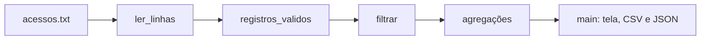

## Passo 1 · Leitura · O que você vai construir

O segundo projeto do nível, também exigido para o certificado, é uma ferramenta de linha de comando que lê o log de acesso de um servidor e responde: quantas requisições chegaram, quão lentas foram, quais rotas falham e em que minuto houve pico. Ela junta geradores, dataclasses, decoradores, `logging`, CSV, JSON, `argparse` e `unittest`.

#### O formato

Cada linha do log tem seis campos separados por espaços:

```text
2026-03-01T10:15:02 INFO GET /api/cursos 200 120ms
```

Momento (`AAAA-MM-DDTHH:MM:SS`), nível, método HTTP, rota, status e latência em milissegundos. Logs reais têm sujeira: linhas cortadas, mensagens soltas do servidor, linhas em branco. Uma linha fora do formato é **contada e ignorada**, nunca derruba o programa.

#### Memória constante

Um log de produção pode ter milhões de linhas. Por isso a leitura é um pipeline de geradores: cada linha passa por todas as etapas e é descartada antes de a próxima ser lida.



#### Os arquivos

| Arquivo | Conteúdo |
|---|---|
| `analisador.py` | `Registro`, `parsear`, os geradores, as agregações, o decorador `cronometrar`, `resumir` e as exportações |
| `main.py` | `main(argv)`, a interface de linha de comando e, no passo 7, a suíte de testes |
| `acessos.txt` | um log de exemplo, com linhas válidas e malformadas |

#### O resultado

Rodado sem argumentos, o programa analisa o `acessos.txt`:

```text
Registros: 23 (3 linha(s) ignorada(s))
Latência: p50 120 ms | p95 1800 ms
/api/cursos: 11 requisição(ões), 1 erro(s)
...
Picos: 2026-03-01T10:17
```

Os passos 3 a 7 constroem o projeto em camadas, cada um a partir do código aprovado no anterior: a entrada (parsing e geradores), as agregações, o resumo e as exportações, a linha de comando e a suíte de testes. A verificação usa o arquivo de exemplo, linhas inventadas para cada regra e um log gerado com milhares de linhas.

## Passo 2 · Previsão · Um gerador que se gasta

O analisador vai percorrer o mesmo log mais de uma vez. Antes de escrever os geradores, veja em que momento um gerador lê os dados e o que sobra dele depois de percorrido.

Leia com calma, sem executar, e digite exatamente o que o programa imprime.

### Código
```python
def numeros():
    for n in [3, 8, 5]:
        print("lendo", n)
        yield n

g = numeros()
print("início")
grandes = (n for n in g if n > 4)
print(next(grandes))
print(sum(g))
print(sum(g))
```

### Dicas
1. Criar o gerador e a expressão geradora não executa nenhuma linha do corpo de `numeros`.
2. `grandes` puxa os valores do mesmo `g`: o que ele consome não volta.

### Saída esperada
```text
início
lendo 3
lendo 8
8
lendo 5
5
0
```

## Passo 3 · Exercício · A entrada: parsear e os geradores

A primeira camada transforma texto em dados. Tudo fica em `analisador.py`; o `main.py` do código inicial fica como está até o passo 6.

**`Registro`** é uma dataclass **congelada** (`frozen=True`) com os campos `momento` (`datetime`), `nivel`, `metodo`, `rota`, `status` (`int`) e `latencia_ms` (`int`), nesta ordem. Um registro lido do log é um fato: ninguém deve alterá-lo depois.

**`parsear(linha)`** devolve um `Registro` ou `None`, nunca uma exceção. A linha é válida quando, separada por espaços (`split()`), tem exatamente seis campos e:

| Campo | Regra |
|---|---|
| momento | formato exato `AAAA-MM-DDTHH:MM:SS` (`FORMATO_MOMENTO`, com `datetime.strptime`) |
| nível | um de `NIVEIS`: `DEBUG`, `INFO`, `WARNING`, `ERROR` |
| método | um de `METODOS`: `GET`, `POST`, `PUT`, `DELETE` |
| rota | começa com `/` |
| status | inteiro de 100 a 599 |
| latência | inteiro maior ou igual a zero seguido de `ms` (`123ms`) |

Três geradores formam o pipeline:

- **`ler_linhas(caminho)`** abre o arquivo em UTF-8 e entrega, uma a uma, as linhas sem os espaços das pontas, pulando as vazias. Nada de `readlines()` nem `read()`.
- **`registros_validos(linhas)`** recebe qualquer iterável de textos e entrega o `Registro` de cada linha válida, pulando as outras.
- **`filtrar(registros, nivel=None, rota=None)`** entrega só os registros com o nível e a rota pedidos; `None` quer dizer "qualquer um".

```python
g = filtrar(registros_validos(ler_linhas("acessos.txt")), nivel="ERROR")
next(g)   # Registro(momento=datetime(2026, 3, 1, 10, 16, 40), nivel='ERROR', ..., status=500, latencia_ms=1250)
```

### Instruções
1. Crie a dataclass congelada `Registro`, com os seis campos na ordem do enunciado.
   Dica: `@dataclass(frozen=True)` gera um `__setattr__` que recusa mudanças.
2. Escreva `parsear(linha)` para as linhas válidas: separe os campos e converta o momento, o status e a latência.
   Dica: `"123ms"[:-2]` é `"123"`.
3. Faça `parsear` devolver `None` para toda linha fora das regras da tabela, sem deixar escapar nenhuma exceção.
   Dica: as conversões levantam `ValueError`; capture-o e devolva `None`.
4. Escreva a função geradora `ler_linhas(caminho)`.
   Dica: o `yield` fica dentro do `with`, no laço que percorre o arquivo.
5. Escreva as funções geradoras `registros_validos(linhas)` e `filtrar(registros, nivel=None, rota=None)`.

### Código inicial
```python
"""Linha de comando do analisador de logs."""
import sys

import analisador


def main(argv):
    pass


if __name__ == "__main__":
    sys.exit(main(sys.argv[1:]))
```
```python path=analisador.py
"""Leitura, análise e exportação de logs de acesso."""
import csv
import json
import logging
import math
import time
from dataclasses import dataclass
from datetime import datetime
from functools import wraps

NIVEIS = ("DEBUG", "INFO", "WARNING", "ERROR")
METODOS = ("GET", "POST", "PUT", "DELETE")
FORMATO_MOMENTO = "%Y-%m-%dT%H:%M:%S"

log = logging.getLogger("analisador")


def parsear(linha):
    pass


def ler_linhas(caminho):
    pass


def registros_validos(linhas):
    pass


def filtrar(registros, nivel=None, rota=None):
    pass


def percentil(valores, p):
    pass


def contar_por_rota(registros):
    pass


def requisicoes_por_minuto(registros):
    pass


def detectar_picos(contagens, limiar=2.0):
    pass


def cronometrar(funcao):
    pass


def resumir(caminho, nivel=None, rota=None):
    pass


def tabela_por_rota(por_rota):
    pass


def exportar_csv(caminho, tabela):
    pass


def exportar_json(caminho, resumo):
    pass
```
```text path=acessos.txt
2026-03-01T10:15:02 INFO GET /api/cursos 200 120ms
2026-03-01T10:15:09 INFO GET /api/licoes 200 95ms
2026-03-01T10:15:31 INFO POST /api/entregas 201 340ms
2026-03-01T10:15:48 WARNING GET /api/cursos 404 15ms
2026-03-01T10:16:05 INFO GET /api/cursos 200 110ms
2026-03-01T10:16:40 ERROR POST /api/entregas 500 1250ms
2026-03-01T10:16:41 servidor reiniciando o pool de conexões
2026-03-01T10:17:00 INFO GET /api/cursos 200 130ms
2026-03-01T10:17:01 INFO GET /api/cursos 200 125ms
2026-03-01T10:17:03 INFO GET /api/licoes 200 90ms
2026-03-01T10:17:04 INFO GET /api/cursos 200 140ms
2026-03-01T10:17:06 INFO POST /api/entregas 201 310ms
2026-03-01T10:17:09 INFO GET /api/licoes 200 85ms
2026-03-01T10:17:12 ERROR GET /api/cursos 503 2100ms
2026-03-01T10:17:15 INFO GET /api/cursos 200 135ms
2026-03-01T10:17:20 INFO GET /api/licoes 200 100ms
2026-03-01T10:17:31 INFO GET /api/cursos 200 150ms
2026-03-01T10:17:44 ERROR POST /api/entregas 500 1800ms
2026-03-01T10:17:59 INFO GET /api/cursos 200 128ms

2026-03-01T10:18:10 INFO GET /api/licoes 200 92ms
2026-03-01T10:18:15 INFO GET /api/cursos 200
2026-03-01T10:18:30 DEBUG GET /api/saude 200 3ms
2026-03-01T10:19:02 INFO GET /api/cursos 200 118ms
2026-03-01T10:19:30 INFO GET /api/cursos abc 120ms
2026-03-01T10:19:45 WARNING POST /api/entregas 422 40ms
2026-03-01T10:20:01 INFO GET /api/licoes 200 99ms
```

### Solução
```python
"""Linha de comando do analisador de logs."""
import sys

import analisador


def main(argv):
    pass


if __name__ == "__main__":
    sys.exit(main(sys.argv[1:]))
```
```python path=analisador.py
"""Leitura, análise e exportação de logs de acesso."""
import csv
import json
import logging
import math
import time
from dataclasses import dataclass
from datetime import datetime
from functools import wraps

NIVEIS = ("DEBUG", "INFO", "WARNING", "ERROR")
METODOS = ("GET", "POST", "PUT", "DELETE")
FORMATO_MOMENTO = "%Y-%m-%dT%H:%M:%S"

log = logging.getLogger("analisador")


@dataclass(frozen=True)
class Registro:
    momento: datetime
    nivel: str
    metodo: str
    rota: str
    status: int
    latencia_ms: int


def parsear(linha):
    partes = linha.split()
    if len(partes) != 6:
        return None
    momento_txt, nivel, metodo, rota, status_txt, latencia_txt = partes
    if nivel not in NIVEIS or metodo not in METODOS or not rota.startswith("/"):
        return None
    if not latencia_txt.endswith("ms"):
        return None
    try:
        momento = datetime.strptime(momento_txt, FORMATO_MOMENTO)
        status = int(status_txt)
        latencia = int(latencia_txt[:-2])
    except ValueError:
        return None
    if not 100 <= status <= 599 or latencia < 0:
        return None
    return Registro(momento, nivel, metodo, rota, status, latencia)


def ler_linhas(caminho):
    with open(caminho, encoding="utf-8") as arquivo:
        for linha in arquivo:
            linha = linha.strip()
            if linha:
                yield linha


def registros_validos(linhas):
    for linha in linhas:
        registro = parsear(linha)
        if registro is not None:
            yield registro


def filtrar(registros, nivel=None, rota=None):
    for registro in registros:
        if nivel is not None and registro.nivel != nivel:
            continue
        if rota is not None and registro.rota != rota:
            continue
        yield registro


def percentil(valores, p):
    pass


def contar_por_rota(registros):
    pass


def requisicoes_por_minuto(registros):
    pass


def detectar_picos(contagens, limiar=2.0):
    pass


def cronometrar(funcao):
    pass


def resumir(caminho, nivel=None, rota=None):
    pass


def tabela_por_rota(por_rota):
    pass


def exportar_csv(caminho, tabela):
    pass


def exportar_json(caminho, resumo):
    pass
```
```text path=acessos.txt
2026-03-01T10:15:02 INFO GET /api/cursos 200 120ms
2026-03-01T10:15:09 INFO GET /api/licoes 200 95ms
2026-03-01T10:15:31 INFO POST /api/entregas 201 340ms
2026-03-01T10:15:48 WARNING GET /api/cursos 404 15ms
2026-03-01T10:16:05 INFO GET /api/cursos 200 110ms
2026-03-01T10:16:40 ERROR POST /api/entregas 500 1250ms
2026-03-01T10:16:41 servidor reiniciando o pool de conexões
2026-03-01T10:17:00 INFO GET /api/cursos 200 130ms
2026-03-01T10:17:01 INFO GET /api/cursos 200 125ms
2026-03-01T10:17:03 INFO GET /api/licoes 200 90ms
2026-03-01T10:17:04 INFO GET /api/cursos 200 140ms
2026-03-01T10:17:06 INFO POST /api/entregas 201 310ms
2026-03-01T10:17:09 INFO GET /api/licoes 200 85ms
2026-03-01T10:17:12 ERROR GET /api/cursos 503 2100ms
2026-03-01T10:17:15 INFO GET /api/cursos 200 135ms
2026-03-01T10:17:20 INFO GET /api/licoes 200 100ms
2026-03-01T10:17:31 INFO GET /api/cursos 200 150ms
2026-03-01T10:17:44 ERROR POST /api/entregas 500 1800ms
2026-03-01T10:17:59 INFO GET /api/cursos 200 128ms

2026-03-01T10:18:10 INFO GET /api/licoes 200 92ms
2026-03-01T10:18:15 INFO GET /api/cursos 200
2026-03-01T10:18:30 DEBUG GET /api/saude 200 3ms
2026-03-01T10:19:02 INFO GET /api/cursos 200 118ms
2026-03-01T10:19:30 INFO GET /api/cursos abc 120ms
2026-03-01T10:19:45 WARNING POST /api/entregas 422 40ms
2026-03-01T10:20:01 INFO GET /api/licoes 200 99ms
```

### Dicas
1. Comece por `partes = linha.split()` e confira `len(partes) != 6` antes de desempacotar os seis campos.
2. Valide primeiro o que não precisa de conversão (nível, método, rota, sufixo `ms`) e deixe as conversões dentro de um `try`.
3. Um gerador só começa a rodar no primeiro `next`; por isso abrir o arquivo dentro dele é preguiçoso.

### Verificação
```json
[
  {"id": "registro-campos", "checkpoint": 1, "kind": "expr", "setup": "from datetime import datetime\nfrom analisador import Registro, parsear, ler_linhas, registros_validos, filtrar\nr = Registro(datetime(2026, 3, 1, 10, 15, 2), 'INFO', 'GET', '/api/cursos', 200, 123)", "expr": "[r.momento.isoformat(), r.nivel, r.metodo, r.rota, r.status, r.latencia_ms]", "expected": ["2026-03-01T10:15:02", "INFO", "GET", "/api/cursos", 200, 123], "name": "Registro tem os seis campos, na ordem do enunciado"},
  {"id": "registro-congelado", "checkpoint": 1, "kind": "expr", "setup": "from datetime import datetime\nfrom analisador import Registro, parsear, ler_linhas, registros_validos, filtrar\nr = Registro(datetime(2026, 3, 1, 10, 15, 2), 'INFO', 'GET', '/api/cursos', 200, 123)", "expr": "setattr(r, 'status', 500)", "raises": "AttributeError", "name": "Registro é imutável: mudar um campo levanta erro", "hint": "@dataclass(frozen=True)."},
  {"id": "parsear-valida", "checkpoint": 2, "kind": "expr", "setup": "from datetime import datetime\nfrom analisador import Registro, parsear, ler_linhas, registros_validos, filtrar\nr = parsear('2026-03-01T10:15:02 INFO GET /api/cursos 200 123ms')", "expr": "[type(r).__name__, r.momento.isoformat(), r.nivel, r.metodo, r.rota, r.status, r.latencia_ms]", "expected": ["Registro", "2026-03-01T10:15:02", "INFO", "GET", "/api/cursos", 200, 123], "name": "parsear transforma uma linha válida em Registro", "hint": "momento vira datetime; status e latência viram int (sem o ms)."},
  {"id": "parsear-tipos", "checkpoint": 2, "kind": "expr", "setup": "from datetime import datetime\nfrom analisador import Registro, parsear, ler_linhas, registros_validos, filtrar\nr = parsear('2026-03-01T23:59:59 ERROR POST /api/entregas 503 2100ms')", "expr": "[type(r.momento).__name__, type(r.status).__name__, type(r.latencia_ms).__name__, r.status, r.latencia_ms]", "expected": ["datetime", "int", "int", 503, 2100], "name": "Status e latência são int; o momento é datetime"},
  {"id": "parsear-espacos", "checkpoint": 2, "kind": "expr", "setup": "from datetime import datetime\nfrom analisador import Registro, parsear, ler_linhas, registros_validos, filtrar", "expr": "[parsear('  2026-03-01T08:00:00   DEBUG  DELETE /api/x/1  204   0ms \\n').rota, parsear('2026-03-01T08:00:00 WARNING PUT /a 100 7ms').status]", "expected": ["/api/x/1", 100], "name": "Espaços a mais entre os campos e nas pontas não atrapalham", "hint": "split() sem argumento separa por qualquer sequência de espaços."},
  {"id": "malformada-campos", "checkpoint": 3, "kind": "expr", "setup": "from datetime import datetime\nfrom analisador import Registro, parsear, ler_linhas, registros_validos, filtrar", "expr": "[parsear(l) for l in [\"\", \"servidor reiniciando\", \"2026-03-01T10:18:15 INFO GET /api/cursos 200\", \"2026-03-01T10:18:15 INFO GET /api/cursos 200 12ms extra\"]]", "expected": [null, null, null, null], "name": "Linha vazia, texto solto e quantidade errada de campos dão None", "hint": "parsear nunca levanta exceção: devolve None."},
  {"id": "malformada-momento", "checkpoint": 3, "kind": "expr", "setup": "from datetime import datetime\nfrom analisador import Registro, parsear, ler_linhas, registros_validos, filtrar", "expr": "[parsear(l) for l in [\"2026-13-01T10:15:02 INFO GET /a 200 5ms\", \"2026-03-01 INFO GET /a 200 5ms\", \"2026-03-01T10:15 INFO GET /a 200 5ms\", \"ontem INFO GET /a 200 5ms\"]]", "expected": [null, null, null, null], "name": "Momento fora do formato AAAA-MM-DDTHH:MM:SS dá None", "hint": "datetime.strptime com o formato exato recusa data sem hora e hora sem segundos."},
  {"id": "malformada-nivel-metodo", "checkpoint": 3, "kind": "expr", "setup": "from datetime import datetime\nfrom analisador import Registro, parsear, ler_linhas, registros_validos, filtrar", "expr": "[parsear(l) for l in [\"2026-03-01T10:15:02 FATAL GET /a 200 5ms\", \"2026-03-01T10:15:02 info GET /a 200 5ms\", \"2026-03-01T10:15:02 INFO FETCH /a 200 5ms\", \"2026-03-01T10:15:02 INFO get /a 200 5ms\"]]", "expected": [null, null, null, null], "name": "Nível ou método fora das listas dão None"},
  {"id": "malformada-rota", "checkpoint": 3, "kind": "expr", "setup": "from datetime import datetime\nfrom analisador import Registro, parsear, ler_linhas, registros_validos, filtrar", "expr": "[parsear(l) for l in [\"2026-03-01T10:15:02 INFO GET api/cursos 200 5ms\"]]", "expected": [null], "name": "Rota que não começa com / dá None"},
  {"id": "malformada-status", "checkpoint": 3, "kind": "expr", "setup": "from datetime import datetime\nfrom analisador import Registro, parsear, ler_linhas, registros_validos, filtrar", "expr": "[parsear(l) for l in [\"2026-03-01T10:19:30 INFO GET /a abc 120ms\", \"2026-03-01T10:19:30 INFO GET /a 999 120ms\", \"2026-03-01T10:19:30 INFO GET /a 99 120ms\", \"2026-03-01T10:19:30 INFO GET /a 2.5 120ms\"]]", "expected": [null, null, null, null], "name": "Status que não é inteiro de 100 a 599 dá None"},
  {"id": "malformada-latencia", "checkpoint": 3, "kind": "expr", "setup": "from datetime import datetime\nfrom analisador import Registro, parsear, ler_linhas, registros_validos, filtrar", "expr": "[parsear(l) for l in [\"2026-03-01T10:15:02 INFO GET /a 200 123\", \"2026-03-01T10:15:02 INFO GET /a 200 12.5ms\", \"2026-03-01T10:15:02 INFO GET /a 200 -5ms\", \"2026-03-01T10:15:02 INFO GET /a 200 ms\"]]", "expected": [null, null, null, null], "name": "Latência sem ms, decimal, negativa ou vazia dá None"},
  {"id": "ler-linhas-gerador", "checkpoint": 4, "kind": "expr", "setup": "from datetime import datetime\nfrom analisador import Registro, parsear, ler_linhas, registros_validos, filtrar", "expr": "ler_linhas('acessos.txt')", "type": "generator", "name": "ler_linhas é uma função geradora", "hint": "Use yield dentro do with."},
  {"id": "ler-linhas-conteudo", "checkpoint": 4, "kind": "expr", "setup": "from datetime import datetime\nfrom analisador import Registro, parsear, ler_linhas, registros_validos, filtrar\nlinhas = list(ler_linhas('acessos.txt'))", "expr": "[len(linhas), linhas[0], linhas[-1], any(l != l.strip() or l == '' for l in linhas)]", "expected": [26, "2026-03-01T10:15:02 INFO GET /api/cursos 200 120ms", "2026-03-01T10:20:01 INFO GET /api/licoes 200 99ms", false], "name": "ler_linhas entrega as 26 linhas não vazias do exemplo, sem a quebra de linha", "hint": "Tire os espaços das pontas e pule as linhas que ficarem vazias."},
  {"id": "ler-linhas-preguicosa", "checkpoint": 4, "kind": "expr", "setup": "from datetime import datetime\nfrom analisador import Registro, parsear, ler_linhas, registros_validos, filtrar", "expr": "ler_linhas('nao_existe.txt')", "type": "generator", "name": "Chamar ler_linhas não abre o arquivo: só o primeiro next abre", "hint": "Se a função abre o arquivo antes do primeiro yield, ela não é preguiçosa."},
  {"id": "ler-linhas-sem-readlines", "checkpoint": 4, "kind": "source", "rule": {"type": "not_calls", "name": "readlines"}, "name": "Não usa readlines, que carrega o arquivo inteiro na memória"},
  {"id": "ler-linhas-grande", "checkpoint": 4, "kind": "expr", "setup": "from datetime import datetime\nfrom analisador import Registro, parsear, ler_linhas, registros_validos, filtrar\nwith open('grande.txt', 'w', encoding='utf-8') as f:\n    for i in range(5000):\n        f.write(f'2026-03-01T11:{i // 100 % 60:02d}:{i % 60:02d} INFO GET /r{i % 7} 200 {i % 900}ms\\n')\n        if i % 500 == 0:\n            f.write('\\n')\ng = ler_linhas('grande.txt')\nprimeira = next(g)\nresto = sum(1 for _ in g)", "expr": "[primeira, resto]", "expected": ["2026-03-01T11:00:00 INFO GET /r0 200 0ms", 4999], "name": "ler_linhas percorre um log de 5 000 linhas com linhas em branco no meio"},
  {"id": "validos-gerador", "checkpoint": 5, "kind": "expr", "setup": "from datetime import datetime\nfrom analisador import Registro, parsear, ler_linhas, registros_validos, filtrar", "expr": "registros_validos([])", "type": "generator", "name": "registros_validos é uma função geradora"},
  {"id": "validos-pula", "checkpoint": 5, "kind": "expr", "setup": "from datetime import datetime\nfrom analisador import Registro, parsear, ler_linhas, registros_validos, filtrar", "expr": "[r.latencia_ms for r in registros_validos(['2026-03-01T10:15:02 INFO GET /a 200 5ms', 'lixo', '', '2026-03-01T10:15:03 INFO GET /b 404 7ms'])]", "expected": [5, 7], "name": "registros_validos entrega os registros das linhas boas e pula as outras"},
  {"id": "validos-preguicoso", "checkpoint": 5, "kind": "expr", "setup": "from datetime import datetime\nfrom analisador import Registro, parsear, ler_linhas, registros_validos, filtrar\ndef fonte():\n    yield 'lixo'\n    yield '2026-03-01T10:15:02 INFO GET /a 200 5ms'\n    raise RuntimeError('leu além do necessário')\nr = next(registros_validos(fonte()))", "expr": "r.rota", "expected": "/a", "name": "registros_validos é preguiçoso: o primeiro next lê só até o primeiro registro válido", "hint": "Não monte uma lista: use yield a cada registro."},
  {"id": "filtrar-nivel", "checkpoint": 5, "kind": "expr", "setup": "from datetime import datetime\nfrom analisador import Registro, parsear, ler_linhas, registros_validos, filtrar", "expr": "[(r.nivel, r.status) for r in filtrar(registros_validos(ler_linhas('acessos.txt')), nivel='ERROR')]", "expected": [["ERROR", 500], ["ERROR", 503], ["ERROR", 500]], "name": "filtrar por nível no exemplo dá os três erros"},
  {"id": "filtrar-rota-e-nivel", "checkpoint": 5, "kind": "expr", "setup": "from datetime import datetime\nfrom analisador import Registro, parsear, ler_linhas, registros_validos, filtrar", "expr": "[len(list(filtrar(registros_validos(ler_linhas('acessos.txt')), rota='/api/entregas'))), len(list(filtrar(registros_validos(ler_linhas('acessos.txt')), 'ERROR', '/api/entregas'))), len(list(filtrar(registros_validos(ler_linhas('acessos.txt')))))]", "expected": [5, 2, 23], "name": "filtrar por rota, por nível e rota juntos (os dois valem) e sem filtro", "hint": "Com os dois filtros, o registro precisa passar nos dois."},
  {"id": "filtrar-preguicoso", "checkpoint": 5, "kind": "expr", "setup": "from datetime import datetime\nfrom analisador import Registro, parsear, ler_linhas, registros_validos, filtrar\nfrom itertools import count\nfonte = (parsear(f'2026-03-01T10:15:{i % 60:02d} INFO GET /a 200 {i}ms') for i in count())\ng = filtrar(fonte, nivel='INFO')\nprimeiros = [next(g).latencia_ms for _ in range(3)]", "expr": "[type(g).__name__, primeiros]", "expected": ["generator", [0, 1, 2]], "name": "filtrar funciona com uma fonte infinita, porque é um gerador"}
]
```

### Soluções erradas
```python name="parsear levanta exceção na linha malformada" path=analisador.py
"""Leitura, análise e exportação de logs de acesso."""
import csv
import json
import logging
import math
import time
from dataclasses import dataclass
from datetime import datetime
from functools import wraps

NIVEIS = ("DEBUG", "INFO", "WARNING", "ERROR")
METODOS = ("GET", "POST", "PUT", "DELETE")
FORMATO_MOMENTO = "%Y-%m-%dT%H:%M:%S"

log = logging.getLogger("analisador")


@dataclass(frozen=True)
class Registro:
    momento: datetime
    nivel: str
    metodo: str
    rota: str
    status: int
    latencia_ms: int


def parsear(linha):
    partes = linha.split()
    if len(partes) != 6:
        return None
    momento_txt, nivel, metodo, rota, status_txt, latencia_txt = partes
    if nivel not in NIVEIS or metodo not in METODOS or not rota.startswith("/"):
        return None
    if not latencia_txt.endswith("ms"):
        return None
    momento = datetime.strptime(momento_txt, FORMATO_MOMENTO)
    status = int(status_txt)
    latencia = int(latencia_txt[:-2])
    if not 100 <= status <= 599 or latencia < 0:
        return None
    return Registro(momento, nivel, metodo, rota, status, latencia)


def ler_linhas(caminho):
    with open(caminho, encoding="utf-8") as arquivo:
        for linha in arquivo:
            linha = linha.strip()
            if linha:
                yield linha


def registros_validos(linhas):
    for linha in linhas:
        registro = parsear(linha)
        if registro is not None:
            yield registro


def filtrar(registros, nivel=None, rota=None):
    for registro in registros:
        if nivel is not None and registro.nivel != nivel:
            continue
        if rota is not None and registro.rota != rota:
            continue
        yield registro


def percentil(valores, p):
    pass


def contar_por_rota(registros):
    pass


def requisicoes_por_minuto(registros):
    pass


def detectar_picos(contagens, limiar=2.0):
    pass


def cronometrar(funcao):
    pass


def resumir(caminho, nivel=None, rota=None):
    pass


def tabela_por_rota(por_rota):
    pass


def exportar_csv(caminho, tabela):
    pass


def exportar_json(caminho, resumo):
    pass
```
```python name="data sem hora aceita (fromisoformat)" path=analisador.py
"""Leitura, análise e exportação de logs de acesso."""
import csv
import json
import logging
import math
import time
from dataclasses import dataclass
from datetime import datetime
from functools import wraps

NIVEIS = ("DEBUG", "INFO", "WARNING", "ERROR")
METODOS = ("GET", "POST", "PUT", "DELETE")
FORMATO_MOMENTO = "%Y-%m-%dT%H:%M:%S"

log = logging.getLogger("analisador")


@dataclass(frozen=True)
class Registro:
    momento: datetime
    nivel: str
    metodo: str
    rota: str
    status: int
    latencia_ms: int


def parsear(linha):
    partes = linha.split()
    if len(partes) != 6:
        return None
    momento_txt, nivel, metodo, rota, status_txt, latencia_txt = partes
    if nivel not in NIVEIS or metodo not in METODOS or not rota.startswith("/"):
        return None
    if not latencia_txt.endswith("ms"):
        return None
    try:
        momento = datetime.fromisoformat(momento_txt)
        status = int(status_txt)
        latencia = int(latencia_txt[:-2])
    except ValueError:
        return None
    if not 100 <= status <= 599 or latencia < 0:
        return None
    return Registro(momento, nivel, metodo, rota, status, latencia)


def ler_linhas(caminho):
    with open(caminho, encoding="utf-8") as arquivo:
        for linha in arquivo:
            linha = linha.strip()
            if linha:
                yield linha


def registros_validos(linhas):
    for linha in linhas:
        registro = parsear(linha)
        if registro is not None:
            yield registro


def filtrar(registros, nivel=None, rota=None):
    for registro in registros:
        if nivel is not None and registro.nivel != nivel:
            continue
        if rota is not None and registro.rota != rota:
            continue
        yield registro


def percentil(valores, p):
    pass


def contar_por_rota(registros):
    pass


def requisicoes_por_minuto(registros):
    pass


def detectar_picos(contagens, limiar=2.0):
    pass


def cronometrar(funcao):
    pass


def resumir(caminho, nivel=None, rota=None):
    pass


def tabela_por_rota(por_rota):
    pass


def exportar_csv(caminho, tabela):
    pass


def exportar_json(caminho, resumo):
    pass
```
```python name="latência sem ms aceita" path=analisador.py
"""Leitura, análise e exportação de logs de acesso."""
import csv
import json
import logging
import math
import time
from dataclasses import dataclass
from datetime import datetime
from functools import wraps

NIVEIS = ("DEBUG", "INFO", "WARNING", "ERROR")
METODOS = ("GET", "POST", "PUT", "DELETE")
FORMATO_MOMENTO = "%Y-%m-%dT%H:%M:%S"

log = logging.getLogger("analisador")


@dataclass(frozen=True)
class Registro:
    momento: datetime
    nivel: str
    metodo: str
    rota: str
    status: int
    latencia_ms: int


def parsear(linha):
    partes = linha.split()
    if len(partes) != 6:
        return None
    momento_txt, nivel, metodo, rota, status_txt, latencia_txt = partes
    if nivel not in NIVEIS or metodo not in METODOS or not rota.startswith("/"):
        return None
    try:
        momento = datetime.strptime(momento_txt, FORMATO_MOMENTO)
        status = int(status_txt)
        latencia = int(latencia_txt.removesuffix("ms"))
    except ValueError:
        return None
    if not 100 <= status <= 599 or latencia < 0:
        return None
    return Registro(momento, nivel, metodo, rota, status, latencia)


def ler_linhas(caminho):
    with open(caminho, encoding="utf-8") as arquivo:
        for linha in arquivo:
            linha = linha.strip()
            if linha:
                yield linha


def registros_validos(linhas):
    for linha in linhas:
        registro = parsear(linha)
        if registro is not None:
            yield registro


def filtrar(registros, nivel=None, rota=None):
    for registro in registros:
        if nivel is not None and registro.nivel != nivel:
            continue
        if rota is not None and registro.rota != rota:
            continue
        yield registro


def percentil(valores, p):
    pass


def contar_por_rota(registros):
    pass


def requisicoes_por_minuto(registros):
    pass


def detectar_picos(contagens, limiar=2.0):
    pass


def cronometrar(funcao):
    pass


def resumir(caminho, nivel=None, rota=None):
    pass


def tabela_por_rota(por_rota):
    pass


def exportar_csv(caminho, tabela):
    pass


def exportar_json(caminho, resumo):
    pass
```
```python name="status sem faixa" path=analisador.py
"""Leitura, análise e exportação de logs de acesso."""
import csv
import json
import logging
import math
import time
from dataclasses import dataclass
from datetime import datetime
from functools import wraps

NIVEIS = ("DEBUG", "INFO", "WARNING", "ERROR")
METODOS = ("GET", "POST", "PUT", "DELETE")
FORMATO_MOMENTO = "%Y-%m-%dT%H:%M:%S"

log = logging.getLogger("analisador")


@dataclass(frozen=True)
class Registro:
    momento: datetime
    nivel: str
    metodo: str
    rota: str
    status: int
    latencia_ms: int


def parsear(linha):
    partes = linha.split()
    if len(partes) != 6:
        return None
    momento_txt, nivel, metodo, rota, status_txt, latencia_txt = partes
    if nivel not in NIVEIS or metodo not in METODOS or not rota.startswith("/"):
        return None
    if not latencia_txt.endswith("ms"):
        return None
    try:
        momento = datetime.strptime(momento_txt, FORMATO_MOMENTO)
        status = int(status_txt)
        latencia = int(latencia_txt[:-2])
    except ValueError:
        return None
    if latencia < 0:
        return None
    return Registro(momento, nivel, metodo, rota, status, latencia)


def ler_linhas(caminho):
    with open(caminho, encoding="utf-8") as arquivo:
        for linha in arquivo:
            linha = linha.strip()
            if linha:
                yield linha


def registros_validos(linhas):
    for linha in linhas:
        registro = parsear(linha)
        if registro is not None:
            yield registro


def filtrar(registros, nivel=None, rota=None):
    for registro in registros:
        if nivel is not None and registro.nivel != nivel:
            continue
        if rota is not None and registro.rota != rota:
            continue
        yield registro


def percentil(valores, p):
    pass


def contar_por_rota(registros):
    pass


def requisicoes_por_minuto(registros):
    pass


def detectar_picos(contagens, limiar=2.0):
    pass


def cronometrar(funcao):
    pass


def resumir(caminho, nivel=None, rota=None):
    pass


def tabela_por_rota(por_rota):
    pass


def exportar_csv(caminho, tabela):
    pass


def exportar_json(caminho, resumo):
    pass
```
```python name="status guardado como texto" path=analisador.py
"""Leitura, análise e exportação de logs de acesso."""
import csv
import json
import logging
import math
import time
from dataclasses import dataclass
from datetime import datetime
from functools import wraps

NIVEIS = ("DEBUG", "INFO", "WARNING", "ERROR")
METODOS = ("GET", "POST", "PUT", "DELETE")
FORMATO_MOMENTO = "%Y-%m-%dT%H:%M:%S"

log = logging.getLogger("analisador")


@dataclass(frozen=True)
class Registro:
    momento: datetime
    nivel: str
    metodo: str
    rota: str
    status: int
    latencia_ms: int


def parsear(linha):
    partes = linha.split()
    if len(partes) != 6:
        return None
    momento_txt, nivel, metodo, rota, status_txt, latencia_txt = partes
    if nivel not in NIVEIS or metodo not in METODOS or not rota.startswith("/"):
        return None
    if not latencia_txt.endswith("ms"):
        return None
    try:
        momento = datetime.strptime(momento_txt, FORMATO_MOMENTO)
        status = int(status_txt)
        latencia = int(latencia_txt[:-2])
    except ValueError:
        return None
    if not 100 <= status <= 599 or latencia < 0:
        return None
    return Registro(momento, nivel, metodo, rota, status_txt, latencia)


def ler_linhas(caminho):
    with open(caminho, encoding="utf-8") as arquivo:
        for linha in arquivo:
            linha = linha.strip()
            if linha:
                yield linha


def registros_validos(linhas):
    for linha in linhas:
        registro = parsear(linha)
        if registro is not None:
            yield registro


def filtrar(registros, nivel=None, rota=None):
    for registro in registros:
        if nivel is not None and registro.nivel != nivel:
            continue
        if rota is not None and registro.rota != rota:
            continue
        yield registro


def percentil(valores, p):
    pass


def contar_por_rota(registros):
    pass


def requisicoes_por_minuto(registros):
    pass


def detectar_picos(contagens, limiar=2.0):
    pass


def cronometrar(funcao):
    pass


def resumir(caminho, nivel=None, rota=None):
    pass


def tabela_por_rota(por_rota):
    pass


def exportar_csv(caminho, tabela):
    pass


def exportar_json(caminho, resumo):
    pass
```
```python name="Registro mutável" path=analisador.py
"""Leitura, análise e exportação de logs de acesso."""
import csv
import json
import logging
import math
import time
from dataclasses import dataclass
from datetime import datetime
from functools import wraps

NIVEIS = ("DEBUG", "INFO", "WARNING", "ERROR")
METODOS = ("GET", "POST", "PUT", "DELETE")
FORMATO_MOMENTO = "%Y-%m-%dT%H:%M:%S"

log = logging.getLogger("analisador")


@dataclass
class Registro:
    momento: datetime
    nivel: str
    metodo: str
    rota: str
    status: int
    latencia_ms: int


def parsear(linha):
    partes = linha.split()
    if len(partes) != 6:
        return None
    momento_txt, nivel, metodo, rota, status_txt, latencia_txt = partes
    if nivel not in NIVEIS or metodo not in METODOS or not rota.startswith("/"):
        return None
    if not latencia_txt.endswith("ms"):
        return None
    try:
        momento = datetime.strptime(momento_txt, FORMATO_MOMENTO)
        status = int(status_txt)
        latencia = int(latencia_txt[:-2])
    except ValueError:
        return None
    if not 100 <= status <= 599 or latencia < 0:
        return None
    return Registro(momento, nivel, metodo, rota, status, latencia)


def ler_linhas(caminho):
    with open(caminho, encoding="utf-8") as arquivo:
        for linha in arquivo:
            linha = linha.strip()
            if linha:
                yield linha


def registros_validos(linhas):
    for linha in linhas:
        registro = parsear(linha)
        if registro is not None:
            yield registro


def filtrar(registros, nivel=None, rota=None):
    for registro in registros:
        if nivel is not None and registro.nivel != nivel:
            continue
        if rota is not None and registro.rota != rota:
            continue
        yield registro


def percentil(valores, p):
    pass


def contar_por_rota(registros):
    pass


def requisicoes_por_minuto(registros):
    pass


def detectar_picos(contagens, limiar=2.0):
    pass


def cronometrar(funcao):
    pass


def resumir(caminho, nivel=None, rota=None):
    pass


def tabela_por_rota(por_rota):
    pass


def exportar_csv(caminho, tabela):
    pass


def exportar_json(caminho, resumo):
    pass
```
```python name="ler_linhas devolve uma lista" path=analisador.py
"""Leitura, análise e exportação de logs de acesso."""
import csv
import json
import logging
import math
import time
from dataclasses import dataclass
from datetime import datetime
from functools import wraps

NIVEIS = ("DEBUG", "INFO", "WARNING", "ERROR")
METODOS = ("GET", "POST", "PUT", "DELETE")
FORMATO_MOMENTO = "%Y-%m-%dT%H:%M:%S"

log = logging.getLogger("analisador")


@dataclass(frozen=True)
class Registro:
    momento: datetime
    nivel: str
    metodo: str
    rota: str
    status: int
    latencia_ms: int


def parsear(linha):
    partes = linha.split()
    if len(partes) != 6:
        return None
    momento_txt, nivel, metodo, rota, status_txt, latencia_txt = partes
    if nivel not in NIVEIS or metodo not in METODOS or not rota.startswith("/"):
        return None
    if not latencia_txt.endswith("ms"):
        return None
    try:
        momento = datetime.strptime(momento_txt, FORMATO_MOMENTO)
        status = int(status_txt)
        latencia = int(latencia_txt[:-2])
    except ValueError:
        return None
    if not 100 <= status <= 599 or latencia < 0:
        return None
    return Registro(momento, nivel, metodo, rota, status, latencia)


def ler_linhas(caminho):
    with open(caminho, encoding="utf-8") as arquivo:
        return [linha.strip() for linha in arquivo if linha.strip()]


def registros_validos(linhas):
    for linha in linhas:
        registro = parsear(linha)
        if registro is not None:
            yield registro


def filtrar(registros, nivel=None, rota=None):
    for registro in registros:
        if nivel is not None and registro.nivel != nivel:
            continue
        if rota is not None and registro.rota != rota:
            continue
        yield registro


def percentil(valores, p):
    pass


def contar_por_rota(registros):
    pass


def requisicoes_por_minuto(registros):
    pass


def detectar_picos(contagens, limiar=2.0):
    pass


def cronometrar(funcao):
    pass


def resumir(caminho, nivel=None, rota=None):
    pass


def tabela_por_rota(por_rota):
    pass


def exportar_csv(caminho, tabela):
    pass


def exportar_json(caminho, resumo):
    pass
```
```python name="ler_linhas com readlines" path=analisador.py
"""Leitura, análise e exportação de logs de acesso."""
import csv
import json
import logging
import math
import time
from dataclasses import dataclass
from datetime import datetime
from functools import wraps

NIVEIS = ("DEBUG", "INFO", "WARNING", "ERROR")
METODOS = ("GET", "POST", "PUT", "DELETE")
FORMATO_MOMENTO = "%Y-%m-%dT%H:%M:%S"

log = logging.getLogger("analisador")


@dataclass(frozen=True)
class Registro:
    momento: datetime
    nivel: str
    metodo: str
    rota: str
    status: int
    latencia_ms: int


def parsear(linha):
    partes = linha.split()
    if len(partes) != 6:
        return None
    momento_txt, nivel, metodo, rota, status_txt, latencia_txt = partes
    if nivel not in NIVEIS or metodo not in METODOS or not rota.startswith("/"):
        return None
    if not latencia_txt.endswith("ms"):
        return None
    try:
        momento = datetime.strptime(momento_txt, FORMATO_MOMENTO)
        status = int(status_txt)
        latencia = int(latencia_txt[:-2])
    except ValueError:
        return None
    if not 100 <= status <= 599 or latencia < 0:
        return None
    return Registro(momento, nivel, metodo, rota, status, latencia)


def ler_linhas(caminho):
    with open(caminho, encoding="utf-8") as arquivo:
        for linha in arquivo.readlines():
            linha = linha.strip()
            if linha:
                yield linha


def registros_validos(linhas):
    for linha in linhas:
        registro = parsear(linha)
        if registro is not None:
            yield registro


def filtrar(registros, nivel=None, rota=None):
    for registro in registros:
        if nivel is not None and registro.nivel != nivel:
            continue
        if rota is not None and registro.rota != rota:
            continue
        yield registro


def percentil(valores, p):
    pass


def contar_por_rota(registros):
    pass


def requisicoes_por_minuto(registros):
    pass


def detectar_picos(contagens, limiar=2.0):
    pass


def cronometrar(funcao):
    pass


def resumir(caminho, nivel=None, rota=None):
    pass


def tabela_por_rota(por_rota):
    pass


def exportar_csv(caminho, tabela):
    pass


def exportar_json(caminho, resumo):
    pass
```
```python name="ler_linhas mantém a quebra de linha e as linhas em branco" path=analisador.py
"""Leitura, análise e exportação de logs de acesso."""
import csv
import json
import logging
import math
import time
from dataclasses import dataclass
from datetime import datetime
from functools import wraps

NIVEIS = ("DEBUG", "INFO", "WARNING", "ERROR")
METODOS = ("GET", "POST", "PUT", "DELETE")
FORMATO_MOMENTO = "%Y-%m-%dT%H:%M:%S"

log = logging.getLogger("analisador")


@dataclass(frozen=True)
class Registro:
    momento: datetime
    nivel: str
    metodo: str
    rota: str
    status: int
    latencia_ms: int


def parsear(linha):
    partes = linha.split()
    if len(partes) != 6:
        return None
    momento_txt, nivel, metodo, rota, status_txt, latencia_txt = partes
    if nivel not in NIVEIS or metodo not in METODOS or not rota.startswith("/"):
        return None
    if not latencia_txt.endswith("ms"):
        return None
    try:
        momento = datetime.strptime(momento_txt, FORMATO_MOMENTO)
        status = int(status_txt)
        latencia = int(latencia_txt[:-2])
    except ValueError:
        return None
    if not 100 <= status <= 599 or latencia < 0:
        return None
    return Registro(momento, nivel, metodo, rota, status, latencia)


def ler_linhas(caminho):
    with open(caminho, encoding="utf-8") as arquivo:
        for linha in arquivo:
            yield linha


def registros_validos(linhas):
    for linha in linhas:
        registro = parsear(linha)
        if registro is not None:
            yield registro


def filtrar(registros, nivel=None, rota=None):
    for registro in registros:
        if nivel is not None and registro.nivel != nivel:
            continue
        if rota is not None and registro.rota != rota:
            continue
        yield registro


def percentil(valores, p):
    pass


def contar_por_rota(registros):
    pass


def requisicoes_por_minuto(registros):
    pass


def detectar_picos(contagens, limiar=2.0):
    pass


def cronometrar(funcao):
    pass


def resumir(caminho, nivel=None, rota=None):
    pass


def tabela_por_rota(por_rota):
    pass


def exportar_csv(caminho, tabela):
    pass


def exportar_json(caminho, resumo):
    pass
```
```python name="registros_validos monta a lista inteira" path=analisador.py
"""Leitura, análise e exportação de logs de acesso."""
import csv
import json
import logging
import math
import time
from dataclasses import dataclass
from datetime import datetime
from functools import wraps

NIVEIS = ("DEBUG", "INFO", "WARNING", "ERROR")
METODOS = ("GET", "POST", "PUT", "DELETE")
FORMATO_MOMENTO = "%Y-%m-%dT%H:%M:%S"

log = logging.getLogger("analisador")


@dataclass(frozen=True)
class Registro:
    momento: datetime
    nivel: str
    metodo: str
    rota: str
    status: int
    latencia_ms: int


def parsear(linha):
    partes = linha.split()
    if len(partes) != 6:
        return None
    momento_txt, nivel, metodo, rota, status_txt, latencia_txt = partes
    if nivel not in NIVEIS or metodo not in METODOS or not rota.startswith("/"):
        return None
    if not latencia_txt.endswith("ms"):
        return None
    try:
        momento = datetime.strptime(momento_txt, FORMATO_MOMENTO)
        status = int(status_txt)
        latencia = int(latencia_txt[:-2])
    except ValueError:
        return None
    if not 100 <= status <= 599 or latencia < 0:
        return None
    return Registro(momento, nivel, metodo, rota, status, latencia)


def ler_linhas(caminho):
    with open(caminho, encoding="utf-8") as arquivo:
        for linha in arquivo:
            linha = linha.strip()
            if linha:
                yield linha


def registros_validos(linhas):
    validos = [parsear(linha) for linha in linhas]
    yield from [r for r in validos if r is not None]


def filtrar(registros, nivel=None, rota=None):
    for registro in registros:
        if nivel is not None and registro.nivel != nivel:
            continue
        if rota is not None and registro.rota != rota:
            continue
        yield registro


def percentil(valores, p):
    pass


def contar_por_rota(registros):
    pass


def requisicoes_por_minuto(registros):
    pass


def detectar_picos(contagens, limiar=2.0):
    pass


def cronometrar(funcao):
    pass


def resumir(caminho, nivel=None, rota=None):
    pass


def tabela_por_rota(por_rota):
    pass


def exportar_csv(caminho, tabela):
    pass


def exportar_json(caminho, resumo):
    pass
```
```python name="filtrar aceita quem passa em um dos filtros" path=analisador.py
"""Leitura, análise e exportação de logs de acesso."""
import csv
import json
import logging
import math
import time
from dataclasses import dataclass
from datetime import datetime
from functools import wraps

NIVEIS = ("DEBUG", "INFO", "WARNING", "ERROR")
METODOS = ("GET", "POST", "PUT", "DELETE")
FORMATO_MOMENTO = "%Y-%m-%dT%H:%M:%S"

log = logging.getLogger("analisador")


@dataclass(frozen=True)
class Registro:
    momento: datetime
    nivel: str
    metodo: str
    rota: str
    status: int
    latencia_ms: int


def parsear(linha):
    partes = linha.split()
    if len(partes) != 6:
        return None
    momento_txt, nivel, metodo, rota, status_txt, latencia_txt = partes
    if nivel not in NIVEIS or metodo not in METODOS or not rota.startswith("/"):
        return None
    if not latencia_txt.endswith("ms"):
        return None
    try:
        momento = datetime.strptime(momento_txt, FORMATO_MOMENTO)
        status = int(status_txt)
        latencia = int(latencia_txt[:-2])
    except ValueError:
        return None
    if not 100 <= status <= 599 or latencia < 0:
        return None
    return Registro(momento, nivel, metodo, rota, status, latencia)


def ler_linhas(caminho):
    with open(caminho, encoding="utf-8") as arquivo:
        for linha in arquivo:
            linha = linha.strip()
            if linha:
                yield linha


def registros_validos(linhas):
    for linha in linhas:
        registro = parsear(linha)
        if registro is not None:
            yield registro


def filtrar(registros, nivel=None, rota=None):
    for registro in registros:
        if nivel is None and rota is None:
            yield registro
        elif registro.nivel == nivel or registro.rota == rota:
            yield registro


def percentil(valores, p):
    pass


def contar_por_rota(registros):
    pass


def requisicoes_por_minuto(registros):
    pass


def detectar_picos(contagens, limiar=2.0):
    pass


def cronometrar(funcao):
    pass


def resumir(caminho, nivel=None, rota=None):
    pass


def tabela_por_rota(por_rota):
    pass


def exportar_csv(caminho, tabela):
    pass


def exportar_json(caminho, resumo):
    pass
```

## Passo 4 · Exercício · As agregações

Com os registros saindo do pipeline, quatro funções calculam as estatísticas. As três que recebem `registros` aceitam qualquer iterável, **inclusive um gerador**, que só pode ser percorrido uma vez.

**`percentil(valores, p)`** usa o método do posto mais próximo: ordene os valores e pegue o da posição

$$
\text{posição} = \left\lceil \frac{p \cdot n}{100} \right\rceil \quad (\text{no mínimo } 1)
$$

contando a partir de 1. Em `[15, 20, 35, 40, 50]`, o p50 está na posição 3 (35) e o p30, na posição 2 (20). `p` vai de 0 a 100. Lista vazia levanta `ValueError("lista vazia")`; `p` fora da faixa, `ValueError("p fora de 0 a 100")`. A lista recebida não muda.

**`contar_por_rota(registros)`** devolve `{rota: {"total": n, "erros": e}}`, em que erro é status 500 ou mais (falha do servidor; um 404 é um pedido errado do cliente, não erro do servidor).

**`requisicoes_por_minuto(registros)`** devolve `{minuto: n}`, com o minuto escrito como `"2026-03-01T10:17"`: o momento truncado, sem os segundos e com a data.

**`detectar_picos(contagens, limiar=2.0)`** recebe esse dicionário e devolve, em ordem crescente, os minutos cuja contagem é **maior que** `limiar` vezes a média das contagens. Sem contagens, `[]`.

```python
percentil([50, 15, 40, 20, 35], 50)                    # 35
requisicoes_por_minuto(registros_validos(ler_linhas("acessos.txt")))["2026-03-01T10:17"]   # 12
detectar_picos({"10:00": 1, "10:01": 1, "10:02": 9, "10:03": 9}, 1.5)   # ['10:02', '10:03']
```

### Instruções
1. Escreva `percentil(valores, p)`, com as duas validações.
   Dica: `math.ceil` arredonda para cima; calcule `p * n / 100` nessa ordem.
2. Escreva `contar_por_rota(registros)` percorrendo os registros uma vez só.
   Dica: `dicionario.setdefault(chave, valor_inicial)` devolve o valor da chave, criando-o se faltar.
3. Escreva `requisicoes_por_minuto(registros)`, com a chave do minuto no formato do enunciado.
4. Escreva `detectar_picos(contagens, limiar=2.0)`.

### Solução
```python
"""Linha de comando do analisador de logs."""
import sys

import analisador


def main(argv):
    pass


if __name__ == "__main__":
    sys.exit(main(sys.argv[1:]))
```
```python path=analisador.py
"""Leitura, análise e exportação de logs de acesso."""
import csv
import json
import logging
import math
import time
from dataclasses import dataclass
from datetime import datetime
from functools import wraps

NIVEIS = ("DEBUG", "INFO", "WARNING", "ERROR")
METODOS = ("GET", "POST", "PUT", "DELETE")
FORMATO_MOMENTO = "%Y-%m-%dT%H:%M:%S"

log = logging.getLogger("analisador")


@dataclass(frozen=True)
class Registro:
    momento: datetime
    nivel: str
    metodo: str
    rota: str
    status: int
    latencia_ms: int


def parsear(linha):
    partes = linha.split()
    if len(partes) != 6:
        return None
    momento_txt, nivel, metodo, rota, status_txt, latencia_txt = partes
    if nivel not in NIVEIS or metodo not in METODOS or not rota.startswith("/"):
        return None
    if not latencia_txt.endswith("ms"):
        return None
    try:
        momento = datetime.strptime(momento_txt, FORMATO_MOMENTO)
        status = int(status_txt)
        latencia = int(latencia_txt[:-2])
    except ValueError:
        return None
    if not 100 <= status <= 599 or latencia < 0:
        return None
    return Registro(momento, nivel, metodo, rota, status, latencia)


def ler_linhas(caminho):
    with open(caminho, encoding="utf-8") as arquivo:
        for linha in arquivo:
            linha = linha.strip()
            if linha:
                yield linha


def registros_validos(linhas):
    for linha in linhas:
        registro = parsear(linha)
        if registro is not None:
            yield registro


def filtrar(registros, nivel=None, rota=None):
    for registro in registros:
        if nivel is not None and registro.nivel != nivel:
            continue
        if rota is not None and registro.rota != rota:
            continue
        yield registro


def percentil(valores, p):
    if len(valores) == 0:
        raise ValueError("lista vazia")
    if not 0 <= p <= 100:
        raise ValueError("p fora de 0 a 100")
    ordenados = sorted(valores)
    posicao = max(1, math.ceil(p * len(ordenados) / 100))
    return ordenados[posicao - 1]


def contar_por_rota(registros):
    contagem = {}
    for registro in registros:
        dados = contagem.setdefault(registro.rota, {"total": 0, "erros": 0})
        dados["total"] += 1
        if registro.status >= 500:
            dados["erros"] += 1
    return contagem


def requisicoes_por_minuto(registros):
    contagem = {}
    for registro in registros:
        minuto = registro.momento.strftime("%Y-%m-%dT%H:%M")
        contagem[minuto] = contagem.get(minuto, 0) + 1
    return contagem


def detectar_picos(contagens, limiar=2.0):
    if not contagens:
        return []
    media = sum(contagens.values()) / len(contagens)
    return sorted(minuto for minuto, total in contagens.items() if total > limiar * media)


def cronometrar(funcao):
    pass


def resumir(caminho, nivel=None, rota=None):
    pass


def tabela_por_rota(por_rota):
    pass


def exportar_csv(caminho, tabela):
    pass


def exportar_json(caminho, resumo):
    pass
```
```text path=acessos.txt
2026-03-01T10:15:02 INFO GET /api/cursos 200 120ms
2026-03-01T10:15:09 INFO GET /api/licoes 200 95ms
2026-03-01T10:15:31 INFO POST /api/entregas 201 340ms
2026-03-01T10:15:48 WARNING GET /api/cursos 404 15ms
2026-03-01T10:16:05 INFO GET /api/cursos 200 110ms
2026-03-01T10:16:40 ERROR POST /api/entregas 500 1250ms
2026-03-01T10:16:41 servidor reiniciando o pool de conexões
2026-03-01T10:17:00 INFO GET /api/cursos 200 130ms
2026-03-01T10:17:01 INFO GET /api/cursos 200 125ms
2026-03-01T10:17:03 INFO GET /api/licoes 200 90ms
2026-03-01T10:17:04 INFO GET /api/cursos 200 140ms
2026-03-01T10:17:06 INFO POST /api/entregas 201 310ms
2026-03-01T10:17:09 INFO GET /api/licoes 200 85ms
2026-03-01T10:17:12 ERROR GET /api/cursos 503 2100ms
2026-03-01T10:17:15 INFO GET /api/cursos 200 135ms
2026-03-01T10:17:20 INFO GET /api/licoes 200 100ms
2026-03-01T10:17:31 INFO GET /api/cursos 200 150ms
2026-03-01T10:17:44 ERROR POST /api/entregas 500 1800ms
2026-03-01T10:17:59 INFO GET /api/cursos 200 128ms

2026-03-01T10:18:10 INFO GET /api/licoes 200 92ms
2026-03-01T10:18:15 INFO GET /api/cursos 200
2026-03-01T10:18:30 DEBUG GET /api/saude 200 3ms
2026-03-01T10:19:02 INFO GET /api/cursos 200 118ms
2026-03-01T10:19:30 INFO GET /api/cursos abc 120ms
2026-03-01T10:19:45 WARNING POST /api/entregas 422 40ms
2026-03-01T10:20:01 INFO GET /api/licoes 200 99ms
```

### Dicas
1. No percentil, a posição conta a partir de 1 e o índice da lista, a partir de 0.
2. Se a função percorre `registros` duas vezes, a segunda passada de um gerador não encontra nada.
3. A média das contagens é `sum(contagens.values()) / len(contagens)`; confira o dicionário vazio antes de dividir.

### Verificação
```json
[
  {"id": "percentil-50", "checkpoint": 1, "kind": "expr", "expected": 35, "type": "int", "name": "percentil([15, 20, 35, 40, 50], 50) é 35", "setup": "from analisador import percentil", "expr": "percentil([15, 20, 35, 40, 50], 50)"},
  {"id": "percentil-desordenado", "checkpoint": 1, "kind": "expr", "expected": 35, "name": "percentil ordena os valores antes de escolher", "hint": "O percentil é uma posição na lista ordenada.", "setup": "from analisador import percentil", "expr": "percentil([50, 15, 40, 20, 35], 50)"},
  {"id": "percentil-bordas", "checkpoint": 1, "kind": "expr", "setup": "from analisador import parsear, registros_validos, ler_linhas, percentil, contar_por_rota, requisicoes_por_minuto, detectar_picos", "expr": "[percentil([15, 20, 35, 40, 50], p) for p in (0, 20, 30, 40, 80, 81, 100)]", "expected": [15, 15, 20, 20, 40, 50, 50], "name": "Percentis nas bordas: 0, 20, 30, 40, 80, 81 e 100", "hint": "posição = teto(p · n / 100), no mínimo 1; o índice é posição - 1."},
  {"id": "percentil-95-de-20", "checkpoint": 1, "kind": "expr", "setup": "from analisador import parsear, registros_validos, ler_linhas, percentil, contar_por_rota, requisicoes_por_minuto, detectar_picos", "expr": "[percentil(list(range(1, 21)), 95), percentil(list(range(1, 21)), 96), percentil([7], 50), percentil([2.5, 1.5], 50)]", "expected": [19, 20, 7, 1.5], "name": "p95 de 1 a 20 é 19; p96 é 20; lista de um valor; valores decimais"},
  {"id": "percentil-nao-altera", "checkpoint": 1, "kind": "expr", "setup": "from analisador import parsear, registros_validos, ler_linhas, percentil, contar_por_rota, requisicoes_por_minuto, detectar_picos\nv = [50, 15, 40]\npercentil(v, 50)", "expr": "v", "expected": [50, 15, 40], "name": "percentil não altera a lista recebida", "hint": "sorted(valores) cria uma lista nova; valores.sort() altera a original."},
  {"id": "percentil-vazia", "checkpoint": 1, "kind": "expr", "setup": "from analisador import parsear, registros_validos, ler_linhas, percentil, contar_por_rota, requisicoes_por_minuto, detectar_picos", "expr": "percentil([], 50)", "raises": "ValueError", "message_contains": "lista vazia", "name": "Lista vazia levanta ValueError('lista vazia')"},
  {"id": "percentil-p-invalido", "checkpoint": 1, "kind": "expr", "setup": "from analisador import parsear, registros_validos, ler_linhas, percentil, contar_por_rota, requisicoes_por_minuto, detectar_picos", "expr": "percentil([1, 2], 101)", "raises": "ValueError", "message_contains": "p fora de 0 a 100", "name": "p acima de 100 levanta ValueError('p fora de 0 a 100')"},
  {"id": "por-rota", "checkpoint": 2, "kind": "expr", "setup": "from analisador import parsear, registros_validos, ler_linhas, percentil, contar_por_rota, requisicoes_por_minuto, detectar_picos\nregs = [parsear(l) for l in ['2026-03-01T10:15:02 INFO GET /a 200 5ms', '2026-03-01T10:15:40 ERROR GET /a 500 50ms', '2026-03-01T10:16:01 WARNING GET /b 404 7ms', '2026-03-01T10:16:30 ERROR POST /b 503 90ms', '2026-03-01T10:16:59 INFO GET /a 200 6ms', '2026-03-02T10:15:10 INFO GET /c 302 4ms']]", "expr": "contar_por_rota(regs)", "expected": {"/a": {"total": 3, "erros": 1}, "/b": {"total": 2, "erros": 1}, "/c": {"total": 1, "erros": 0}}, "name": "contar_por_rota conta o total e os erros (status 500 ou mais) de cada rota", "hint": "404 não é erro do servidor; 500 e 503 são."},
  {"id": "por-rota-gerador", "checkpoint": 2, "kind": "expr", "setup": "from analisador import parsear, registros_validos, ler_linhas, percentil, contar_por_rota, requisicoes_por_minuto, detectar_picos", "expr": "contar_por_rota(registros_validos(ler_linhas('acessos.txt')))", "expected": {"/api/cursos": {"total": 11, "erros": 1}, "/api/licoes": {"total": 6, "erros": 0}, "/api/entregas": {"total": 5, "erros": 2}, "/api/saude": {"total": 1, "erros": 0}}, "name": "contar_por_rota funciona com um gerador (uma passada só)", "hint": "Um gerador só pode ser percorrido uma vez: conte tudo no mesmo laço."},
  {"id": "por-rota-vazio", "checkpoint": 2, "kind": "expr", "expected": {}, "name": "Sem registros, contar_por_rota devolve {}", "setup": "from analisador import contar_por_rota", "expr": "contar_por_rota([])"},
  {"id": "por-minuto", "checkpoint": 3, "kind": "expr", "setup": "from analisador import parsear, registros_validos, ler_linhas, percentil, contar_por_rota, requisicoes_por_minuto, detectar_picos\nregs = [parsear(l) for l in ['2026-03-01T10:15:02 INFO GET /a 200 5ms', '2026-03-01T10:15:40 ERROR GET /a 500 50ms', '2026-03-01T10:16:01 WARNING GET /b 404 7ms', '2026-03-01T10:16:30 ERROR POST /b 503 90ms', '2026-03-01T10:16:59 INFO GET /a 200 6ms', '2026-03-02T10:15:10 INFO GET /c 302 4ms']]", "expr": "requisicoes_por_minuto(regs)", "expected": {"2026-03-01T10:15": 2, "2026-03-01T10:16": 3, "2026-03-02T10:15": 1}, "name": "requisicoes_por_minuto agrupa pelo minuto, com a data", "hint": "Trunque o momento: strftime('%Y-%m-%dT%H:%M')."},
  {"id": "por-minuto-gerador", "checkpoint": 3, "kind": "expr", "setup": "from analisador import parsear, registros_validos, ler_linhas, percentil, contar_por_rota, requisicoes_por_minuto, detectar_picos", "expr": "requisicoes_por_minuto(registros_validos(ler_linhas('acessos.txt')))", "expected": {"2026-03-01T10:15": 4, "2026-03-01T10:16": 2, "2026-03-01T10:17": 12, "2026-03-01T10:18": 2, "2026-03-01T10:19": 2, "2026-03-01T10:20": 1}, "name": "Requisições por minuto no arquivo de exemplo, lidas de um gerador"},
  {"id": "picos-exemplo", "checkpoint": 4, "kind": "expr", "expected": ["2026-03-01T10:17"], "name": "No exemplo, só 10:17 passa de 2 vezes a média", "setup": "from analisador import detectar_picos", "expr": "detectar_picos({'2026-03-01T10:15': 4, '2026-03-01T10:16': 2, '2026-03-01T10:17': 12, '2026-03-01T10:18': 2, '2026-03-01T10:19': 2, '2026-03-01T10:20': 1})"},
  {"id": "picos-limiar", "checkpoint": 4, "kind": "expr", "expected": ["10:02", "10:03"], "name": "Com limiar 1.5, os minutos acima de 1,5 vez a média, em ordem crescente", "hint": "Devolva os minutos ordenados.", "setup": "from analisador import detectar_picos", "expr": "detectar_picos({'10:03': 9, '10:01': 1, '10:02': 9, '10:00': 1}, 1.5)"},
  {"id": "picos-fronteira", "checkpoint": 4, "kind": "expr", "expected": [], "name": "Contagem exatamente igual a limiar × média não é pico", "hint": "A comparação é estrita: maior que, não maior ou igual.", "setup": "from analisador import detectar_picos", "expr": "detectar_picos({'a': 4, 'b': 1, 'c': 1}, 2.0)"},
  {"id": "picos-padrao", "checkpoint": 4, "kind": "expr", "expected": ["a"], "name": "O limiar padrão é 2.0", "setup": "from analisador import detectar_picos", "expr": "detectar_picos({'a': 5, 'b': 1, 'c': 1})"},
  {"id": "picos-vazio", "checkpoint": 4, "kind": "expr", "expected": [], "type": "list", "name": "Sem contagens, nenhum pico (e nenhuma divisão por zero)", "setup": "from analisador import detectar_picos", "expr": "detectar_picos({})"}
]
```

### Soluções erradas
```python name="percentil sem ordenar" path=analisador.py
"""Leitura, análise e exportação de logs de acesso."""
import csv
import json
import logging
import math
import time
from dataclasses import dataclass
from datetime import datetime
from functools import wraps

NIVEIS = ("DEBUG", "INFO", "WARNING", "ERROR")
METODOS = ("GET", "POST", "PUT", "DELETE")
FORMATO_MOMENTO = "%Y-%m-%dT%H:%M:%S"

log = logging.getLogger("analisador")


@dataclass(frozen=True)
class Registro:
    momento: datetime
    nivel: str
    metodo: str
    rota: str
    status: int
    latencia_ms: int


def parsear(linha):
    partes = linha.split()
    if len(partes) != 6:
        return None
    momento_txt, nivel, metodo, rota, status_txt, latencia_txt = partes
    if nivel not in NIVEIS or metodo not in METODOS or not rota.startswith("/"):
        return None
    if not latencia_txt.endswith("ms"):
        return None
    try:
        momento = datetime.strptime(momento_txt, FORMATO_MOMENTO)
        status = int(status_txt)
        latencia = int(latencia_txt[:-2])
    except ValueError:
        return None
    if not 100 <= status <= 599 or latencia < 0:
        return None
    return Registro(momento, nivel, metodo, rota, status, latencia)


def ler_linhas(caminho):
    with open(caminho, encoding="utf-8") as arquivo:
        for linha in arquivo:
            linha = linha.strip()
            if linha:
                yield linha


def registros_validos(linhas):
    for linha in linhas:
        registro = parsear(linha)
        if registro is not None:
            yield registro


def filtrar(registros, nivel=None, rota=None):
    for registro in registros:
        if nivel is not None and registro.nivel != nivel:
            continue
        if rota is not None and registro.rota != rota:
            continue
        yield registro


def percentil(valores, p):
    if len(valores) == 0:
        raise ValueError("lista vazia")
    if not 0 <= p <= 100:
        raise ValueError("p fora de 0 a 100")
    ordenados = list(valores)
    posicao = max(1, math.ceil(p * len(ordenados) / 100))
    return ordenados[posicao - 1]


def contar_por_rota(registros):
    contagem = {}
    for registro in registros:
        dados = contagem.setdefault(registro.rota, {"total": 0, "erros": 0})
        dados["total"] += 1
        if registro.status >= 500:
            dados["erros"] += 1
    return contagem


def requisicoes_por_minuto(registros):
    contagem = {}
    for registro in registros:
        minuto = registro.momento.strftime("%Y-%m-%dT%H:%M")
        contagem[minuto] = contagem.get(minuto, 0) + 1
    return contagem


def detectar_picos(contagens, limiar=2.0):
    if not contagens:
        return []
    media = sum(contagens.values()) / len(contagens)
    return sorted(minuto for minuto, total in contagens.items() if total > limiar * media)


def cronometrar(funcao):
    pass


def resumir(caminho, nivel=None, rota=None):
    pass


def tabela_por_rota(por_rota):
    pass


def exportar_csv(caminho, tabela):
    pass


def exportar_json(caminho, resumo):
    pass
```
```python name="percentil uma posição à frente" path=analisador.py
"""Leitura, análise e exportação de logs de acesso."""
import csv
import json
import logging
import math
import time
from dataclasses import dataclass
from datetime import datetime
from functools import wraps

NIVEIS = ("DEBUG", "INFO", "WARNING", "ERROR")
METODOS = ("GET", "POST", "PUT", "DELETE")
FORMATO_MOMENTO = "%Y-%m-%dT%H:%M:%S"

log = logging.getLogger("analisador")


@dataclass(frozen=True)
class Registro:
    momento: datetime
    nivel: str
    metodo: str
    rota: str
    status: int
    latencia_ms: int


def parsear(linha):
    partes = linha.split()
    if len(partes) != 6:
        return None
    momento_txt, nivel, metodo, rota, status_txt, latencia_txt = partes
    if nivel not in NIVEIS or metodo not in METODOS or not rota.startswith("/"):
        return None
    if not latencia_txt.endswith("ms"):
        return None
    try:
        momento = datetime.strptime(momento_txt, FORMATO_MOMENTO)
        status = int(status_txt)
        latencia = int(latencia_txt[:-2])
    except ValueError:
        return None
    if not 100 <= status <= 599 or latencia < 0:
        return None
    return Registro(momento, nivel, metodo, rota, status, latencia)


def ler_linhas(caminho):
    with open(caminho, encoding="utf-8") as arquivo:
        for linha in arquivo:
            linha = linha.strip()
            if linha:
                yield linha


def registros_validos(linhas):
    for linha in linhas:
        registro = parsear(linha)
        if registro is not None:
            yield registro


def filtrar(registros, nivel=None, rota=None):
    for registro in registros:
        if nivel is not None and registro.nivel != nivel:
            continue
        if rota is not None and registro.rota != rota:
            continue
        yield registro


def percentil(valores, p):
    if len(valores) == 0:
        raise ValueError("lista vazia")
    if not 0 <= p <= 100:
        raise ValueError("p fora de 0 a 100")
    ordenados = sorted(valores)
    posicao = max(1, math.ceil(p * len(ordenados) / 100))
    return ordenados[min(posicao, len(ordenados) - 1)]


def contar_por_rota(registros):
    contagem = {}
    for registro in registros:
        dados = contagem.setdefault(registro.rota, {"total": 0, "erros": 0})
        dados["total"] += 1
        if registro.status >= 500:
            dados["erros"] += 1
    return contagem


def requisicoes_por_minuto(registros):
    contagem = {}
    for registro in registros:
        minuto = registro.momento.strftime("%Y-%m-%dT%H:%M")
        contagem[minuto] = contagem.get(minuto, 0) + 1
    return contagem


def detectar_picos(contagens, limiar=2.0):
    if not contagens:
        return []
    media = sum(contagens.values()) / len(contagens)
    return sorted(minuto for minuto, total in contagens.items() if total > limiar * media)


def cronometrar(funcao):
    pass


def resumir(caminho, nivel=None, rota=None):
    pass


def tabela_por_rota(por_rota):
    pass


def exportar_csv(caminho, tabela):
    pass


def exportar_json(caminho, resumo):
    pass
```
```python name="percentil com a posição arredondada para baixo" path=analisador.py
"""Leitura, análise e exportação de logs de acesso."""
import csv
import json
import logging
import math
import time
from dataclasses import dataclass
from datetime import datetime
from functools import wraps

NIVEIS = ("DEBUG", "INFO", "WARNING", "ERROR")
METODOS = ("GET", "POST", "PUT", "DELETE")
FORMATO_MOMENTO = "%Y-%m-%dT%H:%M:%S"

log = logging.getLogger("analisador")


@dataclass(frozen=True)
class Registro:
    momento: datetime
    nivel: str
    metodo: str
    rota: str
    status: int
    latencia_ms: int


def parsear(linha):
    partes = linha.split()
    if len(partes) != 6:
        return None
    momento_txt, nivel, metodo, rota, status_txt, latencia_txt = partes
    if nivel not in NIVEIS or metodo not in METODOS or not rota.startswith("/"):
        return None
    if not latencia_txt.endswith("ms"):
        return None
    try:
        momento = datetime.strptime(momento_txt, FORMATO_MOMENTO)
        status = int(status_txt)
        latencia = int(latencia_txt[:-2])
    except ValueError:
        return None
    if not 100 <= status <= 599 or latencia < 0:
        return None
    return Registro(momento, nivel, metodo, rota, status, latencia)


def ler_linhas(caminho):
    with open(caminho, encoding="utf-8") as arquivo:
        for linha in arquivo:
            linha = linha.strip()
            if linha:
                yield linha


def registros_validos(linhas):
    for linha in linhas:
        registro = parsear(linha)
        if registro is not None:
            yield registro


def filtrar(registros, nivel=None, rota=None):
    for registro in registros:
        if nivel is not None and registro.nivel != nivel:
            continue
        if rota is not None and registro.rota != rota:
            continue
        yield registro


def percentil(valores, p):
    if len(valores) == 0:
        raise ValueError("lista vazia")
    if not 0 <= p <= 100:
        raise ValueError("p fora de 0 a 100")
    ordenados = sorted(valores)
    posicao = max(1, int(p * len(ordenados) / 100))
    return ordenados[posicao - 1]


def contar_por_rota(registros):
    contagem = {}
    for registro in registros:
        dados = contagem.setdefault(registro.rota, {"total": 0, "erros": 0})
        dados["total"] += 1
        if registro.status >= 500:
            dados["erros"] += 1
    return contagem


def requisicoes_por_minuto(registros):
    contagem = {}
    for registro in registros:
        minuto = registro.momento.strftime("%Y-%m-%dT%H:%M")
        contagem[minuto] = contagem.get(minuto, 0) + 1
    return contagem


def detectar_picos(contagens, limiar=2.0):
    if not contagens:
        return []
    media = sum(contagens.values()) / len(contagens)
    return sorted(minuto for minuto, total in contagens.items() if total > limiar * media)


def cronometrar(funcao):
    pass


def resumir(caminho, nivel=None, rota=None):
    pass


def tabela_por_rota(por_rota):
    pass


def exportar_csv(caminho, tabela):
    pass


def exportar_json(caminho, resumo):
    pass
```
```python name="percentil ordena a lista do chamador" path=analisador.py
"""Leitura, análise e exportação de logs de acesso."""
import csv
import json
import logging
import math
import time
from dataclasses import dataclass
from datetime import datetime
from functools import wraps

NIVEIS = ("DEBUG", "INFO", "WARNING", "ERROR")
METODOS = ("GET", "POST", "PUT", "DELETE")
FORMATO_MOMENTO = "%Y-%m-%dT%H:%M:%S"

log = logging.getLogger("analisador")


@dataclass(frozen=True)
class Registro:
    momento: datetime
    nivel: str
    metodo: str
    rota: str
    status: int
    latencia_ms: int


def parsear(linha):
    partes = linha.split()
    if len(partes) != 6:
        return None
    momento_txt, nivel, metodo, rota, status_txt, latencia_txt = partes
    if nivel not in NIVEIS or metodo not in METODOS or not rota.startswith("/"):
        return None
    if not latencia_txt.endswith("ms"):
        return None
    try:
        momento = datetime.strptime(momento_txt, FORMATO_MOMENTO)
        status = int(status_txt)
        latencia = int(latencia_txt[:-2])
    except ValueError:
        return None
    if not 100 <= status <= 599 or latencia < 0:
        return None
    return Registro(momento, nivel, metodo, rota, status, latencia)


def ler_linhas(caminho):
    with open(caminho, encoding="utf-8") as arquivo:
        for linha in arquivo:
            linha = linha.strip()
            if linha:
                yield linha


def registros_validos(linhas):
    for linha in linhas:
        registro = parsear(linha)
        if registro is not None:
            yield registro


def filtrar(registros, nivel=None, rota=None):
    for registro in registros:
        if nivel is not None and registro.nivel != nivel:
            continue
        if rota is not None and registro.rota != rota:
            continue
        yield registro


def percentil(valores, p):
    if len(valores) == 0:
        raise ValueError("lista vazia")
    if not 0 <= p <= 100:
        raise ValueError("p fora de 0 a 100")
    valores.sort()
    ordenados = valores
    posicao = max(1, math.ceil(p * len(ordenados) / 100))
    return ordenados[posicao - 1]


def contar_por_rota(registros):
    contagem = {}
    for registro in registros:
        dados = contagem.setdefault(registro.rota, {"total": 0, "erros": 0})
        dados["total"] += 1
        if registro.status >= 500:
            dados["erros"] += 1
    return contagem


def requisicoes_por_minuto(registros):
    contagem = {}
    for registro in registros:
        minuto = registro.momento.strftime("%Y-%m-%dT%H:%M")
        contagem[minuto] = contagem.get(minuto, 0) + 1
    return contagem


def detectar_picos(contagens, limiar=2.0):
    if not contagens:
        return []
    media = sum(contagens.values()) / len(contagens)
    return sorted(minuto for minuto, total in contagens.items() if total > limiar * media)


def cronometrar(funcao):
    pass


def resumir(caminho, nivel=None, rota=None):
    pass


def tabela_por_rota(por_rota):
    pass


def exportar_csv(caminho, tabela):
    pass


def exportar_json(caminho, resumo):
    pass
```
```python name="percentil de lista vazia devolve 0" path=analisador.py
"""Leitura, análise e exportação de logs de acesso."""
import csv
import json
import logging
import math
import time
from dataclasses import dataclass
from datetime import datetime
from functools import wraps

NIVEIS = ("DEBUG", "INFO", "WARNING", "ERROR")
METODOS = ("GET", "POST", "PUT", "DELETE")
FORMATO_MOMENTO = "%Y-%m-%dT%H:%M:%S"

log = logging.getLogger("analisador")


@dataclass(frozen=True)
class Registro:
    momento: datetime
    nivel: str
    metodo: str
    rota: str
    status: int
    latencia_ms: int


def parsear(linha):
    partes = linha.split()
    if len(partes) != 6:
        return None
    momento_txt, nivel, metodo, rota, status_txt, latencia_txt = partes
    if nivel not in NIVEIS or metodo not in METODOS or not rota.startswith("/"):
        return None
    if not latencia_txt.endswith("ms"):
        return None
    try:
        momento = datetime.strptime(momento_txt, FORMATO_MOMENTO)
        status = int(status_txt)
        latencia = int(latencia_txt[:-2])
    except ValueError:
        return None
    if not 100 <= status <= 599 or latencia < 0:
        return None
    return Registro(momento, nivel, metodo, rota, status, latencia)


def ler_linhas(caminho):
    with open(caminho, encoding="utf-8") as arquivo:
        for linha in arquivo:
            linha = linha.strip()
            if linha:
                yield linha


def registros_validos(linhas):
    for linha in linhas:
        registro = parsear(linha)
        if registro is not None:
            yield registro


def filtrar(registros, nivel=None, rota=None):
    for registro in registros:
        if nivel is not None and registro.nivel != nivel:
            continue
        if rota is not None and registro.rota != rota:
            continue
        yield registro


def percentil(valores, p):
    if len(valores) == 0:
        return 0
    if not 0 <= p <= 100:
        raise ValueError("p fora de 0 a 100")
    ordenados = sorted(valores)
    posicao = max(1, math.ceil(p * len(ordenados) / 100))
    return ordenados[posicao - 1]


def contar_por_rota(registros):
    contagem = {}
    for registro in registros:
        dados = contagem.setdefault(registro.rota, {"total": 0, "erros": 0})
        dados["total"] += 1
        if registro.status >= 500:
            dados["erros"] += 1
    return contagem


def requisicoes_por_minuto(registros):
    contagem = {}
    for registro in registros:
        minuto = registro.momento.strftime("%Y-%m-%dT%H:%M")
        contagem[minuto] = contagem.get(minuto, 0) + 1
    return contagem


def detectar_picos(contagens, limiar=2.0):
    if not contagens:
        return []
    media = sum(contagens.values()) / len(contagens)
    return sorted(minuto for minuto, total in contagens.items() if total > limiar * media)


def cronometrar(funcao):
    pass


def resumir(caminho, nivel=None, rota=None):
    pass


def tabela_por_rota(por_rota):
    pass


def exportar_csv(caminho, tabela):
    pass


def exportar_json(caminho, resumo):
    pass
```
```python name="4xx contado como erro" path=analisador.py
"""Leitura, análise e exportação de logs de acesso."""
import csv
import json
import logging
import math
import time
from dataclasses import dataclass
from datetime import datetime
from functools import wraps

NIVEIS = ("DEBUG", "INFO", "WARNING", "ERROR")
METODOS = ("GET", "POST", "PUT", "DELETE")
FORMATO_MOMENTO = "%Y-%m-%dT%H:%M:%S"

log = logging.getLogger("analisador")


@dataclass(frozen=True)
class Registro:
    momento: datetime
    nivel: str
    metodo: str
    rota: str
    status: int
    latencia_ms: int


def parsear(linha):
    partes = linha.split()
    if len(partes) != 6:
        return None
    momento_txt, nivel, metodo, rota, status_txt, latencia_txt = partes
    if nivel not in NIVEIS or metodo not in METODOS or not rota.startswith("/"):
        return None
    if not latencia_txt.endswith("ms"):
        return None
    try:
        momento = datetime.strptime(momento_txt, FORMATO_MOMENTO)
        status = int(status_txt)
        latencia = int(latencia_txt[:-2])
    except ValueError:
        return None
    if not 100 <= status <= 599 or latencia < 0:
        return None
    return Registro(momento, nivel, metodo, rota, status, latencia)


def ler_linhas(caminho):
    with open(caminho, encoding="utf-8") as arquivo:
        for linha in arquivo:
            linha = linha.strip()
            if linha:
                yield linha


def registros_validos(linhas):
    for linha in linhas:
        registro = parsear(linha)
        if registro is not None:
            yield registro


def filtrar(registros, nivel=None, rota=None):
    for registro in registros:
        if nivel is not None and registro.nivel != nivel:
            continue
        if rota is not None and registro.rota != rota:
            continue
        yield registro


def percentil(valores, p):
    if len(valores) == 0:
        raise ValueError("lista vazia")
    if not 0 <= p <= 100:
        raise ValueError("p fora de 0 a 100")
    ordenados = sorted(valores)
    posicao = max(1, math.ceil(p * len(ordenados) / 100))
    return ordenados[posicao - 1]


def contar_por_rota(registros):
    contagem = {}
    for registro in registros:
        dados = contagem.setdefault(registro.rota, {"total": 0, "erros": 0})
        dados["total"] += 1
        if registro.status >= 400:
            dados["erros"] += 1
    return contagem


def requisicoes_por_minuto(registros):
    contagem = {}
    for registro in registros:
        minuto = registro.momento.strftime("%Y-%m-%dT%H:%M")
        contagem[minuto] = contagem.get(minuto, 0) + 1
    return contagem


def detectar_picos(contagens, limiar=2.0):
    if not contagens:
        return []
    media = sum(contagens.values()) / len(contagens)
    return sorted(minuto for minuto, total in contagens.items() if total > limiar * media)


def cronometrar(funcao):
    pass


def resumir(caminho, nivel=None, rota=None):
    pass


def tabela_por_rota(por_rota):
    pass


def exportar_csv(caminho, tabela):
    pass


def exportar_json(caminho, resumo):
    pass
```
```python name="contar_por_rota percorre os registros duas vezes" path=analisador.py
"""Leitura, análise e exportação de logs de acesso."""
import csv
import json
import logging
import math
import time
from dataclasses import dataclass
from datetime import datetime
from functools import wraps

NIVEIS = ("DEBUG", "INFO", "WARNING", "ERROR")
METODOS = ("GET", "POST", "PUT", "DELETE")
FORMATO_MOMENTO = "%Y-%m-%dT%H:%M:%S"

log = logging.getLogger("analisador")


@dataclass(frozen=True)
class Registro:
    momento: datetime
    nivel: str
    metodo: str
    rota: str
    status: int
    latencia_ms: int


def parsear(linha):
    partes = linha.split()
    if len(partes) != 6:
        return None
    momento_txt, nivel, metodo, rota, status_txt, latencia_txt = partes
    if nivel not in NIVEIS or metodo not in METODOS or not rota.startswith("/"):
        return None
    if not latencia_txt.endswith("ms"):
        return None
    try:
        momento = datetime.strptime(momento_txt, FORMATO_MOMENTO)
        status = int(status_txt)
        latencia = int(latencia_txt[:-2])
    except ValueError:
        return None
    if not 100 <= status <= 599 or latencia < 0:
        return None
    return Registro(momento, nivel, metodo, rota, status, latencia)


def ler_linhas(caminho):
    with open(caminho, encoding="utf-8") as arquivo:
        for linha in arquivo:
            linha = linha.strip()
            if linha:
                yield linha


def registros_validos(linhas):
    for linha in linhas:
        registro = parsear(linha)
        if registro is not None:
            yield registro


def filtrar(registros, nivel=None, rota=None):
    for registro in registros:
        if nivel is not None and registro.nivel != nivel:
            continue
        if rota is not None and registro.rota != rota:
            continue
        yield registro


def percentil(valores, p):
    if len(valores) == 0:
        raise ValueError("lista vazia")
    if not 0 <= p <= 100:
        raise ValueError("p fora de 0 a 100")
    ordenados = sorted(valores)
    posicao = max(1, math.ceil(p * len(ordenados) / 100))
    return ordenados[posicao - 1]


def contar_por_rota(registros):
    contagem = {registro.rota: {"total": 0, "erros": 0} for registro in registros}
    for registro in registros:
        contagem[registro.rota]["total"] += 1
        if registro.status >= 500:
            contagem[registro.rota]["erros"] += 1
    return contagem


def requisicoes_por_minuto(registros):
    contagem = {}
    for registro in registros:
        minuto = registro.momento.strftime("%Y-%m-%dT%H:%M")
        contagem[minuto] = contagem.get(minuto, 0) + 1
    return contagem


def detectar_picos(contagens, limiar=2.0):
    if not contagens:
        return []
    media = sum(contagens.values()) / len(contagens)
    return sorted(minuto for minuto, total in contagens.items() if total > limiar * media)


def cronometrar(funcao):
    pass


def resumir(caminho, nivel=None, rota=None):
    pass


def tabela_por_rota(por_rota):
    pass


def exportar_csv(caminho, tabela):
    pass


def exportar_json(caminho, resumo):
    pass
```
```python name="minuto com os segundos" path=analisador.py
"""Leitura, análise e exportação de logs de acesso."""
import csv
import json
import logging
import math
import time
from dataclasses import dataclass
from datetime import datetime
from functools import wraps

NIVEIS = ("DEBUG", "INFO", "WARNING", "ERROR")
METODOS = ("GET", "POST", "PUT", "DELETE")
FORMATO_MOMENTO = "%Y-%m-%dT%H:%M:%S"

log = logging.getLogger("analisador")


@dataclass(frozen=True)
class Registro:
    momento: datetime
    nivel: str
    metodo: str
    rota: str
    status: int
    latencia_ms: int


def parsear(linha):
    partes = linha.split()
    if len(partes) != 6:
        return None
    momento_txt, nivel, metodo, rota, status_txt, latencia_txt = partes
    if nivel not in NIVEIS or metodo not in METODOS or not rota.startswith("/"):
        return None
    if not latencia_txt.endswith("ms"):
        return None
    try:
        momento = datetime.strptime(momento_txt, FORMATO_MOMENTO)
        status = int(status_txt)
        latencia = int(latencia_txt[:-2])
    except ValueError:
        return None
    if not 100 <= status <= 599 or latencia < 0:
        return None
    return Registro(momento, nivel, metodo, rota, status, latencia)


def ler_linhas(caminho):
    with open(caminho, encoding="utf-8") as arquivo:
        for linha in arquivo:
            linha = linha.strip()
            if linha:
                yield linha


def registros_validos(linhas):
    for linha in linhas:
        registro = parsear(linha)
        if registro is not None:
            yield registro


def filtrar(registros, nivel=None, rota=None):
    for registro in registros:
        if nivel is not None and registro.nivel != nivel:
            continue
        if rota is not None and registro.rota != rota:
            continue
        yield registro


def percentil(valores, p):
    if len(valores) == 0:
        raise ValueError("lista vazia")
    if not 0 <= p <= 100:
        raise ValueError("p fora de 0 a 100")
    ordenados = sorted(valores)
    posicao = max(1, math.ceil(p * len(ordenados) / 100))
    return ordenados[posicao - 1]


def contar_por_rota(registros):
    contagem = {}
    for registro in registros:
        dados = contagem.setdefault(registro.rota, {"total": 0, "erros": 0})
        dados["total"] += 1
        if registro.status >= 500:
            dados["erros"] += 1
    return contagem


def requisicoes_por_minuto(registros):
    contagem = {}
    for registro in registros:
        minuto = registro.momento.isoformat()
        contagem[minuto] = contagem.get(minuto, 0) + 1
    return contagem


def detectar_picos(contagens, limiar=2.0):
    if not contagens:
        return []
    media = sum(contagens.values()) / len(contagens)
    return sorted(minuto for minuto, total in contagens.items() if total > limiar * media)


def cronometrar(funcao):
    pass


def resumir(caminho, nivel=None, rota=None):
    pass


def tabela_por_rota(por_rota):
    pass


def exportar_csv(caminho, tabela):
    pass


def exportar_json(caminho, resumo):
    pass
```
```python name="minuto sem a data" path=analisador.py
"""Leitura, análise e exportação de logs de acesso."""
import csv
import json
import logging
import math
import time
from dataclasses import dataclass
from datetime import datetime
from functools import wraps

NIVEIS = ("DEBUG", "INFO", "WARNING", "ERROR")
METODOS = ("GET", "POST", "PUT", "DELETE")
FORMATO_MOMENTO = "%Y-%m-%dT%H:%M:%S"

log = logging.getLogger("analisador")


@dataclass(frozen=True)
class Registro:
    momento: datetime
    nivel: str
    metodo: str
    rota: str
    status: int
    latencia_ms: int


def parsear(linha):
    partes = linha.split()
    if len(partes) != 6:
        return None
    momento_txt, nivel, metodo, rota, status_txt, latencia_txt = partes
    if nivel not in NIVEIS or metodo not in METODOS or not rota.startswith("/"):
        return None
    if not latencia_txt.endswith("ms"):
        return None
    try:
        momento = datetime.strptime(momento_txt, FORMATO_MOMENTO)
        status = int(status_txt)
        latencia = int(latencia_txt[:-2])
    except ValueError:
        return None
    if not 100 <= status <= 599 or latencia < 0:
        return None
    return Registro(momento, nivel, metodo, rota, status, latencia)


def ler_linhas(caminho):
    with open(caminho, encoding="utf-8") as arquivo:
        for linha in arquivo:
            linha = linha.strip()
            if linha:
                yield linha


def registros_validos(linhas):
    for linha in linhas:
        registro = parsear(linha)
        if registro is not None:
            yield registro


def filtrar(registros, nivel=None, rota=None):
    for registro in registros:
        if nivel is not None and registro.nivel != nivel:
            continue
        if rota is not None and registro.rota != rota:
            continue
        yield registro


def percentil(valores, p):
    if len(valores) == 0:
        raise ValueError("lista vazia")
    if not 0 <= p <= 100:
        raise ValueError("p fora de 0 a 100")
    ordenados = sorted(valores)
    posicao = max(1, math.ceil(p * len(ordenados) / 100))
    return ordenados[posicao - 1]


def contar_por_rota(registros):
    contagem = {}
    for registro in registros:
        dados = contagem.setdefault(registro.rota, {"total": 0, "erros": 0})
        dados["total"] += 1
        if registro.status >= 500:
            dados["erros"] += 1
    return contagem


def requisicoes_por_minuto(registros):
    contagem = {}
    for registro in registros:
        minuto = registro.momento.strftime("%H:%M")
        contagem[minuto] = contagem.get(minuto, 0) + 1
    return contagem


def detectar_picos(contagens, limiar=2.0):
    if not contagens:
        return []
    media = sum(contagens.values()) / len(contagens)
    return sorted(minuto for minuto, total in contagens.items() if total > limiar * media)


def cronometrar(funcao):
    pass


def resumir(caminho, nivel=None, rota=None):
    pass


def tabela_por_rota(por_rota):
    pass


def exportar_csv(caminho, tabela):
    pass


def exportar_json(caminho, resumo):
    pass
```
```python name="pico com maior ou igual" path=analisador.py
"""Leitura, análise e exportação de logs de acesso."""
import csv
import json
import logging
import math
import time
from dataclasses import dataclass
from datetime import datetime
from functools import wraps

NIVEIS = ("DEBUG", "INFO", "WARNING", "ERROR")
METODOS = ("GET", "POST", "PUT", "DELETE")
FORMATO_MOMENTO = "%Y-%m-%dT%H:%M:%S"

log = logging.getLogger("analisador")


@dataclass(frozen=True)
class Registro:
    momento: datetime
    nivel: str
    metodo: str
    rota: str
    status: int
    latencia_ms: int


def parsear(linha):
    partes = linha.split()
    if len(partes) != 6:
        return None
    momento_txt, nivel, metodo, rota, status_txt, latencia_txt = partes
    if nivel not in NIVEIS or metodo not in METODOS or not rota.startswith("/"):
        return None
    if not latencia_txt.endswith("ms"):
        return None
    try:
        momento = datetime.strptime(momento_txt, FORMATO_MOMENTO)
        status = int(status_txt)
        latencia = int(latencia_txt[:-2])
    except ValueError:
        return None
    if not 100 <= status <= 599 or latencia < 0:
        return None
    return Registro(momento, nivel, metodo, rota, status, latencia)


def ler_linhas(caminho):
    with open(caminho, encoding="utf-8") as arquivo:
        for linha in arquivo:
            linha = linha.strip()
            if linha:
                yield linha


def registros_validos(linhas):
    for linha in linhas:
        registro = parsear(linha)
        if registro is not None:
            yield registro


def filtrar(registros, nivel=None, rota=None):
    for registro in registros:
        if nivel is not None and registro.nivel != nivel:
            continue
        if rota is not None and registro.rota != rota:
            continue
        yield registro


def percentil(valores, p):
    if len(valores) == 0:
        raise ValueError("lista vazia")
    if not 0 <= p <= 100:
        raise ValueError("p fora de 0 a 100")
    ordenados = sorted(valores)
    posicao = max(1, math.ceil(p * len(ordenados) / 100))
    return ordenados[posicao - 1]


def contar_por_rota(registros):
    contagem = {}
    for registro in registros:
        dados = contagem.setdefault(registro.rota, {"total": 0, "erros": 0})
        dados["total"] += 1
        if registro.status >= 500:
            dados["erros"] += 1
    return contagem


def requisicoes_por_minuto(registros):
    contagem = {}
    for registro in registros:
        minuto = registro.momento.strftime("%Y-%m-%dT%H:%M")
        contagem[minuto] = contagem.get(minuto, 0) + 1
    return contagem


def detectar_picos(contagens, limiar=2.0):
    if not contagens:
        return []
    media = sum(contagens.values()) / len(contagens)
    return sorted(minuto for minuto, total in contagens.items() if total >= limiar * media)


def cronometrar(funcao):
    pass


def resumir(caminho, nivel=None, rota=None):
    pass


def tabela_por_rota(por_rota):
    pass


def exportar_csv(caminho, tabela):
    pass


def exportar_json(caminho, resumo):
    pass
```
```python name="picos fora de ordem" path=analisador.py
"""Leitura, análise e exportação de logs de acesso."""
import csv
import json
import logging
import math
import time
from dataclasses import dataclass
from datetime import datetime
from functools import wraps

NIVEIS = ("DEBUG", "INFO", "WARNING", "ERROR")
METODOS = ("GET", "POST", "PUT", "DELETE")
FORMATO_MOMENTO = "%Y-%m-%dT%H:%M:%S"

log = logging.getLogger("analisador")


@dataclass(frozen=True)
class Registro:
    momento: datetime
    nivel: str
    metodo: str
    rota: str
    status: int
    latencia_ms: int


def parsear(linha):
    partes = linha.split()
    if len(partes) != 6:
        return None
    momento_txt, nivel, metodo, rota, status_txt, latencia_txt = partes
    if nivel not in NIVEIS or metodo not in METODOS or not rota.startswith("/"):
        return None
    if not latencia_txt.endswith("ms"):
        return None
    try:
        momento = datetime.strptime(momento_txt, FORMATO_MOMENTO)
        status = int(status_txt)
        latencia = int(latencia_txt[:-2])
    except ValueError:
        return None
    if not 100 <= status <= 599 or latencia < 0:
        return None
    return Registro(momento, nivel, metodo, rota, status, latencia)


def ler_linhas(caminho):
    with open(caminho, encoding="utf-8") as arquivo:
        for linha in arquivo:
            linha = linha.strip()
            if linha:
                yield linha


def registros_validos(linhas):
    for linha in linhas:
        registro = parsear(linha)
        if registro is not None:
            yield registro


def filtrar(registros, nivel=None, rota=None):
    for registro in registros:
        if nivel is not None and registro.nivel != nivel:
            continue
        if rota is not None and registro.rota != rota:
            continue
        yield registro


def percentil(valores, p):
    if len(valores) == 0:
        raise ValueError("lista vazia")
    if not 0 <= p <= 100:
        raise ValueError("p fora de 0 a 100")
    ordenados = sorted(valores)
    posicao = max(1, math.ceil(p * len(ordenados) / 100))
    return ordenados[posicao - 1]


def contar_por_rota(registros):
    contagem = {}
    for registro in registros:
        dados = contagem.setdefault(registro.rota, {"total": 0, "erros": 0})
        dados["total"] += 1
        if registro.status >= 500:
            dados["erros"] += 1
    return contagem


def requisicoes_por_minuto(registros):
    contagem = {}
    for registro in registros:
        minuto = registro.momento.strftime("%Y-%m-%dT%H:%M")
        contagem[minuto] = contagem.get(minuto, 0) + 1
    return contagem


def detectar_picos(contagens, limiar=2.0):
    if not contagens:
        return []
    media = sum(contagens.values()) / len(contagens)
    return [minuto for minuto, total in contagens.items() if total > limiar * media]


def cronometrar(funcao):
    pass


def resumir(caminho, nivel=None, rota=None):
    pass


def tabela_por_rota(por_rota):
    pass


def exportar_csv(caminho, tabela):
    pass


def exportar_json(caminho, resumo):
    pass
```
```python name="picos comparados com o máximo" path=analisador.py
"""Leitura, análise e exportação de logs de acesso."""
import csv
import json
import logging
import math
import time
from dataclasses import dataclass
from datetime import datetime
from functools import wraps

NIVEIS = ("DEBUG", "INFO", "WARNING", "ERROR")
METODOS = ("GET", "POST", "PUT", "DELETE")
FORMATO_MOMENTO = "%Y-%m-%dT%H:%M:%S"

log = logging.getLogger("analisador")


@dataclass(frozen=True)
class Registro:
    momento: datetime
    nivel: str
    metodo: str
    rota: str
    status: int
    latencia_ms: int


def parsear(linha):
    partes = linha.split()
    if len(partes) != 6:
        return None
    momento_txt, nivel, metodo, rota, status_txt, latencia_txt = partes
    if nivel not in NIVEIS or metodo not in METODOS or not rota.startswith("/"):
        return None
    if not latencia_txt.endswith("ms"):
        return None
    try:
        momento = datetime.strptime(momento_txt, FORMATO_MOMENTO)
        status = int(status_txt)
        latencia = int(latencia_txt[:-2])
    except ValueError:
        return None
    if not 100 <= status <= 599 or latencia < 0:
        return None
    return Registro(momento, nivel, metodo, rota, status, latencia)


def ler_linhas(caminho):
    with open(caminho, encoding="utf-8") as arquivo:
        for linha in arquivo:
            linha = linha.strip()
            if linha:
                yield linha


def registros_validos(linhas):
    for linha in linhas:
        registro = parsear(linha)
        if registro is not None:
            yield registro


def filtrar(registros, nivel=None, rota=None):
    for registro in registros:
        if nivel is not None and registro.nivel != nivel:
            continue
        if rota is not None and registro.rota != rota:
            continue
        yield registro


def percentil(valores, p):
    if len(valores) == 0:
        raise ValueError("lista vazia")
    if not 0 <= p <= 100:
        raise ValueError("p fora de 0 a 100")
    ordenados = sorted(valores)
    posicao = max(1, math.ceil(p * len(ordenados) / 100))
    return ordenados[posicao - 1]


def contar_por_rota(registros):
    contagem = {}
    for registro in registros:
        dados = contagem.setdefault(registro.rota, {"total": 0, "erros": 0})
        dados["total"] += 1
        if registro.status >= 500:
            dados["erros"] += 1
    return contagem


def requisicoes_por_minuto(registros):
    contagem = {}
    for registro in registros:
        minuto = registro.momento.strftime("%Y-%m-%dT%H:%M")
        contagem[minuto] = contagem.get(minuto, 0) + 1
    return contagem


def detectar_picos(contagens, limiar=2.0):
    if not contagens:
        return []
    media = max(contagens.values()) / 2
    return sorted(minuto for minuto, total in contagens.items() if total > limiar * media)


def cronometrar(funcao):
    pass


def resumir(caminho, nivel=None, rota=None):
    pass


def tabela_por_rota(por_rota):
    pass


def exportar_csv(caminho, tabela):
    pass


def exportar_json(caminho, resumo):
    pass
```
```python name="picos sem tratar o dicionário vazio" path=analisador.py
"""Leitura, análise e exportação de logs de acesso."""
import csv
import json
import logging
import math
import time
from dataclasses import dataclass
from datetime import datetime
from functools import wraps

NIVEIS = ("DEBUG", "INFO", "WARNING", "ERROR")
METODOS = ("GET", "POST", "PUT", "DELETE")
FORMATO_MOMENTO = "%Y-%m-%dT%H:%M:%S"

log = logging.getLogger("analisador")


@dataclass(frozen=True)
class Registro:
    momento: datetime
    nivel: str
    metodo: str
    rota: str
    status: int
    latencia_ms: int


def parsear(linha):
    partes = linha.split()
    if len(partes) != 6:
        return None
    momento_txt, nivel, metodo, rota, status_txt, latencia_txt = partes
    if nivel not in NIVEIS or metodo not in METODOS or not rota.startswith("/"):
        return None
    if not latencia_txt.endswith("ms"):
        return None
    try:
        momento = datetime.strptime(momento_txt, FORMATO_MOMENTO)
        status = int(status_txt)
        latencia = int(latencia_txt[:-2])
    except ValueError:
        return None
    if not 100 <= status <= 599 or latencia < 0:
        return None
    return Registro(momento, nivel, metodo, rota, status, latencia)


def ler_linhas(caminho):
    with open(caminho, encoding="utf-8") as arquivo:
        for linha in arquivo:
            linha = linha.strip()
            if linha:
                yield linha


def registros_validos(linhas):
    for linha in linhas:
        registro = parsear(linha)
        if registro is not None:
            yield registro


def filtrar(registros, nivel=None, rota=None):
    for registro in registros:
        if nivel is not None and registro.nivel != nivel:
            continue
        if rota is not None and registro.rota != rota:
            continue
        yield registro


def percentil(valores, p):
    if len(valores) == 0:
        raise ValueError("lista vazia")
    if not 0 <= p <= 100:
        raise ValueError("p fora de 0 a 100")
    ordenados = sorted(valores)
    posicao = max(1, math.ceil(p * len(ordenados) / 100))
    return ordenados[posicao - 1]


def contar_por_rota(registros):
    contagem = {}
    for registro in registros:
        dados = contagem.setdefault(registro.rota, {"total": 0, "erros": 0})
        dados["total"] += 1
        if registro.status >= 500:
            dados["erros"] += 1
    return contagem


def requisicoes_por_minuto(registros):
    contagem = {}
    for registro in registros:
        minuto = registro.momento.strftime("%Y-%m-%dT%H:%M")
        contagem[minuto] = contagem.get(minuto, 0) + 1
    return contagem


def detectar_picos(contagens, limiar=2.0):
    media = sum(contagens.values()) / len(contagens)
    return sorted(minuto for minuto, total in contagens.items() if total > limiar * media)


def cronometrar(funcao):
    pass


def resumir(caminho, nivel=None, rota=None):
    pass


def tabela_por_rota(por_rota):
    pass


def exportar_csv(caminho, tabela):
    pass


def exportar_json(caminho, resumo):
    pass
```

## Passo 5 · Exercício · Cronômetro, resumo e exportações

Agora as peças se juntam.

**`cronometrar(funcao)`** é um decorador: a função decorada se comporta como a original (mesmo retorno, mesmas exceções, mesmo `__name__` e docstring) e, ao terminar, **mesmo com exceção**, registra no logger `log` do módulo, nível `INFO`, a mensagem `"%s levou %.1f ms"` com o nome da função e o tempo em milissegundos (`time.perf_counter()`).

**`resumir(caminho, nivel=None, rota=None)`**, decorada com `@cronometrar`, devolve um dicionário com sete chaves:

| Chave | Valor |
|---|---|
| `total` | registros que passaram pelo filtro |
| `ignoradas` | linhas malformadas do arquivo inteiro (o filtro não muda esse número) |
| `p50`, `p95` | percentis das latências filtradas, ou `None` sem registros |
| `por_rota` | `contar_por_rota` dos filtrados |
| `por_minuto` | `requisicoes_por_minuto` dos filtrados |
| `picos` | `detectar_picos(por_minuto)` |

Um gerador se gasta na primeira passada, como na previsão. Para cada conta, `resumir` **cria um pipeline novo** a partir do arquivo: ler o arquivo três vezes custa tempo, mas a memória continua constante.

```python
def selecionados():
    return filtrar(registros_validos(ler_linhas(caminho)), nivel, rota)
```

**`tabela_por_rota(por_rota)`** devolve uma lista de linhas: o cabeçalho `["rota", "total", "erros"]` e uma linha por rota, do maior total para o menor e, no empate, pela rota.

**`exportar_csv(caminho, tabela)`** grava a tabela com `csv.writer` (`newline=""`, UTF-8). **`exportar_json(caminho, resumo)`** grava o resumo com `indent=2` e `ensure_ascii=False`.

### Instruções
1. Escreva o decorador `cronometrar`, que preserva a função original e registra o tempo no `finally`.
   Dica: `@wraps(funcao)` em cima da função interna copia o nome e a docstring.
2. Escreva `resumir(caminho, nivel=None, rota=None)`, decorada com `@cronometrar`, com as sete chaves da tabela.
3. Escreva `tabela_por_rota`, `exportar_csv` e `exportar_json`.

### Solução
```python
"""Linha de comando do analisador de logs."""
import sys

import analisador


def main(argv):
    pass


if __name__ == "__main__":
    sys.exit(main(sys.argv[1:]))
```
```python path=analisador.py
"""Leitura, análise e exportação de logs de acesso."""
import csv
import json
import logging
import math
import time
from dataclasses import dataclass
from datetime import datetime
from functools import wraps

NIVEIS = ("DEBUG", "INFO", "WARNING", "ERROR")
METODOS = ("GET", "POST", "PUT", "DELETE")
FORMATO_MOMENTO = "%Y-%m-%dT%H:%M:%S"

log = logging.getLogger("analisador")


@dataclass(frozen=True)
class Registro:
    momento: datetime
    nivel: str
    metodo: str
    rota: str
    status: int
    latencia_ms: int


def parsear(linha):
    partes = linha.split()
    if len(partes) != 6:
        return None
    momento_txt, nivel, metodo, rota, status_txt, latencia_txt = partes
    if nivel not in NIVEIS or metodo not in METODOS or not rota.startswith("/"):
        return None
    if not latencia_txt.endswith("ms"):
        return None
    try:
        momento = datetime.strptime(momento_txt, FORMATO_MOMENTO)
        status = int(status_txt)
        latencia = int(latencia_txt[:-2])
    except ValueError:
        return None
    if not 100 <= status <= 599 or latencia < 0:
        return None
    return Registro(momento, nivel, metodo, rota, status, latencia)


def ler_linhas(caminho):
    with open(caminho, encoding="utf-8") as arquivo:
        for linha in arquivo:
            linha = linha.strip()
            if linha:
                yield linha


def registros_validos(linhas):
    for linha in linhas:
        registro = parsear(linha)
        if registro is not None:
            yield registro


def filtrar(registros, nivel=None, rota=None):
    for registro in registros:
        if nivel is not None and registro.nivel != nivel:
            continue
        if rota is not None and registro.rota != rota:
            continue
        yield registro


def percentil(valores, p):
    if len(valores) == 0:
        raise ValueError("lista vazia")
    if not 0 <= p <= 100:
        raise ValueError("p fora de 0 a 100")
    ordenados = sorted(valores)
    posicao = max(1, math.ceil(p * len(ordenados) / 100))
    return ordenados[posicao - 1]


def contar_por_rota(registros):
    contagem = {}
    for registro in registros:
        dados = contagem.setdefault(registro.rota, {"total": 0, "erros": 0})
        dados["total"] += 1
        if registro.status >= 500:
            dados["erros"] += 1
    return contagem


def requisicoes_por_minuto(registros):
    contagem = {}
    for registro in registros:
        minuto = registro.momento.strftime("%Y-%m-%dT%H:%M")
        contagem[minuto] = contagem.get(minuto, 0) + 1
    return contagem


def detectar_picos(contagens, limiar=2.0):
    if not contagens:
        return []
    media = sum(contagens.values()) / len(contagens)
    return sorted(minuto for minuto, total in contagens.items() if total > limiar * media)


def cronometrar(funcao):
    @wraps(funcao)
    def envolucro(*args, **kwargs):
        inicio = time.perf_counter()
        try:
            return funcao(*args, **kwargs)
        finally:
            decorrido = (time.perf_counter() - inicio) * 1000
            log.info("%s levou %.1f ms", funcao.__name__, decorrido)
    return envolucro


@cronometrar
def resumir(caminho, nivel=None, rota=None):
    def selecionados():
        return filtrar(registros_validos(ler_linhas(caminho)), nivel, rota)

    latencias = [registro.latencia_ms for registro in selecionados()]
    por_minuto = requisicoes_por_minuto(selecionados())
    return {
        "total": len(latencias),
        "ignoradas": sum(1 for linha in ler_linhas(caminho) if parsear(linha) is None),
        "p50": percentil(latencias, 50) if latencias else None,
        "p95": percentil(latencias, 95) if latencias else None,
        "por_rota": contar_por_rota(selecionados()),
        "por_minuto": por_minuto,
        "picos": detectar_picos(por_minuto),
    }


def tabela_por_rota(por_rota):
    ordem = sorted(por_rota.items(), key=lambda par: (-par[1]["total"], par[0]))
    return [["rota", "total", "erros"]] + [[rota, dados["total"], dados["erros"]] for rota, dados in ordem]


def exportar_csv(caminho, tabela):
    with open(caminho, "w", encoding="utf-8", newline="") as arquivo:
        csv.writer(arquivo).writerows(tabela)


def exportar_json(caminho, resumo):
    with open(caminho, "w", encoding="utf-8") as arquivo:
        json.dump(resumo, arquivo, ensure_ascii=False, indent=2)
```
```text path=acessos.txt
2026-03-01T10:15:02 INFO GET /api/cursos 200 120ms
2026-03-01T10:15:09 INFO GET /api/licoes 200 95ms
2026-03-01T10:15:31 INFO POST /api/entregas 201 340ms
2026-03-01T10:15:48 WARNING GET /api/cursos 404 15ms
2026-03-01T10:16:05 INFO GET /api/cursos 200 110ms
2026-03-01T10:16:40 ERROR POST /api/entregas 500 1250ms
2026-03-01T10:16:41 servidor reiniciando o pool de conexões
2026-03-01T10:17:00 INFO GET /api/cursos 200 130ms
2026-03-01T10:17:01 INFO GET /api/cursos 200 125ms
2026-03-01T10:17:03 INFO GET /api/licoes 200 90ms
2026-03-01T10:17:04 INFO GET /api/cursos 200 140ms
2026-03-01T10:17:06 INFO POST /api/entregas 201 310ms
2026-03-01T10:17:09 INFO GET /api/licoes 200 85ms
2026-03-01T10:17:12 ERROR GET /api/cursos 503 2100ms
2026-03-01T10:17:15 INFO GET /api/cursos 200 135ms
2026-03-01T10:17:20 INFO GET /api/licoes 200 100ms
2026-03-01T10:17:31 INFO GET /api/cursos 200 150ms
2026-03-01T10:17:44 ERROR POST /api/entregas 500 1800ms
2026-03-01T10:17:59 INFO GET /api/cursos 200 128ms

2026-03-01T10:18:10 INFO GET /api/licoes 200 92ms
2026-03-01T10:18:15 INFO GET /api/cursos 200
2026-03-01T10:18:30 DEBUG GET /api/saude 200 3ms
2026-03-01T10:19:02 INFO GET /api/cursos 200 118ms
2026-03-01T10:19:30 INFO GET /api/cursos abc 120ms
2026-03-01T10:19:45 WARNING POST /api/entregas 422 40ms
2026-03-01T10:20:01 INFO GET /api/licoes 200 99ms
```

### Dicas
1. O `return` dentro do `try` devolve o resultado; o `finally` roda depois dele, e também quando a função levanta exceção.
2. Na contagem de `ignoradas`, percorra as linhas do arquivo com `ler_linhas` e conte as que `parsear` recusa.
3. Para ordenar do maior total para o menor e desempatar pela rota, use a chave `(-total, rota)`.

### Verificação
```json
[
  {"id": "cronometrar-retorno", "checkpoint": 1, "kind": "expr", "setup": "import json, csv, logging, re\nfrom analisador import cronometrar, resumir, tabela_por_rota, exportar_csv, exportar_json\nmensagens = []\nclass Coletor(logging.Handler):\n    def emit(self, record):\n        mensagens.append(record.getMessage())\nlogger = logging.getLogger(\"analisador\")\nlogger.addHandler(Coletor())\nlogger.setLevel(logging.INFO)\n@cronometrar\ndef somar(a, b=0):\n    \"\"\"Soma dois números.\"\"\"\n    return a + b\nr = somar(2, b=3)", "expr": "[r, somar.__name__, somar.__doc__, len(mensagens), re.fullmatch(r'somar levou \\d+\\.\\d ms', mensagens[0]) is not None]", "expected": [5, "somar", "Soma dois números.", 1, true], "name": "cronometrar devolve o resultado, preserva nome e docstring e registra 'somar levou N.N ms'", "hint": "Use functools.wraps e log.info com o formato %.1f."},
  {"id": "cronometrar-excecao", "checkpoint": 1, "kind": "expr", "setup": "import json, csv, logging, re\nfrom analisador import cronometrar, resumir, tabela_por_rota, exportar_csv, exportar_json\nmensagens = []\nclass Coletor(logging.Handler):\n    def emit(self, record):\n        mensagens.append(record.getMessage())\nlogger = logging.getLogger(\"analisador\")\nlogger.addHandler(Coletor())\nlogger.setLevel(logging.INFO)\n@cronometrar\ndef falhar():\n    raise KeyError('x')\ntry:\n    falhar()\n    pegou = False\nexcept KeyError:\n    pegou = True", "expr": "[pegou, len(mensagens), mensagens[0].startswith('falhar levou ')]", "expected": [true, 1, true], "name": "Quando a função levanta exceção, ela continua subindo e o tempo é registrado mesmo assim", "hint": "Registre o tempo num finally."},
  {"id": "cronometrar-nivel", "checkpoint": 1, "kind": "expr", "setup": "import json, csv, logging, re\nfrom analisador import cronometrar, resumir, tabela_por_rota, exportar_csv, exportar_json\nnomes = []\nclass Coletor(logging.Handler):\n    def emit(self, record):\n        nomes.append((record.name, record.levelname))\nlogging.getLogger('analisador').addHandler(Coletor())\nlogging.getLogger('analisador').setLevel(logging.DEBUG)\ncronometrar(lambda: 1)()", "expr": "nomes", "expected": [["analisador", "INFO"]], "name": "A mensagem vai para o logger analisador, no nível INFO", "hint": "Use o log = logging.getLogger('analisador') do início do arquivo, e não print."},
  {"id": "resumir-decorado", "checkpoint": 1, "kind": "expr", "setup": "import json, csv, logging, re\nfrom analisador import cronometrar, resumir, tabela_por_rota, exportar_csv, exportar_json\nmensagens = []\nclass Coletor(logging.Handler):\n    def emit(self, record):\n        mensagens.append(record.getMessage())\nlogger = logging.getLogger(\"analisador\")\nlogger.addHandler(Coletor())\nlogger.setLevel(logging.INFO)\nresumir('acessos.txt')", "expr": "[resumir.__name__, hasattr(resumir, '__wrapped__'), [m.split()[0] for m in mensagens]]", "expected": ["resumir", true, ["resumir"]], "name": "resumir é decorada com @cronometrar"},
  {"id": "resumir-tudo", "checkpoint": 2, "kind": "expr", "setup": "import json, csv, logging, re\nfrom analisador import cronometrar, resumir, tabela_por_rota, exportar_csv, exportar_json", "expr": "resumir('acessos.txt')", "expected": {"total": 23, "ignoradas": 3, "p50": 120, "p95": 1800, "por_rota": {"/api/cursos": {"total": 11, "erros": 1}, "/api/licoes": {"total": 6, "erros": 0}, "/api/entregas": {"total": 5, "erros": 2}, "/api/saude": {"total": 1, "erros": 0}}, "por_minuto": {"2026-03-01T10:15": 4, "2026-03-01T10:16": 2, "2026-03-01T10:17": 12, "2026-03-01T10:18": 2, "2026-03-01T10:19": 2, "2026-03-01T10:20": 1}, "picos": ["2026-03-01T10:17"]}, "name": "Resumo completo do acessos.txt", "hint": "Confira as sete chaves: total, ignoradas, p50, p95, por_rota, por_minuto e picos."},
  {"id": "resumir-nivel", "checkpoint": 2, "kind": "expr", "setup": "import json, csv, logging, re\nfrom analisador import cronometrar, resumir, tabela_por_rota, exportar_csv, exportar_json", "expr": "resumir('acessos.txt', 'ERROR')", "expected": {"total": 3, "ignoradas": 3, "p50": 1800, "p95": 2100, "por_rota": {"/api/entregas": {"total": 2, "erros": 2}, "/api/cursos": {"total": 1, "erros": 1}}, "por_minuto": {"2026-03-01T10:16": 1, "2026-03-01T10:17": 2}, "picos": []}, "name": "Resumo só dos registros ERROR (as linhas ignoradas continuam sendo as do arquivo inteiro)"},
  {"id": "resumir-rota", "checkpoint": 2, "kind": "expr", "setup": "import json, csv, logging, re\nfrom analisador import cronometrar, resumir, tabela_por_rota, exportar_csv, exportar_json", "expr": "resumir('acessos.txt', rota='/api/entregas')", "expected": {"total": 5, "ignoradas": 3, "p50": 340, "p95": 1800, "por_rota": {"/api/entregas": {"total": 5, "erros": 2}}, "por_minuto": {"2026-03-01T10:15": 1, "2026-03-01T10:16": 1, "2026-03-01T10:17": 2, "2026-03-01T10:19": 1}, "picos": []}, "name": "Resumo só da rota /api/entregas"},
  {"id": "resumir-vazio", "checkpoint": 2, "kind": "expr", "setup": "import json, csv, logging, re\nfrom analisador import cronometrar, resumir, tabela_por_rota, exportar_csv, exportar_json", "expr": "resumir('acessos.txt', 'DEBUG', '/api/cursos')", "expected": {"total": 0, "ignoradas": 3, "p50": null, "p95": null, "por_rota": {}, "por_minuto": {}, "picos": []}, "name": "Filtro sem nenhum registro: total 0 e percentis None, sem erro", "hint": "percentil levanta ValueError com lista vazia: não o chame nesse caso."},
  {"id": "resumir-grande", "checkpoint": 2, "kind": "expr", "setup": "import json, csv, logging, re\nfrom analisador import cronometrar, resumir, tabela_por_rota, exportar_csv, exportar_json\nwith open('grande.txt', 'w', encoding='utf-8') as f:\n    for i in range(2000):\n        if i % 100 == 99:\n            f.write('linha quebrada\\n')\n        else:\n            f.write(f'2026-03-01T12:{i // 60 % 60:02d}:{i % 60:02d} {\"ERROR\" if i % 50 == 0 else \"INFO\"} GET /r{i % 4} {503 if i % 50 == 0 else 200} {i % 1000}ms\\n')\nr = resumir('grande.txt')\ne = resumir('grande.txt', 'ERROR')", "expr": "[r['total'], r['ignoradas'], r['p50'], r['p95'], len(r['por_minuto']), r['por_rota']['/r0'], e['total'], e['por_rota']]", "expected": [1980, 20, 498, 949, 34, {"total": 500, "erros": 20}, 40, {"/r0": {"total": 20, "erros": 20}, "/r2": {"total": 20, "erros": 20}}], "name": "Um log gerado de 2 000 linhas, com 20 quebradas"},
  {"id": "tabela", "checkpoint": 3, "kind": "expr", "expected": [["rota", "total", "erros"], ["/c", 5, 1], ["/a", 2, 2], ["/b", 2, 0]], "name": "tabela_por_rota: cabeçalho e rotas do maior total para o menor; no empate, pela rota", "setup": "from analisador import tabela_por_rota", "expr": "tabela_por_rota({'/b': {'total': 2, 'erros': 0}, '/c': {'total': 5, 'erros': 1}, '/a': {'total': 2, 'erros': 2}})"},
  {"id": "tabela-vazia", "checkpoint": 3, "kind": "expr", "expected": [["rota", "total", "erros"]], "name": "Sem rotas, a tabela tem só o cabeçalho", "setup": "from analisador import tabela_por_rota", "expr": "tabela_por_rota({})"},
  {"id": "exportar-csv", "checkpoint": 3, "kind": "expr", "setup": "import json, csv, logging, re\nfrom analisador import cronometrar, resumir, tabela_por_rota, exportar_csv, exportar_json\nexportar_csv('t.csv', [['rota', 'total', 'erros'], ['/api/cursos', 12, 1], ['/x,y', 1, 0]])\nwith open('t.csv', encoding='utf-8', newline='') as f:\n    linhas = list(csv.reader(f))", "expr": "linhas", "expected": [["rota", "total", "erros"], ["/api/cursos", "12", "1"], ["/x,y", "1", "0"]], "name": "exportar_csv grava a tabela que o csv.reader lê de volta (inclusive campo com vírgula)", "hint": "Use csv.writer, que coloca aspas onde precisa."},
  {"id": "exportar-json", "checkpoint": 3, "kind": "expr", "setup": "import json, csv, logging, re\nfrom analisador import cronometrar, resumir, tabela_por_rota, exportar_csv, exportar_json\nresumo = resumir('acessos.txt')\nexportar_json('r.json', resumo)\nwith open('r.json', encoding='utf-8') as f:\n    texto = f.read()", "expr": "[json.loads(texto) == resumo, len(texto.splitlines()) > 10]", "expected": [true, true], "name": "exportar_json grava o resumo indentado, e ele volta igual", "hint": "json.dump com indent=2."},
  {"id": "exportar-json-acentos", "checkpoint": 3, "kind": "expr", "setup": "import json, csv, logging, re\nfrom analisador import cronometrar, resumir, tabela_por_rota, exportar_csv, exportar_json\nexportar_json('a.json', {'rota': '/api/lições'})\nwith open('a.json', encoding='utf-8') as f:\n    texto = f.read()", "expr": "'/api/lições' in texto", "expected": true, "name": "exportar_json grava acentos como letras", "hint": "ensure_ascii=False."}
]
```

### Soluções erradas
```python name="decorador sem wraps" path=analisador.py
"""Leitura, análise e exportação de logs de acesso."""
import csv
import json
import logging
import math
import time
from dataclasses import dataclass
from datetime import datetime
from functools import wraps

NIVEIS = ("DEBUG", "INFO", "WARNING", "ERROR")
METODOS = ("GET", "POST", "PUT", "DELETE")
FORMATO_MOMENTO = "%Y-%m-%dT%H:%M:%S"

log = logging.getLogger("analisador")


@dataclass(frozen=True)
class Registro:
    momento: datetime
    nivel: str
    metodo: str
    rota: str
    status: int
    latencia_ms: int


def parsear(linha):
    partes = linha.split()
    if len(partes) != 6:
        return None
    momento_txt, nivel, metodo, rota, status_txt, latencia_txt = partes
    if nivel not in NIVEIS or metodo not in METODOS or not rota.startswith("/"):
        return None
    if not latencia_txt.endswith("ms"):
        return None
    try:
        momento = datetime.strptime(momento_txt, FORMATO_MOMENTO)
        status = int(status_txt)
        latencia = int(latencia_txt[:-2])
    except ValueError:
        return None
    if not 100 <= status <= 599 or latencia < 0:
        return None
    return Registro(momento, nivel, metodo, rota, status, latencia)


def ler_linhas(caminho):
    with open(caminho, encoding="utf-8") as arquivo:
        for linha in arquivo:
            linha = linha.strip()
            if linha:
                yield linha


def registros_validos(linhas):
    for linha in linhas:
        registro = parsear(linha)
        if registro is not None:
            yield registro


def filtrar(registros, nivel=None, rota=None):
    for registro in registros:
        if nivel is not None and registro.nivel != nivel:
            continue
        if rota is not None and registro.rota != rota:
            continue
        yield registro


def percentil(valores, p):
    if len(valores) == 0:
        raise ValueError("lista vazia")
    if not 0 <= p <= 100:
        raise ValueError("p fora de 0 a 100")
    ordenados = sorted(valores)
    posicao = max(1, math.ceil(p * len(ordenados) / 100))
    return ordenados[posicao - 1]


def contar_por_rota(registros):
    contagem = {}
    for registro in registros:
        dados = contagem.setdefault(registro.rota, {"total": 0, "erros": 0})
        dados["total"] += 1
        if registro.status >= 500:
            dados["erros"] += 1
    return contagem


def requisicoes_por_minuto(registros):
    contagem = {}
    for registro in registros:
        minuto = registro.momento.strftime("%Y-%m-%dT%H:%M")
        contagem[minuto] = contagem.get(minuto, 0) + 1
    return contagem


def detectar_picos(contagens, limiar=2.0):
    if not contagens:
        return []
    media = sum(contagens.values()) / len(contagens)
    return sorted(minuto for minuto, total in contagens.items() if total > limiar * media)


def cronometrar(funcao):
    def envolucro(*args, **kwargs):
        inicio = time.perf_counter()
        try:
            return funcao(*args, **kwargs)
        finally:
            decorrido = (time.perf_counter() - inicio) * 1000
            log.info("%s levou %.1f ms", funcao.__name__, decorrido)
    return envolucro


@cronometrar
def resumir(caminho, nivel=None, rota=None):
    def selecionados():
        return filtrar(registros_validos(ler_linhas(caminho)), nivel, rota)

    latencias = [registro.latencia_ms for registro in selecionados()]
    por_minuto = requisicoes_por_minuto(selecionados())
    return {
        "total": len(latencias),
        "ignoradas": sum(1 for linha in ler_linhas(caminho) if parsear(linha) is None),
        "p50": percentil(latencias, 50) if latencias else None,
        "p95": percentil(latencias, 95) if latencias else None,
        "por_rota": contar_por_rota(selecionados()),
        "por_minuto": por_minuto,
        "picos": detectar_picos(por_minuto),
    }


def tabela_por_rota(por_rota):
    ordem = sorted(por_rota.items(), key=lambda par: (-par[1]["total"], par[0]))
    return [["rota", "total", "erros"]] + [[rota, dados["total"], dados["erros"]] for rota, dados in ordem]


def exportar_csv(caminho, tabela):
    with open(caminho, "w", encoding="utf-8", newline="") as arquivo:
        csv.writer(arquivo).writerows(tabela)


def exportar_json(caminho, resumo):
    with open(caminho, "w", encoding="utf-8") as arquivo:
        json.dump(resumo, arquivo, ensure_ascii=False, indent=2)
```
```python name="decorador esquece o return" path=analisador.py
"""Leitura, análise e exportação de logs de acesso."""
import csv
import json
import logging
import math
import time
from dataclasses import dataclass
from datetime import datetime
from functools import wraps

NIVEIS = ("DEBUG", "INFO", "WARNING", "ERROR")
METODOS = ("GET", "POST", "PUT", "DELETE")
FORMATO_MOMENTO = "%Y-%m-%dT%H:%M:%S"

log = logging.getLogger("analisador")


@dataclass(frozen=True)
class Registro:
    momento: datetime
    nivel: str
    metodo: str
    rota: str
    status: int
    latencia_ms: int


def parsear(linha):
    partes = linha.split()
    if len(partes) != 6:
        return None
    momento_txt, nivel, metodo, rota, status_txt, latencia_txt = partes
    if nivel not in NIVEIS or metodo not in METODOS or not rota.startswith("/"):
        return None
    if not latencia_txt.endswith("ms"):
        return None
    try:
        momento = datetime.strptime(momento_txt, FORMATO_MOMENTO)
        status = int(status_txt)
        latencia = int(latencia_txt[:-2])
    except ValueError:
        return None
    if not 100 <= status <= 599 or latencia < 0:
        return None
    return Registro(momento, nivel, metodo, rota, status, latencia)


def ler_linhas(caminho):
    with open(caminho, encoding="utf-8") as arquivo:
        for linha in arquivo:
            linha = linha.strip()
            if linha:
                yield linha


def registros_validos(linhas):
    for linha in linhas:
        registro = parsear(linha)
        if registro is not None:
            yield registro


def filtrar(registros, nivel=None, rota=None):
    for registro in registros:
        if nivel is not None and registro.nivel != nivel:
            continue
        if rota is not None and registro.rota != rota:
            continue
        yield registro


def percentil(valores, p):
    if len(valores) == 0:
        raise ValueError("lista vazia")
    if not 0 <= p <= 100:
        raise ValueError("p fora de 0 a 100")
    ordenados = sorted(valores)
    posicao = max(1, math.ceil(p * len(ordenados) / 100))
    return ordenados[posicao - 1]


def contar_por_rota(registros):
    contagem = {}
    for registro in registros:
        dados = contagem.setdefault(registro.rota, {"total": 0, "erros": 0})
        dados["total"] += 1
        if registro.status >= 500:
            dados["erros"] += 1
    return contagem


def requisicoes_por_minuto(registros):
    contagem = {}
    for registro in registros:
        minuto = registro.momento.strftime("%Y-%m-%dT%H:%M")
        contagem[minuto] = contagem.get(minuto, 0) + 1
    return contagem


def detectar_picos(contagens, limiar=2.0):
    if not contagens:
        return []
    media = sum(contagens.values()) / len(contagens)
    return sorted(minuto for minuto, total in contagens.items() if total > limiar * media)


def cronometrar(funcao):
    @wraps(funcao)
    def envolucro(*args, **kwargs):
        inicio = time.perf_counter()
        try:
            funcao(*args, **kwargs)
        finally:
            decorrido = (time.perf_counter() - inicio) * 1000
            log.info("%s levou %.1f ms", funcao.__name__, decorrido)
    return envolucro


@cronometrar
def resumir(caminho, nivel=None, rota=None):
    def selecionados():
        return filtrar(registros_validos(ler_linhas(caminho)), nivel, rota)

    latencias = [registro.latencia_ms for registro in selecionados()]
    por_minuto = requisicoes_por_minuto(selecionados())
    return {
        "total": len(latencias),
        "ignoradas": sum(1 for linha in ler_linhas(caminho) if parsear(linha) is None),
        "p50": percentil(latencias, 50) if latencias else None,
        "p95": percentil(latencias, 95) if latencias else None,
        "por_rota": contar_por_rota(selecionados()),
        "por_minuto": por_minuto,
        "picos": detectar_picos(por_minuto),
    }


def tabela_por_rota(por_rota):
    ordem = sorted(por_rota.items(), key=lambda par: (-par[1]["total"], par[0]))
    return [["rota", "total", "erros"]] + [[rota, dados["total"], dados["erros"]] for rota, dados in ordem]


def exportar_csv(caminho, tabela):
    with open(caminho, "w", encoding="utf-8", newline="") as arquivo:
        csv.writer(arquivo).writerows(tabela)


def exportar_json(caminho, resumo):
    with open(caminho, "w", encoding="utf-8") as arquivo:
        json.dump(resumo, arquivo, ensure_ascii=False, indent=2)
```
```python name="tempo registrado só quando dá certo" path=analisador.py
"""Leitura, análise e exportação de logs de acesso."""
import csv
import json
import logging
import math
import time
from dataclasses import dataclass
from datetime import datetime
from functools import wraps

NIVEIS = ("DEBUG", "INFO", "WARNING", "ERROR")
METODOS = ("GET", "POST", "PUT", "DELETE")
FORMATO_MOMENTO = "%Y-%m-%dT%H:%M:%S"

log = logging.getLogger("analisador")


@dataclass(frozen=True)
class Registro:
    momento: datetime
    nivel: str
    metodo: str
    rota: str
    status: int
    latencia_ms: int


def parsear(linha):
    partes = linha.split()
    if len(partes) != 6:
        return None
    momento_txt, nivel, metodo, rota, status_txt, latencia_txt = partes
    if nivel not in NIVEIS or metodo not in METODOS or not rota.startswith("/"):
        return None
    if not latencia_txt.endswith("ms"):
        return None
    try:
        momento = datetime.strptime(momento_txt, FORMATO_MOMENTO)
        status = int(status_txt)
        latencia = int(latencia_txt[:-2])
    except ValueError:
        return None
    if not 100 <= status <= 599 or latencia < 0:
        return None
    return Registro(momento, nivel, metodo, rota, status, latencia)


def ler_linhas(caminho):
    with open(caminho, encoding="utf-8") as arquivo:
        for linha in arquivo:
            linha = linha.strip()
            if linha:
                yield linha


def registros_validos(linhas):
    for linha in linhas:
        registro = parsear(linha)
        if registro is not None:
            yield registro


def filtrar(registros, nivel=None, rota=None):
    for registro in registros:
        if nivel is not None and registro.nivel != nivel:
            continue
        if rota is not None and registro.rota != rota:
            continue
        yield registro


def percentil(valores, p):
    if len(valores) == 0:
        raise ValueError("lista vazia")
    if not 0 <= p <= 100:
        raise ValueError("p fora de 0 a 100")
    ordenados = sorted(valores)
    posicao = max(1, math.ceil(p * len(ordenados) / 100))
    return ordenados[posicao - 1]


def contar_por_rota(registros):
    contagem = {}
    for registro in registros:
        dados = contagem.setdefault(registro.rota, {"total": 0, "erros": 0})
        dados["total"] += 1
        if registro.status >= 500:
            dados["erros"] += 1
    return contagem


def requisicoes_por_minuto(registros):
    contagem = {}
    for registro in registros:
        minuto = registro.momento.strftime("%Y-%m-%dT%H:%M")
        contagem[minuto] = contagem.get(minuto, 0) + 1
    return contagem


def detectar_picos(contagens, limiar=2.0):
    if not contagens:
        return []
    media = sum(contagens.values()) / len(contagens)
    return sorted(minuto for minuto, total in contagens.items() if total > limiar * media)


def cronometrar(funcao):
    @wraps(funcao)
    def envolucro(*args, **kwargs):
        inicio = time.perf_counter()
        resultado = funcao(*args, **kwargs)
        decorrido = (time.perf_counter() - inicio) * 1000
        log.info("%s levou %.1f ms", funcao.__name__, decorrido)
        return resultado
    return envolucro


@cronometrar
def resumir(caminho, nivel=None, rota=None):
    def selecionados():
        return filtrar(registros_validos(ler_linhas(caminho)), nivel, rota)

    latencias = [registro.latencia_ms for registro in selecionados()]
    por_minuto = requisicoes_por_minuto(selecionados())
    return {
        "total": len(latencias),
        "ignoradas": sum(1 for linha in ler_linhas(caminho) if parsear(linha) is None),
        "p50": percentil(latencias, 50) if latencias else None,
        "p95": percentil(latencias, 95) if latencias else None,
        "por_rota": contar_por_rota(selecionados()),
        "por_minuto": por_minuto,
        "picos": detectar_picos(por_minuto),
    }


def tabela_por_rota(por_rota):
    ordem = sorted(por_rota.items(), key=lambda par: (-par[1]["total"], par[0]))
    return [["rota", "total", "erros"]] + [[rota, dados["total"], dados["erros"]] for rota, dados in ordem]


def exportar_csv(caminho, tabela):
    with open(caminho, "w", encoding="utf-8", newline="") as arquivo:
        csv.writer(arquivo).writerows(tabela)


def exportar_json(caminho, resumo):
    with open(caminho, "w", encoding="utf-8") as arquivo:
        json.dump(resumo, arquivo, ensure_ascii=False, indent=2)
```
```python name="tempo com print em vez de logging" path=analisador.py
"""Leitura, análise e exportação de logs de acesso."""
import csv
import json
import logging
import math
import time
from dataclasses import dataclass
from datetime import datetime
from functools import wraps

NIVEIS = ("DEBUG", "INFO", "WARNING", "ERROR")
METODOS = ("GET", "POST", "PUT", "DELETE")
FORMATO_MOMENTO = "%Y-%m-%dT%H:%M:%S"

log = logging.getLogger("analisador")


@dataclass(frozen=True)
class Registro:
    momento: datetime
    nivel: str
    metodo: str
    rota: str
    status: int
    latencia_ms: int


def parsear(linha):
    partes = linha.split()
    if len(partes) != 6:
        return None
    momento_txt, nivel, metodo, rota, status_txt, latencia_txt = partes
    if nivel not in NIVEIS or metodo not in METODOS or not rota.startswith("/"):
        return None
    if not latencia_txt.endswith("ms"):
        return None
    try:
        momento = datetime.strptime(momento_txt, FORMATO_MOMENTO)
        status = int(status_txt)
        latencia = int(latencia_txt[:-2])
    except ValueError:
        return None
    if not 100 <= status <= 599 or latencia < 0:
        return None
    return Registro(momento, nivel, metodo, rota, status, latencia)


def ler_linhas(caminho):
    with open(caminho, encoding="utf-8") as arquivo:
        for linha in arquivo:
            linha = linha.strip()
            if linha:
                yield linha


def registros_validos(linhas):
    for linha in linhas:
        registro = parsear(linha)
        if registro is not None:
            yield registro


def filtrar(registros, nivel=None, rota=None):
    for registro in registros:
        if nivel is not None and registro.nivel != nivel:
            continue
        if rota is not None and registro.rota != rota:
            continue
        yield registro


def percentil(valores, p):
    if len(valores) == 0:
        raise ValueError("lista vazia")
    if not 0 <= p <= 100:
        raise ValueError("p fora de 0 a 100")
    ordenados = sorted(valores)
    posicao = max(1, math.ceil(p * len(ordenados) / 100))
    return ordenados[posicao - 1]


def contar_por_rota(registros):
    contagem = {}
    for registro in registros:
        dados = contagem.setdefault(registro.rota, {"total": 0, "erros": 0})
        dados["total"] += 1
        if registro.status >= 500:
            dados["erros"] += 1
    return contagem


def requisicoes_por_minuto(registros):
    contagem = {}
    for registro in registros:
        minuto = registro.momento.strftime("%Y-%m-%dT%H:%M")
        contagem[minuto] = contagem.get(minuto, 0) + 1
    return contagem


def detectar_picos(contagens, limiar=2.0):
    if not contagens:
        return []
    media = sum(contagens.values()) / len(contagens)
    return sorted(minuto for minuto, total in contagens.items() if total > limiar * media)


def cronometrar(funcao):
    @wraps(funcao)
    def envolucro(*args, **kwargs):
        inicio = time.perf_counter()
        try:
            return funcao(*args, **kwargs)
        finally:
            decorrido = (time.perf_counter() - inicio) * 1000
            print(f"{funcao.__name__} levou {decorrido:.1f} ms")
    return envolucro


@cronometrar
def resumir(caminho, nivel=None, rota=None):
    def selecionados():
        return filtrar(registros_validos(ler_linhas(caminho)), nivel, rota)

    latencias = [registro.latencia_ms for registro in selecionados()]
    por_minuto = requisicoes_por_minuto(selecionados())
    return {
        "total": len(latencias),
        "ignoradas": sum(1 for linha in ler_linhas(caminho) if parsear(linha) is None),
        "p50": percentil(latencias, 50) if latencias else None,
        "p95": percentil(latencias, 95) if latencias else None,
        "por_rota": contar_por_rota(selecionados()),
        "por_minuto": por_minuto,
        "picos": detectar_picos(por_minuto),
    }


def tabela_por_rota(por_rota):
    ordem = sorted(por_rota.items(), key=lambda par: (-par[1]["total"], par[0]))
    return [["rota", "total", "erros"]] + [[rota, dados["total"], dados["erros"]] for rota, dados in ordem]


def exportar_csv(caminho, tabela):
    with open(caminho, "w", encoding="utf-8", newline="") as arquivo:
        csv.writer(arquivo).writerows(tabela)


def exportar_json(caminho, resumo):
    with open(caminho, "w", encoding="utf-8") as arquivo:
        json.dump(resumo, arquivo, ensure_ascii=False, indent=2)
```
```python name="resumir sem o decorador" path=analisador.py
"""Leitura, análise e exportação de logs de acesso."""
import csv
import json
import logging
import math
import time
from dataclasses import dataclass
from datetime import datetime
from functools import wraps

NIVEIS = ("DEBUG", "INFO", "WARNING", "ERROR")
METODOS = ("GET", "POST", "PUT", "DELETE")
FORMATO_MOMENTO = "%Y-%m-%dT%H:%M:%S"

log = logging.getLogger("analisador")


@dataclass(frozen=True)
class Registro:
    momento: datetime
    nivel: str
    metodo: str
    rota: str
    status: int
    latencia_ms: int


def parsear(linha):
    partes = linha.split()
    if len(partes) != 6:
        return None
    momento_txt, nivel, metodo, rota, status_txt, latencia_txt = partes
    if nivel not in NIVEIS or metodo not in METODOS or not rota.startswith("/"):
        return None
    if not latencia_txt.endswith("ms"):
        return None
    try:
        momento = datetime.strptime(momento_txt, FORMATO_MOMENTO)
        status = int(status_txt)
        latencia = int(latencia_txt[:-2])
    except ValueError:
        return None
    if not 100 <= status <= 599 or latencia < 0:
        return None
    return Registro(momento, nivel, metodo, rota, status, latencia)


def ler_linhas(caminho):
    with open(caminho, encoding="utf-8") as arquivo:
        for linha in arquivo:
            linha = linha.strip()
            if linha:
                yield linha


def registros_validos(linhas):
    for linha in linhas:
        registro = parsear(linha)
        if registro is not None:
            yield registro


def filtrar(registros, nivel=None, rota=None):
    for registro in registros:
        if nivel is not None and registro.nivel != nivel:
            continue
        if rota is not None and registro.rota != rota:
            continue
        yield registro


def percentil(valores, p):
    if len(valores) == 0:
        raise ValueError("lista vazia")
    if not 0 <= p <= 100:
        raise ValueError("p fora de 0 a 100")
    ordenados = sorted(valores)
    posicao = max(1, math.ceil(p * len(ordenados) / 100))
    return ordenados[posicao - 1]


def contar_por_rota(registros):
    contagem = {}
    for registro in registros:
        dados = contagem.setdefault(registro.rota, {"total": 0, "erros": 0})
        dados["total"] += 1
        if registro.status >= 500:
            dados["erros"] += 1
    return contagem


def requisicoes_por_minuto(registros):
    contagem = {}
    for registro in registros:
        minuto = registro.momento.strftime("%Y-%m-%dT%H:%M")
        contagem[minuto] = contagem.get(minuto, 0) + 1
    return contagem


def detectar_picos(contagens, limiar=2.0):
    if not contagens:
        return []
    media = sum(contagens.values()) / len(contagens)
    return sorted(minuto for minuto, total in contagens.items() if total > limiar * media)


def cronometrar(funcao):
    @wraps(funcao)
    def envolucro(*args, **kwargs):
        inicio = time.perf_counter()
        try:
            return funcao(*args, **kwargs)
        finally:
            decorrido = (time.perf_counter() - inicio) * 1000
            log.info("%s levou %.1f ms", funcao.__name__, decorrido)
    return envolucro


def resumir(caminho, nivel=None, rota=None):
    def selecionados():
        return filtrar(registros_validos(ler_linhas(caminho)), nivel, rota)

    latencias = [registro.latencia_ms for registro in selecionados()]
    por_minuto = requisicoes_por_minuto(selecionados())
    return {
        "total": len(latencias),
        "ignoradas": sum(1 for linha in ler_linhas(caminho) if parsear(linha) is None),
        "p50": percentil(latencias, 50) if latencias else None,
        "p95": percentil(latencias, 95) if latencias else None,
        "por_rota": contar_por_rota(selecionados()),
        "por_minuto": por_minuto,
        "picos": detectar_picos(por_minuto),
    }


def tabela_por_rota(por_rota):
    ordem = sorted(por_rota.items(), key=lambda par: (-par[1]["total"], par[0]))
    return [["rota", "total", "erros"]] + [[rota, dados["total"], dados["erros"]] for rota, dados in ordem]


def exportar_csv(caminho, tabela):
    with open(caminho, "w", encoding="utf-8", newline="") as arquivo:
        csv.writer(arquivo).writerows(tabela)


def exportar_json(caminho, resumo):
    with open(caminho, "w", encoding="utf-8") as arquivo:
        json.dump(resumo, arquivo, ensure_ascii=False, indent=2)
```
```python name="um gerador só para as três contas" path=analisador.py
"""Leitura, análise e exportação de logs de acesso."""
import csv
import json
import logging
import math
import time
from dataclasses import dataclass
from datetime import datetime
from functools import wraps

NIVEIS = ("DEBUG", "INFO", "WARNING", "ERROR")
METODOS = ("GET", "POST", "PUT", "DELETE")
FORMATO_MOMENTO = "%Y-%m-%dT%H:%M:%S"

log = logging.getLogger("analisador")


@dataclass(frozen=True)
class Registro:
    momento: datetime
    nivel: str
    metodo: str
    rota: str
    status: int
    latencia_ms: int


def parsear(linha):
    partes = linha.split()
    if len(partes) != 6:
        return None
    momento_txt, nivel, metodo, rota, status_txt, latencia_txt = partes
    if nivel not in NIVEIS or metodo not in METODOS or not rota.startswith("/"):
        return None
    if not latencia_txt.endswith("ms"):
        return None
    try:
        momento = datetime.strptime(momento_txt, FORMATO_MOMENTO)
        status = int(status_txt)
        latencia = int(latencia_txt[:-2])
    except ValueError:
        return None
    if not 100 <= status <= 599 or latencia < 0:
        return None
    return Registro(momento, nivel, metodo, rota, status, latencia)


def ler_linhas(caminho):
    with open(caminho, encoding="utf-8") as arquivo:
        for linha in arquivo:
            linha = linha.strip()
            if linha:
                yield linha


def registros_validos(linhas):
    for linha in linhas:
        registro = parsear(linha)
        if registro is not None:
            yield registro


def filtrar(registros, nivel=None, rota=None):
    for registro in registros:
        if nivel is not None and registro.nivel != nivel:
            continue
        if rota is not None and registro.rota != rota:
            continue
        yield registro


def percentil(valores, p):
    if len(valores) == 0:
        raise ValueError("lista vazia")
    if not 0 <= p <= 100:
        raise ValueError("p fora de 0 a 100")
    ordenados = sorted(valores)
    posicao = max(1, math.ceil(p * len(ordenados) / 100))
    return ordenados[posicao - 1]


def contar_por_rota(registros):
    contagem = {}
    for registro in registros:
        dados = contagem.setdefault(registro.rota, {"total": 0, "erros": 0})
        dados["total"] += 1
        if registro.status >= 500:
            dados["erros"] += 1
    return contagem


def requisicoes_por_minuto(registros):
    contagem = {}
    for registro in registros:
        minuto = registro.momento.strftime("%Y-%m-%dT%H:%M")
        contagem[minuto] = contagem.get(minuto, 0) + 1
    return contagem


def detectar_picos(contagens, limiar=2.0):
    if not contagens:
        return []
    media = sum(contagens.values()) / len(contagens)
    return sorted(minuto for minuto, total in contagens.items() if total > limiar * media)


def cronometrar(funcao):
    @wraps(funcao)
    def envolucro(*args, **kwargs):
        inicio = time.perf_counter()
        try:
            return funcao(*args, **kwargs)
        finally:
            decorrido = (time.perf_counter() - inicio) * 1000
            log.info("%s levou %.1f ms", funcao.__name__, decorrido)
    return envolucro


@cronometrar
def resumir(caminho, nivel=None, rota=None):
    gerador = filtrar(registros_validos(ler_linhas(caminho)), nivel, rota)

    def selecionados():
        return gerador

    latencias = [registro.latencia_ms for registro in selecionados()]
    por_minuto = requisicoes_por_minuto(selecionados())
    return {
        "total": len(latencias),
        "ignoradas": sum(1 for linha in ler_linhas(caminho) if parsear(linha) is None),
        "p50": percentil(latencias, 50) if latencias else None,
        "p95": percentil(latencias, 95) if latencias else None,
        "por_rota": contar_por_rota(selecionados()),
        "por_minuto": por_minuto,
        "picos": detectar_picos(por_minuto),
    }


def tabela_por_rota(por_rota):
    ordem = sorted(por_rota.items(), key=lambda par: (-par[1]["total"], par[0]))
    return [["rota", "total", "erros"]] + [[rota, dados["total"], dados["erros"]] for rota, dados in ordem]


def exportar_csv(caminho, tabela):
    with open(caminho, "w", encoding="utf-8", newline="") as arquivo:
        csv.writer(arquivo).writerows(tabela)


def exportar_json(caminho, resumo):
    with open(caminho, "w", encoding="utf-8") as arquivo:
        json.dump(resumo, arquivo, ensure_ascii=False, indent=2)
```
```python name="ignoradas contam as filtradas" path=analisador.py
"""Leitura, análise e exportação de logs de acesso."""
import csv
import json
import logging
import math
import time
from dataclasses import dataclass
from datetime import datetime
from functools import wraps

NIVEIS = ("DEBUG", "INFO", "WARNING", "ERROR")
METODOS = ("GET", "POST", "PUT", "DELETE")
FORMATO_MOMENTO = "%Y-%m-%dT%H:%M:%S"

log = logging.getLogger("analisador")


@dataclass(frozen=True)
class Registro:
    momento: datetime
    nivel: str
    metodo: str
    rota: str
    status: int
    latencia_ms: int


def parsear(linha):
    partes = linha.split()
    if len(partes) != 6:
        return None
    momento_txt, nivel, metodo, rota, status_txt, latencia_txt = partes
    if nivel not in NIVEIS or metodo not in METODOS or not rota.startswith("/"):
        return None
    if not latencia_txt.endswith("ms"):
        return None
    try:
        momento = datetime.strptime(momento_txt, FORMATO_MOMENTO)
        status = int(status_txt)
        latencia = int(latencia_txt[:-2])
    except ValueError:
        return None
    if not 100 <= status <= 599 or latencia < 0:
        return None
    return Registro(momento, nivel, metodo, rota, status, latencia)


def ler_linhas(caminho):
    with open(caminho, encoding="utf-8") as arquivo:
        for linha in arquivo:
            linha = linha.strip()
            if linha:
                yield linha


def registros_validos(linhas):
    for linha in linhas:
        registro = parsear(linha)
        if registro is not None:
            yield registro


def filtrar(registros, nivel=None, rota=None):
    for registro in registros:
        if nivel is not None and registro.nivel != nivel:
            continue
        if rota is not None and registro.rota != rota:
            continue
        yield registro


def percentil(valores, p):
    if len(valores) == 0:
        raise ValueError("lista vazia")
    if not 0 <= p <= 100:
        raise ValueError("p fora de 0 a 100")
    ordenados = sorted(valores)
    posicao = max(1, math.ceil(p * len(ordenados) / 100))
    return ordenados[posicao - 1]


def contar_por_rota(registros):
    contagem = {}
    for registro in registros:
        dados = contagem.setdefault(registro.rota, {"total": 0, "erros": 0})
        dados["total"] += 1
        if registro.status >= 500:
            dados["erros"] += 1
    return contagem


def requisicoes_por_minuto(registros):
    contagem = {}
    for registro in registros:
        minuto = registro.momento.strftime("%Y-%m-%dT%H:%M")
        contagem[minuto] = contagem.get(minuto, 0) + 1
    return contagem


def detectar_picos(contagens, limiar=2.0):
    if not contagens:
        return []
    media = sum(contagens.values()) / len(contagens)
    return sorted(minuto for minuto, total in contagens.items() if total > limiar * media)


def cronometrar(funcao):
    @wraps(funcao)
    def envolucro(*args, **kwargs):
        inicio = time.perf_counter()
        try:
            return funcao(*args, **kwargs)
        finally:
            decorrido = (time.perf_counter() - inicio) * 1000
            log.info("%s levou %.1f ms", funcao.__name__, decorrido)
    return envolucro


@cronometrar
def resumir(caminho, nivel=None, rota=None):
    def selecionados():
        return filtrar(registros_validos(ler_linhas(caminho)), nivel, rota)

    latencias = [registro.latencia_ms for registro in selecionados()]
    por_minuto = requisicoes_por_minuto(selecionados())
    return {
        "total": len(latencias),
        "ignoradas": sum(1 for linha in ler_linhas(caminho)) - len(latencias),
        "p50": percentil(latencias, 50) if latencias else None,
        "p95": percentil(latencias, 95) if latencias else None,
        "por_rota": contar_por_rota(selecionados()),
        "por_minuto": por_minuto,
        "picos": detectar_picos(por_minuto),
    }


def tabela_por_rota(por_rota):
    ordem = sorted(por_rota.items(), key=lambda par: (-par[1]["total"], par[0]))
    return [["rota", "total", "erros"]] + [[rota, dados["total"], dados["erros"]] for rota, dados in ordem]


def exportar_csv(caminho, tabela):
    with open(caminho, "w", encoding="utf-8", newline="") as arquivo:
        csv.writer(arquivo).writerows(tabela)


def exportar_json(caminho, resumo):
    with open(caminho, "w", encoding="utf-8") as arquivo:
        json.dump(resumo, arquivo, ensure_ascii=False, indent=2)
```
```python name="percentil sem conferir o filtro vazio" path=analisador.py
"""Leitura, análise e exportação de logs de acesso."""
import csv
import json
import logging
import math
import time
from dataclasses import dataclass
from datetime import datetime
from functools import wraps

NIVEIS = ("DEBUG", "INFO", "WARNING", "ERROR")
METODOS = ("GET", "POST", "PUT", "DELETE")
FORMATO_MOMENTO = "%Y-%m-%dT%H:%M:%S"

log = logging.getLogger("analisador")


@dataclass(frozen=True)
class Registro:
    momento: datetime
    nivel: str
    metodo: str
    rota: str
    status: int
    latencia_ms: int


def parsear(linha):
    partes = linha.split()
    if len(partes) != 6:
        return None
    momento_txt, nivel, metodo, rota, status_txt, latencia_txt = partes
    if nivel not in NIVEIS or metodo not in METODOS or not rota.startswith("/"):
        return None
    if not latencia_txt.endswith("ms"):
        return None
    try:
        momento = datetime.strptime(momento_txt, FORMATO_MOMENTO)
        status = int(status_txt)
        latencia = int(latencia_txt[:-2])
    except ValueError:
        return None
    if not 100 <= status <= 599 or latencia < 0:
        return None
    return Registro(momento, nivel, metodo, rota, status, latencia)


def ler_linhas(caminho):
    with open(caminho, encoding="utf-8") as arquivo:
        for linha in arquivo:
            linha = linha.strip()
            if linha:
                yield linha


def registros_validos(linhas):
    for linha in linhas:
        registro = parsear(linha)
        if registro is not None:
            yield registro


def filtrar(registros, nivel=None, rota=None):
    for registro in registros:
        if nivel is not None and registro.nivel != nivel:
            continue
        if rota is not None and registro.rota != rota:
            continue
        yield registro


def percentil(valores, p):
    if len(valores) == 0:
        raise ValueError("lista vazia")
    if not 0 <= p <= 100:
        raise ValueError("p fora de 0 a 100")
    ordenados = sorted(valores)
    posicao = max(1, math.ceil(p * len(ordenados) / 100))
    return ordenados[posicao - 1]


def contar_por_rota(registros):
    contagem = {}
    for registro in registros:
        dados = contagem.setdefault(registro.rota, {"total": 0, "erros": 0})
        dados["total"] += 1
        if registro.status >= 500:
            dados["erros"] += 1
    return contagem


def requisicoes_por_minuto(registros):
    contagem = {}
    for registro in registros:
        minuto = registro.momento.strftime("%Y-%m-%dT%H:%M")
        contagem[minuto] = contagem.get(minuto, 0) + 1
    return contagem


def detectar_picos(contagens, limiar=2.0):
    if not contagens:
        return []
    media = sum(contagens.values()) / len(contagens)
    return sorted(minuto for minuto, total in contagens.items() if total > limiar * media)


def cronometrar(funcao):
    @wraps(funcao)
    def envolucro(*args, **kwargs):
        inicio = time.perf_counter()
        try:
            return funcao(*args, **kwargs)
        finally:
            decorrido = (time.perf_counter() - inicio) * 1000
            log.info("%s levou %.1f ms", funcao.__name__, decorrido)
    return envolucro


@cronometrar
def resumir(caminho, nivel=None, rota=None):
    def selecionados():
        return filtrar(registros_validos(ler_linhas(caminho)), nivel, rota)

    latencias = [registro.latencia_ms for registro in selecionados()]
    por_minuto = requisicoes_por_minuto(selecionados())
    return {
        "total": len(latencias),
        "ignoradas": sum(1 for linha in ler_linhas(caminho) if parsear(linha) is None),
        "p50": percentil(latencias, 50),
        "p95": percentil(latencias, 95),
        "por_rota": contar_por_rota(selecionados()),
        "por_minuto": por_minuto,
        "picos": detectar_picos(por_minuto),
    }


def tabela_por_rota(por_rota):
    ordem = sorted(por_rota.items(), key=lambda par: (-par[1]["total"], par[0]))
    return [["rota", "total", "erros"]] + [[rota, dados["total"], dados["erros"]] for rota, dados in ordem]


def exportar_csv(caminho, tabela):
    with open(caminho, "w", encoding="utf-8", newline="") as arquivo:
        csv.writer(arquivo).writerows(tabela)


def exportar_json(caminho, resumo):
    with open(caminho, "w", encoding="utf-8") as arquivo:
        json.dump(resumo, arquivo, ensure_ascii=False, indent=2)
```
```python name="tabela ordenada só pela rota" path=analisador.py
"""Leitura, análise e exportação de logs de acesso."""
import csv
import json
import logging
import math
import time
from dataclasses import dataclass
from datetime import datetime
from functools import wraps

NIVEIS = ("DEBUG", "INFO", "WARNING", "ERROR")
METODOS = ("GET", "POST", "PUT", "DELETE")
FORMATO_MOMENTO = "%Y-%m-%dT%H:%M:%S"

log = logging.getLogger("analisador")


@dataclass(frozen=True)
class Registro:
    momento: datetime
    nivel: str
    metodo: str
    rota: str
    status: int
    latencia_ms: int


def parsear(linha):
    partes = linha.split()
    if len(partes) != 6:
        return None
    momento_txt, nivel, metodo, rota, status_txt, latencia_txt = partes
    if nivel not in NIVEIS or metodo not in METODOS or not rota.startswith("/"):
        return None
    if not latencia_txt.endswith("ms"):
        return None
    try:
        momento = datetime.strptime(momento_txt, FORMATO_MOMENTO)
        status = int(status_txt)
        latencia = int(latencia_txt[:-2])
    except ValueError:
        return None
    if not 100 <= status <= 599 or latencia < 0:
        return None
    return Registro(momento, nivel, metodo, rota, status, latencia)


def ler_linhas(caminho):
    with open(caminho, encoding="utf-8") as arquivo:
        for linha in arquivo:
            linha = linha.strip()
            if linha:
                yield linha


def registros_validos(linhas):
    for linha in linhas:
        registro = parsear(linha)
        if registro is not None:
            yield registro


def filtrar(registros, nivel=None, rota=None):
    for registro in registros:
        if nivel is not None and registro.nivel != nivel:
            continue
        if rota is not None and registro.rota != rota:
            continue
        yield registro


def percentil(valores, p):
    if len(valores) == 0:
        raise ValueError("lista vazia")
    if not 0 <= p <= 100:
        raise ValueError("p fora de 0 a 100")
    ordenados = sorted(valores)
    posicao = max(1, math.ceil(p * len(ordenados) / 100))
    return ordenados[posicao - 1]


def contar_por_rota(registros):
    contagem = {}
    for registro in registros:
        dados = contagem.setdefault(registro.rota, {"total": 0, "erros": 0})
        dados["total"] += 1
        if registro.status >= 500:
            dados["erros"] += 1
    return contagem


def requisicoes_por_minuto(registros):
    contagem = {}
    for registro in registros:
        minuto = registro.momento.strftime("%Y-%m-%dT%H:%M")
        contagem[minuto] = contagem.get(minuto, 0) + 1
    return contagem


def detectar_picos(contagens, limiar=2.0):
    if not contagens:
        return []
    media = sum(contagens.values()) / len(contagens)
    return sorted(minuto for minuto, total in contagens.items() if total > limiar * media)


def cronometrar(funcao):
    @wraps(funcao)
    def envolucro(*args, **kwargs):
        inicio = time.perf_counter()
        try:
            return funcao(*args, **kwargs)
        finally:
            decorrido = (time.perf_counter() - inicio) * 1000
            log.info("%s levou %.1f ms", funcao.__name__, decorrido)
    return envolucro


@cronometrar
def resumir(caminho, nivel=None, rota=None):
    def selecionados():
        return filtrar(registros_validos(ler_linhas(caminho)), nivel, rota)

    latencias = [registro.latencia_ms for registro in selecionados()]
    por_minuto = requisicoes_por_minuto(selecionados())
    return {
        "total": len(latencias),
        "ignoradas": sum(1 for linha in ler_linhas(caminho) if parsear(linha) is None),
        "p50": percentil(latencias, 50) if latencias else None,
        "p95": percentil(latencias, 95) if latencias else None,
        "por_rota": contar_por_rota(selecionados()),
        "por_minuto": por_minuto,
        "picos": detectar_picos(por_minuto),
    }


def tabela_por_rota(por_rota):
    ordem = sorted(por_rota.items(), key=lambda par: par[0])
    return [["rota", "total", "erros"]] + [[rota, dados["total"], dados["erros"]] for rota, dados in ordem]


def exportar_csv(caminho, tabela):
    with open(caminho, "w", encoding="utf-8", newline="") as arquivo:
        csv.writer(arquivo).writerows(tabela)


def exportar_json(caminho, resumo):
    with open(caminho, "w", encoding="utf-8") as arquivo:
        json.dump(resumo, arquivo, ensure_ascii=False, indent=2)
```
```python name="tabela sem cabeçalho" path=analisador.py
"""Leitura, análise e exportação de logs de acesso."""
import csv
import json
import logging
import math
import time
from dataclasses import dataclass
from datetime import datetime
from functools import wraps

NIVEIS = ("DEBUG", "INFO", "WARNING", "ERROR")
METODOS = ("GET", "POST", "PUT", "DELETE")
FORMATO_MOMENTO = "%Y-%m-%dT%H:%M:%S"

log = logging.getLogger("analisador")


@dataclass(frozen=True)
class Registro:
    momento: datetime
    nivel: str
    metodo: str
    rota: str
    status: int
    latencia_ms: int


def parsear(linha):
    partes = linha.split()
    if len(partes) != 6:
        return None
    momento_txt, nivel, metodo, rota, status_txt, latencia_txt = partes
    if nivel not in NIVEIS or metodo not in METODOS or not rota.startswith("/"):
        return None
    if not latencia_txt.endswith("ms"):
        return None
    try:
        momento = datetime.strptime(momento_txt, FORMATO_MOMENTO)
        status = int(status_txt)
        latencia = int(latencia_txt[:-2])
    except ValueError:
        return None
    if not 100 <= status <= 599 or latencia < 0:
        return None
    return Registro(momento, nivel, metodo, rota, status, latencia)


def ler_linhas(caminho):
    with open(caminho, encoding="utf-8") as arquivo:
        for linha in arquivo:
            linha = linha.strip()
            if linha:
                yield linha


def registros_validos(linhas):
    for linha in linhas:
        registro = parsear(linha)
        if registro is not None:
            yield registro


def filtrar(registros, nivel=None, rota=None):
    for registro in registros:
        if nivel is not None and registro.nivel != nivel:
            continue
        if rota is not None and registro.rota != rota:
            continue
        yield registro


def percentil(valores, p):
    if len(valores) == 0:
        raise ValueError("lista vazia")
    if not 0 <= p <= 100:
        raise ValueError("p fora de 0 a 100")
    ordenados = sorted(valores)
    posicao = max(1, math.ceil(p * len(ordenados) / 100))
    return ordenados[posicao - 1]


def contar_por_rota(registros):
    contagem = {}
    for registro in registros:
        dados = contagem.setdefault(registro.rota, {"total": 0, "erros": 0})
        dados["total"] += 1
        if registro.status >= 500:
            dados["erros"] += 1
    return contagem


def requisicoes_por_minuto(registros):
    contagem = {}
    for registro in registros:
        minuto = registro.momento.strftime("%Y-%m-%dT%H:%M")
        contagem[minuto] = contagem.get(minuto, 0) + 1
    return contagem


def detectar_picos(contagens, limiar=2.0):
    if not contagens:
        return []
    media = sum(contagens.values()) / len(contagens)
    return sorted(minuto for minuto, total in contagens.items() if total > limiar * media)


def cronometrar(funcao):
    @wraps(funcao)
    def envolucro(*args, **kwargs):
        inicio = time.perf_counter()
        try:
            return funcao(*args, **kwargs)
        finally:
            decorrido = (time.perf_counter() - inicio) * 1000
            log.info("%s levou %.1f ms", funcao.__name__, decorrido)
    return envolucro


@cronometrar
def resumir(caminho, nivel=None, rota=None):
    def selecionados():
        return filtrar(registros_validos(ler_linhas(caminho)), nivel, rota)

    latencias = [registro.latencia_ms for registro in selecionados()]
    por_minuto = requisicoes_por_minuto(selecionados())
    return {
        "total": len(latencias),
        "ignoradas": sum(1 for linha in ler_linhas(caminho) if parsear(linha) is None),
        "p50": percentil(latencias, 50) if latencias else None,
        "p95": percentil(latencias, 95) if latencias else None,
        "por_rota": contar_por_rota(selecionados()),
        "por_minuto": por_minuto,
        "picos": detectar_picos(por_minuto),
    }


def tabela_por_rota(por_rota):
    ordem = sorted(por_rota.items(), key=lambda par: (-par[1]["total"], par[0]))
    return [[rota, dados["total"], dados["erros"]] for rota, dados in ordem]


def exportar_csv(caminho, tabela):
    with open(caminho, "w", encoding="utf-8", newline="") as arquivo:
        csv.writer(arquivo).writerows(tabela)


def exportar_json(caminho, resumo):
    with open(caminho, "w", encoding="utf-8") as arquivo:
        json.dump(resumo, arquivo, ensure_ascii=False, indent=2)
```
```python name="CSV montado com join" path=analisador.py
"""Leitura, análise e exportação de logs de acesso."""
import csv
import json
import logging
import math
import time
from dataclasses import dataclass
from datetime import datetime
from functools import wraps

NIVEIS = ("DEBUG", "INFO", "WARNING", "ERROR")
METODOS = ("GET", "POST", "PUT", "DELETE")
FORMATO_MOMENTO = "%Y-%m-%dT%H:%M:%S"

log = logging.getLogger("analisador")


@dataclass(frozen=True)
class Registro:
    momento: datetime
    nivel: str
    metodo: str
    rota: str
    status: int
    latencia_ms: int


def parsear(linha):
    partes = linha.split()
    if len(partes) != 6:
        return None
    momento_txt, nivel, metodo, rota, status_txt, latencia_txt = partes
    if nivel not in NIVEIS or metodo not in METODOS or not rota.startswith("/"):
        return None
    if not latencia_txt.endswith("ms"):
        return None
    try:
        momento = datetime.strptime(momento_txt, FORMATO_MOMENTO)
        status = int(status_txt)
        latencia = int(latencia_txt[:-2])
    except ValueError:
        return None
    if not 100 <= status <= 599 or latencia < 0:
        return None
    return Registro(momento, nivel, metodo, rota, status, latencia)


def ler_linhas(caminho):
    with open(caminho, encoding="utf-8") as arquivo:
        for linha in arquivo:
            linha = linha.strip()
            if linha:
                yield linha


def registros_validos(linhas):
    for linha in linhas:
        registro = parsear(linha)
        if registro is not None:
            yield registro


def filtrar(registros, nivel=None, rota=None):
    for registro in registros:
        if nivel is not None and registro.nivel != nivel:
            continue
        if rota is not None and registro.rota != rota:
            continue
        yield registro


def percentil(valores, p):
    if len(valores) == 0:
        raise ValueError("lista vazia")
    if not 0 <= p <= 100:
        raise ValueError("p fora de 0 a 100")
    ordenados = sorted(valores)
    posicao = max(1, math.ceil(p * len(ordenados) / 100))
    return ordenados[posicao - 1]


def contar_por_rota(registros):
    contagem = {}
    for registro in registros:
        dados = contagem.setdefault(registro.rota, {"total": 0, "erros": 0})
        dados["total"] += 1
        if registro.status >= 500:
            dados["erros"] += 1
    return contagem


def requisicoes_por_minuto(registros):
    contagem = {}
    for registro in registros:
        minuto = registro.momento.strftime("%Y-%m-%dT%H:%M")
        contagem[minuto] = contagem.get(minuto, 0) + 1
    return contagem


def detectar_picos(contagens, limiar=2.0):
    if not contagens:
        return []
    media = sum(contagens.values()) / len(contagens)
    return sorted(minuto for minuto, total in contagens.items() if total > limiar * media)


def cronometrar(funcao):
    @wraps(funcao)
    def envolucro(*args, **kwargs):
        inicio = time.perf_counter()
        try:
            return funcao(*args, **kwargs)
        finally:
            decorrido = (time.perf_counter() - inicio) * 1000
            log.info("%s levou %.1f ms", funcao.__name__, decorrido)
    return envolucro


@cronometrar
def resumir(caminho, nivel=None, rota=None):
    def selecionados():
        return filtrar(registros_validos(ler_linhas(caminho)), nivel, rota)

    latencias = [registro.latencia_ms for registro in selecionados()]
    por_minuto = requisicoes_por_minuto(selecionados())
    return {
        "total": len(latencias),
        "ignoradas": sum(1 for linha in ler_linhas(caminho) if parsear(linha) is None),
        "p50": percentil(latencias, 50) if latencias else None,
        "p95": percentil(latencias, 95) if latencias else None,
        "por_rota": contar_por_rota(selecionados()),
        "por_minuto": por_minuto,
        "picos": detectar_picos(por_minuto),
    }


def tabela_por_rota(por_rota):
    ordem = sorted(por_rota.items(), key=lambda par: (-par[1]["total"], par[0]))
    return [["rota", "total", "erros"]] + [[rota, dados["total"], dados["erros"]] for rota, dados in ordem]


def exportar_csv(caminho, tabela):
    with open(caminho, "w", encoding="utf-8", newline="") as arquivo:
        for linha in tabela:
            arquivo.write(",".join(str(campo) for campo in linha) + "\n")


def exportar_json(caminho, resumo):
    with open(caminho, "w", encoding="utf-8") as arquivo:
        json.dump(resumo, arquivo, ensure_ascii=False, indent=2)
```
```python name="JSON numa linha só e com acentos escapados" path=analisador.py
"""Leitura, análise e exportação de logs de acesso."""
import csv
import json
import logging
import math
import time
from dataclasses import dataclass
from datetime import datetime
from functools import wraps

NIVEIS = ("DEBUG", "INFO", "WARNING", "ERROR")
METODOS = ("GET", "POST", "PUT", "DELETE")
FORMATO_MOMENTO = "%Y-%m-%dT%H:%M:%S"

log = logging.getLogger("analisador")


@dataclass(frozen=True)
class Registro:
    momento: datetime
    nivel: str
    metodo: str
    rota: str
    status: int
    latencia_ms: int


def parsear(linha):
    partes = linha.split()
    if len(partes) != 6:
        return None
    momento_txt, nivel, metodo, rota, status_txt, latencia_txt = partes
    if nivel not in NIVEIS or metodo not in METODOS or not rota.startswith("/"):
        return None
    if not latencia_txt.endswith("ms"):
        return None
    try:
        momento = datetime.strptime(momento_txt, FORMATO_MOMENTO)
        status = int(status_txt)
        latencia = int(latencia_txt[:-2])
    except ValueError:
        return None
    if not 100 <= status <= 599 or latencia < 0:
        return None
    return Registro(momento, nivel, metodo, rota, status, latencia)


def ler_linhas(caminho):
    with open(caminho, encoding="utf-8") as arquivo:
        for linha in arquivo:
            linha = linha.strip()
            if linha:
                yield linha


def registros_validos(linhas):
    for linha in linhas:
        registro = parsear(linha)
        if registro is not None:
            yield registro


def filtrar(registros, nivel=None, rota=None):
    for registro in registros:
        if nivel is not None and registro.nivel != nivel:
            continue
        if rota is not None and registro.rota != rota:
            continue
        yield registro


def percentil(valores, p):
    if len(valores) == 0:
        raise ValueError("lista vazia")
    if not 0 <= p <= 100:
        raise ValueError("p fora de 0 a 100")
    ordenados = sorted(valores)
    posicao = max(1, math.ceil(p * len(ordenados) / 100))
    return ordenados[posicao - 1]


def contar_por_rota(registros):
    contagem = {}
    for registro in registros:
        dados = contagem.setdefault(registro.rota, {"total": 0, "erros": 0})
        dados["total"] += 1
        if registro.status >= 500:
            dados["erros"] += 1
    return contagem


def requisicoes_por_minuto(registros):
    contagem = {}
    for registro in registros:
        minuto = registro.momento.strftime("%Y-%m-%dT%H:%M")
        contagem[minuto] = contagem.get(minuto, 0) + 1
    return contagem


def detectar_picos(contagens, limiar=2.0):
    if not contagens:
        return []
    media = sum(contagens.values()) / len(contagens)
    return sorted(minuto for minuto, total in contagens.items() if total > limiar * media)


def cronometrar(funcao):
    @wraps(funcao)
    def envolucro(*args, **kwargs):
        inicio = time.perf_counter()
        try:
            return funcao(*args, **kwargs)
        finally:
            decorrido = (time.perf_counter() - inicio) * 1000
            log.info("%s levou %.1f ms", funcao.__name__, decorrido)
    return envolucro


@cronometrar
def resumir(caminho, nivel=None, rota=None):
    def selecionados():
        return filtrar(registros_validos(ler_linhas(caminho)), nivel, rota)

    latencias = [registro.latencia_ms for registro in selecionados()]
    por_minuto = requisicoes_por_minuto(selecionados())
    return {
        "total": len(latencias),
        "ignoradas": sum(1 for linha in ler_linhas(caminho) if parsear(linha) is None),
        "p50": percentil(latencias, 50) if latencias else None,
        "p95": percentil(latencias, 95) if latencias else None,
        "por_rota": contar_por_rota(selecionados()),
        "por_minuto": por_minuto,
        "picos": detectar_picos(por_minuto),
    }


def tabela_por_rota(por_rota):
    ordem = sorted(por_rota.items(), key=lambda par: (-par[1]["total"], par[0]))
    return [["rota", "total", "erros"]] + [[rota, dados["total"], dados["erros"]] for rota, dados in ordem]


def exportar_csv(caminho, tabela):
    with open(caminho, "w", encoding="utf-8", newline="") as arquivo:
        csv.writer(arquivo).writerows(tabela)


def exportar_json(caminho, resumo):
    with open(caminho, "w", encoding="utf-8") as arquivo:
        json.dump(resumo, arquivo)
```

## Passo 6 · Exercício · A linha de comando

Falta a interface, no `main.py`. `main(argv)` recebe a lista de argumentos (sem o nome do programa), usa `argparse` e **devolve** o código de saída; quem chama `sys.exit` é o guarda `if __name__ == "__main__":`, que já está no arquivo.

| Argumento | Uso |
|---|---|
| `arquivo` | posicional e opcional; padrão `acessos.txt` |
| `--nivel` | só um de `NIVEIS` (`choices`); outro valor encerra com o erro do argparse |
| `--rota` | filtra a rota |
| `--saida PREFIXO` | grava `PREFIXO.csv` (a tabela por rota) e `PREFIXO.json` (o resumo) |

Se o arquivo não existe, `main` escreve `Erro: arquivo não encontrado: <arquivo>` em **stderr** e devolve `1`. Senão, chama `resumir` e imprime:

```text
Registros: 5 (3 linha(s) ignorada(s))
Latência: p50 340 ms | p95 1800 ms
/api/entregas: 5 requisição(ões), 2 erro(s)
Picos: nenhum
```

- uma linha por rota, na ordem de `tabela_por_rota`;
- os picos separados por `, `, ou `nenhum`;
- com total 0, só a primeira linha e `Nenhum registro com esses filtros.`, e nada mais;
- com `--saida`, ao final, `Arquivos gravados: rel.csv e rel.json` (com o prefixo informado).

Tudo correndo bem, `main` devolve `0`. Rodando `main.py` sem argumentos, você vê o resumo do arquivo de exemplo.

### Instruções
1. Monte o `ArgumentParser` com os quatro argumentos e trate o arquivo inexistente.
   Dica: `print(..., file=sys.stderr)` escreve no fluxo de erros.
2. Chame `resumir` com os filtros e imprima o resumo no formato do enunciado, inclusive o caso sem registros.
   Dica: `tabela_por_rota(resumo["por_rota"])[1:]` são as linhas sem o cabeçalho.
3. Com `--saida`, exporte o CSV e o JSON e avise os dois arquivos; devolva `0` no fim.

### Solução
```python
"""Linha de comando do analisador de logs."""
import argparse
import sys
from pathlib import Path

from analisador import NIVEIS, exportar_csv, exportar_json, resumir, tabela_por_rota


def main(argv):
    parser = argparse.ArgumentParser(prog="analisador", description="Resume um arquivo de log de acesso.")
    parser.add_argument("arquivo", nargs="?", default="acessos.txt")
    parser.add_argument("--nivel", choices=NIVEIS)
    parser.add_argument("--rota")
    parser.add_argument("--saida")
    args = parser.parse_args(argv)
    if not Path(args.arquivo).exists():
        print(f"Erro: arquivo não encontrado: {args.arquivo}", file=sys.stderr)
        return 1
    resumo = resumir(args.arquivo, args.nivel, args.rota)
    print(f"Registros: {resumo['total']} ({resumo['ignoradas']} linha(s) ignorada(s))")
    if resumo["total"] == 0:
        print("Nenhum registro com esses filtros.")
        return 0
    tabela = tabela_por_rota(resumo["por_rota"])
    print(f"Latência: p50 {resumo['p50']} ms | p95 {resumo['p95']} ms")
    for rota, total, erros in tabela[1:]:
        print(f"{rota}: {total} requisição(ões), {erros} erro(s)")
    print("Picos: " + (", ".join(resumo["picos"]) or "nenhum"))
    if args.saida:
        exportar_csv(args.saida + ".csv", tabela)
        exportar_json(args.saida + ".json", resumo)
        print(f"Arquivos gravados: {args.saida}.csv e {args.saida}.json")
    return 0


if __name__ == "__main__":
    sys.exit(main(sys.argv[1:]))
```
```python path=analisador.py
"""Leitura, análise e exportação de logs de acesso."""
import csv
import json
import logging
import math
import time
from dataclasses import dataclass
from datetime import datetime
from functools import wraps

NIVEIS = ("DEBUG", "INFO", "WARNING", "ERROR")
METODOS = ("GET", "POST", "PUT", "DELETE")
FORMATO_MOMENTO = "%Y-%m-%dT%H:%M:%S"

log = logging.getLogger("analisador")


@dataclass(frozen=True)
class Registro:
    momento: datetime
    nivel: str
    metodo: str
    rota: str
    status: int
    latencia_ms: int


def parsear(linha):
    partes = linha.split()
    if len(partes) != 6:
        return None
    momento_txt, nivel, metodo, rota, status_txt, latencia_txt = partes
    if nivel not in NIVEIS or metodo not in METODOS or not rota.startswith("/"):
        return None
    if not latencia_txt.endswith("ms"):
        return None
    try:
        momento = datetime.strptime(momento_txt, FORMATO_MOMENTO)
        status = int(status_txt)
        latencia = int(latencia_txt[:-2])
    except ValueError:
        return None
    if not 100 <= status <= 599 or latencia < 0:
        return None
    return Registro(momento, nivel, metodo, rota, status, latencia)


def ler_linhas(caminho):
    with open(caminho, encoding="utf-8") as arquivo:
        for linha in arquivo:
            linha = linha.strip()
            if linha:
                yield linha


def registros_validos(linhas):
    for linha in linhas:
        registro = parsear(linha)
        if registro is not None:
            yield registro


def filtrar(registros, nivel=None, rota=None):
    for registro in registros:
        if nivel is not None and registro.nivel != nivel:
            continue
        if rota is not None and registro.rota != rota:
            continue
        yield registro


def percentil(valores, p):
    if len(valores) == 0:
        raise ValueError("lista vazia")
    if not 0 <= p <= 100:
        raise ValueError("p fora de 0 a 100")
    ordenados = sorted(valores)
    posicao = max(1, math.ceil(p * len(ordenados) / 100))
    return ordenados[posicao - 1]


def contar_por_rota(registros):
    contagem = {}
    for registro in registros:
        dados = contagem.setdefault(registro.rota, {"total": 0, "erros": 0})
        dados["total"] += 1
        if registro.status >= 500:
            dados["erros"] += 1
    return contagem


def requisicoes_por_minuto(registros):
    contagem = {}
    for registro in registros:
        minuto = registro.momento.strftime("%Y-%m-%dT%H:%M")
        contagem[minuto] = contagem.get(minuto, 0) + 1
    return contagem


def detectar_picos(contagens, limiar=2.0):
    if not contagens:
        return []
    media = sum(contagens.values()) / len(contagens)
    return sorted(minuto for minuto, total in contagens.items() if total > limiar * media)


def cronometrar(funcao):
    @wraps(funcao)
    def envolucro(*args, **kwargs):
        inicio = time.perf_counter()
        try:
            return funcao(*args, **kwargs)
        finally:
            decorrido = (time.perf_counter() - inicio) * 1000
            log.info("%s levou %.1f ms", funcao.__name__, decorrido)
    return envolucro


@cronometrar
def resumir(caminho, nivel=None, rota=None):
    def selecionados():
        return filtrar(registros_validos(ler_linhas(caminho)), nivel, rota)

    latencias = [registro.latencia_ms for registro in selecionados()]
    por_minuto = requisicoes_por_minuto(selecionados())
    return {
        "total": len(latencias),
        "ignoradas": sum(1 for linha in ler_linhas(caminho) if parsear(linha) is None),
        "p50": percentil(latencias, 50) if latencias else None,
        "p95": percentil(latencias, 95) if latencias else None,
        "por_rota": contar_por_rota(selecionados()),
        "por_minuto": por_minuto,
        "picos": detectar_picos(por_minuto),
    }


def tabela_por_rota(por_rota):
    ordem = sorted(por_rota.items(), key=lambda par: (-par[1]["total"], par[0]))
    return [["rota", "total", "erros"]] + [[rota, dados["total"], dados["erros"]] for rota, dados in ordem]


def exportar_csv(caminho, tabela):
    with open(caminho, "w", encoding="utf-8", newline="") as arquivo:
        csv.writer(arquivo).writerows(tabela)


def exportar_json(caminho, resumo):
    with open(caminho, "w", encoding="utf-8") as arquivo:
        json.dump(resumo, arquivo, ensure_ascii=False, indent=2)
```
```text path=acessos.txt
2026-03-01T10:15:02 INFO GET /api/cursos 200 120ms
2026-03-01T10:15:09 INFO GET /api/licoes 200 95ms
2026-03-01T10:15:31 INFO POST /api/entregas 201 340ms
2026-03-01T10:15:48 WARNING GET /api/cursos 404 15ms
2026-03-01T10:16:05 INFO GET /api/cursos 200 110ms
2026-03-01T10:16:40 ERROR POST /api/entregas 500 1250ms
2026-03-01T10:16:41 servidor reiniciando o pool de conexões
2026-03-01T10:17:00 INFO GET /api/cursos 200 130ms
2026-03-01T10:17:01 INFO GET /api/cursos 200 125ms
2026-03-01T10:17:03 INFO GET /api/licoes 200 90ms
2026-03-01T10:17:04 INFO GET /api/cursos 200 140ms
2026-03-01T10:17:06 INFO POST /api/entregas 201 310ms
2026-03-01T10:17:09 INFO GET /api/licoes 200 85ms
2026-03-01T10:17:12 ERROR GET /api/cursos 503 2100ms
2026-03-01T10:17:15 INFO GET /api/cursos 200 135ms
2026-03-01T10:17:20 INFO GET /api/licoes 200 100ms
2026-03-01T10:17:31 INFO GET /api/cursos 200 150ms
2026-03-01T10:17:44 ERROR POST /api/entregas 500 1800ms
2026-03-01T10:17:59 INFO GET /api/cursos 200 128ms

2026-03-01T10:18:10 INFO GET /api/licoes 200 92ms
2026-03-01T10:18:15 INFO GET /api/cursos 200
2026-03-01T10:18:30 DEBUG GET /api/saude 200 3ms
2026-03-01T10:19:02 INFO GET /api/cursos 200 118ms
2026-03-01T10:19:30 INFO GET /api/cursos abc 120ms
2026-03-01T10:19:45 WARNING POST /api/entregas 422 40ms
2026-03-01T10:20:01 INFO GET /api/licoes 200 99ms
```

### Dicas
1. `nargs="?"` com `default=` torna o argumento posicional opcional.
2. `main` devolve o código com `return`; o `sys.exit(main(...))` do guarda é que encerra o programa.
3. `", ".join([])` é texto vazio, e texto vazio é falso: `texto or "nenhum"` resolve.

### Verificação
```json
[
  {"id": "main-padrao", "checkpoint": 1, "kind": "expr", "setup": "import io, contextlib, json, csv", "expr": "main([])", "expected": 0, "expected_stdout": "Registros: 23 (3 linha(s) ignorada(s))\nLatência: p50 120 ms | p95 1800 ms\n/api/cursos: 11 requisição(ões), 1 erro(s)\n/api/licoes: 6 requisição(ões), 0 erro(s)\n/api/entregas: 5 requisição(ões), 2 erro(s)\n/api/saude: 1 requisição(ões), 0 erro(s)\nPicos: 2026-03-01T10:17\n", "match": "trimmed", "name": "Sem argumentos, main analisa o acessos.txt, imprime o resumo e devolve 0", "hint": "Confira linha a linha o formato do enunciado."},
  {"id": "main-arquivo", "checkpoint": 1, "kind": "expr", "setup": "import io, contextlib, json, csv\nimport shutil\nshutil.copy('acessos.txt', 'copia.txt')", "expr": "main(['copia.txt'])", "expected": 0, "expected_stdout": "Registros: 23 (3 linha(s) ignorada(s))\nLatência: p50 120 ms | p95 1800 ms\n/api/cursos: 11 requisição(ões), 1 erro(s)\n/api/licoes: 6 requisição(ões), 0 erro(s)\n/api/entregas: 5 requisição(ões), 2 erro(s)\n/api/saude: 1 requisição(ões), 0 erro(s)\nPicos: 2026-03-01T10:17\n", "match": "trimmed", "name": "O arquivo pode ser informado como argumento"},
  {"id": "main-erro", "checkpoint": 1, "kind": "expr", "setup": "import io, contextlib, json, csv\nerro = io.StringIO()\nsaida = io.StringIO()\nwith contextlib.redirect_stderr(erro), contextlib.redirect_stdout(saida):\n    codigo = main(['sumiu.txt'])", "expr": "[codigo, erro.getvalue().strip(), saida.getvalue()]", "expected": [1, "Erro: arquivo não encontrado: sumiu.txt", ""], "name": "Arquivo inexistente: mensagem só em stderr e código 1", "hint": "print(..., file=sys.stderr) e return 1."},
  {"id": "main-rota", "checkpoint": 2, "kind": "expr", "setup": "import io, contextlib, json, csv", "expr": "main(['acessos.txt', '--rota', '/api/entregas'])", "expected": 0, "expected_stdout": "Registros: 5 (3 linha(s) ignorada(s))\nLatência: p50 340 ms | p95 1800 ms\n/api/entregas: 5 requisição(ões), 2 erro(s)\nPicos: nenhum\n", "match": "trimmed", "name": "--rota filtra uma rota"},
  {"id": "main-nivel", "checkpoint": 2, "kind": "expr", "setup": "import io, contextlib, json, csv", "expr": "main(['--nivel', 'ERROR'])", "expected": 0, "expected_stdout": "Registros: 3 (3 linha(s) ignorada(s))\nLatência: p50 1800 ms | p95 2100 ms\n/api/entregas: 2 requisição(ões), 2 erro(s)\n/api/cursos: 1 requisição(ões), 1 erro(s)\nPicos: nenhum\n", "match": "trimmed", "name": "--nivel ERROR mostra só os erros"},
  {"id": "main-ordem-rotas", "checkpoint": 2, "kind": "expr", "setup": "import io, contextlib, json, csv\nwith open('ordem.txt', 'w', encoding='utf-8') as f:\n    f.write('2026-03-02T09:00:00 INFO GET /b 200 10ms\\n2026-03-02T09:00:10 INFO GET /a 200 20ms\\n2026-03-02T09:01:00 INFO GET /c 500 30ms\\n2026-03-02T09:01:10 INFO GET /a 200 40ms\\n2026-03-02T09:02:00 INFO GET /c 200 50ms\\n2026-03-02T09:02:10 INFO GET /a 200 60ms\\n')", "expr": "main(['ordem.txt'])", "expected": 0, "expected_stdout": "Registros: 6 (0 linha(s) ignorada(s))\nLatência: p50 30 ms | p95 60 ms\n/a: 3 requisição(ões), 0 erro(s)\n/c: 2 requisição(ões), 1 erro(s)\n/b: 1 requisição(ões), 0 erro(s)\nPicos: nenhum\n", "match": "trimmed", "name": "As rotas saem do maior total para o menor, mesmo quando aparecem em outra ordem no log", "hint": "Use a ordem de tabela_por_rota, não a do dicionário."},
  {"id": "main-vazio", "checkpoint": 2, "kind": "expr", "setup": "import io, contextlib, json, csv", "expr": "main(['--nivel', 'DEBUG', '--rota', '/api/cursos'])", "expected": 0, "expected_stdout": "Registros: 0 (3 linha(s) ignorada(s))\nNenhum registro com esses filtros.\n", "match": "trimmed", "name": "Filtro sem registros: aviso e código 0", "hint": "Com total 0, imprima a linha de registros e o aviso, e pare."},
  {"id": "main-nivel-invalido", "checkpoint": 2, "kind": "expr", "setup": "import io, contextlib, json, csv\ndef chamar():\n    with contextlib.redirect_stderr(io.StringIO()):\n        return main(['--nivel', 'FATAL'])", "expr": "chamar()", "raises": "SystemExit", "message_contains": "2", "name": "Nível fora da lista é recusado pelo argparse (SystemExit 2)", "hint": "Use choices=NIVEIS no add_argument."},
  {"id": "main-saida", "checkpoint": 3, "kind": "expr", "setup": "import io, contextlib, json, csv\ncodigo = main(['acessos.txt', '--nivel', 'INFO', '--saida', 'rel'])\nwith open('rel.csv', encoding='utf-8', newline='') as f:\n    tabela = list(csv.reader(f))\nwith open('rel.json', encoding='utf-8') as f:\n    resumo = json.load(f)", "expr": "[codigo, tabela, resumo]", "expected": [0, [["rota", "total", "erros"], ["/api/cursos", "9", "0"], ["/api/licoes", "6", "0"], ["/api/entregas", "2", "0"]], {"total": 17, "ignoradas": 3, "p50": 120, "p95": 340, "por_rota": {"/api/cursos": {"total": 9, "erros": 0}, "/api/licoes": {"total": 6, "erros": 0}, "/api/entregas": {"total": 2, "erros": 0}}, "por_minuto": {"2026-03-01T10:15": 3, "2026-03-01T10:16": 1, "2026-03-01T10:17": 10, "2026-03-01T10:18": 1, "2026-03-01T10:19": 1, "2026-03-01T10:20": 1}, "picos": ["2026-03-01T10:17"]}], "name": "--saida grava rel.csv (tabela por rota) e rel.json (resumo)"},
  {"id": "main-saida-texto", "checkpoint": 3, "kind": "expr", "setup": "import io, contextlib, json, csv", "expr": "main(['acessos.txt', '--nivel', 'INFO', '--saida', 'rel'])", "expected": 0, "expected_stdout": "Registros: 17 (3 linha(s) ignorada(s))\nLatência: p50 120 ms | p95 340 ms\n/api/cursos: 9 requisição(ões), 0 erro(s)\n/api/licoes: 6 requisição(ões), 0 erro(s)\n/api/entregas: 2 requisição(ões), 0 erro(s)\nPicos: 2026-03-01T10:17\nArquivos gravados: rel.csv e rel.json\n", "match": "trimmed", "name": "Com --saida, a última linha avisa os dois arquivos gravados"},
  {"id": "main-sem-saida", "checkpoint": 3, "kind": "expr", "setup": "import io, contextlib, json, csv\nimport os\nantes = set(os.listdir('.'))\nmain([])", "expr": "sorted(set(os.listdir('.')) - antes)", "expected": [], "name": "Sem --saida, nenhum arquivo é criado"},
  {"id": "main-codigo", "checkpoint": 3, "kind": "source", "rule": {"type": "imports", "module": "argparse"}, "name": "main usa argparse"}
]
```

### Soluções erradas
```python name="main imprime o código em vez de devolver"
"""Linha de comando do analisador de logs."""
import argparse
import sys
from pathlib import Path

from analisador import NIVEIS, exportar_csv, exportar_json, resumir, tabela_por_rota


def main(argv):
    parser = argparse.ArgumentParser(prog="analisador", description="Resume um arquivo de log de acesso.")
    parser.add_argument("arquivo", nargs="?", default="acessos.txt")
    parser.add_argument("--nivel", choices=NIVEIS)
    parser.add_argument("--rota")
    parser.add_argument("--saida")
    args = parser.parse_args(argv)
    if not Path(args.arquivo).exists():
        print(f"Erro: arquivo não encontrado: {args.arquivo}", file=sys.stderr)
        print(1)
        return
    resumo = resumir(args.arquivo, args.nivel, args.rota)
    print(f"Registros: {resumo['total']} ({resumo['ignoradas']} linha(s) ignorada(s))")
    if resumo["total"] == 0:
        print("Nenhum registro com esses filtros.")
        return 0
    tabela = tabela_por_rota(resumo["por_rota"])
    print(f"Latência: p50 {resumo['p50']} ms | p95 {resumo['p95']} ms")
    for rota, total, erros in tabela[1:]:
        print(f"{rota}: {total} requisição(ões), {erros} erro(s)")
    print("Picos: " + (", ".join(resumo["picos"]) or "nenhum"))
    if args.saida:
        exportar_csv(args.saida + ".csv", tabela)
        exportar_json(args.saida + ".json", resumo)
        print(f"Arquivos gravados: {args.saida}.csv e {args.saida}.json")
    print(0)


if __name__ == "__main__":
    sys.exit(main(sys.argv[1:]))
```
```python name="erro na saída normal"
"""Linha de comando do analisador de logs."""
import argparse
import sys
from pathlib import Path

from analisador import NIVEIS, exportar_csv, exportar_json, resumir, tabela_por_rota


def main(argv):
    parser = argparse.ArgumentParser(prog="analisador", description="Resume um arquivo de log de acesso.")
    parser.add_argument("arquivo", nargs="?", default="acessos.txt")
    parser.add_argument("--nivel", choices=NIVEIS)
    parser.add_argument("--rota")
    parser.add_argument("--saida")
    args = parser.parse_args(argv)
    if not Path(args.arquivo).exists():
        print(f"Erro: arquivo não encontrado: {args.arquivo}")
        return 1
    resumo = resumir(args.arquivo, args.nivel, args.rota)
    print(f"Registros: {resumo['total']} ({resumo['ignoradas']} linha(s) ignorada(s))")
    if resumo["total"] == 0:
        print("Nenhum registro com esses filtros.")
        return 0
    tabela = tabela_por_rota(resumo["por_rota"])
    print(f"Latência: p50 {resumo['p50']} ms | p95 {resumo['p95']} ms")
    for rota, total, erros in tabela[1:]:
        print(f"{rota}: {total} requisição(ões), {erros} erro(s)")
    print("Picos: " + (", ".join(resumo["picos"]) or "nenhum"))
    if args.saida:
        exportar_csv(args.saida + ".csv", tabela)
        exportar_json(args.saida + ".json", resumo)
        print(f"Arquivos gravados: {args.saida}.csv e {args.saida}.json")
    return 0


if __name__ == "__main__":
    sys.exit(main(sys.argv[1:]))
```
```python name="arquivo inexistente estoura FileNotFoundError"
"""Linha de comando do analisador de logs."""
import argparse
import sys
from pathlib import Path

from analisador import NIVEIS, exportar_csv, exportar_json, resumir, tabela_por_rota


def main(argv):
    parser = argparse.ArgumentParser(prog="analisador", description="Resume um arquivo de log de acesso.")
    parser.add_argument("arquivo", nargs="?", default="acessos.txt")
    parser.add_argument("--nivel", choices=NIVEIS)
    parser.add_argument("--rota")
    parser.add_argument("--saida")
    args = parser.parse_args(argv)
    resumo = resumir(args.arquivo, args.nivel, args.rota)
    print(f"Registros: {resumo['total']} ({resumo['ignoradas']} linha(s) ignorada(s))")
    if resumo["total"] == 0:
        print("Nenhum registro com esses filtros.")
        return 0
    tabela = tabela_por_rota(resumo["por_rota"])
    print(f"Latência: p50 {resumo['p50']} ms | p95 {resumo['p95']} ms")
    for rota, total, erros in tabela[1:]:
        print(f"{rota}: {total} requisição(ões), {erros} erro(s)")
    print("Picos: " + (", ".join(resumo["picos"]) or "nenhum"))
    if args.saida:
        exportar_csv(args.saida + ".csv", tabela)
        exportar_json(args.saida + ".json", resumo)
        print(f"Arquivos gravados: {args.saida}.csv e {args.saida}.json")
    return 0


if __name__ == "__main__":
    sys.exit(main(sys.argv[1:]))
```
```python name="--nivel aceita qualquer texto"
"""Linha de comando do analisador de logs."""
import argparse
import sys
from pathlib import Path

from analisador import NIVEIS, exportar_csv, exportar_json, resumir, tabela_por_rota


def main(argv):
    parser = argparse.ArgumentParser(prog="analisador", description="Resume um arquivo de log de acesso.")
    parser.add_argument("arquivo", nargs="?", default="acessos.txt")
    parser.add_argument("--nivel")
    parser.add_argument("--rota")
    parser.add_argument("--saida")
    args = parser.parse_args(argv)
    if not Path(args.arquivo).exists():
        print(f"Erro: arquivo não encontrado: {args.arquivo}", file=sys.stderr)
        return 1
    resumo = resumir(args.arquivo, args.nivel, args.rota)
    print(f"Registros: {resumo['total']} ({resumo['ignoradas']} linha(s) ignorada(s))")
    if resumo["total"] == 0:
        print("Nenhum registro com esses filtros.")
        return 0
    tabela = tabela_por_rota(resumo["por_rota"])
    print(f"Latência: p50 {resumo['p50']} ms | p95 {resumo['p95']} ms")
    for rota, total, erros in tabela[1:]:
        print(f"{rota}: {total} requisição(ões), {erros} erro(s)")
    print("Picos: " + (", ".join(resumo["picos"]) or "nenhum"))
    if args.saida:
        exportar_csv(args.saida + ".csv", tabela)
        exportar_json(args.saida + ".json", resumo)
        print(f"Arquivos gravados: {args.saida}.csv e {args.saida}.json")
    return 0


if __name__ == "__main__":
    sys.exit(main(sys.argv[1:]))
```
```python name="--rota ignorada"
"""Linha de comando do analisador de logs."""
import argparse
import sys
from pathlib import Path

from analisador import NIVEIS, exportar_csv, exportar_json, resumir, tabela_por_rota


def main(argv):
    parser = argparse.ArgumentParser(prog="analisador", description="Resume um arquivo de log de acesso.")
    parser.add_argument("arquivo", nargs="?", default="acessos.txt")
    parser.add_argument("--nivel", choices=NIVEIS)
    parser.add_argument("--rota")
    parser.add_argument("--saida")
    args = parser.parse_args(argv)
    if not Path(args.arquivo).exists():
        print(f"Erro: arquivo não encontrado: {args.arquivo}", file=sys.stderr)
        return 1
    resumo = resumir(args.arquivo, args.nivel)
    print(f"Registros: {resumo['total']} ({resumo['ignoradas']} linha(s) ignorada(s))")
    if resumo["total"] == 0:
        print("Nenhum registro com esses filtros.")
        return 0
    tabela = tabela_por_rota(resumo["por_rota"])
    print(f"Latência: p50 {resumo['p50']} ms | p95 {resumo['p95']} ms")
    for rota, total, erros in tabela[1:]:
        print(f"{rota}: {total} requisição(ões), {erros} erro(s)")
    print("Picos: " + (", ".join(resumo["picos"]) or "nenhum"))
    if args.saida:
        exportar_csv(args.saida + ".csv", tabela)
        exportar_json(args.saida + ".json", resumo)
        print(f"Arquivos gravados: {args.saida}.csv e {args.saida}.json")
    return 0


if __name__ == "__main__":
    sys.exit(main(sys.argv[1:]))
```
```python name="arquivo obrigatório"
"""Linha de comando do analisador de logs."""
import argparse
import sys
from pathlib import Path

from analisador import NIVEIS, exportar_csv, exportar_json, resumir, tabela_por_rota


def main(argv):
    parser = argparse.ArgumentParser(prog="analisador", description="Resume um arquivo de log de acesso.")
    parser.add_argument("arquivo")
    parser.add_argument("--nivel", choices=NIVEIS)
    parser.add_argument("--rota")
    parser.add_argument("--saida")
    args = parser.parse_args(argv)
    if not Path(args.arquivo).exists():
        print(f"Erro: arquivo não encontrado: {args.arquivo}", file=sys.stderr)
        return 1
    resumo = resumir(args.arquivo, args.nivel, args.rota)
    print(f"Registros: {resumo['total']} ({resumo['ignoradas']} linha(s) ignorada(s))")
    if resumo["total"] == 0:
        print("Nenhum registro com esses filtros.")
        return 0
    tabela = tabela_por_rota(resumo["por_rota"])
    print(f"Latência: p50 {resumo['p50']} ms | p95 {resumo['p95']} ms")
    for rota, total, erros in tabela[1:]:
        print(f"{rota}: {total} requisição(ões), {erros} erro(s)")
    print("Picos: " + (", ".join(resumo["picos"]) or "nenhum"))
    if args.saida:
        exportar_csv(args.saida + ".csv", tabela)
        exportar_json(args.saida + ".json", resumo)
        print(f"Arquivos gravados: {args.saida}.csv e {args.saida}.json")
    return 0


if __name__ == "__main__":
    sys.exit(main(sys.argv[1:]))
```
```python name="sem o aviso de filtro vazio"
"""Linha de comando do analisador de logs."""
import argparse
import sys
from pathlib import Path

from analisador import NIVEIS, exportar_csv, exportar_json, resumir, tabela_por_rota


def main(argv):
    parser = argparse.ArgumentParser(prog="analisador", description="Resume um arquivo de log de acesso.")
    parser.add_argument("arquivo", nargs="?", default="acessos.txt")
    parser.add_argument("--nivel", choices=NIVEIS)
    parser.add_argument("--rota")
    parser.add_argument("--saida")
    args = parser.parse_args(argv)
    if not Path(args.arquivo).exists():
        print(f"Erro: arquivo não encontrado: {args.arquivo}", file=sys.stderr)
        return 1
    resumo = resumir(args.arquivo, args.nivel, args.rota)
    print(f"Registros: {resumo['total']} ({resumo['ignoradas']} linha(s) ignorada(s))")
    tabela = tabela_por_rota(resumo["por_rota"])
    print(f"Latência: p50 {resumo['p50']} ms | p95 {resumo['p95']} ms")
    for rota, total, erros in tabela[1:]:
        print(f"{rota}: {total} requisição(ões), {erros} erro(s)")
    print("Picos: " + (", ".join(resumo["picos"]) or "nenhum"))
    if args.saida:
        exportar_csv(args.saida + ".csv", tabela)
        exportar_json(args.saida + ".json", resumo)
        print(f"Arquivos gravados: {args.saida}.csv e {args.saida}.json")
    return 0


if __name__ == "__main__":
    sys.exit(main(sys.argv[1:]))
```
```python name="picos vazios sem o nenhum"
"""Linha de comando do analisador de logs."""
import argparse
import sys
from pathlib import Path

from analisador import NIVEIS, exportar_csv, exportar_json, resumir, tabela_por_rota


def main(argv):
    parser = argparse.ArgumentParser(prog="analisador", description="Resume um arquivo de log de acesso.")
    parser.add_argument("arquivo", nargs="?", default="acessos.txt")
    parser.add_argument("--nivel", choices=NIVEIS)
    parser.add_argument("--rota")
    parser.add_argument("--saida")
    args = parser.parse_args(argv)
    if not Path(args.arquivo).exists():
        print(f"Erro: arquivo não encontrado: {args.arquivo}", file=sys.stderr)
        return 1
    resumo = resumir(args.arquivo, args.nivel, args.rota)
    print(f"Registros: {resumo['total']} ({resumo['ignoradas']} linha(s) ignorada(s))")
    if resumo["total"] == 0:
        print("Nenhum registro com esses filtros.")
        return 0
    tabela = tabela_por_rota(resumo["por_rota"])
    print(f"Latência: p50 {resumo['p50']} ms | p95 {resumo['p95']} ms")
    for rota, total, erros in tabela[1:]:
        print(f"{rota}: {total} requisição(ões), {erros} erro(s)")
    print("Picos: " + ", ".join(resumo["picos"]))
    if args.saida:
        exportar_csv(args.saida + ".csv", tabela)
        exportar_json(args.saida + ".json", resumo)
        print(f"Arquivos gravados: {args.saida}.csv e {args.saida}.json")
    return 0


if __name__ == "__main__":
    sys.exit(main(sys.argv[1:]))
```
```python name="rotas na ordem do dicionário"
"""Linha de comando do analisador de logs."""
import argparse
import sys
from pathlib import Path

from analisador import NIVEIS, exportar_csv, exportar_json, resumir, tabela_por_rota


def main(argv):
    parser = argparse.ArgumentParser(prog="analisador", description="Resume um arquivo de log de acesso.")
    parser.add_argument("arquivo", nargs="?", default="acessos.txt")
    parser.add_argument("--nivel", choices=NIVEIS)
    parser.add_argument("--rota")
    parser.add_argument("--saida")
    args = parser.parse_args(argv)
    if not Path(args.arquivo).exists():
        print(f"Erro: arquivo não encontrado: {args.arquivo}", file=sys.stderr)
        return 1
    resumo = resumir(args.arquivo, args.nivel, args.rota)
    print(f"Registros: {resumo['total']} ({resumo['ignoradas']} linha(s) ignorada(s))")
    if resumo["total"] == 0:
        print("Nenhum registro com esses filtros.")
        return 0
    tabela = tabela_por_rota(resumo["por_rota"])
    print(f"Latência: p50 {resumo['p50']} ms | p95 {resumo['p95']} ms")
    for rota, dados in resumo["por_rota"].items():
        total, erros = dados["total"], dados["erros"]
        print(f"{rota}: {total} requisição(ões), {erros} erro(s)")
    print("Picos: " + (", ".join(resumo["picos"]) or "nenhum"))
    if args.saida:
        exportar_csv(args.saida + ".csv", tabela)
        exportar_json(args.saida + ".json", resumo)
        print(f"Arquivos gravados: {args.saida}.csv e {args.saida}.json")
    return 0


if __name__ == "__main__":
    sys.exit(main(sys.argv[1:]))
```
```python name="--saida grava só o CSV"
"""Linha de comando do analisador de logs."""
import argparse
import sys
from pathlib import Path

from analisador import NIVEIS, exportar_csv, exportar_json, resumir, tabela_por_rota


def main(argv):
    parser = argparse.ArgumentParser(prog="analisador", description="Resume um arquivo de log de acesso.")
    parser.add_argument("arquivo", nargs="?", default="acessos.txt")
    parser.add_argument("--nivel", choices=NIVEIS)
    parser.add_argument("--rota")
    parser.add_argument("--saida")
    args = parser.parse_args(argv)
    if not Path(args.arquivo).exists():
        print(f"Erro: arquivo não encontrado: {args.arquivo}", file=sys.stderr)
        return 1
    resumo = resumir(args.arquivo, args.nivel, args.rota)
    print(f"Registros: {resumo['total']} ({resumo['ignoradas']} linha(s) ignorada(s))")
    if resumo["total"] == 0:
        print("Nenhum registro com esses filtros.")
        return 0
    tabela = tabela_por_rota(resumo["por_rota"])
    print(f"Latência: p50 {resumo['p50']} ms | p95 {resumo['p95']} ms")
    for rota, total, erros in tabela[1:]:
        print(f"{rota}: {total} requisição(ões), {erros} erro(s)")
    print("Picos: " + (", ".join(resumo["picos"]) or "nenhum"))
    if args.saida:
        exportar_csv(args.saida + ".csv", tabela)
        print(f"Arquivos gravados: {args.saida}.csv e {args.saida}.json")
    return 0


if __name__ == "__main__":
    sys.exit(main(sys.argv[1:]))
```

## Passo 7 · Exercício · A suíte de testes

Para fechar, a suíte `TestAnalisador`, no próprio `main.py`, abaixo de `main` (num projeto no seu computador ela ficaria em `tests/test_analisador.py`; aqui a plataforma roda a classe de testes do `main.py`). Importe as funções testadas pelo nome, junto com as que `main` já usa, e chame-as sem prefixo:

```python
import unittest

from analisador import (
    NIVEIS, contar_por_rota, detectar_picos, exportar_csv, exportar_json,
    parsear, percentil, requisicoes_por_minuto, resumir, tabela_por_rota,
)
```

O `setUp` prepara uma lista pequena de linhas e os registros correspondentes, para os testes não repetirem dados. Escreva pelo menos 8 testes. A verificação roda a sua suíte com o seu analisador, com funções de referência e com **nove versões com defeito**; cada uma precisa derrubar pelo menos um teste:

| Função | Defeitos que a suíte precisa pegar |
|---|---|
| `parsear` | levanta exceção numa linha malformada; guarda o status como texto |
| `percentil` | não ordena; pega a posição seguinte; devolve 0 para lista vazia |
| `contar_por_rota` | conta 404 como erro |
| `requisicoes_por_minuto` | não trunca os segundos |
| `detectar_picos` | usa maior ou igual; devolve fora de ordem |

O guarda `if __name__ == "__main__":` continua no fim do arquivo: a suíte não muda o que o programa faz na linha de comando.

### Instruções
1. Crie `TestAnalisador(unittest.TestCase)` com um `setUp` e pelo menos 8 testes que passam com o seu analisador.
   Dica: cada teste confere um comportamento, com `assertEqual`, `assertIsNone` ou `assertRaises`.
2. Teste `parsear` (linha válida e malformadas) e `percentil` (lista fora de ordem, bordas e lista vazia).
3. Teste as contagens e os picos: erro só a partir de 500, minuto truncado, fronteira do limiar e ordem dos picos.
   Dica: a fronteira é a contagem exatamente igual a `limiar` vezes a média.

### Solução
```python
"""Linha de comando do analisador de logs."""
import argparse
import sys
import unittest
from pathlib import Path

from analisador import (
    NIVEIS,
    contar_por_rota,
    detectar_picos,
    exportar_csv,
    exportar_json,
    parsear,
    percentil,
    requisicoes_por_minuto,
    resumir,
    tabela_por_rota,
)


def main(argv):
    parser = argparse.ArgumentParser(prog="analisador", description="Resume um arquivo de log de acesso.")
    parser.add_argument("arquivo", nargs="?", default="acessos.txt")
    parser.add_argument("--nivel", choices=NIVEIS)
    parser.add_argument("--rota")
    parser.add_argument("--saida")
    args = parser.parse_args(argv)
    if not Path(args.arquivo).exists():
        print(f"Erro: arquivo não encontrado: {args.arquivo}", file=sys.stderr)
        return 1
    resumo = resumir(args.arquivo, args.nivel, args.rota)
    print(f"Registros: {resumo['total']} ({resumo['ignoradas']} linha(s) ignorada(s))")
    if resumo["total"] == 0:
        print("Nenhum registro com esses filtros.")
        return 0
    tabela = tabela_por_rota(resumo["por_rota"])
    print(f"Latência: p50 {resumo['p50']} ms | p95 {resumo['p95']} ms")
    for rota, total, erros in tabela[1:]:
        print(f"{rota}: {total} requisição(ões), {erros} erro(s)")
    print("Picos: " + (", ".join(resumo["picos"]) or "nenhum"))
    if args.saida:
        exportar_csv(args.saida + ".csv", tabela)
        exportar_json(args.saida + ".json", resumo)
        print(f"Arquivos gravados: {args.saida}.csv e {args.saida}.json")
    return 0


class TestAnalisador(unittest.TestCase):
    def setUp(self):
        self.linhas = [
            "2026-03-01T10:15:02 INFO GET /a 200 5ms",
            "2026-03-01T10:15:40 ERROR GET /a 500 50ms",
            "2026-03-01T10:16:01 WARNING GET /b 404 7ms",
        ]
        self.registros = [parsear(linha) for linha in self.linhas]

    def test_parsear_linha_valida(self):
        registro = parsear("2026-03-01T10:15:02 INFO GET /api/cursos 200 123ms")
        self.assertEqual(registro.rota, "/api/cursos")
        self.assertEqual(registro.status, 200)
        self.assertEqual(registro.latencia_ms, 123)

    def test_parsear_linha_malformada_devolve_none(self):
        self.assertIsNone(parsear("servidor reiniciando"))
        self.assertIsNone(parsear("2026-03-01T10:19:30 INFO GET /a abc 120ms"))

    def test_percentil_ordena_os_valores(self):
        self.assertEqual(percentil([50, 15, 40, 20, 35], 50), 35)

    def test_percentil_nas_bordas(self):
        self.assertEqual(percentil([15, 20, 35, 40, 50], 30), 20)
        self.assertEqual(percentil([15, 20, 35, 40, 50], 100), 50)

    def test_percentil_de_lista_vazia(self):
        with self.assertRaises(ValueError):
            percentil([], 50)

    def test_contar_por_rota_so_conta_5xx_como_erro(self):
        self.assertEqual(contar_por_rota(self.registros),
                         {"/a": {"total": 2, "erros": 1}, "/b": {"total": 1, "erros": 0}})

    def test_requisicoes_por_minuto_trunca_os_segundos(self):
        self.assertEqual(requisicoes_por_minuto(self.registros),
                         {"2026-03-01T10:15": 2, "2026-03-01T10:16": 1})

    def test_pico_exige_passar_do_limiar(self):
        self.assertEqual(detectar_picos({"a": 4, "b": 1, "c": 1}), [])
        self.assertEqual(detectar_picos({"a": 5, "b": 1, "c": 1}), ["a"])

    def test_picos_em_ordem(self):
        self.assertEqual(detectar_picos({"10:03": 9, "10:01": 1, "10:02": 9, "10:00": 1}, 1.5), ["10:02", "10:03"])


if __name__ == "__main__":
    sys.exit(main(sys.argv[1:]))
```
```python path=analisador.py
"""Leitura, análise e exportação de logs de acesso."""
import csv
import json
import logging
import math
import time
from dataclasses import dataclass
from datetime import datetime
from functools import wraps

NIVEIS = ("DEBUG", "INFO", "WARNING", "ERROR")
METODOS = ("GET", "POST", "PUT", "DELETE")
FORMATO_MOMENTO = "%Y-%m-%dT%H:%M:%S"

log = logging.getLogger("analisador")


@dataclass(frozen=True)
class Registro:
    momento: datetime
    nivel: str
    metodo: str
    rota: str
    status: int
    latencia_ms: int


def parsear(linha):
    partes = linha.split()
    if len(partes) != 6:
        return None
    momento_txt, nivel, metodo, rota, status_txt, latencia_txt = partes
    if nivel not in NIVEIS or metodo not in METODOS or not rota.startswith("/"):
        return None
    if not latencia_txt.endswith("ms"):
        return None
    try:
        momento = datetime.strptime(momento_txt, FORMATO_MOMENTO)
        status = int(status_txt)
        latencia = int(latencia_txt[:-2])
    except ValueError:
        return None
    if not 100 <= status <= 599 or latencia < 0:
        return None
    return Registro(momento, nivel, metodo, rota, status, latencia)


def ler_linhas(caminho):
    with open(caminho, encoding="utf-8") as arquivo:
        for linha in arquivo:
            linha = linha.strip()
            if linha:
                yield linha


def registros_validos(linhas):
    for linha in linhas:
        registro = parsear(linha)
        if registro is not None:
            yield registro


def filtrar(registros, nivel=None, rota=None):
    for registro in registros:
        if nivel is not None and registro.nivel != nivel:
            continue
        if rota is not None and registro.rota != rota:
            continue
        yield registro


def percentil(valores, p):
    if len(valores) == 0:
        raise ValueError("lista vazia")
    if not 0 <= p <= 100:
        raise ValueError("p fora de 0 a 100")
    ordenados = sorted(valores)
    posicao = max(1, math.ceil(p * len(ordenados) / 100))
    return ordenados[posicao - 1]


def contar_por_rota(registros):
    contagem = {}
    for registro in registros:
        dados = contagem.setdefault(registro.rota, {"total": 0, "erros": 0})
        dados["total"] += 1
        if registro.status >= 500:
            dados["erros"] += 1
    return contagem


def requisicoes_por_minuto(registros):
    contagem = {}
    for registro in registros:
        minuto = registro.momento.strftime("%Y-%m-%dT%H:%M")
        contagem[minuto] = contagem.get(minuto, 0) + 1
    return contagem


def detectar_picos(contagens, limiar=2.0):
    if not contagens:
        return []
    media = sum(contagens.values()) / len(contagens)
    return sorted(minuto for minuto, total in contagens.items() if total > limiar * media)


def cronometrar(funcao):
    @wraps(funcao)
    def envolucro(*args, **kwargs):
        inicio = time.perf_counter()
        try:
            return funcao(*args, **kwargs)
        finally:
            decorrido = (time.perf_counter() - inicio) * 1000
            log.info("%s levou %.1f ms", funcao.__name__, decorrido)
    return envolucro


@cronometrar
def resumir(caminho, nivel=None, rota=None):
    def selecionados():
        return filtrar(registros_validos(ler_linhas(caminho)), nivel, rota)

    latencias = [registro.latencia_ms for registro in selecionados()]
    por_minuto = requisicoes_por_minuto(selecionados())
    return {
        "total": len(latencias),
        "ignoradas": sum(1 for linha in ler_linhas(caminho) if parsear(linha) is None),
        "p50": percentil(latencias, 50) if latencias else None,
        "p95": percentil(latencias, 95) if latencias else None,
        "por_rota": contar_por_rota(selecionados()),
        "por_minuto": por_minuto,
        "picos": detectar_picos(por_minuto),
    }


def tabela_por_rota(por_rota):
    ordem = sorted(por_rota.items(), key=lambda par: (-par[1]["total"], par[0]))
    return [["rota", "total", "erros"]] + [[rota, dados["total"], dados["erros"]] for rota, dados in ordem]


def exportar_csv(caminho, tabela):
    with open(caminho, "w", encoding="utf-8", newline="") as arquivo:
        csv.writer(arquivo).writerows(tabela)


def exportar_json(caminho, resumo):
    with open(caminho, "w", encoding="utf-8") as arquivo:
        json.dump(resumo, arquivo, ensure_ascii=False, indent=2)
```
```text path=acessos.txt
2026-03-01T10:15:02 INFO GET /api/cursos 200 120ms
2026-03-01T10:15:09 INFO GET /api/licoes 200 95ms
2026-03-01T10:15:31 INFO POST /api/entregas 201 340ms
2026-03-01T10:15:48 WARNING GET /api/cursos 404 15ms
2026-03-01T10:16:05 INFO GET /api/cursos 200 110ms
2026-03-01T10:16:40 ERROR POST /api/entregas 500 1250ms
2026-03-01T10:16:41 servidor reiniciando o pool de conexões
2026-03-01T10:17:00 INFO GET /api/cursos 200 130ms
2026-03-01T10:17:01 INFO GET /api/cursos 200 125ms
2026-03-01T10:17:03 INFO GET /api/licoes 200 90ms
2026-03-01T10:17:04 INFO GET /api/cursos 200 140ms
2026-03-01T10:17:06 INFO POST /api/entregas 201 310ms
2026-03-01T10:17:09 INFO GET /api/licoes 200 85ms
2026-03-01T10:17:12 ERROR GET /api/cursos 503 2100ms
2026-03-01T10:17:15 INFO GET /api/cursos 200 135ms
2026-03-01T10:17:20 INFO GET /api/licoes 200 100ms
2026-03-01T10:17:31 INFO GET /api/cursos 200 150ms
2026-03-01T10:17:44 ERROR POST /api/entregas 500 1800ms
2026-03-01T10:17:59 INFO GET /api/cursos 200 128ms

2026-03-01T10:18:10 INFO GET /api/licoes 200 92ms
2026-03-01T10:18:15 INFO GET /api/cursos 200
2026-03-01T10:18:30 DEBUG GET /api/saude 200 3ms
2026-03-01T10:19:02 INFO GET /api/cursos 200 118ms
2026-03-01T10:19:30 INFO GET /api/cursos abc 120ms
2026-03-01T10:19:45 WARNING POST /api/entregas 422 40ms
2026-03-01T10:20:01 INFO GET /api/licoes 200 99ms
```

### Dicas
1. Um teste que só confere `assertIsNotNone(registro)` passa com um status em texto: compare os valores.
2. Para a fronteira dos picos, monte contagens em que um minuto fica exatamente no limite: em `{"a": 4, "b": 1, "c": 1}`, a média é 2 e, com o limiar padrão, o limite é 4.
3. Para pegar o percentil deslocado, teste um percentil cuja posição não seja a última.

### Verificação
```json
[
  {"id": "usa-setup", "checkpoint": 1, "kind": "source", "rule": {"type": "defines_function", "name": "setUp"}, "name": "A suíte usa setUp"},
  {"id": "suite-propria", "checkpoint": 1, "kind": "expr", "setup": "import io as _io, unittest as _ut\n_r = _ut.TextTestRunner(stream=_io.StringIO()).run(_ut.defaultTestLoader.loadTestsFromTestCase(TestAnalisador))", "expr": "[_r.wasSuccessful(), _r.testsRun >= 8, len(_r.skipped)]", "expected": [true, true, 0], "name": "Pelo menos 8 testes, todos passando com o seu analisador"},
  {"id": "suite-referencia", "checkpoint": 1, "kind": "expr", "setup": "import math\nfrom datetime import datetime\nfrom analisador import Registro, NIVEIS, METODOS, FORMATO_MOMENTO\ndef parsear(linha):\n    partes = linha.split()\n    if len(partes) != 6:\n        return None\n    momento_txt, nivel, metodo, rota, status_txt, latencia_txt = partes\n    if nivel not in NIVEIS or metodo not in METODOS or not rota.startswith(\"/\"):\n        return None\n    if not latencia_txt.endswith(\"ms\"):\n        return None\n    try:\n        momento = datetime.strptime(momento_txt, FORMATO_MOMENTO)\n        status = int(status_txt)\n        latencia = int(latencia_txt[:-2])\n    except ValueError:\n        return None\n    if not 100 <= status <= 599 or latencia < 0:\n        return None\n    return Registro(momento, nivel, metodo, rota, status, latencia)\n\ndef percentil(valores, p):\n    if len(valores) == 0:\n        raise ValueError(\"lista vazia\")\n    if not 0 <= p <= 100:\n        raise ValueError(\"p fora de 0 a 100\")\n    ordenados = sorted(valores)\n    posicao = max(1, math.ceil(p * len(ordenados) / 100))\n    return ordenados[posicao - 1]\n\ndef contar_por_rota(registros):\n    contagem = {}\n    for registro in registros:\n        dados = contagem.setdefault(registro.rota, {\"total\": 0, \"erros\": 0})\n        dados[\"total\"] += 1\n        if registro.status >= 500:\n            dados[\"erros\"] += 1\n    return contagem\n\ndef requisicoes_por_minuto(registros):\n    contagem = {}\n    for registro in registros:\n        minuto = registro.momento.strftime(\"%Y-%m-%dT%H:%M\")\n        contagem[minuto] = contagem.get(minuto, 0) + 1\n    return contagem\n\ndef detectar_picos(contagens, limiar=2.0):\n    if not contagens:\n        return []\n    media = sum(contagens.values()) / len(contagens)\n    return sorted(minuto for minuto, total in contagens.items() if total > limiar * media)\nimport io as _io, unittest as _ut\n_r = _ut.TextTestRunner(stream=_io.StringIO()).run(_ut.defaultTestLoader.loadTestsFromTestCase(TestAnalisador))", "expr": "[_r.wasSuccessful(), _r.testsRun >= 8]", "expected": [true, true], "name": "A suíte passa com as funções de referência", "hint": "Teste só o que o enunciado garante."},
  {"id": "mutante-parsear-levanta", "checkpoint": 1, "kind": "expr", "setup": "import math\nfrom datetime import datetime\nfrom analisador import Registro, NIVEIS, METODOS, FORMATO_MOMENTO\ndef parsear(linha):\n    partes = linha.split()\n    if len(partes) != 6:\n        return None\n    momento_txt, nivel, metodo, rota, status_txt, latencia_txt = partes\n    if nivel not in NIVEIS or metodo not in METODOS or not rota.startswith(\"/\"):\n        return None\n    if not latencia_txt.endswith(\"ms\"):\n        return None\n    momento = datetime.strptime(momento_txt, FORMATO_MOMENTO)\n    status = int(status_txt)\n    latencia = int(latencia_txt[:-2])\n    if not 100 <= status <= 599 or latencia < 0:\n        return None\n    return Registro(momento, nivel, metodo, rota, status, latencia)\nimport io as _io, unittest as _ut\n_r = _ut.TextTestRunner(stream=_io.StringIO()).run(_ut.defaultTestLoader.loadTestsFromTestCase(TestAnalisador))", "expr": "_r.wasSuccessful()", "expected": false, "name": "Pega o parsear que levanta exceção na linha malformada", "hint": "Teste uma linha com status que não é número."},
  {"id": "mutante-status-texto", "checkpoint": 1, "kind": "expr", "setup": "import math\nfrom datetime import datetime\nfrom analisador import Registro, NIVEIS, METODOS, FORMATO_MOMENTO\ndef parsear(linha):\n    partes = linha.split()\n    if len(partes) != 6:\n        return None\n    momento_txt, nivel, metodo, rota, status_txt, latencia_txt = partes\n    if nivel not in NIVEIS or metodo not in METODOS or not rota.startswith(\"/\"):\n        return None\n    if not latencia_txt.endswith(\"ms\"):\n        return None\n    try:\n        momento = datetime.strptime(momento_txt, FORMATO_MOMENTO)\n        status = int(status_txt)\n        latencia = int(latencia_txt[:-2])\n    except ValueError:\n        return None\n    if not 100 <= status <= 599 or latencia < 0:\n        return None\n    return Registro(momento, nivel, metodo, rota, status_txt, latencia)\nimport io as _io, unittest as _ut\n_r = _ut.TextTestRunner(stream=_io.StringIO()).run(_ut.defaultTestLoader.loadTestsFromTestCase(TestAnalisador))", "expr": "_r.wasSuccessful()", "expected": false, "name": "Pega o parsear que guarda o status como texto", "hint": "Compare o status com o inteiro 200."},
  {"id": "mutante-percentil-sem-ordenar", "checkpoint": 2, "kind": "expr", "setup": "import math\nfrom datetime import datetime\nfrom analisador import Registro, NIVEIS, METODOS, FORMATO_MOMENTO\ndef percentil(valores, p):\n    if len(valores) == 0:\n        raise ValueError(\"lista vazia\")\n    if not 0 <= p <= 100:\n        raise ValueError(\"p fora de 0 a 100\")\n    ordenados = list(valores)\n    posicao = max(1, math.ceil(p * len(ordenados) / 100))\n    return ordenados[posicao - 1]\nimport io as _io, unittest as _ut\n_r = _ut.TextTestRunner(stream=_io.StringIO()).run(_ut.defaultTestLoader.loadTestsFromTestCase(TestAnalisador))", "expr": "_r.wasSuccessful()", "expected": false, "name": "Pega o percentil que não ordena", "hint": "Use uma lista fora de ordem."},
  {"id": "mutante-percentil-deslocado", "checkpoint": 2, "kind": "expr", "setup": "import math\nfrom datetime import datetime\nfrom analisador import Registro, NIVEIS, METODOS, FORMATO_MOMENTO\ndef percentil(valores, p):\n    if len(valores) == 0:\n        raise ValueError(\"lista vazia\")\n    if not 0 <= p <= 100:\n        raise ValueError(\"p fora de 0 a 100\")\n    ordenados = sorted(valores)\n    posicao = max(1, math.ceil(p * len(ordenados) / 100))\n    return ordenados[min(posicao, len(ordenados) - 1)]\nimport io as _io, unittest as _ut\n_r = _ut.TextTestRunner(stream=_io.StringIO()).run(_ut.defaultTestLoader.loadTestsFromTestCase(TestAnalisador))", "expr": "_r.wasSuccessful()", "expected": false, "name": "Pega o percentil uma posição à frente"},
  {"id": "mutante-percentil-vazio", "checkpoint": 2, "kind": "expr", "setup": "import math\nfrom datetime import datetime\nfrom analisador import Registro, NIVEIS, METODOS, FORMATO_MOMENTO\ndef percentil(valores, p):\n    if len(valores) == 0:\n        return 0\n    if not 0 <= p <= 100:\n        raise ValueError(\"p fora de 0 a 100\")\n    ordenados = sorted(valores)\n    posicao = max(1, math.ceil(p * len(ordenados) / 100))\n    return ordenados[posicao - 1]\nimport io as _io, unittest as _ut\n_r = _ut.TextTestRunner(stream=_io.StringIO()).run(_ut.defaultTestLoader.loadTestsFromTestCase(TestAnalisador))", "expr": "_r.wasSuccessful()", "expected": false, "name": "Pega o percentil que devolve 0 para lista vazia"},
  {"id": "mutante-erro-4xx", "checkpoint": 3, "kind": "expr", "setup": "import math\nfrom datetime import datetime\nfrom analisador import Registro, NIVEIS, METODOS, FORMATO_MOMENTO\ndef contar_por_rota(registros):\n    contagem = {}\n    for registro in registros:\n        dados = contagem.setdefault(registro.rota, {\"total\": 0, \"erros\": 0})\n        dados[\"total\"] += 1\n        if registro.status >= 400:\n            dados[\"erros\"] += 1\n    return contagem\nimport io as _io, unittest as _ut\n_r = _ut.TextTestRunner(stream=_io.StringIO()).run(_ut.defaultTestLoader.loadTestsFromTestCase(TestAnalisador))", "expr": "_r.wasSuccessful()", "expected": false, "name": "Pega a contagem que trata 404 como erro", "hint": "Inclua um 404 nos registros de teste."},
  {"id": "mutante-minuto-com-segundos", "checkpoint": 3, "kind": "expr", "setup": "import math\nfrom datetime import datetime\nfrom analisador import Registro, NIVEIS, METODOS, FORMATO_MOMENTO\ndef requisicoes_por_minuto(registros):\n    contagem = {}\n    for registro in registros:\n        minuto = registro.momento.isoformat()\n        contagem[minuto] = contagem.get(minuto, 0) + 1\n    return contagem\nimport io as _io, unittest as _ut\n_r = _ut.TextTestRunner(stream=_io.StringIO()).run(_ut.defaultTestLoader.loadTestsFromTestCase(TestAnalisador))", "expr": "_r.wasSuccessful()", "expected": false, "name": "Pega a contagem por minuto que não trunca os segundos"},
  {"id": "mutante-pico-maior-ou-igual", "checkpoint": 3, "kind": "expr", "setup": "import math\nfrom datetime import datetime\nfrom analisador import Registro, NIVEIS, METODOS, FORMATO_MOMENTO\ndef detectar_picos(contagens, limiar=2.0):\n    if not contagens:\n        return []\n    media = sum(contagens.values()) / len(contagens)\n    return sorted(minuto for minuto, total in contagens.items() if total >= limiar * media)\nimport io as _io, unittest as _ut\n_r = _ut.TextTestRunner(stream=_io.StringIO()).run(_ut.defaultTestLoader.loadTestsFromTestCase(TestAnalisador))", "expr": "_r.wasSuccessful()", "expected": false, "name": "Pega o pico com maior ou igual", "hint": "Teste uma contagem exatamente igual a limiar × média."},
  {"id": "mutante-picos-fora-de-ordem", "checkpoint": 3, "kind": "expr", "setup": "import math\nfrom datetime import datetime\nfrom analisador import Registro, NIVEIS, METODOS, FORMATO_MOMENTO\ndef detectar_picos(contagens, limiar=2.0):\n    if not contagens:\n        return []\n    media = sum(contagens.values()) / len(contagens)\n    return [minuto for minuto, total in contagens.items() if total > limiar * media]\nimport io as _io, unittest as _ut\n_r = _ut.TextTestRunner(stream=_io.StringIO()).run(_ut.defaultTestLoader.loadTestsFromTestCase(TestAnalisador))", "expr": "_r.wasSuccessful()", "expected": false, "name": "Pega os picos fora de ordem"}
]
```

### Soluções erradas
```python name="só 6 testes"
"""Linha de comando do analisador de logs."""
import argparse
import sys
import unittest
from pathlib import Path

from analisador import (
    NIVEIS,
    contar_por_rota,
    detectar_picos,
    exportar_csv,
    exportar_json,
    parsear,
    percentil,
    requisicoes_por_minuto,
    resumir,
    tabela_por_rota,
)


def main(argv):
    parser = argparse.ArgumentParser(prog="analisador", description="Resume um arquivo de log de acesso.")
    parser.add_argument("arquivo", nargs="?", default="acessos.txt")
    parser.add_argument("--nivel", choices=NIVEIS)
    parser.add_argument("--rota")
    parser.add_argument("--saida")
    args = parser.parse_args(argv)
    if not Path(args.arquivo).exists():
        print(f"Erro: arquivo não encontrado: {args.arquivo}", file=sys.stderr)
        return 1
    resumo = resumir(args.arquivo, args.nivel, args.rota)
    print(f"Registros: {resumo['total']} ({resumo['ignoradas']} linha(s) ignorada(s))")
    if resumo["total"] == 0:
        print("Nenhum registro com esses filtros.")
        return 0
    tabela = tabela_por_rota(resumo["por_rota"])
    print(f"Latência: p50 {resumo['p50']} ms | p95 {resumo['p95']} ms")
    for rota, total, erros in tabela[1:]:
        print(f"{rota}: {total} requisição(ões), {erros} erro(s)")
    print("Picos: " + (", ".join(resumo["picos"]) or "nenhum"))
    if args.saida:
        exportar_csv(args.saida + ".csv", tabela)
        exportar_json(args.saida + ".json", resumo)
        print(f"Arquivos gravados: {args.saida}.csv e {args.saida}.json")
    return 0


class TestAnalisador(unittest.TestCase):
    def setUp(self):
        self.linhas = [
            "2026-03-01T10:15:02 INFO GET /a 200 5ms",
            "2026-03-01T10:15:40 ERROR GET /a 500 50ms",
            "2026-03-01T10:16:01 WARNING GET /b 404 7ms",
        ]
        self.registros = [parsear(linha) for linha in self.linhas]

    def test_parsear_linha_malformada_devolve_none(self):
        self.assertIsNone(parsear("servidor reiniciando"))
        self.assertIsNone(parsear("2026-03-01T10:19:30 INFO GET /a abc 120ms"))

    def test_percentil_ordena_os_valores(self):
        self.assertEqual(percentil([50, 15, 40, 20, 35], 50), 35)

    def test_percentil_de_lista_vazia(self):
        with self.assertRaises(ValueError):
            percentil([], 50)

    def test_contar_por_rota_so_conta_5xx_como_erro(self):
        self.assertEqual(contar_por_rota(self.registros),
                         {"/a": {"total": 2, "erros": 1}, "/b": {"total": 1, "erros": 0}})

    def test_requisicoes_por_minuto_trunca_os_segundos(self):
        self.assertEqual(requisicoes_por_minuto(self.registros),
                         {"2026-03-01T10:15": 2, "2026-03-01T10:16": 1})

    def test_pico_exige_passar_do_limiar(self):
        self.assertEqual(detectar_picos({"a": 4, "b": 1, "c": 1}), [])
        self.assertEqual(detectar_picos({"a": 5, "b": 1, "c": 1}), ["a"])


if __name__ == "__main__":
    sys.exit(main(sys.argv[1:]))
```
```python name="sem testar a linha malformada"
"""Linha de comando do analisador de logs."""
import argparse
import sys
import unittest
from pathlib import Path

from analisador import (
    NIVEIS,
    contar_por_rota,
    detectar_picos,
    exportar_csv,
    exportar_json,
    parsear,
    percentil,
    requisicoes_por_minuto,
    resumir,
    tabela_por_rota,
)


def main(argv):
    parser = argparse.ArgumentParser(prog="analisador", description="Resume um arquivo de log de acesso.")
    parser.add_argument("arquivo", nargs="?", default="acessos.txt")
    parser.add_argument("--nivel", choices=NIVEIS)
    parser.add_argument("--rota")
    parser.add_argument("--saida")
    args = parser.parse_args(argv)
    if not Path(args.arquivo).exists():
        print(f"Erro: arquivo não encontrado: {args.arquivo}", file=sys.stderr)
        return 1
    resumo = resumir(args.arquivo, args.nivel, args.rota)
    print(f"Registros: {resumo['total']} ({resumo['ignoradas']} linha(s) ignorada(s))")
    if resumo["total"] == 0:
        print("Nenhum registro com esses filtros.")
        return 0
    tabela = tabela_por_rota(resumo["por_rota"])
    print(f"Latência: p50 {resumo['p50']} ms | p95 {resumo['p95']} ms")
    for rota, total, erros in tabela[1:]:
        print(f"{rota}: {total} requisição(ões), {erros} erro(s)")
    print("Picos: " + (", ".join(resumo["picos"]) or "nenhum"))
    if args.saida:
        exportar_csv(args.saida + ".csv", tabela)
        exportar_json(args.saida + ".json", resumo)
        print(f"Arquivos gravados: {args.saida}.csv e {args.saida}.json")
    return 0


class TestAnalisador(unittest.TestCase):
    def setUp(self):
        self.linhas = [
            "2026-03-01T10:15:02 INFO GET /a 200 5ms",
            "2026-03-01T10:15:40 ERROR GET /a 500 50ms",
            "2026-03-01T10:16:01 WARNING GET /b 404 7ms",
        ]
        self.registros = [parsear(linha) for linha in self.linhas]

    def test_parsear_linha_valida(self):
        registro = parsear("2026-03-01T10:15:02 INFO GET /api/cursos 200 123ms")
        self.assertEqual(registro.rota, "/api/cursos")
        self.assertEqual(registro.status, 200)
        self.assertEqual(registro.latencia_ms, 123)

    def test_percentil_ordena_os_valores(self):
        self.assertEqual(percentil([50, 15, 40, 20, 35], 50), 35)

    def test_percentil_nas_bordas(self):
        self.assertEqual(percentil([15, 20, 35, 40, 50], 30), 20)
        self.assertEqual(percentil([15, 20, 35, 40, 50], 100), 50)

    def test_percentil_de_lista_vazia(self):
        with self.assertRaises(ValueError):
            percentil([], 50)

    def test_contar_por_rota_so_conta_5xx_como_erro(self):
        self.assertEqual(contar_por_rota(self.registros),
                         {"/a": {"total": 2, "erros": 1}, "/b": {"total": 1, "erros": 0}})

    def test_requisicoes_por_minuto_trunca_os_segundos(self):
        self.assertEqual(requisicoes_por_minuto(self.registros),
                         {"2026-03-01T10:15": 2, "2026-03-01T10:16": 1})

    def test_pico_exige_passar_do_limiar(self):
        self.assertEqual(detectar_picos({"a": 4, "b": 1, "c": 1}), [])
        self.assertEqual(detectar_picos({"a": 5, "b": 1, "c": 1}), ["a"])

    def test_picos_em_ordem(self):
        self.assertEqual(detectar_picos({"10:03": 9, "10:01": 1, "10:02": 9, "10:00": 1}, 1.5), ["10:02", "10:03"])


if __name__ == "__main__":
    sys.exit(main(sys.argv[1:]))
```
```python name="percentil testado só com lista ordenada"
"""Linha de comando do analisador de logs."""
import argparse
import sys
import unittest
from pathlib import Path

from analisador import (
    NIVEIS,
    contar_por_rota,
    detectar_picos,
    exportar_csv,
    exportar_json,
    parsear,
    percentil,
    requisicoes_por_minuto,
    resumir,
    tabela_por_rota,
)


def main(argv):
    parser = argparse.ArgumentParser(prog="analisador", description="Resume um arquivo de log de acesso.")
    parser.add_argument("arquivo", nargs="?", default="acessos.txt")
    parser.add_argument("--nivel", choices=NIVEIS)
    parser.add_argument("--rota")
    parser.add_argument("--saida")
    args = parser.parse_args(argv)
    if not Path(args.arquivo).exists():
        print(f"Erro: arquivo não encontrado: {args.arquivo}", file=sys.stderr)
        return 1
    resumo = resumir(args.arquivo, args.nivel, args.rota)
    print(f"Registros: {resumo['total']} ({resumo['ignoradas']} linha(s) ignorada(s))")
    if resumo["total"] == 0:
        print("Nenhum registro com esses filtros.")
        return 0
    tabela = tabela_por_rota(resumo["por_rota"])
    print(f"Latência: p50 {resumo['p50']} ms | p95 {resumo['p95']} ms")
    for rota, total, erros in tabela[1:]:
        print(f"{rota}: {total} requisição(ões), {erros} erro(s)")
    print("Picos: " + (", ".join(resumo["picos"]) or "nenhum"))
    if args.saida:
        exportar_csv(args.saida + ".csv", tabela)
        exportar_json(args.saida + ".json", resumo)
        print(f"Arquivos gravados: {args.saida}.csv e {args.saida}.json")
    return 0


class TestAnalisador(unittest.TestCase):
    def setUp(self):
        self.linhas = [
            "2026-03-01T10:15:02 INFO GET /a 200 5ms",
            "2026-03-01T10:15:40 ERROR GET /a 500 50ms",
            "2026-03-01T10:16:01 WARNING GET /b 404 7ms",
        ]
        self.registros = [parsear(linha) for linha in self.linhas]

    def test_parsear_linha_valida(self):
        registro = parsear("2026-03-01T10:15:02 INFO GET /api/cursos 200 123ms")
        self.assertEqual(registro.rota, "/api/cursos")
        self.assertEqual(registro.status, 200)
        self.assertEqual(registro.latencia_ms, 123)

    def test_parsear_linha_malformada_devolve_none(self):
        self.assertIsNone(parsear("servidor reiniciando"))
        self.assertIsNone(parsear("2026-03-01T10:19:30 INFO GET /a abc 120ms"))

    def test_percentil_ordena_os_valores(self):
        self.assertEqual(percentil([15, 20, 35, 40, 50], 50), 35)

    def test_percentil_nas_bordas(self):
        self.assertEqual(percentil([15, 20, 35, 40, 50], 30), 20)
        self.assertEqual(percentil([15, 20, 35, 40, 50], 100), 50)

    def test_percentil_de_lista_vazia(self):
        with self.assertRaises(ValueError):
            percentil([], 50)

    def test_contar_por_rota_so_conta_5xx_como_erro(self):
        self.assertEqual(contar_por_rota(self.registros),
                         {"/a": {"total": 2, "erros": 1}, "/b": {"total": 1, "erros": 0}})

    def test_requisicoes_por_minuto_trunca_os_segundos(self):
        self.assertEqual(requisicoes_por_minuto(self.registros),
                         {"2026-03-01T10:15": 2, "2026-03-01T10:16": 1})

    def test_pico_exige_passar_do_limiar(self):
        self.assertEqual(detectar_picos({"a": 4, "b": 1, "c": 1}), [])
        self.assertEqual(detectar_picos({"a": 5, "b": 1, "c": 1}), ["a"])

    def test_picos_em_ordem(self):
        self.assertEqual(detectar_picos({"10:03": 9, "10:01": 1, "10:02": 9, "10:00": 1}, 1.5), ["10:02", "10:03"])


if __name__ == "__main__":
    sys.exit(main(sys.argv[1:]))
```
```python name="sem testar a fronteira do pico"
"""Linha de comando do analisador de logs."""
import argparse
import sys
import unittest
from pathlib import Path

from analisador import (
    NIVEIS,
    contar_por_rota,
    detectar_picos,
    exportar_csv,
    exportar_json,
    parsear,
    percentil,
    requisicoes_por_minuto,
    resumir,
    tabela_por_rota,
)


def main(argv):
    parser = argparse.ArgumentParser(prog="analisador", description="Resume um arquivo de log de acesso.")
    parser.add_argument("arquivo", nargs="?", default="acessos.txt")
    parser.add_argument("--nivel", choices=NIVEIS)
    parser.add_argument("--rota")
    parser.add_argument("--saida")
    args = parser.parse_args(argv)
    if not Path(args.arquivo).exists():
        print(f"Erro: arquivo não encontrado: {args.arquivo}", file=sys.stderr)
        return 1
    resumo = resumir(args.arquivo, args.nivel, args.rota)
    print(f"Registros: {resumo['total']} ({resumo['ignoradas']} linha(s) ignorada(s))")
    if resumo["total"] == 0:
        print("Nenhum registro com esses filtros.")
        return 0
    tabela = tabela_por_rota(resumo["por_rota"])
    print(f"Latência: p50 {resumo['p50']} ms | p95 {resumo['p95']} ms")
    for rota, total, erros in tabela[1:]:
        print(f"{rota}: {total} requisição(ões), {erros} erro(s)")
    print("Picos: " + (", ".join(resumo["picos"]) or "nenhum"))
    if args.saida:
        exportar_csv(args.saida + ".csv", tabela)
        exportar_json(args.saida + ".json", resumo)
        print(f"Arquivos gravados: {args.saida}.csv e {args.saida}.json")
    return 0


class TestAnalisador(unittest.TestCase):
    def setUp(self):
        self.linhas = [
            "2026-03-01T10:15:02 INFO GET /a 200 5ms",
            "2026-03-01T10:15:40 ERROR GET /a 500 50ms",
            "2026-03-01T10:16:01 WARNING GET /b 404 7ms",
        ]
        self.registros = [parsear(linha) for linha in self.linhas]

    def test_parsear_linha_valida(self):
        registro = parsear("2026-03-01T10:15:02 INFO GET /api/cursos 200 123ms")
        self.assertEqual(registro.rota, "/api/cursos")
        self.assertEqual(registro.status, 200)
        self.assertEqual(registro.latencia_ms, 123)

    def test_parsear_linha_malformada_devolve_none(self):
        self.assertIsNone(parsear("servidor reiniciando"))
        self.assertIsNone(parsear("2026-03-01T10:19:30 INFO GET /a abc 120ms"))

    def test_percentil_ordena_os_valores(self):
        self.assertEqual(percentil([50, 15, 40, 20, 35], 50), 35)

    def test_percentil_nas_bordas(self):
        self.assertEqual(percentil([15, 20, 35, 40, 50], 30), 20)
        self.assertEqual(percentil([15, 20, 35, 40, 50], 100), 50)

    def test_percentil_de_lista_vazia(self):
        with self.assertRaises(ValueError):
            percentil([], 50)

    def test_contar_por_rota_so_conta_5xx_como_erro(self):
        self.assertEqual(contar_por_rota(self.registros),
                         {"/a": {"total": 2, "erros": 1}, "/b": {"total": 1, "erros": 0}})

    def test_requisicoes_por_minuto_trunca_os_segundos(self):
        self.assertEqual(requisicoes_por_minuto(self.registros),
                         {"2026-03-01T10:15": 2, "2026-03-01T10:16": 1})

    def test_pico_exige_passar_do_limiar(self):
        self.assertEqual(detectar_picos({"a": 5, "b": 1, "c": 1}), ["a"])

    def test_picos_em_ordem(self):
        self.assertEqual(detectar_picos({"10:03": 9, "10:01": 1, "10:02": 9, "10:00": 1}, 1.5), ["10:02", "10:03"])


if __name__ == "__main__":
    sys.exit(main(sys.argv[1:]))
```
```python name="contagem por rota sem um 404"
"""Linha de comando do analisador de logs."""
import argparse
import sys
import unittest
from pathlib import Path

from analisador import (
    NIVEIS,
    contar_por_rota,
    detectar_picos,
    exportar_csv,
    exportar_json,
    parsear,
    percentil,
    requisicoes_por_minuto,
    resumir,
    tabela_por_rota,
)


def main(argv):
    parser = argparse.ArgumentParser(prog="analisador", description="Resume um arquivo de log de acesso.")
    parser.add_argument("arquivo", nargs="?", default="acessos.txt")
    parser.add_argument("--nivel", choices=NIVEIS)
    parser.add_argument("--rota")
    parser.add_argument("--saida")
    args = parser.parse_args(argv)
    if not Path(args.arquivo).exists():
        print(f"Erro: arquivo não encontrado: {args.arquivo}", file=sys.stderr)
        return 1
    resumo = resumir(args.arquivo, args.nivel, args.rota)
    print(f"Registros: {resumo['total']} ({resumo['ignoradas']} linha(s) ignorada(s))")
    if resumo["total"] == 0:
        print("Nenhum registro com esses filtros.")
        return 0
    tabela = tabela_por_rota(resumo["por_rota"])
    print(f"Latência: p50 {resumo['p50']} ms | p95 {resumo['p95']} ms")
    for rota, total, erros in tabela[1:]:
        print(f"{rota}: {total} requisição(ões), {erros} erro(s)")
    print("Picos: " + (", ".join(resumo["picos"]) or "nenhum"))
    if args.saida:
        exportar_csv(args.saida + ".csv", tabela)
        exportar_json(args.saida + ".json", resumo)
        print(f"Arquivos gravados: {args.saida}.csv e {args.saida}.json")
    return 0


class TestAnalisador(unittest.TestCase):
    def setUp(self):
        self.linhas = [
            "2026-03-01T10:15:02 INFO GET /a 200 5ms",
            "2026-03-01T10:15:40 ERROR GET /a 500 50ms",
            "2026-03-01T10:16:01 WARNING GET /b 201 7ms",
        ]
        self.registros = [parsear(linha) for linha in self.linhas]

    def test_parsear_linha_valida(self):
        registro = parsear("2026-03-01T10:15:02 INFO GET /api/cursos 200 123ms")
        self.assertEqual(registro.rota, "/api/cursos")
        self.assertEqual(registro.status, 200)
        self.assertEqual(registro.latencia_ms, 123)

    def test_parsear_linha_malformada_devolve_none(self):
        self.assertIsNone(parsear("servidor reiniciando"))
        self.assertIsNone(parsear("2026-03-01T10:19:30 INFO GET /a abc 120ms"))

    def test_percentil_ordena_os_valores(self):
        self.assertEqual(percentil([50, 15, 40, 20, 35], 50), 35)

    def test_percentil_nas_bordas(self):
        self.assertEqual(percentil([15, 20, 35, 40, 50], 30), 20)
        self.assertEqual(percentil([15, 20, 35, 40, 50], 100), 50)

    def test_percentil_de_lista_vazia(self):
        with self.assertRaises(ValueError):
            percentil([], 50)

    def test_contar_por_rota_so_conta_5xx_como_erro(self):
        self.assertEqual(contar_por_rota(self.registros),
                         {"/a": {"total": 2, "erros": 1}, "/b": {"total": 1, "erros": 0}})

    def test_requisicoes_por_minuto_trunca_os_segundos(self):
        self.assertEqual(requisicoes_por_minuto(self.registros),
                         {"2026-03-01T10:15": 2, "2026-03-01T10:16": 1})

    def test_pico_exige_passar_do_limiar(self):
        self.assertEqual(detectar_picos({"a": 4, "b": 1, "c": 1}), [])
        self.assertEqual(detectar_picos({"a": 5, "b": 1, "c": 1}), ["a"])

    def test_picos_em_ordem(self):
        self.assertEqual(detectar_picos({"10:03": 9, "10:01": 1, "10:02": 9, "10:00": 1}, 1.5), ["10:02", "10:03"])


if __name__ == "__main__":
    sys.exit(main(sys.argv[1:]))
```
```python name="percentil esperado errado"
"""Linha de comando do analisador de logs."""
import argparse
import sys
import unittest
from pathlib import Path

from analisador import (
    NIVEIS,
    contar_por_rota,
    detectar_picos,
    exportar_csv,
    exportar_json,
    parsear,
    percentil,
    requisicoes_por_minuto,
    resumir,
    tabela_por_rota,
)


def main(argv):
    parser = argparse.ArgumentParser(prog="analisador", description="Resume um arquivo de log de acesso.")
    parser.add_argument("arquivo", nargs="?", default="acessos.txt")
    parser.add_argument("--nivel", choices=NIVEIS)
    parser.add_argument("--rota")
    parser.add_argument("--saida")
    args = parser.parse_args(argv)
    if not Path(args.arquivo).exists():
        print(f"Erro: arquivo não encontrado: {args.arquivo}", file=sys.stderr)
        return 1
    resumo = resumir(args.arquivo, args.nivel, args.rota)
    print(f"Registros: {resumo['total']} ({resumo['ignoradas']} linha(s) ignorada(s))")
    if resumo["total"] == 0:
        print("Nenhum registro com esses filtros.")
        return 0
    tabela = tabela_por_rota(resumo["por_rota"])
    print(f"Latência: p50 {resumo['p50']} ms | p95 {resumo['p95']} ms")
    for rota, total, erros in tabela[1:]:
        print(f"{rota}: {total} requisição(ões), {erros} erro(s)")
    print("Picos: " + (", ".join(resumo["picos"]) or "nenhum"))
    if args.saida:
        exportar_csv(args.saida + ".csv", tabela)
        exportar_json(args.saida + ".json", resumo)
        print(f"Arquivos gravados: {args.saida}.csv e {args.saida}.json")
    return 0


class TestAnalisador(unittest.TestCase):
    def setUp(self):
        self.linhas = [
            "2026-03-01T10:15:02 INFO GET /a 200 5ms",
            "2026-03-01T10:15:40 ERROR GET /a 500 50ms",
            "2026-03-01T10:16:01 WARNING GET /b 404 7ms",
        ]
        self.registros = [parsear(linha) for linha in self.linhas]

    def test_parsear_linha_valida(self):
        registro = parsear("2026-03-01T10:15:02 INFO GET /api/cursos 200 123ms")
        self.assertEqual(registro.rota, "/api/cursos")
        self.assertEqual(registro.status, 200)
        self.assertEqual(registro.latencia_ms, 123)

    def test_parsear_linha_malformada_devolve_none(self):
        self.assertIsNone(parsear("servidor reiniciando"))
        self.assertIsNone(parsear("2026-03-01T10:19:30 INFO GET /a abc 120ms"))

    def test_percentil_ordena_os_valores(self):
        self.assertEqual(percentil([50, 15, 40, 20, 35], 50), 35)

    def test_percentil_nas_bordas(self):
        self.assertEqual(percentil([15, 20, 35, 40, 50], 30), 35)
        self.assertEqual(percentil([15, 20, 35, 40, 50], 100), 50)

    def test_percentil_de_lista_vazia(self):
        with self.assertRaises(ValueError):
            percentil([], 50)

    def test_contar_por_rota_so_conta_5xx_como_erro(self):
        self.assertEqual(contar_por_rota(self.registros),
                         {"/a": {"total": 2, "erros": 1}, "/b": {"total": 1, "erros": 0}})

    def test_requisicoes_por_minuto_trunca_os_segundos(self):
        self.assertEqual(requisicoes_por_minuto(self.registros),
                         {"2026-03-01T10:15": 2, "2026-03-01T10:16": 1})

    def test_pico_exige_passar_do_limiar(self):
        self.assertEqual(detectar_picos({"a": 4, "b": 1, "c": 1}), [])
        self.assertEqual(detectar_picos({"a": 5, "b": 1, "c": 1}), ["a"])

    def test_picos_em_ordem(self):
        self.assertEqual(detectar_picos({"10:03": 9, "10:01": 1, "10:02": 9, "10:00": 1}, 1.5), ["10:02", "10:03"])


if __name__ == "__main__":
    sys.exit(main(sys.argv[1:]))
```
```python name="sem testar a ordem dos picos"
"""Linha de comando do analisador de logs."""
import argparse
import sys
import unittest
from pathlib import Path

from analisador import (
    NIVEIS,
    contar_por_rota,
    detectar_picos,
    exportar_csv,
    exportar_json,
    parsear,
    percentil,
    requisicoes_por_minuto,
    resumir,
    tabela_por_rota,
)


def main(argv):
    parser = argparse.ArgumentParser(prog="analisador", description="Resume um arquivo de log de acesso.")
    parser.add_argument("arquivo", nargs="?", default="acessos.txt")
    parser.add_argument("--nivel", choices=NIVEIS)
    parser.add_argument("--rota")
    parser.add_argument("--saida")
    args = parser.parse_args(argv)
    if not Path(args.arquivo).exists():
        print(f"Erro: arquivo não encontrado: {args.arquivo}", file=sys.stderr)
        return 1
    resumo = resumir(args.arquivo, args.nivel, args.rota)
    print(f"Registros: {resumo['total']} ({resumo['ignoradas']} linha(s) ignorada(s))")
    if resumo["total"] == 0:
        print("Nenhum registro com esses filtros.")
        return 0
    tabela = tabela_por_rota(resumo["por_rota"])
    print(f"Latência: p50 {resumo['p50']} ms | p95 {resumo['p95']} ms")
    for rota, total, erros in tabela[1:]:
        print(f"{rota}: {total} requisição(ões), {erros} erro(s)")
    print("Picos: " + (", ".join(resumo["picos"]) or "nenhum"))
    if args.saida:
        exportar_csv(args.saida + ".csv", tabela)
        exportar_json(args.saida + ".json", resumo)
        print(f"Arquivos gravados: {args.saida}.csv e {args.saida}.json")
    return 0


class TestAnalisador(unittest.TestCase):
    def setUp(self):
        self.linhas = [
            "2026-03-01T10:15:02 INFO GET /a 200 5ms",
            "2026-03-01T10:15:40 ERROR GET /a 500 50ms",
            "2026-03-01T10:16:01 WARNING GET /b 404 7ms",
        ]
        self.registros = [parsear(linha) for linha in self.linhas]

    def test_parsear_linha_valida(self):
        registro = parsear("2026-03-01T10:15:02 INFO GET /api/cursos 200 123ms")
        self.assertEqual(registro.rota, "/api/cursos")
        self.assertEqual(registro.status, 200)
        self.assertEqual(registro.latencia_ms, 123)

    def test_parsear_linha_malformada_devolve_none(self):
        self.assertIsNone(parsear("servidor reiniciando"))
        self.assertIsNone(parsear("2026-03-01T10:19:30 INFO GET /a abc 120ms"))

    def test_percentil_ordena_os_valores(self):
        self.assertEqual(percentil([50, 15, 40, 20, 35], 50), 35)

    def test_percentil_nas_bordas(self):
        self.assertEqual(percentil([15, 20, 35, 40, 50], 30), 20)
        self.assertEqual(percentil([15, 20, 35, 40, 50], 100), 50)

    def test_percentil_de_lista_vazia(self):
        with self.assertRaises(ValueError):
            percentil([], 50)

    def test_contar_por_rota_so_conta_5xx_como_erro(self):
        self.assertEqual(contar_por_rota(self.registros),
                         {"/a": {"total": 2, "erros": 1}, "/b": {"total": 1, "erros": 0}})

    def test_requisicoes_por_minuto_trunca_os_segundos(self):
        self.assertEqual(requisicoes_por_minuto(self.registros),
                         {"2026-03-01T10:15": 2, "2026-03-01T10:16": 1})

    def test_pico_exige_passar_do_limiar(self):
        self.assertEqual(detectar_picos({"a": 4, "b": 1, "c": 1}), [])
        self.assertEqual(detectar_picos({"a": 5, "b": 1, "c": 1}), ["a"])


if __name__ == "__main__":
    sys.exit(main(sys.argv[1:]))
```

## Passo 8 · Quiz · Autoavaliação

### Pergunta
Por que `ler_linhas` percorre o arquivo com `for linha in arquivo` e `yield`, em vez de devolver `arquivo.readlines()`?
- [ ] Porque `readlines()` não existe em arquivos abertos com `encoding`
- [ ] Porque `yield` lê o arquivo mais rápido
- [x] Porque assim só uma linha por vez fica na memória, e um log de milhões de linhas não esgota a RAM
- [ ] Porque `readlines()` pula as linhas malformadas
> O gerador entrega uma linha, espera o próximo `next` e só então lê a seguinte. `readlines()` monta uma lista com o arquivo inteiro antes de devolver.

### Pergunta
Uma versão de `resumir` cria **um** gerador, `regs = filtrar(registros_validos(ler_linhas(caminho)), nivel, rota)`, e o usa para calcular as latências e, em seguida, `contar_por_rota(regs)`. O que acontece?
- [ ] Funciona, porque `contar_por_rota` reinicia o gerador
- [x] `por_rota` sai `{}`: a primeira conta esgotou o gerador e a segunda não recebe nenhum registro
- [ ] O Python levanta `StopIteration` dentro de `contar_por_rota`
- [ ] O arquivo é lido de novo automaticamente
> Um gerador se gasta, como na previsão do passo 2. Cada conta precisa de um pipeline novo, criado a partir do arquivo.

### Pergunta
Por que `main(argv)` **devolve** o código de saída em vez de chamar `sys.exit` ou só imprimir o código?
- [ ] Porque `sys.exit` não aceita números
- [ ] Porque `print` não funciona dentro de `main`
- [x] Porque um teste (ou outro programa Python) pode chamar `main([...])` e conferir o código sem que o interpretador seja encerrado; o guarda `__main__` é quem passa o código ao sistema
- [ ] Porque o argparse exige que `main` devolva um número
> Com `return`, `main` é uma função comum e testável. O `sys.exit(main(sys.argv[1:]))` do guarda transforma o valor em código de saída só quando o arquivo roda como programa.
