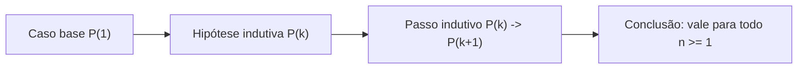

## Passo 1 · Leitura · Proposições, implicação, De Morgan e indução como invariante de laço

Toda decisão e todo laço que escrevemos em Python repousam sobre **lógica proposicional** e **lógica de predicados**. Uma proposição é uma afirmação que assume valor verdade `True` ou `False`. Além dos conectivos `and` ($\land$), `or` ($\lor$) e `not` ($\neg$), a análise de algoritmos usa intensamente a **implicação lógica** $p \to q$ ("se $p$, então $q$"):

$$p \to q \;\equiv\; (\neg p) \lor q \;\equiv\; (\neg q) \to (\neg p)$$

Repare em dois fatos essenciais:
- **Vacuidade ($p = \text{False}$):** quando a premissa $p$ é falsa, a implicação $p \to q$ é **verdadeira** independentemente de $q$. Em programação, isso explica por que `all(cond(x) for x in [])` devolve `True`: em uma coleção vazia, não existe contraexemplo que viole a regra.
- **Contrapositiva ($\neg q \to \neg p$):** "se um número é divisível por 4, então é par" equivale exatamente a "se um número **não** é par, então **não** é divisível por 4". Já a **recíproca** ($q \to p$, "se é par, então é divisível por 4") é falsa ($2$ é contraexemplo).

Ao negar condições compostas ou quantificadores (`all` = $\forall$, `any` = $\exists$), aplicamos as **Leis de De Morgan**:

$$\neg(p \land q) \equiv (\neg p) \lor (\neg q), \qquad \neg(p \lor q) \equiv (\neg p) \land (\neg q)$$

$$\neg(\forall x,\, P(x)) \equiv \exists x,\, \neg P(x), \qquad \neg(\exists x,\, P(x)) \equiv \forall x,\, \neg P(x)$$



Por fim, uma **prova por indução matemática** demonstra uma propriedade $P(n)$ para todo inteiro $n \ge 1$ em dois passos: (1) provar o **caso base** $P(1)$ e (2) provar o **passo indutivo** $P(k) \to P(k+1)$. Porexemplo, a soma dos $n$ primeiros ímpares positivos satisfaz:

$$\sum_{i=1}^{n} (2i - 1) = 1 + 3 + 5 + \dots + (2n - 1) = n^2$$

Na base $n=1$, temos $1 = 1^2$. Supondo que valha para $k$, somamos o próximo ímpar $2(k+1)-1 = 2k+1$ e obtemos $k^2 + (2k + 1) = (k + 1)^2$. Em programação, um **invariante de laço** é exatamente uma prova por indução sobre as iterações do `for`/`while`: vale antes da primeira iteração (base) e, se valia no início da iteração $k$, continua valendo no início da iteração $k+1$.

## Passo 2 · Previsão · Quantificadores `all`, `any` e De Morgan em código

Veja como a negação de um quantificador universal (`not all(...)`) coincide com o existencial da negação (`any(not ...)`), e observe o valor de `all` e `any` na lista vazia.

### Código

```python
notas = [7.5, 8.0, 6.0, 9.0]

todos_aprovados = all(n >= 5.0 for n in notas)
alguem_reprovou_1 = not all(n >= 7.0 for n in notas)
alguem_reprovou_2 = any(n < 7.0 for n in notas)

vazia = []
print(todos_aprovados)
print(alguem_reprovou_1, alguem_reprovou_2)
print(all(vazia), any(vazia))
```

### Dicas

1. `all(n >= 7.0 for n in notas)` é `False` porque `6.0 < 7.0`; logo `not all(...)` é `True`, igual a `any(n < 7.0 for n in notas)`.
2. Em uma lista vazia `[]`, `all([])` é `True` (verdade por vacuidade: não há elemento falso) e `any([])` é `False` (não existe elemento verdadeiro).

### Saída esperada

```text
True
True True
True False
```

## Passo 3 · Exercício · Implicação lógica e verificação de De Morgan

modo: lacunas

Complete as lacunas para implementar `implicacao(p, q)` ($p \to q$), `tabela_implicacao()` (para os 4 pares `(False, False)`, `(False, True)`, `(True, False)`, `(True, True)`) e `verificar_de_morgan()`, que confirma as duas leis de De Morgan e a equivalência da contrapositiva nas 4 combinações booleanas.

### Instruções

1. Em `implicacao(p, q)`, retorne `bool((not p) or q)`.
2. Em `tabela_implicacao()`, percorra `p` em `(False, True)` e `q` em `(False, True)`, adicionando `(p, q, implicacao(p, q))`.
3. Em `verificar_de_morgan()`, verifique se `not (p and q) == ((not p) or (not q))`, `not (p or q) == ((not p) and (not q))` e `implicacao(p, q) == implicacao(not q, not p)` para todos os pares `(p, q)`.

### Código inicial

```python
def implicacao(p, q):
    return bool((___ p) ___ q)


def tabela_implicacao():
    linhas = []
    for p in (False, True):
        for q in (False, True):
            linhas.append((p, q, ___(p, q)))
    return linhas


def verificar_de_morgan():
    for p in (False, True):
        for q in (False, True):
            lei1 = (not (p and q)) == ((not p) ___ (not q))
            lei2 = (not (p or q)) == ((not p) ___ (not q))
            contrapositiva = implicacao(p, q) == implicacao(not ___, not ___)
            if not (lei1 and lei2 and contrapositiva):
                return False
    return True
```

### Solução

```python
def implicacao(p, q):
    return bool((not p) or q)


def tabela_implicacao():
    linhas = []
    for p in (False, True):
        for q in (False, True):
            linhas.append((p, q, implicacao(p, q)))
    return linhas


def verificar_de_morgan():
    for p in (False, True):
        for q in (False, True):
            lei1 = (not (p and q)) == ((not p) or (not q))
            lei2 = (not (p or q)) == ((not p) and (not q))
            contrapositiva = implicacao(p, q) == implicacao(not q, not p)
            if not (lei1 and lei2 and contrapositiva):
                return False
    return True
```

### Dicas

1. A implicação $p \to q$ só é falsa quando $p$ é `True` e $q$ é `False`, o que equivale a `(not p) or q`.
2. A contrapositiva de `implicacao(p, q)` inverte e nega os dois termos: `implicacao(not q, not p)`.

### Verificação

```json
[
  {
    "id": "implicacao-casos",
    "name": "Calcula p -> q corretamente nos quatro pares de valores verdade",
    "checkpoint": 1,
    "kind": "expr",
    "expr": "[implicacao(False, False), implicacao(False, True), implicacao(True, False), implicacao(True, True)]",
    "expected": [
      true,
      true,
      false,
      true
    ]
  },
  {
    "id": "tabela-verdade-completa",
    "name": "Gera as 4 linhas ordenadas da tabela-verdade da implicação",
    "checkpoint": 2,
    "kind": "call",
    "function": "tabela_implicacao",
    "args": [],
    "expected": [
      [false, false, true],
      [false, true, true],
      [true, false, false],
      [true, true, true]
    ]
  },
  {
    "id": "de-morgan-e-contrapositiva",
    "name": "Confirma as duas leis de De Morgan e a contrapositiva",
    "checkpoint": 3,
    "kind": "call",
    "function": "verificar_de_morgan",
    "args": [],
    "expected": true
  }
]
```

### Soluções erradas

```python name="Confunde implicação com equivalência lógica p == q"
def implicacao(p, q):
    return bool(p == q)


def tabela_implicacao():
    return [(p, q, implicacao(p, q)) for p in (False, True) for q in (False, True)]


def verificar_de_morgan():
    return True
```

```python name="Aplica De Morgan sem trocar and por or"
def implicacao(p, q):
    return bool((not p) or q)


def tabela_implicacao():
    return [(p, q, implicacao(p, q)) for p in (False, True) for q in (False, True)]


def verificar_de_morgan():
    for p in (False, True):
        for q in (False, True):
            if (not (p and q)) != ((not p) and (not q)):
                return False
    return True
```

## Passo 4 · Exercício · Soma dos $n$ primeiros ímpares e verificação da hipótese indutiva

modo: ordenar

Ordene as linhas para implementar `soma_impares(n)` (que soma os $n$ primeiros ímpares $1 + 3 + \dots + (2n-1)$ iterativamente) e `verificar_inducao_impares(limite)`, que testa o caso base $n = 1$ e o passo indutivo $S(k) + (2k + 1) == (k + 1)^2$ para todo $k$ de $1$ até `limite`.

### Instruções

1. Em `soma_impares(n)`, acumule `2 * i - 1` para `i` em `range(1, n + 1)` e devolva o total.
2. Em `verificar_inducao_impares(limite)`, confira se `soma_impares(1) == 1` (caso base) e se, para todo `k` em `range(1, limite + 1)`, `soma_impares(k) == k * k` e `soma_impares(k) + (2 * k + 1) == (k + 1) ** 2`.

### Solução

```python
def soma_impares(n):
    total = 0
    for i in range(1, n + 1):
        total += 2 * i - 1
    return total


def verificar_inducao_impares(limite):
    if soma_impares(1) != 1:
        return False
    for k in range(1, limite + 1):
        if soma_impares(k) != k * k or soma_impares(k) + (2 * k + 1) != (k + 1) ** 2:
            return False
    return True
```

### Dicas

1. O $i$-ésimo número ímpar (começando em $i=1$) é `2 * i - 1`.
2. No passo indutivo, somar o próximo ímpar `2 * k + 1` a `soma_impares(k)` deve resultar em `(k + 1) ** 2`.

### Verificação

```json
[
  {
    "id": "soma-impares-valores",
    "name": "Calcula a soma dos n primeiros ímpares para n = 0, 1, 5 e 20",
    "checkpoint": 1,
    "kind": "expr",
    "expr": "[soma_impares(0), soma_impares(1), soma_impares(5), soma_impares(20)]",
    "expected": [
      0,
      1,
      25,
      400
    ]
  },
  {
    "id": "verifica-inducao-ate-200",
    "name": "Confirma caso base e passo indutivo até n = 200",
    "checkpoint": 2,
    "kind": "call",
    "function": "verificar_inducao_impares",
    "args": [200],
    "expected": true
  }
]
```

### Soluções erradas

```python name="Soma números pares em vez dos n primeiros ímpares"
def soma_impares(n):
    total = 0
    for i in range(1, n + 1):
        total += 2 * i
    return total


def verificar_inducao_impares(limite):
    return False
```

```python name="Ignora o último termo usando range(1, n)"
def soma_impares(n):
    total = 0
    for i in range(1, n):
        total += 2 * i - 1
    return total


def verificar_inducao_impares(limite):
    return True
```

## Passo 5 · Exercício · Busca linear verificando o invariante de laço

Na busca linear de `alvo` em `lista`, o **invariante de laço** no início da iteração de índice `i` afirma: *"o `alvo` não ocorre em nenhuma posição de `lista[:i]`"*. Implemente `invariante_busca(lista, alvo)` que devolve o índice onde `alvo` foi encontrado (ou `-1`) junto com a confirmação de que o invariante valeu em todos os passos visitados.

### Instruções

1. Inicialize `passos_verificados = 0`.
2. Para cada índice `i` de `0` até `len(lista)` (inclusive):
   - Verifique o invariante ` alvo not in lista[:i]`. Se falhar, retorne `{"indice": -1, "passos": passos_verificados, "invariante_valido": False}`.
   - Incremente `passos_verificados += 1`.
   - Se `i < len(lista)` e `lista[i] == alvo`, retorne `{"indice": i, "passos": passos_verificados, "invariante_valido": True}`.
3. Se o laço terminar sem encontrar `alvo` (após checar `i == len(lista)`), retorne `{"indice": -1, "passos": passos_verificados, "invariante_valido": True}`.

### Código inicial

```python
def invariante_busca(lista, alvo):
    # Verifique o invariante antes de inspecionar lista[i] e ao final quando não encontrado
    pass
```

### Solução

```python
def invariante_busca(lista, alvo):
    passos_verificados = 0
    for i in range(len(lista) + 1):
        if any(x == alvo for x in lista[:i]):
            return {
                "indice": -1,
                "passos": passos_verificados,
                "invariante_valido": False,
            }
        passos_verificados += 1
        if i < len(lista) and lista[i] == alvo:
            return {
                "indice": i,
                "passos": passos_verificados,
                "invariante_valido": True,
            }
    return {
        "indice": -1,
        "passos": passos_verificados,
        "invariante_valido": True,
    }
```

### Dicas

1. Antes de testar `lista[0]` (`i = 0`), a fatia `lista[:0]` é `[]`, então o invariante vale por vacuidade (`passos_verificados` passa a `1`).
2. Quando `alvo` não está na lista de tamanho $n$, o invariante é verificado para $i = 0, 1, \dots, n$, totalizando $n + 1$ verificações.

### Verificação

```json
[
  {
    "id": "invariante-encontrado",
    "name": "Retorna o primeiro índice encontrado e o número de passos em que o invariante foi checado",
    "checkpoint": 2,
    "kind": "call",
    "function": "invariante_busca",
    "args": [
      [10, 25, 40, 25],
      25
    ],
    "expected": {
      "indice": 1,
      "passos": 2,
      "invariante_valido": true
    }
  },
  {
    "id": "invariante-ausente-e-vazio",
    "name": "Quando o alvo não está presente, verifica até i == len(lista) concluindo que alvo não está na lista inteira",
    "checkpoint": 3,
    "kind": "expr",
    "expr": "[invariante_busca([10, 20, 30], 99), invariante_busca([], 5)]",
    "expected": [
      {
        "indice": -1,
        "passos": 4,
        "invariante_valido": true
      },
      {
        "indice": -1,
        "passos": 1,
        "invariante_valido": true
      }
    ]
  }
]
```

### Soluções erradas

```python name="Não verifica o estado final i == len(lista) quando o elemento está ausente"
def invariante_busca(lista, alvo):
    for i, x in enumerate(lista):
        if x == alvo:
            return {"indice": i, "passos": i + 1, "invariante_valido": True}
    return {"indice": -1, "passos": len(lista), "invariante_valido": True}
```

```python name="Retorna a última ocorrência em vez de parar na primeira mantendo o invariante"
def invariante_busca(lista, alvo):
    pos = -1
    for i, x in enumerate(lista):
        if x == alvo:
            pos = i
    return {"indice": pos, "passos": len(lista) + 1, "invariante_valido": True}
```

## Passo 6 · Quiz · Implicação, contrapositiva e quantificadores

### Pergunta

Considere a regra do regimento: *"Se o aluno teve frequência menor que 70%, então foi reprovado"*. Qual das afirmações abaixo é logicamente equivalente a essa regra (sua **contrapositiva**)?

- [ ] Se o aluno foi reprovado, então teve frequência menor que 70%.
- [ ] Se o aluno teve frequência maior ou igual a 70%, então foi aprovado.
- [x] Se o aluno **não** foi reprovado (foi aprovado), então sua frequência foi maior ou igual a 70%.
- [ ] Todo aluno reprovado faltou a todas as aulas.

> A contrapositiva de $p \to q$ é $\neg q \to \neg p$: não ter sido reprovado implica não ter tido frequência menor que $70\%$. Já $q \to p$ (recíproca) é falsa, pois alguém pode reprovar por nota mesmo tendo $100\%$ de presença.

### Pergunta

Qual expressão Python é equivalente a `not all(x > 0 for x in dados)` pela Lei de De Morgan para quantificadores?

- [ ] `all(x <= 0 for x in dados)`
- [x] `any(x <= 0 for x in dados)`
- [ ] `not any(x <= 0 for x in dados)`
- [ ] `any(x > 0 for x in dados)`

> Negar "todos são maiores que zero" ($\neg \forall x,\, x > 0$) equivale a "existe pelo menos um menor ou igual a zero" ($\exists x,\, x \le 0$).

### Pergunta

Por que uma prova por indução que demonstra apenas o passo indutivo $P(k) \to P(k+1)$, sem verificar o caso base $P(1)$, está incorreta?

- [ ] Porque o passo indutivo só funciona para números pares.
- [x] Porque a implicação $P(k) \to P(k+1)$ pode ser verdadeira mesmo que $P(k)$ seja sempre falsa (por exemplo, a afirmação falsa "$2n + 1$ é par" satisfaz o passo indutivo, mas falha na base $n=1$).
- [ ] Porque o Python limita o número de iterações em 1000.
- [ ] Porque o caso base substitui o passo indutivo.

> Sem o caso base para ancorar a verdade inicial, a cadeia de implicações $P(1) \to P(2) \to P(3) \dots$ parte de uma premissa falsa e não garante que nenhum $P(n)$ seja verdadeiro.
