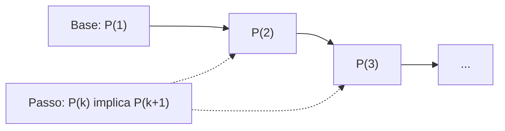

## Passo 1 · Leitura · Implicação, contrapositiva e De Morgan

Uma **proposição** é uma afirmação que é verdadeira ou falsa: "12 é par", "a lista está ordenada". Você já combina proposições com `and` ($\land$), `or` ($\lor$) e `not` ($\neg$). Para falar de algoritmos falta um conectivo: a **implicação** $p \to q$, "se $p$, então $q$".

| $p$ | $q$ | $p \to q$ |
|:---:|:---:|:---:|
| F | F | V |
| F | V | V |
| V | F | **F** |
| V | V | V |

A implicação só é falsa quando a premissa vale e a conclusão não. Quando $p$ é falsa, $p \to q$ é verdadeira **por vacuidade**: a regra "se chover, a aula é online" não foi quebrada num dia de sol, qualquer que tenha sido a aula. Pela tabela, $p \to q \equiv \neg p \lor q$.

Duas proposições são **equivalentes** ($\equiv$) quando têm o mesmo valor em todas as linhas da tabela. Três frases parecidas com $p \to q$ se comportam de jeitos diferentes:

- a **contrapositiva** $\neg q \to \neg p$ é equivalente a ela;
- a **recíproca** $q \to p$ não é: "se é múltiplo de 4, é par" vale, "se é par, é múltiplo de 4" falha no 2;
- a **negação** $\neg(p \to q)$ é $p \land \neg q$: um caso com a premissa verdadeira e a conclusão falsa.

A contrapositiva é uma técnica de prova. Para provar "se $n^2$ é par, então $n$ é par", a **prova direta** emperra. Prove então que, se $n$ é ímpar, $n^2$ é ímpar: com $n = 2k+1$, $n^2 = 4k^2 + 4k + 1 = 2(2k^2+2k) + 1$, que é ímpar.

Para negar um `and` ou um `or`, use as **leis de De Morgan**: a negação troca um conectivo pelo outro.

$$
\neg(p \land q) \equiv \neg p \lor \neg q \qquad\qquad \neg(p \lor q) \equiv \neg p \land \neg q
$$

O erro clássico é negar os dois lados e esquecer de trocar o conectivo:

```python
nota, freq = 8.0, 60
aprovado = nota >= 5 and freq >= 70
reprovado_certo = nota < 5 or freq < 70       # De Morgan: troca and por or
reprovado_errado = nota < 5 and freq < 70     # só nega os lados
print(aprovado, reprovado_certo, reprovado_errado)   # False True False
```

Com nota 8 e frequência 60, o aluno está reprovado, mas a versão errada diz que não. Para ter certeza de que duas expressões booleanas são equivalentes, basta testar **todas** as combinações de valores: com duas variáveis, são só quatro.

## Passo 2 · Exercício · Equivalências por força bruta
modo: lacunas

Complete as lacunas (`___`). `implicacao(p, q)` devolve o valor de $p \to q$. `equivalentes(f, g)` recebe duas funções de duas variáveis booleanas e devolve `True` só se elas concordarem nas quatro combinações de `p` e `q`. Exemplo: `equivalentes(lambda p, q: not (p and q), lambda p, q: (not p) or (not q))` é `True`.

### Instruções
1. Em `implicacao`, escreva $p \to q$ usando a equivalência $\neg p \lor q$.
2. Em `equivalentes`, percorra as quatro combinações de `p` e `q`.
3. Devolva `False` assim que achar uma combinação em que `f` e `g` discordam; devolva `True` só depois de testar todas.

### Código inicial
```python
def implicacao(p, q):
    return (not p) ___ q


def equivalentes(f, g):
    for p in (False, True):
        for q in ___:
            if f(p, q) ___ g(p, q):
                return ___
    return True
```

### Solução
```python
def implicacao(p, q):
    return (not p) or q


def equivalentes(f, g):
    for p in (False, True):
        for q in (False, True):
            if f(p, q) != g(p, q):
                return False
    return True
```

### Dicas
1. A implicação só é falsa na linha em que `p` é verdadeiro e `q` é falso.
2. Uma única combinação em que `f` e `g` discordam já prova que não são equivalentes. Uma combinação em que concordam não prova nada.
3. O `return True` fica fora dos dois laços, depois de todas as combinações.

### Verificação
```json
[
  { "id": "tabela-implicacao", "checkpoint": 1, "kind": "expr",
    "expr": "[implicacao(p, q) for p in (False, True) for q in (False, True)]", "expected": [true, true, false, true],
    "name": "implicacao nas quatro linhas da tabela é V, V, F, V" },
  { "id": "de-morgan-and", "checkpoint": 2, "kind": "expr",
    "expr": "equivalentes(lambda p, q: not (p and q), lambda p, q: (not p) or (not q))", "expected": true,
    "name": "not (p and q) é equivalente a (not p) or (not q)" },
  { "id": "de-morgan-errado", "checkpoint": 3, "kind": "expr",
    "expr": "equivalentes(lambda p, q: not (p or q), lambda p, q: (not p) or (not q))", "expected": false,
    "name": "not (p or q) não é equivalente a (not p) or (not q)",
    "hint": "As duas funções concordam em algumas combinações e discordam em outras. Todas precisam ser testadas." },
  { "id": "contrapositiva", "checkpoint": 2, "kind": "expr",
    "expr": "equivalentes(implicacao, lambda p, q: implicacao(not q, not p))", "expected": true,
    "name": "A contrapositiva é equivalente à implicação" },
  { "id": "reciproca", "checkpoint": 3, "kind": "expr",
    "expr": "equivalentes(implicacao, lambda p, q: implicacao(q, p))", "expected": false,
    "name": "A recíproca não é equivalente à implicação",
    "hint": "Implicação e recíproca concordam quando p e q são iguais. Teste também as combinações com p diferente de q." },
  { "id": "difere-so-no-fim", "checkpoint": 2, "kind": "expr",
    "expr": "equivalentes(lambda p, q: p and q, lambda p, q: False)", "expected": false,
    "name": "Funções que só discordam em p = q = True não são equivalentes" }
]
```

### Soluções erradas
```python name="implicação escrita ao contrário (é a recíproca)"
def implicacao(p, q):
    return p or (not q)


def equivalentes(f, g):
    for p in (False, True):
        for q in (False, True):
            if f(p, q) != g(p, q):
                return False
    return True
```
```python name="decide na primeira combinação"
def implicacao(p, q):
    return (not p) or q


def equivalentes(f, g):
    for p in (False, True):
        for q in (False, True):
            if f(p, q) == g(p, q):
                return True
            return False
    return True
```
```python name="testa só p e q iguais"
def implicacao(p, q):
    return (not p) or q


def equivalentes(f, g):
    for v in (False, True):
        if f(v, v) != g(v, v):
            return False
    return True
```
```python name="return True indentado dentro do laço de p"
def implicacao(p, q):
    return (not p) or q


def equivalentes(f, g):
    for p in (False, True):
        for q in (False, True):
            if f(p, q) != g(p, q):
                return False
        return True
```

## Passo 3 · Previsão · all, any e a lista vazia

`all(...)` responde "todos satisfazem?" e `any(...)` responde "algum satisfaz?". Leia o programa sem executar e digite exatamente o que ele imprime. Preste atenção na lista vazia.

### Código
```python
notas = [7.5, 8.0, 6.0, 9.0]
print(all(n >= 5 for n in notas))
print(not all(n >= 7 for n in notas), any(n < 7 for n in notas))
vazia = []
print(all(n >= 7 for n in vazia), any(n >= 7 for n in vazia))
print(all(n > 10 for n in vazia) and all(n < 0 for n in vazia))
```

### Dicas
1. Na linha 3, as duas expressões dizem a mesma coisa com palavras diferentes: "não são todos" e "existe um que não é".
2. Para `all` ser falso, alguém precisa ser um contraexemplo. Para `any` ser verdadeiro, alguém precisa ser um exemplo. Quantos elementos a lista vazia tem?

### Saída esperada
```text
True
True True
True False
True
```

## Passo 4 · Leitura · Quantificadores e contraexemplos

A última linha da previsão diz que todas as notas da lista vazia são maiores que 10 **e** menores que 0. Não há contradição: nenhuma nota da lista vazia quebra as duas regras.

Afirmações sobre coleções usam dois **quantificadores**: $\forall x\, P(x)$ ("para todo $x$, vale $P(x)$") e $\exists x\, P(x)$ ("existe $x$ com $P(x)$"). Em Python, sobre uma coleção finita, eles são `all` e `any`. As leis de De Morgan valem para eles também:

$$
\neg\,\forall x\, P(x) \equiv \exists x\, \neg P(x) \qquad\qquad \neg\,\exists x\, P(x) \equiv \forall x\, \neg P(x)
$$

Para **refutar** um "para todo", basta **um contraexemplo**. Para **provar** um "para todo" sobre infinitos valores, testar não basta, por mais casos que você teste. O polinômio $n^2 + n + 41$ dá um primo para $n = 0, 1, 2, \dots, 39$: quarenta acertos seguidos. Em $n = 40$ ele vale $1681 = 41^2$.

```python
def eh_primo(n):
    if n < 2:
        return False
    d = 2
    while d * d <= n:
        if n % d == 0:
            return False
        d += 1
    return True


contra = next((n for n in range(100) if not eh_primo(n * n + n + 41)), None)
print(contra)   # 40
```

Com dois quantificadores, a **ordem** muda o sentido. Com `alunos` e `horarios` de monitoria:

- $\forall a\, \exists h$: "todo aluno tem **algum** horário em que pode ir", cada um o seu. Em código: `all(any(pode(a, h) for h in horarios) for a in alunos)`.
- $\exists h\, \forall a$: "existe **um** horário que serve para todos". Em código: `any(all(pode(a, h) for a in alunos) for h in horarios)`.

A segunda afirmação é mais forte. Com Ana livre só de manhã e Bia livre só à tarde, a primeira vale e a segunda não. Negar uma afirmação com dois quantificadores troca cada um e nega o predicado: $\neg\,\forall a\, \exists h\, P \equiv \exists a\, \forall h\, \neg P$, "há um aluno para quem nenhum horário serve".

## Passo 5 · Exercício · Caçador de contraexemplos

Escreva duas funções:

- `primeiro_contraexemplo(predicado, inicio, fim)` testa os inteiros de `inicio` até `fim`, **inclusive**, em ordem crescente, e devolve o primeiro `n` com `predicado(n)` falso. Se não houver, devolve `None`. Ela para assim que encontra: numa faixa de um milhão de números com contraexemplo no 5, chama `predicado` só seis vezes. Exemplo: `primeiro_contraexemplo(lambda n: n % 4 != 3, 0, 20)` é `3`.
- `para_todo_existe(xs, ys, relacao)` devolve `True` se, para todo `x` de `xs`, existe um `y` de `ys` com `relacao(x, y)` verdadeiro. Exemplo: `para_todo_existe([1, 2], [5, 6], lambda x, y: y > x)` é `True`.

### Instruções
1. Escreva `primeiro_contraexemplo` com a faixa fechada `[inicio, fim]`, parando no primeiro contraexemplo.
2. Escreva `para_todo_existe` com os quantificadores na ordem do enunciado: primeiro "para todo `x`", depois "existe `y`".

### Código inicial
```python
def primeiro_contraexemplo(predicado, inicio, fim):
    pass


def para_todo_existe(xs, ys, relacao):
    pass
```

### Solução
```python
def primeiro_contraexemplo(predicado, inicio, fim):
    for n in range(inicio, fim + 1):
        if not predicado(n):
            return n
    return None


def para_todo_existe(xs, ys, relacao):
    return all(any(relacao(x, y) for y in ys) for x in xs)
```

### Dicas
1. `range(a, b)` não inclui `b`. A faixa do enunciado inclui `fim`.
2. Devolver dentro do laço interrompe a busca. Montar a lista de todos os contraexemplos primeiro chama o predicado na faixa inteira.
3. Leia de fora para dentro: o quantificador de fora é o primeiro da frase. "Para todo `x`" vira `all(... for x in xs)`.

### Verificação
```json
[
  { "id": "euler", "checkpoint": 1, "kind": "expr",
    "setup": "def eh_primo(n):\n    if n < 2:\n        return False\n    d = 2\n    while d * d <= n:\n        if n % d == 0:\n            return False\n        d += 1\n    return True",
    "expr": "primeiro_contraexemplo(lambda n: eh_primo(n * n + n + 41), 0, 100)", "expected": 40,
    "name": "n*n + n + 41 deixa de ser primo em n = 40" },
  { "id": "o-primeiro", "checkpoint": 1, "kind": "expr",
    "expr": "primeiro_contraexemplo(lambda n: n % 10 != 3, 0, 100)", "expected": 3,
    "name": "Devolve o primeiro contraexemplo (3), não um posterior" },
  { "id": "no-fim", "checkpoint": 1, "kind": "expr",
    "expr": "primeiro_contraexemplo(lambda n: n < 50, 10, 50)", "expected": 50,
    "name": "Contraexemplo exatamente em fim é encontrado",
    "hint": "A faixa é fechada: fim também é testado." },
  { "id": "nenhum", "checkpoint": 1, "kind": "expr",
    "expr": "[primeiro_contraexemplo(lambda n: n * n >= n, -20, 1000) is None, primeiro_contraexemplo(lambda n: False, 5, 4) is None]",
    "expected": [true, true],
    "name": "Sem contraexemplo (ou com faixa vazia) devolve None" },
  { "id": "para-cedo", "checkpoint": 1, "kind": "expr",
    "setup": "chamadas = []\ndef p(n):\n    chamadas.append(n)\n    return n != 5\nr = primeiro_contraexemplo(p, 0, 10**6)",
    "expr": "[r, len(chamadas)]", "expected": [5, 6],
    "name": "Para no primeiro contraexemplo: 6 chamadas numa faixa de um milhão",
    "hint": "Assim que o predicado falhar, devolva. Não percorra o resto da faixa." },
  { "id": "cada-x-seu-y", "checkpoint": 2, "kind": "expr",
    "expr": "para_todo_existe([0, 1, 2], [0, 1, 2], lambda x, y: (x + y) % 3 == 0)", "expected": true,
    "name": "Cada x tem o seu y (nenhum y serve para todos): True",
    "hint": "Para x = 1 o par é y = 2; para x = 2 é y = 1. Não precisa ser o mesmo y." },
  { "id": "um-x-sem-y", "checkpoint": 2, "kind": "expr",
    "expr": "para_todo_existe([1, 2, 3], [1, 2], lambda x, y: y > x)", "expected": false,
    "name": "Um x sem nenhum y que sirva torna tudo False" },
  { "id": "vazios", "checkpoint": 2, "kind": "expr",
    "expr": "[para_todo_existe([], [1], lambda x, y: False), para_todo_existe([1], [], lambda x, y: True)]", "expected": [true, false],
    "name": "xs vazio é True por vacuidade; ys vazio com xs não vazio é False" }
]
```

### Soluções erradas
```python name="range sem o + 1 ignora fim"
def primeiro_contraexemplo(predicado, inicio, fim):
    for n in range(inicio, fim):
        if not predicado(n):
            return n
    return None


def para_todo_existe(xs, ys, relacao):
    return all(any(relacao(x, y) for y in ys) for x in xs)
```
```python name="guarda o último contraexemplo"
def primeiro_contraexemplo(predicado, inicio, fim):
    achado = None
    for n in range(inicio, fim + 1):
        if not predicado(n):
            achado = n
    return achado


def para_todo_existe(xs, ys, relacao):
    return all(any(relacao(x, y) for y in ys) for x in xs)
```
```python name="lista todos os contraexemplos antes de escolher"
def primeiro_contraexemplo(predicado, inicio, fim):
    contras = [n for n in range(inicio, fim + 1) if not predicado(n)]
    if contras:
        return contras[0]
    return None


def para_todo_existe(xs, ys, relacao):
    return all(any(relacao(x, y) for y in ys) for x in xs)
```
```python name="quantificadores na ordem trocada (existe y para todo x)"
def primeiro_contraexemplo(predicado, inicio, fim):
    for n in range(inicio, fim + 1):
        if not predicado(n):
            return n
    return None


def para_todo_existe(xs, ys, relacao):
    return any(all(relacao(x, y) for x in xs) for y in ys)
```
```python name="basta um par qualquer (existe x, existe y)"
def primeiro_contraexemplo(predicado, inicio, fim):
    for n in range(inicio, fim + 1):
        if not predicado(n):
            return n
    return None


def para_todo_existe(xs, ys, relacao):
    for x in xs:
        for y in ys:
            if relacao(x, y):
                return True
    return False
```

## Passo 6 · Leitura · Indução: base, hipótese e passo

Testar não prova um "para todo $n$". Para isso existe a **indução matemática**. Para provar $P(n)$ para todo inteiro $n \ge 1$:

1. **Base:** prove $P(1)$.
2. **Hipótese de indução:** suponha que $P(k)$ vale para um $k \ge 1$ qualquer.
3. **Passo:** usando a hipótese, prove $P(k+1)$.



Exemplo: a soma dos $n$ primeiros ímpares é $n^2$.

$$
\sum_{i=1}^{n} (2i - 1) = 1 + 3 + \dots + (2n-1) = n^2
$$

**Base:** para $n = 1$, a soma é $1 = 1^2$. **Hipótese:** $1 + 3 + \dots + (2k-1) = k^2$. **Passo:** a soma até $k+1$ é a soma até $k$ mais o ímpar seguinte, $2(k+1) - 1 = 2k+1$. Pela hipótese, ela vale $k^2 + 2k + 1 = (k+1)^2$.

Por que isso convence? Por **contradição**: suponha que $P$ falhe em algum $n$ e pegue o **menor** desses $n$. Ele não é 1, pela base. Então $P(n-1)$ vale, porque $n$ era o menor que falha, e o passo dá $P(n)$. Contradição: não existe um $n$ em que $P$ falha.

As duas partes são obrigatórias. "$2n + 1$ é par" tem um passo válido: se $2k+1$ é par, então $2k+3 = (2k+1) + 2$ também é. Mas a base falha ($3$ é ímpar), e a afirmação é falsa para todo $n$.

Um **invariante de laço** é a mesma ideia aplicada às voltas de um laço. Ele vale antes da primeira volta, e cada volta o preserva. Um `assert` confere o invariante a cada volta:

```python
total = 0
for i in range(1, 6):
    total += 2 * i - 1
    assert total == i * i      # vale depois de cada volta
print(total)                    # 25
```

O `assert` confere só os casos que rodaram. Quem garante que o invariante vale para todo `n` é a prova. No próximo exercício, o código confere a fórmula de uma soma até um limite, e aponta onde ela falha. Assim você descobre se vale a pena tentar a prova.

## Passo 7 · Exercício · Conferindo uma fórmula de soma

Escreva `verificar_formula(formula, termo, ate)`. Ela compara `formula(n)` com a soma real $S(n) = \text{termo}(1) + \text{termo}(2) + \dots + \text{termo}(n)$ para cada $n$ de 1 até `ate`, inclusive, e devolve o **primeiro** `n` em que os dois diferem. Se nenhum diferir, devolve `None`.

Mantenha a soma acumulada de uma volta para a outra, como no passo da indução ($S(n) = S(n-1) + \text{termo}(n)$): `termo` pode ser chamado no máximo `ate` vezes. Exemplos:

- `verificar_formula(lambda n: n * n, lambda i: 2 * i - 1, 100)` é `None`.
- `verificar_formula(lambda n: n * n + 1, lambda i: 2 * i - 1, 100)` é `1`. O passo vale para essa fórmula, mas a base não.

### Instruções
1. Percorra `n` de 1 até `ate`, inclusive, acumulando a soma dos termos.
2. Compare a soma acumulada com `formula(n)` e devolva o primeiro `n` em que diferem, ou `None`.
3. Chame `termo` uma única vez para cada `n`.

### Código inicial
```python
def verificar_formula(formula, termo, ate):
    pass
```

### Solução
```python
def verificar_formula(formula, termo, ate):
    soma = 0
    for n in range(1, ate + 1):
        soma += termo(n)
        if soma != formula(n):
            return n
    return None
```

### Dicas
1. O primeiro termo é `termo(1)`, não `termo(0)`.
2. Comparar só `formula(k) + termo(k + 1)` com `formula(k + 1)` confere o passo, mas esquece a base.
3. Somar de novo `termo(1) + ... + termo(n)` para cada `n` chama `termo` cerca de $n^2/2$ vezes. Guarde a soma numa variável.

### Verificação
```json
[
  { "id": "impares", "checkpoint": 2, "kind": "expr",
    "expr": "verificar_formula(lambda n: n * n, lambda i: 2 * i - 1, 1000) is None", "expected": true,
    "name": "n² confere com a soma dos ímpares até 1000" },
  { "id": "gauss", "checkpoint": 2, "kind": "expr",
    "expr": "verificar_formula(lambda n: n * (n + 1) // 2, lambda i: i, 500) is None", "expected": true,
    "name": "n(n+1)/2 confere com 1 + 2 + ... + n" },
  { "id": "potencias", "checkpoint": 2, "kind": "expr",
    "expr": "verificar_formula(lambda n: 2 ** n - 1, lambda i: 2 ** (i - 1), 200) is None", "expected": true,
    "name": "2^n - 1 confere com 1 + 2 + 4 + ... + 2^(n-1)" },
  { "id": "base-falha", "checkpoint": 2, "kind": "expr",
    "expr": "verificar_formula(lambda n: n * n + 1, lambda i: 2 * i - 1, 100)", "expected": 1,
    "name": "n² + 1 falha já em n = 1 (o passo vale, a base não)",
    "hint": "Compare a fórmula com a soma real em cada n, a começar por n = 1." },
  { "id": "fora-por-um", "checkpoint": 2, "kind": "expr",
    "expr": "verificar_formula(lambda n: n * (n - 1) // 2, lambda i: i, 100)", "expected": 1,
    "name": "n(n-1)/2 não é 1 + ... + n: falha em n = 1" },
  { "id": "falha-no-meio", "checkpoint": 2, "kind": "expr",
    "expr": "verificar_formula(lambda n: n * n if n < 50 else n * n + 1, lambda i: 2 * i - 1, 100)", "expected": 50,
    "name": "Fórmula certa até 49 e errada a partir de 50: devolve 50" },
  { "id": "falha-no-limite", "checkpoint": 1, "kind": "expr",
    "expr": "verificar_formula(lambda n: n * n if n < 30 else 0, lambda i: 2 * i - 1, 30)", "expected": 30,
    "name": "Falha exatamente em n = ate é encontrada",
    "hint": "ate também precisa ser conferido." },
  { "id": "chamadas-lineares", "checkpoint": 3, "kind": "expr",
    "setup": "chamadas = []\ndef termo(i):\n    chamadas.append(i)\n    return 2 * i - 1\nr = verificar_formula(lambda n: n * n, termo, 2000)",
    "expr": "[r is None, len(chamadas) <= 2000]", "expected": [true, true],
    "name": "Até 2000: chama termo no máximo 2000 vezes",
    "hint": "Some cada termo uma vez só e guarde a soma para o próximo n." }
]
```

### Soluções erradas
```python name="confere só o passo e esquece a base"
def verificar_formula(formula, termo, ate):
    for k in range(1, ate):
        if formula(k) + termo(k + 1) != formula(k + 1):
            return k + 1
    return None
```
```python name="começa a soma em termo(0)"
def verificar_formula(formula, termo, ate):
    soma = 0
    for n in range(ate):
        soma += termo(n)
        if soma != formula(n + 1):
            return n + 1
    return None
```
```python name="range sem o + 1 não confere ate"
def verificar_formula(formula, termo, ate):
    soma = 0
    for n in range(1, ate):
        soma += termo(n)
        if soma != formula(n):
            return n
    return None
```
```python name="refaz a soma inteira para cada n"
def verificar_formula(formula, termo, ate):
    for n in range(1, ate + 1):
        soma = sum(termo(i) for i in range(1, n + 1))
        if soma != formula(n):
            return n
    return None
```

## Passo 8 · Quiz · Implicação, quantificadores e indução

### Pergunta
O regimento diz: "se o aluno teve frequência menor que 70%, então foi reprovado". Qual afirmação é **equivalente** a essa regra?
- [ ] Se o aluno foi reprovado, então teve frequência menor que 70%.
- [ ] Se o aluno teve frequência de 70% ou mais, então foi aprovado.
- [x] Se o aluno foi aprovado, então teve frequência de 70% ou mais.
- [ ] Algum aluno teve frequência menor que 70% e foi aprovado.
> A terceira é a contrapositiva $\neg q \to \neg p$, equivalente à regra. A primeira é a recíproca: alguém pode reprovar por nota com 100% de presença. A segunda nega os dois lados sem inverter, e falha pelo mesmo motivo. A quarta é a negação da regra ($p \land \neg q$).

### Pergunta
A coordenação quer saber se **existe um horário** de monitoria que serve para **todos** os alunos. `pode(a, h)` diz se o aluno `a` pode ir no horário `h`. Qual expressão responde a essa pergunta?
- [ ] `all(any(pode(a, h) for h in horarios) for a in alunos)`
- [x] `any(all(pode(a, h) for a in alunos) for h in horarios)`
- [ ] `any(any(pode(a, h) for h in horarios) for a in alunos)`
- [ ] `all(all(pode(a, h) for h in horarios) for a in alunos)`
> A frase é $\exists h\, \forall a$: o quantificador de fora é "existe um horário", e por isso `any` envolve o `all`. A primeira expressão é $\forall a\, \exists h$: cada aluno tem algum horário, mas talvez um diferente para cada um. As duas últimas pedem um par qualquer e todos os pares.

### Pergunta
Uma "prova" afirma que $n^2 + n$ é ímpar para todo $n \ge 1$. O passo é: se $k^2 + k$ é ímpar, então $(k+1)^2 + (k+1) = (k^2 + k) + 2(k + 1)$ é ímpar mais par, logo ímpar. O que está errado?
- [ ] A conta do passo: $(k+1)^2 + (k+1)$ não é igual a $(k^2+k) + 2(k+1)$.
- [x] O passo está certo, mas a base falha: $1^2 + 1 = 2$ é par. A afirmação é falsa para todo $n$.
- [ ] Não se pode usar a hipótese $P(k)$ para provar $P(k+1)$: isso é raciocínio circular.
- [ ] Indução só vale para fórmulas de somatórios.
> A conta do passo confere, e usar a hipótese é justamente o que a indução permite. Só que um passo válido sem base não prova nada. Aqui $n^2 + n = n(n+1)$ é sempre par, porque um de dois números consecutivos é par.
