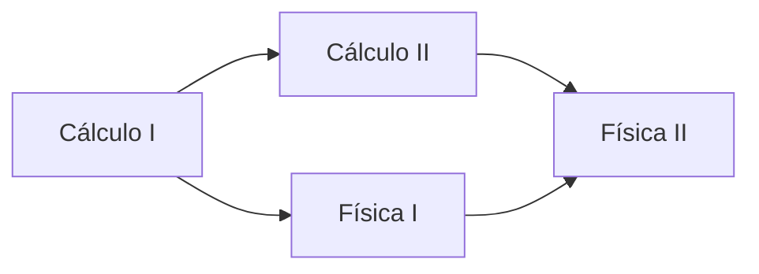

## Passo 1 · Leitura · Inclusão-exclusão: contar a união sem contar duas vezes

Os `set` do Python já trazem as operações da matemática: `A | B` é a união $A \cup B$, `A & B` é a interseção $A \cap B$ e `A - B` é a diferença. O **produto cartesiano** $A \times B$ é o conjunto de todos os pares $(a, b)$, e tem $|A| \cdot |B|$ elementos.

Na turma de Algoritmos, 30 alunos fazem Cálculo e 25 fazem Física. Quantos fazem pelo menos uma das duas? Não são 55: quem faz as duas foi contado duas vezes. Se 10 fazem as duas, a resposta é $30 + 25 - 10 = 45$. Esse é o **princípio da inclusão-exclusão**:

$$
|A \cup B| = |A| + |B| - |A \cap B|
$$

Com três conjuntos, quem está nos três é somado 3 vezes e subtraído 3 vezes (uma em cada interseção dois a dois). Ele precisa ser somado de volta:

$$
|A \cup B \cup C| = |A| + |B| + |C| - |A \cap B| - |A \cap C| - |B \cap C| + |A \cap B \cap C|
$$

A fórmula vale a pena quando os conjuntos são grandes demais para montar. Quantos números de 1 a $n$ são múltiplos de 4 ou de 6? Há `n // 4` múltiplos de 4 e `n // 6` múltiplos de 6. Os múltiplos **dos dois** são os múltiplos do **mínimo múltiplo comum**, $\text{mmc}(4, 6) = 12$, e não de $4 \cdot 6 = 24$: o 12 é múltiplo de 4 e de 6, e não é múltiplo de 24. O mmc está pronto em `math.lcm`, e a lição 4 mostra como calculá-lo.

```python
import math

n = 100
forca_bruta = len({x for x in range(1, n + 1) if x % 4 == 0 or x % 6 == 0})
formula = n // 4 + n // 6 - n // math.lcm(4, 6)
errada = n // 4 + n // 6 - n // (4 * 6)
print(forca_bruta, formula, errada)   # 33 33 37
```

A força bruta percorre os $n$ números. A fórmula faz poucas divisões, qualquer que seja $n$: com $n = 10^{12}$, a força bruta levaria horas e a fórmula responde na hora. Para confiar na fórmula, compare-a com a força bruta nos valores pequenos.

## Passo 2 · Exercício · Múltiplos de a, b ou c
modo: lacunas

Complete as lacunas (`___`) de `contar_multiplos(n, a, b, c)`, que devolve quantos inteiros de 1 a `n` são múltiplos de `a`, de `b` ou de `c` (pelo menos um deles). `a`, `b` e `c` são inteiros positivos, que podem se repetir, e `n` pode ter 18 dígitos. Exemplo: `contar_multiplos(100, 2, 3, 5)` é `74`.

### Instruções
1. Some quantos múltiplos de cada um existem até `n`.
2. Subtraia os múltiplos comuns de cada par, usando o mmc do par.
3. Some de volta os múltiplos comuns aos três.

### Código inicial
```python
import math


def contar_multiplos(n, a, b, c):
    um = n // a + n // b + n // c
    dois = n // math.lcm(a, b) + n // math.lcm(a, c) + n // math.lcm(___, ___)
    tres = n // math.lcm(a, b, ___)
    return um ___ dois ___ tres
```

### Solução
```python
import math


def contar_multiplos(n, a, b, c):
    um = n // a + n // b + n // c
    dois = n // math.lcm(a, b) + n // math.lcm(a, c) + n // math.lcm(b, c)
    tres = n // math.lcm(a, b, c)
    return um - dois + tres
```

### Dicas
1. Os múltiplos comuns de 4 e 6 são os múltiplos de 12, não de 24.
2. Conte quantas vezes um número que é múltiplo dos três entra em `um` e quantas sai em `dois`.

### Verificação
```json
[
  { "id": "forca-2-3-5", "checkpoint": 3, "kind": "expr",
    "setup": "def forca(n, a, b, c):\n    return sum(1 for x in range(1, n + 1) if x % a == 0 or x % b == 0 or x % c == 0)",
    "expr": "all(contar_multiplos(n, 2, 3, 5) == forca(n, 2, 3, 5) for n in range(0, 301))", "expected": true,
    "name": "Confere com a força bruta para 2, 3 e 5 e n de 0 a 300",
    "hint": "Um múltiplo dos três foi somado 3 vezes e subtraído 3 vezes." },
  { "id": "forca-4-6-10", "checkpoint": 2, "kind": "expr",
    "setup": "def forca(n, a, b, c):\n    return sum(1 for x in range(1, n + 1) if x % a == 0 or x % b == 0 or x % c == 0)",
    "expr": "all(contar_multiplos(n, 4, 6, 10) == forca(n, 4, 6, 10) for n in range(0, 301))", "expected": true,
    "name": "Confere com a força bruta para 4, 6 e 10 (divisores com fator comum)",
    "hint": "O produto de dois números só é o mmc quando eles não têm fator comum." },
  { "id": "repetidos", "checkpoint": 3, "kind": "expr",
    "setup": "def forca(n, a, b, c):\n    return sum(1 for x in range(1, n + 1) if x % a == 0 or x % b == 0 or x % c == 0)",
    "expr": "[contar_multiplos(n, 3, 3, 7) == forca(n, 3, 3, 7) for n in (20, 21, 100)]", "expected": [true, true, true],
    "name": "Divisores repetidos (3, 3, 7) também conferem" },
  { "id": "divisor-um", "checkpoint": 1, "kind": "expr",
    "expr": "[contar_multiplos(37, 1, 5, 7), contar_multiplos(0, 2, 3, 5)]", "expected": [37, 0],
    "name": "Com divisor 1 todos contam; com n = 0 nenhum conta" },
  { "id": "n-10-12", "checkpoint": 3, "kind": "expr",
    "expr": "contar_multiplos(10**12, 4, 6, 10)", "expected": 366666666666,
    "name": "n = 10**12 com 4, 6 e 10 é 366666666666",
    "hint": "Percorrer até 10**12 não termina a tempo: use só divisões." },
  { "id": "n-10-18", "checkpoint": 3, "kind": "expr",
    "expr": "str(contar_multiplos(10**18, 6, 10, 15))", "expected": "266666666666666666",
    "name": "n = 10**18 com 6, 10 e 15 é 266666666666666666" }
]
```

### Soluções erradas
```python name="usa o produto no lugar do mmc"
import math


def contar_multiplos(n, a, b, c):
    um = n // a + n // b + n // c
    dois = n // (a * b) + n // (a * c) + n // (b * c)
    tres = n // (a * b * c)
    return um - dois + tres
```
```python name="esquece de somar de volta os três"
import math


def contar_multiplos(n, a, b, c):
    um = n // a + n // b + n // c
    dois = n // math.lcm(a, b) + n // math.lcm(a, c) + n // math.lcm(b, c)
    tres = n // math.lcm(a, b, c)
    return um - dois
```
```python name="subtrai também os três"
import math


def contar_multiplos(n, a, b, c):
    um = n // a + n // b + n // c
    dois = n // math.lcm(a, b) + n // math.lcm(a, c) + n // math.lcm(b, c)
    tres = n // math.lcm(a, b, c)
    return um - dois - tres
```
```python name="força bruta não termina para n grande"
def contar_multiplos(n, a, b, c):
    total = 0
    for x in range(1, n + 1):
        if x % a == 0 or x % b == 0 or x % c == 0:
            total += 1
    return total
```

## Passo 3 · Leitura · Funções injetoras, sobrejetoras e bijetoras

Uma **função** $f: D \to C$ associa **cada** elemento do domínio $D$ a **um único** elemento do contradomínio $C$. Um `dict` finito é exatamente isso: as chaves formam $D$, e cada chave tem um só valor. A **imagem** é o conjunto dos valores atingidos, $\text{Im}(f) = \{f(x) \mid x \in D\}$; em Python, `set(mapa.values())`. Se algum valor fica fora de $C$, o dicionário não é uma função de $D$ em $C$.

- **Injetora:** elementos diferentes vão para valores diferentes. Nenhum valor se repete, então $|\text{Im}(f)| = |D|$.
- **Sobrejetora:** todo elemento de $C$ é atingido, ou seja, $\text{Im}(f) = C$.
- **Bijetora:** injetora e sobrejetora. Só aí existe a **inversa** $f^{-1}: C \to D$, que desfaz $f$.

Tamanho não basta. $D$ e $C$ podem ter o mesmo tamanho e $f$ não ser nem injetora nem sobrejetora: dois alunos na mesma turma deixam outra turma vazia. Mas o tamanho dá uma condição necessária, o **princípio da casa dos pombos**: se $|D| > |C|$, dois elementos de $D$ caem no mesmo valor, e $f$ não pode ser injetora. Por isso uma função de hash que leva milhões de chaves em mil posições sempre tem colisões.

Inverter um dicionário que não é injetor não dá erro. Os valores repetidos se sobrescrevem em silêncio:

```python
turma = {"Ana": "A", "Bia": "B", "Caio": "A"}
inversa = {v: k for k, v in turma.items()}
print(inversa)   # {'A': 'Caio', 'B': 'Bia'}: Ana sumiu
```

Sobrejetividade depende do contradomínio escolhido. `{"Ana": "A", "Bia": "B"}` é sobrejetora em `{"A", "B"}` e não é em `{"A", "B", "C"}`: a turma C ficou vazia. Por isso a função do próximo exercício recebe o contradomínio separado do mapa. E se o contradomínio vier como lista com repetidos, `["A", "A", "B"]`, ele ainda é o conjunto `{"A", "B"}`.

## Passo 4 · Exercício · Classificar e inverter uma função finita

Escreva duas funções. Em ambas, `mapa` é um `dict` `{x: f(x)}` e `contradominio` é uma coleção (pode ter repetidos) com os elementos de $C$.

- `classificar_funcao(mapa, contradominio)` devolve `"bijetora"`, `"injetora"`, `"sobrejetora"` ou `"nenhuma"`. Se algum valor de `mapa` não estiver no contradomínio, levanta `ValueError`. Exemplo: `classificar_funcao({"Ana": "A", "Bia": "B", "Caio": "A"}, ["A", "B"])` é `"sobrejetora"`.
- `inversa(mapa, contradominio)` devolve o dicionário `{f(x): x}` quando a função é bijetora e levanta `ValueError` caso contrário.

### Instruções
1. Levante `ValueError` se algum valor do mapa estiver fora do contradomínio.
2. Decida se a função é injetora e se é sobrejetora, e devolva a classificação.
3. Em `inversa`, só inverta se a função for bijetora; senão, levante `ValueError`.

### Código inicial
```python
def classificar_funcao(mapa, contradominio):
    pass


def inversa(mapa, contradominio):
    pass
```

### Solução
```python
def classificar_funcao(mapa, contradominio):
    valores = list(mapa.values())
    imagem = set(valores)
    c = set(contradominio)
    if not imagem <= c:
        raise ValueError("valor fora do contradomínio")
    injetora = len(imagem) == len(valores)
    sobrejetora = imagem == c
    if injetora and sobrejetora:
        return "bijetora"
    if injetora:
        return "injetora"
    if sobrejetora:
        return "sobrejetora"
    return "nenhuma"


def inversa(mapa, contradominio):
    if classificar_funcao(mapa, contradominio) != "bijetora":
        raise ValueError("só uma função bijetora tem inversa")
    return {y: x for x, y in mapa.items()}
```

### Dicas
1. `imagem <= c` testa se todo elemento da imagem está em `c`. Sobrejetora pede a igualdade.
2. Mesmo tamanho de domínio e contradomínio não garante nada: confira repetições e elementos não atingidos.
3. Teste "bijetora" antes de "injetora", porque toda bijetora também é injetora.

### Verificação
```json
[
  { "id": "bijetora", "checkpoint": 2, "kind": "call", "function": "classificar_funcao",
    "args": [{"a": 1, "b": 2, "c": 3}, [3, 1, 2]], "expected": "bijetora",
    "name": "{a: 1, b: 2, c: 3} em [3, 1, 2] é bijetora" },
  { "id": "injetora", "checkpoint": 2, "kind": "call", "function": "classificar_funcao",
    "args": [{"a": 1, "b": 2}, [1, 2, 3]], "expected": "injetora",
    "name": "{a: 1, b: 2} em [1, 2, 3] é só injetora" },
  { "id": "sobrejetora", "checkpoint": 2, "kind": "call", "function": "classificar_funcao",
    "args": [{"a": 1, "b": 2, "c": 2}, [1, 2]], "expected": "sobrejetora",
    "name": "{a: 1, b: 2, c: 2} em [1, 2] é só sobrejetora" },
  { "id": "mesmo-tamanho-nenhuma", "checkpoint": 2, "kind": "call", "function": "classificar_funcao",
    "args": [{"a": 1, "b": 1, "c": 3}, [1, 2, 3]], "expected": "nenhuma",
    "name": "Domínio e contradomínio de mesmo tamanho, mas nenhuma das duas",
    "hint": "Tamanhos iguais não bastam: há valor repetido e valor não atingido." },
  { "id": "contradominio-repetido", "checkpoint": 2, "kind": "call", "function": "classificar_funcao",
    "args": [{"x": "A", "y": "B"}, ["A", "A", "B"]], "expected": "bijetora",
    "name": "Contradomínio com repetidos é o conjunto {A, B}" },
  { "id": "fora-do-contradominio", "checkpoint": 1, "kind": "expr",
    "expr": "classificar_funcao({'a': 1, 'b': 9}, [1, 2])", "raises": "ValueError",
    "name": "Valor fora do contradomínio levanta ValueError" },
  { "id": "inversa-ok", "checkpoint": 3, "kind": "call", "function": "inversa",
    "args": [{"Ana": "A", "Bia": "B", "Caio": "C"}, ["C", "B", "A"]], "expected": {"A": "Ana", "B": "Bia", "C": "Caio"},
    "name": "Inversa de uma bijeção" },
  { "id": "inversa-nao-injetora", "checkpoint": 3, "kind": "expr",
    "expr": "inversa({'Ana': 'A', 'Bia': 'B', 'Caio': 'A'}, ['A', 'B'])", "raises": "ValueError",
    "name": "Sem injetividade não há inversa: ValueError",
    "hint": "Inverter um dict com valores repetidos perde chaves em silêncio." },
  { "id": "inversa-nao-sobrejetora", "checkpoint": 3, "kind": "expr",
    "expr": "inversa({'Ana': 'A'}, ['A', 'B'])", "raises": "ValueError",
    "name": "Sem sobrejetividade não há inversa: ValueError" }
]
```

### Soluções erradas
```python name="sobrejetora testada com imagem contida no contradomínio"
def classificar_funcao(mapa, contradominio):
    valores = list(mapa.values())
    imagem = set(valores)
    c = set(contradominio)
    if not imagem <= c:
        raise ValueError("valor fora do contradomínio")
    injetora = len(imagem) == len(valores)
    sobrejetora = imagem <= c
    if injetora and sobrejetora:
        return "bijetora"
    if injetora:
        return "injetora"
    if sobrejetora:
        return "sobrejetora"
    return "nenhuma"


def inversa(mapa, contradominio):
    if classificar_funcao(mapa, contradominio) != "bijetora":
        raise ValueError("só uma função bijetora tem inversa")
    return {y: x for x, y in mapa.items()}
```
```python name="injetora decidida pelo tamanho (domínio não maior que contradomínio)"
def classificar_funcao(mapa, contradominio):
    imagem = set(mapa.values())
    c = set(contradominio)
    if not imagem <= c:
        raise ValueError("valor fora do contradomínio")
    injetora = len(mapa) <= len(c)
    sobrejetora = imagem == c
    if injetora and sobrejetora:
        return "bijetora"
    if injetora:
        return "injetora"
    if sobrejetora:
        return "sobrejetora"
    return "nenhuma"


def inversa(mapa, contradominio):
    if classificar_funcao(mapa, contradominio) != "bijetora":
        raise ValueError("só uma função bijetora tem inversa")
    return {y: x for x, y in mapa.items()}
```
```python name="devolve injetora antes de testar bijetora"
def classificar_funcao(mapa, contradominio):
    valores = list(mapa.values())
    imagem = set(valores)
    c = set(contradominio)
    if not imagem <= c:
        raise ValueError("valor fora do contradomínio")
    injetora = len(imagem) == len(valores)
    sobrejetora = imagem == c
    if injetora:
        return "injetora"
    if sobrejetora:
        return "sobrejetora"
    if injetora and sobrejetora:
        return "bijetora"
    return "nenhuma"


def inversa(mapa, contradominio):
    if classificar_funcao(mapa, contradominio) != "bijetora":
        raise ValueError("só uma função bijetora tem inversa")
    return {y: x for x, y in mapa.items()}
```
```python name="não confere valores fora do contradomínio"
def classificar_funcao(mapa, contradominio):
    valores = list(mapa.values())
    imagem = set(valores)
    c = set(contradominio)
    injetora = len(imagem) == len(valores)
    sobrejetora = imagem == c
    if injetora and sobrejetora:
        return "bijetora"
    if injetora:
        return "injetora"
    if sobrejetora:
        return "sobrejetora"
    return "nenhuma"


def inversa(mapa, contradominio):
    if classificar_funcao(mapa, contradominio) != "bijetora":
        raise ValueError("só uma função bijetora tem inversa")
    return {y: x for x, y in mapa.items()}
```
```python name="inverte sem conferir se é bijetora"
def classificar_funcao(mapa, contradominio):
    valores = list(mapa.values())
    imagem = set(valores)
    c = set(contradominio)
    if not imagem <= c:
        raise ValueError("valor fora do contradomínio")
    injetora = len(imagem) == len(valores)
    sobrejetora = imagem == c
    if injetora and sobrejetora:
        return "bijetora"
    if injetora:
        return "injetora"
    if sobrejetora:
        return "sobrejetora"
    return "nenhuma"


def inversa(mapa, contradominio):
    return {y: x for x, y in mapa.items()}
```

## Passo 5 · Leitura · Relações de equivalência e de ordem

Uma **relação** sobre um conjunto $E$ é um conjunto de pares $R \subseteq E \times E$; escrevemos $x\,R\,y$ quando $(x, y) \in R$. Quatro propriedades classificam as relações:

| Propriedade | Definição |
|---|---|
| reflexiva | $x\,R\,x$ para **todo** $x \in E$ |
| simétrica | se $x\,R\,y$, então $y\,R\,x$ |
| antissimétrica | se $x\,R\,y$ e $y\,R\,x$, então $x = y$ |
| transitiva | se $x\,R\,y$ e $y\,R\,z$, então $x\,R\,z$ |

Uma relação **reflexiva, simétrica e transitiva** é de **equivalência**. Ela divide $E$ em **classes** disjuntas, e cada elemento fica em exatamente uma. "Deixar o mesmo resto na divisão por 3" é de equivalência e separa os inteiros em três classes: restos 0, 1 e 2. No módulo 7, a estrutura *union-find* mantém essas classes enquanto pares novos chegam.

Uma relação **reflexiva, antissimétrica e transitiva** é uma **ordem parcial**: $\le$ entre números, "divide" entre inteiros positivos, "é pré-requisito de (ou é a própria)" entre disciplinas. "Parcial" porque dois elementos podem ser incomparáveis: 2 não divide 3 e 3 não divide 2. No módulo 7, a ordenação topológica põe as disciplinas numa sequência que respeita os pré-requisitos.



Três tropeços comuns:

- **Antissimétrica não é "não simétrica".** A igualdade, só com os pares $(x, x)$, é simétrica **e** antissimétrica. Por isso ela é, ao mesmo tempo, de equivalência e de ordem.
- **Reflexiva exige todo elemento de $E$**, inclusive os que não aparecem em nenhum par.
- **Transitiva se confere com dois pares encadeados**, $(x, y)$ e $(y, z)$.

```python
E = [1, 2, 3, 4, 6, 12]
divide = {(x, y) for x in E for y in E if y % x == 0}
antissimetrica = all(x == y for (x, y) in divide if (y, x) in divide)
transitiva = all((x, z) in divide for (x, y) in divide for (y2, z) in divide if y == y2)
print(antissimetrica, transitiva)   # True True
```

## Passo 6 · Exercício · Propriedades de uma relação e classes de equivalência

Escreva duas funções. `pares` é uma lista de pares `(x, y)` e `elementos` é a lista com todos os elementos de $E$ (sem repetidos).

- `propriedades(pares, elementos)` devolve o dicionário `{"reflexiva": ..., "simetrica": ..., "antissimetrica": ..., "transitiva": ...}` com quatro booleanos. Exemplo: para `pares = [(1, 1), (2, 2), (1, 2)]` e `elementos = [1, 2]`, devolve `{"reflexiva": True, "simetrica": False, "antissimetrica": True, "transitiva": True}`.
- `classes_de_equivalencia(pares, elementos)` recebe uma relação de equivalência e devolve suas classes: cada classe em ordem crescente, e as classes em ordem pelo primeiro elemento. Exemplo: com a relação "mesma paridade" sobre `[1, 2, 3, 4]`, devolve `[[1, 3], [2, 4]]`.

### Instruções
1. Confira reflexividade sobre todos os `elementos` e simetria sobre todos os pares.
2. Confira antissimetria e transitividade como na tabela da leitura.
3. Em `classes_de_equivalencia`, a classe de `x` é a lista dos `y` com `(x, y)` na relação; devolva cada classe uma vez só.

### Código inicial
```python
def propriedades(pares, elementos):
    pass


def classes_de_equivalencia(pares, elementos):
    pass
```

### Solução
```python
def propriedades(pares, elementos):
    rel = set(pares)
    return {
        "reflexiva": all((x, x) in rel for x in elementos),
        "simetrica": all((y, x) in rel for (x, y) in rel),
        "antissimetrica": all(x == y for (x, y) in rel if (y, x) in rel),
        "transitiva": all((x, z) in rel for (x, y) in rel for (y2, z) in rel if y == y2),
    }


def classes_de_equivalencia(pares, elementos):
    rel = set(pares)
    classes = []
    for x in sorted(elementos):
        classe = [y for y in sorted(elementos) if (x, y) in rel]
        if classe not in classes:
            classes.append(classe)
    return classes
```

### Dicas
1. Antissimetria proíbe ida e volta entre elementos **diferentes**. O par $(x, x)$ não a quebra.
2. Na reflexividade, percorra `elementos`, não só os elementos que aparecem nos pares.
3. Elementos equivalentes têm a mesma classe: sem cuidado, a mesma classe aparece uma vez para cada membro.

### Verificação
```json
[
  { "id": "divide", "checkpoint": 2, "kind": "expr",
    "setup": "E = [1, 2, 3, 4, 6, 12]\nR = [(x, y) for x in E for y in E if y % x == 0]",
    "expr": "propriedades(R, E)", "expected": {"reflexiva": true, "simetrica": false, "antissimetrica": true, "transitiva": true},
    "name": "'x divide y' em [1, 2, 3, 4, 6, 12] é ordem parcial" },
  { "id": "mod-3", "checkpoint": 1, "kind": "expr",
    "setup": "E = list(range(7))\nR = [(x, y) for x in E for y in E if (x - y) % 3 == 0]",
    "expr": "propriedades(R, E)", "expected": {"reflexiva": true, "simetrica": true, "antissimetrica": false, "transitiva": true},
    "name": "Mesmo resto na divisão por 3 é de equivalência" },
  { "id": "identidade", "checkpoint": 2, "kind": "expr",
    "expr": "propriedades([(1, 1), (2, 2), (3, 3)], [1, 2, 3])", "expected": {"reflexiva": true, "simetrica": true, "antissimetrica": true, "transitiva": true},
    "name": "A igualdade é simétrica e antissimétrica ao mesmo tempo",
    "hint": "O par (x, x) não quebra a antissimetria: ela só proíbe ida e volta entre elementos diferentes." },
  { "id": "elemento-isolado", "checkpoint": 1, "kind": "expr",
    "expr": "propriedades([(1, 1), (2, 2)], [1, 2, 3])['reflexiva']", "expected": false,
    "name": "Falta (3, 3): não é reflexiva, mesmo sem 3 nos pares",
    "hint": "Reflexiva exige (x, x) para todo elemento do conjunto." },
  { "id": "nao-transitiva", "checkpoint": 2, "kind": "expr",
    "expr": "propriedades([(1, 1), (2, 2), (3, 3), (1, 2), (2, 1), (2, 3), (3, 2)], [1, 2, 3])", "expected": {"reflexiva": true, "simetrica": true, "antissimetrica": false, "transitiva": false},
    "name": "1~2 e 2~3 sem 1~3: não é transitiva" },
  { "id": "menor-estrito", "checkpoint": 2, "kind": "expr",
    "setup": "E = [1, 2, 3]\nR = [(x, y) for x in E for y in E if x < y]",
    "expr": "propriedades(R, E)", "expected": {"reflexiva": false, "simetrica": false, "antissimetrica": true, "transitiva": true},
    "name": "< estrito: antissimétrica por vacuidade, não reflexiva" },
  { "id": "classes-mod-3", "checkpoint": 3, "kind": "expr",
    "setup": "E = [8, 0, 3, 5, 1, 6, 2, 7, 4]\nR = [(x, y) for x in E for y in E if (x - y) % 3 == 0]",
    "expr": "classes_de_equivalencia(R, E)", "expected": [[0, 3, 6], [1, 4, 7], [2, 5, 8]],
    "name": "Classes do resto por 3 em 0..8",
    "hint": "Cada classe aparece uma vez, mesmo tendo três membros." },
  { "id": "classes-unitarias", "checkpoint": 3, "kind": "expr",
    "expr": "classes_de_equivalencia([(5, 5), (1, 1), (3, 3)], [5, 1, 3])", "expected": [[1], [3], [5]],
    "name": "Na igualdade, cada elemento é a sua própria classe" }
]
```

### Soluções erradas
```python name="reflexiva só olha quem aparece nos pares"
def propriedades(pares, elementos):
    rel = set(pares)
    aparecem = {x for (x, y) in rel} | {y for (x, y) in rel}
    return {
        "reflexiva": all((x, x) in rel for x in aparecem),
        "simetrica": all((y, x) in rel for (x, y) in rel),
        "antissimetrica": all(x == y for (x, y) in rel if (y, x) in rel),
        "transitiva": all((x, z) in rel for (x, y) in rel for (y2, z) in rel if y == y2),
    }


def classes_de_equivalencia(pares, elementos):
    rel = set(pares)
    classes = []
    for x in sorted(elementos):
        classe = [y for y in sorted(elementos) if (x, y) in rel]
        if classe not in classes:
            classes.append(classe)
    return classes
```
```python name="antissimétrica como 'não simétrica'"
def propriedades(pares, elementos):
    rel = set(pares)
    simetrica = all((y, x) in rel for (x, y) in rel)
    return {
        "reflexiva": all((x, x) in rel for x in elementos),
        "simetrica": simetrica,
        "antissimetrica": not simetrica,
        "transitiva": all((x, z) in rel for (x, y) in rel for (y2, z) in rel if y == y2),
    }


def classes_de_equivalencia(pares, elementos):
    rel = set(pares)
    classes = []
    for x in sorted(elementos):
        classe = [y for y in sorted(elementos) if (x, y) in rel]
        if classe not in classes:
            classes.append(classe)
    return classes
```
```python name="antissimetria também proíbe (x, x)"
def propriedades(pares, elementos):
    rel = set(pares)
    return {
        "reflexiva": all((x, x) in rel for x in elementos),
        "simetrica": all((y, x) in rel for (x, y) in rel),
        "antissimetrica": all((y, x) not in rel for (x, y) in rel),
        "transitiva": all((x, z) in rel for (x, y) in rel for (y2, z) in rel if y == y2),
    }


def classes_de_equivalencia(pares, elementos):
    rel = set(pares)
    classes = []
    for x in sorted(elementos):
        classe = [y for y in sorted(elementos) if (x, y) in rel]
        if classe not in classes:
            classes.append(classe)
    return classes
```
```python name="transitividade procura o par invertido (z, x)"
def propriedades(pares, elementos):
    rel = set(pares)
    return {
        "reflexiva": all((x, x) in rel for x in elementos),
        "simetrica": all((y, x) in rel for (x, y) in rel),
        "antissimetrica": all(x == y for (x, y) in rel if (y, x) in rel),
        "transitiva": all((z, x) in rel for (x, y) in rel for (y2, z) in rel if y == y2),
    }


def classes_de_equivalencia(pares, elementos):
    rel = set(pares)
    classes = []
    for x in sorted(elementos):
        classe = [y for y in sorted(elementos) if (x, y) in rel]
        if classe not in classes:
            classes.append(classe)
    return classes
```
```python name="uma classe por elemento, sem tirar as repetidas"
def propriedades(pares, elementos):
    rel = set(pares)
    return {
        "reflexiva": all((x, x) in rel for x in elementos),
        "simetrica": all((y, x) in rel for (x, y) in rel),
        "antissimetrica": all(x == y for (x, y) in rel if (y, x) in rel),
        "transitiva": all((x, z) in rel for (x, y) in rel for (y2, z) in rel if y == y2),
    }


def classes_de_equivalencia(pares, elementos):
    rel = set(pares)
    return [[y for y in sorted(elementos) if (x, y) in rel] for x in sorted(elementos)]
```

## Passo 7 · Quiz · Funções, inversas e relações

### Pergunta
O que este código imprime?
```python
notas = {"Ana": 7, "Bia": 9, "Caio": 7}
por_nota = {v: k for k, v in notas.items()}
print(por_nota)
```
- [ ] `{7: 'Ana', 9: 'Bia'}`
- [x] `{7: 'Caio', 9: 'Bia'}`
- [ ] `{7: ['Ana', 'Caio'], 9: ['Bia']}`
- [ ] Levanta `KeyError`, porque a nota 7 aparece duas vezes.
> `notas` não é injetora: Ana e Caio têm 7. Ao inverter, a chave 7 é gravada duas vezes e a última atribuição vence, sem erro. Uma inversa só existe para funções bijetoras. Para agrupar os alunos por nota, monte listas.

### Pergunta
Uma tabela hash tem 1000 posições e recebe 5000 chaves distintas. Sobre a função que leva cada chave à sua posição, qual afirmação é sempre verdadeira?
- [ ] Ela pode ser injetora se a função de hash for bem escolhida.
- [x] Ela não pode ser injetora; pode ser sobrejetora.
- [ ] Ela é bijetora, porque toda chave tem uma posição.
- [ ] Ela não pode ser sobrejetora, porque há mais chaves que posições.
> Com 5000 chaves em 1000 posições, pela casa dos pombos alguma posição recebe pelo menos duas: não há injetividade, por melhor que seja o hash. Já ocupar todas as 1000 posições é possível (e desejável). "Toda chave tem uma posição" só diz que é uma função.

### Pergunta
Sobre os alunos de uma turma, qual relação é de **equivalência**?
- [ ] "$x$ tirou nota menor ou igual à de $y$"
- [ ] "a nota de $x$ difere da de $y$ em no máximo 1 ponto"
- [x] "$x$ e $y$ tiraram a mesma nota"
- [ ] "$x$ sentou ao lado de $y$"
> "Mesma nota" é reflexiva, simétrica e transitiva; as classes são os grupos de cada nota. "Menor ou igual" não é simétrica: é uma ordem. "Difere em no máximo 1" não é transitiva: 5 e 6 diferem em 1, 6 e 7 também, mas 5 e 7 diferem em 2. "Sentou ao lado" não é reflexiva nem transitiva.
