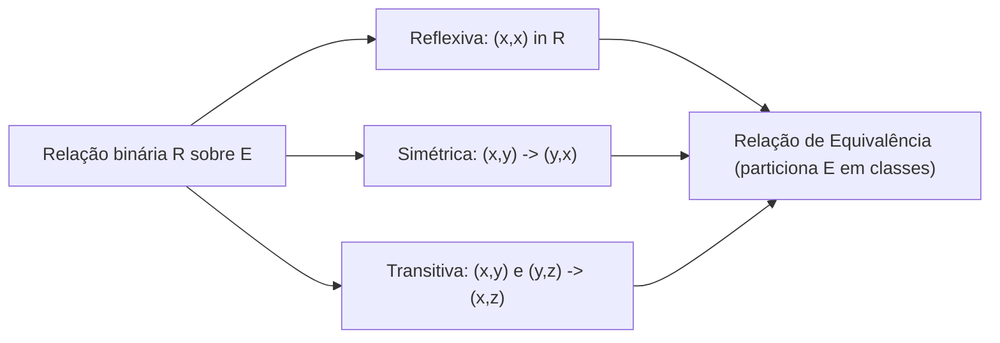

## Passo 1 · Leitura · Inclusão-exclusão, bijeções e relações de equivalência

Conjuntos, funções e relações são o idioma em que descrevemos tabelas hash, grafos e partições.

Quando contamos elementos na união de conjuntos que se sobrepõem, somar os tamanhos individuais conta mais de uma vez quem está nas interseções. O **Princípio da Inclusão-Exclusão** corrige a contagem alternando sinais:

$$|A \cup B| = |A| + |B| - |A \cap B|$$

$$|A \cup B \cup C| = |A| + |B| + |C| - |A \cap B| - |A \cap C| - |B \cap C| + |A \cap B \cap C|$$

Uma **função** $f: D \to C$ associa cada elemento do domínio $D$ a um único elemento do contradomínio $C$ (como um `dict` cujas chaves são $D$ e cujos valores pertencem a $C$). Sua imagem é $\text{Im}(f) = \{f(x) \mid x \in D\}$:
- **Injetora (1-para-1):** elementos distintos de $D$ nunca colidem no mesmo valor ($|D| = |\text{Im}(f)|$). Uma função de hash ideal sem colisões nas chaves presentes é injetora.
- **Sobrejetora:** todo elemento do contradomínio $C$ é atingido ($\text{Im}(f) = C$).
- **Bijetora:** é simultaneamente **injetora e sobrejetora**, o que garante que $f$ possui **função inversa** $f^{-1}: C \to D$.



Uma **relação binária** sobre um conjunto $E$ é um subconjunto do produto cartesiano $R \subseteq E \times E$ (um conjunto de pares `(x, y)`):
- Quando $R$ é **reflexiva**, **simétrica** e **transitiva**, ela é uma **relação de equivalência** e divide $E$ em **classes de equivalência** disjuntas (exatamente o que a estrutura *Union-Find* manterá no Módulo 7).
- Quando $R$ é **reflexiva**, **antissimétrica** (se $(x, y) \in R$ e $(y, x) \in R$, então $x = y$) e **transitiva**, ela define uma **ordem parcial** (como a grade de pré-requisitos de disciplinas, que ordenaremos topologicamente no Módulo 7).

## Passo 2 · Exercício · Princípio da inclusão-exclusão para 3 conjuntos

modo: lacunas

Complete as lacunas de `inclusao_exclusao(a, b, c)`, que recebe três coleções `a`, `b`, `c`, converte cada uma em `set` e devolve um dicionário com o tamanho da união calculado pela fórmula de inclusão-exclusão e com o tamanho da interseção tripla.

### Instruções

1. Converta `sa, sb, sc = set(a), set(b), set(c)`.
2. Calcule `uniao_formula` somando os tamanhos individuais, subtraindo os tamanhos das três interseções dois a dois (`sa & sb`, `sa & sc`, `sb & sc`) e somando de volta `len(sa & sb & sc)`.
3. Retorne `{"uniao": uniao_formula, "intersecao_tripla": len(sa & sb & sc), "confere_com_set": uniao_formula == len(sa | sb | sc)}`.

### Código inicial

```python
def inclusao_exclusao(a, b, c):
    sa, sb, sc = set(a), set(b), set(c)
    soma_individuais = len(sa) + len(sb) + len(sc)
    soma_pares = len(sa & sb) + len(sa & sc) + len(___ & ___)
    tripla = len(sa ___ sb ___ sc)
    uniao_formula = soma_individuais - ___ + ___
    return {
        "uniao": uniao_formula,
        "intersecao_tripla": tripla,
        "confere_com_set": uniao_formula == len(sa | sb | sc),
    }
```

### Solução

```python
def inclusao_exclusao(a, b, c):
    sa, sb, sc = set(a), set(b), set(c)
    soma_individuais = len(sa) + len(sb) + len(sc)
    soma_pares = len(sa & sb) + len(sa & sc) + len(sb & sc)
    tripla = len(sa & sb & sc)
    uniao_formula = soma_individuais - soma_pares + tripla
    return {
        "uniao": uniao_formula,
        "intersecao_tripla": tripla,
        "confere_com_set": uniao_formula == len(sa | sb | sc),
    }
```

### Dicas

1. O operador `&` entre conjuntos em Python calcula a interseção ($\cap$) e `|` calcula a união ($\cup$).
2. Quem pertence aos três conjuntos (`sa & sb & sc`) foi somado 3 vezes em `soma_individuais` e subtraído 3 vezes em `soma_pares`, por isso precisa ser somado de volta (`+ tripla`).

### Verificação

```json
[
  {
    "id": "inclusao-exclusao-tres-conjuntos",
    "name": "Calcula a união e a interseção tripla quando há sobreposição entre os 3 conjuntos",
    "checkpoint": 3,
    "kind": "call",
    "function": "inclusao_exclusao",
    "args": [
      [1, 2, 3, 4],
      [3, 4, 5, 6],
      [4, 6, 7]
    ],
    "expected": {
      "uniao": 7,
      "intersecao_tripla": 1,
      "confere_com_set": true
    }
  },
  {
    "id": "inclusao-exclusao-disjuntos",
    "name": "Funciona para conjuntos disjuntos (interseção tripla igual a 0)",
    "checkpoint": 3,
    "kind": "call",
    "function": "inclusao_exclusao",
    "args": [
      ["a", "b"],
      ["c"],
      ["d", "e"]
    ],
    "expected": {
      "uniao": 5,
      "intersecao_tripla": 0,
      "confere_com_set": true
    }
  }
]
```

### Soluções erradas

```python name="Esquece de somar de volta a interseção tripla"
def inclusao_exclusao(a, b, c):
    sa, sb, sc = set(a), set(b), set(c)
    soma_ind = len(sa) + len(sb) + len(sc)
    soma_par = len(sa & sb) + len(sa & sc) + len(sb & sc)
    tripla = len(sa & sb & sc)
    u = soma_ind - soma_par
    return {"uniao": u, "intersecao_tripla": tripla, "confere_com_set": u == len(sa | sb | sc)}
```

```python name="Soma os tamanhos sem subtrair as interseções dois a dois"
def inclusao_exclusao(a, b, c):
    sa, sb, sc = set(a), set(b), set(c)
    u = len(sa) + len(sb) + len(sc)
    return {"uniao": u, "intersecao_tripla": 0, "confere_com_set": True}
```

## Passo 3 · Exercício · Classificando funções como injetora, sobrejetora ou bijetora

Implemente `classificar_funcao(mapa, contradominio)`, onde `mapa` é um dicionário `{x: f(x)}` representando os pares do domínio e `contradominio` é uma coleção com todos os elementos de $C$.

### Instruções

1. Obtenha a lista de valores `valores = list(mapa.values())` e o conjunto imagem `imagem = set(valores)`, além de `c_set = set(contradominio)`.
2. A função é **injetora** se não há colisão de valores: `len(imagem) == len(valores)`.
3. A função é **sobrejetora** se a imagem cobre exatamente o contradomínio: `imagem == c_set`.
4. Retorne `"bijetora"` se for ambos, `"injetora"` se for apenas injetora, `"sobrejetora"` se for apenas sobrejetora, ou `"nenhuma"` caso contrário.

### Código inicial

```python
def classificar_funcao(mapa, contradominio):
    # Devolva "bijetora", "injetora", "sobrejetora" ou "nenhuma"
    pass
```

### Solução

```python
def classificar_funcao(mapa, contradominio):
    valores = list(mapa.values())
    imagem = set(valores)
    c_set = set(contradominio)
    injetora = len(imagem) == len(valores)
    sobrejetora = imagem == c_set
    if injetora and sobrejetora:
        return "bijetora"
    if injetora:
        return "injetora"
    if sobrejetora:
        return "sobrejetora"
    return "nenhuma"
```

### Dicas

1. Se duas chaves distintas têm o mesmo valor em `mapa.values()`, então `len(set(valores)) < len(valores)` e a função não é injetora.
2. Teste `injetora and sobrejetora` antes dos casos individuais para devolver `"bijetora"`.

### Verificação

```json
[
  {
    "id": "quatro-classificacoes-funcao",
    "name": "Classifica corretamente funções bijetora, apenas injetora, apenas sobrejetora e nenhuma",
    "checkpoint": 4,
    "kind": "expr",
    "expr": "[classificar_funcao({'a': 1, 'b': 2, 'c': 3}, [1, 2, 3]), classificar_funcao({'a': 1, 'b': 2}, [1, 2, 3]), classificar_funcao({'a': 1, 'b': 2, 'c': 2}, [1, 2]), classificar_funcao({'a': 1, 'b': 1}, [1, 2])]",
    "expected": [
      "bijetora",
      "injetora",
      "sobrejetora",
      "nenhuma"
    ]
  }
]
```

### Soluções erradas

```python name="Compara apenas os tamanhos do domínio e do contradomínio ignorando colisões"
def classificar_funcao(mapa, contradominio):
    if len(mapa) == len(set(contradominio)):
        return "bijetora"
    if len(mapa) < len(set(contradominio)):
        return "injetora"
    return "sobrejetora"
```

```python name="Retorna injetora antes de checar se também é sobrejetora"
def classificar_funcao(mapa, contradominio):
    valores = list(mapa.values())
    imagem = set(valores)
    injetora = len(imagem) == len(valores)
    sobrejetora = imagem == set(contradominio)
    if injetora:
        return "injetora"
    if sobrejetora:
        return "sobrejetora"
    return "nenhuma"
```

## Passo 4 · Exercício · Relação de equivalência e classes de equivalência

Implemente `eh_equivalencia(pares, elementos)` e `classes_de_equivalencia(pares, elementos)` para verificar se um conjunto de pares ordenados `(x, y)` sobre `elementos` forma uma relação de equivalência e, em caso afirmativo, devolver suas classes de equivalência ordenadas.

### Instruções

1. Em `eh_equivalencia(pares, elementos)`:
   - Converta `rel = set(map(tuple, pares))` e `elems = set(elementos)`.
   - **Reflexiva:** para todo `x` em `elems`, `(x, x)` deve estar em `rel`.
   - **Simétrica:** para todo `(x, y)` em `rel`, `(y, x)` deve estar em `rel`.
   - **Transitiva:** para todos `(x, y)` e `(y2, z)` em `rel` com `y == y2`, o par `(x, z)` deve estar em `rel`.
   - Retorne `True` se as três propriedades valerem, ou `False` caso contrário.
2. Em `classes_de_equivalencia(pares, elementos)`:
   - Para cada elemento `x`, sua classe é `tuple(sorted(y for y in elems if (x, y) in rel))`.
   - Colete as classes distintas, converta cada uma de volta para `list` e retorne a lista de classes ordenada pelo primeiro elemento de cada classe (`sorted([list(c) for c in set_classes])`).

### Código inicial

```python
def eh_equivalencia(pares, elementos):
    # Verifique reflexividade, simetria e transitividade
    pass


def classes_de_equivalencia(pares, elementos):
    # Devolva a lista ordenada de classes de equivalência (cada classe ordenada)
    pass
```

### Solução

```python
def eh_equivalencia(pares, elementos):
    rel = {(x, y) for x, y in pares}
    elems = set(elementos)
    for x in elems:
        if (x, x) not in rel:
            return False
    for x, y in rel:
        if (y, x) not in rel:
            return False
    for x, y in rel:
        for y2, z in rel:
            if y == y2 and (x, z) not in rel:
                return False
    return True


def classes_de_equivalencia(pares, elementos):
    rel = {(x, y) for x, y in pares}
    elems = sorted(set(elementos))
    classes_unicas = set()
    for x in elems:
        classe = tuple(y for y in elems if (x, y) in rel)
        classes_unicas.add(classe)
    return sorted([list(c) for c in classes_unicas])
```

### Dicas

1. Na transitividade, combine todos os pares `(x, y)` e `(y2, z)` de `rel`: sempre que `y == y2`, confira se `(x, z) in rel`.
2. Guardar cada classe como `tuple` ordenada dentro de um `set` elimina automaticamente duplicatas de elementos equivalentes entre si.

### Verificação

```json
[
  {
    "id": "testa-propriedades-equivalencia",
    "name": "Distingue relação de equivalência completa de relações sem reflexividade, simetria ou transitividade",
    "checkpoint": 1,
    "kind": "expr",
    "setup": "eq = [(1,1),(2,2),(3,3),(1,2),(2,1)]\nnao_trans = [(1,1),(2,2),(3,3),(1,2),(2,1),(2,3),(3,2)]\nnao_refl = [(1,1),(2,2)]",
    "expr": "[eh_equivalencia(eq, [1, 2, 3]), eh_equivalencia(nao_trans, [1, 2, 3]), eh_equivalencia(nao_refl, [1, 2, 3])]",
    "expected": [
      true,
      false,
      false
    ]
  },
  {
    "id": "particao-em-classes",
    "name": "Extrai a partição em classes de equivalência ordenadas",
    "checkpoint": 2,
    "kind": "call",
    "function": "classes_de_equivalencia",
    "args": [
      [[1, 1], [2, 2], [3, 3], [4, 4], [1, 3], [3, 1], [2, 4], [4, 2]],
      [1, 2, 3, 4]
    ],
    "expected": [
      [1, 3],
      [2, 4]
    ]
  }
]
```

### Soluções erradas

```python name="Verifica apenas reflexividade e simetria esquecendo a transitividade"
def eh_equivalencia(pares, elementos):
    rel = {(x, y) for x, y in pares}
    for x in elementos:
        if (x, x) not in rel:
            return False
    for x, y in rel:
        if (y, x) not in rel:
            return False
    return True


def classes_de_equivalencia(pares, elementos):
    return [[x] for x in sorted(elementos)]
```

```python name="Repete a mesma classe para cada membro sem deduplicar a partição"
def eh_equivalencia(pares, elementos):
    return True


def classes_de_equivalencia(pares, elementos):
    rel = {(x, y) for x, y in pares}
    elems = sorted(set(elementos))
    return [[y for y in elems if (x, y) in rel] for x in elems]
```

## Passo 5 · Quiz · Funções inversas e relações

### Pergunta

Para que uma função $f: D \to C$ possua função inversa $f^{-1}: C \to D$ bem definida em todo o conjunto $C$, qual condição é necessária e suficiente?

- [ ] Que $f$ seja apenas injetora.
- [ ] Que $f$ seja apenas sobrejetora.
- [x] Que $f$ seja bijetora (injetora para que cada valor venha de um único elemento de $D$, e sobrejetora para que todo elemento de $C$ tenha pré-imagem).
- [ ] Que $D$ e $C$ sejam conjuntos vazios.

> Se $f$ não for injetora, $f^{-1}(y)$ teria mais de um candidato; se não for sobrejetora, existiria $y \in C$ sem valor para $f^{-1}(y)$.

### Pergunta

Considere a relação $R$ sobre os números inteiros definida por $x \sim y \iff (x - y)$ é múltiplo de $3$ (congruência módulo 3). Quantas classes de equivalência essa relação produz?

- [ ] Infinitas classes unitárias.
- [x] Exatamente 3 classes disjuntas, correspondentes aos restos $0$, $1$ e $2$ na divisão por $3$.
- [ ] Apenas 1 classe contendo todos os inteiros.
- [ ] Nenhuma, pois a relação não é simétrica.

> Dois inteiros são equivalentes módulo 3 se e somente se deixam o mesmo resto ao dividir por 3, particionando $\mathbb{Z}$ em 3 classes de equivalência.
