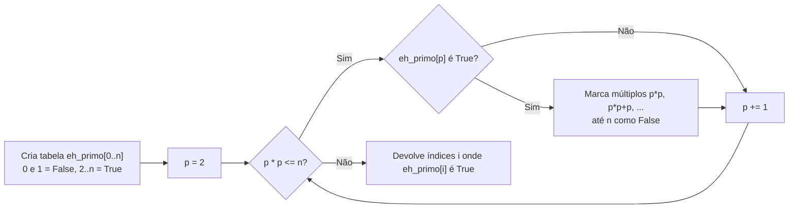

## Passo 1 · Leitura · Resto, congruências e dígitos verificadores

Quando dividimos um inteiro $a$ por um inteiro positivo $m$, obtemos um quociente $q$ e um resto $r$ tais que:

$$
a = q \cdot m + r, \quad \text{com } 0 \le r < m
$$

Dizemos que dois inteiros $a$ e $b$ são **congruentes módulo $m$** — escrito $a \equiv b \pmod m$ — quando deixam o mesmo resto na divisão por $m$ (ou, equivalentemente, quando $m$ divide $a - b$).

Aritmética modular é a matemática dos relógios, dos dias da semana, das tabelas hash (`hash(chave) % capacidade`) e da criptografia. Uma propriedade crucial é que podemos **reduzir módulo $m$ a cada passo** de uma soma ou multiplicação sem alterar o resto final:

$$
(a + b) \bmod m = ((a \bmod m) + (b \bmod m)) \bmod m
$$

$$
(a \cdot b) \bmod m = ((a \bmod m) \cdot (b \bmod m)) \bmod m
$$

#### O operador `%` com negativos no Python

Diferente de linguagens como C ou Java (onde `-7 % 3` resulta em `-1`), no Python o resultado de `a % m` (para $m > 0$) é **sempre não negativo**, no intervalo $[0, m-1]$. Assim, `-7 % 3` vale `2`, pois $-7 = (-3) \cdot 3 + 2$. Isso é perfeito para índices circulares: se hoje é dia `d` da semana (`0` a `6`), `k` dias atrás foi `(d - k) % 7`, sem risco de índice negativo!

#### Aplicação real: os dígitos verificadores do CPF

O CPF possui 9 dígitos base ($d_1 d_2 \dots d_9$) e 2 dígitos verificadores ($v_1, v_2$) calculados com aritmética módulo 11 para detectar erros de digitação:

1. **Primeiro dígito ($v_1$):** multiplicamos os 9 dígitos pelos pesos decrescentes de $10$ até $2$:
   $$S_1 = 10 d_1 + 9 d_2 + 8 d_3 + \dots + 2 d_9$$
   Calculamos $r_1 = (S_1 \cdot 10) \bmod 11$. Se $r_1 == 10$, então $v_1 = 0$; caso contrário, $v_1 = r_1$.
2. **Segundo dígito ($v_2$):** agora incluímos $v_1$ ao final dos 9 dígitos e multiplicamos os 10 dígitos pelos pesos decrescentes de $11$ até $2$:
   $$S_2 = 11 d_1 + 10 d_2 + \dots + 3 d_9 + 2 v_1$$
   Calculamos $r_2 = (S_2 \cdot 10) \bmod 11$. Se $r_2 == 10$, então $v_2 = 0$; caso contrário, $v_2 = r_2$.

## Passo 2 · Exercício · Dígito verificador do CPF

Implemente a função `digito_verificador_cpf(nove_digitos)`, que recebe uma string contendo exatamente os 9 primeiros dígitos de um CPF (ex.: `"123456789"`) e devolve uma string de 2 caracteres com os dígitos verificadores `"v1v2"` (ex.: `"09"`).

### Instruções
1. Converta cada caractere de `nove_digitos` para inteiro e calcule a soma ponderada $S_1$ com pesos de `10` até `2`.
2. Obtenha o primeiro dígito `v1 = (S1 * 10) % 11`, trocando `10` por `0`.
3. Calcule a segunda soma ponderada $S_2$ sobre os 9 dígitos seguidos de `v1`, com pesos de `11` até `2`, obtenha `v2 = (S2 * 10) % 11` (trocando `10` por `0`) e devolva `f"{v1}{v2}"`.

### Código inicial
```python
def digito_verificador_cpf(nove_digitos):
    # Devolva os dois dígitos verificadores como string de 2 caracteres
    pass
```

### Solução
```python
def digito_verificador_cpf(nove_digitos):
    digitos = [int(c) for c in nove_digitos]
    soma1 = sum(d * peso for d, peso in zip(digitos, range(10, 1, -1)))
    v1 = (soma1 * 10) % 11
    if v1 == 10:
        v1 = 0
    digitos.append(v1)
    soma2 = sum(d * peso for d, peso in zip(digitos, range(11, 1, -1)))
    v2 = (soma2 * 10) % 11
    if v2 == 10:
        v2 = 0
    return f"{v1}{v2}"
```

### Dicas
1. `range(10, 1, -1)` gera os pesos `10, 9, 8, 7, 6, 5, 4, 3, 2`.
2. Se `(soma * 10) % 11` resultar em `10`, o dígito verificador deve ser `0` (você também pode fazer `((soma * 10) % 11) % 10`).
3. Não se esqueça de incluir `v1` como o 10º número (com peso `2`) no cálculo de `v2`.

### Verificação
```json
[
  {
    "id": "cpf-123456789",
    "checkpoint": 1,
    "kind": "call",
    "function": "digito_verificador_cpf",
    "args": ["123456789"],
    "expected": "09",
    "type": "str",
    "name": "digito_verificador_cpf('123456789') devolve '09'"
  },
  {
    "id": "cpf-111444777",
    "checkpoint": 2,
    "kind": "call",
    "function": "digito_verificador_cpf",
    "args": ["111444777"],
    "expected": "35",
    "type": "str",
    "name": "digito_verificador_cpf('111444777') devolve '35'"
  },
  {
    "id": "cpf-resto-10",
    "checkpoint": 3,
    "kind": "call",
    "function": "digito_verificador_cpf",
    "args": ["000000006"],
    "expected": "04",
    "type": "str",
    "name": "Trata resto 10 virando dígito 0 ('000000006' -> '04')",
    "hint": "Quando (soma * 10) % 11 for 10, o dígito verificador deve ser 0."
  },
  {
    "id": "cpf-529982247",
    "checkpoint": 3,
    "kind": "call",
    "function": "digito_verificador_cpf",
    "args": ["529982247"],
    "expected": "25",
    "type": "str",
    "name": "digito_verificador_cpf('529982247') devolve '25'"
  }
]
```

### Soluções erradas
```python name="esquece de trocar 10 por 0"
def digito_verificador_cpf(nove_digitos):
    digitos = [int(c) for c in nove_digitos]
    soma1 = sum(d * peso for d, peso in zip(digitos, range(10, 1, -1)))
    v1 = (soma1 * 10) % 11
    digitos.append(v1)
    soma2 = sum(d * peso for d, peso in zip(digitos, range(11, 1, -1)))
    v2 = (soma2 * 10) % 11
    return f"{v1}{v2}"
```
```python name="não inclui v1 no cálculo de v2"
def digito_verificador_cpf(nove_digitos):
    digitos = [int(c) for c in nove_digitos]
    soma1 = sum(d * peso for d, peso in zip(digitos, range(10, 1, -1)))
    v1 = ((soma1 * 10) % 11) % 10
    soma2 = sum(d * peso for d, peso in zip(digitos, range(10, 1, -1)))
    v2 = ((soma2 * 10) % 11) % 10
    return f"{v1}{v2}"
```

## Passo 3 · Leitura · MDC com o Algoritmo de Euclides e MMC

O **Máximo Divisor Comum** $\text{mdc}(a, b)$ é o maior inteiro positivo que divide simultaneamente $a$ e $b$. Testar todos os divisores possíveis de $1$ até $\min(a, b)$ é lento demais quando os números têm dezenas de dígitos.

O **Algoritmo de Euclides** (c. 300 a.C.) baseia-se em uma observação simples: qualquer divisor comum de $a$ e $b$ também divide o resto $a \bmod b$. Portanto:

$$
\text{mdc}(a, b) = \begin{cases} a, & \text{se } b = 0 \\ \text{mdc}(b, a \bmod b), & \text{se } b > 0 \end{cases}
$$

Por que ele termina tão rápido? A cada dois passos da recursão, o primeiro argumento cai **pela metade ou mais** (pois se $a \ge b$, então $a \bmod b < a / 2$). Isso significa que o número de divisões é proporcional a $\log_2(\min(a, b))$: mesmo para números da ordem de $10^{18}$, o algoritmo dá no máximo ~90 passos!

A partir do MDC, obtemos o **Mínimo Múltiplo Comum** ($\text{mmc}$) sem precisar fatorar nada, usando a identidade $\text{mdc}(a, b) \cdot \text{mmc}(a, b) = a \cdot b$:

$$
\text{mmc}(a, b) = \frac{a \cdot b}{\text{mdc}(a, b)} = (a // \text{mdc}(a, b)) \cdot b
$$

Veja no visualizador como `mdc(252, 105)` converge em apenas 3 chamadas:

```python visualizar
def mdc(a, b):
    if b == 0:
        return a
    return mdc(b, a % b)

resultado = mdc(252, 105)
print("MDC(252, 105) =", resultado)
```

## Passo 4 · Exercício · MDC recursivo e MMC
modo: lacunas

Complete as lacunas para implementar `mdc(a, b)` de forma recursiva pelo Algoritmo de Euclides e `mmc(a, b)` usando divisão inteira.

### Instruções
1. No caso base de `mdc(a, b)`, quando `b == 0`, devolva `a`.
2. No passo recursivo de `mdc(a, b)`, chame `mdc(b, a % b)`.
3. Em `mmc(a, b)`, devolva `0` se `a == 0` ou `b == 0`; caso contrário, devolva `(a // mdc(a, b)) * b`.

### Código inicial
```python
def mdc(a, b):
    if b == ___:
        return a
    return mdc(b, ___)


def mmc(a, b):
    if a == 0 or b == 0:
        return 0
    return (a // ___) * b
```

### Solução
```python
def mdc(a, b):
    if b == 0:
        return a
    return mdc(b, a % b)


def mmc(a, b):
    if a == 0 or b == 0:
        return 0
    return (a // mdc(a, b)) * b
```

### Dicas
1. A condição de parada de Euclides ocorre quando o segundo parâmetro chega a `0`.
2. Na chamada recursiva, o novo segundo parâmetro é o resto da divisão de `a` por `b` (`a % b`).
3. Em `mmc(a, b)`, divida `a` inteiramente por `mdc(a, b)` antes de multiplicar por `b`.

### Verificação
```json
[
  {
    "id": "mdc-recursivo",
    "checkpoint": 2,
    "kind": "source",
    "rule": { "type": "uses", "construct": "recursion" },
    "name": "mdc é implementada com recursão"
  },
  {
    "id": "mdc-casos",
    "checkpoint": 1,
    "kind": "call",
    "function": "mdc",
    "args": [252, 105],
    "expected": 21,
    "name": "mdc(252, 105) devolve 21"
  },
  {
    "id": "mdc-primos-entre-si",
    "checkpoint": 2,
    "kind": "call",
    "function": "mdc",
    "args": [1000000007, 1000000009],
    "expected": 1,
    "name": "mdc(1000000007, 1000000009) devolve 1 rapidamente"
  },
  {
    "id": "mmc-casos",
    "checkpoint": 3,
    "kind": "call",
    "function": "mmc",
    "args": [12, 18],
    "expected": 36,
    "name": "mmc(12, 18) devolve 36"
  },
  {
    "id": "mmc-zero",
    "checkpoint": 3,
    "kind": "call",
    "function": "mmc",
    "args": [0, 15],
    "expected": 0,
    "name": "mmc(0, 15) devolve 0"
  }
]
```

### Soluções erradas
```python name="troca resto por divisão inteira"
def mdc(a, b):
    if b == 0:
        return a
    return mdc(b, a // b)


def mmc(a, b):
    if a == 0 or b == 0:
        return 0
    return (a // mdc(a, b)) * b
```
```python name="divide por b em vez de mdc(a, b)"
def mdc(a, b):
    if b == 0:
        return a
    return mdc(b, a % b)


def mmc(a, b):
    if a == 0 or b == 0:
        return 0
    return (a // b) * b
```

## Passo 5 · Leitura · Números primos, limite $\sqrt{n}$ e o Crivo de Eratóstenes

Um inteiro $p \ge 2$ é **primo** se seus únicos divisores positivos são $1$ e $p$.

#### Por que basta testar até $\sqrt{n}$?

Se $n$ é composto, podemos escrevê-lo como $n = a \cdot b$ com $1 < a \le b < n$. Se ambos os fatores fossem maiores que $\sqrt{n}$, o produto $a \cdot b$ seria maior que $\sqrt{n} \cdot \sqrt{n} = n$, o que é impossível! Logo, **todo número composto $n$ possui pelo menos um divisor primo menor ou igual a $\sqrt{n}$**.

Para testar um único número $n$, testar divisores até $\lfloor\sqrt{n}\rfloor$ leva tempo proporcional a $\sqrt{n}$. Mas e se quisermos encontrar **todos os primos até $n$**?

#### O Crivo de Eratóstenes

Em vez de testar divisores para cada número isoladamente, o **Crivo de Eratóstenes** faz o inverso: cria uma lista booleana `eh_primo` de tamanho $n + 1$ (inicialmente `True` de `2` até `n`) e, para cada primo $p$ encontrado até $\lfloor\sqrt{n}\rfloor$, **risca todos os seus múltiplos**:



Repare em dois detalhes que evitam trabalho inútil:
1. O laço externo de $p$ para quando `p * p > n` (isto é, $p > \sqrt{n}$), pois qualquer composto $\le n$ já terá sido riscado por seu menor fator primo $\le \sqrt{n}$.
2. O laço interno que risca os múltiplos de $p$ começa em **`p * p`** (e não em `2 * p`!): todos os múltiplos menores ($2p, 3p, \dots, (p-1)p$) já foram riscados antes quando processamos fatores primos menores que $p$.

O custo total do crivo é proporcional a $n \ln \ln n$ — quase linear! Ele encontra todos os primos até $200\,000$ em poucos milissegundos.

## Passo 6 · Exercício · Crivo de Eratóstenes

Implemente `crivo(n)`, que recebe um inteiro `n` ($n \ge 0$) e devolve a lista ordenada de todos os números primos menores ou iguais a `n`. Sua implementação será testada com `n = 200_000`, portanto um teste ingênuo de divisores até `n` para cada número estourará o tempo.

### Instruções
1. Se `n < 2`, devolva uma lista vazia `[]`.
2. Crie uma lista booleana `eh_primo = [True] * (n + 1)` e marque `eh_primo[0] = eh_primo[1] = False`.
3. Para cada `p` enquanto `p * p <= n`, se `eh_primo[p]` for verdadeiro, marque todos os múltiplos de `p * p` até `n` (com passo `p`) como `False`.
4. Devolva a lista `[i for i in range(2, n + 1) if eh_primo[i]]`.

### Código inicial
```python
def crivo(n):
    # Devolva a lista de todos os primos <= n usando o Crivo de Eratóstenes
    pass
```

### Solução
```python
def crivo(n):
    if n < 2:
        return []
    eh_primo = [True] * (n + 1)
    eh_primo[0] = False
    eh_primo[1] = False
    p = 2
    while p * p <= n:
        if eh_primo[p]:
            for multiplo in range(p * p, n + 1, p):
                eh_primo[multiplo] = False
        p += 1
    return [i for i in range(2, n + 1) if eh_primo[i]]
```

### Dicas
1. Em `range(p * p, n + 1, p)`, o terceiro argumento `p` faz o laço pular de múltiplo em múltiplo (`p*p`, `p*p + p`, `p*p + 2*p`, ...).
2. Não se esqueça de incluir `n` quando `n` for primo: a lista tem tamanho `n + 1` e o `range` final vai até `n + 1`.

### Verificação
```json
[
  {
    "id": "crivo-pequeno",
    "checkpoint": 1,
    "kind": "call",
    "function": "crivo",
    "args": [1],
    "expected": [],
    "name": "crivo(1) devolve []"
  },
  {
    "id": "crivo-30",
    "checkpoint": 2,
    "kind": "call",
    "function": "crivo",
    "args": [30],
    "expected": [2, 3, 5, 7, 11, 13, 17, 19, 23, 29],
    "name": "crivo(30) devolve os 10 primeiros primos"
  },
  {
    "id": "crivo-limite-primo",
    "checkpoint": 3,
    "kind": "call",
    "function": "crivo",
    "args": [13],
    "expected": [2, 3, 5, 7, 11, 13],
    "name": "crivo(13) inclui o próprio 13"
  },
  {
    "id": "crivo-200k-desempenho",
    "checkpoint": 4,
    "kind": "expr",
    "setup": "primos = crivo(200000)",
    "expr": "[len(primos), primos[0], primos[-1]]",
    "expected": [17984, 2, 199999],
    "name": "crivo(200000) encontra os 17.984 primos até 200.000 rapidamente",
    "hint": "Use o Crivo de Eratóstenes marcando múltiplos de p*p até n com passo p."
  }
]
```

### Soluções erradas
```python name="inclui 0 e 1 como primos"
def crivo(n):
    eh_primo = [True] * (n + 1)
    p = 2
    while p * p <= n:
        if eh_primo[p]:
            for m in range(p * p, n + 1, p):
                eh_primo[m] = False
        p += 1
    return [i for i in range(n + 1) if eh_primo[i]]
```
```python name="esquece de incluir n no limite do range"
def crivo(n):
    if n < 2:
        return []
    eh_primo = [True] * n
    eh_primo[0] = False
    eh_primo[1] = False
    p = 2
    while p * p < n:
        if eh_primo[p]:
            for m in range(p * p, n, p):
                eh_primo[m] = False
        p += 1
    return [i for i in range(2, n) if eh_primo[i]]
```

## Passo 7 · Leitura · Exponenciação modular rápida em $O(\log e)$

Em criptografia (como RSA e Diffie-Hellman) e em testes probabilísticos de primalidade, precisamos calcular $a^e \bmod m$ para expoentes gigantescos, como $e \approx 10^{18}$.

Calcular `a ** e % m` diretamente é inviável: um número com $10^{18}$ bits não cabe na memória do planeta, e um laço multiplicando $a$ por si mesmo $10^{18}$ vezes levaria séculos.

A solução é a **exponenciação por quadrados sucessivos** (*binary exponentiation*):

$$
a^e = \begin{cases}
1, & \text{se } e = 0 \\
\left(a^2\right)^{e/2}, & \text{se } e \text{ é par} \\
a \cdot \left(a^2\right)^{(e-1)/2}, & \text{se } e \text{ é ímpar}
\end{cases}
$$

A cada passo, dividimos o expoente $e$ por $2$ (`e //= 2`) e elevamos a base ao quadrado módulo $m$ (`base = (base * base) % m`). Se o expoente atual era ímpar (`e % 2 == 1`), multiplicamos o acumulador `resultado` pela `base` atual módulo $m$.

Como o expoente cai pela metade a cada iteração, para $e = 10^{18}$ o laço executa no máximo $\lfloor\log_2(10^{18})\rfloor + 1 = 60$ iterações! No Python, a função embutida `pow(base, exp, mod)` implementa exatamente esse algoritmo em C. No exercício a seguir, você vai implementá-lo do zero.

## Passo 8 · Exercício · Exponenciação modular sem `pow`

Implemente `pot_mod(base, exp, mod)` usando o método de quadrados sucessivos, **sem chamar a função embutida `pow`**. Sua função deve suportar expoentes da ordem de $10^{18}$ instantaneamente.

### Instruções
1. Inicialize `resultado = 1 % mod` e reduza `base = base % mod`.
2. Enquanto `exp > 0`, se `exp` for ímpar (`exp % 2 == 1`), atualize `resultado = (resultado * base) % mod`.
3. Em cada iteração do laço, eleve a base ao quadrado módulo `mod` (`base = (base * base) % mod`) e divida `exp` por 2 (`exp //= 2`).
4. Ao final do laço, devolva `resultado`.

### Código inicial
```python
def pot_mod(base, exp, mod):
    # Calcule (base ** exp) % mod por quadrados sucessivos, sem usar pow()
    pass
```

### Solução
```python
def pot_mod(base, exp, mod):
    resultado = 1 % mod
    base = base % mod
    while exp > 0:
        if exp % 2 == 1:
            resultado = (resultado * base) % mod
        base = (base * base) % mod
        exp //= 2
    return resultado
```

### Dicas
1. Nunca calcule `base ** exp`: mantenha tanto `resultado` quanto `base` reduzidos módulo `mod` a cada multiplicação.
2. Quando `mod == 1`, qualquer resto módulo `1` é `0` — começar com `resultado = 1 % mod` já trata esse caso de borda automaticamente!

### Verificação
```json
[
  {
    "id": "sem-pow",
    "checkpoint": 1,
    "kind": "source",
    "rule": { "type": "not_calls", "name": "pow" },
    "name": "Não utiliza a função embutida pow()"
  },
  {
    "id": "pot-pequeno",
    "checkpoint": 2,
    "kind": "call",
    "function": "pot_mod",
    "args": [2, 10, 1000],
    "expected": 24,
    "name": "pot_mod(2, 10, 1000) devolve 24"
  },
  {
    "id": "pot-exp-zero",
    "checkpoint": 1,
    "kind": "call",
    "function": "pot_mod",
    "args": [99, 0, 7],
    "expected": 1,
    "name": "pot_mod(99, 0, 7) devolve 1"
  },
  {
    "id": "pot-mod-um",
    "checkpoint": 1,
    "kind": "call",
    "function": "pot_mod",
    "args": [5, 0, 1],
    "expected": 0,
    "name": "pot_mod(5, 0, 1) devolve 0"
  },
  {
    "id": "pot-gigante",
    "checkpoint": 3,
    "kind": "expr",
    "expr": "pot_mod(7, 10**18, 1000000007)",
    "expected": 259616729,
    "name": "pot_mod(7, 10**18, 1000000007) executa em O(log exp) e devolve 259616729"
  },
  {
    "id": "pot-fermat",
    "checkpoint": 4,
    "kind": "call",
    "function": "pot_mod",
    "args": [123456789, 1000000006, 1000000007],
    "expected": 1,
    "name": "Pequeno Teorema de Fermat: a^(p-1) mod p == 1 para p = 1000000007"
  }
]
```

### Soluções erradas
```python name="usa operador ** direto e estoura memória/tempo"
def pot_mod(base, exp, mod):
    return (base ** exp) % mod
```
```python name="esquece de elevar a base ao quadrado"
def pot_mod(base, exp, mod):
    resultado = 1 % mod
    base = base % mod
    while exp > 0:
        if exp % 2 == 1:
            resultado = (resultado * base) % mod
        exp //= 2
    return resultado
```

## Passo 9 · Quiz · Congruências, Euclides e exponenciação modular

### Pergunta
Qual é o valor da expressão `-11 % 4` em Python e por quê?
- [ ] `-3`, porque `-11 = (-2) * 4 + (-3)` e o resto acompanha o sinal do dividendo.
- [x] `1`, porque para divisor positivo o operador `%` no Python devolve o resto no intervalo `[0, 3]`, satisfazendo `-11 = (-3) * 4 + 1`.
- [ ] `3`, porque o Python simplesmente calcula `abs(-11) % 4`.
- [ ] Levanta `ValueError`, pois aritmética modular não é definida para negativos.
> Em Python, o resto `a % m` tem sempre o mesmo sinal do divisor `m`. Para `m = 4`, o resto fica sempre em `{0, 1, 2, 3}`, e como `-12` é o maior múltiplo de `4` menor ou igual a `-11`, o resto é `-11 - (-12) = 1`.

### Pergunta
Por que o laço interno do Crivo de Eratóstenes pode começar marcando os múltiplos de um primo $p$ a partir de $p^2$ em vez de $2p$?
- [ ] Porque números pares já foram removidos antes do crivo começar.
- [x] Porque qualquer múltiplo composto de $p$ menor que $p^2$ é da forma $k \cdot p$ com $2 \le k < p$, e portanto já possui um fator primo menor que $p$ que o riscou em uma iteração anterior.
- [ ] Porque não existem múltiplos de $p$ entre $2p$ e $p^2$.
- [ ] Apenas para economizar memória na lista booleana.
> Todo composto $k \cdot p$ com $k < p$ tem pelo menos um fator primo $q \le k < p$, de modo que ele já foi marcado como `False` quando o crivo processou o primo $q$.

### Pergunta
Aproximadamente quantas divisões pela metade a exponenciação por quadrados sucessivos (`pot_mod(base, exp, mod)`) realiza quando `exp` é $2^{60}$?
- [ ] Cerca de $2^{30}$ divisões (a raiz quadrada do expoente).
- [x] Cerca de $61$ iterações, pois o expoente é dividido por 2 a cada passo ($\log_2(2^{60}) = 60$).
- [ ] Cerca de $2^{60}$ multiplicações.
- [ ] Depende do valor da `base` e de `mod`.
> Como `exp //= 2` reduz o expoente pela metade a cada iteração do laço `while`, o número de iterações é $\lfloor\log_2(\text{exp})\rfloor + 1 = 61$.
