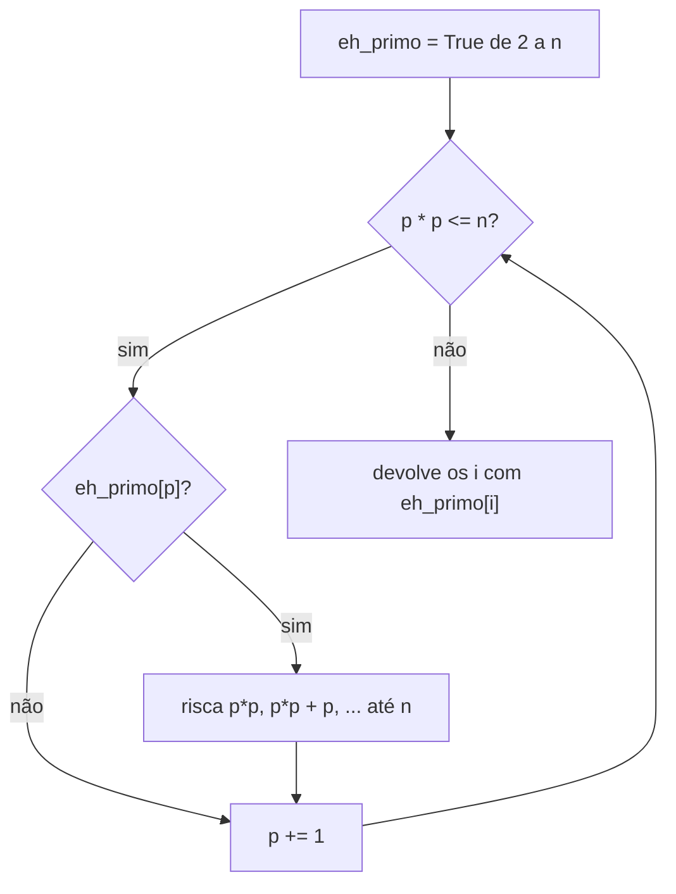

## Passo 1 · Leitura · Resto, congruência e o % do Python

Dividir um inteiro $a$ por um inteiro positivo $m$ dá um quociente $q$ e um resto $r$ **únicos** com

$$
a = q \cdot m + r, \qquad 0 \le r < m
$$

Em Python, `q = a // m` e `r = a % m`. Dois inteiros são **congruentes módulo $m$**, $a \equiv b \pmod m$, quando deixam o mesmo resto, ou seja, quando $m$ divide $a - b$. É a matemática do relógio: 25 horas depois das 10h são 11h, porque $35 \equiv 11 \pmod{24}$.

O resto pode ser tirado **a cada passo** de uma soma ou de um produto, sem mudar o resto final:

$$
(a + b) \bmod m = \big((a \bmod m) + (b \bmod m)\big) \bmod m \qquad (a \cdot b) \bmod m = \big((a \bmod m) \cdot (b \bmod m)\big) \bmod m
$$

É isso que mantém os números pequenos em hash, criptografia e dígitos verificadores.

Com negativos, o Python escolhe o quociente arredondando **para baixo**, e o resto fica com o sinal do divisor: `-7 // 3` é `-3` e `-7 % 3` é `2`, porque $-7 = (-3) \cdot 3 + 2$. Em C e Java, `-7 % 3` dá `-1`. Por isso, no Python, andar para trás num ciclo é seguro. Só cuidado com a precedência: `%` vem antes de `+` e `-`.

```python
dias = ["dom", "seg", "ter", "qua", "qui", "sex", "sáb"]
hoje = 2                          # ter
print(dias[(hoje - 3) % 7])       # sáb: três dias antes de terça
print(dias[(hoje + 100) % 7])     # qui
print(hoje - 3 % 7)               # -1: é hoje - (3 % 7), sem ciclo nenhum
```

O último índice, `-1`, não dá erro: `dias[-1]` é o último elemento da lista. O bug passa em silêncio.

#### Dígitos verificadores do CPF

O CPF tem 9 dígitos $d_1 \dots d_9$ e 2 verificadores, que pegam erros de digitação.

- Para o **primeiro**, some os dígitos com pesos de 10 a 2: $S_1 = 10 d_1 + 9 d_2 + \dots + 2 d_9$. O verificador é $(10\,S_1) \bmod 11$, trocando 10 por 0.
- Para o **segundo**, acrescente o primeiro verificador aos 9 dígitos e use pesos de 11 a 2 nos 10 dígitos.

Para `123456789`, $S_1 = 210$ e $2100 \bmod 11 = 10$: o primeiro verificador vira 0. Com ele, $S_2 = 255$, e $2550 \bmod 11 = 9$. Os verificadores são `09`. Trocar dois dígitos vizinhos muda $S_1$, porque os pesos são diferentes. É por isso que o verificador pega essa troca.

## Passo 2 · Exercício · CPF e dias da semana

Escreva duas funções:

- `digito_verificador_cpf(nove_digitos)` recebe uma string com os 9 primeiros dígitos de um CPF e devolve uma **string** de 2 caracteres com os verificadores. Exemplo: `digito_verificador_cpf("123456789")` é `"09"`.
- `dia_da_semana(hoje, deslocamento)` recebe o nome de um dia da lista `DIAS` e um inteiro (negativo = dias atrás) e devolve o nome do dia resultante. Exemplo: `dia_da_semana("ter", -3)` é `"sáb"`.

### Instruções
1. Calcule o primeiro verificador com os pesos de 10 a 2, trocando 10 por 0.
2. Calcule o segundo com os 10 dígitos (os 9 e o primeiro verificador), pesos de 11 a 2, e devolva os dois como texto.
3. Em `dia_da_semana`, ache a posição de `hoje`, desloque e volte ao ciclo de 7 dias com `%`.

### Código inicial
```python
DIAS = ["dom", "seg", "ter", "qua", "qui", "sex", "sáb"]


def digito_verificador_cpf(nove_digitos):
    pass


def dia_da_semana(hoje, deslocamento):
    pass
```

### Solução
```python
DIAS = ["dom", "seg", "ter", "qua", "qui", "sex", "sáb"]


def digito_verificador_cpf(nove_digitos):
    digitos = [int(c) for c in nove_digitos]
    soma1 = sum(d * peso for d, peso in zip(digitos, range(10, 1, -1)))
    v1 = (soma1 * 10) % 11 % 10
    digitos.append(v1)
    soma2 = sum(d * peso for d, peso in zip(digitos, range(11, 1, -1)))
    v2 = (soma2 * 10) % 11 % 10
    return f"{v1}{v2}"


def dia_da_semana(hoje, deslocamento):
    return DIAS[(DIAS.index(hoje) + deslocamento) % 7]
```

### Dicas
1. `range(10, 1, -1)` gera os pesos 10, 9, ..., 2. Com `zip`, cada dígito pega o seu peso.
2. O resultado é texto: o CPF `123.456.789-09` começa o verificador com zero.
3. Em `dia_da_semana`, o `%` precisa valer para a soma inteira. Confira os parênteses.

### Verificação
```json
[
  { "id": "cpf-v1-zero", "checkpoint": 1, "kind": "call", "function": "digito_verificador_cpf", "args": ["123456789"], "expected": "09", "type": "str",
    "name": "123456789 tem verificadores '09'", "hint": "Quando o resto é 10, o dígito é 0. E o resultado é texto com 2 caracteres." },
  { "id": "cpf-35", "checkpoint": 2, "kind": "call", "function": "digito_verificador_cpf", "args": ["111444777"], "expected": "35",
    "name": "111444777 tem verificadores '35'" },
  { "id": "cpf-25", "checkpoint": 2, "kind": "call", "function": "digito_verificador_cpf", "args": ["529982247"], "expected": "25",
    "name": "529982247 tem verificadores '25'" },
  { "id": "cpf-v2-zero", "checkpoint": 2, "kind": "call", "function": "digito_verificador_cpf", "args": ["987654321"], "expected": "00",
    "name": "987654321 tem verificadores '00' (os dois restos dão 0 ou 10)" },
  { "id": "cpf-v2-dez", "checkpoint": 2, "kind": "call", "function": "digito_verificador_cpf", "args": ["100000028"], "expected": "10",
    "name": "100000028 tem verificadores '10' (o segundo resto é 10)",
    "hint": "O segundo verificador também troca 10 por 0." },
  { "id": "dia-zero", "checkpoint": 3, "kind": "expr", "expr": "[dia_da_semana('seg', 0), dia_da_semana('seg', 3)]", "expected": ["seg", "qui"],
    "name": "seg + 0 é seg; seg + 3 é qui" },
  { "id": "dia-volta", "checkpoint": 3, "kind": "expr", "expr": "[dia_da_semana('sáb', 3), dia_da_semana('qua', 7002)]", "expected": ["ter", "sex"],
    "name": "Passando do sábado volta ao domingo; 7002 dias depois de quarta é sexta",
    "hint": "O índice precisa voltar para 0..6 depois de somar o deslocamento." },
  { "id": "dia-atras", "checkpoint": 3, "kind": "expr", "expr": "[dia_da_semana('ter', -3), dia_da_semana('dom', -1), dia_da_semana('qua', -7002)]", "expected": ["sáb", "sáb", "seg"],
    "name": "Deslocamentos negativos andam para trás no ciclo" }
]
```

### Soluções erradas
```python name="não troca o resto 10 por 0"
DIAS = ["dom", "seg", "ter", "qua", "qui", "sex", "sáb"]


def digito_verificador_cpf(nove_digitos):
    digitos = [int(c) for c in nove_digitos]
    soma1 = sum(d * peso for d, peso in zip(digitos, range(10, 1, -1)))
    v1 = (soma1 * 10) % 11
    digitos.append(v1)
    soma2 = sum(d * peso for d, peso in zip(digitos, range(11, 1, -1)))
    v2 = (soma2 * 10) % 11
    return f"{v1}{v2}"


def dia_da_semana(hoje, deslocamento):
    return DIAS[(DIAS.index(hoje) + deslocamento) % 7]
```
```python name="segundo verificador sem o primeiro"
DIAS = ["dom", "seg", "ter", "qua", "qui", "sex", "sáb"]


def digito_verificador_cpf(nove_digitos):
    digitos = [int(c) for c in nove_digitos]
    soma1 = sum(d * peso for d, peso in zip(digitos, range(10, 1, -1)))
    v1 = (soma1 * 10) % 11 % 10
    soma2 = sum(d * peso for d, peso in zip(digitos, range(11, 1, -1)))
    v2 = (soma2 * 10) % 11 % 10
    return f"{v1}{v2}"


def dia_da_semana(hoje, deslocamento):
    return DIAS[(DIAS.index(hoje) + deslocamento) % 7]
```
```python name="devolve número e perde o zero à esquerda"
DIAS = ["dom", "seg", "ter", "qua", "qui", "sex", "sáb"]


def digito_verificador_cpf(nove_digitos):
    digitos = [int(c) for c in nove_digitos]
    soma1 = sum(d * peso for d, peso in zip(digitos, range(10, 1, -1)))
    v1 = (soma1 * 10) % 11 % 10
    digitos.append(v1)
    soma2 = sum(d * peso for d, peso in zip(digitos, range(11, 1, -1)))
    v2 = (soma2 * 10) % 11 % 10
    return v1 * 10 + v2


def dia_da_semana(hoje, deslocamento):
    return DIAS[(DIAS.index(hoje) + deslocamento) % 7]
```
```python name="% só no deslocamento (precedência)"
DIAS = ["dom", "seg", "ter", "qua", "qui", "sex", "sáb"]


def digito_verificador_cpf(nove_digitos):
    digitos = [int(c) for c in nove_digitos]
    soma1 = sum(d * peso for d, peso in zip(digitos, range(10, 1, -1)))
    v1 = (soma1 * 10) % 11 % 10
    digitos.append(v1)
    soma2 = sum(d * peso for d, peso in zip(digitos, range(11, 1, -1)))
    v2 = (soma2 * 10) % 11 % 10
    return f"{v1}{v2}"


def dia_da_semana(hoje, deslocamento):
    return DIAS[DIAS.index(hoje) + deslocamento % 7]
```
```python name="usa abs e perde o sentido do deslocamento"
DIAS = ["dom", "seg", "ter", "qua", "qui", "sex", "sáb"]


def digito_verificador_cpf(nove_digitos):
    digitos = [int(c) for c in nove_digitos]
    soma1 = sum(d * peso for d, peso in zip(digitos, range(10, 1, -1)))
    v1 = (soma1 * 10) % 11 % 10
    digitos.append(v1)
    soma2 = sum(d * peso for d, peso in zip(digitos, range(11, 1, -1)))
    v2 = (soma2 * 10) % 11 % 10
    return f"{v1}{v2}"


def dia_da_semana(hoje, deslocamento):
    return DIAS[(DIAS.index(hoje) + abs(deslocamento)) % 7]
```

## Passo 3 · Leitura · Euclides: por que funciona e quanto custa

O **máximo divisor comum** $\text{mdc}(a, b)$ é o maior inteiro que divide $a$ e $b$. Como todo inteiro divide 0, $\text{mdc}(a, 0) = a$. Testar candidatos de $\min(a, b)$ para baixo custa até $\min(a, b)$ divisões: com números de 18 dígitos, isso não termina. O **algoritmo de Euclides** usa uma igualdade:

$$
\text{mdc}(a, b) = \text{mdc}(b,\ a \bmod b) \quad (b > 0)
$$

**Por que vale.** Escreva $a = q b + r$, com $r = a \bmod b$. Se $d$ divide $a$ e $b$, divide $a - qb = r$. Na volta, se $d$ divide $b$ e $r$, divide $qb + r = a$. Os pares $(a, b)$ e $(b, r)$ têm **exatamente os mesmos divisores comuns**, logo o mesmo máximo. Como $0 \le r < b$, o segundo argumento diminui a cada chamada e chega a 0: aí a resposta é o primeiro.

**Quanto custa.** Se $a \ge b$, então $a \bmod b < a / 2$. Quando $b \le a/2$, o resto é menor que $b$; quando $b > a/2$, o resto é $a - b < a/2$. A cada duas chamadas o primeiro argumento cai pelo menos à metade, então são no máximo cerca de $2 \log_2 a$ chamadas: uns 120 para números de 18 dígitos. O pior caso são dois números de Fibonacci consecutivos, em que cada quociente é 1.

A versão antiga, que subtrai em vez de tirar o resto, $\text{mdc}(a, b) = \text{mdc}(a - b, b)$, também está certa, mas para $\text{mdc}(10^{12}, 1)$ faz $10^{12}$ subtrações.

Com o mdc sai o **mínimo múltiplo comum**, pela identidade $\text{mdc}(a, b) \cdot \text{mmc}(a, b) = a \cdot b$. Divida antes de multiplicar, para não criar um número maior que o necessário:

$$
\text{mmc}(a, b) = \frac{a}{\text{mdc}(a, b)} \cdot b
$$

No visualizador, veja os argumentos encolherem em `mdc(252, 105)` e depois em `mdc(89, 55)`, dois números de Fibonacci:

```python visualizar
def mdc(a, b):
    print("mdc(", a, ",", b, ")")
    if b == 0:
        return a
    return mdc(b, a % b)


print(mdc(252, 105))
print(mdc(89, 55))
```

## Passo 4 · Exercício · mdc e mmc
modo: lacunas

Complete as lacunas (`___`) de `mdc(a, b)`, recursiva pelo algoritmo de Euclides, e de `mmc(a, b)`. Os argumentos são inteiros não negativos, com até 18 dígitos; `mmc` devolve 0 quando um deles é 0. Exemplos: `mdc(252, 105)` é `21` e `mmc(4, 6)` é `12`.

### Instruções
1. Pare quando o segundo argumento for zero.
2. Chame `mdc` de novo com o segundo argumento e o resto da divisão.
3. Em `mmc`, divida `a` pelo mdc antes de multiplicar por `b`.

### Código inicial
```python
def mdc(a, b):
    if b == ___:
        return a
    return mdc(b, ___)


def mmc(a, b):
    if a == 0 or b == 0:
        return 0
    return (a // ___) * b
```

### Solução
```python
def mdc(a, b):
    if b == 0:
        return a
    return mdc(b, a % b)


def mmc(a, b):
    if a == 0 or b == 0:
        return 0
    return (a // mdc(a, b)) * b
```

### Dicas
1. $\text{mdc}(a, 0) = a$: todo inteiro divide 0.
2. O novo par é o divisor e o **resto**, não o quociente.
3. $\text{mmc}(4, 6)$ é 12, não 24: o produto conta duas vezes o fator comum.

### Verificação
```json
[
  { "id": "mdc-basico", "checkpoint": 2, "kind": "expr", "expr": "[mdc(252, 105), mdc(105, 252), mdc(17, 5), mdc(12, 18)]", "expected": [21, 21, 1, 6],
    "name": "mdc(252, 105) = 21, também com os argumentos trocados" },
  { "id": "mdc-zero", "checkpoint": 1, "kind": "expr", "expr": "[mdc(9, 0), mdc(0, 9), mdc(0, 0)]", "expected": [9, 9, 0],
    "name": "mdc com zero devolve o outro argumento", "hint": "Quando b chega a 0, a resposta é a." },
  { "id": "mdc-fibonacci", "checkpoint": 2, "kind": "expr", "expr": "mdc(2880067194370816120, 1779979416004714189)", "expected": 1,
    "name": "Dois Fibonacci consecutivos de 19 dígitos: o pior caso de Euclides" },
  { "id": "mdc-grande", "checkpoint": 2, "kind": "expr", "expr": "[mdc(10**12, 1), str(mdc(10**18, 6 * 10**17))]", "expected": [1, "200000000000000000"],
    "name": "mdc(10**12, 1) e mdc(10**18, 6 * 10**17) terminam rápido",
    "hint": "Subtrair um de cada vez faz 10**12 passos. O resto faz o mesmo trabalho de uma vez." },
  { "id": "mmc-basico", "checkpoint": 3, "kind": "expr", "expr": "[mmc(4, 6), mmc(21, 6), mmc(7, 5), mmc(12, 12)]", "expected": [12, 42, 35, 12],
    "name": "mmc(4, 6) = 12, mmc(21, 6) = 42, mmc(7, 5) = 35, mmc(12, 12) = 12",
    "hint": "O produto a * b só é o mmc quando os dois não têm fator comum." },
  { "id": "mmc-zero", "checkpoint": 3, "kind": "expr", "expr": "[mmc(0, 15), mmc(15, 0)]", "expected": [0, 0],
    "name": "mmc com zero é 0" },
  { "id": "mmc-grande", "checkpoint": 3, "kind": "expr", "expr": "str(mmc(10**18, 15 * 10**17))", "expected": "3000000000000000000",
    "name": "mmc(10**18, 15 * 10**17) exato" }
]
```

### Soluções erradas
```python name="usa o quociente no lugar do resto"
def mdc(a, b):
    if b == 0:
        return a
    return mdc(b, a // b)


def mmc(a, b):
    if a == 0 or b == 0:
        return 0
    return (a // mdc(a, b)) * b
```
```python name="caso base devolve b (que é 0)"
def mdc(a, b):
    if b == 0:
        return b
    return mdc(b, a % b)


def mmc(a, b):
    if a == 0 or b == 0:
        return 0
    return (a // mdc(a, b)) * b
```
```python name="Euclides por subtrações"
def mdc(a, b):
    if b == 0:
        return a
    if a < b:
        return mdc(b, a)
    return mdc(a - b, b)


def mmc(a, b):
    if a == 0 or b == 0:
        return 0
    return (a // mdc(a, b)) * b
```
```python name="mmc como produto"
def mdc(a, b):
    if b == 0:
        return a
    return mdc(b, a % b)


def mmc(a, b):
    return a * b
```

## Passo 5 · Leitura · Primos, o limite √n e o crivo de Eratóstenes

Um inteiro $p \ge 2$ é **primo** se seus únicos divisores positivos são 1 e $p$. Para testar um número $n$, basta procurar divisores até $\sqrt{n}$. Se $n = a \cdot b$ com $2 \le a \le b$, então $a \cdot a \le a \cdot b = n$, logo $a \le \sqrt{n}$: todo composto tem um divisor até $\sqrt{n}$. Em código, `d * d <= n` evita a raiz em `float`. Um único teste custa até $\sqrt{n}$ divisões, mas testar assim **todos** os números até $10^6$ dá dezenas de milhões de divisões.

O **crivo de Eratóstenes** inverte a pergunta. Em vez de procurar divisores de cada número, ele parte de cada primo e risca os múltiplos dele:



Dois detalhes evitam trabalho inútil:

1. **O laço de fora para quando $p^2 > n$.** Um composto $\le n$ tem um fator primo $\le \sqrt{n}$ e já foi riscado por ele.
2. **O laço de dentro começa em $p^2$.** Um múltiplo $k \cdot p$ com $k < p$ tem um fator primo menor que $p$ e já foi riscado antes.

As desigualdades são `<=`, não `<`. Com `p * p < n`, o número $n = 25$ nunca é riscado, porque o 5 não chega a ser processado. O mesmo vale para riscar só até $n - 1$: `range(p * p, n, p)` deixa de fora o próprio $n$.

```python
n = 30
eh_primo = [False, False] + [True] * (n - 1)
p = 2
while p * p <= n:
    if eh_primo[p]:
        for m in range(p * p, n + 1, p):
            eh_primo[m] = False
    p += 1
print([i for i in range(n + 1) if eh_primo[i]])
# [2, 3, 5, 7, 11, 13, 17, 19, 23, 29]
```

Cada primo $p$ risca cerca de $n/p$ posições. Somando sobre os primos, o total é $O(n \log \log n)$, quase linear: o crivo acha os 78 498 primos até um milhão numa fração de segundo. O custo é memória: uma lista de $n + 1$ booleanos.

## Passo 6 · Exercício · Crivo de Eratóstenes

Escreva `crivo(n)`, que devolve a lista crescente dos primos menores ou iguais a `n` (`n >= 0`). A verificação chama `crivo(1_000_000)` e conta as linhas de Python que `crivo(100_000)` executa: testar os divisores de cada número passa do limite. Exemplo: `crivo(10)` é `[2, 3, 5, 7]`.

### Instruções
1. Para `n < 2`, devolva a lista vazia.
2. Monte a lista de booleanos de tamanho `n + 1`, com 0 e 1 marcados como não primos.
3. Para cada `p` com `p * p <= n` ainda marcado como primo, risque os múltiplos de `p * p` até `n`, inclusive.
4. Devolva os índices que continuaram marcados.

### Código inicial
```python
def crivo(n):
    pass
```

### Solução
```python
def crivo(n):
    if n < 2:
        return []
    eh_primo = [True] * (n + 1)
    eh_primo[0] = False
    eh_primo[1] = False
    p = 2
    while p * p <= n:
        if eh_primo[p]:
            for m in range(p * p, n + 1, p):
                eh_primo[m] = False
        p += 1
    return [i for i in range(n + 1) if eh_primo[i]]
```

### Dicas
1. 0 e 1 não são primos, e não são riscados por nenhum `p`: marque-os à mão.
2. Quadrados de primos, como 25 e 49, são os primeiros números a escapar de um limite com `<`.
3. O terceiro argumento de `range` faz o laço pular de `p` em `p`.

### Verificação
```json
[
  { "id": "vazios", "checkpoint": 1, "kind": "expr", "expr": "[crivo(0), crivo(1), crivo(2)]", "expected": [[], [], [2]],
    "name": "crivo(0) e crivo(1) são vazios; crivo(2) é [2]", "hint": "0 e 1 não são primos." },
  { "id": "ate-30", "checkpoint": 4, "kind": "call", "function": "crivo", "args": [30], "expected": [2, 3, 5, 7, 11, 13, 17, 19, 23, 29],
    "name": "crivo(30)" },
  { "id": "quadrado-25", "checkpoint": 3, "kind": "call", "function": "crivo", "args": [25], "expected": [2, 3, 5, 7, 11, 13, 17, 19, 23],
    "name": "crivo(25) não inclui o 25", "hint": "Com n = 25, o primo 5 também precisa riscar seus múltiplos." },
  { "id": "quadrado-49", "checkpoint": 3, "kind": "expr", "expr": "crivo(49)[-3:]", "expected": [41, 43, 47],
    "name": "crivo(49) termina em 47 (49 = 7 * 7 é riscado)" },
  { "id": "n-primo", "checkpoint": 2, "kind": "expr", "expr": "[crivo(13)[-1], crivo(97)[-1], len(crivo(97))]", "expected": [13, 97, 25],
    "name": "Quando n é primo, ele entra na lista", "hint": "A lista vai até o índice n, inclusive." },
  { "id": "milhao", "checkpoint": 4, "kind": "expr", "setup": "primos = crivo(1000000)",
    "expr": "[len(primos), primos[:5], primos[-1]]", "expected": [78498, [2, 3, 5, 7, 11], 999983],
    "name": "crivo(1000000) acha os 78498 primos até um milhão" },
  { "id": "conta-linhas", "checkpoint": 3, "kind": "expr",
    "setup": "import sys\nlinhas = 0\ndef rastro(quadro, evento, arg):\n    global linhas\n    if evento == 'line':\n        linhas += 1\n    return rastro\nsys.settrace(rastro)\nr = crivo(100000)\nsys.settrace(None)",
    "expr": "[len(r), linhas <= 1500000]", "expected": [9592, true],
    "name": "crivo(100000) executa no máximo 1,5 milhão de linhas de Python",
    "hint": "Testar os divisores de cada número executa milhões de linhas. Risque os múltiplos de cada primo." }
]
```

### Soluções erradas
```python name="0 e 1 entram como primos"
def crivo(n):
    eh_primo = [True] * (n + 1)
    p = 2
    while p * p <= n:
        if eh_primo[p]:
            for m in range(p * p, n + 1, p):
                eh_primo[m] = False
        p += 1
    return [i for i in range(n + 1) if eh_primo[i]]
```
```python name="laço de fora com p * p < n"
def crivo(n):
    if n < 2:
        return []
    eh_primo = [True] * (n + 1)
    eh_primo[0] = False
    eh_primo[1] = False
    p = 2
    while p * p < n:
        if eh_primo[p]:
            for m in range(p * p, n + 1, p):
                eh_primo[m] = False
        p += 1
    return [i for i in range(n + 1) if eh_primo[i]]
```
```python name="lista de tamanho n deixa o próprio n de fora"
def crivo(n):
    if n < 2:
        return []
    eh_primo = [True] * n
    eh_primo[0] = False
    eh_primo[1] = False
    p = 2
    while p * p < n:
        if eh_primo[p]:
            for m in range(p * p, n, p):
                eh_primo[m] = False
        p += 1
    return [i for i in range(n) if eh_primo[i]]
```
```python name="testa divisores de cada número"
def crivo(n):
    primos = []
    for x in range(2, n + 1):
        d = 2
        primo = True
        while d * d <= x:
            if x % d == 0:
                primo = False
                break
            d += 1
        if primo:
            primos.append(x)
    return primos
```

## Passo 7 · Leitura · Exponenciação modular rápida

RSA, Diffie-Hellman e os testes de primalidade calculam $a^e \bmod m$ com expoentes de centenas de dígitos. Dois caminhos óbvios falham:

- `a ** e % m` monta $a^e$ inteiro antes do resto. Com $e = 10^{18}$, são cerca de $10^{18}$ bits, mais do que existe de memória.
- Multiplicar $e$ vezes, tirando o resto a cada passo, mantém os números pequenos, mas faz $10^{18}$ multiplicações.

A saída é escrever o expoente em **binário**. Como $13 = 1101_2 = 8 + 4 + 1$, temos $a^{13} = a^8 \cdot a^4 \cdot a^1$. E as potências $a, a^2, a^4, a^8, \dots$ saem uma da outra elevando ao quadrado. O laço lê os bits do expoente do menos significativo para o mais significativo:

```python
def pot_mod(base, exp, mod):
    resultado = 1 % mod
    base = base % mod
    while exp > 0:
        if exp % 2 == 1:                        # bit atual é 1
            resultado = (resultado * base) % mod
        base = (base * base) % mod              # a^1, a^2, a^4, a^8...
        exp //= 2                               # próximo bit
    return resultado
```

A ordem importa. Com o bit atual, `base` precisa ser $a^{2^i}$ ainda **antes** de elevar ao quadrado. Trocar as duas linhas multiplica a potência errada.

**Custo.** Um expoente com $b$ bits faz $b$ voltas. Em cada volta há uma multiplicação de `base` e, se o bit é 1, uma multiplicação do resultado. São no máximo $2b$ multiplicações, e $b = \lfloor \log_2 e \rfloor + 1$. Para $e = 10^{18}$, $b = 60$: no máximo 120 multiplicações, contra $10^{18}$.

Uma versão recursiva tem uma armadilha. Calcular $a^e$ como `pot(a, e // 2) * pot(a, e // 2)` faz **duas** chamadas iguais. Cada nível dobra o número de chamadas, e o total volta a ser proporcional a $e$. Calcule a metade **uma vez**, guarde numa variável e eleve-a ao quadrado.

`resultado = 1 % mod` começa em 0 quando `mod == 1`, porque todo inteiro deixa resto 0 na divisão por 1. Em Python, `pow(base, exp, mod)` faz esse algoritmo em C. No exercício, você o escreve do zero.

## Passo 8 · Exercício · pot_mod contando multiplicações

Escreva `pot_mod(base, exp, mod)`, que devolve $\text{base}^{\text{exp}} \bmod \text{mod}$ para `exp >= 0` e `mod >= 1`, sem chamar `pow`. Use só multiplicação, `%`, `//` e comparações. A verificação conta as multiplicações: com um expoente de $b$ bits, você pode fazer no máximo $2b$. Exemplo: `pot_mod(3, 13, 7)` é `3`.

### Instruções
1. Comece o resultado em `1 % mod` e reduza a base módulo `mod`.
2. Percorra os bits do expoente: quando o bit for 1, multiplique o resultado pela base atual.
3. A cada bit, eleve a base ao quadrado (módulo `mod`) e passe ao próximo bit.

### Código inicial
```python
def pot_mod(base, exp, mod):
    pass
```

### Solução
```python
def pot_mod(base, exp, mod):
    resultado = 1 % mod
    base = base % mod
    while exp > 0:
        if exp % 2 == 1:
            resultado = (resultado * base) % mod
        base = (base * base) % mod
        exp //= 2
    return resultado
```

### Dicas
1. `exp % 2` é o bit menos significativo; `exp //= 2` descarta esse bit.
2. Multiplique o resultado pela base **antes** de elevar a base ao quadrado.
3. Tire o resto em toda multiplicação, senão os números crescem sem limite.

### Verificação
```json
[
  { "id": "sem-pow", "checkpoint": 2, "kind": "source", "rule": { "type": "not_calls", "name": "pow" },
    "name": "Não chama pow()" },
  { "id": "pequenos", "checkpoint": 2, "kind": "expr", "expr": "[pot_mod(2, 10, 1000), pot_mod(3, 13, 7), pot_mod(5, 1, 3), pot_mod(-2, 3, 5)]", "expected": [24, 3, 2, 2],
    "name": "2^10 mod 1000 = 24, 3^13 mod 7 = 3, 5^1 mod 3 = 2, (-2)^3 mod 5 = 2",
    "hint": "Multiplique o resultado pela base do bit atual antes de elevá-la ao quadrado." },
  { "id": "expoente-zero", "checkpoint": 1, "kind": "expr", "expr": "[pot_mod(99, 0, 7), pot_mod(5, 0, 1), pot_mod(5, 3, 1)]", "expected": [1, 0, 0],
    "name": "Expoente 0 dá 1; módulo 1 dá sempre 0", "hint": "Qual é o resto de 1 na divisão por 1?" },
  { "id": "forca-bruta", "checkpoint": 2, "kind": "expr", "expr": "all(pot_mod(b, e, m) == (b ** e) % m for b in range(0, 6) for e in range(0, 20) for m in (1, 2, 7, 10, 97))", "expected": true,
    "name": "Confere com b ** e % m para bases até 5, expoentes até 19 e vários módulos" },
  { "id": "gigante", "checkpoint": 3, "kind": "expr", "expr": "pot_mod(7, 10**18, 1000000007)", "expected": 259616729,
    "name": "7^(10**18) mod 1000000007 = 259616729 a tempo" },
  { "id": "fermat", "checkpoint": 3, "kind": "expr", "expr": "pot_mod(123456789, 1000000006, 1000000007)", "expected": 1,
    "name": "Pequeno teorema de Fermat: a^(p-1) mod p = 1 com p = 1000000007" },
  { "id": "conta-multiplicacoes", "checkpoint": 3, "kind": "expr",
    "setup": "class Contado:\n    mults = 0\n    def __init__(self, v):\n        self.v = v\n    def __mul__(self, outro):\n        Contado.mults += 1\n        return Contado(self.v * (outro.v if isinstance(outro, Contado) else outro))\n    __rmul__ = __mul__\n    def __mod__(self, m):\n        return Contado(self.v % m)\n    def __pow__(self, e):\n        Contado.mults += max(e - 1, 0)\n        return Contado(self.v ** e)\n    def __int__(self):\n        return self.v\nr = pot_mod(Contado(3), 1000, 1000000007)",
    "expr": "[int(r), Contado.mults <= 20]", "expected": [56888193, true],
    "name": "Com expoente 1000 (10 bits), faz no máximo 20 multiplicações",
    "hint": "Multiplicar a base mil vezes acerta o valor, mas o custo é linear no expoente." }
]
```

### Soluções erradas
```python name="multiplica exp vezes (custo linear)"
def pot_mod(base, exp, mod):
    resultado = 1 % mod
    for _ in range(exp):
        resultado = (resultado * base) % mod
    return resultado
```
```python name="eleva ao quadrado antes de usar o bit"
def pot_mod(base, exp, mod):
    resultado = 1 % mod
    base = base % mod
    while exp > 0:
        base = (base * base) % mod
        if exp % 2 == 1:
            resultado = (resultado * base) % mod
        exp //= 2
    return resultado
```
```python name="começa o resultado em 1, sem % mod"
def pot_mod(base, exp, mod):
    resultado = 1
    base = base % mod
    while exp > 0:
        if exp % 2 == 1:
            resultado = (resultado * base) % mod
        base = (base * base) % mod
        exp //= 2
    return resultado
```
```python name="recursão chama a metade duas vezes"
def pot_mod(base, exp, mod):
    if exp == 0:
        return 1 % mod
    if exp % 2 == 0:
        return (pot_mod(base, exp // 2, mod) * pot_mod(base, exp // 2, mod)) % mod
    return (base * pot_mod(base, exp - 1, mod)) % mod
```
```python name="não tira o resto da base ao elevar ao quadrado"
def pot_mod(base, exp, mod):
    resultado = 1 % mod
    while exp > 0:
        if exp % 2 == 1:
            resultado = (resultado * base) % mod
        base = base * base
        exp //= 2
    return resultado
```

## Passo 9 · Quiz · Restos, primos e potências

### Pergunta
O que este código imprime?
```python
print(-11 // 4, -11 % 4)
```
- [ ] `-2 -3`
- [x] `-3 1`
- [ ] `-2 3`
- [ ] `-3 -1`
> O Python arredonda o quociente para baixo: $-11/4 = -2{,}75$, e o quociente é $-3$. O resto completa a conta, $-11 = (-3) \cdot 4 + 1$, e fica entre 0 e 3. `-2 -3` é o que C e Java dão, com o quociente truncado em direção ao zero.

### Pergunta
Esta função está certa, mas demora demais com `exp = 2**20`. Por quê?
```python
def pot(a, e, m):
    if e == 0:
        return 1 % m
    if e % 2 == 0:
        return pot(a, e // 2, m) * pot(a, e // 2, m) % m
    return a * pot(a, e - 1, m) % m
```
- [ ] Porque falta reduzir `a` módulo `m` antes de começar.
- [ ] Porque a recursão estoura o limite de profundidade do Python.
- [x] Porque cada nível chama a metade **duas** vezes: o número de chamadas dobra a cada nível e o total fica proporcional a $e$.
- [ ] Porque `e // 2` deveria ser `e >> 1`, que é mais rápido.
> A profundidade é só uns 20 níveis, mas há duas chamadas por nível: $2^{20}$ chamadas no último. Guarde `metade = pot(a, e // 2, m)` e devolva `metade * metade % m`. Assim há uma chamada por nível e cerca de $2 \log_2 e$ multiplicações. `>>` e `//` custam o mesmo aqui.

### Pergunta
No crivo de Eratóstenes, por que o laço de dentro pode começar riscando em $p^2$, e não em $2p$?
- [ ] Porque não existem múltiplos de $p$ entre $2p$ e $p^2$.
- [x] Porque todo múltiplo $k \cdot p$ com $k < p$ tem um fator primo menor que $p$ e já foi riscado antes.
- [ ] Porque os números pares já foram removidos no começo.
- [ ] Porque começar em $2p$ riscaria o próprio $p$.
> Se $k < p$, algum primo $q \le k$ divide $k \cdot p$, e esse número foi riscado quando o crivo processou $q$. Começar em $2p$ também funciona, mas repete trabalho. É pela mesma razão que o laço de fora para em $p^2 > n$.
