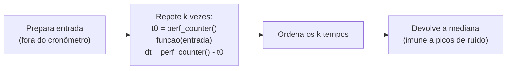

## Passo 1 · Leitura · Como medir tempo em Python sem cair em armadilhas

Antes de estudarmos a matemática assintótica (Big-O), precisamos saber medir o tempo real de execução de um código. Parece simples — basta olhar o relógio antes e depois da função —, mas três erros clássicos invalidam quase todo benchmark amador:

1. **Usar `time.time()` em vez de `time.perf_counter()`:** `time.time()` lê o relógio de parede do sistema, que tem resolução mais baixa e pode pular para frente ou para trás quando o sistema sincroniza o horário via rede (NTP). Para medir intervalos curtos de execução, use sempre **`time.perf_counter()`**, que acessa o contador monotônico de mais alta resolução da CPU.
2. **Incluir a geração da entrada dentro do cronômetro:** se você quer medir o tempo de uma busca em uma lista de $100\,000$ elementos, construa a lista **antes** de chamar `perf_counter()`. Caso contrário, o custo $O(n)$ de criar a lista vai mascarar uma operação que deveria ser $O(1)$ (como `x in conjunto`).
3. **Medir uma única vez ou usar a média simples:** o sistema operacional interrompe o seu processo a todo instante (escalonamento de outras tarefas, coleta de lixo do Python, falhas de cache). Uma única interrupção transforma uma execução de $1\text{ ms}$ em $15\text{ ms}$ e distorce a média. Por isso, medimos várias **repetições** e tomamos a **mediana** (ou o mínimo, como faz o módulo `timeit`), que ignora picos isolados de ruído.



Quando você quiser fazer medições rápidas no terminal ou em scripts, a biblioteca padrão oferece o módulo `timeit` (ex.: `timeit.repeat(stmt, number=100, repeat=5)`), que já usa `perf_counter` internamente e desativa temporariamente o coletor de lixo durante cada rodada.

## Passo 2 · Exercício · Medindo com `perf_counter` e mediana
modo: lacunas

Complete as lacunas da função `medir(funcao, entrada, repeticoes=5)` para executar `funcao(entrada)` `repeticoes` vezes, registrar a duração de cada execução com `time.perf_counter()` e devolver a **mediana** dos tempos em segundos (`float`).

### Instruções
1. Antes de chamar `funcao(entrada)`, registre o instante inicial com `time.perf_counter()`.
2. Logo após a chamada, calcule a diferença `fim - inicio` e guarde-a na lista `tempos`.
3. Ordene `tempos` com `sorted(tempos)` e devolva a mediana (o elemento central `ordenados[meio]` se `repeticoes` for ímpar, ou a média dos dois centrais se for par).

### Código inicial
```python
import time


def medir(funcao, entrada, repeticoes=5):
    tempos = []
    for _ in range(repeticoes):
        inicio = time.___()
        funcao(entrada)
        fim = time.perf_counter()
        tempos.append(___)
    ordenados = sorted(tempos)
    meio = len(ordenados) // 2
    if len(ordenados) % 2 == 1:
        return float(ordenados[___])
    return float((ordenados[meio - 1] + ordenados[meio]) / 2)
```

### Solução
```python
import time


def medir(funcao, entrada, repeticoes=5):
    tempos = []
    for _ in range(repeticoes):
        inicio = time.perf_counter()
        funcao(entrada)
        fim = time.perf_counter()
        tempos.append(fim - inicio)
    ordenados = sorted(tempos)
    meio = len(ordenados) // 2
    if len(ordenados) % 2 == 1:
        return float(ordenados[meio])
    return float((ordenados[meio - 1] + ordenados[meio]) / 2)
```

### Dicas
1. Use `time.perf_counter()` tanto para `inicio` quanto para `fim`.
2. A duração de uma repetição é `fim - inicio`.
3. Quando a quantidade de elementos é ímpar, a mediana de `ordenados` está exatamente no índice `meio`.

### Verificação
```json
[
  {
    "id": "usa-perf-counter",
    "checkpoint": 1,
    "kind": "source",
    "rule": { "type": "calls", "name": "perf_counter" },
    "name": "Usa time.perf_counter()"
  },
  {
    "id": "medir-tipo-float",
    "checkpoint": 2,
    "kind": "expr",
    "expr": "medir(sum, list(range(1000)), 5) >= 0.0",
    "expected": true,
    "type": "bool",
    "name": "medir(sum, range(1000), 5) devolve um float não negativo"
  },
  {
    "id": "medir-mediana-impar",
    "checkpoint": 3,
    "kind": "expr",
    "setup": "import time\n_orig = time.perf_counter\n_vals = iter([0.0, 0.50, 1.0, 1.10, 2.0, 2.20, 3.0, 3.90, 4.0, 4.15])\ntime.perf_counter = lambda: next(_vals)\ntry:\n    res_impar = medir(lambda x: x, 1, 5)\nfinally:\n    time.perf_counter = _orig",
    "expr": "res_impar",
    "expected": 0.2,
    "tolerance": 1e-6,
    "name": "Calcula a mediana correta para número ímpar de repetições (ignora outlier 0.90)"
  },
  {
    "id": "medir-mediana-par",
    "checkpoint": 3,
    "kind": "expr",
    "setup": "import time\n_orig = time.perf_counter\n_vals = iter([0.0, 0.10, 1.0, 1.30, 2.0, 2.20, 3.0, 4.00])\ntime.perf_counter = lambda: next(_vals)\ntry:\n    res_par = medir(lambda x: x, 1, 4)\nfinally:\n    time.perf_counter = _orig",
    "expr": "res_par",
    "expected": 0.25,
    "tolerance": 1e-6,
    "name": "Calcula a mediana correta para número par de repetições"
  }
]
```

### Soluções erradas
```python name="devolve a média em vez da mediana"
import time


def medir(funcao, entrada, repeticoes=5):
    tempos = []
    for _ in range(repeticoes):
        inicio = time.perf_counter()
        funcao(entrada)
        fim = time.perf_counter()
        tempos.append(fim - inicio)
    return float(sum(tempos) / len(tempos))
```
```python name="devolve o menor elemento em vez da mediana"
import time


def medir(funcao, entrada, repeticoes=5):
    tempos = []
    for _ in range(repeticoes):
        inicio = time.perf_counter()
        funcao(entrada)
        fim = time.perf_counter()
        tempos.append(fim - inicio)
    ordenados = sorted(tempos)
    return float(ordenados[0])
```

## Passo 3 · Leitura · O experimento de dobrar a entrada: a razão $T(2n) / T(n)$

Um único número como "$0{,}4\text{ ms}$" depende do processador, da versão do Python e da carga da máquina. Mas se medirmos o tempo $T(n)$ para uma entrada de tamanho $n$ e o tempo $T(2n)$ para uma entrada com o **dobro do tamanho** ($2n$) na mesma máquina, a constante de velocidade do hardware se cancela na divisão!

Veja o que acontece com a **razão de duplicação** $\frac{T(2n)}{T(n)}$:

- **Algoritmo constante ($T(n) \approx c$, como `x in conjunto` ou `lista[-1]`):**
  $$\frac{T(2n)}{T(n)} \approx \frac{c}{c} = 1$$
  Dobrar a entrada não altera o tempo.
- **Algoritmo linear ($T(n) \approx c \cdot n$, como `x in lista` ou um laço simples):**
  $$\frac{T(2n)}{T(n)} \approx \frac{c \cdot (2n)}{c \cdot n} = 2$$
  Dobrar a entrada **dobra** o tempo.
- **Algoritmo quadrático ($T(n) \approx c \cdot n^2$, como dois laços aninhados):**
  $$\frac{T(2n)}{T(n)} \approx \frac{c \cdot (2n)^2}{c \cdot n^2} = \frac{4 c n^2}{c n^2} = 4$$
  Dobrar a entrada **quadruplica** o tempo!

#### Por que medir não substitui analisar?

Embora o teste da razão seja excelente para diagnosticar funções caixa-preta, a medição empírica tem limites claros:
- **Entradas pequenas enganam:** para $n = 20$, o custo fixo de chamada de função em Python domina tudo, fazendo até uma função quadrática parecer constante ($T(40)/T(20) \approx 1$).
- **Dependência do caso testado:** se você medir `alvo in lista` procurando sempre o primeiro elemento (`lista[0]`), a medição dirá que a busca em lista é instantânea ($O(1)$), escondendo o pior caso ($O(n)$) quando o elemento está no fim ou não existe.
- **Algoritmos lentos não terminam:** você não consegue medir um algoritmo $O(2^n)$ para $n = 100$ para "ver quanto dá".

## Passo 4 · Exercício · Diagnosticando caixas-pretas pela razão $T(2n)/T(n)$

Implemente `razao_de_crescimento(funcao, gerador_de_entrada, n, repeticoes=5)` e `diagnosticar_ordem(razao)`:
1. `razao_de_crescimento` deve construir `entrada_n = gerador_de_entrada(n)` e `entrada_2n = gerador_de_entrada(2 * n)` **fora** da medição de tempo, medir a mediana de `funcao(entrada_n)` e de `funcao(entrada_2n)` com `repeticoes` execuções cada, e devolver a razão `t_2n / t_n` (`float`).
2. `diagnosticar_ordem(razao)` recebe uma razão numérica $T(2n)/T(n)$ e devolve:
   - `"constante"`, se `razao < 1.5`;
   - `"linear"`, se `1.5 <= razao < 3.0`;
   - `"quadratica"`, se `razao >= 3.0`.

### Instruções
1. Implemente (ou mantenha) `medir(funcao, entrada, repeticoes=5)` devolvendo a mediana com `time.perf_counter()`.
2. Em `razao_de_crescimento(funcao, gerador_de_entrada, n, repeticoes=5)`, gere `entrada_n` para `n` e `entrada_2n` para `2 * n` antes de medir, e devolva `medir(funcao, entrada_2n, repeticoes) / medir(funcao, entrada_n, repeticoes)`.
3. Em `diagnosticar_ordem(razao)`, classifique a razão nos intervalos `< 1.5` (`"constante"`), `< 3.0` (`"linear"`) e `>= 3.0` (`"quadratica"`).

### Código inicial
```python
import time


def medir(funcao, entrada, repeticoes=5):
    tempos = []
    for _ in range(repeticoes):
        inicio = time.perf_counter()
        funcao(entrada)
        fim = time.perf_counter()
        tempos.append(fim - inicio)
    ordenados = sorted(tempos)
    meio = len(ordenados) // 2
    if len(ordenados) % 2 == 1:
        return float(ordenados[meio])
    return float((ordenados[meio - 1] + ordenados[meio]) / 2)


def razao_de_crescimento(funcao, gerador_de_entrada, n, repeticoes=5):
    # Gere as entradas para n e 2*n fora da medição e devolva T(2n) / T(n)
    pass


def diagnosticar_ordem(razao):
    # Devolva "constante", "linear" ou "quadratica"
    pass
```

### Solução
```python
import time


def medir(funcao, entrada, repeticoes=5):
    tempos = []
    for _ in range(repeticoes):
        inicio = time.perf_counter()
        funcao(entrada)
        fim = time.perf_counter()
        tempos.append(fim - inicio)
    ordenados = sorted(tempos)
    meio = len(ordenados) // 2
    if len(ordenados) % 2 == 1:
        return float(ordenados[meio])
    return float((ordenados[meio - 1] + ordenados[meio]) / 2)


def razao_de_crescimento(funcao, gerador_de_entrada, n, repeticoes=5):
    entrada_n = gerador_de_entrada(n)
    entrada_2n = gerador_de_entrada(2 * n)
    t_n = medir(funcao, entrada_n, repeticoes)
    t_2n = medir(funcao, entrada_2n, repeticoes)
    return float(t_2n / t_n)


def diagnosticar_ordem(razao):
    if razao < 1.5:
        return "constante"
    if razao < 3.0:
        return "linear"
    return "quadratica"
```

### Dicas
1. Chame `gerador_de_entrada(n)` e `gerador_de_entrada(2 * n)` apenas uma vez cada, antes de chamar `medir`.
2. Se você gerar a entrada dentro da função medida, uma função $O(1)$ que recebe uma lista gerada em $O(n)$ aparentará ter razão $2$ (linear)!

### Verificação
```json
[
  {
    "id": "gera-fora-da-medicao",
    "checkpoint": 2,
    "kind": "expr",
    "setup": "chamadas_gerador = []\ndef gerador_lento(k):\n    chamadas_gerador.append(k)\n    return list(range(k))\nimport time\n_orig = time.perf_counter\n_t = [0.0]\ndef _fake_clock():\n    _t[0] += 1.0\n    return _t[0]\ntime.perf_counter = _fake_clock\ntry:\n    r = razao_de_crescimento(lambda x: len(x), gerador_lento, 100, 5)\nfinally:\n    time.perf_counter = _orig",
    "expr": "[chamadas_gerador, round(r, 2)]",
    "expected": [[100, 200], 1.0],
    "name": "Gera as entradas n e 2n apenas uma vez, fora do laço de medição"
  },
  {
    "id": "razao-linear-vs-quadratica",
    "checkpoint": 2,
    "kind": "expr",
    "setup": "def caixa_linear(n):\n    s = 0\n    for i in range(n):\n        s += i\n    return s\ndef caixa_quadratica(n):\n    s = 0\n    for i in range(n):\n        for j in range(n):\n            s += 1\n    return s\nr_lin = razao_de_crescimento(caixa_linear, lambda k: k, 20000, 5)\nr_quad = razao_de_crescimento(caixa_quadratica, lambda k: k, 250, 5)",
    "expr": "[1.3 <= r_lin <= 2.9, 2.8 <= r_quad <= 6.0]",
    "expected": [true, true],
    "name": "Mede razão ~2 para função linear e razão ~4 para função quadrática"
  },
  {
    "id": "diagnostica-ordens",
    "checkpoint": 3,
    "kind": "expr",
    "expr": "[diagnosticar_ordem(1.05), diagnosticar_ordem(2.02), diagnosticar_ordem(3.95)]",
    "expected": ["constante", "linear", "quadratica"],
    "name": "diagnosticar_ordem classifica razões constante (~1), linear (~2) e quadrática (~4)"
  }
]
```

### Soluções erradas
```python name="inverte a razão dividindo t_n por t_2n"
import time


def medir(funcao, entrada, repeticoes=5):
    tempos = []
    for _ in range(repeticoes):
        inicio = time.perf_counter()
        funcao(entrada)
        fim = time.perf_counter()
        tempos.append(fim - inicio)
    ordenados = sorted(tempos)
    return float(ordenados[len(ordenados) // 2])


def razao_de_crescimento(funcao, gerador_de_entrada, n, repeticoes=5):
    entrada_n = gerador_de_entrada(n)
    entrada_2n = gerador_de_entrada(2 * n)
    t_n = medir(funcao, entrada_n, repeticoes)
    t_2n = medir(funcao, entrada_2n, repeticoes)
    return float(t_n / t_2n)


def diagnosticar_ordem(razao):
    if razao < 1.5:
        return "constante"
    if razao < 3.0:
        return "linear"
    return "quadratica"
```
```python name="limiares trocados em diagnosticar_ordem"
import time


def medir(funcao, entrada, repeticoes=5):
    tempos = []
    for _ in range(repeticoes):
        inicio = time.perf_counter()
        funcao(entrada)
        fim = time.perf_counter()
        tempos.append(fim - inicio)
    ordenados = sorted(tempos)
    return float(ordenados[len(ordenados) // 2])


def razao_de_crescimento(funcao, gerador_de_entrada, n, repeticoes=5):
    entrada_n = gerador_de_entrada(n)
    entrada_2n = gerador_de_entrada(2 * n)
    return float(medir(funcao, entrada_2n, repeticoes) / medir(funcao, entrada_n, repeticoes))


def diagnosticar_ordem(razao):
    if razao < 2.0:
        return "linear"
    return "quadratica"
```

## Passo 5 · Quiz · Boas práticas de medição de desempenho

### Pergunta
Por que preferimos a **mediana** (ou o mínimo) das repetições em vez da **média aritmética** ao medir o tempo de execução de uma função?
- [ ] Porque a mediana é mais rápida de calcular que a média em Python.
- [x] Porque o ruído do sistema operacional (interrupções de CPU, escalonador, coleta de lixo) sempre atrasa a execução, criando picos positivos extremos que inflam a média, mas não afetam a mediana.
- [ ] Porque a média só funciona para algoritmos lineares.
- [ ] Porque `time.perf_counter()` devolve valores inteiros.
> Interrupções do sistema operacional nunca deixam o código mais rápido do que ele é; elas apenas adicionam atrasos ocasionais. Um único pico de $50\text{ ms}$ em 5 medições de $1\text{ ms}$ eleva a média para $10{,}8\text{ ms}$, enquanto a mediana continua sendo $1\text{ ms}$.

### Pergunta
Você mede uma função misteriosa `f(lista)` para $n = 50\,000$ e obtém $0{,}012\text{ s}$. Em seguida, mede para $2n = 100\,000$ e obtém $0{,}049\text{ s}$. Qual é a hipótese mais forte sobre o crescimento de `f`?
- [ ] `f` tem comportamento linear, pois o tempo aumentou menos de um décimo de segundo.
- [x] `f` tem comportamento quadrático, pois ao dobrar o tamanho da entrada o tempo multiplicou por $\approx 4$ ($0{,}049 / 0{,}012 \approx 4{,}08$).
- [ ] `f` tem comportamento exponencial ($2^n$).
- [ ] Não é possível inferir nada porque os tempos são menores que $1$ segundo.
> A razão $T(2n)/T(n) = 0{,}049 / 0{,}012 \approx 4{,}08 = 2^2$, assinatura clássica de um algoritmo cujo tempo cresce proporcionalmente a $n^2$.
