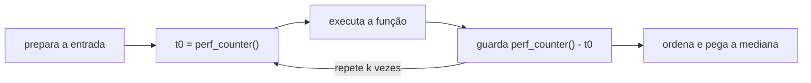

## Passo 1 · Leitura · O relógio certo e o ruído

Quer saber se uma função é rápida? O primeiro impulso é olhar o relógio antes e depois. Três detalhes separam uma medida útil de um número sem sentido.

#### 1. Qual relógio

`time.time()` lê o relógio de parede, o mesmo da barra de tarefas. Ele tem resolução baixa em alguns sistemas e pode **pular** quando o computador acerta a hora pela rede. Para medir intervalos, use `time.perf_counter()`: é **monotônico** (nunca volta) e tem a maior resolução disponível. O valor isolado não significa nada; só a diferença entre duas leituras importa.

#### 2. O que fica dentro do cronômetro

Só a operação que você quer medir. Se a lista de $100\,000$ elementos é criada entre as duas leituras, você mede a criação da lista, e uma consulta $O(1)$ parece linear.

#### 3. Uma medida só não basta

O sistema operacional pausa o seu programa para atender outros, o coletor de lixo do Python roda quando quer e a primeira execução encontra a memória "fria". Esse ruído **só soma** tempo: nada faz o código rodar mais rápido do que ele é. Por isso repetimos a medida e resumimos com a **mediana** (o valor típico, imune a um pico isolado) ou o **mínimo** (a melhor execução, a menos contaminada).

```python
import time

dados = list(range(100_000))        # preparado FORA do cronômetro
tempos = []
for _ in range(5):
    inicio = time.perf_counter()
    9_999_999 in dados              # só isto é medido
    tempos.append(time.perf_counter() - inicio)
print(sorted(tempos)[2])            # mediana de 5
```



#### Por que a correção desta plataforma nunca usa o relógio

Seu código é corrigido num executor **compartilhado**: ao mesmo tempo, rodam programas de outros alunos. A mesma solução pode levar $0{,}3\text{ s}$ numa correção e $0{,}9\text{ s}$ na seguinte. Um limite em segundos reprovaria soluções certas em horário de pico e aprovaria lentas de madrugada. Por isso, nos exercícios deste nível, o relógio é **injetado** (você recebe um relógio falso que avança quanto o teste mandar) ou o custo é medido **contando operações**, um número que não muda de uma execução para outra.

## Passo 2 · Previsão · Média, mediana e mínimo

Cinco medidas de uma mesma função, em microssegundos. Na terceira, o sistema operacional pausou o programa. Leia sem executar e digite exatamente o que o programa imprime.

### Código
```python
tempos_us = [118, 121, 2400, 119, 120]
ordenados = sorted(tempos_us)
media = sum(tempos_us) / len(tempos_us)
mediana = ordenados[len(ordenados) // 2]
print("ordenados:", ordenados)
print("média:", media)
print("mediana:", mediana)
print("mínimo:", ordenados[0])
sem_pico = [118, 121, 119, 120]
print("média sem o pico:", sum(sem_pico) / len(sem_pico))
```

### Dicas
1. A soma das cinco medidas é $2878$.
2. A mediana de 5 valores ordenados é o do índice 2.
3. Divisão com `/` sempre dá `float` em Python, mesmo quando a conta é exata.

### Saída esperada
```text
ordenados: [118, 119, 120, 121, 2400]
média: 575.6
mediana: 120
mínimo: 118
média sem o pico: 119.5
```

## Passo 3 · Exercício · A mediana de k medidas
modo: lacunas

Complete as lacunas (`___`) de `medir(funcao, entrada, repeticoes=5, relogio=time.perf_counter)`. Ela executa `funcao(entrada)` `repeticoes` vezes, mede cada execução com `relogio()` e devolve a **mediana** das durações: o elemento do meio quando a quantidade é ímpar, a média dos dois do meio quando é par.

O parâmetro `relogio` é o truque que torna a função testável: no uso normal ele é `time.perf_counter`; na correção, um relógio falso que devolve marcas combinadas, sempre as mesmas. Por isso, chame sempre `relogio()` e nunca `time.perf_counter()` direto.

### Instruções
1. Leia o relógio passado em `relogio` logo antes de cada chamada de `funcao(entrada)`.
2. Leia o relógio de novo logo depois e guarde a duração da chamada em `tempos`.
3. Devolva a mediana: ordene as durações e escolha o elemento do meio, ou a média dos dois do meio.

### Código inicial
```python
import time


def medir(funcao, entrada, repeticoes=5, relogio=time.perf_counter):
    tempos = []
    for _ in range(repeticoes):
        inicio = ___
        funcao(entrada)
        tempos.append(___ - inicio)
    ordenados = sorted(tempos)
    meio = len(ordenados) // 2
    if len(ordenados) % 2 == 1:
        return ordenados[___]
    return (ordenados[meio - 1] + ordenados[___]) / 2
```

### Solução
```python
import time


def medir(funcao, entrada, repeticoes=5, relogio=time.perf_counter):
    tempos = []
    for _ in range(repeticoes):
        inicio = relogio()
        funcao(entrada)
        tempos.append(relogio() - inicio)
    ordenados = sorted(tempos)
    meio = len(ordenados) // 2
    if len(ordenados) % 2 == 1:
        return ordenados[meio]
    return (ordenados[meio - 1] + ordenados[meio]) / 2
```

### Dicas
1. `relogio` é uma função: para ler o relógio, chame-a com parênteses.
2. A leitura do início fica **dentro** do laço: cada repetição tem o seu próprio começo.
3. Com 4 valores ordenados, `meio` é 2 e os do meio estão nos índices 1 e 2.

### Verificação
```json
[
  { "id": "usa-relogio", "checkpoint": 1, "kind": "source", "rule": { "type": "calls", "name": "relogio" },
    "name": "Chama o relógio recebido em relogio" },
  { "id": "impar-com-pico", "checkpoint": 3, "kind": "expr",
    "setup": "class Relogio:\n    def __init__(self, marcas):\n        self.marcas = iter(marcas)\n        self.leituras = 0\n    def __call__(self):\n        self.leituras += 1\n        return next(self.marcas)\nr = Relogio([0, 5, 10, 11, 20, 22, 30, 39, 40, 43])\nm = medir(len, [1, 2], 5, r)",
    "expr": "m", "expected": 3,
    "name": "Durações 5, 1, 2, 9, 3: a mediana é 3",
    "hint": "Ordene as durações antes de escolher o elemento do meio." },
  { "id": "pico-no-meio", "checkpoint": 3, "kind": "expr",
    "setup": "class Relogio:\n    def __init__(self, marcas):\n        self.marcas = iter(marcas)\n    def __call__(self):\n        return next(self.marcas)\nr = Relogio([0, 3, 10, 11, 20, 120, 130, 132, 140, 144])\nm = medir(len, [1], 5, r)",
    "expr": "m", "expected": 3,
    "name": "Durações 3, 1, 100, 2, 4: o pico de 100 não muda a mediana",
    "hint": "A mediana é o meio da lista ORDENADA, não da lista na ordem em que as medidas chegaram." },
  { "id": "par", "checkpoint": 3, "kind": "expr",
    "setup": "class Relogio:\n    def __init__(self, marcas):\n        self.marcas = iter(marcas)\n    def __call__(self):\n        return next(self.marcas)\nr = Relogio([0, 4, 10, 11, 20, 27, 30, 32])\nm = medir(len, [1], 4, r)",
    "expr": "m", "expected": 3.0, "type": "float",
    "name": "Durações 4, 1, 7, 2: a mediana é 3.0",
    "hint": "Com quantidade par, a mediana é a média dos dois valores do meio." },
  { "id": "uma-repeticao", "checkpoint": 2, "kind": "expr",
    "setup": "class Relogio:\n    def __init__(self, marcas):\n        self.marcas = iter(marcas)\n    def __call__(self):\n        return next(self.marcas)\nm = medir(len, [1], 1, Relogio([100, 107]))",
    "expr": "m", "expected": 7, "name": "Com uma repetição, devolve a única duração" },
  { "id": "leituras-e-chamadas", "checkpoint": 2, "kind": "expr",
    "setup": "class Relogio:\n    def __init__(self):\n        self.t = 0\n        self.leituras = 0\n    def __call__(self):\n        self.leituras += 1\n        self.t += 1\n        return self.t\nrecebidas = []\ndados = [3, 1, 2]\ndef registra(x):\n    recebidas.append(x)\nr = Relogio()\nmedir(registra, dados, 7, r)",
    "expr": "[r.leituras, len(recebidas), all(x is dados for x in recebidas)]", "expected": [14, 7, true],
    "name": "Com 7 repetições: 14 leituras do relógio e 7 chamadas com a mesma entrada",
    "hint": "Duas leituras por repetição: uma antes e uma depois da chamada." },
  { "id": "relogio-real", "checkpoint": 1, "kind": "expr", "expr": "medir(sum, list(range(1000)), 3) >= 0",
    "expected": true, "name": "Sem relógio falso, usa perf_counter e devolve uma duração não negativa" }
]
```

### Soluções erradas
```python name="lê o início uma vez só, antes do laço"
import time


def medir(funcao, entrada, repeticoes=5, relogio=time.perf_counter):
    tempos = []
    inicio = relogio()
    for _ in range(repeticoes):
        funcao(entrada)
        tempos.append(relogio() - inicio)
    ordenados = sorted(tempos)
    meio = len(ordenados) // 2
    if len(ordenados) % 2 == 1:
        return ordenados[meio]
    return (ordenados[meio - 1] + ordenados[meio]) / 2
```
```python name="ignora o relogio recebido e chama perf_counter"
import time


def medir(funcao, entrada, repeticoes=5, relogio=time.perf_counter):
    tempos = []
    for _ in range(repeticoes):
        inicio = time.perf_counter()
        funcao(entrada)
        tempos.append(time.perf_counter() - inicio)
    ordenados = sorted(tempos)
    meio = len(ordenados) // 2
    if len(ordenados) % 2 == 1:
        return ordenados[meio]
    return (ordenados[meio - 1] + ordenados[meio]) / 2
```
```python name="pega o meio sem ordenar"
import time


def medir(funcao, entrada, repeticoes=5, relogio=time.perf_counter):
    tempos = []
    for _ in range(repeticoes):
        inicio = relogio()
        funcao(entrada)
        tempos.append(relogio() - inicio)
    meio = len(tempos) // 2
    if len(tempos) % 2 == 1:
        return tempos[meio]
    return (tempos[meio - 1] + tempos[meio]) / 2
```
```python name="devolve a média"
import time


def medir(funcao, entrada, repeticoes=5, relogio=time.perf_counter):
    tempos = []
    for _ in range(repeticoes):
        inicio = relogio()
        funcao(entrada)
        tempos.append(relogio() - inicio)
    return sum(tempos) / len(tempos)
```
```python name="com quantidade par, pega só um dos dois do meio"
import time


def medir(funcao, entrada, repeticoes=5, relogio=time.perf_counter):
    tempos = []
    for _ in range(repeticoes):
        inicio = relogio()
        funcao(entrada)
        tempos.append(relogio() - inicio)
    ordenados = sorted(tempos)
    return ordenados[len(ordenados) // 2]
```

## Passo 4 · Leitura · O módulo timeit

Uma chamada de `sum` numa lista curta leva menos de um microssegundo, perto da resolução do relógio. Para medir algo tão curto, execute a operação **muitas vezes seguidas** e divida o total pelo número de execuções. O módulo `timeit` faz isso e cuida de dois detalhes: usa `perf_counter` e **desliga o coletor de lixo** durante a medida, para uma coleta não cair no meio de uma rodada.

```python
import timeit

dados = list(range(1000))
totais = timeit.repeat(lambda: sum(dados), number=10_000, repeat=5)
print(totais)                     # 5 totais, cada um de 10 000 execuções
print(min(totais) / 10_000)       # segundos por chamada
```

Os dois números contam coisas diferentes:

| Parâmetro | O que é |
| :--- | :--- |
| `number` | execuções seguidas dentro de **uma** rodada; o total da rodada é um número da lista |
| `repeat` | quantas rodadas; o tamanho da lista devolvida |

Os erros mais comuns:

- **Esquecer de dividir por `number`.** Cada valor da lista é o tempo de `number` execuções, não de uma.
- **Passar o resultado em vez da função.** `timeit.repeat(sum(dados), ...)` executa `sum(dados)` uma vez, na hora, e entrega um número ao `timeit`:
  ```text
  ValueError: stmt is neither a string nor callable
  ```
  O primeiro argumento precisa ser algo que o `timeit` possa chamar: um `lambda` ou uma função sem argumentos.
- **Preparar a entrada dentro da operação medida.** Em `lambda: sum(list(range(1000)))`, você mede a construção da lista junto com a soma.

Por que o mínimo das rodadas, e não a média? Como o ruído só acrescenta tempo, a rodada mais rápida é a menos contaminada. A documentação do `timeit` recomenda o mínimo. A mediana, do passo anterior, responde a outra pergunta: quanto a operação costuma levar, com o ruído típico incluído. As duas são legítimas. A média é a pior escolha, porque um único pico a desloca.

Por fim, `timeit.repeat` aceita `timer=`: um relógio no lugar do `perf_counter`. É assim que a correção do próximo exercício controla o tempo sem depender da máquina.

## Passo 5 · Exercício · Tempo por chamada com timeit

Escreva `tempo_por_chamada(funcao, entrada, number=1000, repeat=5, timer=time.perf_counter)`. Ela usa `timeit.repeat` para medir `funcao(entrada)` em `repeat` rodadas de `number` execuções cada, com o relógio `timer`, e devolve o **tempo de uma chamada** na melhor rodada, em segundos.

Exemplo: se as rodadas totalizarem `[0.21, 0.20, 0.35]` com `number=100`, a função devolve `0.002`.

### Instruções
1. Chame `timeit.repeat` com uma função sem argumentos que execute `funcao(entrada)`, repassando `number`, `repeat` e `timer`.
2. Escolha a melhor rodada da lista devolvida.
3. Divida por `number` para obter o tempo de uma chamada.

### Código inicial
```python
import time
import timeit


def tempo_por_chamada(funcao, entrada, number=1000, repeat=5, timer=time.perf_counter):
    pass
```

### Solução
```python
import time
import timeit


def tempo_por_chamada(funcao, entrada, number=1000, repeat=5, timer=time.perf_counter):
    totais = timeit.repeat(lambda: funcao(entrada), number=number, repeat=repeat, timer=timer)
    return min(totais) / number
```

### Dicas
1. `timeit.repeat` chama o primeiro argumento várias vezes: entregue um `lambda`, não `funcao(entrada)`.
2. A melhor rodada é a de menor total.
3. Cada total é o tempo de `number` execuções.

### Verificação
```json
[
  { "id": "usa-timeit", "checkpoint": 1, "kind": "source", "rule": { "type": "calls", "name": "repeat" },
    "name": "Usa timeit.repeat" },
  { "id": "melhor-rodada", "checkpoint": 3, "kind": "expr",
    "setup": "class Relogio:\n    def __init__(self, marcas):\n        self.marcas = iter(marcas)\n    def __call__(self):\n        return next(self.marcas)\nr = Relogio([0, 5000, 10000, 14000, 20000, 29000])\nt = tempo_por_chamada(len, [1, 2], 1000, 3, r)",
    "expr": "t", "expected": 4.0, "tolerance": 1e-9,
    "name": "Rodadas de 5000, 4000 e 9000 com number=1000: 4.0 por chamada",
    "hint": "Escolha a menor rodada e divida pelo número de execuções da rodada." },
  { "id": "melhor-no-fim", "checkpoint": 2, "kind": "expr",
    "setup": "class Relogio:\n    def __init__(self, marcas):\n        self.marcas = iter(marcas)\n    def __call__(self):\n        return next(self.marcas)\nr = Relogio([0, 30, 100, 160, 200, 225, 300, 340])\nt = tempo_por_chamada(len, [1], 10, 4, r)",
    "expr": "t", "expected": 2.5, "tolerance": 1e-9,
    "name": "Rodadas de 30, 60, 25 e 40 com number=10: 2.5 por chamada",
    "hint": "A melhor rodada pode ser qualquer uma, não necessariamente a primeira." },
  { "id": "tipo-float", "checkpoint": 3, "kind": "expr",
    "setup": "class Relogio:\n    def __init__(self, marcas):\n        self.marcas = iter(marcas)\n    def __call__(self):\n        return next(self.marcas)\nt = tempo_por_chamada(len, [1], 4, 2, Relogio([0, 8, 10, 22]))",
    "expr": "t", "expected": 2.0, "type": "float", "name": "Devolve float (8 / 4 = 2.0)" },
  { "id": "execucoes", "checkpoint": 1, "kind": "expr",
    "setup": "recebidas = []\ndados = [5, 6]\ndef registra(x):\n    recebidas.append(x)\nt = tempo_por_chamada(registra, dados, 7, 3)",
    "expr": "[len(recebidas), all(x is dados for x in recebidas)]", "expected": [21, true],
    "name": "number=7 e repeat=3: 21 execuções, todas com a mesma lista recebida",
    "hint": "Nada de copiar ou reconstruir a entrada dentro da operação medida." },
  { "id": "relogio-real", "checkpoint": 1, "kind": "expr", "expr": "tempo_por_chamada(sum, [1, 2, 3], 50, 3) >= 0",
    "expected": true, "name": "Sem relógio falso, devolve um tempo não negativo" }
]
```

### Soluções erradas
```python name="não divide por number"
import time
import timeit


def tempo_por_chamada(funcao, entrada, number=1000, repeat=5, timer=time.perf_counter):
    totais = timeit.repeat(lambda: funcao(entrada), number=number, repeat=repeat, timer=timer)
    return min(totais)
```
```python name="usa a média das rodadas"
import time
import timeit


def tempo_por_chamada(funcao, entrada, number=1000, repeat=5, timer=time.perf_counter):
    totais = timeit.repeat(lambda: funcao(entrada), number=number, repeat=repeat, timer=timer)
    return sum(totais) / len(totais) / number
```
```python name="passa o resultado em vez da função"
import time
import timeit


def tempo_por_chamada(funcao, entrada, number=1000, repeat=5, timer=time.perf_counter):
    totais = timeit.repeat(funcao(entrada), number=number, repeat=repeat, timer=timer)
    return min(totais) / number
```
```python name="copia a entrada dentro da operação medida"
import time
import timeit


def tempo_por_chamada(funcao, entrada, number=1000, repeat=5, timer=time.perf_counter):
    totais = timeit.repeat(lambda: funcao(list(entrada)), number=number, repeat=repeat, timer=timer)
    return min(totais) / number
```
```python name="mede uma rodada só"
import time
import timeit


def tempo_por_chamada(funcao, entrada, number=1000, repeat=5, timer=time.perf_counter):
    total = timeit.timeit(lambda: funcao(entrada), number=number, timer=timer)
    return total / number
```

## Passo 6 · Leitura · Dobrar a entrada e contar operações

Um tempo isolado, "$0{,}4\text{ ms}$", depende da máquina. A **razão** entre dois tempos medidos na mesma máquina não depende. Se $T(n) \approx c \cdot n^k$, ao dobrar a entrada:

$$
\frac{T(2n)}{T(n)} \approx \frac{c\,(2n)^k}{c\,n^k} = 2^k
\qquad\Longrightarrow\qquad
k \approx \log_2 \frac{T(2n)}{T(n)}
$$

A constante $c$, que guarda a velocidade da máquina, se cancela. Razão perto de 1: constante. Perto de 2: linear. Perto de 4: quadrático. Perto de 8: cúbico.

#### O que o experimento não separa

Para $T(n) = n \log_2 n$, a razão é $2 \cdot \frac{\log_2 2n}{\log_2 n} = 2\left(1 + \frac{1}{\log_2 n}\right)$. Com $n = 1024$, dá $2{,}2$. Isso é quase o mesmo que $2$, e o ruído de uma medida de tempo é maior que essa diferença. O experimento de dobrar diz "expoente perto de 1", mas não distingue $n$ de $n \log n$.

#### Contar em vez de cronometrar

Troque o relógio por um contador: some 1 a cada operação que interessa (uma comparação, uma leitura, uma volta do laço mais interno). A contagem é **exata**, não tem ruído e dá o mesmo número em qualquer máquina e em qualquer horário.

```python
def comparacoes_de_pares(n):
    ops = 0
    for i in range(n):
        for j in range(i + 1, n):
            ops += 1                 # uma comparação entre os itens i e j
    return ops

print(comparacoes_de_pares(200) / comparacoes_de_pares(100))   # 4.0202...
```

A razão sai $4{,}02$, e não exatamente 4, porque a contagem é $\frac{n(n-1)}{2}$: o termo $-n$ ainda pesa com $n = 100$ e some quando $n$ cresce.

#### Os limites de qualquer experimento

- **Entrada pequena engana.** Com $n = 20$, o custo fixo de chamar a função domina, e até um algoritmo quadrático parece constante.
- **O caso escolhido engana.** Medir `alvo in lista` com o alvo na posição 0 dá "constante" e esconde o caso em que o alvo está no fim.
- **Algoritmo lento não termina.** Não dá para medir $2^n$ com $n = 100$ para "ver quanto dá".

O experimento sugere uma hipótese; a análise das próximas lições é que a confirma.

## Passo 7 · Exercício · O experimento de dobrar

Escreva duas funções.

- `experimento_de_dobra(contar, n0, vezes)`: `contar(n)` devolve quantas operações um algoritmo faz com entrada de tamanho `n`. Chame `contar` **uma vez** para cada tamanho $n_0, 2n_0, 4n_0, \dots, 2^{\text{vezes}} n_0$ e devolva a lista com as `vezes` razões entre tamanhos vizinhos, `contar(2n) / contar(n)`, em ordem.
- `expoente_estimado(razao)`: devolve o inteiro mais próximo de $\log_2(\text{razao})$, o $k$ de $n^k$.

Exemplo: se `contar(n)` devolve `n * n`, `experimento_de_dobra(contar, 10, 2)` chama `contar` com 10, 20 e 40 e devolve `[4.0, 4.0]`, e `expoente_estimado(4.0)` devolve `2`.

### Instruções
1. Em `experimento_de_dobra`, gere os tamanhos dobrando a partir de `n0` e conte cada tamanho uma única vez.
2. Devolva as razões entre cada contagem e a **anterior**.
3. Em `expoente_estimado`, arredonde $\log_2$ da razão para o inteiro mais próximo.

### Código inicial
```python
import math


def experimento_de_dobra(contar, n0, vezes):
    pass


def expoente_estimado(razao):
    pass
```

### Solução
```python
import math


def experimento_de_dobra(contar, n0, vezes):
    contagens = []
    n = n0
    for _ in range(vezes + 1):
        contagens.append(contar(n))
        n *= 2
    return [contagens[i + 1] / contagens[i] for i in range(vezes)]


def expoente_estimado(razao):
    return round(math.log2(razao))
```

### Dicas
1. Para `vezes` razões você precisa de `vezes + 1` contagens.
2. Guarde as contagens numa lista e só depois calcule as razões: assim cada tamanho é contado uma vez.
3. `int()` corta a parte decimal; arredondar é outra coisa.

### Verificação
```json
[
  { "id": "tamanhos", "checkpoint": 1, "kind": "expr",
    "setup": "pedidos = []\ndef conta(n):\n    pedidos.append(n)\n    return n\nexperimento_de_dobra(conta, 10, 3)",
    "expr": "pedidos", "expected": [10, 20, 40, 80],
    "name": "n0=10 e vezes=3: conta os tamanhos 10, 20, 40 e 80, uma vez cada",
    "hint": "Os tamanhos dobram a cada passo, e cada um é contado uma única vez." },
  { "id": "linear", "checkpoint": 2, "kind": "expr",
    "setup": "def conta_laco(n):\n    ops = 0\n    for _ in range(n):\n        ops += 1\n    return ops",
    "expr": "experimento_de_dobra(conta_laco, 7, 3)", "expected": [2.0, 2.0, 2.0],
    "name": "Laço simples: razões [2.0, 2.0, 2.0]" },
  { "id": "pares", "checkpoint": 2, "kind": "expr",
    "setup": "def conta_pares(n):\n    ops = 0\n    for i in range(n):\n        for j in range(i + 1, n):\n            ops += 1\n    return ops\nr = experimento_de_dobra(conta_pares, 50, 3)",
    "expr": "[round(x, 3) for x in r]", "expected": [4.041, 4.02, 4.01],
    "name": "Todos os pares a partir de 50: razões perto de 4, diminuindo",
    "hint": "Cada razão compara uma contagem com a do tamanho imediatamente anterior." },
  { "id": "constante", "checkpoint": 2, "kind": "expr",
    "expr": "experimento_de_dobra(lambda n: 12, 100, 2)", "expected": [1.0, 1.0],
    "name": "Custo constante: razões [1.0, 1.0]" },
  { "id": "uma-razao", "checkpoint": 2, "kind": "expr",
    "expr": "experimento_de_dobra(lambda n: n ** 3, 5, 1)", "expected": [8.0],
    "name": "vezes=1 devolve uma razão só" },
  { "id": "expoentes-exatos", "checkpoint": 3, "kind": "expr",
    "expr": "[expoente_estimado(1.0), expoente_estimado(2.0), expoente_estimado(4.0), expoente_estimado(8.0)]",
    "expected": [0, 1, 2, 3], "name": "Razões 1, 2, 4 e 8 dão expoentes 0, 1, 2 e 3" },
  { "id": "expoentes-ruido", "checkpoint": 3, "kind": "expr",
    "expr": "[expoente_estimado(1.3), expoente_estimado(2.25), expoente_estimado(3.9), expoente_estimado(7.4)]",
    "expected": [0, 1, 2, 3], "name": "Razões 1.3, 2.25, 3.9 e 7.4 dão 0, 1, 2 e 3",
    "hint": "3.9 está muito mais perto de 4 do que de 2." },
  { "id": "nlogn", "checkpoint": 3, "kind": "expr",
    "setup": "def conta_nlogn(n):\n    ops = 0\n    for i in range(n):\n        k = 1\n        while k < n:\n            ops += 1\n            k *= 2\n    return ops",
    "expr": "[expoente_estimado(r) for r in experimento_de_dobra(conta_nlogn, 64, 3)]", "expected": [1, 1, 1],
    "name": "n log n também dá expoente 1: o experimento não o separa do linear" }
]
```

### Soluções erradas
```python name="divide pela primeira contagem, não pela anterior"
import math


def experimento_de_dobra(contar, n0, vezes):
    contagens = []
    n = n0
    for _ in range(vezes + 1):
        contagens.append(contar(n))
        n *= 2
    return [contagens[i + 1] / contagens[0] for i in range(vezes)]


def expoente_estimado(razao):
    return round(math.log2(razao))
```
```python name="soma n0 em vez de dobrar"
import math


def experimento_de_dobra(contar, n0, vezes):
    contagens = []
    n = n0
    for _ in range(vezes + 1):
        contagens.append(contar(n))
        n += n0
    return [contagens[i + 1] / contagens[i] for i in range(vezes)]


def expoente_estimado(razao):
    return round(math.log2(razao))
```
```python name="conta cada tamanho duas vezes"
import math


def experimento_de_dobra(contar, n0, vezes):
    razoes = []
    n = n0
    for _ in range(vezes):
        razoes.append(contar(2 * n) / contar(n))
        n *= 2
    return razoes


def expoente_estimado(razao):
    return round(math.log2(razao))
```
```python name="razão invertida"
import math


def experimento_de_dobra(contar, n0, vezes):
    contagens = []
    n = n0
    for _ in range(vezes + 1):
        contagens.append(contar(n))
        n *= 2
    return [contagens[i] / contagens[i + 1] for i in range(vezes)]


def expoente_estimado(razao):
    return round(math.log2(razao))
```
```python name="trunca o logaritmo com int"
import math


def experimento_de_dobra(contar, n0, vezes):
    contagens = []
    n = n0
    for _ in range(vezes + 1):
        contagens.append(contar(n))
        n *= 2
    return [contagens[i + 1] / contagens[i] for i in range(vezes)]


def expoente_estimado(razao):
    return int(math.log2(razao))
```

## Passo 8 · Quiz · Medir com honestidade

### Pergunta
A mesma solução, enviada duas vezes seguidas, levou $0{,}31\text{ s}$ e $0{,}84\text{ s}$ no executor de correção. Por que os exercícios deste nível não usam um limite em segundos para cobrar complexidade?
- [ ] Porque `perf_counter` não funciona dentro do executor
- [ ] Porque bastaria tirar a mediana de 5 execuções para o limite ficar justo
- [x] Porque o executor é compartilhado: a carga de outros programas muda o tempo de uma mesma solução, e só uma contagem de operações dá o mesmo resultado em toda correção
- [ ] Porque Python é lento demais para algoritmos quadráticos
> A mediana reduz o efeito de um pico isolado, mas não corrige uma máquina inteira mais carregada durante todas as repetições. Contar comparações, leituras ou chamadas mede o algoritmo, não a máquina.

### Pergunta
Você conta as operações de uma função para $n = 1000$ e $n = 2000$ e obtém razão $2{,}2$, estável em várias duplicações. O que dá para concluir?
- [ ] O algoritmo é certamente $\Theta(n \log n)$
- [ ] O algoritmo é quadrático, porque a razão passou de 2
- [x] O crescimento é compatível com $n$ e com $n \log n$; o experimento de dobrar não separa os dois
- [ ] Nada, porque razões só valem para tempos, não para contagens
> Para $n \log_2 n$ com $n = 1000$, a razão é $2(1 + 1/\log_2 1000) \approx 2{,}2$. Um algoritmo linear com um custo fixo por chamada também pode dar $2{,}2$. Para decidir, é preciso analisar o código.

### Pergunta
`timeit.repeat(lambda: f(dados), number=100, repeat=5)` devolveu `[0.21, 0.20, 0.35, 0.20, 0.22]`. Qual é a melhor estimativa do tempo de uma chamada de `f(dados)`?
- [ ] $0{,}20\text{ s}$
- [ ] $0{,}236\text{ s}$, a média das rodadas
- [ ] $2{,}36\text{ ms}$, a média dividida por 100
- [x] $2\text{ ms}$, a melhor rodada dividida por 100
> Cada número é o total de 100 execuções. O ruído só acrescenta tempo, então a melhor rodada ($0{,}20\text{ s}$) é a menos contaminada; dividida por `number`, dá $0{,}002\text{ s}$. A média carrega o pico de $0{,}35$.
