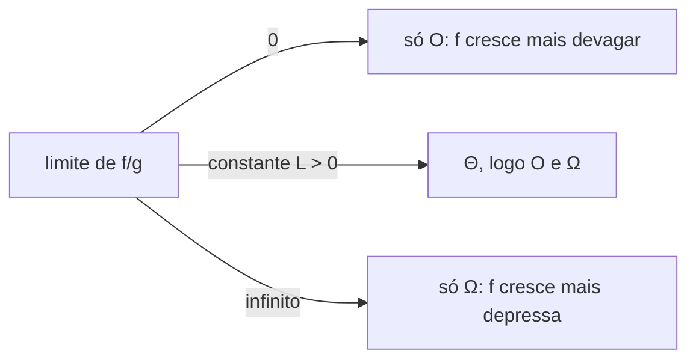

## Passo 1 · Leitura · A definição de O, com c e n₀

Na lição anterior, você contou operações. Uma contagem como $f(n) = 3n^2 + 10n$ é exata, mas detalhada demais para comparar algoritmos: o $3$ muda com a máquina e o $10n$ só pesa quando $n$ é pequeno. A notação $O$ guarda só o que importa quando $n$ cresce.

Dizemos que $f(n)$ é $O(g(n))$ quando existem constantes $c > 0$ e $n_0 \ge 1$ tais que

$$
0 \le f(n) \le c \cdot g(n) \quad \text{para todo } n \ge n_0 .
$$

Em palavras: a partir de algum tamanho $n_0$, $f$ nunca passa de $g$ multiplicada por uma constante fixa. As duas constantes têm papéis diferentes. O $c$ absorve as constantes multiplicativas. O $n_0$ permite ignorar as entradas pequenas, onde termos menores ainda pesam.

#### Uma prova completa: $3n^2 + 10n$ é $O(n^2)$

Quando $n \ge 10$, vale $10n \le n \cdot n = n^2$. Então, para todo $n \ge 10$:

$$
3n^2 + 10n \le 3n^2 + n^2 = 4n^2 .
$$

Escolhemos $c = 4$ e $n_0 = 10$. O par não é único: com $c = 13$ e $n_0 = 1$ também funciona, porque $10n \le 10n^2$ para todo $n \ge 1$. Para provar, basta exibir **um** par que funcione.

#### Uma prova de que não é: $n^2$ não é $O(n)$

Suponha que $n^2 \le c \cdot n$ para todo $n \ge n_0$. Dividindo por $n$, isso dá $n \le c$ para todo $n \ge n_0$. Mas $n = \max(n_0, c + 1)$ quebra a desigualdade. Nenhum par $(c, n_0)$ serve, qualquer que seja.

#### O que o computador pode e o que não pode fazer

Testar a desigualdade num intervalo finito ajuda a encontrar um contraexemplo ou a escolher $n_0$:

```python
f = lambda n: 3 * n * n + 10 * n
g = lambda n: n * n
print([n for n in range(1, 20) if f(n) > 4 * g(n)])   # [1, 2, ..., 9]
```

Mas nenhum teste finito **prova** que a desigualdade vale para todo $n \ge n_0$: sempre sobram infinitos valores não testados. A prova é a conta algébrica acima. O teste só pode **refutar** um par $(c, n_0)$, mostrando um $n$ em que ele falha.

## Passo 2 · Exercício · Procurando uma violação
modo: ordenar

Monte `primeira_violacao(f, g, c, n0, ate)`. Ela procura, em ordem, o primeiro inteiro $n$ de `n0` até `ate` (**inclusive**) em que $f(n) > c \cdot g(n)$, e devolve esse $n$. Se não houver violação no intervalo, devolve `None`. Duas linhas estão sobrando.

Exemplo: com $f(n) = 3n^2 + 10n$, $g(n) = n^2$ e $c = 4$, `primeira_violacao(f, g, 4, 5, 100)` devolve `5`, e `primeira_violacao(f, g, 4, 10, 100)` devolve `None`.

### Instruções
1. Percorra os inteiros de `n0` até `ate`, incluindo `ate`.
2. Devolva o primeiro `n` em que `f(n)` passa de `c * g(n)`. Igualdade não é violação.
3. Só depois de testar o intervalo inteiro, devolva `None`.

### Solução
```python
def primeira_violacao(f, g, c, n0, ate):
    for n in range(n0, ate + 1):
        if f(n) > c * g(n):
            return n
    return None
```

### Distratores
```python
for n in range(n0, ate):
if f(n) >= c * g(n):
```

### Dicas
1. `range(a, b)` para antes de `b`.
2. A definição de $O$ usa $\le$: quando $f(n) = c \cdot g(n)$, a desigualdade vale.
3. O `return None` não pode estar dentro do laço, senão a função desiste depois do primeiro `n`.

### Verificação
```json
[
  { "id": "valida", "checkpoint": 3, "kind": "expr",
    "expr": "primeira_violacao(lambda n: 3 * n * n + 10 * n, lambda n: n * n, 4, 10, 500)", "expected": null,
    "name": "c=4 e n0=10 valem para 3n² + 10n até 500" },
  { "id": "n0-pequeno", "checkpoint": 2, "kind": "expr",
    "expr": "primeira_violacao(lambda n: 3 * n * n + 10 * n, lambda n: n * n, 4, 5, 500)", "expected": 5,
    "name": "Com n0=5, a violação aparece logo em n=5" },
  { "id": "no-meio", "checkpoint": 2, "kind": "expr",
    "expr": "primeira_violacao(lambda n: n * n, lambda n: n, 10, 3, 50)", "expected": 11,
    "name": "n² contra 10n a partir de 3: a primeira violação é 11",
    "hint": "Devolva o n em que a desigualdade falhou, não o início do intervalo." },
  { "id": "no-limite", "checkpoint": 1, "kind": "expr",
    "expr": "primeira_violacao(lambda n: n * n, lambda n: n, 10, 1, 11)", "expected": 11,
    "name": "A violação em n = ate também conta", "hint": "O intervalo inclui ate." },
  { "id": "igualdade", "checkpoint": 2, "kind": "expr",
    "expr": "primeira_violacao(lambda n: 2 * n, lambda n: n, 2, 1, 100)", "expected": null,
    "name": "2n contra 2·n: igualdade não é violação" },
  { "id": "intervalo-vazio", "checkpoint": 3, "kind": "expr",
    "expr": "primeira_violacao(lambda n: n * n, lambda n: n, 1, 8, 7)", "expected": null,
    "name": "n0 maior que ate: nada a testar, devolve None" },
  { "id": "nao-e-on", "checkpoint": 2, "kind": "expr",
    "expr": "[primeira_violacao(lambda n: n * n, lambda n: n, c, 1, 10000) for c in (10, 100, 1000)]",
    "expected": [11, 101, 1001], "name": "n² não é O(n): para c = 10, 100 e 1000 sempre aparece uma violação" }
]
```

### Soluções erradas
```python name="range sem o +1 não testa ate"
def primeira_violacao(f, g, c, n0, ate):
    for n in range(n0, ate):
        if f(n) > c * g(n):
            return n
    return None
```
```python name=">= trata a igualdade como violação"
def primeira_violacao(f, g, c, n0, ate):
    for n in range(n0, ate + 1):
        if f(n) >= c * g(n):
            return n
    return None
```
```python name="return None dentro do laço"
def primeira_violacao(f, g, c, n0, ate):
    for n in range(n0, ate + 1):
        if f(n) > c * g(n):
            return n
        return None
```
```python name="devolve n0 em vez do n que falhou"
def primeira_violacao(f, g, c, n0, ate):
    for n in range(n0, ate + 1):
        if f(n) > c * g(n):
            return n0
    return None
```
```python name="esquece a constante c"
def primeira_violacao(f, g, c, n0, ate):
    for n in range(n0, ate + 1):
        if f(n) > g(n):
            return n
    return None
```

## Passo 3 · Exercício · O menor n₀ para um c

Fixado $c$, qual é o menor $n_0$ que funciona? Escreva `menor_n0(f, g, c, limite)`, que devolve o menor $n_0 \ge 1$ tal que $f(n) \le c \cdot g(n)$ para **todo** $n$ de $n_0$ até `limite`. Se a desigualdade falha no próprio `limite`, nenhum $n_0$ do intervalo serve: devolva `None`.

Exemplo, com $f(n) = 3n^2 + 10n$ e $g(n) = n^2$:

| `c` | `menor_n0(f, g, c, 1000)` | por quê |
| :---: | :---: | :--- |
| 4 | `10` | $10n \le n^2$ a partir de $n = 10$ |
| 13 | `1` | $10n \le 10n^2$ para todo $n \ge 1$ |
| 3 | `None` | $3n^2 + 10n > 3n^2$ sempre |

Cuidado: "o primeiro $n$ em que vale" **não** é a resposta. A desigualdade pode valer num $n$ pequeno, falhar depois e só voltar a valer de vez mais adiante.

### Instruções
1. Se `f(limite) > c * g(limite)`, devolva `None`.
2. Encontre a última violação do intervalo `[1, limite]`; o menor $n_0$ é o número logo depois dela.
3. Se não houver violação nenhuma, devolva `1`.

### Código inicial
```python
def menor_n0(f, g, c, limite):
    pass
```

### Solução
```python
def menor_n0(f, g, c, limite):
    if f(limite) > c * g(limite):
        return None
    n0 = limite
    while n0 > 1 and f(n0 - 1) <= c * g(n0 - 1):
        n0 -= 1
    return n0
```

### Dicas
1. Percorrer de `limite` para trás e parar na primeira violação encontra a última violação.
2. Se você percorrer para a frente, guarde a **última** violação vista, não a primeira posição em que a desigualdade vale.
3. Igualdade não é violação.

### Verificação
```json
[
  { "id": "c4", "checkpoint": 2, "kind": "expr", "expr": "menor_n0(lambda n: 3 * n * n + 10 * n, lambda n: n * n, 4, 1000)",
    "expected": 10, "name": "3n² + 10n com c = 4: n0 = 10" },
  { "id": "c5", "checkpoint": 2, "kind": "expr", "expr": "menor_n0(lambda n: 3 * n * n + 10 * n, lambda n: n * n, 5, 1000)",
    "expected": 5, "name": "3n² + 10n com c = 5: n0 = 5", "hint": "Com c = 5, a igualdade acontece em n = 5." },
  { "id": "c13", "checkpoint": 3, "kind": "expr", "expr": "menor_n0(lambda n: 3 * n * n + 10 * n, lambda n: n * n, 13, 1000)",
    "expected": 1, "name": "3n² + 10n com c = 13: n0 = 1" },
  { "id": "c3", "checkpoint": 1, "kind": "expr", "expr": "menor_n0(lambda n: 3 * n * n + 10 * n, lambda n: n * n, 3, 1000)",
    "expected": null, "name": "3n² + 10n com c = 3: None" },
  { "id": "volta-e-falha", "checkpoint": 2, "kind": "expr",
    "setup": "def f(n):\n    if n == 1:\n        return 1\n    if n <= 20:\n        return 2 * n\n    return n",
    "expr": "menor_n0(f, lambda n: n, 1, 500)", "expected": 21,
    "name": "Vale em n=1, falha de 2 a 20, vale de 21 em diante: n0 = 21",
    "hint": "A desigualdade precisa valer para TODO n a partir de n0." },
  { "id": "linear-quadratica", "checkpoint": 2, "kind": "expr", "expr": "menor_n0(lambda n: 100 * n, lambda n: n * n, 1, 5000)",
    "expected": 100, "name": "100n contra n² com c = 1: n0 = 100" },
  { "id": "nao-e-on", "checkpoint": 1, "kind": "expr", "expr": "menor_n0(lambda n: n * n, lambda n: n, 100, 1000)",
    "expected": null, "name": "n² contra 100n até 1000: None, mesmo valendo para n pequeno",
    "hint": "n² ≤ 100n vale para n ≤ 100, mas falha depois." },
  { "id": "so-no-limite", "checkpoint": 2, "kind": "expr", "expr": "menor_n0(lambda n: 1000 - n, lambda n: 1, 1, 999)",
    "expected": 999, "name": "Só vale no próprio limite: n0 = limite" }
]
```

### Soluções erradas
```python name="devolve o primeiro n em que a desigualdade vale"
def menor_n0(f, g, c, limite):
    for n in range(1, limite + 1):
        if f(n) <= c * g(n):
            return n
    return None
```
```python name="devolve a própria última violação"
def menor_n0(f, g, c, limite):
    if f(limite) > c * g(limite):
        return None
    ultima = 0
    for n in range(1, limite + 1):
        if f(n) > c * g(n):
            ultima = n
    return max(ultima, 1)
```
```python name="< estrito trata a igualdade como violação"
def menor_n0(f, g, c, limite):
    if f(limite) >= c * g(limite):
        return None
    n0 = limite
    while n0 > 1 and f(n0 - 1) < c * g(n0 - 1):
        n0 -= 1
    return n0
```
```python name="para no primeiro n que falha, vindo da esquerda"
def menor_n0(f, g, c, limite):
    n0 = 1
    for n in range(1, limite + 1):
        if f(n) > c * g(n):
            n0 = n + 1
            break
    if n0 > limite:
        return None
    return n0
```

## Passo 4 · Previsão · Para onde vai a razão f/g

O programa calcula a razão $f(n)/g(n)$ para três pares de funções, com $n = 10, 100, 1000$. Leia sem executar e digite exatamente o que ele imprime. Depois, pense: em qual dos três pares a razão se aproxima de uma constante positiva? Em qual vai a zero? Em qual cresce sem parar?

### Código
```python
ns = [10, 100, 1000]
a = [(3 * n * n + 10 * n) / (n * n) for n in ns]
b = [5 * n / (n * n) for n in ns]
c = [n * n / (100 * n) for n in ns]
print("A:", a)
print("B:", b)
print("C:", c)
```

### Dicas
1. Simplifique antes de calcular: $\frac{3n^2 + 10n}{n^2} = 3 + \frac{10}{n}$.
2. $\frac{5n}{n^2} = \frac{5}{n}$ e $\frac{n^2}{100n} = \frac{n}{100}$.
3. Divisão com `/` sempre dá `float`: `1.0`, não `1`.

### Saída esperada
```text
A: [4.0, 3.1, 3.01]
B: [0.5, 0.05, 0.005]
C: [0.1, 1.0, 10.0]
```

## Passo 5 · Leitura · Ω, Θ, e por que O não é "pior caso"

$O$ é um **teto**. Para o **piso** e para o **encaixe justo** existem mais dois símbolos:

| Símbolo | Definição (existem constantes $c, c_1, c_2 > 0$ e $n_0$; vale para todo $n \ge n_0$) | Lê-se |
| :---: | :--- | :--- |
| $O(g)$ | $f(n) \le c \cdot g(n)$ | cresce **no máximo** como $g$ |
| $\Omega(g)$ | $f(n) \ge c \cdot g(n)$ | cresce **pelo menos** como $g$ |
| $\Theta(g)$ | $c_1 \cdot g(n) \le f(n) \le c_2 \cdot g(n)$ | cresce **exatamente** como $g$ |

$\Theta$ é ter $O$ e $\Omega$ ao mesmo tempo. A Previsão mostra o atalho: quando a razão $f/g$ tem limite $L$, o limite decide.



No par A, a razão tende a 3: $3n^2 + 10n = \Theta(n^2)$. No B, tende a 0: $5n$ é $O(n^2)$, mas não $\Omega(n^2)$. É um teto **folgado**, verdadeiro e pouco informativo. No C, cresce sem parar: $n^2$ é $\Omega(100n)$. Repare que, com $n = 10$, $n^2$ ainda era **menor** que $100n$. Por isso a definição tem $n_0$.

#### Regras que saem da definição

- Constantes multiplicativas somem: $500n = \Theta(n)$.
- Numa soma, fica o termo que cresce mais: $3n^2 + 50n \log n + 1000 = \Theta(n^2)$.
- A base do logaritmo não importa, porque $\log_a n = \frac{\log_2 n}{\log_2 a}$ é só uma constante vezes $\log_2 n$. Já a base da exponencial importa: $4^n = 2^n \cdot 2^n$, e $4^n / 2^n = 2^n$ cresce sem parar, então $4^n$ **não** é $O(2^n)$.
- Um $\log$ que multiplica não some: $n \log n / n = \log n \to \infty$.

#### O erro mais comum: "O é o pior caso"

$O$, $\Omega$ e $\Theta$ falam de **funções**. "Pior caso" e "melhor caso" escolhem **qual** função você está analisando. São perguntas independentes. Na busca linear numa lista de $n$ elementos:

| Afirmação | Verdadeira? |
| :--- | :--- |
| o pior caso faz $n$ comparações: é $\Theta(n)$ | sim |
| o melhor caso faz 1 comparação: é $\Theta(1)$ | sim |
| o tempo, em qualquer entrada, é $O(n)$ e $\Omega(1)$ | sim |
| "a busca linear é $\Theta(n)$", sem dizer o caso | não: o melhor caso é 1 |

Também não existe "$\Omega$ = melhor caso" nem "$\Theta$ = caso médio". O pior caso tem seu próprio $O$, $\Omega$ e $\Theta$, e o melhor caso também.

## Passo 6 · Exercício · Termo dominante e as três relações

Um custo é uma lista de termos `[coef, a, b]`, cada um valendo $\text{coef} \cdot n^a \cdot (\log n)^b$, com `coef > 0`. Por exemplo, $3n^2 + 10n + 5$ é `[[3, 2, 0], [10, 1, 0], [5, 0, 0]]`, e $\sqrt{n} + 2 n \log n$ é `[[1, 0.5, 0], [2, 1, 1]]`.

Entre dois termos, cresce mais o de maior expoente `a`. Com o mesmo `a`, cresce mais o de maior `b`. O coeficiente nunca decide. Uma potência de $n$, por menor que seja o expoente, vence qualquer potência de $\log n$: $\sqrt{n}$ cresce mais que $(\log n)^3$.

Escreva:

- `termo_dominante(termos)`: devolve a tupla `(a, b)` do termo que cresce mais.
- `relacoes(f, g)`: recebe dois custos e devolve a lista, nesta ordem, das relações que valem entre `"O"`, `"Omega"` e `"Theta"` para "$f$ é ___ de $g$".

Exemplos: `relacoes([[3, 2, 0], [10, 1, 0]], [[1, 2, 0]])` devolve `["O", "Omega", "Theta"]`; `relacoes([[5, 1, 0]], [[1, 2, 0]])` devolve `["O"]`.

### Instruções
1. Em `termo_dominante`, compare os termos por `(a, b)`, ignorando o coeficiente.
2. Em `relacoes`, se os termos dominantes forem iguais, devolva as três relações.
3. Se forem diferentes, devolva só `["O"]` ou só `["Omega"]`, conforme quem cresce mais.

### Código inicial
```python
def termo_dominante(termos):
    pass


def relacoes(f, g):
    pass
```

### Solução
```python
def termo_dominante(termos):
    melhor = None
    for coef, a, b in termos:
        if melhor is None or (a, b) > melhor:
            melhor = (a, b)
    return melhor


def relacoes(f, g):
    df = termo_dominante(f)
    dg = termo_dominante(g)
    if df == dg:
        return ["O", "Omega", "Theta"]
    if df < dg:
        return ["O"]
    return ["Omega"]
```

### Dicas
1. Tuplas do Python se comparam elemento a elemento: `(2, 0) < (2, 1)` é `True`.
2. $\Theta$ vale exatamente quando $O$ e $\Omega$ valem juntas.
3. Se $f$ cresce mais devagar que $g$, $g$ é um teto para $f$.

### Verificação
```json
[
  { "id": "polinomio", "checkpoint": 1, "kind": "call", "function": "termo_dominante",
    "args": [[[3, 2, 0], [10, 1, 0], [5, 0, 0]]], "expected": [2, 0], "name": "3n² + 10n + 5: domina (2, 0)" },
  { "id": "coeficiente-grande", "checkpoint": 1, "kind": "call", "function": "termo_dominante",
    "args": [[[99999, 1, 0], [2, 1, 1], [500, 0, 1]]], "expected": [1, 1],
    "name": "99999n + 2n log n + 500 log n: domina n log n",
    "hint": "O coeficiente não decide quem cresce mais." },
  { "id": "desempate-log", "checkpoint": 1, "kind": "call", "function": "termo_dominante",
    "args": [[[7, 2, 0], [1, 2, 1]]], "expected": [2, 1], "name": "7n² + n² log n: domina n² log n",
    "hint": "Com o mesmo expoente de n, decide o expoente do log." },
  { "id": "raiz-contra-log", "checkpoint": 1, "kind": "call", "function": "termo_dominante",
    "args": [[[1000, 0, 3], [1, 0.5, 0]]], "expected": [0.5, 0], "name": "1000 (log n)³ + √n: domina √n",
    "hint": "Qualquer potência positiva de n vence qualquer potência de log n." },
  { "id": "constante", "checkpoint": 1, "kind": "call", "function": "termo_dominante",
    "args": [[[42, 0, 0]]], "expected": [0, 0], "name": "42: domina (0, 0)" },
  { "id": "theta", "checkpoint": 2, "kind": "call", "function": "relacoes",
    "args": [[[3, 2, 0], [10, 1, 0]], [[1, 2, 0]]], "expected": ["O", "Omega", "Theta"],
    "name": "3n² + 10n contra n²: O, Omega e Theta", "hint": "Theta significa O e Omega ao mesmo tempo." },
  { "id": "so-o", "checkpoint": 3, "kind": "call", "function": "relacoes",
    "args": [[[5, 1, 0]], [[1, 2, 0]]], "expected": ["O"], "name": "5n contra n²: só O" },
  { "id": "so-omega", "checkpoint": 3, "kind": "call", "function": "relacoes",
    "args": [[[1, 1, 1]], [[1, 1, 0]]], "expected": ["Omega"], "name": "n log n contra n: só Omega",
    "hint": "Um log que multiplica não some." },
  { "id": "coef-nao-decide", "checkpoint": 3, "kind": "call", "function": "relacoes",
    "args": [[[1000, 1, 0]], [[1, 1, 1]]], "expected": ["O"], "name": "1000n contra n log n: só O" },
  { "id": "theta-com-logs", "checkpoint": 2, "kind": "call", "function": "relacoes",
    "args": [[[2, 2, 1], [9, 2, 0]], [[1, 2, 1]]], "expected": ["O", "Omega", "Theta"],
    "name": "2n² log n + 9n² contra n² log n: as três" }
]
```

### Soluções erradas
```python name="escolhe o termo de maior coeficiente"
def termo_dominante(termos):
    coef, a, b = max(termos, key=lambda t: t[0])
    return (a, b)


def relacoes(f, g):
    df = termo_dominante(f)
    dg = termo_dominante(g)
    if df == dg:
        return ["O", "Omega", "Theta"]
    if df < dg:
        return ["O"]
    return ["Omega"]
```
```python name="compara só o expoente de n e ignora o log"
def termo_dominante(termos):
    melhor = None
    for coef, a, b in termos:
        if melhor is None or a > melhor[0]:
            melhor = (a, b)
    return melhor


def relacoes(f, g):
    df = termo_dominante(f)
    dg = termo_dominante(g)
    if df == dg:
        return ["O", "Omega", "Theta"]
    if df < dg:
        return ["O"]
    return ["Omega"]
```
```python name="soma os expoentes a + b"
def termo_dominante(termos):
    melhor = None
    for coef, a, b in termos:
        if melhor is None or a + b > melhor[0] + melhor[1]:
            melhor = (a, b)
    return melhor


def relacoes(f, g):
    df = termo_dominante(f)
    dg = termo_dominante(g)
    if df == dg:
        return ["O", "Omega", "Theta"]
    if df < dg:
        return ["O"]
    return ["Omega"]
```
```python name="Theta sozinho, sem O e Omega"
def termo_dominante(termos):
    melhor = None
    for coef, a, b in termos:
        if melhor is None or (a, b) > melhor:
            melhor = (a, b)
    return melhor


def relacoes(f, g):
    df = termo_dominante(f)
    dg = termo_dominante(g)
    if df == dg:
        return ["Theta"]
    if df < dg:
        return ["O"]
    return ["Omega"]
```
```python name="O e Omega trocados"
def termo_dominante(termos):
    melhor = None
    for coef, a, b in termos:
        if melhor is None or (a, b) > melhor:
            melhor = (a, b)
    return melhor


def relacoes(f, g):
    df = termo_dominante(f)
    dg = termo_dominante(g)
    if df == dg:
        return ["O", "Omega", "Theta"]
    if df < dg:
        return ["Omega"]
    return ["O"]
```

## Passo 7 · Quiz · Teto, piso e casos

### Pergunta
Sobre a busca linear numa lista de $n$ elementos, qual afirmação está correta?
- [ ] "É $O(n)$" quer dizer que ela sempre faz cerca de $n$ comparações
- [ ] O pior caso é $O(n)$ e o melhor caso é $\Omega(1)$, porque $O$ descreve o pior caso e $\Omega$ o melhor
- [x] O pior caso é $\Theta(n)$ e o melhor é $\Theta(1)$; sem escolher um caso, o correto é dizer que o tempo é $O(n)$ e $\Omega(1)$
- [ ] Ela é $\Theta(n/2)$ no caso médio, que é diferente de $\Theta(n)$
> Pior e melhor caso são duas funções diferentes, e cada uma tem seu $\Theta$. $O$ é só um teto: ele vale para o pior caso e, portanto, para todas as entradas. $\Theta(n/2)$ e $\Theta(n)$ são a mesma classe, porque a constante $\frac{1}{2}$ some.

### Pergunta
Qual das afirmações é verdadeira?
- [ ] $4^n$ é $O(2^n)$, porque as duas são exponenciais
- [x] $\log_2 n$ é $\Theta(\log_{10} n)$
- [ ] $n \log n$ é $O(n)$, porque $\log n$ cresce muito devagar
- [ ] $n^2$ é $O(n)$ com $c = 1000$
> $\log_2 n = \log_{10} n / \log_{10} 2 \approx 3{,}32 \cdot \log_{10} n$: só uma constante de diferença. Já $4^n / 2^n = 2^n$ cresce sem limite, $n \log n / n = \log n$ também, e $n^2 \le 1000n$ falha para todo $n > 1000$.

### Pergunta
Um colega escreveu: "$100n + 5$ é $O(n^2)$, com $c = 1$ e $n_0 = 1$". O que está errado?
- [ ] Nada: a afirmação e as constantes estão certas
- [x] A afirmação é verdadeira, mas o par não serve: em $n = 1$, $105 > 1$. Com $c = 1$, é preciso $n_0 = 101$; com $c = 105$, $n_0 = 1$ serve
- [ ] $100n + 5$ não é $O(n^2)$, porque o coeficiente 100 é maior que o 1 de $n^2$
- [ ] A definição exige $c < 1$ quando $f$ tem grau menor que $g$
> $100n + 5 \le n^2$ vale a partir de $n = 101$ (em $n = 100$, $10\,005 > 10\,000$). Outra escolha: $100n + 5 \le 105n \le 105n^2$ para todo $n \ge 1$. Mostrar $O$ é exibir **um** par $(c, n_0)$ que funcione de verdade.
