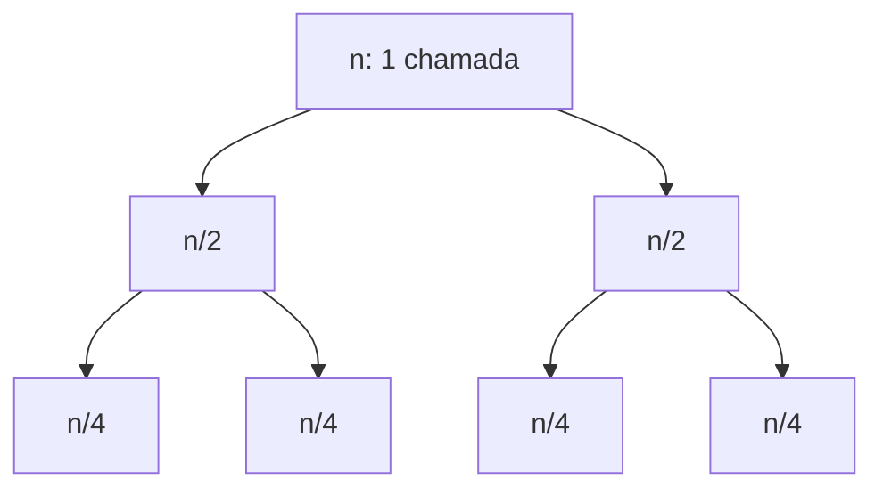

## Passo 1 · Leitura · Conte quantas vezes o corpo mais interno roda

Para analisar um trecho com laços, conte quantas vezes a linha **mais interna** executa, em função de $n$. Quatro regras resolvem quase tudo.

#### Em sequência, some. Aninhados, multiplique.

```python
for i in range(n):          # n vezes
    ...
for j in range(n):          # mais n vezes, DEPOIS do primeiro
    ...                     # total: n + n = 2n, Θ(n)

for i in range(n):          # para CADA um dos n valores de i...
    for j in range(n):      # ...o laço de dentro roda inteiro
        ...                 # total: n · n = n², Θ(n²)
```

O erro clássico é somar laços aninhados: "dois laços de $n$, então $2n$". O de dentro recomeça a cada volta do de fora, então ele roda $n$ vezes **por volta**. O mesmo raciocínio vale com um laço interno de tamanho fixo: `for j in range(5)` dentro de `for i in range(n)` dá $5n$, que é $\Theta(n)$.

#### Laço dependente: some volta por volta

Quando o laço de dentro depende de `i`, não dá para multiplicar. Some o que ele faz em cada volta:

$$
\text{for } j \text{ in range}(i+1, n): \qquad \sum_{i=0}^{n-1} (n - 1 - i) = (n-1) + (n-2) + \dots + 0 = \frac{n(n-1)}{2}
$$

É metade do quadrado, mas o $\frac{1}{2}$ é constante: continua $\Theta(n^2)$. É o laço de "todos os pares", que você pode acompanhar no visualizador.

#### Passo multiplicativo: logaritmo

Em `i = 1; while i < n: i *= 2`, `i` vale $1, 2, 4, \dots$ e o laço para quando $2^k \ge n$: são $\lceil \log_2 n \rceil$ voltas. Dividir por 2 até zerar (`while i > 0: i //= 2`) dá $\lfloor \log_2 n \rfloor + 1$ voltas para $n \ge 1$, o número de dígitos de $n$ em binário. Ambos são $\Theta(\log n)$. Um laço $\Theta(\log n)$ dentro de um laço de $n$ voltas dá $\Theta(n \log n)$.

```python visualizar
n = 4
pares = []
for i in range(n):
    for j in range(i + 1, n):
        pares.append((i, j))
print(len(pares), pares)
```

Observe `j` começar em `i + 1` a cada volta: o laço de dentro roda 3, 2, 1 e 0 vezes, e o total é $\frac{4 \cdot 3}{2} = 6$.

## Passo 2 · Previsão · Cinco contadores

Leia sem executar e digite exatamente o que o programa imprime para `n = 8`.

### Código
```python
n = 8

seguidos = 0
for i in range(n):
    seguidos += 1
for j in range(n):
    seguidos += 1

aninhados = 0
for i in range(n):
    for j in range(n):
        aninhados += 1

pares = 0
for i in range(n):
    for j in range(i + 1, n):
        pares += 1

dobra = 0
k = 1
while k < n:
    dobra += 1
    k *= 2

n_log_n = 0
for i in range(n):
    k = 1
    while k < n:
        n_log_n += 1
        k *= 2

print("seguidos:", seguidos)
print("aninhados:", aninhados)
print("pares:", pares)
print("dobra:", dobra)
print("n_log_n:", n_log_n)
```

### Dicas
1. Em sequência, some; aninhados, multiplique.
2. `pares` é $7 + 6 + \dots + 0$.
3. Em `dobra`, `k` passa por 1, 2 e 4; quando vira 8, o `while` para.

### Saída esperada
```text
seguidos: 16
aninhados: 64
pares: 28
dobra: 3
n_log_n: 24
```

## Passo 3 · Exercício · Fórmulas fechadas para quatro trechos

Para cada trecho abaixo, escreva uma função que devolve **quantas vezes `corpo()` executa** para um $n \ge 0$, sem executar o trecho: a correção chama suas funções com $n = 10^{12}$, e um laço com $10^{24}$ voltas nunca terminaria.

```python
# trecho A                     # trecho B
for i in range(n):             for i in range(n):
    for j in range(n):             corpo()
        corpo()                for j in range(n):
                                   corpo()

# trecho C                     # trecho D
for i in range(n):             i = n
    for j in range(i + 1, n):  while i > 0:
        corpo()                    corpo()
                                   i //= 2
```

Escreva `vezes_a(n)`, `vezes_b(n)`, `vezes_c(n)` e `vezes_d(n)`. As três primeiras são uma conta só, sem laços. Em `vezes_d` você pode usar um laço: ele dá $\Theta(\log n)$ voltas, só 40 com $n = 10^{12}$. Devolva sempre `int`.

### Instruções
1. `vezes_a(n)`: dois laços aninhados de `n` voltas, sem `for` nem `while`.
2. `vezes_b(n)`: dois laços em sequência, sem `for` nem `while`.
3. `vezes_c(n)`: o laço dependente, sem `for` nem `while`, devolvendo um `int` exato.
4. `vezes_d(n)`: quantas vezes `n` pode ser dividido por 2 (divisão inteira) antes de zerar.

### Código inicial
```python
def vezes_a(n):
    pass


def vezes_b(n):
    pass


def vezes_c(n):
    pass


def vezes_d(n):
    pass
```

### Solução
```python
def vezes_a(n):
    return n * n


def vezes_b(n):
    return 2 * n


def vezes_c(n):
    return n * (n - 1) // 2


def vezes_d(n):
    voltas = 0
    while n > 0:
        voltas += 1
        n //= 2
    return voltas
```

### Dicas
1. Em sequência, some; aninhados, multiplique.
2. No trecho C, escreva a soma das voltas do laço de dentro para `n = 3` e `n = 4` e procure a fórmula de Gauss.
3. `/` sempre devolve `float`, e um `float` não guarda todos os dígitos de um número com 24 algarismos.

### Verificação
```json
[
  { "id": "a-sem-laco", "checkpoint": 1, "kind": "source", "rule": { "type": "not_uses", "construct": "for", "function": "vezes_a" },
    "name": "vezes_a não usa for" },
  { "id": "b-sem-laco", "checkpoint": 2, "kind": "source", "rule": { "type": "not_uses", "construct": "for", "function": "vezes_b" },
    "name": "vezes_b não usa for" },
  { "id": "c-sem-for", "checkpoint": 3, "kind": "source", "rule": { "type": "not_uses", "construct": "for", "function": "vezes_c" },
    "name": "vezes_c não usa for" },
  { "id": "c-sem-while", "checkpoint": 3, "kind": "source", "rule": { "type": "not_uses", "construct": "while", "function": "vezes_c" },
    "name": "vezes_c não usa while" },
  { "id": "a-confere", "checkpoint": 1, "kind": "expr",
    "setup": "def real_a(n):\n    c = 0\n    for i in range(n):\n        for j in range(n):\n            c += 1\n    return c",
    "expr": "all(vezes_a(n) == real_a(n) for n in range(30))", "expected": true,
    "name": "vezes_a confere com o trecho A executado, de n = 0 a 29",
    "hint": "O laço de dentro roda inteiro a cada volta do de fora." },
  { "id": "b-confere", "checkpoint": 2, "kind": "expr",
    "setup": "def real_b(n):\n    c = 0\n    for i in range(n):\n        c += 1\n    for j in range(n):\n        c += 1\n    return c",
    "expr": "all(vezes_b(n) == real_b(n) for n in range(30))", "expected": true,
    "name": "vezes_b confere com o trecho B executado, de n = 0 a 29",
    "hint": "O segundo laço só começa depois que o primeiro termina." },
  { "id": "c-confere", "checkpoint": 3, "kind": "expr",
    "setup": "def real_c(n):\n    c = 0\n    for i in range(n):\n        for j in range(i + 1, n):\n            c += 1\n    return c",
    "expr": "all(vezes_c(n) == real_c(n) for n in range(30))", "expected": true,
    "name": "vezes_c confere com o trecho C executado, de n = 0 a 29",
    "hint": "Para n = 4, o laço de dentro roda 3, 2, 1 e 0 vezes." },
  { "id": "c-grande", "checkpoint": 3, "kind": "expr",
    "expr": "[vezes_c(10 ** 12) == 10 ** 12 * (10 ** 12 - 1) // 2, type(vezes_c(10 ** 12)) is int]", "expected": [true, true],
    "name": "vezes_c(10**12) é o inteiro exato",
    "hint": "Divisão com / devolve float e perde dígitos; use //." },
  { "id": "a-b-grande", "checkpoint": 1, "kind": "expr",
    "expr": "[vezes_a(10 ** 12) == 10 ** 24, vezes_b(10 ** 12) == 2 * 10 ** 12]", "expected": [true, true],
    "name": "vezes_a e vezes_b com n = 10**12" },
  { "id": "d-confere", "checkpoint": 4, "kind": "expr",
    "setup": "def real_d(n):\n    c = 0\n    i = n\n    while i > 0:\n        c += 1\n        i //= 2\n    return c",
    "expr": "all(vezes_d(n) == real_d(n) for n in range(200))", "expected": true,
    "name": "vezes_d confere com o trecho D executado, de n = 0 a 199",
    "hint": "Com n = 1, o corpo roda uma vez antes de i zerar." },
  { "id": "d-valores", "checkpoint": 4, "kind": "expr",
    "expr": "[vezes_d(0), vezes_d(1), vezes_d(7), vezes_d(8), vezes_d(10 ** 18)]", "expected": [0, 1, 3, 4, 60],
    "name": "vezes_d para 0, 1, 7, 8 e 10**18" }
]
```

### Soluções erradas
```python name="soma os laços aninhados"
def vezes_a(n):
    return n + n


def vezes_b(n):
    return 2 * n


def vezes_c(n):
    return n * (n - 1) // 2


def vezes_d(n):
    voltas = 0
    while n > 0:
        voltas += 1
        n //= 2
    return voltas
```
```python name="multiplica os laços em sequência"
def vezes_a(n):
    return n * n


def vezes_b(n):
    return n * n


def vezes_c(n):
    return n * (n - 1) // 2


def vezes_d(n):
    voltas = 0
    while n > 0:
        voltas += 1
        n //= 2
    return voltas
```
```python name="n(n+1)/2 conta uma volta a mais por linha"
def vezes_a(n):
    return n * n


def vezes_b(n):
    return 2 * n


def vezes_c(n):
    return n * (n + 1) // 2


def vezes_d(n):
    voltas = 0
    while n > 0:
        voltas += 1
        n //= 2
    return voltas
```
```python name="divide com / e perde precisão"
def vezes_a(n):
    return n * n


def vezes_b(n):
    return 2 * n


def vezes_c(n):
    return int(n * (n - 1) / 2)


def vezes_d(n):
    voltas = 0
    while n > 0:
        voltas += 1
        n //= 2
    return voltas
```
```python name="para o while em 1 e perde a última volta"
def vezes_a(n):
    return n * n


def vezes_b(n):
    return 2 * n


def vezes_c(n):
    return n * (n - 1) // 2


def vezes_d(n):
    voltas = 0
    while n > 1:
        voltas += 1
        n //= 2
    return voltas
```

## Passo 4 · Leitura · O custo escondido numa linha só

Contar laços só funciona se você souber quanto custa cada linha. Algumas linhas curtas de Python escondem um laço inteiro:

| Linha | Custo | Por quê |
| :--- | :---: | :--- |
| `x in lista`, `lista.index(x)` | $\Theta(n)$ no pior caso | compara elemento por elemento |
| `lista.insert(0, x)`, `lista.pop(0)` | $\Theta(n)$ | desloca todos os outros uma posição |
| `lista[a:b]` | $\Theta(b - a)$ | **copia** o trecho para uma lista nova |
| `s = s + t` com strings | $\Theta(\lvert s \rvert + \lvert t \rvert)$ | string é imutável: cria uma string nova e copia as duas |
| `sorted(lista)` | $\Theta(n \log n)$ | ordena uma cópia |
| `x in conjunto`, `d[chave]` | $\Theta(1)$ em média | vai direto ao lugar pelo `hash` |
| `lista[i]`, `len(lista)`, `lista.append(x)` | $\Theta(1)$ | `append` é constante amortizado (próxima lição) |

Veja o efeito numa função com **um** laço só:

```python
def sem_duplicatas_lenta(itens):
    resultado = []
    for x in itens:
        if x not in resultado:      # percorre resultado inteiro
            resultado.append(x)
    return resultado
```

Com $n$ itens distintos, o `not in` compara com $0, 1, 2, \dots, n-1$ elementos: $\frac{n(n-1)}{2}$ comparações, $\Theta(n^2)$. Com $n = 50\,000$, são mais de um bilhão. A correção é guardar os já vistos num `set`, onde a consulta é $\Theta(1)$ em média: a função passa a $\Theta(n)$. Ela troca memória por tempo.

O mesmo vale para `texto = texto + linha` num laço de $n$ linhas: a $k$-ésima concatenação copia as $k$ linhas anteriores, e o total é $\Theta(n^2)$ caracteres copiados. O CPython às vezes consegue estender a string no lugar, mas isso é um detalhe que some quando existe outra referência ao texto. O jeito garantido é juntar as partes numa lista e chamar `"\n".join(partes)` uma vez, em $\Theta$(tamanho total). E `insert(0, x)` em laço também é $\Theta(n^2)$: faça `append` e inverta no fim.

## Passo 5 · Exercício · Elementos em comum, sem custo escondido

A secretaria acadêmica tem a lista de quem fez a prova (`a`) e a de quem entregou o trabalho (`b`). Escreva `comuns(a, b)`, que devolve os elementos de `a` que também aparecem em `b`, **na ordem da primeira aparição em `a`** e **sem repetições**. Exemplo:

```python
comuns(["Caio", "Ana", "Caio", "Davi", "Bia"], ["Bia", "Caio", "Eva"])
# ["Caio", "Bia"]
```

A função precisa ser $\Theta(\lvert a \rvert + \lvert b \rvert)$. A correção conta as comparações com `==` feitas entre os elementos: com $2\,000$ elementos em cada lista, uma versão com `in` numa lista faz milhões de comparações; a sua deve fazer no máximo $8\,000$.

### Instruções
1. Monte um `set` com os elementos de `b` antes do laço.
2. Percorra `a` em ordem e mantenha a ordem da primeira aparição.
3. Evite repetições usando um segundo `set` com os já incluídos, não a lista do resultado.

### Código inicial
```python
def comuns(a, b):
    pass
```

### Solução
```python
def comuns(a, b):
    em_b = set(b)
    vistos = set()
    resultado = []
    for x in a:
        if x in em_b and x not in vistos:
            vistos.add(x)
            resultado.append(x)
    return resultado
```

### Dicas
1. `x in b` com `b` lista percorre `b` inteira a cada consulta.
2. `x not in resultado` também é uma busca numa lista.
3. Um `set` não guarda ordem: use-o só para consultar, e a lista para a resposta.

### Verificação
```json
[
  { "id": "exemplo", "checkpoint": 2, "kind": "call", "function": "comuns",
    "args": [["Lia", "Rui", "Lia", "Gil", "Ana"], ["Ana", "Lia", "Teo"]], "expected": ["Lia", "Ana"],
    "name": "Ordem da primeira aparição em a, sem repetir" },
  { "id": "ordem-de-a", "checkpoint": 2, "kind": "call", "function": "comuns",
    "args": [[50, 3, 9, 1, 27], [1, 3, 9, 27, 50]], "expected": [50, 3, 9, 1, 27],
    "name": "Segue a ordem de a, não a de b nem a ordem crescente",
    "hint": "Um set não preserva a ordem de a." },
  { "id": "repetidos", "checkpoint": 3, "kind": "call", "function": "comuns",
    "args": [[4, 4, 4, 2, 2, 4], [2, 4, 4]], "expected": [4, 2], "name": "Repetidos em a e em b aparecem uma vez" },
  { "id": "vazias", "checkpoint": 1, "kind": "expr", "expr": "[comuns([], [1, 2]), comuns([1, 2], []), comuns([1, 2], [3])]",
    "expected": [[], [], []], "name": "Listas vazias ou sem nada em comum devolvem []" },
  { "id": "nao-altera", "checkpoint": 1, "kind": "expr",
    "setup": "a = [3, 1, 3]\nb = [1, 3]\nr = comuns(a, b)", "expr": "[r, a, b]", "expected": [[3, 1], [3, 1, 3], [1, 3]],
    "name": "Não altera as listas recebidas" },
  { "id": "linear-poucos-comuns", "checkpoint": 1, "kind": "expr",
    "setup": "class Item:\n    comparacoes = 0\n    def __init__(self, v):\n        self.v = v\n    def __eq__(self, outro):\n        Item.comparacoes += 1\n        return isinstance(outro, Item) and self.v == outro.v\n    def __hash__(self):\n        return hash(self.v)\na = [Item(i) for i in range(2000)]\nb = [Item(i) for i in range(1990, 3990)]\nr = comuns(a, b)",
    "expr": "[[x.v for x in r], Item.comparacoes <= 8000]", "expected": [[1990, 1991, 1992, 1993, 1994, 1995, 1996, 1997, 1998, 1999], true],
    "name": "2000 contra 2000 elementos: até 8000 comparações com ==",
    "hint": "Cada x in lista compara x com os elementos da lista, um por um." },
  { "id": "linear-muitos-comuns", "checkpoint": 3, "kind": "expr",
    "setup": "class Item:\n    comparacoes = 0\n    def __init__(self, v):\n        self.v = v\n    def __eq__(self, outro):\n        Item.comparacoes += 1\n        return isinstance(outro, Item) and self.v == outro.v\n    def __hash__(self):\n        return hash(self.v)\na = [Item(i % 1500) for i in range(2000)]\nb = [Item(i) for i in range(2000)]\nr = comuns(a, b)",
    "expr": "[len(r), r[0].v, r[-1].v, Item.comparacoes <= 8000]", "expected": [1500, 0, 1499, true],
    "name": "1500 elementos em comum: evitar repetição também precisa ser O(1)",
    "hint": "Procurar x na lista do resultado é uma busca linear." }
]
```

### Soluções erradas
```python name="x in b com b lista"
def comuns(a, b):
    resultado = []
    for x in a:
        if x in b and x not in resultado:
            resultado.append(x)
    return resultado
```
```python name="set para b, mas repetição conferida na lista"
def comuns(a, b):
    em_b = set(b)
    resultado = []
    for x in a:
        if x in em_b and x not in resultado:
            resultado.append(x)
    return resultado
```
```python name="interseção de sets perde a ordem de a"
def comuns(a, b):
    return list(set(a) & set(b))
```
```python name="não tira as repetições"
def comuns(a, b):
    em_b = set(b)
    return [x for x in a if x in em_b]
```
```python name="ordena o resultado"
def comuns(a, b):
    return sorted(set(a) & set(b))
```

## Passo 6 · Leitura · Recorrências: o custo de uma função recursiva

Uma função recursiva não tem laço para contar, mas tem uma regra: o custo $T(n)$ é o trabalho feito **nesta** chamada mais o custo das chamadas que ela faz. Escrever essa igualdade é montar a **recorrência**. Expandi-la até o caso base dá a soma.

#### Exemplo 1: a fatia que ninguém vê

```python
def soma(lista):
    if not lista:
        return 0
    return lista[0] + soma(lista[1:])     # lista[1:] copia n - 1 elementos
```

Cada chamada copia $n - 1$ elementos e chama a si mesma com $n - 1$:

$$
T(n) = T(n-1) + n \;\Rightarrow\; T(n) = n + (n-1) + \dots + 1 = \frac{n(n+1)}{2} = \Theta(n^2).
$$

Passando um índice, `soma(lista, i + 1)`, a chamada faz trabalho constante: $T(n) = T(n-1) + 1$, que expande para $n$ termos iguais a 1, $\Theta(n)$.

#### Exemplo 2: dividir por dois

```python
def digitos_binarios(n):
    if n < 2:
        return 1
    return 1 + digitos_binarios(n // 2)
```

$T(n) = T(n/2) + 1$. Cada expansão divide $n$ por 2 e soma 1, até chegar a 1: são $\log_2 n$ expansões, $\Theta(\log n)$.

#### Exemplo 3: duas metades, trabalho constante

Achar o maior de `lista[lo:hi]` pedindo o maior de cada metade, **sem fatiar** (passando `lo` e `hi`), custa $T(n) = 2T(n/2) + 1$. Expanda em níveis:



São $1 + 2 + 4 + \dots + n = 2n - 1$ chamadas, cada uma com trabalho constante: $\Theta(n)$, e **não** $\Theta(n \log n)$. Duas chamadas recursivas não dão $n \log n$ por si só. O $n \log n$ do merge sort, no módulo 4, vem de $T(n) = 2T(n/2) + n$: o trabalho de **cada nível** soma $n$. O módulo 3 generaliza essa conta no Teorema Mestre.

## Passo 7 · Exercício · Recursão sem fatia e contas por expansão

Escreva três funções.

- `soma_rec(lista, i=0)`: soma recursiva dos elementos de `lista[i:]` **sem fatiar**: avance o índice. A correção usa uma lista que conta quantos elementos as fatias copiam; o total precisa ser zero.
- `copias_com_fatia(n)`: quantos elementos, no total, a função `soma` do passo anterior (a que chama `soma(lista[1:])`) copia ao somar uma lista de `n` elementos. Sem laços: expanda a recorrência e escreva a fórmula.
- `chamadas_metades(n)`: quantas chamadas, contando a primeira, faz uma função que, para $n \ge 2$, chama a si mesma com as metades de tamanhos `n // 2` e `n - n // 2`, e para $n = 1$ não chama mais nada. Sem laços. Exemplos: `chamadas_metades(1) == 1` e `chamadas_metades(2) == 3`.

### Instruções
1. `soma_rec`: caso base quando `i` chega ao fim da lista; senão, some `lista[i]` com a chamada para `i + 1`.
2. `copias_com_fatia(n)`: some os tamanhos de todas as fatias criadas, com uma fórmula fechada.
3. `chamadas_metades(n)`: conte os nós da árvore de chamadas, com uma fórmula fechada.

### Código inicial
```python
def soma_rec(lista, i=0):
    pass


def copias_com_fatia(n):
    pass


def chamadas_metades(n):
    pass
```

### Solução
```python
def soma_rec(lista, i=0):
    if i == len(lista):
        return 0
    return lista[i] + soma_rec(lista, i + 1)


def copias_com_fatia(n):
    return n * (n - 1) // 2


def chamadas_metades(n):
    return 2 * n - 1
```

### Dicas
1. A lista vazia também precisa funcionar: o caso base é `i == len(lista)`.
2. Com uma lista de 3 elementos, as fatias têm 2, 1 e 0 elementos.
3. Cada chamada com $n \ge 2$ tem exatamente dois "filhos"; conte as folhas (tamanho 1) e os nós internos.

### Verificação
```json
[
  { "id": "usa-recursao", "checkpoint": 1, "kind": "source", "rule": { "type": "uses", "construct": "recursion" },
    "name": "soma_rec é recursiva" },
  { "id": "soma-valores", "checkpoint": 1, "kind": "expr",
    "expr": "[soma_rec([4, -1, 7]), soma_rec([]), soma_rec([5]), soma_rec([10, 20, 30], 1)]", "expected": [10, 0, 5, 50],
    "name": "soma_rec com 3 elementos, vazia, um elemento e começando em i=1" },
  { "id": "sem-copias", "checkpoint": 1, "kind": "expr",
    "setup": "class Seq(list):\n    copiados = 0\n    def __getitem__(self, k):\n        if isinstance(k, slice):\n            r = Seq(list.__getitem__(self, k))\n            Seq.copiados += len(r)\n            return r\n        return list.__getitem__(self, k)\ndados = Seq(range(500))\ns = soma_rec(dados)",
    "expr": "[s, Seq.copiados]", "expected": [124750, 0],
    "name": "Soma 500 elementos sem copiar nenhum por fatia",
    "hint": "lista[1:] copia a lista; passe o índice adiante." },
  { "id": "copias-confere", "checkpoint": 2, "kind": "expr",
    "setup": "class Seq(list):\n    copiados = 0\n    def __getitem__(self, k):\n        if isinstance(k, slice):\n            r = Seq(list.__getitem__(self, k))\n            Seq.copiados += len(r)\n            return r\n        return list.__getitem__(self, k)\ndef soma(lista):\n    if not lista:\n        return 0\n    return lista[0] + soma(lista[1:])\ndef real(n):\n    Seq.copiados = 0\n    soma(Seq(range(n)))\n    return Seq.copiados",
    "expr": "all(copias_com_fatia(n) == real(n) for n in range(40))", "expected": true,
    "name": "copias_com_fatia confere com as cópias reais, de n = 0 a 39",
    "hint": "A chamada com a lista vazia não cria fatia." },
  { "id": "copias-grande", "checkpoint": 2, "kind": "expr",
    "expr": "[copias_com_fatia(10 ** 9) == 10 ** 9 * (10 ** 9 - 1) // 2, copias_com_fatia(0), copias_com_fatia(1)]",
    "expected": [true, 0, 0], "name": "copias_com_fatia para 10**9, 0 e 1" },
  { "id": "copias-sem-laco", "checkpoint": 2, "kind": "source", "rule": { "type": "not_uses", "construct": "for", "function": "copias_com_fatia" },
    "name": "copias_com_fatia não usa for" },
  { "id": "metades-confere", "checkpoint": 3, "kind": "expr",
    "setup": "def real(n):\n    if n == 1:\n        return 1\n    return 1 + real(n // 2) + real(n - n // 2)",
    "expr": "all(chamadas_metades(n) == real(n) for n in range(1, 300))", "expected": true,
    "name": "chamadas_metades confere com a árvore real, de n = 1 a 299",
    "hint": "Conte para n = 1, 2, 3 e 4 e procure o padrão." },
  { "id": "metades-grande", "checkpoint": 3, "kind": "expr", "expr": "chamadas_metades(10 ** 12) == 2 * 10 ** 12 - 1",
    "expected": true, "name": "chamadas_metades(10**12)" },
  { "id": "metades-sem-laco", "checkpoint": 3, "kind": "source", "rule": { "type": "not_uses", "construct": "while", "function": "chamadas_metades" },
    "name": "chamadas_metades não usa while" }
]
```

### Soluções erradas
```python name="soma_rec fatiando a lista"
def soma_rec(lista, i=0):
    if not lista[i:]:
        return 0
    return lista[i] + soma_rec(lista[i + 1:])


def copias_com_fatia(n):
    return n * (n - 1) // 2


def chamadas_metades(n):
    return 2 * n - 1
```
```python name="caso base no último elemento quebra a lista vazia"
def soma_rec(lista, i=0):
    if i == len(lista) - 1:
        return lista[i]
    return lista[i] + soma_rec(lista, i + 1)


def copias_com_fatia(n):
    return n * (n - 1) // 2


def chamadas_metades(n):
    return 2 * n - 1
```
```python name="conta uma fatia de n elementos a mais"
def soma_rec(lista, i=0):
    if i == len(lista):
        return 0
    return lista[i] + soma_rec(lista, i + 1)


def copias_com_fatia(n):
    return n * (n + 1) // 2


def chamadas_metades(n):
    return 2 * n - 1
```
```python name="duas metades viram n log n"
def soma_rec(lista, i=0):
    if i == len(lista):
        return 0
    return lista[i] + soma_rec(lista, i + 1)


def copias_com_fatia(n):
    return n * (n - 1) // 2


def chamadas_metades(n):
    return n * n.bit_length()
```
```python name="conta só as folhas"
def soma_rec(lista, i=0):
    if i == len(lista):
        return 0
    return lista[i] + soma_rec(lista, i + 1)


def copias_com_fatia(n):
    return n * (n - 1) // 2


def chamadas_metades(n):
    return n
```

## Passo 8 · Quiz · Laços, linhas caras e recorrências

### Pergunta
Qual é o custo do trecho, em função de $n$?
```python
for i in range(n):
    for j in range(10):
        total += i * j
for k in range(n):
    total += k
```
- [ ] $\Theta(n^2)$, porque há dois laços aninhados
- [x] $\Theta(n)$: são $10n + n = 11n$ execuções
- [ ] $\Theta(n \log n)$, porque o laço de dentro é pequeno
- [ ] $\Theta(10n^2)$, porque os laços se multiplicam
> Aninhados se multiplicam, mas o de dentro tem tamanho fixo: $n \cdot 10$. O terceiro laço vem em sequência e soma $n$. $11n$ é $\Theta(n)$. Laços aninhados só dão $n^2$ quando os dois dependem de $n$.

### Pergunta
Um relatório de $n$ linhas, cada uma com 80 caracteres, é montado com `texto = texto + linha + "\n"` dentro de um `for`. Sem contar otimizações do interpretador, quantos caracteres são copiados no total?
- [ ] $\Theta(n)$, porque cada linha é copiada uma vez
- [x] $\Theta(n^2)$, porque cada concatenação cria uma string nova e copia todo o texto acumulado até ali
- [ ] $\Theta(1)$ por linha, porque strings funcionam como listas com `append`
- [ ] $\Theta(n \log n)$, porque o texto dobra de tamanho a cada passo
> Strings são imutáveis: a $k$-ésima concatenação copia cerca de $81k$ caracteres, e $81(1 + 2 + \dots + n)$ é $\Theta(n^2)$. `"\n".join(linhas)` calcula o tamanho final e copia cada caractere uma vez.

### Pergunta
Uma busca binária recursiva chama a si mesma com `lista[:meio]` ou `lista[meio + 1:]`, uma metade por vez. Qual é o custo total?
- [ ] $\Theta(\log n)$, como toda busca binária
- [x] $\Theta(n)$: $T(n) = T(n/2) + n$, e $n + \frac{n}{2} + \frac{n}{4} + \dots < 2n$
- [ ] $\Theta(n \log n)$: $\log n$ chamadas, cada uma copiando $n$ elementos
- [ ] $\Theta(n^2)$, porque fatiar dentro de recursão é sempre quadrático
> Cada chamada copia metade do que recebeu. A soma geométrica $n + n/2 + n/4 + \dots$ fica abaixo de $2n$. A fatia transformou uma busca $\Theta(\log n)$ numa busca $\Theta(n)$. Com índices `lo` e `hi`, volta a ser $\Theta(\log n)$.
