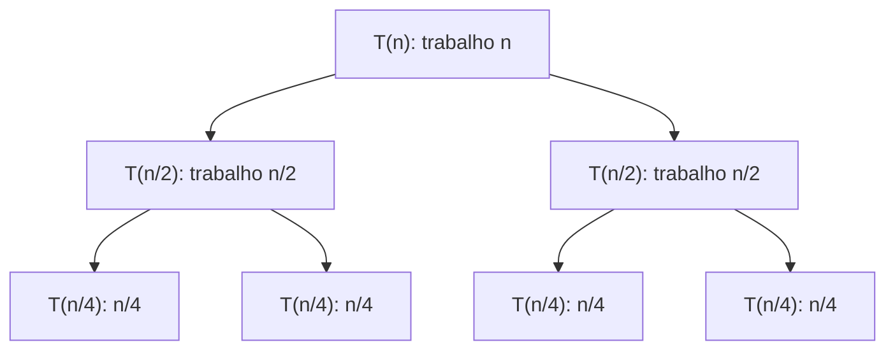

## Passo 1 · Leitura · Contando iterações em cinco padrões clássicos de laços

A forma mais segura de descobrir a complexidade de um algoritmo iterativo é **contar quantas vezes o corpo mais interno executa** em função de $n$:

1. **Laço simples (`for i in range(n)`):** executa $n$ vezes $\to \Theta(n)$.
2. **Laço duplo independente (`for i in range(n): for j in range(n)`):** para cada uma das $n$ iterações externas, o laço interno roda $n$ vezes $\to n \cdot n = n^2 \in \Theta(n^2)$.
3. **Laço duplo dependente / triangular (`for i in range(n): for j in range(i)`):** o laço interno roda $0, 1, 2, \dots, n-1$ vezes. Pela soma de Gauss:
   $$\sum_{i=0}^{n-1} i = \frac{n(n-1)}{2} = \frac{1}{2}n^2 - \frac{1}{2}n \in \Theta(n^2)$$
   Cuidado com um erro muito comum: o fator $\frac{1}{2}$ **não** muda a classe assintótica! Um laço triangular continua sendo $\Theta(n^2)$.
4. **Laço com passo multiplicativo (`i = 1; while i < n: i *= 2`):** a variável `i` assume os valores $1, 2, 4, 8, \dots, 2^{k-1}$. O laço para assim que $2^k \ge n$, ou seja, após $\lceil\log_2 n\rceil$ iterações $\to \Theta(\log n)$.
5. **Laço linear combinado com laço multiplicativo (`for i in range(n): j = 1; while j < n: j *= 2`):** o laço externo roda $n$ vezes e o interno roda $\lceil\log_2 n\rceil$ vezes para cada `i` $\to \Theta(n \log n)$.

## Passo 2 · Previsão · Quantas vezes cada laço executa?

Leia o programa abaixo e determine os três contadores impressos para `n = 8`.

### Código
```python
n = 8

c_triangular = 0
for i in range(n):
    for j in range(i):
        c_triangular += 1

c_log = 0
k = 1
while k < n:
    c_log += 1
    k *= 2

c_nlogn = 0
for i in range(n):
    m = 1
    while m < n:
        c_nlogn += 1
        m *= 2

print(c_triangular, c_log, c_nlogn)
```

### Dicas
1. Para `n = 8`, `c_triangular` vale $0 + 1 + 2 + \dots + 7 = \frac{8 \cdot 7}{2}$.
2. Em `c_log`, `k` assume os valores `1`, `2` e `4` antes de chegar a `8` e sair do `while`.
3. Em `c_nlogn`, o laço interno de `3` passos repete `8` vezes.

### Saída esperada
```text
28 3 24
```

## Passo 3 · Exercício · Contando iterações e classificando trechos

Implemente duas funções:
- `contar_iteracoes(n)`: recebe `n` ($n \ge 1$) e devolve um dicionário com a contagem exata de iterações dos 4 padrões para aquele `n`:
  - `"linear"`: número de iterações de `for i in range(n)` ($n$);
  - `"triangular"`: número de iterações de `for i in range(n): for j in range(i)` ($n(n-1)//2$);
  - `"log"`: número de iterações de `k = 1; while k < n: k *= 2`;
  - `"n_log_n"`: número de iterações de `for i in range(n): k = 1; while k < n: k *= 2`.
- `classificar_trecho(codigo_id)`: recebe o identificador de um trecho (`"linear"`, `"triangular"`, `"log"` ou `"n_log_n"`) e devolve sua classe Big-O (`"O(n)"`, `"O(n^2)"`, `"O(log n)"` ou `"O(n log n)"`).

### Instruções
1. Em `contar_iteracoes(n)`, calcule ou conte fielmente as iterações dos quatro trechos e devolva o dicionário `{"linear": ..., "triangular": ..., "log": ..., "n_log_n": ...}`.
2. Em `classificar_trecho(codigo_id)`, associe `"linear"` a `"O(n)"`, `"triangular"` a `"O(n^2)"`, `"log"` a `"O(log n)"` e `"n_log_n"` a `"O(n log n)"`.

### Código inicial
```python
def contar_iteracoes(n):
    # Devolva {"linear": ..., "triangular": ..., "log": ..., "n_log_n": ...}
    pass


def classificar_trecho(codigo_id):
    # Devolva "O(n)", "O(n^2)", "O(log n)" ou "O(n log n)"
    pass
```

### Solução
```python
def contar_iteracoes(n):
    c_log = 0
    k = 1
    while k < n:
        c_log += 1
        k *= 2
    return {
        "linear": n,
        "triangular": n * (n - 1) // 2,
        "log": c_log,
        "n_log_n": n * c_log,
    }


def classificar_trecho(codigo_id):
    mapa = {
        "linear": "O(n)",
        "triangular": "O(n^2)",
        "log": "O(log n)",
        "n_log_n": "O(n log n)",
    }
    return mapa[codigo_id]
```

### Dicas
1. O número de iterações de `k = 1; while k < n: k *= 2` para `n = 1` é `0` (pois `1 < 1` já é falso).
2. Lembre-se de que o laço `"triangular"` faz $n(n-1)/2$ iterações, mas sua classe assintótica é `"O(n^2)"`.

### Verificação
```json
[
  {
    "id": "contar-n8",
    "checkpoint": 1,
    "kind": "call",
    "function": "contar_iteracoes",
    "args": [8],
    "expected": { "linear": 8, "triangular": 28, "log": 3, "n_log_n": 24 },
    "name": "contar_iteracoes(8) devolve as 4 contagens exatas"
  },
  {
    "id": "contar-n10",
    "checkpoint": 1,
    "kind": "call",
    "function": "contar_iteracoes",
    "args": [10],
    "expected": { "linear": 10, "triangular": 45, "log": 4, "n_log_n": 40 },
    "name": "contar_iteracoes(10) trata n que não é potência de 2 (k = 1, 2, 4, 8 -> 4 passos)"
  },
  {
    "id": "contar-n1",
    "checkpoint": 1,
    "kind": "call",
    "function": "contar_iteracoes",
    "args": [1],
    "expected": { "linear": 1, "triangular": 0, "log": 0, "n_log_n": 0 },
    "name": "contar_iteracoes(1) devolve 0 para triangular, log e n_log_n"
  },
  {
    "id": "classificar-todos",
    "checkpoint": 2,
    "kind": "expr",
    "expr": "[classificar_trecho('linear'), classificar_trecho('triangular'), classificar_trecho('log'), classificar_trecho('n_log_n')]",
    "expected": ["O(n)", "O(n^2)", "O(log n)", "O(n log n)"],
    "name": "Classifica corretamente os 4 padrões (incluindo triangular como O(n^2))"
  }
]
```

### Soluções erradas
```python name="classifica laço triangular como O(n) por ter menos iterações que n^2"
def contar_iteracoes(n):
    c_log = 0
    k = 1
    while k < n:
        c_log += 1
        k *= 2
    return {
        "linear": n,
        "triangular": n * (n - 1) // 2,
        "log": c_log,
        "n_log_n": n * c_log,
    }


def classificar_trecho(codigo_id):
    mapa = {
        "linear": "O(n)",
        "triangular": "O(n)",
        "log": "O(log n)",
        "n_log_n": "O(n log n)",
    }
    return mapa[codigo_id]
```
```python name="usa n*(n+1)//2 em vez de n*(n-1)//2 para for j in range(i)"
def contar_iteracoes(n):
    c_log = 0
    k = 1
    while k < n:
        c_log += 1
        k *= 2
    return {
        "linear": n,
        "triangular": n * (n + 1) // 2,
        "log": c_log,
        "n_log_n": n * c_log,
    }


def classificar_trecho(codigo_id):
    mapa = {
        "linear": "O(n)",
        "triangular": "O(n^2)",
        "log": "O(log n)",
        "n_log_n": "O(n log n)",
    }
    return mapa[codigo_id]
```

## Passo 4 · Leitura · Custo escondido em chamadas de função e recorrências simples

#### O perigo do $O(n^2)$ disfarçado de uma linha

Considere esta função que remove elementos duplicados preservando a ordem original de aparição:

```python
def sem_duplicatas_lenta(lista):
    resultado = []
    for x in lista:
        if x not in resultado:   # <-- CUSTO ESCONDIDO O(len(resultado))!
            resultado.append(x)
    return resultado
```

À primeira vista, há apenas **um** laço `for`. Mas `x not in resultado` percorre `resultado` do início ao fim a cada iteração! Se todos os $n$ elementos forem distintos, o número de comparações será $0 + 1 + 2 + \dots + (n-1) = \frac{n(n-1)}{2} \in \Theta(n^2)$. Para $n = 50\,000$, isso faz mais de $1{,}2$ bilhão de comparações!

Como consertar? Mantemos um conjunto auxiliar `vistos = set()` ao lado da lista `resultado`: como `x not in vistos` e `vistos.add(x)` custam $O(1)$ cada, o algoritmo inteiro passa a rodar em **$\Theta(n)$**!

#### Analisando funções recursivas com recorrências

Em uma função recursiva, expressamos o custo $T(n)$ somando o **trabalho feito fora da chamada recursiva** com o **custo das chamadas recursivas**:

| Padrão recursivo | Recorrência (com $T(1) = 1$) | Expansão | Classe assintótica | Exemplo |
| :--- | :--- | :--- | :---: | :--- |
| Reduz em 1, trabalho $O(1)$ | $T(n) = T(n-1) + 1$ | $1 + 1 + \dots + 1$ ($n$ vezes) | $\Theta(n)$ | Fatorial, busca linear recursiva |
| Reduz em 1, trabalho $O(n)$ | $T(n) = T(n-1) + n$ | $1 + 2 + \dots + n = \frac{n(n+1)}{2}$ | $\Theta(n^2)$ | Selection sort recursivo, fatiar `lista[1:]` |
| Divide por 2 (1 chamada), trabalho $O(1)$ | $T(n) = T(n // 2) + 1$ | $1 + 1 + \dots + 1$ ($\lfloor\log_2 n\rfloor + 1$ vezes) | $\Theta(\log n)$ | Busca binária |
| Divide por 2 (2 chamadas), trabalho $O(n)$ | $T(n) = 2T(n // 2) + n$ | $\approx n \cdot (\log_2 n + 1)$ | $\Theta(n \log n)$ | Merge Sort |



Na árvore de recursão de $T(n) = 2T(n/2) + n$, cada nível soma exatamente $n$ ($2 \cdot \frac{n}{2} = n$, $4 \cdot \frac{n}{4} = n$, …) e a árvore tem $\log_2 n + 1$ níveis, totalizando $\Theta(n \log n)$ — o caso central do **Teorema Mestre** que aprofundaremos no Módulo 3!

## Passo 5 · Exercício · Resolvendo recorrências e eliminando o custo escondido

Implemente duas funções:
1. `resolver_recorrencia(tipo, n)`: recebe `tipo` e um inteiro $n \ge 1$, e calcula o valor numérico exato de $T(n)$ definido pelas recorrências abaixo com caso base $T(1) = 1$:
   - `"linear"`: $T(n) = T(n-1) + 1$ para $n > 1$;
   - `"quadratica"`: $T(n) = T(n-1) + n$ para $n > 1$;
   - `"log"`: $T(n) = T(n // 2) + 1$ para $n > 1$;
   - `"n_log_n"`: $T(n) = 2 \cdot T(n // 2) + n$ para $n > 1$.
2. `custo_escondido(lista)`: recebe uma `lista` e devolve uma nova lista contendo os elementos únicos de `lista` **na mesma ordem da primeira aparição**, rodando em tempo linear $O(n)$ com o auxílio de um `set`. Sua função será testada com $n = 50\,000$ elementos!

### Instruções
1. Em `resolver_recorrencia(tipo, n)`, se `n == 1` devolva `1`; para `n > 1`, aplique a fórmula fechada ou a recorrência correspondente a `"linear"`, `"quadratica"`, `"log"` e `"n_log_n"`.
2. Em `custo_escondido(lista)`, crie `vistos = set()` e `resultado = []`. Para cada `x` em `lista`, se `x not in vistos`, adicione `x` em `vistos` e em `resultado`. Devolva `resultado`.

### Código inicial
```python
def resolver_recorrencia(tipo, n):
    # Calcule T(n) com T(1) = 1 para "linear", "quadratica", "log" ou "n_log_n"
    pass


def custo_escondido(lista):
    # Remova duplicatas preservando a ordem da 1ª aparição em tempo O(n)
    pass
```

### Solução
```python
def resolver_recorrencia(tipo, n):
    if n <= 1:
        return 1
    if tipo == "linear":
        return n
    if tipo == "quadratica":
        return n * (n + 1) // 2
    if tipo == "log":
        return resolver_recorrencia("log", n // 2) + 1
    if tipo == "n_log_n":
        return 2 * resolver_recorrencia("n_log_n", n // 2) + n
    raise ValueError(f"Tipo desconhecido: {tipo}")


def custo_escondido(lista):
    vistos = set()
    resultado = []
    for x in lista:
        if x not in vistos:
            vistos.add(x)
            resultado.append(x)
    return resultado
```

### Dicas
1. Para `"log"` e `"n_log_n"`, como $n$ é dividido por 2 a cada chamada (`n // 2`), a própria chamada recursiva faz apenas $\approx \log_2 n$ passos e nunca estoura a pilha!
2. Em `custo_escondido`, fazer `return list(set(lista))` **não** preserva a ordem de aparição para qualquer tipo de dado; use a dupla `vistos = set()` + `resultado.append(x)`.

### Verificação
```json
[
  {
    "id": "recorrencias-n16",
    "checkpoint": 1,
    "kind": "expr",
    "expr": "[resolver_recorrencia('linear', 16), resolver_recorrencia('quadratica', 16), resolver_recorrencia('log', 16), resolver_recorrencia('n_log_n', 16)]",
    "expected": [16, 136, 5, 80],
    "name": "Calcula T(16) para as quatro recorrências: [16, 136, 5, 80]"
  },
  {
    "id": "recorrencias-n1",
    "checkpoint": 1,
    "kind": "expr",
    "expr": "[resolver_recorrencia(t, 1) for t in ('linear', 'quadratica', 'log', 'n_log_n')]",
    "expected": [1, 1, 1, 1],
    "name": "Caso base T(1) == 1 para todos os tipos"
  },
  {
    "id": "custo-escondido-ordem",
    "checkpoint": 2,
    "kind": "call",
    "function": "custo_escondido",
    "args": [[4, 2, 4, 1, 2, 3, 1]],
    "expected": [4, 2, 1, 3],
    "name": "Preserva a ordem da primeira aparição ([4, 2, 4, 1, 2, 3, 1] -> [4, 2, 1, 3])"
  },
  {
    "id": "custo-escondido-50k",
    "checkpoint": 2,
    "kind": "expr",
    "setup": "entrada = [i % 25000 for i in range(50000)]\nsaida = custo_escondido(entrada)",
    "expr": "[len(saida), saida[:4], saida[-1]]",
    "expected": [25000, [0, 1, 2, 3], 24999],
    "name": "Processa 50.000 elementos rapidamente em O(n) usando set"
  }
]
```

### Soluções erradas
```python name="esquece de somar n no passo recursivo de n_log_n"
def resolver_recorrencia(tipo, n):
    if n <= 1:
        return 1
    if tipo == "linear":
        return n
    if tipo == "quadratica":
        return n * (n + 1) // 2
    if tipo == "log":
        return resolver_recorrencia("log", n // 2) + 1
    if tipo == "n_log_n":
        return 2 * resolver_recorrencia("n_log_n", n // 2)
    return 1


def custo_escondido(lista):
    vistos = set()
    resultado = []
    for x in lista:
        if x not in vistos:
            vistos.add(x)
            resultado.append(x)
    return resultado
```
```python name="ordena a saída e perde a ordem original de aparição"
def resolver_recorrencia(tipo, n):
    if n <= 1:
        return 1
    if tipo == "linear":
        return n
    if tipo == "quadratica":
        return n * (n + 1) // 2
    if tipo == "log":
        return resolver_recorrencia("log", n // 2) + 1
    return 2 * resolver_recorrencia("n_log_n", n // 2) + n


def custo_escondido(lista):
    return sorted(set(lista))
```

## Passo 6 · Quiz · Laços, custos escondidos e recorrências

### Pergunta
Qual é a complexidade de tempo do trecho abaixo em função de `n = len(lista)`?
```python
copia = list(lista)
while len(copia) > 0:
    copia.pop(0)
```
- [ ] $O(n)$, pois há apenas um laço `while` que executa $n$ vezes.
- [ ] $O(\log n)$, pois a lista diminui a cada passo.
- [x] $O(n^2)$, porque o laço roda $n$ vezes e cada chamada `copia.pop(0)` desloca todos os elementos restantes da lista na memória, custando $(n-1) + (n-2) + \dots + 0 = \Theta(n^2)$.
- [ ] $O(1)$, porque `pop` é sempre constante em Python.
> Enquanto `copia.pop()` (no final) custa $O(1)$, `copia.pop(0)` (no início) precisa mover todos os elementos seguintes uma posição para a esquerda, transformando o laço em uma progressão aritmética $\Theta(n^2)$.

### Pergunta
Uma função recursiva `f(lista)` verifica o primeiro elemento e chama `f(lista[1:])` até a lista esvaziar. Sabendo que fatiar `lista[1:]` cria uma nova lista copiando $n - 1$ elementos, qual é a recorrência e a complexidade total de `f`?
- [ ] $T(n) = T(n-1) + 1 \implies \Theta(n)$, pois fatiar listas em Python é gratuito.
- [x] $T(n) = T(n-1) + \Theta(n) \implies \Theta(n^2)$, pois a cópia da fatia custa $\Theta(n)$ em cada uma das $n$ chamadas recursivas.
- [ ] $T(n) = 2T(n/2) + n \implies \Theta(n \log n)$.
- [ ] $T(n) = T(n/2) + 1 \implies \Theta(\log n)$.
> Passar uma fatia `lista[1:]` copia $n-1, n-2, \dots, 1$ elementos ao longo das chamadas, somando $\frac{n(n-1)}{2} \in \Theta(n^2)$. Para manter a recursão em $\Theta(n)$, passamos um índice inteiro `i + 1` sem copiar a lista!
